# CST — Than Cao Sơn (TKV): mỏ có giấy phép tới 2045 nhưng lãi định mức mỏng, và giá 14.900 đã cao hơn tâm giá trị khoảng 17%

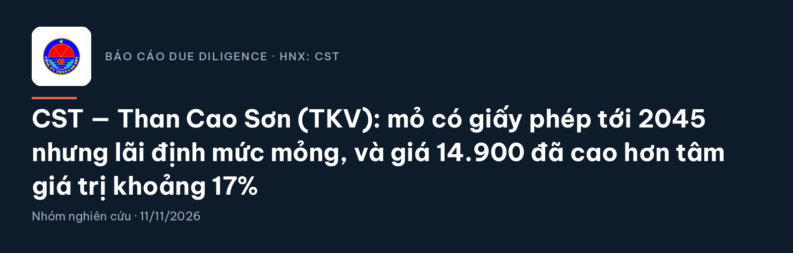

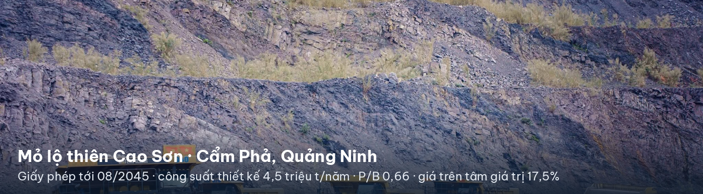

## Tóm tắt: giá nằm trong vùng giá trị hợp lý nhưng trên tâm 17,5%, chưa có biên an toàn

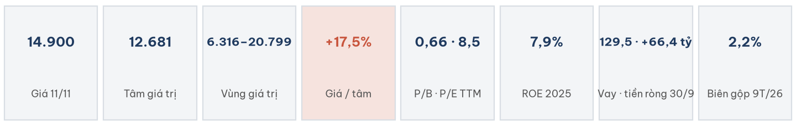

- **Giá trị:** tâm 12.681 đ/cp sau chiết khấu thanh khoản (13.084 trước chiết khấu); vùng 6.316–20.799. Giá đóng cửa 11/11: 14.900.
- **Tích cực:** giấy phép khai thác tới 08/2045; vay chỉ còn 129,5 tỷ; P/B 0,66 ngang nhóm than TKV.
- **Tiêu cực:** 97% doanh thu bán cho đơn vị TKV theo giá vốn cộng lãi định mức; biên gộp 2,2%; ROE 2025 chỉ 7,9%, thấp hơn chi phí vốn 13,5%.

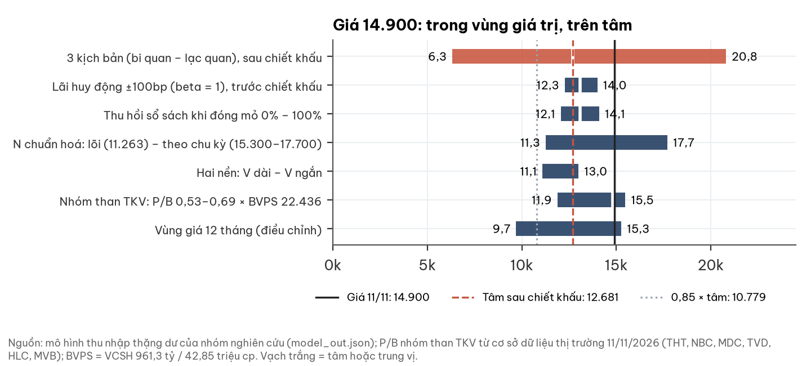

## 1. Doanh nghiệp: đơn vị khai thác than lộ thiên gia công cho TKV tại Cẩm Phả

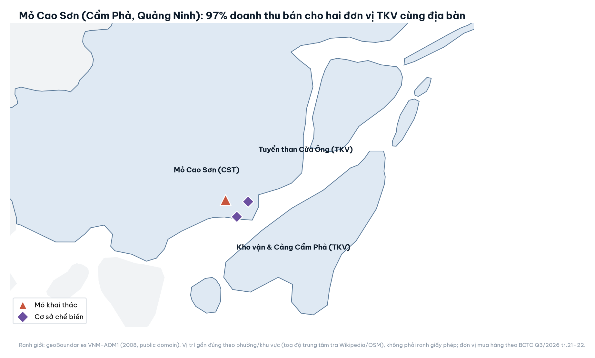

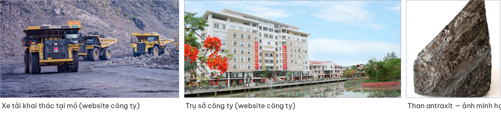

*Ảnh mỏ và trụ sở: website thancaoson.vn. Ảnh than antraxit: minh họa chung (Wikimedia Commons, tác giả Jakec, CC BY-SA 4.0), không phải ảnh sản phẩm của công ty; chưa lấy được ảnh sản phẩm do công ty công bố.*

- Giấy phép 280/GP-BTNMT (07/08/2023): công suất thiết kế 4,5 triệu t/năm, trữ lượng 65,99 triệu t tại thời điểm cấp phép, hoạt động tới 08/2045.
- TKV giữ 65,14% vốn; free float tối đa 34,86%. Lao động 3.188 người (2025).
- Dự án mở rộng mỏ: tổng mức đầu tư 1.829,5 tỷ (vay 70%), triển khai từ 09/2023.

## 2. Ngành: cầu than mạnh, nhưng giá bán nội bộ do TKV quyết định

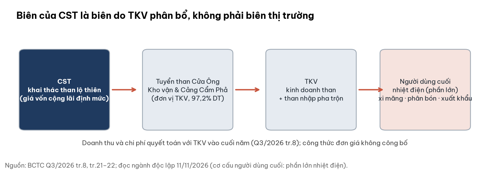

- **Cầu:** TKV tiêu thụ 44,06 triệu t trong 10 tháng 2026 (+20%); điện than 49,7% sản lượng toàn hệ thống; El Niño 2026–27 làm thuỷ điện yếu.
- **Cơ chế:** NQ 28/2026 cho khai thác vượt ≤15% công suất tới hết 2027. Giá chuyển giao nội bộ không công bố.
- **Giá thế giới:** Newcastle +25% so cùng kỳ, diesel nội địa 28.696 đ/l. CST nhận giá hành chính nhưng trả chi phí theo thị trường: biên bị ép khi nhiên liệu tăng.

## 3. Tài chính: doanh thu giảm theo sản lượng, lãi quý biến động, dòng tiền theo mùa vụ

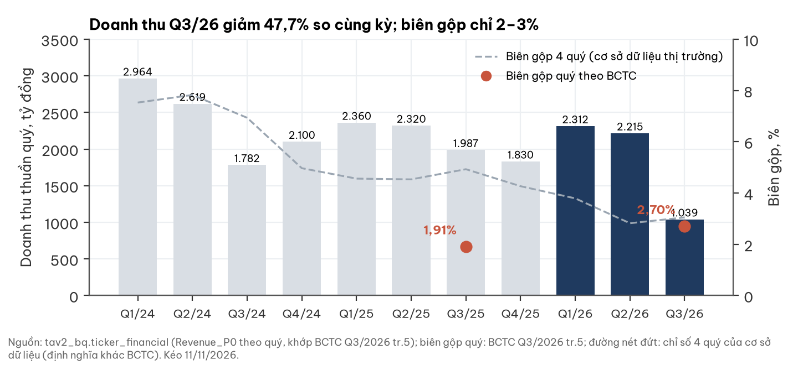

- Q3/26 doanh thu 1.039,2 tỷ (−47,7%): sản lượng tiêu thụ 412.867 t so với 927.728 t (−55,5%); doanh thu/tấn tăng 17,5%.

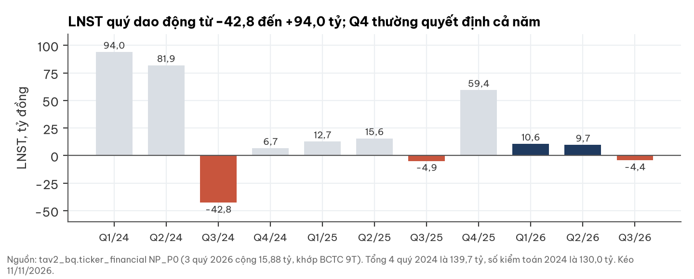

- LNST 9T/26 15,9 tỷ (9T/25: 23,4). Lợi nhuận lõi 9T khoảng 7,3 tỷ sau khi loại 13,6 tỷ thu nhập khác (thanh lý, đánh giá lại tài sản thuê).
- Chi phí QLDN giảm 107 tỷ chủ yếu do phân loại lại thuế, phí (99,5 → 2,6 tỷ), không phải tiết kiệm thật.
- Dự phòng phải trả 333,5 tỷ (30/9) là bút toán trong năm, quyết toán với TKV cuối năm; Q4 có thể lệch cả hai chiều.

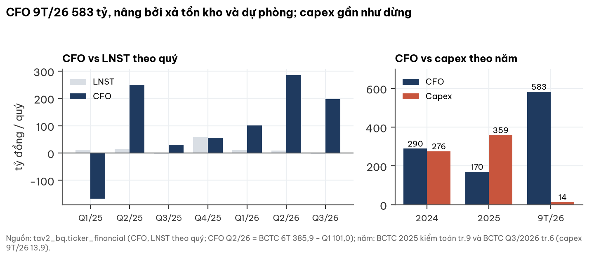

- CFO 4 quý gần nhất 639,6 tỷ nhưng được nâng bởi xả tồn kho (396 tỷ) và dự phòng; capex 9T/26 chỉ 13,9 tỷ so với 320,3 tỷ cùng kỳ.

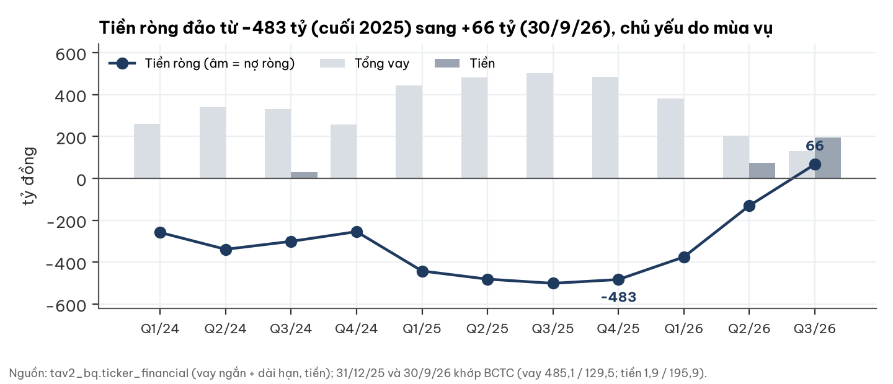

- Tiền ròng +66,4 tỷ tại 30/9 mang tính mùa vụ: cuối 2025 là −483,2 tỷ, cuối 2024 là +545 tỷ. Ký quỹ môi trường 212,2 tỷ là tài sản bị phong toả, không phải tiền tự do.

## 4. Cổ tức và giá: thị trường đang định giá kỳ vọng chia lợi nhuận tích luỹ

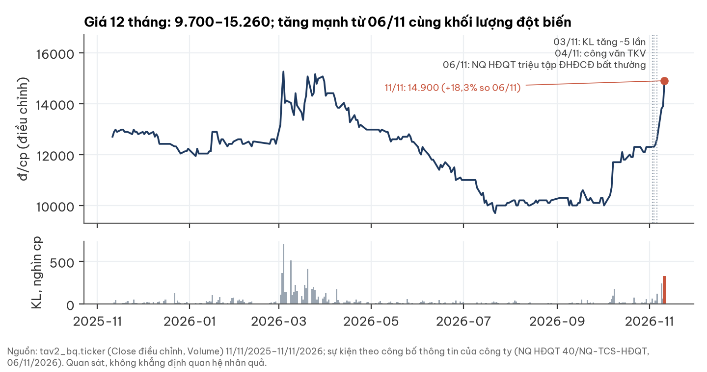

- Giá tăng +18,3% từ 12.600 (06/11) lên 14.900 (11/11); ngày 11/11 khớp 327.200 cp, khoảng 26 lần khối lượng trung vị 60 phiên.
- HĐQT triệu tập ĐHĐCĐ bất thường (chốt danh sách 30/11, họp 20–30/12) để phân phối lợi nhuận theo chỉ đạo của TKV; tỷ lệ chưa công bố.
- Lợi nhuận chưa phân phối của các năm trước còn 130,7 tỷ, trần khoảng 3.050 đ/cp. Cổ tức chỉ hiện thực hoá giá trị, không làm tăng giá trị nội tại.

## 5. Định giá: tâm 12.681; điểm yếu nhất là giả định lợi nhuận chuẩn hoá

**Phương pháp:** thu nhập thặng dư hữu hạn tới 2045 (V = sổ sách 961,3 tỷ + thu nhập vượt chi phí vốn chiết khấu + thu hồi 50% sổ sách khi đóng mỏ, ước lượng). Dự án mở rộng ở mức NPV bằng 0; không trừ dự phòng. Định giá dựng từ nền tảng trước khi đối chiếu với giá.

| Kịch bản | Xác suất | LN chuẩn hoá (tỷ/năm) | Cơ sở | Giá trị/cp | Sau chiết khấu |
|---|---|---|---|---|---|
| Bi quan | 30% | 35 | Kế hoạch 2026 ~36 tỷ (báo chí) | 6.517 | 6.316 |
| Cơ sở | 45% | 75 | LNST 4 quý gần nhất 75,2 | 12.808 | 12.414 |
| Lạc quan | 25% | 130 | LNST 2024 kiểm toán 130,0 | 21.460 | 20.799 |
| **Tâm** | | | | **13.084** | **12.681** |

*Xác suất là ước lượng chủ quan.*

**Điểm yếu nhất của định giá — lợi nhuận chuẩn hoá N:**
- Giá 14.900 tương đương N ≈ 88 tỷ/năm trong 19 năm (≈ 91 sau chiết khấu thanh khoản). Nếu N trung bình theo chu kỳ khoảng 106 tỷ, tâm là 15.300–17.700 và giá nằm DƯỚI tâm.
- Ngược lại, tính trên lợi nhuận lõi (35 / 66,5 / 99 tỷ), tâm còn khoảng 11.263 và giá cao hơn tâm nhiều hơn.
- Chưa có đơn giá và lãi định mức của TKV để xác định chiều đúng; kịch bản cơ sở lấy lợi nhuận 4 quý gần nhất (gần đáy chu kỳ) cùng giả định suy giảm cấu trúc.

**Chi phí vốn:** r = 13,5% khi lãi huy động 12 tháng hiệu dụng là 7,40% (02/11/2026), β = 1; r điều chỉnh theo lãi huy động. Thị trường đang ngầm định lãi suất chiết khấu bình quân khoảng 15,1% (panel 30/10/2026, phân vị 75% từ 2014, đỉnh 2022: 15,9%); TPCP 10 năm 4,57% (10/11, +0,58 điểm % trong 12 tháng; nguồn chưa đối chiếu độc lập). Hai số này chỉ để tham chiếu, không đổi giá trị.

| Lãi huy động | β = 1 | β = 0,5 |
|---|---|---|
| −100bp | 13.998 (+7,0%) | 13.528 (+3,4%) |
| −50bp | 13.528 (+3,4%) | 13.303 (+1,7%) |
| +50bp | 12.664 (−3,2%) | 12.871 (−1,6%) |
| +100bp | 12.267 (−6,2%) | 12.664 (−3,2%) |

*Tâm trước chiết khấu thanh khoản: 13.084. Độ nhạy khác: thu hồi sổ sách 0% → 12.072, 100% → 14.095; đóng mỏ năm 2030 → 12.033.*

**Chiết khấu thanh khoản:** giá trị khớp trung vị 60 phiên chỉ 0,132 tỷ/phiên (12.600 cp).

| Cỡ giao dịch minh họa | Chiết khấu | Số phiên thoát (10–20% khối lượng) | Tâm sau chiết khấu |
|---|---|---|---|
| 1,0 tỷ | 5,6% | 38–76 | 12.349 |
| 0,3 tỷ | 3,1% | 11–23 | 12.681 |
| 0,1 tỷ | 1,8% | 4–8 | 12.851 |

**Đối chiếu bội số:** tại giá 14.900, P/B 0,66 và P/E TTM 8,5; so nhóm than TKV (P/B 0,53–0,69; P/E trung vị 7,6 gồm MVB). Tâm tương ứng P/B 0,58 và P/E 7,5.

## 6. Rủi ro: lãi định mức bị nén là rủi ro lớn nhất

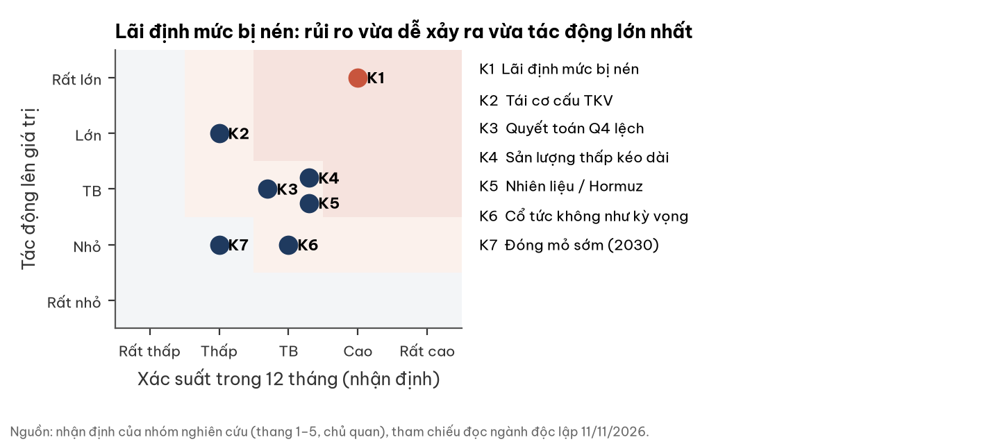

| Mã | Rủi ro | Xác suất | Tác động | Dấu hiệu sớm | Ngày kiểm |
|---|---|---|---|---|---|
| K1 | TKV tiếp tục nén lãi định mức | Cao | Rất lớn | Biên gộp dưới 2%; LNST 2026 dưới 55 tỷ | ~20/01/2027 |
| K2 | Tái cơ cấu TKV: hợp nhất hoặc hoán đổi | Thấp | Lớn | Dự thảo Đề án; tỷ lệ hoán đổi | trước 27/11/2026 |
| K3 | Quyết toán Q4 lệch so với dự phòng | TB | TB | Dự phòng 31/12 khác 0 | ~20/01/2027 |
| K4 | Sản lượng thấp kéo dài | TB | TB | Dưới 0,5 triệu t/quý | Q4/26, Q1/27 |
| K5 | Nhiên liệu (24,8% giá vốn) | TB | TB | Diesel, Newcastle (chiều giảm là thuận lợi) | hằng kỳ |
| K6 | Kỳ vọng cổ tức không thành | TB | TB | Cổ tức ≤ 700 đ/cp hoặc bằng cổ phiếu | 20–30/12/2026 |
| K7 | Đóng mỏ lộ thiên sớm theo quy hoạch 2030 | Thấp | Nhỏ | Lịch đóng mỏ Cao Sơn; tâm còn 12.033 | 12 tháng |

*Xác suất và tác động là nhận định của nhóm nghiên cứu, thang chủ quan.*

**Điều thị trường có thể chưa tính:** nếu Hormuz bình thường hoá, nhiên liệu giảm trong 2–3 quý tới và biên nới ra; cầu than mạnh trong khi CST hụt sản lượng do điều kiện khai thác của riêng mỏ.

## 7. Pháp lý và quản trị: chỉ cảnh báo, không có vụ việc

- Giao dịch bên liên quan chiếm phần lớn doanh thu và chi phí; công thức giá không công bố.
- Đổi kiểm toán từ AASC sang PKF-TTG; ý kiến của cả hai đều chấp nhận toàn phần. Một dòng lưu chuyển tiền 9T mang dấu bất thường (+45,07 tỷ) cần giải trình.
- Không có vụ án, khởi tố hay xử phạt trong tài liệu đã đọc; chưa tra cứu nguồn cơ quan quản lý và báo chí độc lập.

## 8. Điều kiện đổi nhận định: hai chiều, gắn với mốc đã công bố

| Mốc | Ngày | Làm nhận định tích cực hơn | Làm nhận định tiêu cực hơn |
|---|---|---|---|
| M1 — BCTC Q4/2026 | ~20/01/2027 | LNST 2026 ≥ 100 tỷ và dự phòng về 0: dời trọng số sang lạc quan | LNST ≤ 55 tỷ, hoặc dự phòng không về 0: dời sang bi quan; dưới 15 tỷ: bi quan mạnh |
| M2 — ĐHĐCĐ bất thường | 20–30/12/2026 | Cổ tức ≥ 2.000 đ/cp tiền mặt mà không vay thêm | Cổ tức ≤ 700 đ/cp hoặc bằng cổ phiếu |
| M3 — Đề án TKV | dự thảo trước 27/11/2026 | Giá trị quy đổi/cp > 1,15 lần tâm (≈ 15.050) | Quy đổi < 0,85 lần tâm (≈ 11.120), hoặc đóng mỏ trước 2035 |
| M4 — Sản lượng | Q4/26, Q1/27 | Về ≥ 0,9 triệu t/quý | Tiếp tục dưới 0,5 triệu t/quý |

- **Tích cực hơn:** giá thấp hơn tâm từ 15% (≤ 10.779), hoặc LNST 2026 ≥ 100 tỷ với CFO ≥ LNST và dự phòng về 0.
- **Tiêu cực hơn:** LNST 2026 dưới 15 tỷ, lịch đóng mỏ Cao Sơn trước 2035, hoặc TKV giảm trừ doanh thu cuối năm lớn hơn dự phòng đã trích.

## Phụ lục A — Số BCTC chính (tỷ đồng)

| Khoản mục | Q3/26 | Q3/25 | 9T/26 | 9T/25 |
|---|---|---|---|---|
| Doanh thu thuần | 1.039,2 | 1.987,5 | 5.566,7 | 6.668,3 |
| Lợi nhuận gộp (biên) | 28,0 (2,70%) | 37,9 (1,91%) | 123,4 (2,22%) | 260,4 (3,91%) |
| Chi phí QLDN | 32,3 | 37,1 | 102,9 | 210,4 |
| LNST | −4,37 | −4,91 | 15,88 | 23,40 |

| Bảng cân đối | 30/09/26 | 31/12/25 |
|---|---|---|
| Tiền | 195,9 | 1,9 |
| Vay | 129,5 | 485,1 |
| Tồn kho | 296,7 | 692,7 |
| Phải thu khách hàng (TKV 337,9) | 360,4 | 327,0 |
| Vốn chủ sở hữu | 961,3 | 1.028,2 |

LNST năm: 2021 106,6 · 2022 339,9 · 2023 293,1 · 2024 130,0 · 2025 82,7 · 4 quý gần nhất 75,2. ROE 2025 = 7,9%.

## Phụ lục B — Giới hạn dữ liệu

- Chưa có: công thức đơn giá và lãi định mức của TKV; hệ số bóc thực tế; thuế suất tài nguyên; room ngoại; nghị quyết ĐHĐCĐ thường niên 2026 (kế hoạch 36 tỷ chỉ từ báo chí, tương đương −56% so với LNST 2025 kiểm toán).
- Phân tích biến động dự phòng −372 tỷ trong Q3 (sử dụng hay hoàn nhập) chưa thực hiện được.
- BCTC Q3/2026 chưa soát xét. Trữ lượng 65,99 triệu t là tại thời điểm cấp phép 2023, chưa trừ phần đã khai thác.

## Phụ lục C — Nguồn

BCTC Q3/2026 (HNX CBTT 22/10/2026) và công văn giải trình 8364/TCS-KT; BCTC 6T/2026 soát xét (PKF-TTG); BCTC 2025 kiểm toán (AASC); NQ HĐQT 40/NQ-TCS-HĐQT và TB 8923 (06/11/2026); danh sách cổ đông lớn; dữ liệu giá và tài chính quý từ cơ sở dữ liệu thị trường của nhóm nghiên cứu; đọc ngành độc lập 11/11/2026. Logo, ảnh mỏ, trụ sở: website thancaoson.vn. Ảnh than: Wikimedia Commons (Jakec, CC BY-SA 4.0). Ranh giới bản đồ: geoBoundaries VNM-ADM1 (2008). Kế hoạch 2026: Thời báo Tài chính Việt Nam. Logo chỉ để nhận diện doanh nghiệp, không ngụ ý công ty bảo chứng báo cáo.

## Phụ lục D — Phương pháp và giới hạn

Số liệu đối chiếu với BCTC gốc; có người phản biện độc lập kiểm số liệu và nguồn. Số nào không đo được gắn nhãn ước lượng. Ngành đọc không biết trước mã cổ phiếu và giá. Định giá chạy trước khi so với giá thị trường.

## Phụ lục F — Tuyên bố miễn trừ trách nhiệm

Tài liệu này chỉ nhằm cung cấp thông tin nghiên cứu, không phải lời khuyên đầu tư hay khuyến nghị mua, bán, nắm giữ cổ phiếu và không được cá nhân hoá cho nhu cầu của bất kỳ nhà đầu tư nào. Nội dung dựa trên thông tin công bố và có thể chứa ước lượng, giả định; kết quả thực tế có thể khác. Nhà đầu tư tự chịu trách nhiệm với quyết định của mình và nên tham khảo tư vấn chuyên nghiệp độc lập.
