# DBC — Tập đoàn Dabaco: chuỗi thức ăn–giống–thực phẩm khép kín với bảng cân đối vững, nhưng lợi nhuận Q3 giảm 42% ở đáy chu kỳ heo và giá 16.950 đ chỉ quanh vùng giá trị hợp lý

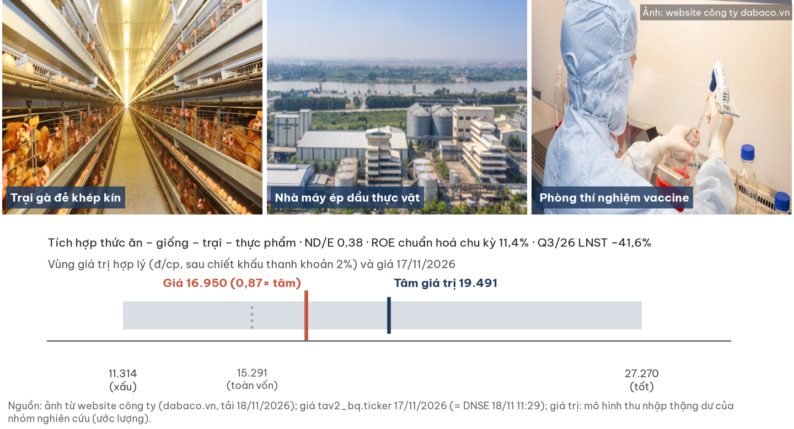

| Chỉ tiêu | Giá trị | Chỉ tiêu | Giá trị |
|---|---|---|---|
| Giá (HOSE) | **16.950 đ** (đóng cửa 17/11; DNSE 18/11 11:29 vẫn 16.950) | Vùng giá trị hợp lý | **11.314 – 27.270 đ** |
| Tâm giá trị sau chiết khấu thanh khoản 2% | **19.491 đ** (trước chiết khấu 19.888) | Giá / tâm | **0,87 lần** (dải 0,83–1,10 theo hai lựa chọn mô hình) |
| ROE chuẩn hoá chu kỳ (15 quý) | 11,4% · LNST 996,3 tỷ · EPS 2.311 đ | P/E · P/B tại tâm | 8,4 · 0,96 |
| LNST 9T/2026 | 863,3 tỷ (−36,4%) · Q3: 200,2 tỷ (−41,6%) | Nợ ròng 30/9/2026 | 3.285 tỷ · ND/E **0,38** |
| BVPS | 20.231 đ | Thanh khoản | ADV trung vị 3 tháng 20,08 tỷ đ/phiên |

**Ba điều cần biết**

- **Tích cực:** chuỗi khép kín từ thức ăn chăn nuôi (TACN) đến giống, trại, thực phẩm; nợ ròng giảm, ND/E 0,38; giám đốc tài chính mua 2 triệu cổ phiếu tháng 10/2026.
- **Tiêu cực:** biên gộp Q3 còn 11,4% (từ 17,4%), lãi vay +61%; Q4/26 ước lượng −50…+120 tỷ, có rủi ro trích lập đàn heo 94–188 tỷ.
- **Định giá:** giá thấp hơn tâm 13% nhưng cao hơn giá trị "toàn vốn" 15.291 đ; tuỳ cách đo lợi nhuận bình thường, giá/tâm 0,78–1,27 — **quanh vùng giá trị hợp lý, không rẻ rõ rệt**.

## 1. Tóm tắt điều hành

| | Nội dung |
|---|---|
| **Tình huống** | Tập đoàn nông nghiệp tích hợp dọc lớn ở miền Bắc; doanh thu 9T/26 +21%, nhưng giá heo hơi rơi ~40% từ đỉnh tháng 1 và nguyên liệu TACN đạt đỉnh quý 3. |
| **Vấn đề** | Lợi nhuận dao động mạnh theo chu kỳ (ROE năm 0,5–41%); giá trị phụ thuộc mức lợi nhuận "bình thường" qua chu kỳ. |
| **Câu hỏi** | Giá 16.950 đ đang trả cho kịch bản nào? |
| **Trả lời** | Giá thấp hơn giá trị kịch bản cơ sở sau chiết khấu (19.689) 14%, cao hơn kịch bản xấu (11.314) và giá trị nếu mọi đồng vốn chỉ sinh ROE 11,4% (15.291): giá trong vùng hợp lý. |

## 2. Luận điểm và điều thị trường đang định giá

| Luận điểm tích cực | Luận điểm tiêu cực |
|---|---|
| Tích hợp dọc: 3.657 tỷ TACN bán nội bộ trong H1/26; tự cung khô đậu từ nhà máy ép dầu | Người nhận giá heo: ±5.000 đ/kg ≈ ±50–60% LNST chuẩn hoá (ước lượng cận trên) |
| Nợ ròng giảm dù đầu tư lớn; EBIT 9T gấp 4,9 lần lãi vay | Đầu tư 9T (1.680 tỷ) vượt CFO; dòng tiền tự do 3 năm ≈ −45 tỷ/năm |
| Phải thu khách hàng chỉ ~7 ngày doanh thu | Phải thu người lao động 237,1 tỷ = 27% LNST 9T |
| Giám đốc tài chính mua 2 triệu cp trước công bố Q3 | Trại mới 873 tỷ đang xây đúng lúc ngành tái đàn mạnh (+5,4%) |

- **Thị trường đang định giá:** giá ngang tâm khi ROE chuẩn hoá ≈ 10,3% (Hình 8), thấp hơn r 13,5% — chu kỳ heo hồi về trung bình thấp hơn, không lặp đỉnh 2025.
- **Điều thị trường có thể chưa tính:** biên TACN mở 1–2 quý tới khi nguyên liệu giao ngay đã hạ ~9% trong khi giá bán chưa giảm; 3,1 nghìn tỷ tiền gửi hưởng lãi khi lãi vay ngắn hạn dịu.
- **Điều thị trường có thể đã tính đúng:** 2026 là năm đi xuống; lợi nhuận chuẩn hoá 996 tỷ cao hơn ước lượng LNST 2026 (813–983 tỷ).

## 3. Ngành: giá heo ở đáy, biên TACN sắp mở, cung đang tăng

| Động lực | Dữ kiện (đọc ngành độc lập 18/11/2026) |
|---|---|
| Giá heo hơi | Đỉnh ~80.000 đ/kg (T1/2026) xuống 46–49.000 (giữa T11), ≈ −40%; năm 2025 cùng hình dạng |
| Giá cả năm | Chỉ số giá sản phẩm chăn nuôi lợn 9T/2026 +0,2%, Q3 +0,7% so cùng kỳ: cái sụp là biên |
| Cung | Tổng đàn cuối T9/2026 +5,4%; tăng chủ yếu từ trại quy mô lớn mới |
| Nhập khẩu thịt | 7T/2026 +27% lượng, đơn giá −38%: đặt trần giá cho kênh chế biến |
| Nguyên liệu TACN | Ngô CBOT −15% từ đỉnh T9; khô đậu châu Á −5%; giá TACN 2026: 6 lần tăng, 1 lần giảm |
| Dịch tả lợn châu Phi | ~401 ổ/25 tỉnh tới T4/2026, tiếp diễn T10–11; cú sốc cung hai chiều |

- Dự báo khoá trước của người đọc ngành: P(giá heo miền Bắc T1/2027 ≥ 55.000) = 0,65; P(tổng đàn cuối T3/2027 ≤ +3%) = 0,55.
- 12 tháng: lợi nhuận ngành chủ yếu do chu kỳ (0,65); 36 tháng: yếu tố cấu trúc (tập trung hoá, thịt nhập) chiếm ưu thế (0,45).

## 4. Doanh nghiệp: 30 năm từ công ty nông sản tỉnh thành chuỗi "feed – farm – food"

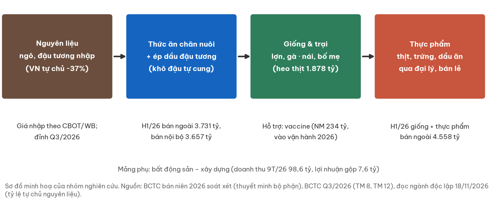

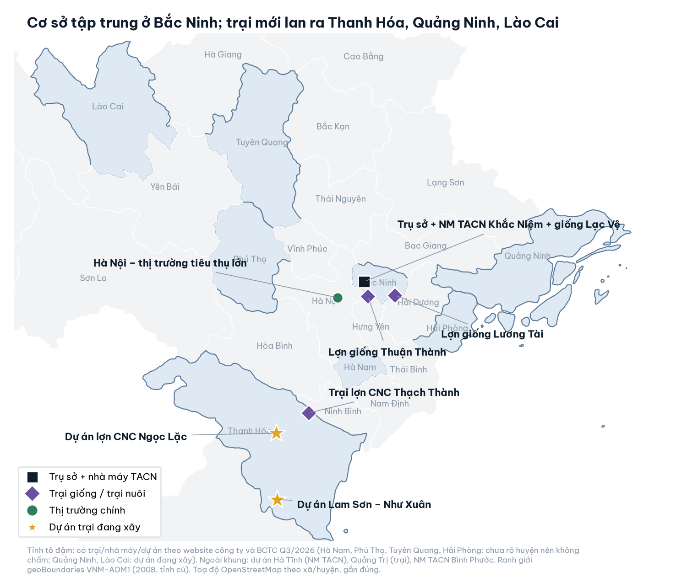

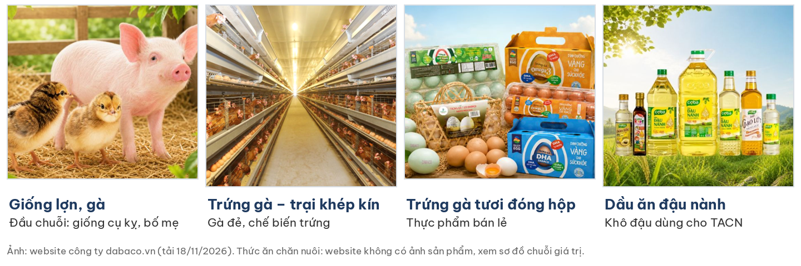

| Hạng mục | Thông tin |
|---|---|
| Lịch sử | 1996 thành lập (Công ty Nông sản Hà Bắc) · 2005 cổ phần hoá · 2008 niêm yết · 2019 nhà máy ép dầu và chế biến trứng · 2026 kỷ niệm 30 năm |
| Mảng chính | TACN (Dabaco Feed) · giống và trại lợn, gà (Dabaco Farm) · thịt, trứng, dầu ăn (Dabaco Food) · vaccine (DACOVET) · bất động sản (nhỏ) |
| Đầu tư 2026 | Nhà máy ép dầu giai đoạn 2 (1.095 tỷ) và nhà máy vaccine (234 tỷ) đã vào vận hành; 6 dự án trại đang xây |
| Vốn điều lệ | 4.310,46 tỷ đ · 431,05 triệu cổ phiếu (đăng ký 26/09/2026) |
| Định hướng công bố | "Kiểm soát chuỗi giá trị nông nghiệp – thực phẩm", ứng dụng công nghệ cao (website công ty) |

- **Lợi thế cạnh tranh: hẹp và mỏng**, nằm sát ranh giới với "không có lợi thế bền": có cơ chế gọi tên được (TACN nội bộ, tự cung khô đậu, di truyền giống, vaccine) nhưng chưa đo được thị phần, và ROE thấp nhất 5 năm chỉ 0,5%.
- Mô hình định giá không cộng thêm giá trị cho lợi thế cạnh tranh.

## 5. Tài chính: lợi nhuận theo chu kỳ, bảng cân đối không phải điểm yếu

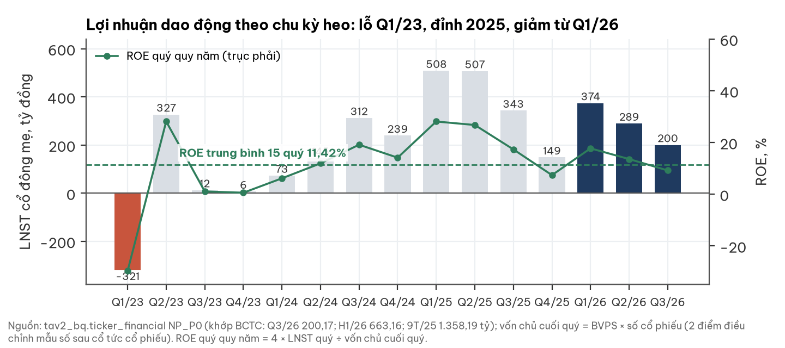

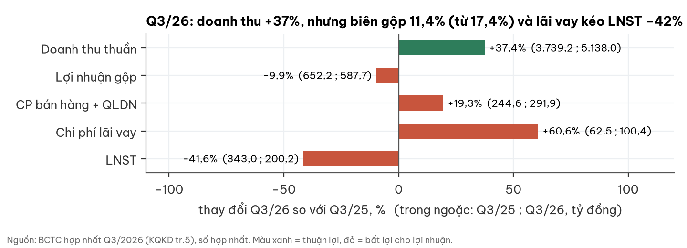

- **Nguyên nhân Q3:** giá heo Q3 không thấp hơn cùng kỳ; lợi nhuận gộp ngoài công ty mẹ giảm 100 tỷ khớp với chi phí nguyên liệu đỉnh quý 3 hơn là giá heo.
- **Q4/2026:** giá heo ước ngang Q4/25 (khi đó LNST 148,6 tỷ) nhưng lãi vay cao hơn ~38 tỷ/quý; LNST Q4 ước lượng −50…+120 tỷ, cả năm 813–983 tỷ.
- **Trích lập tài sản sinh học:** heo thịt 1.877,7 tỷ ghi theo giá gốc, chưa có dự phòng; lệch giá trị thuần 5–10% (ước lượng) ⇒ 94–188 tỷ (218–436 đ/cp).

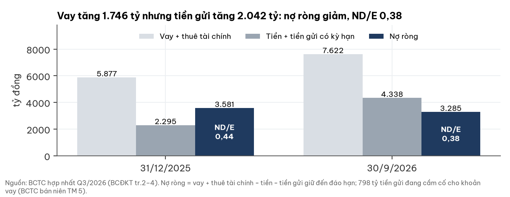

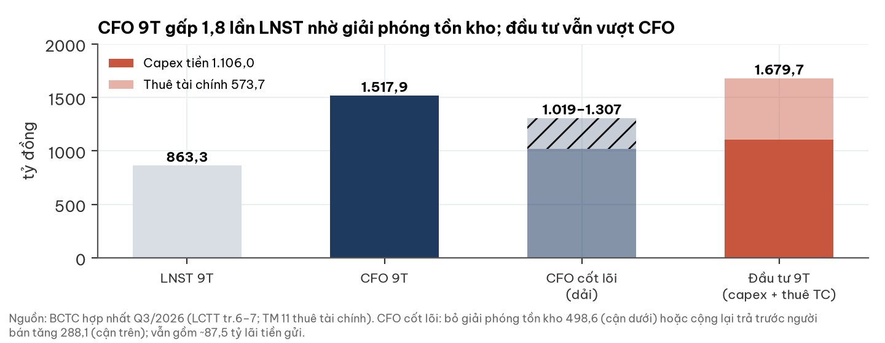

- **Phải thu người lao động 237,1 tỷ** (30/9/2026; 208,8 đầu năm), phần lớn là tạm ứng giải phóng mặt bằng trại, chưa có dự phòng: điểm cần theo dõi.
- Năm 2026 không phát hành vốn tiền mặt mới; dòng "phát hành cổ phiếu" và "cổ tức" trên LCTT chủ yếu là cổ tức cổ phiếu 12%.

## 6. Định giá: thu nhập thặng dư trên ROE chuẩn hoá chu kỳ

| Kịch bản | Giả định | đ/cp (trước chiết khấu) | Xác suất |
|---|---|---|---|
| **Xấu** | ROE 8,2%; đáy heo kéo dài; giảm 40% giá trị 873 tỷ dự án trại đang xây | 11.545 | 0,25 |
| **Cơ sở** | ROE 11,4% (trung bình 15 quý Q1/23–Q3/26); dự án mới ở giá sổ sách | 20.091 | 0,50 |
| **Tốt** | ROE 14,7%; chu kỳ hồi, biên TACN mở | 27.826 | 0,25 |
| **Có trọng số** | trước / sau chiết khấu thanh khoản 2% | **19.888 / 19.491** | |

- Biên ±3,25 điểm % ROE và trọng số 25/50/25 là giả định đối xứng; dữ liệu ROE năm phân tán rộng hơn (nửa khoảng tứ phân vị 6,0 điểm %), nên vùng giá trị là **cận trong**, không phải khoảng tin cậy.
- Với biên ±6,0: tâm giữ 19.491, vùng nở ra 4.900–33.684. Ở kịch bản cơ sở, g 4–7% gần như không đổi tâm (19.448–19.505) vì ROE trên vốn hoạt động (13,4%) ≈ r.

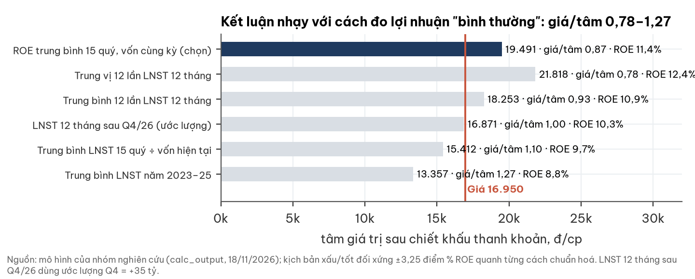

**Chi phí vốn:** r = **13,5%**, neo lãi huy động 12 tháng hiệu dụng **7,4%** (03/11 và 18/11/2026, không đổi); r đi cùng lãi huy động theo tỷ lệ 1:1; g = 5%.

| Lãi huy động | −100 điểm cơ bản | −50 | Neo | +50 | +100 |
|---|---|---|---|---|---|
| Tâm sau chiết khấu (đ/cp) | 21.721 (+11,4%) | 20.536 (+5,4%) | 19.491 | 18.561 (−4,8%) | 17.730 (−9,0%) |

- **Bối cảnh lãi suất:** lãi suất chiết khấu thị trường đang ngầm định ≈ 15,1% (147 mã, 30/10/2026), phân vị 75% giai đoạn 2014–2026 (đỉnh 2022: 15,9%; đáy 2022–23: 12,1%) — cao hơn r của mô hình. TPCP 10 năm 4,57% (17/11/2026), +0,57 điểm % trong 12 tháng (nguồn chưa đối chiếu độc lập). Chỉ để tham khảo, không đổi giá trị hợp lý.
- **Chiết khấu thanh khoản 2%** (ước lượng): ADV trung vị 20,08 tỷ đ/phiên (18/08–17/11/2026); 0% ⇒ 19.888 · 5% ⇒ 18.894.

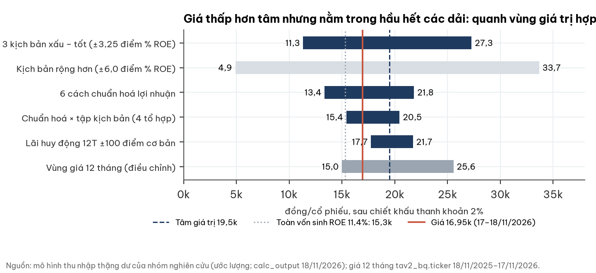

| So sánh (17/11/2026) | P/E 12 tháng | P/B | ROE bình quân 5 năm |
|---|---|---|---|
| DBC | 7,2 | 0,84 | 11,2% |
| HAG (chăn nuôi heo quy mô lớn, có trái cây) | 5,2 | 0,97 | 15,7% |
| MML (thịt chế biến; thanh khoản 1,4 tỷ đ/phiên) | 16,8 | 1,44 | 3,5% |

- **Kết luận:** giá 16.950 = 0,87 × tâm 19.491; thấp hơn giá trị cơ sở sau chiết khấu (19.689), cao hơn giá trị toàn vốn (15.291) ⇒ **giá trong vùng giá trị hợp lý, không rẻ rõ rệt**.
- Hai lựa chọn mô hình (cách chuẩn hoá × tập kịch bản) cho tâm 15.412–20.453, giá/tâm 0,83–1,10: không thể kết luận "rẻ" hay "đắt" từ một con số.

## 7. Rủi ro: chu kỳ giá heo và dịch bệnh là biến lớn nhất

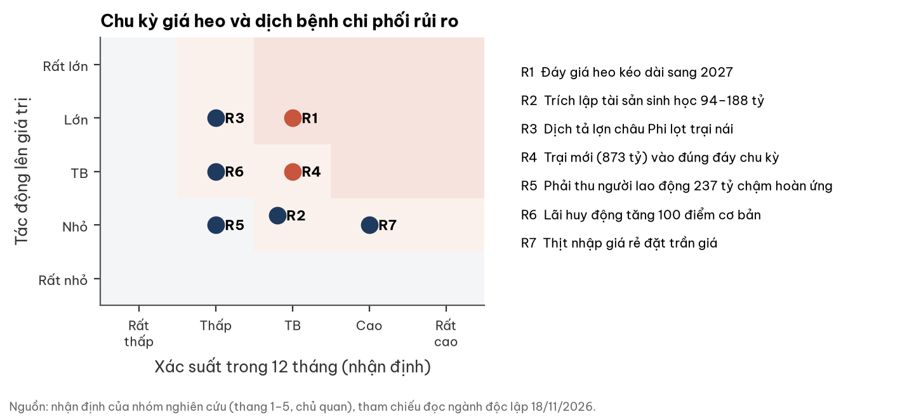

| Rủi ro | Tác động ước tính | Dấu hiệu sớm | Ngày kiểm |
|---|---|---|---|
| R1 Đáy giá heo kéo dài | Trọng số xấu 35%: tâm 17.895 (−8,2%) | Giá heo T1/2027 < 50.000 đ/kg | 05/02/2027 |
| R2 Trích lập tài sản sinh học | 94–188 tỷ (218–436 đ/cp), một lần | Dự phòng tồn kho trên BCTC Q4 | ≤ 30/01/2027 |
| R3 Dịch tả lợn lọt trại nái | Không định lượng được (không có số đàn) | Ổ dịch tại tỉnh có trại | Liên tục |
| R4 Trại mới vào đáy chu kỳ | Đã tính trong kịch bản xấu (−349 tỷ) | Tổng đàn cuối T3/2027 ≥ +4% | 15/04/2027 |
| R5 Phải thu người lao động | 237,1 tỷ; chưa có dự phòng | Tăng > 300 tỷ hoặc trích lập | BCTC Q4/2026 |
| R6 Lãi huy động tăng | +100 điểm cơ bản: tâm −9,0% | Lãi huy động 12 tháng | Liên tục |

## 8. Pháp lý, quản trị, kiểm toán

- EY soát xét BCTC bán niên 2026: chấp nhận toàn phần, không ngoại trừ, không nhấn mạnh; trình bày lại đầu kỳ theo Thông tư 99 chỉ là phân loại lại, không đổi lợi nhuận.
- Vốn phát hành 2024 (1.330 tỷ) dùng 100% đúng phương án đến 25/06/2026, có xác nhận của kiểm toán độc lập.
- Không thấy khởi tố, xử phạt hay ý kiến ngoại trừ trong tài liệu đã đọc. Chưa kiểm: giấy phép môi trường từng trại, thời hạn hoàn ứng của khoản phải thu người lao động.

## 9. Lịch xúc tác và mốc đổi nhận định hai chiều

| Mốc | Nhận định tích cực hơn nếu | Nhận định tiêu cực hơn nếu |
|---|---|---|
| BCTC Q4/2026 (≤ 30/01/2027) | LNST ≥ 120 tỷ, không trích lập ⇒ trọng số tốt 35%: tâm 21.086 (+8,2%) | LNST < −50 tỷ hoặc trích lập > 100 tỷ ⇒ trọng số xấu 35%: tâm 17.895 |
| Giá heo T1/2027 (05/02/2027) | ≥ 55.000, đặc biệt ≥ 65.000 đ/kg | < 50.000 đ/kg |
| BCTC Q1/2027 (≤ 30/04/2027) | LNST ≥ 300 tỷ và biên công ty mẹ ≥ 8,5% | LNST < 150 tỷ |
| Tổng đàn cuối T3/2027 (15/04/2027) | ≤ +3% so cùng kỳ: chu kỳ tự sửa | ≥ +4%: đáy kéo dài |
| Bảng cân đối Q4/26–Q2/27 | ND/E ≤ 0,35 khi trại mới vận hành | ND/E > 0,6 hoặc tăng vốn tiền mặt dưới BVPS |
| Phải thu người lao động | Giảm về ≤ 150 tỷ (hoàn ứng) | Tăng > 300 tỷ hoặc phải trích lập |

Mỗi quý mới cập nhật ROE trung bình chu kỳ theo cửa sổ mở rộng: thêm Q4/26 ở −50 / +35 / +120 tỷ cho tâm 17.491 / 18.059 / 18.627.

## Phụ lục A — Số liệu BCTC chính (tỷ đồng, hợp nhất)

| Chỉ tiêu | Q3/26 | Q3/25 | 9T/26 | 9T/25 |
|---|---|---|---|---|
| Doanh thu thuần | 5.138,0 | 3.739,2 | 13.515,0 | 11.168,6 |
| Lợi nhuận gộp | 587,7 | 652,2 | 1.932,1 | 2.294,4 |
| Biên gộp | 11,4% | 17,4% | 14,3% | 20,5% |
| Chi phí lãi vay | 100,4 | 62,5 | 247,3 | 196,9 |
| LNTT | 241,3 | 365,6 | 967,7 | 1.438,7 |
| LNST | 200,2 | 343,0 | 863,3 | 1.358,2 |

Bảng cân đối 30/9/2026: tiền 1.192,0 · tiền gửi giữ đến đáo hạn 3.100,5 (ngắn hạn) + 45,0 (dài hạn) · vay và thuê tài chính 7.622,3 · tồn kho 3.281,6 · heo thịt 1.877,7 · XDCB dở dang 1.302,6 · vốn chủ cổ đông mẹ 8.720,4. Bộ phận H1/26 (bán ngoài): TACN 3.731,1 · giống và thực phẩm 4.557,8 · BĐS 88,1.

## Phụ lục B — Đối chiếu dữ liệu thị trường với BCTC gốc

| Chỉ tiêu | Dữ liệu thị trường | BCTC gốc | Ghi chú |
|---|---|---|---|
| LNST Q3/26; H1/26; 9T/25 | 200,17; 663,16; 1.358,19 | Như nhau | Khớp |
| Doanh thu Q3/26 | 5.317,8 | thuần 5.138,0 | Dữ liệu thị trường là doanh thu gộp |
| Doanh thu quý 2025 | Q3/25 5.021,6 | 3.919,5 (gộp) | Chia quý sai; không dùng |
| CFO Q2/26 | −841,8 | −415,3 | Lệch 426; dùng BCTC |
| Vốn chủ Q2/25, Q1/26 | 6.589,2; 7.538,6 | 7.577,5; 8.443,1 | Số cổ phiếu trước cổ tức cổ phiếu; đã điều chỉnh |

## Phụ lục C — Nguồn

- **Công ty** (dabaco.vn): BCTC hợp nhất và công ty mẹ Q3/2026 (ký 21/10/2026); BCTC hợp nhất bán niên 2026 do EY soát xét (ký 26/08/2026); báo cáo sử dụng vốn phát hành (CBTT 09/09/2026); thông báo và kết quả giao dịch cổ đông nội bộ (01/10, 14/10/2026); đăng ký doanh nghiệp (26/09/2026); trang "Về chúng tôi" (lịch sử); logo và ảnh sản phẩm, cơ sở từ website (tải 18/11/2026).
- **Dữ liệu thị trường:** chuỗi tài chính quý, giá, khối lượng, P/E, P/B (đến 17/11/2026); giá trong phiên DNSE 18/11/2026 11:29; lãi huy động 12 tháng hiệu dụng.
- **Ngành:** đọc ngành độc lập 18/11/2026 (GSO, Hải quan, Bộ NN&MT, CBOT, World Bank, SunSirs, báo ngành).
- **Bản đồ:** ranh giới geoBoundaries VNM-ADM1 (2008); toạ độ OpenStreetMap theo xã/huyện lấy từ website và BCTC — vị trí gần đúng.

## Phụ lục D — Phương pháp và giới hạn

- Thu nhập thặng dư: P/B hợp lý = (ROE − g)/(r − g) trên vốn chủ hoạt động (trừ XDCB 1.302,6 tỷ, ghi theo giá sổ sách). ROE chuẩn hoá = trung bình ROE quý quy năm 15 quý, mỗi quý chia vốn chủ cuối quý cùng kỳ; đối chiếu ROE 3 năm/5 năm của nguồn dữ liệu (11,44%/11,21%).
- Cách chuẩn hoá và tập kịch bản là phán đoán của nhóm nghiên cứu, thực hiện khi đã biết giá thị trường; vì vậy công bố đủ sáu cách chuẩn hoá và bốn tổ hợp (Hình 8, Mục 6).
- Dòng tiền tự do 3 năm âm (−45 tỷ/năm, gồm thuê tài chính) nên không dùng định giá theo dòng tiền tự do; thuê tài chính 2023–2025 chưa tính, nên tỷ lệ đầu tư/CFO 1,04 là cận dưới.
- **Chưa có dữ liệu:** số đàn nái, heo xuất chuồng, giá thành/kg, sản lượng TACN bán ngoài, doanh thu vaccine, lợi nhuận thật theo mảng (bị méo bởi cổ tức nội bộ); BCTC kiểm toán 2025; room ngoại, free float; thời hạn hoàn ứng phải thu người lao động.
- Độ nhạy giá heo, Q4/26, trích lập tài sản sinh học, chiết khấu thanh khoản, ma trận rủi ro là ước lượng/nhận định.

## Phụ lục E — Quy trình nghiên cứu

Số liệu đối chiếu trực tiếp với BCTC gốc do công ty công bố. Bối cảnh ngành do một người đọc ngành độc lập soạn, không dựa trên giá cổ phiếu. Toàn bộ số liệu, mô hình và giả định đã được một người phản biện độc lập kiểm tra. Các giới hạn dữ liệu nêu ở Phụ lục D.

## Phụ lục F — Tuyên bố miễn trừ trách nhiệm

Tài liệu này chỉ nhằm mục đích cung cấp thông tin nghiên cứu, không phải lời khuyên, đề nghị hay khuyến nghị mua, bán hoặc nắm giữ bất kỳ chứng khoán nào, và không tính đến mục tiêu, tình hình tài chính hay nhu cầu của từng nhà đầu tư. Thông tin được tổng hợp từ các nguồn được cho là đáng tin cậy tại thời điểm lập, nhưng không được bảo đảm về tính đầy đủ hay chính xác. Các ước lượng, kịch bản và giá trị hợp lý phản ánh giả định tại ngày lập và có thể thay đổi mà không cần thông báo. Kết quả trong quá khứ không bảo đảm kết quả tương lai. Nhà đầu tư cần tự đánh giá và chịu trách nhiệm với quyết định của mình.
