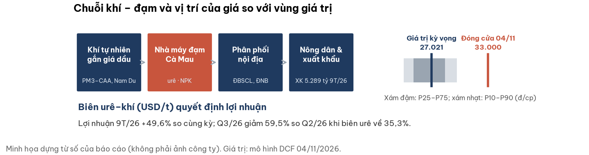
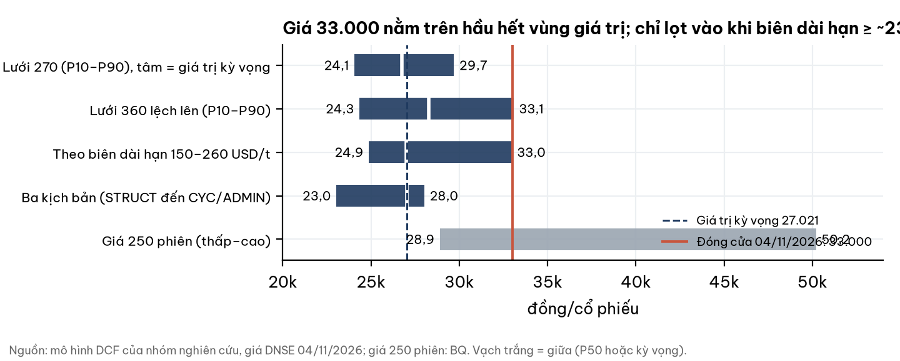
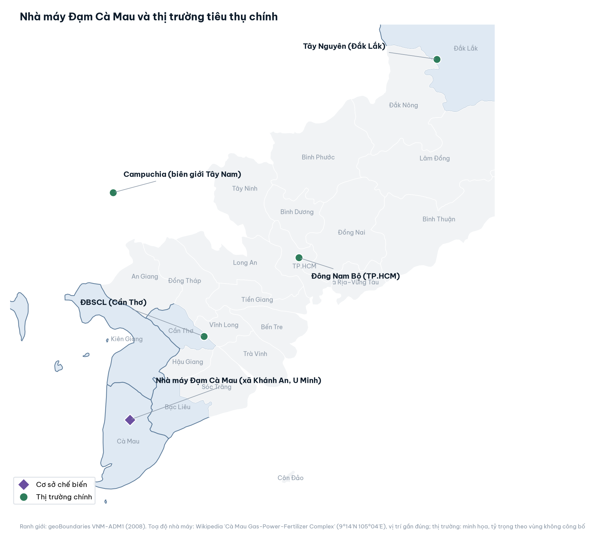
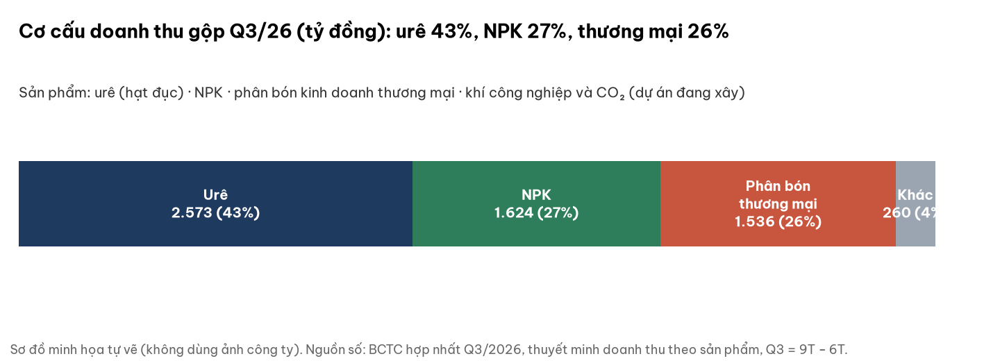
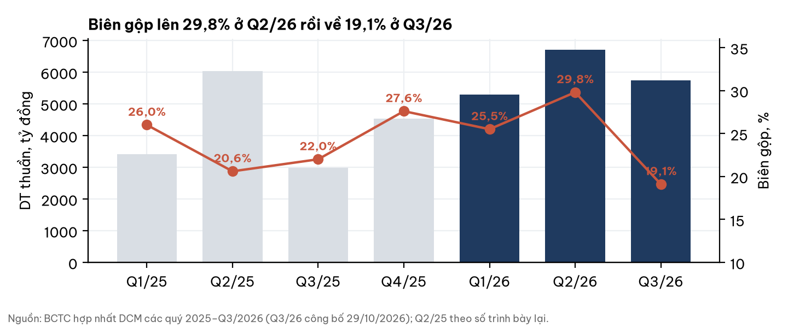
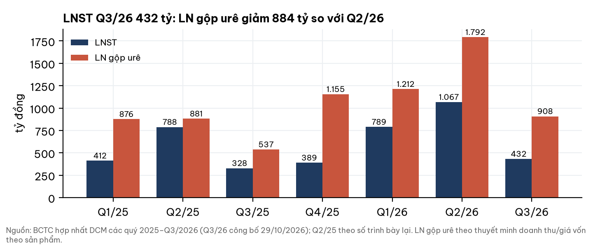
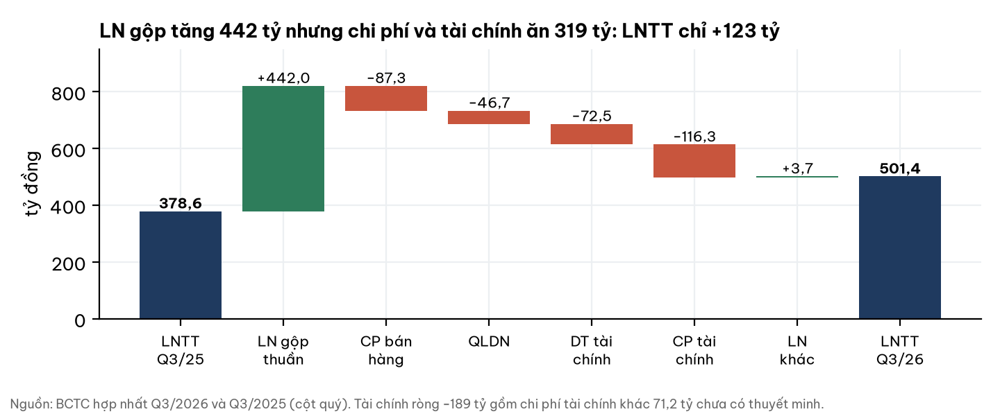
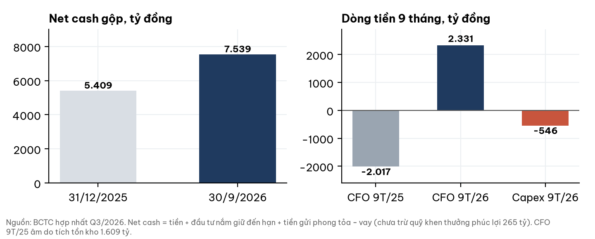
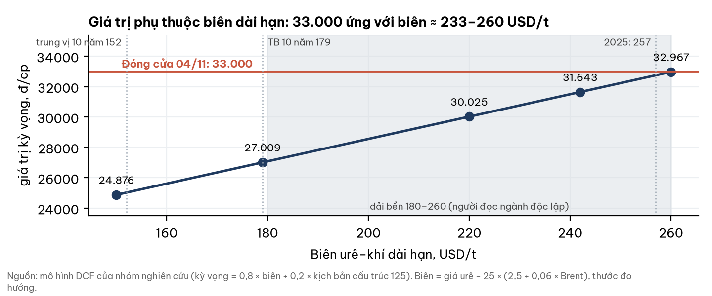

# DCM — Đạm Cà Mau: dòng tiền và bảng cân đối vững, nhưng giá đã trả cho biên urê–khí của năm 2025 kéo dài

**Báo cáo Due Diligence · dữ liệu đến 04/11/2026 · Nhóm nghiên cứu** · CTCP – Tổng Công ty Phân bón Dầu khí Cà Mau (PVCFC), sàn HOSE · Ngành phân đạm urê, NPK, phân bón thương mại

## Investment Summary

**Giá đóng cửa 33.000 đ nằm trên vùng giá trị hợp lý nếu biên urê–khí dài hạn bằng trung bình 10 năm (179 USD/t); nằm gần hoặc trong vùng nếu biên bền ở 220–260 USD/t.** Doanh nghiệp có lợi nhuận thật, tiền mặt lớn và kiểm toán chấp nhận toàn phần; câu hỏi định giá là biên của năm 2025 có kéo dài hay không.

| Dữ liệu chính | Giá trị | Ghi chú |
|---|---|---|
| Giá đóng cửa 04/11/2026 | **33.000 đ** | DNSE, khớp ATC 14:45:02; sàn HOSE |
| Giá trị kỳ vọng (trước = sau chiết khấu thanh khoản) | **27.021 đ** | Giá cao hơn 22,1% |
| Vùng giá trị (lưới 270): P10 – P90 | 24.065 – 29.691 | P25 25.121 · P50 26.745 · P75 28.458 |
| Net cash gộp 30/9/2026 | 7.539 tỷ = 14.241 đ/cp | Sau trừ quỹ khen thưởng phúc lợi: 13.740 đ/cp |
| LNST 9T/26 · CFO 9T/26 | 2.285 tỷ (+49,6%) · +2.331 tỷ | LNST 9T = 193% kế hoạch năm (1.182 tỷ) |
| P/E · P/B · EV/EBITDA (BQ, TTM) | 6,43 · 1,47 · 4,94 | TTM chứa biên đỉnh Q1–Q2/26 |
| GTGD trung vị 90 phiên | 74,0 tỷ đ/phiên | BQ |

**Ba điều cần biết:**

1. **Lợi nhuận tăng nhờ giá urê và xuất khẩu, không phải khoản một lần**, nhưng Q3/26 giảm còn 432 tỷ (Q2/26: 1.067 tỷ) khi biên urê về 35,3%.
2. **Bảng cân đối khoẻ:** net cash 7,5 nghìn tỷ, CFO dương mạnh; cổ tức kế hoạch 2026 chỉ 10%, tiền tiếp tục tích luỹ.
3. **Giá trị phụ thuộc một lựa chọn:** biên dài hạn. Giá 33.000 ứng với biên ≈ 233 USD/t (không có kịch bản cấu trúc) hoặc ≈ 260 (có kịch bản cấu trúc 20%).

## 1. Tóm tắt điều hành

**Doanh nghiệp tốt lên thật; giá đã nằm ở nửa trên của dải biên dài hạn hợp lý.** 9T/26: doanh thu thuần 17.740 tỷ, LNST 2.285 tỷ. Giá urê thế giới đã rời đỉnh tháng 4 (−52% theo World Bank) nhưng vẫn ở phân vị ~70% của 10 năm; chi phí khí gắn dầu tăng theo Brent (+68% so cùng kỳ).

- **Điểm tích cực:** net cash lớn, CFO 9T +2.331 tỷ, xuất khẩu vượt kế hoạch 50%, mảng NPK và thương mại tăng bù khi urê yếu.
- **Điểm tiêu cực:** biên Q3 về 19,1%; chi phí tài chính khác 71,2 tỷ chưa có thuyết minh; thuế TNDN lên 20% từ 2027.
- **Cân bằng:** giá hàm ý biên cao hơn trung bình 10 năm 30–45% và không có cú sụp cấu trúc; đó không phải giả định phi lý, nhưng cũng không phải mặc định.

## 2. Ngành: cung vượt cầu nội địa, giá do Trung Quốc và Ấn Độ đặt trần

**Nhà sản xuất khí phía Nam có lợi thế chi phí tốt; biên bền ở mức trung bình 180–260 USD/t, không bền ở đỉnh tháng 4.** (Đánh giá của người đọc ngành độc lập, đọc mù trước khi biết mã.)

- **Quy mô:** 4 nhà máy urê, công suất 2,6–2,73 triệu t/năm; tiêu thụ nội địa 1,6–2,1 triệu t ⇒ dư cung 0,6–1,0 triệu t, Việt Nam là nước xuất khẩu ròng.
- **Giá:** trần = giá nhập khẩu từ Trung Quốc/Đông Nam Á; sàn = giá xuất khẩu trừ thuế 5%. Hạn ngạch xuất khẩu Trung Quốc và nhu cầu Ấn Độ quyết định mức giá.
- **Mùa vụ:** nhu cầu thấp tháng 6–11; Đông Xuân (tháng 11–2) đỡ giá nội địa.

| Chỉ báo (04/11/2026) | Giá trị | So sánh |
|---|---|---|
| Urê TE (USD/t) | 446,0 | Phân vị 69%; tháng 4/26: 697,9 |
| Brent (USD/thùng) | 103,1 | +68% so cùng kỳ |
| Biên proxy urê–khí (USD/t) | ≈ 222 | Trung bình 10 năm 179; trung vị 152 |
| Xác suất 2–4 quý tới | Chu kỳ 0,50 · Chính sách 0,30 · Cấu trúc 0,20 | Người đọc ngành độc lập |

Biên proxy = giá urê − 25 × (2,5 + 0,06 × Brent): thước đo hướng, không phải biên thực của doanh nghiệp.

Nhà máy ở xã Khánh An, huyện U Minh, Cà Mau; đường khí PM3–CAA và Nam Du–U Minh cấp khí (vị trí tuyến không vẽ). Tỷ trọng tiêu thụ theo vùng: không công bố.

## 3. Doanh nghiệp: nhà sản xuất urê từ khí ở Tây Nam Bộ, thêm NPK và thương mại

**Urê vẫn là mảng sinh lời chính, nhưng NPK và thương mại đang lớn lên và đỡ khi urê yếu.**

- **Sản lượng 9T/26:** urê tiêu thụ 741 nghìn t (nội địa 66% kế hoạch, xuất khẩu 150%); NPK 177 nghìn t; thương mại 301 nghìn t.
- **Đầu tư:** XDCB dở dang 724 tỷ (kho cảng Nhơn Trạch 247, khí công nghiệp 158, nâng công suất); kế hoạch nâng công suất 118,5% → 125% thiết kế, 800–1.000 tỷ.
- **Sở hữu:** PVN 75,56%; free float ≈ 24%.
- **Bảo dưỡng tổng thể:** 20/9 đến 7/10/2026 (~17 ngày).

## 4. Tài chính: lợi nhuận thật, tiền thật; Q3 chịu biên và tỷ giá

**LN gộp urê giảm 884 tỷ từ Q2 sang Q3 là nguyên nhân chính của LNST giảm.**

**Q3/26 so Q3/25: LN gộp +442 tỷ, LNTT +123 tỷ.** Doanh thu gộp 5.999,6 tỷ trừ giảm trừ 258,1 tỷ (chiết khấu thương mại).

- **Chi phí tài chính khác 71,2 tỷ** (9T 71,30 − 6T 0,13) chưa có thuyết minh; lỗ tỷ giá ròng Q3 61 tỷ (nắm 189,4 triệu USD ngoài bảng).
- **Một lần trong 9T/26:** hoàn nhập dự phòng tồn kho +67,4 tỷ; phân bổ giá trị tiềm năng phát triển 102,9 tỷ đã hết (không lặp lại).
- **Net cash gộp** gồm 2.219,9 tỷ tiền gửi không kỳ hạn bị phong toả; thuyết minh vay nói không có tài sản bảo đảm, thuyết minh tiền nói tiền phong toả để bảo đảm vay: cần hỏi doanh nghiệp.

## 5. Định giá: 27.021 đ/cp; giá trị phụ thuộc biên dài hạn

**Dòng tiền chiết khấu dựng từ nền tảng (BCTC, ngành, quy định), khoá trước khi so với giá thị trường.** Giá trị kỳ vọng = trung bình trọng số ba kịch bản.

| Kịch bản | Xác suất | Biên dài hạn (USD/t) | Giá trị (đ/cp) |
|---|---|---|---|
| Chu kỳ | 0,50 | 179 (TB 10 năm) | 28.017 |
| Chính sách (thuế xuất khẩu 0%) | 0,30 | 179 | 28.017 |
| Cấu trúc (mất lợi thế khí) | 0,20 | 125 (ước lượng) | 23.037 |
| **Kỳ vọng** | | | **27.021** |

Xác suất của người đọc ngành độc lập áp cho 2–4 quý tới; dùng làm trọng số dài hạn là **lựa chọn** (giả định). Xác suất 0,55 cho thuế xuất khẩu 0% áp độc lập cho mọi kịch bản nên hai nhánh đầu cùng giá trị.

| Biên dài hạn (USD/t) | 150 | 179 | 220 | 242 | 260 |
|---|---|---|---|---|---|
| Giá trị kỳ vọng (đ/cp) | 24.876 | 27.009 | 30.025 | 31.643 | 32.967 |
| Giá 33.000 cao hơn giá trị | +32,7% | +22,2% | +9,9% | +4,3% | +0,1% |

- **Lưới đối xứng** (138/179/220) cho P90 30.458; **lưới lệch lên** (150/179/220/260, 360 ô) cho P75 31.204 · P90 33.075, trong đó 33.000 nằm trong dải P75–P90.
- **Điểm yếu:** hồi quy lợi nhuận–biên chỉ có 5 điểm (2021–25); tâm 179 nằm ở mép dưới của dải bền 180–260.

**Chi phí vốn r = 13,5%**, neo theo lãi huy động 12 tháng hiệu dụng 7,40% (CCTG 12T Big-4 02/11/2026; Big-4 12T 6,8%) và điều chỉnh khi lãi huy động đổi (β = 1).

| Lãi huy động | +50bp | −50bp | +100bp | −100bp |
|---|---|---|---|---|
| β = 1 (đ/cp · %) | −456 · −1,7% | +491 · +1,8% | −881 · −3,3% | +1.021 · +3,8% |
| β = 0,5 (đ/cp · %) | −232 · −0,9% | +241 · +0,9% | −456 · −1,7% | +491 · +1,8% |

Chi phí vốn chủ nội địa (β 1,1) nằm trong khoảng 12,3–13,4%; góc nhìn nước ngoài chỉ là đầu trên.

- **Lãi suất chiết khấu thị trường (r*)** 15.1% (mẫu 147 mã, 30/10/2026; r hằng của mô hình công cụ 12.25%) · phân vị 75% lịch sử 2014-01→2026-10 · đỉnh 2022 15.9% (12/2022), đáy 2022–23 12.1% (08/2023). Thước đo để tham khảo, không phải tín hiệu mua/bán.
- **TPCP 10 năm** 4.58% (04/11/2026) · thay đổi 12 tháng +0.62pp (từ 3.96%); nguồn chưa đối chiếu độc lập.

- **Dự án đầu tư mới** (nâng công suất, kho cảng, khí công nghiệp): giá trị hiện tại ròng = 0 trong kịch bản cơ sở; phần đã chi là tài sản, không bị trừ.
- **Khí, hai chiều theo Brent:** Petronas tăng 12,7% → 13,7% Brent từ 2027 là chi phí chuyển tiếp ≈ −400 đ/cp (ước lượng); Nam Du thay Petronas từ ~Q4/2028, hoà vốn Brent ≈ 75,8: tiết kiệm khi Brent cao, chi phí khi Brent thấp. Chưa thấy hợp đồng khí gốc; ngoài giá trị kỳ vọng.
- **Thuế:** 20% từ 2027 (BCTC Q3/26 tr.17: 2026 là năm thứ 15 hưởng ưu đãi 10%). Thuế hiệu dụng 2021–24 thấp hơn 10,8%: giá trị có thể bị đánh giá cao +280…+560 đ/cp (ước lượng, chưa vào tâm). Quỹ khen thưởng phúc lợi đã trừ (−1.316 đ/cp). Ưu đãi NPK còn lại: +65…+200 đ/cp, chưa vào tâm.
- **Thanh khoản:** quy mô giao dịch nhỏ so với 74 tỷ đ/phiên ⇒ chiết khấu thanh khoản ≈ 0 (ước lượng, cơ sở BQ); giá trị sau chiết khấu = 27.021.
- **Đối chiếu bội số:** DPM P/E 8,54 · P/B 1,17 · EV/EBITDA 8,15; DDV 5,64 · 1,01 · 4,5. P/E 6,43 của DCM thấp vì TTM chứa biên đỉnh: không đọc là rẻ.

**Kết luận có điều kiện:** nếu biên dài hạn = 179 thì 33.000 nằm trên P90 (29.691); nếu 220 thì cao hơn giá trị 9,9%; nếu ≥ 233–260 thì ≈ giá trị. Nếu biên = trung vị 152 thì giá cao hơn ≈ 33%.

## 6. Điều làm nhận định đổi (hai chiều) và mốc ngày

Một điều kiện xảy ra ⇒ chạy lại mô hình; giá trị chỉ dời mạnh khi tổng tác động đủ lớn. Tác động đơn lẻ tính trên giá trị kỳ vọng.

| Hướng tích cực hơn | Tác động (đ/cp) | Hướng tiêu cực hơn | Tác động (đ/cp) |
|---|---|---|---|
| Nghị định thuế xuất khẩu 0% ban hành (hạn 31/03/2027) | +845 đến +1.033 | Biên proxy < 170 ở hai mốc liên tiếp | −664; −2.145 nếu biên dài hạn về 150 |
| Biên proxy trung bình 5 ngày > 255 ngày 04/03/2027 | tăng đáng kể | Tiền 332 tỷ phải trích lập, hoặc tiền phong toả không rút tự do | −627 |
| Nam Du đúng hạn, Brent dài hạn ≥ ~85 | +1.500 trở lên | Nam Du ≥ 35% khi Brent < ~75; Petronas giữ 50% | −2.000 trở xuống; −2.216 |
| Q4/26 + Q1/27 LNST ≥ 1.200 tỷ khi biên proxy ≤ 230 | biên thật cao hơn proxy | Chi phí tài chính khác ≥ 50 tỷ/quý lặp lại | ≈ −2.100 |
| Ưu đãi NPK còn dài | +65 đến +200 | VAT phân bón về "không chịu thuế" (dư VAT khấu trừ 905 tỷ) | chưa đo |

**Mốc:** 24/11/2026 (biên trung vị dự báo 224) · 03/01/2027 (225) · 04/03/2027 (222) · BCTC Q4/26 (cuối 01/2027) · 31/03/2027 (hạn nghị định thuế).

## 7. Rủi ro

| Rủi ro | Xác suất (nhận định) | Tác động | Dấu hiệu sớm · mốc kiểm |
|---|---|---|---|
| Biên co: Trung Quốc nới hạn ngạch, Brent vẫn cao | Trung bình | Lớn (−2.145 ở biên 150) | Hạn ngạch 2027; biên proxy 04/03/2027 |
| Công thức khí (Petronas, Nam Du, LNG) | Trung bình | Lớn, hai chiều | Hợp đồng khí; Brent |
| Chính sách thuế/VAT | Trung bình | Hai chiều | Nghị định 31/03/2027 |
| Tiền 332 tỷ hạn chế tại ngân hàng | Thấp–trung bình | −627 | BCTC Q4/26 |
| Tài chính khác, tỷ giá (USD 189,4 triệu) | Trung bình | Vừa | Thuyết minh Q4/26 |
| Quản trị: thù lao, bên liên quan | Trung bình | Khó đo | Kết quả ĐHĐCĐ |

## 8. Pháp lý và quản trị (cảnh báo có bằng chứng, không chặn, không vào giá trị kỳ vọng)

- **Tiền gửi 332 tỷ** hạn chế giao dịch tại ngân hàng TNHH MTV Việt Nam Hiện đại – CN Cà Mau (BCTC Q3/26 thuyết minh 5); kiểm toán 2025 không trích lập, không nhấn mạnh.
- **Kết luận Thanh tra Chính phủ 07/7/2023:** giá trị tiềm năng phát triển 102,9 tỷ đã phân bổ hết.
- **Thù lao HĐQT/BĐH/BKS 9T:** 56,56 tỷ so với 17,39 tỷ cùng kỳ (3,25 lần); kế hoạch lợi nhuận đặt thấp, thưởng theo vượt kế hoạch.
- **Bên liên quan:** PVN 75,56% và PV GAS là bên bán khí; mua từ nhóm Tập đoàn 9T/26 tăng 36,2%; phải thu PVN 261 tỷ.
- **Nhân sự:** Tổng giám đốc mới; một Phó tổng giám đốc nghỉ 17/09 theo nguồn báo chí, BCTC lập 15/10 vẫn liệt kê.
- **Kiểm toán:** BCTC 2025 Deloitte chấp nhận toàn phần.

## Phụ lục A. Số BCTC theo quý (tỷ đồng)

| Quý | DT thuần | LN gộp | Biên | LNTT | LNST | LN gộp urê | Biên urê |
|---|---|---|---|---|---|---|---|
| Q1/25 | 3.407 | 885 | 26,0% | 454 | 412 | 876 | 35,9% |
| Q2/25 | 6.037 | 1.241 | 20,6% | 888 | 788 | 881 | 36,3% |
| Q3/25 | 2.988 | 657 | 22,0% | 379 | 328 | 537 | 39,0% |
| Q4/25 | 4.528 | 1.252 | 27,6% | 436 | 389 | 1.155 | 48,1% |
| Q1/26 | 5.286 | 1.346 | 25,5% | 878 | 789 | 1.212 | 41,5% |
| Q2/26 | 6.712 | 2.001 | 29,8% | 1.187 | 1.067 | 1.792 | 46,0% |
| Q3/26 | 5.742 | 1.099 | 19,1% | 501 | 432 | 908 | 35,3% |

Q2/25 theo số trình bày lại. Từ 9T/26, 102,9 tỷ giá trị tiềm năng phát triển của nửa đầu năm được chuyển từ GVHB sang chi phí quản lý: số theo quý lấy từ cột quý của báo cáo kết quả kinh doanh.

## Phụ lục B. Đối chiếu BQ và BCTC

P/E, P/B, EV/EBITDA lấy từ bảng ticker BigQuery ngày 04/11/2026 (TTM). Giá đóng cửa 33.000 khớp DNSE. Net cash tính từ BCTC, không từ BQ.

## Phụ lục C. Nguồn

BCTC hợp nhất Q3/2026 (công bố 29/10/2026), Q2/2026, Q1/2026, Q4/2025, Q2–Q3/2025; BCTC hợp nhất 2025 kiểm toán (Deloitte); Nghị quyết ĐHĐCĐ 996/NQ-PVCFC (22/04/2026); đọc ngành độc lập (04/11/2026); tài liệu môi giới (chỉ dùng số vận hành). Toạ độ nhà máy: Wikipedia "Cà Mau Gas-Power-Fertilizer Complex" (vị trí gần đúng); ranh giới: geoBoundaries VNM-ADM1 (2008). Giá: DNSE, BigQuery. **Hình sản phẩm:** website công ty chặn tải tự động nên không có ảnh công bố dùng được; hình ở mục 3 là sơ đồ minh họa tự vẽ. **Logo:** không lấy được từ nguồn chính thức; banner dùng huy hiệu chữ mã DCM.

## Phụ lục D. Phương pháp và giới hạn

- Giá trị dựng bằng chiết khấu dòng tiền, hồi quy LNST–biên (n = 5), net cash tách riêng; không dùng giá thị trường làm đầu vào.
- **Chưa có:** hợp đồng khí gốc (sàn/trần, take-or-pay); sản lượng và giá theo quý; nội dung chi phí tài chính khác; kết quả ĐHĐCĐ bất thường 23/09/2026; room ngoại.
- Số "ước lượng" là phán đoán của nhóm; sản lượng quý lấy từ báo chí, lệch nhau giữa các nguồn.

## Phụ lục E. Quy trình độc lập

Số liệu đối chiếu BCTC gốc (đọc từ ảnh trang); ngành do người đọc ngành độc lập viết khi chưa biết mã; mô hình định giá được người phản biện độc lập kiểm tra; giới hạn dữ liệu nêu tại Phụ lục D.

## Phụ lục F. Tuyên bố miễn trừ trách nhiệm

Tài liệu chỉ nhằm cung cấp thông tin nghiên cứu, không phải lời khuyên đầu tư, khuyến nghị mua/bán hay tư vấn cá nhân hoá. Số liệu lấy từ nguồn được cho là đáng tin cậy nhưng không bảo đảm đầy đủ hay chính xác; các ước lượng có thể sai khác đáng kể. Nhà đầu tư tự chịu trách nhiệm với quyết định của mình.
