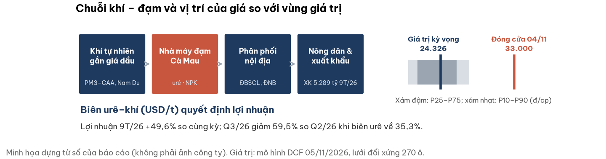
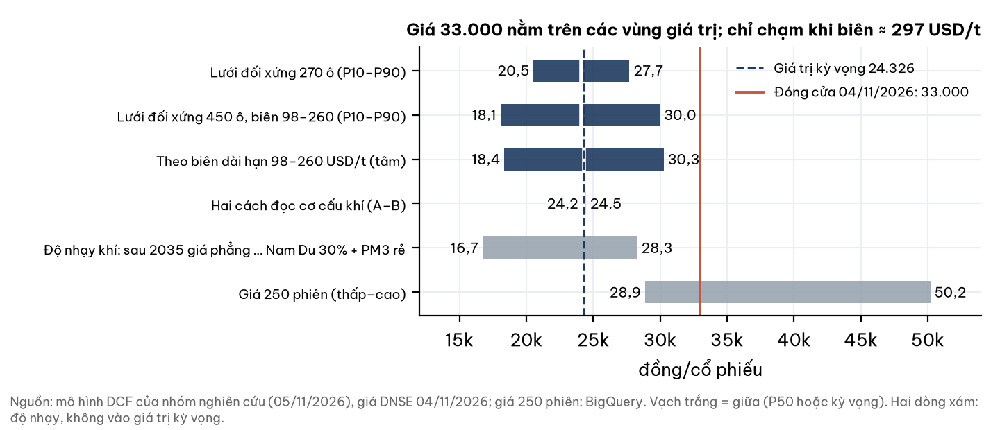
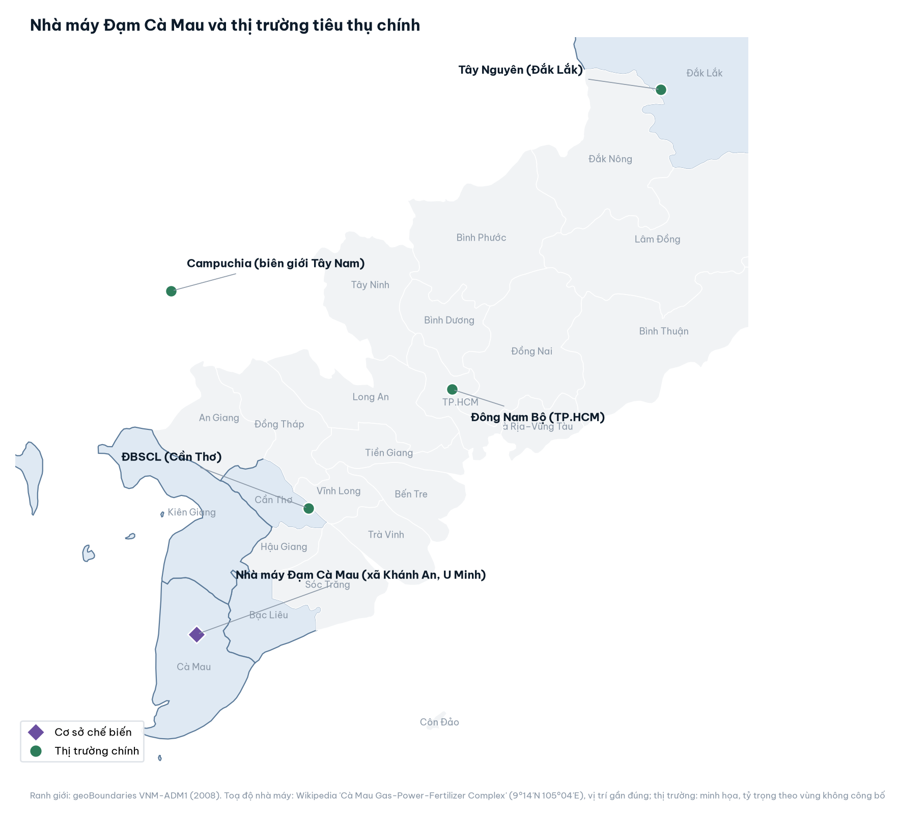
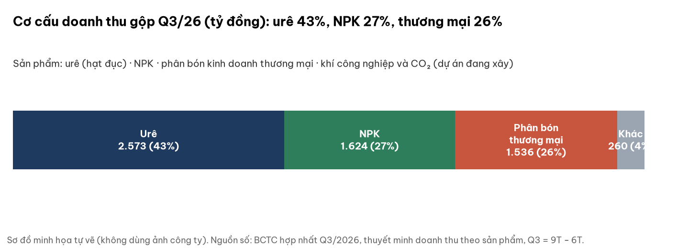
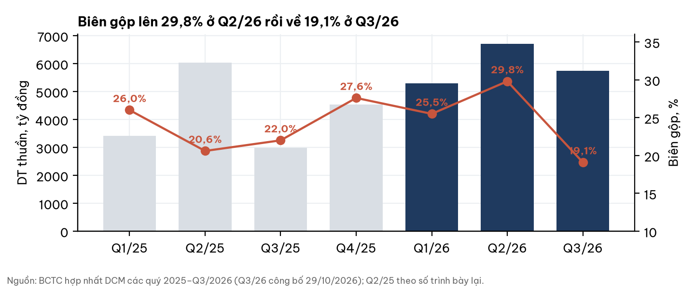
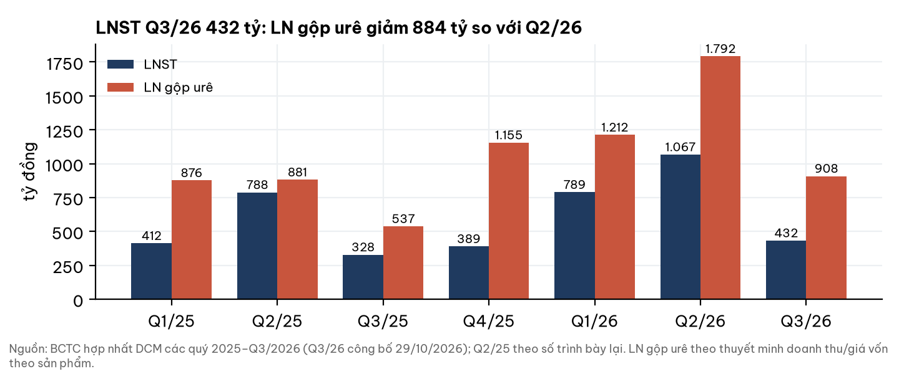
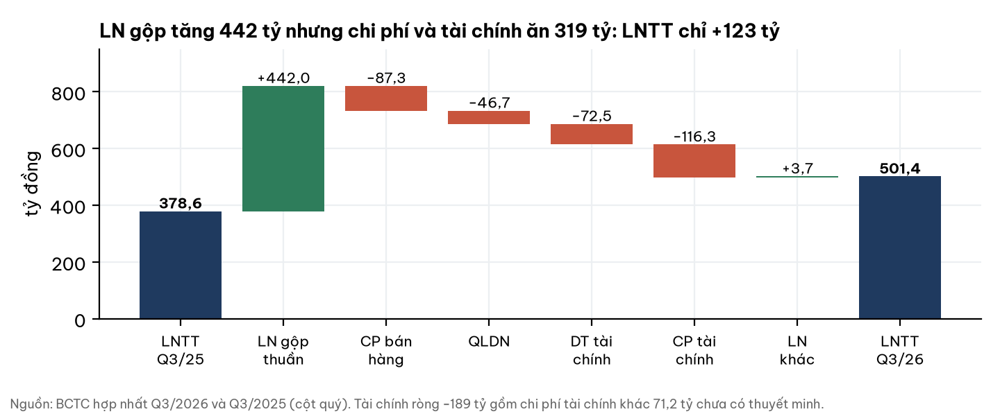
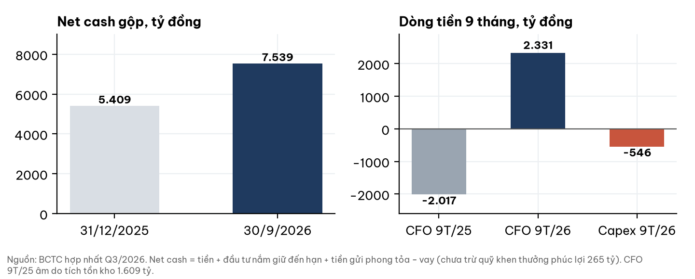
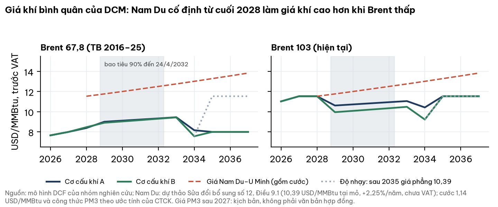
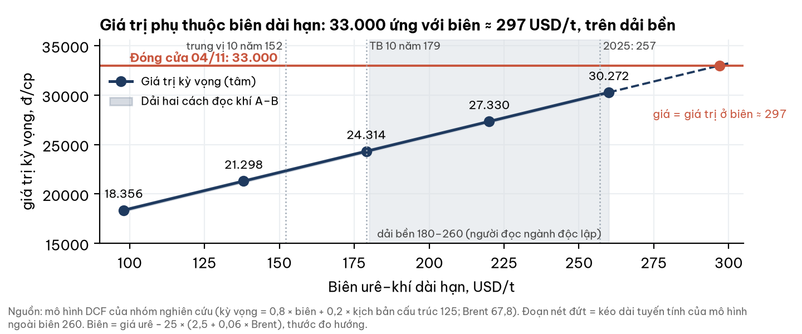

# DCM — Đạm Cà Mau: dòng tiền và bảng cân đối vững, nhưng giá đã trả cho biên urê–khí năm 2025 kéo dài, khi chi phí khí từ 2028 nhích lên

**Báo cáo Due Diligence · dữ liệu đến 04/11/2026 (đóng cửa) · Nhóm nghiên cứu** · CTCP – Tổng Công ty Phân bón Dầu khí Cà Mau (PVCFC), sàn HOSE · Ngành phân đạm urê, NPK, phân bón thương mại

## Investment Summary

**Giá đóng cửa 33.000 đ nằm trên vùng giá trị hợp lý ở mọi lưới giả định; giá chỉ bằng giá trị khi biên urê–khí dài hạn khoảng 297 USD/t, cao hơn trung bình 10 năm (179) và cao hơn năm 2025 (257).** Doanh nghiệp có lợi nhuận thật, tiền mặt lớn và kiểm toán chấp nhận toàn phần; hai câu hỏi định giá là biên của năm 2025 có kéo dài không, và giá khí từ 2028 sẽ ở đâu.

| Dữ liệu chính | Giá trị | Ghi chú |
|---|---|---|
| Giá đóng cửa 04/11/2026 | **33.000 đ** | DNSE, khớp ATC 14:45:02; sàn HOSE |
| Giá trị kỳ vọng (trước = sau chiết khấu thanh khoản) | **24.326 đ** | Giá cao hơn 35,7%; hai cách đọc cơ cấu khí: 24.192 – 24.459 |
| Vùng giá trị (lưới 270): P10 – P90 | 20.522 – 27.708 | P25 21.643 · P50 24.095 · P75 26.243 |
| Net cash gộp 30/9/2026 | 7.539 tỷ = 14.241 đ/cp | Sau trừ quỹ khen thưởng phúc lợi: 13.740 đ/cp |
| LNST 9T/26 · CFO 9T/26 | 2.285 tỷ (+49,6%) · +2.331 tỷ | LNST 9T = 193% kế hoạch năm (1.182 tỷ) |
| P/E · P/B · EV/EBITDA (BQ, TTM) | 6,43 · 1,47 · 4,94 | TTM chứa biên đỉnh Q1–Q2/26 |
| GTGD trung vị 90 phiên | 74,0 tỷ đ/phiên | BQ |

**Ba điều cần biết:**

1. **Lợi nhuận tăng nhờ giá urê và xuất khẩu, không phải khoản một lần**, nhưng Q3/26 giảm còn 432 tỷ (Q2/26: 1.067 tỷ) khi biên urê về 35,3%.
2. **Bảng cân đối khoẻ:** net cash 7,5 nghìn tỷ, CFO dương mạnh; cổ tức kế hoạch 2026 chỉ 10%, tiền tiếp tục tích luỹ.
3. **Giá trị phụ thuộc hai lựa chọn:** biên dài hạn (giá 33.000 ứng với ≈ 297 USD/t) và đường giá khí từ cuối 2028, khi nguồn Nam Du–U Minh giá cố định đi vào hợp đồng.

## 1. Tóm tắt điều hành

**Doanh nghiệp tốt lên thật; giá đã nằm trên vùng giá trị theo mọi lưới, và khoảng cách phụ thuộc chủ yếu vào biên dài hạn.** 9T/26: doanh thu thuần 17.740 tỷ, LNST 2.285 tỷ. Giá urê thế giới đã rời đỉnh tháng 4 (−52% theo World Bank) nhưng vẫn ở phân vị ≈70% của 10 năm; chi phí khí gắn dầu tăng theo Brent (+68% so cùng kỳ).

- **Điểm tích cực:** net cash lớn, CFO 9T +2.331 tỷ, xuất khẩu vượt kế hoạch 50%, mảng NPK và thương mại tăng bù khi urê yếu.
- **Điểm tiêu cực:** biên Q3 về 19,1%; chi phí tài chính khác 71,2 tỷ chưa có thuyết minh; thuế TNDN lên 20% từ 2027; chi phí khí có xu hướng tăng từ 2028.
- **Cân bằng:** giá hàm ý biên cao hơn trung bình 10 năm khoảng 66% (297 so với 179) và hơn 15% so với năm 2025 (257); không phi lý nếu biên đỉnh kéo dài, nhưng đó là điều kiện chứ không phải mặc định.

## 2. Ngành: cung vượt cầu nội địa, giá do Trung Quốc và Ấn Độ đặt trần

**Nhà sản xuất khí phía Nam có lợi thế chi phí tốt; biên bền ở mức trung bình 180–260 USD/t, không bền ở đỉnh tháng 4.** (Đánh giá của người đọc ngành độc lập, đọc mù trước khi biết mã.)

- **Quy mô:** 4 nhà máy urê, công suất 2,6–2,73 triệu t/năm; tiêu thụ nội địa 1,6–2,1 triệu t ⇒ dư cung 0,6–1,0 triệu t, Việt Nam là nước xuất khẩu ròng.
- **Giá:** trần = giá nhập khẩu từ Trung Quốc/Đông Nam Á; sàn = giá xuất khẩu trừ thuế 5%. Hạn ngạch xuất khẩu Trung Quốc và nhu cầu Ấn Độ quyết định mức giá.
- **Mùa vụ:** nhu cầu thấp tháng 6–11; Đông Xuân (tháng 11–2) đỡ giá nội địa.

| Chỉ báo (04/11/2026) | Giá trị | So sánh |
|---|---|---|
| Urê TE (USD/t) | 446,0 | Phân vị 69%; tháng 4/26: 697,9 |
| Brent (USD/thùng) | 103,1 | +68% so cùng kỳ |
| Biên proxy urê–khí (USD/t) | ≈ 222 | Trung bình 10 năm 179; trung vị 152 |
| Xác suất 2–4 quý tới | Chu kỳ 0,50 · Chính sách 0,30 · Cấu trúc 0,20 | Người đọc ngành độc lập |

Biên proxy = giá urê − 25 × (2,5 + 0,06 × Brent): thước đo hướng, không phải biên thực của doanh nghiệp.

Nhà máy ở xã Khánh An, huyện U Minh, Cà Mau; đường khí PM3–CAA và Nam Du–U Minh cấp khí (vị trí tuyến không vẽ). Tỷ trọng tiêu thụ theo vùng: không công bố.

## 3. Doanh nghiệp: nhà sản xuất urê từ khí ở Tây Nam Bộ, thêm NPK và thương mại

**Urê vẫn là mảng sinh lời chính, nhưng NPK và thương mại đang lớn lên và đỡ khi urê yếu.**

- **Sản lượng 9T/26:** urê tiêu thụ 741 nghìn t (nội địa 66% kế hoạch, xuất khẩu 150%); NPK 177 nghìn t; thương mại 301 nghìn t.
- **Đầu tư:** XDCB dở dang 724 tỷ (kho cảng Nhơn Trạch 247, khí công nghiệp 158, nâng công suất); kế hoạch nâng công suất 118,5% → 125% thiết kế, 800–1.000 tỷ.
- **Sở hữu:** PVN 75,56%; free float ≈ 24%.
- **Bảo dưỡng tổng thể:** 20/9 đến 7/10/2026 (≈17 ngày).

## 4. Tài chính: lợi nhuận thật, tiền thật; Q3 chịu biên và tỷ giá

**LN gộp urê giảm 884 tỷ từ Q2 sang Q3 là nguyên nhân chính của LNST giảm.**

**Q3/26 so Q3/25: LN gộp +442 tỷ, LNTT +123 tỷ.** Doanh thu gộp 5.999,6 tỷ trừ giảm trừ 258,1 tỷ (chiết khấu thương mại).

- **Chi phí tài chính khác 71,2 tỷ** (9T 71,30 − 6T 0,13) chưa có thuyết minh; lỗ tỷ giá ròng Q3 61 tỷ (nắm 189,4 triệu USD ngoài bảng).
- **Một lần trong 9T/26:** hoàn nhập dự phòng tồn kho +67,4 tỷ; phân bổ giá trị tiềm năng phát triển 102,9 tỷ đã hết (không lặp lại).
- **Net cash gộp** gồm 2.219,9 tỷ tiền gửi không kỳ hạn bị phong toả; thuyết minh vay nói không có tài sản bảo đảm, thuyết minh tiền nói tiền phong toả để bảo đảm vay: cần hỏi doanh nghiệp.

## 5. Khí: giá cố định từ Nam Du–U Minh đi vào hợp đồng từ cuối 2028

**Hợp đồng khí của DCM sắp có thêm một nguồn giá cố định, đắt hơn khí gắn dầu ở Brent trung bình 10 năm (67,8); khối lượng và nguồn khí bổ sung sau 2027 chưa công bố.** Khí là nguyên liệu chính của urê.

| Văn bản | Nội dung chạm DCM | Trạng thái |
|---|---|---|
| Sửa đổi bổ sung số 11, hợp đồng 3918/HĐ-DKVN | Chuyển bên bán từ PVN sang PV GAS; không đổi giá, khối lượng, thời hạn | Ký 18/11/2025 |
| Sửa đổi bổ sung số 12 | Thêm nguồn Nam Du–U Minh: **10,39 USD/MMBtu tại mỏ, chưa VAT, +2,25%/năm**; khí đầu chậm nhất Q4/2028; bao tiêu 90% (445,5 trên 495 triệu Sm3/năm) đến 24/4/2032; hoá đơn bằng USD | **Dự thảo** trình ĐHĐCĐ bất thường 23/9/2026; nghị quyết và bản ký chưa tìm thấy |
| Gia hạn hợp đồng chia sản phẩm và mua bán khí PM3-CAA đến 2047 | Cấp khí cho Việt Nam qua Cà Mau; giá **không công bố** | Công bố 10/4/2025 |
| Hợp đồng mua khí bổ sung từ Petronas | Kết thúc cuối 2027 | Biên bản ĐHĐCĐ 05/11/2025 |

- **Ẩn số là khối lượng và nguồn khí bổ sung sau 2027**, không phải công thức: giá PM3 vẫn theo điều khoản hợp đồng gốc. Mô hình dùng hai cách đọc nhất quán và lấy trung bình.
- **Cách đọc A:** Nam Du chiếm 44,8% khí (bao tiêu 269,74 trên khoảng 602 triệu Sm3 tiêu thụ); phần PM3 còn lại là trung bình kịch bản rẻ và kịch bản đắt (theo ước tính của CTCK: phần bổ sung gắn khoảng 13,7% Brent). Giá trị **24.192**.
- **Cách đọc B:** Nam Du 54% (0,81 trên 1,5 triệu Sm3/ngày), thay phần khí bổ sung; phần còn lại ở kịch bản rẻ. Giá trị **24.459**. Tỷ trọng 54% cao hơn trần cung theo công suất ngày (49,1%); cắt về 49,1% cho 25.233.
- **Năm 2028** tính ở mức kịch bản đắt: mua Petronas hết cuối 2027 và Nam Du chậm nhất Q4/2028. Rủi ro **hụt khí** năm 2028–29 chưa mô hình hoá.
- **Tỷ giá:** mọi nguồn khí tính bằng USD, chuyển VND theo tỷ giá bán VCB; DCM nắm 189,4 triệu USD, phòng hộ một phần.
- **Sau 25/4/2032** hợp đồng không còn khối lượng cam kết. Độ nhạy (ngoài giá trị kỳ vọng): nếu từ 2035 khí giá 10,39 phẳng, giá trị **16.719** (−7.607); nếu tiếp tục leo thang 2,25%/năm, **12.962**.

## 6. Định giá: 24.326 đ/cp; giá trị phụ thuộc biên dài hạn và đường khí

**Dòng tiền chiết khấu dựng từ nền tảng (BCTC, ngành, hợp đồng, quy định), khoá trước khi so với giá thị trường.** Giá trị kỳ vọng = trung bình trọng số ba kịch bản, cơ cấu khí lấy trung bình hai cách đọc.

| Kịch bản | Xác suất | Biên dài hạn (USD/t) | Giá trị (đ/cp) |
|---|---|---|---|
| Chu kỳ | 0,50 | 179 (TB 10 năm) | 25.322 |
| Chính sách (thuế xuất khẩu 0%) | 0,30 | 179 | 25.322 |
| Cấu trúc (mất lợi thế khí) | 0,20 | 125 (ước lượng) | 20.342 |
| **Kỳ vọng** | | | **24.326** |

Xác suất của người đọc ngành độc lập áp cho 2–4 quý tới; dùng làm trọng số dài hạn là **lựa chọn** (giả định). Xác suất 0,55 cho thuế xuất khẩu 0% áp độc lập cho mọi kịch bản nên hai nhánh đầu cùng giá trị.

| Biên dài hạn (USD/t) | 98 | 138 | 179 | 220 | 260 |
|---|---|---|---|---|---|
| Giá trị kỳ vọng (đ/cp) | 18.356 | 21.298 | 24.314 | 27.330 | 30.272 |
| Dải hai cách đọc khí A – B | 18.222 – 18.490 | 21.164 – 21.432 | 24.180 – 24.448 | 27.196 – 27.463 | 30.138 – 30.405 |
| Giá 33.000 cao hơn giá trị | +79,8% | +54,9% | +35,7% | +20,7% | +9,0% |

| Lưới (Brent 67,8) | Số ô | P10 | P25 | P50 | P75 | P90 |
|---|---|---|---|---|---|---|
| Đối xứng 138/179/220 | 270 | 20.522 | 21.643 | 24.095 | 26.243 | 27.708 |
| Đối xứng 98/138/179/220/260 | 450 | 18.062 | 20.458 | 24.095 | 27.752 | 29.991 |
| 138/179/220 × Brent 67,8/82/90/103 | 1.080 | 19.846 | 21.030 | 23.380 | 25.686 | 27.047 |

- **Brent cao hơn làm giá trị giảm nhẹ:** tâm 24.326 / 23.806 / 23.512 / 23.035 ở Brent 67,8 / 82 / 90 / 103 (cơ cấu khí gắn dầu đắt lên; giá urê theo biên giả định cố định).
- **Giá hàm ý biên dài hạn:** 297 USD/t (295–299 theo hai cách đọc) ở Brent 67,8; 304 / 308 / 315 ở Brent 82 / 90 / 103. Nếu chỉ tính nhánh chu kỳ: 263–277.
- **Khi nào giá bằng giá trị:** cần đồng thời kịch bản khí rẻ, Nam Du thấp (khoảng 30%, cận trên vì chưa tính chi phí bao tiêu) và biên từ khoảng 243 USD/t (224 nếu lãi huy động thấp hơn 100bp). Với Nam Du 44,8% cần biên khoảng 275, ngoài dải bền 180–260.

**Chi phí vốn r = 13,5%**, neo theo lãi huy động 12 tháng hiệu dụng 7,40% (CCTG 12T Big-4 02/11/2026; Big-4 12T 6,8%) và điều chỉnh khi lãi huy động đổi (β = 1).

| Lãi huy động | +50bp | −50bp | +100bp | −100bp |
|---|---|---|---|---|
| β = 1 (đ/cp · %) | −403 · −1,7% | +437 · +1,8% | −776 · −3,2% | +911 · +3,7% |
| β = 0,5 (đ/cp · %) | −205 · −0,8% | +214 · +0,9% | −403 · −1,7% | +437 · +1,8% |

Chi phí vốn chủ nội địa (β 1,1) nằm trong khoảng 12,3–13,4%; góc nhìn nước ngoài chỉ là đầu trên.

- **Lãi suất chiết khấu thị trường (r*)** 15,1% (mẫu 147 mã, 30/10/2026; r cố định của công cụ tham chiếu 12,25%) · phân vị 75% lịch sử 2014-01→2026-10 · đỉnh 2022 15,9% (12/2022), đáy 2022–23 12,1% (08/2023). Thước đo để tham khảo, không phải tín hiệu mua/bán.
- **TPCP 10 năm** 4,58% (04/11/2026) · thay đổi 12 tháng +0,62pp (từ 3,96%); nguồn chưa đối chiếu độc lập.
- **Dự án đầu tư mới** (nâng công suất, kho cảng, khí công nghiệp): giá trị hiện tại ròng = 0 trong kịch bản cơ sở; phần đã chi là tài sản, không bị trừ.
- **Thuế:** 20% từ 2027 (BCTC Q3/26 tr.17: 2026 là năm thứ 15 hưởng ưu đãi 10%). Thuế hiệu dụng 2021–24 thấp hơn 10,8%: giá trị có thể bị đánh giá cao +280…+560 đ/cp (ước lượng, chưa vào tâm). Quỹ khen thưởng phúc lợi đã trừ (−1.316 đ/cp).
- **Thanh khoản:** quy mô giao dịch nhỏ so với 74 tỷ đ/phiên ⇒ chiết khấu thanh khoản ≈ 0 (ước lượng, cơ sở BQ); giá trị sau chiết khấu = 24.326.
- **Giới hạn của hệ số khí:** quy đổi cơ học 25,5 tỷ đ trước thuế cho mỗi USD/t, trong khi hồi quy lợi nhuận–biên (n = 5) cho khoảng 9,9 tỷ; theo thang hồi quy, giá trị là 25.974. Chế độ giá khí 2021–25 (giả định 50/50) chưa kiểm.
- **Đối chiếu bội số:** DPM P/E 8,54 · P/B 1,17 · EV/EBITDA 8,15; DDV 5,64 · 1,01 · 4,5. P/E 6,43 của DCM thấp vì TTM chứa biên đỉnh: không đọc là rẻ.

**Kết luận có điều kiện:** nếu biên dài hạn = 179 thì 33.000 cao hơn tâm 35,7% và nằm trên P90 (27.708); nếu 220 thì cao hơn 20,7%; nếu 260 thì cao hơn 9,0%. Giá chỉ ngang giá trị khi biên khoảng 297 USD/t, hoặc khoảng 243–260 trong kịch bản khí rẻ và Nam Du thấp.

## 7. Điều làm nhận định đổi (hai chiều) và mốc ngày

Một điều kiện xảy ra ⇒ chạy lại mô hình; tác động đơn lẻ tính trên giá trị kỳ vọng, riêng mục khí tính theo cách đọc A.

| Hướng tích cực hơn | Tác động (đ/cp) | Hướng tiêu cực hơn | Tác động (đ/cp) |
|---|---|---|---|
| Nghị định thuế xuất khẩu 0% ban hành (hạn 31/03/2027) | +845 đến +1.033 | Biên proxy < 170 ở hai mốc liên tiếp | −664; −2.145 nếu biên dài hạn về 150 |
| Khí bổ sung PM3 sau 2027 theo kịch bản rẻ | +1.728 | Khí bổ sung PM3 theo kịch bản đắt | −1.729 |
| Nam Du chỉ khoảng 30% khí (cận trên, chưa tính chi phí bao tiêu) | +1.816 | Sau 2035 không có khí giá ≤ PM3 (giá 10,39 phẳng) | −7.607 |
| Brent bền ≥ ≈100 và giá urê bám chi phí khí thực | ≈ +3.683 (phép cộng) | Hụt khí 2028–29 hoặc sau 2032; VND mất giá | chưa đo |
| Q4/26 + Q1/27 LNST ≥ 1.200 tỷ khi biên proxy ≤ 230 | biên thật cao hơn proxy | Tiền 332 tỷ phải trích lập, hoặc tiền phong toả không rút tự do | −627 |
| Ưu đãi NPK còn dài | +65 đến +200 | Chi phí tài chính khác ≥ 50 tỷ/quý lặp lại | ≈ −2.100 |

**Mốc:** 24/11/2026 (biên trung vị dự báo 224) · 03/01/2027 (225) · 04/03/2027 (222) · BCTC Q4/26 (cuối 01/2027) · 31/03/2027 (hạn nghị định thuế) · nghị quyết chính thức và bản ký sửa đổi số 12 · giá/khối lượng khí bổ sung PM3 từ 01/01/2028 · ngày khí Nam Du đầu tiên (chậm nhất Q4/2028) · 25/4/2032 (hết khối lượng cam kết).

## 8. Rủi ro

| Rủi ro | Xác suất (nhận định) | Tác động | Dấu hiệu sớm · mốc kiểm |
|---|---|---|---|
| Biên co: Trung Quốc nới hạn ngạch, Brent vẫn cao | Trung bình | Lớn (−2.145 ở biên 150) | Hạn ngạch 2027; biên proxy 04/03/2027 |
| Giá và khối lượng khí sau 2027, sau 2032 (PM3 suy giảm, Nam Du, LNG) | Trung bình | Lớn, hai chiều (−7.607 … +1.816) | Công bố giá PM3 2028; ngày khí đầu Nam Du |
| Tỷ giá: hoá đơn khí bằng USD | Trung bình | Vừa; phòng hộ một phần bằng 189,4 triệu USD | Tỷ giá VCB; thuyết minh Q4/26 |
| Chính sách thuế/VAT | Trung bình | Hai chiều | Nghị định 31/03/2027 |
| Tiền 332 tỷ hạn chế tại ngân hàng | Thấp–trung bình | −627 | BCTC Q4/26 |
| Quản trị: thù lao, bên liên quan (bên bán khí là công ty con của cổ đông lớn) | Trung bình | Khó đo | Kết quả ĐHĐCĐ |

## 9. Pháp lý và quản trị (cảnh báo có bằng chứng, không chặn, không vào giá trị kỳ vọng)

- **Tiền gửi 332 tỷ** hạn chế giao dịch tại ngân hàng TNHH MTV Việt Nam Hiện đại – CN Cà Mau (BCTC Q3/26 thuyết minh 5); kiểm toán 2025 không trích lập, không nhấn mạnh.
- **Kết luận Thanh tra Chính phủ 07/7/2023:** giá trị tiềm năng phát triển 102,9 tỷ đã phân bổ hết.
- **Thù lao HĐQT/BĐH/BKS 9T:** 56,56 tỷ so với 17,39 tỷ cùng kỳ (3,25 lần); kế hoạch lợi nhuận đặt thấp, thưởng theo vượt kế hoạch.
- **Bên liên quan:** PVN 75,56% và PV GAS là bên bán khí; hợp đồng khí là giao dịch khép kín trong nhóm PVN; Đại hội 2025 đã thông qua sửa đổi số 11 khi PVN không biểu quyết, đồng thời uỷ quyền HĐQT sửa nội dung cơ bản khi chính sách nhà nước đổi, nên thay đổi giá khí về sau có thể không qua cổ đông thiểu số. Mua từ nhóm Tập đoàn 9T/26 tăng 36,2%; phải thu PVN 261 tỷ.
- **Nhân sự:** Tổng giám đốc mới; một Phó tổng giám đốc nghỉ 17/09 theo nguồn báo chí, BCTC lập 15/10 vẫn liệt kê.
- **Kiểm toán:** BCTC 2025 Deloitte chấp nhận toàn phần.

## Phụ lục A. Số BCTC theo quý (tỷ đồng)

| Quý | DT thuần | LN gộp | Biên | LNTT | LNST | LN gộp urê | Biên urê |
|---|---|---|---|---|---|---|---|
| Q1/25 | 3.407 | 885 | 26,0% | 454 | 412 | 876 | 35,9% |
| Q2/25 | 6.037 | 1.241 | 20,6% | 888 | 788 | 881 | 36,3% |
| Q3/25 | 2.988 | 657 | 22,0% | 379 | 328 | 537 | 39,0% |
| Q4/25 | 4.528 | 1.252 | 27,6% | 436 | 389 | 1.155 | 48,1% |
| Q1/26 | 5.286 | 1.346 | 25,5% | 878 | 789 | 1.212 | 41,5% |
| Q2/26 | 6.712 | 2.001 | 29,8% | 1.187 | 1.067 | 1.792 | 46,0% |
| Q3/26 | 5.742 | 1.099 | 19,1% | 501 | 432 | 908 | 35,3% |

Q2/25 theo số trình bày lại. Từ 9T/26, 102,9 tỷ giá trị tiềm năng phát triển của nửa đầu năm được chuyển từ GVHB sang chi phí quản lý: số theo quý lấy từ cột quý của báo cáo kết quả kinh doanh.

## Phụ lục B. Đối chiếu BQ và BCTC

P/E, P/B, EV/EBITDA lấy từ bảng ticker BigQuery ngày 04/11/2026 (TTM). Giá đóng cửa 33.000 khớp DNSE. Net cash tính từ BCTC, không từ BQ.

## Phụ lục C. Nguồn

BCTC hợp nhất Q3/2026 (công bố 29/10/2026), Q2/2026, Q1/2026, Q4/2025, Q2–Q3/2025; BCTC hợp nhất 2025 kiểm toán (Deloitte); Nghị quyết ĐHĐCĐ 996/NQ-PVCFC (22/04/2026); đọc ngành độc lập (04/11/2026). **Hợp đồng khí:** tài liệu ĐHĐCĐ bất thường 2026 (dự thảo Sửa đổi bổ sung số 12, Điều 3.3, 4.1, 4.2, 9.1, 9.2, 10.1, 10.2; Vietstock); tài liệu và biên bản ĐHĐCĐ bất thường 05/11/2025 (sửa đổi số 11); thông cáo Petronas 10/4/2025; công bố Jadestone 20/4/2026; nghị quyết HĐQT PV GAS 27/NQ-KVN, 34/NQ-KVN. Tài liệu môi giới (CTCK Rồng Việt, Q3/2026) chỉ dùng cho công thức giá PM3 và cước khí, là ước tính của CTCK, không phải văn bản hợp đồng. Toạ độ nhà máy: Wikipedia "Cà Mau Gas-Power-Fertilizer Complex" (vị trí gần đúng); ranh giới: geoBoundaries VNM-ADM1 (2008). Giá: DNSE, BigQuery. **Hình sản phẩm:** website công ty chặn tải tự động nên không có ảnh công bố dùng được; hình ở mục 3 là sơ đồ minh họa tự vẽ. **Logo:** không lấy được từ nguồn chính thức; banner dùng huy hiệu chữ mã DCM.

## Phụ lục D. Phương pháp và giới hạn

- Giá trị dựng bằng chiết khấu dòng tiền, hồi quy LNST–biên (n = 5), net cash tách riêng, đường giá khí theo hợp đồng cộng vào mọi kịch bản; không dùng giá thị trường làm đầu vào.
- **Chưa có:** nghị quyết chính thức và bản ký sửa đổi số 12 (hiện chỉ có dự thảo); giá và khối lượng khí bổ sung PM3 sau 2027; tỷ trọng Nam Du thực tế và chi phí bao tiêu; sản lượng và giá theo quý; nội dung chi phí tài chính khác; room ngoại.
- Số "ước lượng" là phán đoán của nhóm; định mức khí 22 MMBtu/t urê suy từ thuyết minh chi phí khí và sản lượng 9T ước lượng; sản lượng quý lấy từ báo chí, lệch nhau giữa các nguồn.

## Phụ lục E. Quy trình độc lập

Số liệu đối chiếu BCTC gốc (đọc từ ảnh trang) và văn bản hợp đồng khí; ngành do người đọc ngành độc lập viết khi chưa biết mã; mô hình định giá được người phản biện độc lập kiểm tra; giới hạn dữ liệu nêu tại Phụ lục D.

## Phụ lục F. Tuyên bố miễn trừ trách nhiệm

Tài liệu chỉ nhằm cung cấp thông tin nghiên cứu, không phải lời khuyên đầu tư, khuyến nghị mua/bán hay tư vấn cá nhân hoá. Số liệu lấy từ nguồn được cho là đáng tin cậy nhưng không bảo đảm đầy đủ hay chính xác; các ước lượng có thể sai khác đáng kể. Nhà đầu tư tự chịu trách nhiệm với quyết định của mình.
