# DGC — CTCP Tập đoàn Hóa chất Đức Giang: bảng cân đối nhiều tiền mặt và P/B dưới 1, nhưng giá 32.900 chưa trả đủ cho câu hỏi dự phòng môi trường và vụ án chưa có lời đáp

**Báo cáo Due Diligence · 29/10/2026 · Nhóm nghiên cứu** · Sàn HOSE · Hóa chất phốt pho (phốt pho vàng, axit photphoric), phân bón, phụ gia thực phẩm

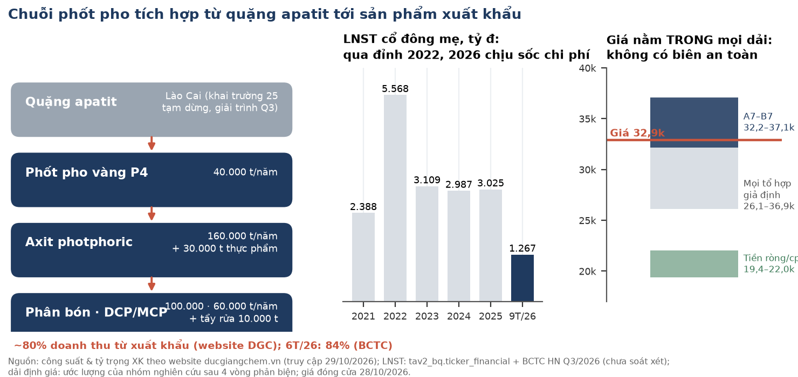

## Investment Summary

**Xếp hạng của nhóm: AMBIGUOUS, nghiêng tích cực (constructive).** Đây không phải QUALIFY và cũng không phải NON. Bảng cân đối mạnh (tiền ròng ≈ 22.040 đ/cp trước haircut, P/B ≈ 0,96). Nhưng giá 32.900 nằm **trong** mọi dải định giá đã xét, từ tổ hợp thấp nhất ≈ 26,1 nghìn tới cao nhất 36.880. Vì vậy giá hiện tại **không có biên an toàn**. Câu hỏi quyết định giá trị là dự phòng môi trường 200 tỷ chỉ trích một lần hay sẽ còn trích thêm. Câu hỏi này **chưa phân định**, và bằng chứng hai chiều đang cân nhau.

Thang của nhóm: **QUALIFY** (đủ điều kiện xem xét) · **AMBIGUOUS** (chưa đủ bằng chứng) · **NON** (không đủ điều kiện ở giá hiện tại). Đây là nhãn nghiên cứu, không phải khuyến nghị cá nhân hoá.

| Dữ liệu chính | Giá trị | Ghi chú |
|---|---|---|
| Đóng cửa 28/10/2026 | **32.900 đ** | Mốc neo cho toàn bộ phân tích định giá |
| Giá 29/10/2026, khớp cuối phiên 14:45:02 ICT | 33.300 đ (+1,2%) | DNSE latest_trade, đọc lúc 19:12 ICT; kết luận không đổi ở cả hai mức |
| Dải mô hình tổng hợp A7 (khai trường đóng) – B7 (mở lại) | **32.182 – 37.060** | Ước lượng; giá nằm sát cận dưới A7 |
| Tổ hợp thấp nhất / cao nhất của các giả định đã xét | **≈ 26,1–26,6 nghìn / 36.880** | Thấp nhất: nền biên thấp + dự phòng 100 tỷ/quý lặp vĩnh viễn. Cao nhất: nền biên cao, không trích thêm |
| Tiền + tiền gửi · vay · tiền ròng (30/9/2026) | 9.761 · 1.391 · **8.370 tỷ** | ≈ 22.040 đ/cp trước haircut; ≈ 19.400 sau khi trừ phần thuộc cổ đông thiểu số PAT (274 tỷ) và haircut 9% (ước lượng) |
| BVPS mẹ · P/B | 34.425 đ · **0,96×** | VCSH mẹ 13.073,9 tỷ / 379,78 tr CP |
| P/E TTM (4 quý tới Q3/26) | 6,6× | LNST mẹ 4 quý 1.888,8 tỷ, đã gồm lãi tiền gửi |
| LNST mẹ 9T/2026 | 1.267,1 tỷ (−47% YoY) | BCTC hợp nhất Q3/2026, **chưa soát xét** |
| CFO/LNST | 9T/26 0,55× · 9T/25 0,49× · 4 quý gần nhất 0,82× | Theo quý: Q1 −1.093 · Q2 +852,6 · Q3 +996,1 tỷ |
| Vốn hoá (32.900) | 12.495 tỷ đ | 379.779.286 CP |

**Ba luận điểm (MECE):**

1. **Bảng cân đối là phần chắc nhất.** Tiền ròng 8.370 tỷ ≈ 59–67% giá. Lượng tiền này còn lại sau khi chi 4.213 tỷ cổ tức trong 9 tháng. P/B 0,96. Dự phòng giảm giá tồn kho gần như bằng 0 (0,29 tỷ).
2. **Lợi nhuận lõi đang ở đáy nhiều năm, và chất lượng của nó chưa kiểm chứng được.** Biên gộp Q3 20,5% so với 31,1% cùng kỳ. Khai trường 25 tạm dừng nên công ty dùng toàn bộ quặng nhập hoặc mua ngoài. Hai lần trích dự phòng môi trường 100 tỷ (thuyết minh H1 gọi là chi phí khôi phục môi trường) không nêu tổng mức ước tính, nguyên nhân cụ thể hay lịch chi. BCTC Q3 chưa soát xét. Bản soát xét H1 có ý kiến ngoại trừ, và kiểm toán 2025 cũng ngoại trừ.
3. **Giá không cho biên an toàn ở chiều nào.** Mỗi 1pp biên gộp 2027-28 tương đương khoảng 1.420 đ/cp. Cách đọc dự phòng (một lần hay lặp) làm đổi giá trị từ khoảng 0,5 nghìn tới khoảng 6 nghìn đ/cp. Giá 32.900 nằm giữa hai đầu.

**Điều gì làm chúng tôi đổi ý.**
- **Theo chiều tích cực, lên QUALIFY (cần chạy lại kiểm định đầy đủ):**
  - DGC công bố bằng văn bản bản chất và tổng mức của khoản dự phòng, kèm xác nhận không trích thêm.
  - BCTC soát xét hoặc kiểm toán không còn ngoại trừ.
  - Khai trường 25 hoặc 19B có mốc mở lại bằng văn bản. Riêng yếu tố này là B7 − A7 ≈ 4.878 đ/cp, theo mô hình.
- **Theo chiều tiêu cực, về NON:**
  - Q4/2026 trích thêm dự phòng mà không giải thích.
  - Pháp nhân hoặc công ty con bị khởi tố, hoặc có quyết định đình chỉ hay kê biên.
  - BCTC kiểm toán 2026 bị từ chối ý kiến hoặc nộp chậm.

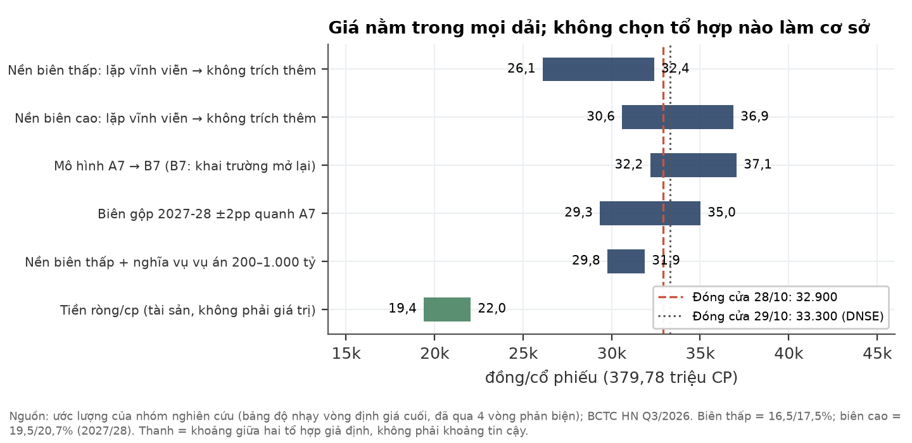

## 1. Tóm tắt điều hành

**Tình huống (Situation).** DGC là nhà sản xuất phốt pho vàng và hóa chất gốc phốt pho tích hợp từ mỏ quặng apatit ở Lào Cai. Khoảng 80% doanh thu đến từ xuất khẩu (website công ty; 6T/2026 là 84% theo BCTC). Doanh nghiệp có lượng tiền gửi lớn: tiền và tiền gửi có kỳ hạn 9.761 tỷ tại 30/9/2026. Giá cổ phiếu điều chỉnh giảm từ khoảng 75,0 nghìn (29/10/2025) xuống 32.900 (28/10/2026).

**Biến chuyển (Complication).** Có ba vấn đề chồng lên nhau trong năm 2026:
- **Vụ án.** Ngày 17/03/2026 cơ quan điều tra khởi tố vụ án gồm ba tội danh: kế toán, khai thác tài nguyên và gây ô nhiễm môi trường. Một khai trường quặng phải tạm dừng để phục vụ điều tra.
- **Chi phí đầu vào.** Lưu huỳnh, NH3, điện và than cốc tăng giá. Công ty phải dùng quặng nhập hoặc mua ngoài.
- **Dự phòng môi trường.** Mỗi quý Q2 và Q3 công ty trích 100 tỷ, nâng số dư lên 200 tỷ. Thuyết minh bản soát xét H1 gọi đây là dự phòng chi phí khôi phục môi trường nhưng không nêu tổng mức ước tính, nguyên nhân cụ thể hay lịch chi; BCTC Q3 không có thuyết minh riêng cho khoản này.

LNST mẹ 9T/2026 giảm 47%. Bản soát xét H1 có ý kiến ngoại trừ, và BCTC Q3 chưa được soát xét.

**Câu hỏi (Question).** Ở giá 32.900, thấp hơn giá trị sổ sách và cao hơn tiền ròng khoảng 11 nghìn đ/cp, nhà đầu tư đã được trả đủ cho rủi ro chi phí môi trường lặp lại và rủi ro pháp lý chưa định lượng được chưa?

**Trả lời (Answer).** Chưa rõ. Đó là lý do nhãn là AMBIGUOUS. Giá nằm trong mọi dải mà nhóm dựng được.
- **Phía thấp:** chỉ xuống dưới giá khi nhiều giả định bất lợi cùng xảy ra. Đó là biên thấp, dự phòng còn trích nhiều quý, hoặc lặp vĩnh viễn.
- **Phía cao:** chỉ vượt xa giá khi biên hồi về run-rate Q3 bỏ dự phòng và khai trường mở lại.
- **Điểm nghiêng:** nhãn nghiêng tích cực vì phần tiền ròng là tài sản hữu hình. Phần chưa biết nằm ở lợi nhuận tương lai, không nằm ở sự tồn tại của tài sản.

## 2. Luận điểm và điều thị trường đang định giá

**Giá hiện tại ngầm định lợi nhuận lõi thấp hơn khoảng 25–45% so với 9 tháng 2026 năm hoá, tức thị trường đã trừ một phần cho chi phí lặp hoặc biên giảm tiếp (ước lượng).**

| Phép định giá ngược (ước lượng, giá 32.900) | Giá trị |
|---|---|
| Vốn hoá | 12.495 tỷ |
| Trừ tiền ròng sau phần cổ đông thiểu số PAT và haircut 9% (19.400 đ/cp) | −7.368 tỷ |
| Giá trị thị trường gán cho hoạt động lõi | **≈ 5.127 tỷ** |
| LNTT lõi 9T/2026 = LN thuần HĐKD 1.568,0 − DT tài chính 576,1 + CP tài chính 61,9 | 1.053,8 tỷ (đã gồm 200 tỷ dự phòng) |
| Năm hoá, sau thuế 13% và phần cổ đông không kiểm soát (7,5%) | ≈ 1.131 tỷ |
| P/E lõi ngầm định | **≈ 4,5×** |
| LNST lõi ngầm định ở P/E lõi 6–8× (khung dùng trong mô hình) | ≈ 640–855 tỷ/năm |

**Đọc hai chiều.**
- **Lạc quan:** P/E lõi khoảng 4,5× là rẻ, nếu 9T/2026 (đã gánh 200 tỷ dự phòng và quặng nhập) là đáy.
- **Thận trọng:**
  - Mô hình hạ doanh thu 2027 xuống 9.261 tỷ, tức −6,2% so với Q3 × 4. Lý do là giả định giá phốt pho vàng 4.150 USD/t. Mô hình đồng thời giữ giá vốn phẳng.
  - Nếu cộng thêm dự phòng lặp, LNST lõi 2027 có thể rơi vào đúng vùng 640–855 tỷ.
  - Cả hai đều là giả định. Nhóm **không chọn** kịch bản cơ sở.

**Quan điểm khác biệt.** Câu hỏi giá trị lớn nhất **không phải** con số 200 tỷ, vì nếu chỉ trích một lần thì chỉ ≈ 527–541 đ/cp. Câu hỏi lớn nhất là biên gộp 2027-28 sẽ ổn định ở đâu. Biên này có ba động lực cùng cỡ:
1. chi phí xử lý môi trường định kỳ, nếu có;
2. giá phốt pho vàng;
3. chi phí lưu huỳnh, NH3 và quặng.

Dữ liệu công bố hiện không đủ để tách ba động lực này.

## 3. Ngành: giá đầu ra ở vùng cao 10 năm, nhưng chi phí đầu vào tăng nhanh hơn

**Chuỗi phốt pho toàn cầu đang chịu cú sốc cung từ eo Hormuz, chồng lên tình trạng thiếu lưu huỳnh mang tính cấu trúc. Theo bản đọc ngành, chi phí "giảm về hướng nhưng vẫn cao về mức".** Phần này dựa trên một bản đọc ngành độc lập do một nhà phân tích vĩ mô thực hiện **mù**: người đọc không biết mã cổ phiếu, giá hay BCTC của doanh nghiệp, as-of 28/10/2026. Bản đọc tập trung vào phân bón lân DAP và chuỗi lưu huỳnh/NH3. Mảng lõi của DGC là phốt pho vàng, chỉ chia chung một phần chi phí đầu vào. Vì vậy phần này là bối cảnh, **không phải** dự báo biên của DGC.

| Chủ đề | Dữ kiện (nguồn, ngày) | Đọc của bản đọc ngành (nhận định) |
|---|---|---|
| Lưu huỳnh | Giá nội địa TQ 5.714 CNY/t (23/10), −38% từ đỉnh tháng 9.261 (T8), vẫn ×1,45 mức trước xung đột. Hợp đồng Trung Đông T10: Qatar 835 USD/t, chỉ −5–10% từ đỉnh (SMM 08/10/2026) | Đỉnh cấp tính đã qua. Chi phí thực của nhà nhập khẩu Việt Nam giảm ít hơn nhiều so với giá TQ gợi ý |
| DAP | 800,6 USD/t (WB, T9) = phân vị 96,7% của 10 năm; tỷ lệ DAP/urea ở phân vị 97,5% | Giá bền vừa phải tới Q1/2027, vùng 720–830; rủi ro giảm lớn hơn rủi ro tăng |
| Cung TQ | TQ cấm xuất khẩu MAP/DAP từ 19/03/2026; xuất khẩu lân 2026 gần bằng 0 (UkrAgroConsult 16/10/2026) | Đỡ giá cho tới khi TQ nối lại xuất khẩu (Argus dự kiến khoảng T5/2027) |
| NH3 / khí | Khí TTF +63% từ đầu T8; NH3 rời vùng Gulf gần như dừng (EnterpriseAM 06/10/2026). NH3 nội địa TQ chỉ +22% YoY | NH3 có thể lấy lại phần biên mà lưu huỳnh trả lại |

**Phân loại cú sốc chi phí (đọc mù, xác suất chủ quan).** Kéo dài về **mức** khoảng 70/30. Về **hướng**, chi phí giảm trong 1–2 quý tới. Một dự báo khoá trước sẽ được chấm vào 31/01/2027: giá lưu huỳnh nội địa TQ trung vị khoảng 4.900 CNY/t, P(<5.714) = 0,65.

**Hàm ý cho DGC.** Giải trình KQKD Q3 của công ty (28/10/2026) nêu đúng các yếu tố này: lưu huỳnh, điện, than cốc và amoniac tăng giá, cộng với việc phải dùng toàn bộ quặng nhập hoặc mua ngoài. Theo bản đọc ngành, giá vốn trong BCTC thường trễ 1–2 quý so với giá thị trường. Nhóm **không** dựng được cầu nối định lượng từ giá nguyên liệu tới biên của DGC. Lý do là doanh nghiệp không công bố tỷ trọng từng nguyên liệu trong giá vốn hay cơ cấu doanh thu theo sản phẩm.

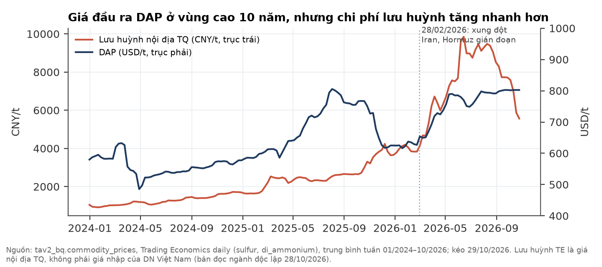

## 4. Doanh nghiệp: hơn 60 năm làm hóa chất phốt pho, từ một xí nghiệp nhà nước tới tập đoàn xuất khẩu

**DGC là một trong số ít doanh nghiệp Việt Nam làm chủ trọn chuỗi từ quặng apatit tới phốt pho vàng và hóa chất tinh khiết. Lợi thế này gắn chặt với mỏ ở Lào Cai, và đó cũng là chỗ rủi ro hiện tại tập trung.**

**Lịch sử hình thành** (website ducgiangchem.vn, truy cập 29/10/2026; BCTC hợp nhất Q3/2026 thuyết minh 1):

| Năm | Mốc |
|---|---|
| 1963 | Thành lập; tiền thân là Công ty Hóa chất Đức Giang, doanh nghiệp nhà nước thuộc Tổng cục Hóa chất |
| 2003–2004 | Cổ phần hoá; Giấy chứng nhận đăng ký doanh nghiệp lần đầu 05/03/2004 |
| 2020 | Niêm yết trên HOSE (DNSE secdef: ngày niêm yết 28/07/2020) |
| 2021 | Vào rổ FTSE Russell; Top 50 công ty đại chúng uy tín, hiệu quả (VietNamReport) |
| 2022 | Doanh thu gần 15.000 tỷ, vốn điều lệ 3.800 tỷ (theo website) |
| 2025–2026 | Khởi công Tổ hợp Hóa chất Nghi Sơn (02/2025). Vụ án khởi tố 03/2026. Điều chỉnh chủ trương đầu tư Nghi Sơn (15/10/2026) |

**Sản phẩm và công suất** (theo website; công ty không ghi ngày cập nhật số liệu):

| Sản phẩm | Công suất công bố | Vai trò |
|---|---|---|
| Phốt pho vàng (P4) | 40.000 t/năm | Sản phẩm lõi, chủ yếu xuất khẩu |
| Axit photphoric (chiết xuất) | 160.000 t/năm | Nguyên liệu cho phân bón, phụ gia |
| Axit photphoric thực phẩm | 30.000 t/năm | Hóa chất tinh khiết |
| Tổ hợp phân bón | 100.000 t/năm | Phân bón |
| Phụ gia thực phẩm/công nghiệp DCP & MCP | 60.000 t/năm | Thức ăn chăn nuôi, công nghiệp |
| Bột giặt, chất tẩy rửa | 10.000 t/năm | Tiêu dùng |
| Ắc quy Tia Sáng | 300.000 kWh/năm | Công ty con 51% |

**Khách hàng và thị trường.**
- Website nêu "80% doanh thu đến từ xuất khẩu" nhưng không nêu thị trường cụ thể. BCTC 6T/2026: xuất khẩu 3.804,6 tỷ, tức 84% doanh thu thuần.
- Trên bảng cân đối 30/9/2026 có thể thấy một số đối tác lớn:
  - phải thu Mitsubishi 188,3 tỷ;
  - trả trước cho Samsung C&T Singapore 119,5 tỷ;
  - phải thu bên liên quan Van Minh 17,1 tỷ.
- Doanh nghiệp **không công bố** cơ cấu doanh thu theo sản phẩm, giá bán hay sản lượng.

**Cơ cấu tập đoàn** (BCTC Q3/2026, thuyết minh 1). Gồm 3 chi nhánh (Hưng Yên, Bình Dương, Lào Cai) và 8 công ty con. Các đơn vị sản xuất chính:
- Hóa chất Đức Giang – Lào Cai (100%, Tằng Loỏng);
- Phốt pho Apatit Việt Nam (PAT, 51%, Tằng Loỏng);
- Hóa chất Đức Giang Nghi Sơn (100%, Thanh Hoá);
- Hóa chất Đức Giang – Đắk Nông (100%, Lâm Đồng);
- kho bãi Đình Vũ (100%, Hải Phòng);
- Ắc quy Tia Sáng (51%, Hải Phòng).

Số lao động là 2.629 người tại 30/9/2026. Website còn liệt kê "Phốt Pho 6", nhưng đơn vị này không có trong danh sách công ty con của BCTC.

**Định hướng chiến lược (công ty công bố).** Tổ hợp Hóa chất Đức Giang Nghi Sơn giai đoạn 1 có vốn khoảng 2.400 tỷ. Theo nghị quyết HĐQT ngày 15/10/2026, dự án bổ sung H3PO4, PCl3 và PCl5, chạy thử Q4/2026 và vận hành thương mại toàn bộ từ Q1/2027. Cả tổ hợp gồm 3 giai đoạn, tổng vốn khoảng 12.000 tỷ theo báo chí. Đây là hướng mở rộng sang hóa chất gốc clo (xút, PVC), giúp đa dạng hoá khỏi phốt pho vàng. **Giới hạn:** hiệu quả của giai đoạn 1 chưa có số liệu vận hành.

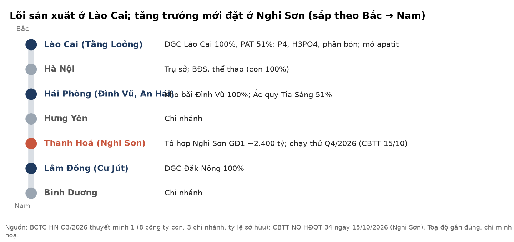

## 5. Phân tích tài chính (bottom-up)

### 5a. Lợi nhuận 2026 ở đáy nhiều năm; một phần lớn lợi nhuận trước thuế đến từ lãi tiền gửi

**Biên gộp Q3/26 20,5% so với 31,1% Q3/25. Doanh thu tài chính, chủ yếu là lãi tiền gửi, chiếm 36,5% LNTT 9 tháng.**

| Tỷ đồng [BCTC hợp nhất Q3/26, chưa soát xét] | Q3/26 | Q3/25 | 9T/26 | 9T/25 |
|---|---|---|---|---|
| Doanh thu thuần | 2.469,5 | 2.816,7 | 7.009,5 | 8.521,4 |
| Lợi nhuận gộp · biên | 506,4 · **20,5%** | 875,5 · 31,1% | 1.451,2 · 20,7% | 2.836,5 · 33,3% |
| Doanh thu tài chính | 209,6 | 192,1 | 576,1 | 542,2 |
| Chi phí bán hàng + quản lý | 125,1 | 144,4 | 397,4 | 425,3 |
| LNTT | 580,6 | 901,3 | 1.577,3 | 2.865,5 |
| Thuế TNDN / LNTT | 12,8% | | 13,0% | |
| **LNST cổ đông mẹ** | **478,2** (−36%) | 751,6 | **1.267,1** (−47%) | 2.403,2 |

- **Theo quý, LNST mẹ 2026:** Q1 408,8 · Q2 380,1 · Q3 478,2 tỷ, thấp hơn mọi quý trong 2022–2025 (dữ liệu BQ). Theo năm: 2022 khoảng 5.568 tỷ; 2023–2025 khoảng 3.000 tỷ/năm.
- **Nguyên nhân theo giải trình của công ty** (CV 12/2026/CV-KT-DGC, 28/10/2026):
  - doanh thu −12%;
  - lưu huỳnh, điện, than cốc và amoniac tăng giá;
  - khai trường 25 tạm dừng để phục vụ điều tra, nên phải dùng toàn bộ quặng nhập hoặc mua ngoài.
  - Giải trình **không nhắc** khoản dự phòng.
- **Sự kiện.** Dự phòng phải trả ngắn hạn (mã 322): 0 tại 31/12/2025 → 100 tỷ (30/6) → 200 tỷ (30/9).
- **Suy luận loại trừ, chưa xác nhận.** Khoản dự phòng này nhiều khả năng nằm trong giá vốn:
  - Chi phí khác 9T chỉ 52,4 tỷ.
  - Các dòng chi phí bán hàng, quản lý và tài chính không dòng nào đủ lớn để chứa 100 tỷ.
  - Nếu bỏ dự phòng, biên Q2 là 23,0% và Q3 là 24,6%.

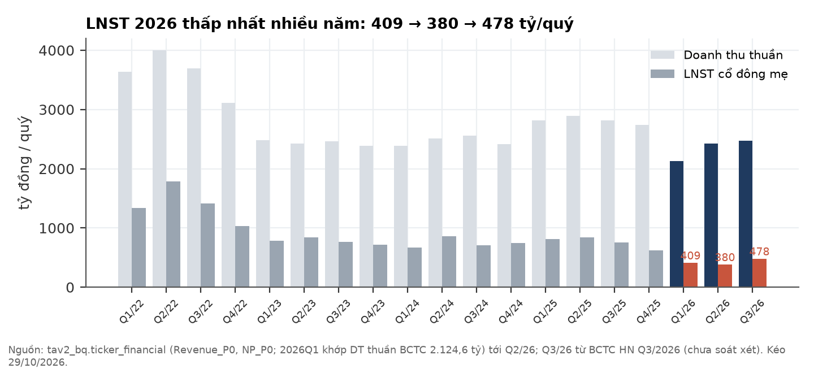

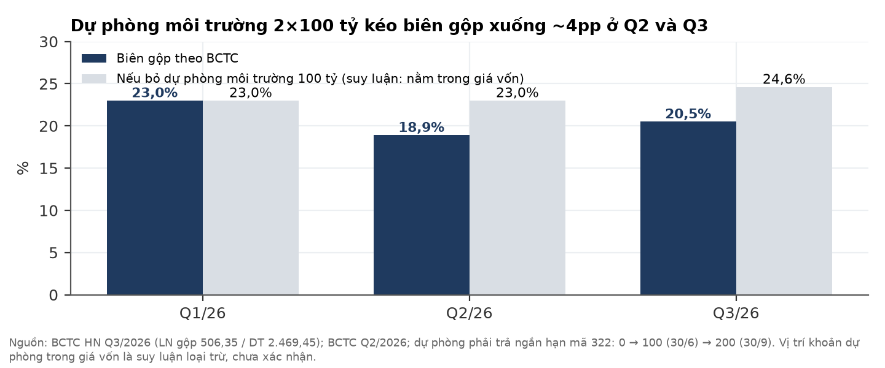

### 5b. Chất lượng lợi nhuận: sáu điểm chưa được giải trình

**Từng điểm có quy mô nhỏ so với vốn hoá, nhưng gộp lại chúng làm giảm độ tin cậy của bộ số. Tất cả nằm dưới hai ý kiến ngoại trừ của kiểm toán.**

| # | Sự kiện (nguồn) | Quy mô | Vì sao quan trọng |
|---|---|---|---|
| 1 | Dự phòng chi phí khôi phục môi trường 100 + 100 tỷ, không thuyết minh lịch chi (BCTC soát xét H1 note 19; BCTC Q3) | 200 tỷ ≈ 527–541 đ/cp nếu chỉ một lần | Bản chất một lần hay lặp **chưa phân định** (mục 7) |
| 2 | Khoản mục liên quan dự án Đắk Nông 60,09 tỷ về 0 qua dòng "giảm khác" 63,38 tỷ; không thuyết minh là bán hay xoá sổ (BCTC Q3) | 63,4 tỷ | Chưa giải trình |
| 3 | LCTT 9T: các dòng đầu tư cộng ra 2.850,50, nhưng dòng tổng in 2.802,27, lệch 48,23 tỷ ngay trong bản gốc (đã phóng ảnh kiểm lại) | 48,2 tỷ | Lỗi in hoặc thiếu dòng, chưa rõ |
| 4 | Thu thanh lý TSCĐ 9T 332,3 tỷ, không nêu bên mua (theo bản trích; cần đối chiếu ảnh LCTT) | 332,3 tỷ | Chưa biết có phải bên liên quan |
| 5 | BCTC Q3 chưa soát xét. Soát xét H1/2026 (UHY, 26/08/2026) **ngoại trừ** vì vụ việc đang điều tra; không đủ bằng chứng để xác định có cần điều chỉnh khoản mục nào | — | Mọi số liệu 2026 nằm dưới ý kiến này |
| 6 | Kiểm toán 2025 **ngoại trừ**: 950,9 tỷ tồn kho chưa đủ bằng chứng (VietnamFinance 06/10/2026, một nguồn) | 950,9 tỷ | Tồn kho 30/9/2026 là 2.085,9 tỷ, dự phòng giảm giá chỉ 0,29 tỷ |

Gộp ba khoản #1 (phần trích Q3), #2 và #3: 100 + 63,38 + 48,23 = 211,6 tỷ ≈ 557 đ/cp. Đây là ước lượng trong trường hợp mất trắng, và nó không bao gồm khoản #4.

### 5c. Dòng tiền: biến động mạnh theo quý, không phải bằng chứng một chiều

**CFO 9T/26 chỉ bằng 0,55× LNST hợp nhất, nhưng 4 quý gần nhất là 0,82×. Hai quý gần nhất đều cao hơn LNST.**

- **Theo quý 2026:** CFO Q1 −1.093 · Q2 +852,6 · Q3 +996,1 tỷ (Q3 tính bằng 9T 755,6 trừ H1). Trong 9 tháng, tồn kho tăng 421,7 tỷ, và thuế TNDN đã nộp 399,5 tỷ cao hơn chi phí thuế 205,6 tỷ (LCTT). Nhóm không có LCTT riêng Q1 để tách nguyên nhân theo quý.
- **Cùng kỳ:** CFO 9T/2025 = 1.250,2 tỷ, tức 0,49× LNST. Như vậy tỷ lệ 9 tháng thấp **không mới** trong năm 2026.
- **Lịch sử năm 2015–2025:** CFO/LNST ở mức ≥ 0,9× trong 9 trên 11 năm. Riêng 2023 (0,58×) và 2025 (0,67×) dưới 0,8×.
- **Nhận định.** Dòng tiền **không** cho thấy lợi nhuận "giấy" một cách rõ ràng. Nó cũng không đủ ổn định để làm bằng chứng ủng hộ chất lượng lợi nhuận.

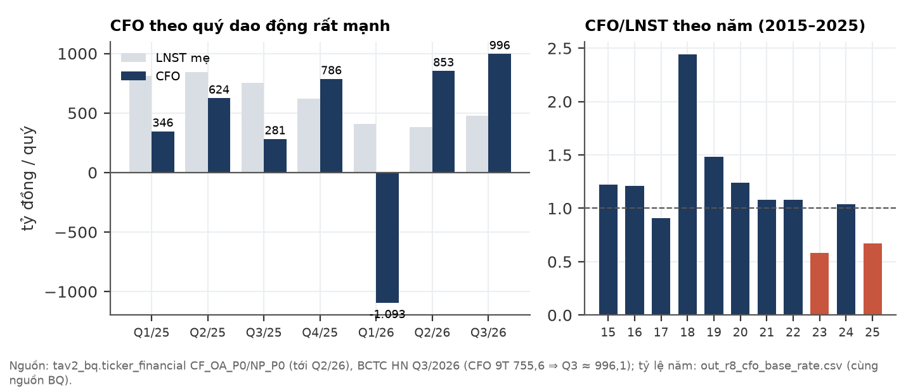

### 5d. Bảng cân đối: nhiều tiền, ít nợ, nhưng tiền giảm nhanh

**Tiền ròng 8.370 tỷ (≈ 22.040 đ/cp) tại 30/9/2026. Con số này giảm từ khoảng 11.900 tỷ đầu năm, chủ yếu vì cổ tức và capex.**

- **Tiền và tiền gửi:** tiền 230,2 tỷ, cộng tiền gửi có kỳ hạn (nắm giữ đến đáo hạn) 9.531,0 tỷ tại BIDV, ACB, VietinBank, MB và các ngân hàng khác (gồm dự thu lãi 93,2 tỷ). Vay ngắn hạn 1.391,0 tỷ; không có vay dài hạn.
- **Khoản cho vay 819 tỷ:** khoản phải thu cho vay ngắn hạn 819 tỷ (30/6) không còn trên bảng cân đối 30/9. Nhóm **chưa chứng minh được** khoản này (và lãi phải thu 326,2 tỷ) được tất toán bằng tiền hay bằng cách phi tiền: đối chiếu LCTT cho thấy tiền gửi và lãi dự thu giảm trên bảng cân đối nhiều hơn dòng tiền tương ứng (chênh khoảng 140 tỷ gốc và 222 tỷ lãi, theo số trích tay, cần đối chiếu ảnh). Đây là câu hỏi mở cho DGC.
- **Dòng chi 9T:** cổ tức đã trả 4.213,0 tỷ; chi mua sắm TSCĐ 511,6 tỷ. XDCB dở dang 1.452,8 tỷ (tăng 131,9 tỷ trong Q3), chủ yếu cho Nghi Sơn (suy luận).
- **Từ tiền ròng tới giá trị mỗi cổ phiếu (ước lượng):** trừ phần thuộc cổ đông thiểu số PAT (274 tỷ) và haircut 9% cho rủi ro thu hồi hoặc nghĩa vụ chưa biết, còn ≈ 19.400 đ/cp. Tiền ròng là **tài sản**, không phải giá trị. Nó chỉ thuộc về cổ đông theo phần không bị dùng cho nghĩa vụ hay đầu tư.
- **VCSH mẹ** 13.073,9 tỷ ⇒ BVPS 34.425 đ ⇒ P/B 0,96×.

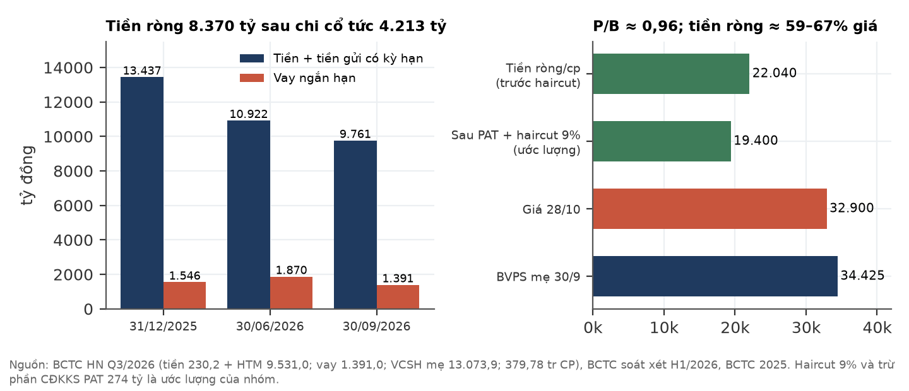

## 6. Diễn biến giá: quan sát, không gán nhân quả

**Giá điều chỉnh (đã trừ cổ tức tiền mặt) giảm khoảng 56% trong 12 tháng: từ 74.970 (29/10/2025) còn 32.900 (28/10/2026). Đáy là 29.840 ngày 27/07/2026.** Trong cùng giai đoạn có nhiều sự kiện pháp lý và kế toán, đánh dấu trên biểu đồ. Các đường dọc chỉ đánh dấu thời điểm. Nhóm **không** chứng minh được sự kiện nào gây ra biến động nào. Ngày 05–06/10/2026, HOSE đưa DGC vào danh sách không được giao dịch ký quỹ quý IV/2026 vì mã đang bị hạn chế giao dịch (cafef, VietnamFinance).

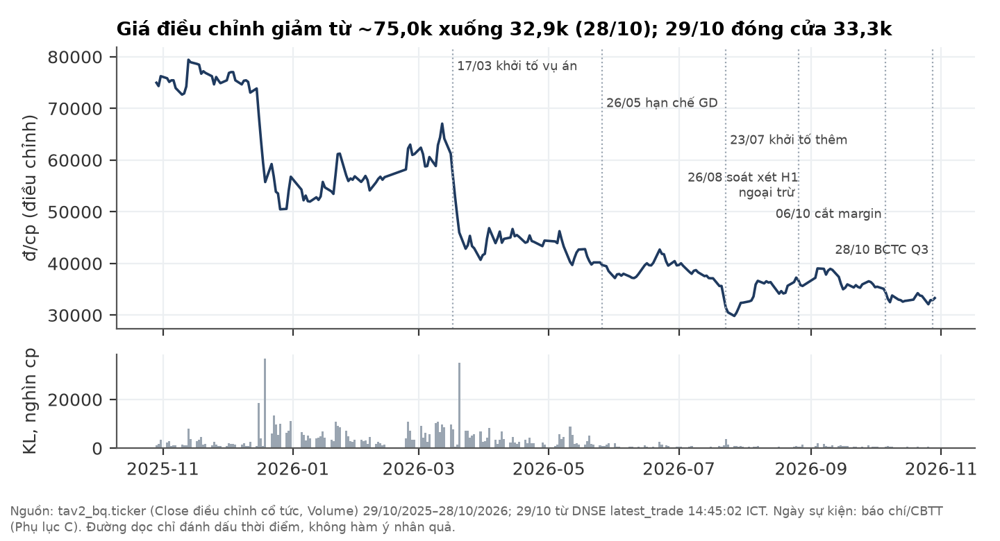

## 7. Định giá: giá nằm trong mọi dải; nhóm không chọn kịch bản cơ sở

**Hai giả định chi phối toàn bộ dải: (i) biên gộp 2027-28, mỗi 1pp ≈ 1.420 đ/cp; (ii) dự phòng môi trường còn trích bao nhiêu quý. Cả hai đều là giả định, không có số neo đáng tin.**

**Phương pháp.**
- Giá trị mỗi kịch bản bằng trung bình của ba cách: định giá theo từng phần (SOTP), chiết khấu dòng tiền (DCF), và trung bình ba bội số. Ba bội số là P/E lịch sử 10 năm của DGC, P/E nhóm so sánh và P/B.
- Các kịch bản được gộp theo trọng số chủ quan. Chi phí vốn chủ 14,9%. Tiền ròng được cộng riêng.
- **A7** = mô hình khi khai trường vẫn dừng. **B7** = cùng mô hình nếu khai trường 25/19B mở lại.
- **Hai nền biên đối xứng** (tỷ lệ 2027/2028):
  - **Nền biên thấp, 16,5/17,5%.** Tương đương ngầm ≈ 281 tỷ/năm chi phí cao hơn run-rate Q3 sau khi bỏ dự phòng.
  - **Nền biên cao, 19,5/20,7%.** Giá vốn Q3 bỏ dự phòng, giữ phẳng, dù giá NH3 đang tăng.
  - Không nền nào trung tính. Nhóm gọi hai đầu là "tổ hợp thấp nhất" và "tổ hợp cao nhất" của các giả định đã xét.
- Q4/2026 đã được tách khỏi dự phòng. Nhờ vậy dòng "không trích thêm" không bị trừ hai lần.

| Cách đọc dự phòng (giá trị A7, đ/cp) | Nền biên thấp: trước thuế / sau lá chắn 20% | Nền biên cao: trước thuế / sau lá chắn 20% |
|---|---|---|
| Không trích thêm (kể cả Q4) | **32.399** | **36.880** |
| 100 tỷ × 1 quý | 32.146 / 32.197 | 36.627 / 36.678 |
| 100 tỷ × 4 quý | 31.439 / 31.631 | 35.920 / 36.112 |
| 200 tỷ × 4 quý | 30.478 / 30.862 | 34.959 / 35.343 |
| 100 tỷ × 8 quý | 30.603 / 30.962 | 35.084 / 35.443 |
| 200 tỷ × 8 quý | 28.807 / 29.525 | 33.288 / 34.006 |
| **100 tỷ/quý lặp vĩnh viễn** | **≈ 26.117 – 26.558** (ba cách đo) | **30.598** (qua mô hình) |
| Cộng nghĩa vụ vụ án pháp nhân 200 / 500 / 1.000 tỷ (trừ thẳng 527 / 1.317 / 2.633 đ/cp) | 31.872 / 31.082 / 29.766 | 36.353 / 35.563 / 34.247 |

**Cách đọc bảng.**
- **Mức bằng chứng cho mọi hàng như nhau.** Bản chất một lần hay lặp chưa phân định, và quy mô cuối cùng chưa xác lập. Hàng "200 tỷ × N quý" chỉ là kịch bản; không có số công bố nào ủng hộ mức 200 tỷ/quý.
- **Thuế.** Theo tra cứu pháp lý tham khảo, dự phòng môi trường **không** được trừ khi tính thuế lúc trích. Khi chi thật và có chứng từ, về nguyên tắc khoản chi được trừ. Mức lá chắn 20% là giả định; thuế suất ưu đãi trong mô hình là 13%.
- **Quy mô của cùng 100 tỷ/quý (trước thuế):**
  - trừ một lần ≈ 263 đ/cp;
  - 8 quý ≈ 1.796 đ/cp;
  - lặp vĩnh viễn ≈ 6.065 đ/cp qua mô hình, hoặc 7.406 đ/cp thô.
  - Các con số này khác cơ sở thuế, nên không so tỷ lệ trực tiếp.
- **Biên tự thân.** Ngoài bảng trên, mỗi ±1pp biên gộp 2027-28 làm đổi giá trị khoảng ±1.420 đ/cp. Quanh A7, ±2pp cho dải 29.345–35.017.

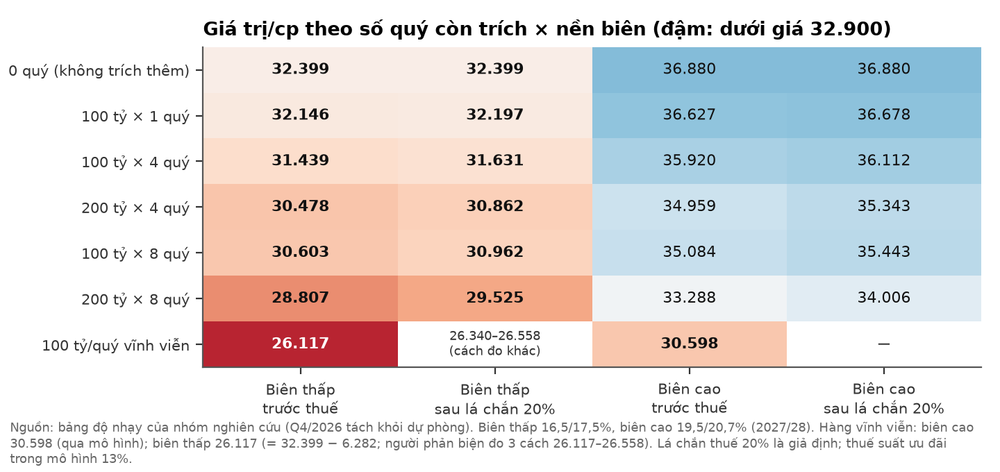

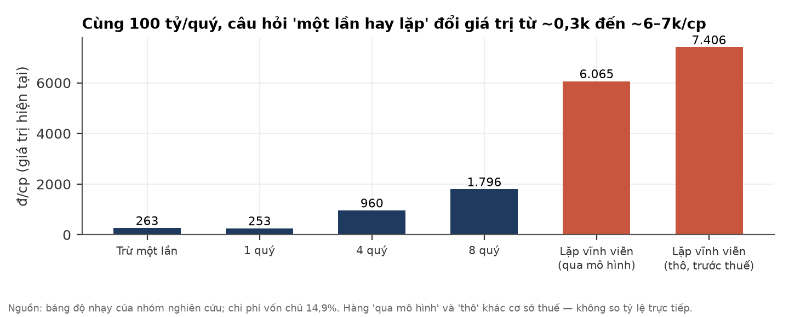

**Bằng chứng về "một lần hay lặp": hai chiều cân nhau.**

| Chiều | Bằng chứng (nguồn) |
|---|---|
| Nghiêng hữu hạn | Nhãn khoản mục là "Provision for environmental restoration costs" (khôi phục; note 19 BCTC soát xét H1). Đến 30/9 chưa thấy sử dụng (H1 cột giảm "-"). Dòng LCTT 9T "dự phòng +199,95" là điều chỉnh phi tiền, chỉ ghi như quan sát |
| Nghiêng lặp/tăng | Chú thích note 19: chi phí "arising from the Group's production and business activities" (phát sinh từ hoạt động sản xuất kinh doanh). Q3 trích thêm 100 tỷ, không thuyết minh |
| Không phân định | Chuẩn mực VAS 18 cho phép ghi nhận cả nghĩa vụ phát sinh định kỳ, nên không tự phân biệt được hai trường hợp. Báo chí diễn ý ĐHĐCĐ 13/08: doanh nghiệp "đã chủ động trích lập dự phòng 100 tỷ đồng để triển khai các biện pháp xử lý" (doanhnhan.baophapluat.vn 15/08, không phải lời nguyên văn) |
| Không nối được với vụ án | Thuyết minh 36 H1: HĐQT chưa đủ cơ sở ước tính đáng tin cậy tác động tài chính của vụ án. Vì vậy **không thể** coi khoản 200 tỷ là nghĩa vụ của vụ án. Thời điểm trùng nhau chỉ là bối cảnh, chưa chứng minh. Tác động của vụ án, nếu có, là phần **cộng thêm** |

**Vùng giá cần chạy lại kiểm định.** Nhóm **không** gán QUALIFY cho bất kỳ vùng giá nào. Muốn nâng nhãn, cần một trong các mốc ở mục 10 thay đổi, rồi chạy lại toàn bộ bài kiểm định.

## 8. Rủi ro (pre-mortem): "Nếu 18 tháng nữa giá trị thấp hơn hôm nay, vì sao?"

**Hai rủi ro có tác động lớn nhất là dự phòng lặp và pháp lý đối với pháp nhân. Rủi ro dễ xảy ra nhất là kiểm toán tiếp tục ngoại trừ.** Xác suất và tác động là nhận định chủ quan của nhóm.

| # | Rủi ro | Xác suất | Tác động | Dấu hiệu sớm | Kiểm khi nào |
|---|---|---|---|---|---|
| R1 | Dự phòng môi trường hoá ra là chi phí xử lý định kỳ | TB | Rất lớn (tới ≈ 6.000 đ/cp nếu vĩnh viễn) | Q4 trích thêm; thuyết minh BCTC năm cho thấy khoản này gắn với hoạt động sản xuất kinh doanh định kỳ | BCTC Q4/2026, kiểm toán 2026 |
| R2 | Pháp nhân hoặc công ty con bị truy cứu; đình chỉ hoạt động; buộc khắc phục | Thấp | Rất lớn | Quyết định khởi tố pháp nhân, kê biên, đình chỉ | Liên tục |
| R3 | Biên gộp 2027-28 dưới 16,5% (S/NH3 cao kéo dài, giá P4 giảm) | TB | Lớn (≈ 1.420 đ/cp mỗi 1pp) | Biên quý bỏ dự phòng < 20% | Hằng quý |
| R4 | Khai trường 25/19B không mở lại | TB | TB (≈ 4.878 đ/cp giữa B7 và A7) | Không có văn bản mốc mở lại | Hằng quý |
| R5 | Kiểm toán 2026 tiếp tục ngoại trừ, từ chối hoặc nộp chậm | Cao | Nhỏ–TB | Tiến độ điều tra | 31/03/2027 |
| R6 | Nghi Sơn chạy thử chậm hoặc hiệu suất thấp năm đầu | TB | Nhỏ | Không có doanh thu mới từ Q1/2027 | BCTC Q4/26, Q1/27 |
| R7 | Giá DAP/P4 điều chỉnh khi TQ nối lại xuất khẩu | TB | TB | TQ công bố cửa sổ xuất khẩu lân | ~T5/2027 |

**Điều có thể làm chúng tôi sai theo chiều tích cực:**
- Khoản 200 tỷ được xác nhận là chi phí khôi phục một lần.
- Hormuz mở lại và giá lưu huỳnh giảm nhanh như năm 2022.
- Khai trường mở lại.
- Nghi Sơn đóng góp sớm.
- Tiền ròng lớn được dùng cho cổ tức hoặc đầu tư có hiệu quả.

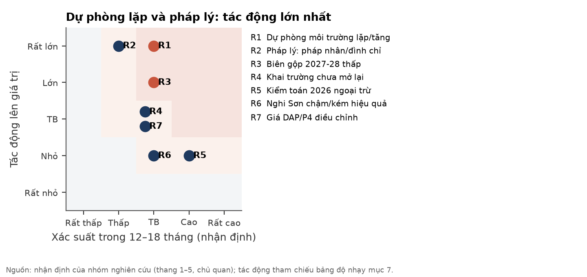

## 9. Pháp lý và quản trị — CẢNH BÁO (không phải lý do chặn phân tích)

**Có vụ án hình sự đang điều tra liên quan trực tiếp tới tài sản lõi (mỏ) và tới tính toàn vẹn của BCTC (tội danh kế toán). Mức thiệt hại cuối cùng chưa được công bố.**

**Phạm vi tra cứu.**
- Tra cứu pháp lý tham khảo ngày 29/10/2026. Đây không phải ý kiến luật sư, và nhiều điểm được ghi "chưa xác minh".
- Quét tin 01–29/10/2026 qua tin tức công khai. Không thấy sự kiện không có nghĩa là không có sự kiện.
- **Chưa** đọc trực tiếp trang thông báo của HOSE. Giai đoạn 16/08–30/09/2026 chưa được quét có hệ thống.

**Diễn biến vụ án:**
- ⚠️ **Khởi tố.** Ngày 17/03/2026, Bộ Công an khởi tố vụ án theo Điều 221, 227 và 235 Bộ luật Hình sự, với 14 bị can. Tội danh gồm vi phạm về khai thác tài nguyên (Đ.227), gây ô nhiễm môi trường (Đ.235) và một tội về kế toán (Đ.221; tên tội theo tra cứu tham khảo, chưa đối chiếu nguyên văn). Theo các nguồn, nội dung gồm đổ thải trái phép tại KCN Tằng Loỏng (Nhân Dân, BNEWS 17/03).
- ⚠️ **Khởi tố bổ sung.** Ngày 23/07/2026, Tổng giám đốc và một Phó tổng giám đốc bị khởi tố (Tuổi Trẻ). Việc khởi tố giám đốc công ty con là khởi tố **cá nhân**, không đồng nghĩa công ty con bị khởi tố với tư cách pháp nhân.
- ⚠️ **Pháp nhân.** Theo Báo Pháp luật ngày 15/08/2026, **chưa khởi tố pháp nhân**. Quét tin 01–29/10 không thấy sự kiện mới. Giai đoạn 16/08–30/09 chưa quét.
- ⚠️ **Tiền khắc phục.** Khoản 331,3 tỷ "khắc phục hậu quả" là tiền bị can và gia đình tự nguyện nộp (Kenh14 dẫn VKSND, 23/06). Một thành viên HĐQT nói đây "không phải là con số thiệt hại cuối cùng" (Viettimes 13/08).

**Khung pháp lý (tham khảo):**
- ⚠️ Pháp nhân thương mại **có thể** bị truy cứu với tội khai thác tài nguyên (Đ.227) và gây ô nhiễm môi trường (Đ.235). Tội kế toán chỉ áp dụng cho cá nhân.
- Mức phạt pháp nhân theo Điều 235 (bản 2025) từ 6 đến 40 tỷ. Con số này **không phải** trần thiệt hại:
  - Biện pháp tư pháp buộc khôi phục hoặc khắc phục (Điều 82) và bồi thường dân sự (BLDS Điều 602) không có trần.
  - Đình chỉ hoạt động là rủi ro lớn nhất.
  - Mọi tác động sẽ đi vào BCTC hợp nhất, vì công ty con sở hữu 100%.

**Giao dịch và quản trị:**
- ⚠️ **Hạn chế giao dịch.** Theo VietnamFinance 06/10, DGC bị hạn chế giao dịch từ 26/05/2026 vì chậm nộp BCTC kiểm toán 2025 quá 45 ngày, và bị cảnh báo từ 30/06 do ý kiến ngoại trừ BCTC 2025. Lý do hạn chế chỉ có **một nguồn**. Trạng thái sau 06/10 **chưa được xác nhận** từ thông báo gốc của HOSE. Không có nguồn nào nêu ngày dự kiến gỡ.
- ⚠️ **Nhân sự.** ĐHĐCĐ bất thường 08/05/2026 miễn nhiệm 3 thành viên. Chủ tịch HĐQT công ty con PAT miễn chức sau khởi tố (hiệu lực 28/07). Ắc quy Tia Sáng đổi lãnh đạo 05–06/10.
- **Cổ đông lớn tại 30/09** (một nguồn báo chí): ông Đào Hữu Huyền 18,38%, bà Ngô Thị Ngọc Lan 6,64%, ông Đào Hữu Kha 5,97%.
- **Thuế.** Dự phòng môi trường không được trừ khi trích. Phạt hành chính không được trừ. Phạt hình sự trên thực tiễn được coi là không được trừ (chưa xác minh).

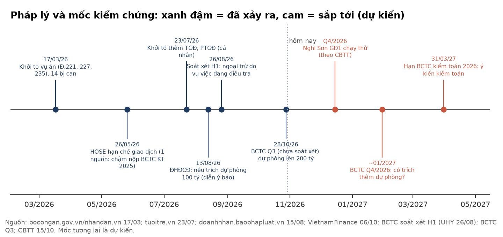

## 10. Lịch xúc tác và dấu hiệu cần theo dõi

**Mốc kiểm chứng quan trọng nhất là DGC trả lời về bản chất khoản dự phòng 200 tỷ, và BCTC Q4/2026 có trích thêm hay không.**

| Thời điểm | Sự kiện | Kiểm gì | Hệ quả với nhãn |
|---|---|---|---|
| Bất kỳ lúc nào | DGC công bố bản chất, tổng mức và lịch chi của dự phòng môi trường; dự kiến trích thêm | Một lần hay định kỳ; có gắn với vụ án không | Một lần và đủ ⇒ chạy lại kiểm định, có thể lên QUALIFY. Định kỳ ⇒ NON |
| Q4/2026 | Nghi Sơn GĐ1 chạy thử (theo CBTT 15/10/2026) | Có văn bản xác nhận vận hành | Hỗ trợ chiều tích cực; quy mô nhỏ so với lõi |
| Chưa có ngày (không có nguồn) | HOSE gỡ hạn chế giao dịch | Thông báo gốc HOSE | Cải thiện thanh khoản, không đổi giá trị |
| Bất kỳ lúc nào | Khai trường 25/19B mở lại | Văn bản cho phép | ≈ +4.878 đ/cp (B7 − A7, theo mô hình) |
| ~01/2027 | BCTC Q4/2026; BCTC soát xét hoặc kiểm toán | Dự phòng có tăng thêm không; biên gộp bỏ dự phòng; CFO | Tăng thêm mà không giải thích ⇒ nghiêng NON |
| Liên tục | Pháp lý: khởi tố pháp nhân, đình chỉ, kê biên, kết luận điều tra | Thông báo cơ quan tố tụng, CBTT | Xảy ra ⇒ NON |
| 31/03/2027 (hạn) | BCTC kiểm toán 2026 | Ý kiến kiểm toán; thuyết minh dự phòng | Gỡ ngoại trừ ⇒ chiều tích cực. Từ chối ý kiến hoặc nộp chậm ⇒ NON |
| 31/01/2027 | Chấm dự báo khoá trước của bản đọc ngành (giá lưu huỳnh, DAP) | Hướng chi phí đầu vào | Hỗ trợ hoặc phản bác giả định biên |

## Phụ lục A. Số liệu tài chính chính

Nguồn: BCTC hợp nhất Q3/2026 (ký 28/10/2026, **chưa soát xét**, bản scan 45 trang, chép tay từ ảnh); BCTC soát xét H1/2026 (UHY). Đơn vị tỷ đồng.

| Bảng cân đối | 30/09/2026 | 30/06/2026 | 31/12/2025 |
|---|---|---|---|
| Tiền và tương đương tiền | 230,2 | — | 1.040,5 |
| Đầu tư nắm giữ đến đáo hạn (tiền gửi) | 9.531,0 | — | 12.396,2 |
| Tiền + tiền gửi | **9.761,2** | 10.921,5 | 13.436,7 |
| Phải thu ngắn hạn | 811,8 | 1.850,6 | 1.220,4 |
| Hàng tồn kho (dự phòng giảm giá 0,29) | 2.085,9 | 2.460,2 | 1.681,9 |
| XDCB dở dang | 1.452,8 | 1.320,9 | 804,8 |
| Tổng tài sản | 16.513,9 | 19.271,2 | — |
| Vay ngắn hạn | 1.391,0 | 1.869,7 | 1.546,2 |
| Dự phòng phải trả ngắn hạn | 200,0 | 100,0 | 0 |
| Quỹ khen thưởng phúc lợi | 592,8 | 405,7 | — |
| VCSH (gồm CĐKKS 400,7) | 13.474,6 | — | — |
| VCSH cổ đông mẹ | 13.073,9 | — | — |

| Lưu chuyển tiền tệ 9T/2026 (gián tiếp) | Tỷ đồng |
|---|---|
| LNTT | 1.577,3 |
| Khấu hao · dự phòng · lãi đầu tư · chi phí lãi vay | +209,4 · +199,95 · −527,1 · +37,7 |
| Tồn kho (tăng) · thuế TNDN đã nộp | −421,7 · −399,5 |
| **CFO 9T/2026** (9T/2025: 1.250,2) | **755,6** |
| Chi mua sắm TSCĐ · thu thanh lý (theo bản trích; cần đối chiếu ảnh) | −511,6 · +332,3 |
| CFI 9T (dòng tổng in; các dòng con cộng ra 2.850,50) | +2.802,3 |
| Cổ tức đã trả · CFF 9T | −4.213,0 · −4.368,2 |

## Phụ lục B. Đối chiếu cơ sở dữ liệu (BQ) với BCTC

| Chỉ tiêu | tav2_bq | BCTC | Kết luận |
|---|---|---|---|
| Revenue_P0 Q1/26 | 2.125,5 | DT thuần Q1 = H1 4.540,0 − Q2 2.415,4 = 2.124,6 | Khớp (doanh thu thuần) |
| NP_P0 Q1 + Q2/26 | 408,8 + 380,1 = 788,9 | LNST mẹ H1 soát xét 788,94 | Khớp |
| GPM_P0 Q1 · Q2/26 | 28,7% · 24,8% | Biên gộp 23,0% · 18,9% | **Lệch** — định nghĩa khác; không dùng làm biên |
| CF_OA_P0 Q1 + Q2/26 | −1.093,0 + 852,6 | CFO 9T 755,6 ⇒ Q3 ≈ 996,1 | Nhất quán |
| Cash_P0 | Chỉ tiền và tương đương | Không gồm 9.531 tỷ tiền gửi kỳ hạn | Không dùng Cash_P0 cho tiền ròng |
| StDebt_P0 Q2/26 | 1.869,7 | Vay ngắn hạn 30/6: 1.869,7 | Khớp |
| OShares | 379,78 tr | 379.779.286 CP | Khớp |
| Sàn niêm yết | — | DNSE secdef: marketId = STO | **HOSE** |
| Trạng thái mã trên DNSE secdef (29/10 08:00) | — | symbolAdminStatusCode = "RES" | Nhóm chưa đối chiếu ý nghĩa mã với tài liệu DNSE; không dùng để xác nhận trạng thái HOSE |
| Giá đóng cửa 28/10 | 32.900 | DNSE basicPrice 29/10 = 32.900 | Khớp |

## Phụ lục C. Danh mục nguồn

| Nguồn | Ngày | Ghi chú |
|---|---|---|
| BCTC hợp nhất Q3/2026 (scan, chưa soát xét) | 28/10/2026 | ducgiangchem.vn; ảnh trang lưu trong hồ sơ |
| Văn bản giải trình KQKD Q3, 12/2026/CV-KT-DGC | 28/10/2026 | ducgiangchem.vn |
| BCTC hợp nhất soát xét H1/2026 (UHY, 995/2026/UHY-BCSX), note 19, 35, 36, 38 | 26/08/2026 | ducgiangchem.vn |
| BCTC Q2/2026 (cơ cấu doanh thu nội địa/xuất khẩu 6T) | 2026 | ducgiangchem.vn |
| Website công ty — giới thiệu, công suất | Truy cập 29/10/2026 | ducgiangchem.vn/gioi-thieu |
| CBTT nghị quyết HĐQT 34 — Dự án Nghi Sơn | 15/10/2026 | Qua báo chí |
| Bộ Công an; Nhân Dân; BNEWS — khởi tố vụ án | 17/03/2026 | bocongan.gov.vn, nhandan.vn |
| Tuổi Trẻ — khởi tố bổ sung | 23/07/2026 | tuoitre.vn |
| Báo Pháp luật — ĐHĐCĐ, "chưa khởi tố pháp nhân" | 15/08/2026 | doanhnhan.baophapluat.vn |
| Kenh14 (dẫn VKSND); VnExpress; Viettimes | 23/06; 13/08/2026 | Tiền khắc phục; phát biểu HĐQT |
| VietnamFinance; cafef — hạn chế giao dịch, cắt margin, ngoại trừ 2025 | 05–06/10/2026 | Lý do hạn chế: một nguồn |
| Bản đọc ngành phân bón lân/lưu huỳnh/NH3 (đọc mù) | 28/10/2026 (+ bổ sung 29/10) | Nguồn gốc: SMM, Argus, UkrAgroConsult, WB, OilChem, EnterpriseAM… |
| tav2_bq: ticker, ticker_financial, commodity_prices | Kéo 29/10/2026 | Cơ sở dữ liệu của nhóm |
| DNSE OpenAPI latest_trade, secdef (DGC) | 29/10/2026, đọc 19:12 ICT | Khớp cuối phiên 14:45:02 |

## Phụ lục D. Phương pháp và giới hạn

**Phương pháp.** Giá trị được dựng từ dưới lên theo thứ tự: chất lượng lợi nhuận → dòng tiền → bảng cân đối → biên 2027-28 → SOTP, DCF và bội số. Sau đó đối chiếu từ trên xuống với bản đọc ngành. Số do nhóm tự tính được ghi "(ước lượng)". Biểu đồ và CSV được tái lập bằng `build_report.py`.

**Giá dùng trong báo cáo.** Định giá neo vào đóng cửa 28/10/2026 (32.900 đ). Giá đóng cửa 29/10 (33.300 đ, +1,2%) từ DNSE không làm đổi kết luận: giá vẫn nằm trong mọi dải và vẫn sát cận dưới A7.

**Giới hạn đã biết:**
- BCTC Q3/2026 **chưa soát xét**. Số được chép tay từ bản scan ảnh không có lớp chữ, nên chữ số cuối có thể sai.
- Không có cơ cấu doanh thu hay biên theo sản phẩm, giá bán, sản lượng; không có tỷ trọng lưu huỳnh/NH3/quặng trong giá vốn.
- Không có thuyết minh bản chất, tổng mức và lịch chi của dự phòng môi trường. Vị trí khoản này trong giá vốn là suy luận loại trừ.
- Chưa có kết luận điều tra hay cáo trạng; không có số thiệt hại môi trường, mức phạt hay quyết định buộc khắc phục có số tiền.
- Trạng thái hạn chế giao dịch HOSE sau 06/10/2026 chưa xác nhận từ nguồn gốc.
- Công suất theo website không ghi ngày cập nhật. BCTN 2025 (PDF ảnh) chưa đọc. Chưa tra giao dịch cổ đông nội bộ.
- Haircut 9% cho tiền ròng, giá phốt pho vàng 4.150 USD/t, hai nền biên và lá chắn thuế 20% đều là giả định.
- Giá trong biểu đồ 12 tháng đã điều chỉnh cổ tức tiền mặt.

## Phụ lục E. Quy trình độc lập

Báo cáo đi qua ba lớp tách biệt:
1. **Đọc ngành mù.** Một nhà phân tích vĩ mô độc lập viết bản đọc ngành phân bón lân và chuỗi lưu huỳnh/NH3, không biết mã cổ phiếu, giá hay BCTC.
2. **Due diligence.** Nhóm đọc BCTC gốc từng trang và dựng định giá.
3. **Phản biện độc lập.** Một người phản biện có nhiệm vụ duy nhất là bác bỏ kết luận. Người này đã qua **bốn vòng**. Ở vòng cuối, người phản biện tái lập độc lập toàn bộ số học và xác nhận các con số khớp.

**Minh bạch — những gì người phản biện đã sửa qua bốn vòng:**
1. **Số sai.**
   - Một bản trước ghi "100 tỷ/quý lặp vĩnh viễn ≈ 1.516 đ/cp"; con số đó thật ra là mức của 100 tỷ/**năm**. Đúng là ≈ 6.065 đ/cp.
   - Dự phòng giảm giá tồn kho từng bị ghi nhầm đơn vị: 292,9 tỷ, trong khi đúng là 0,29 tỷ.
   - Dấu của thuế hoãn lại được sửa.
2. **Tính đôi Q4.** Biên Q4/2026 nội suy đã ngầm chứa khoảng 100 tỷ dự phòng, nên các hàng "trích thêm N quý" trừ quý đầu hai lần. Ảnh hưởng ≈ 217 đ/cp. Đã tách ra, nên giá trị "không trích thêm" ở nền biên cao là 36.880 chứ không phải 36.663.
3. **Lập luận bị bỏ.** Lập luận "VAS 18 + dự phòng ngắn hạn ⇒ chỉ một lần" đã bị bỏ, vì nó không phân biệt được một lần với định kỳ.
4. **Dải chưa đối xứng.** Dải định giá được trình bày lại theo hai nền biên, gồm **cả hai cực**:
   - Bảng có thêm ô "nền biên thấp + lặp vĩnh viễn" ≈ 26,1–26,6 nghìn (người phản biện đo ba cách), trước đó bị thiếu.
   - Không còn gán nhãn "chồng giả định bi quan" cho riêng một nền.
5. **Một lần hay lặp.** Câu "nghiêng hữu hạn" được sửa thành "**chưa phân định**; bằng chứng hai chiều cân nhau". Các tỷ lệ so sánh trộn cơ sở thuế (kiểu "gấp ~23 lần") đã bị bỏ.
6. **Pháp lý.**
   - Câu "chưa khởi tố pháp nhân" giờ ghi rõ cửa sổ nguồn (Báo Pháp luật 15/08; quét tin 01–29/10).
   - Mức phạt Điều 235 được nêu kèm lưu ý đây không phải trần thiệt hại.
   - Ngày dự kiến gỡ hạn chế giao dịch không được nêu vì không có nguồn xác nhận.

**Giới hạn của quy trình.** Các sửa theo vòng phản biện cuối (nêu ở mục 4-6 trên) được áp vào báo cáo này sau vòng đó và chưa được người phản biện rà lại lần nữa; số học đã được nhóm tái lập độc lập. Phần pháp lý do tra cứu tham khảo, nhiều điểm chưa xác minh nguyên văn.

**Lịch sử nhãn.** Các vòng trước đã cân nhắc giữa AMBIGUOUS và NON. Nhãn hiện tại (AMBIGUOUS, nghiêng tích cực) giữ cả hai chiều bằng chứng. Nhóm nêu điều này để người đọc biết kết luận đã từng dao động trên cùng một bộ dữ liệu.

## Phụ lục F. Tuyên bố miễn trừ trách nhiệm

Tài liệu này mang tính thông tin và nghiên cứu. Nó không phải lời khuyên đầu tư cá nhân hoá và không phải đề nghị giao dịch chứng khoán. Nhãn QUALIFY/AMBIGUOUS/NON là đánh giá nghiên cứu theo khung của nhóm, không tính tới mục tiêu, khẩu vị rủi ro hay tình hình tài chính của từng nhà đầu tư. Số liệu quá khứ không bảo đảm kết quả tương lai. Các ước lượng, kịch bản và xác suất là chủ quan và có thể sai. Thông tin pháp lý chỉ để tham khảo, không phải ý kiến tư vấn pháp lý. BCTC Q3/2026 chưa được soát xét. Người đọc tự chịu trách nhiệm về quyết định của mình và nên tham khảo chuyên gia được cấp phép trước khi đầu tư.
