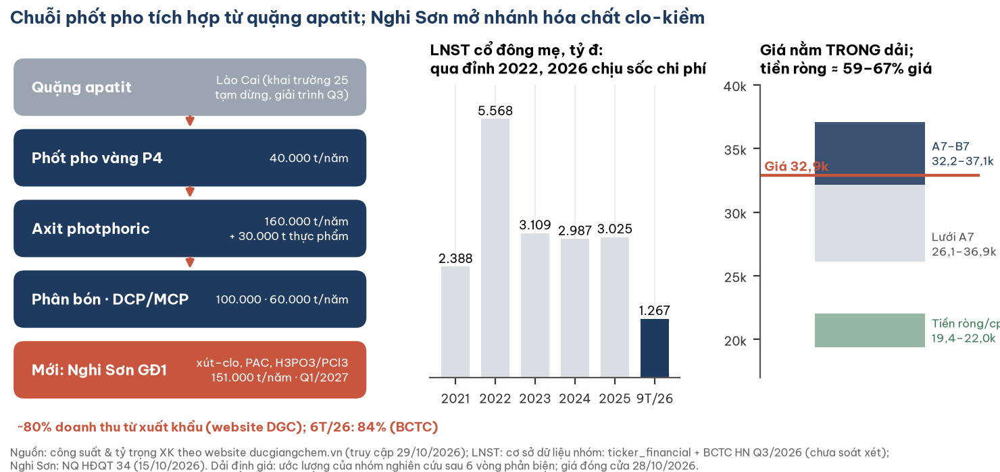
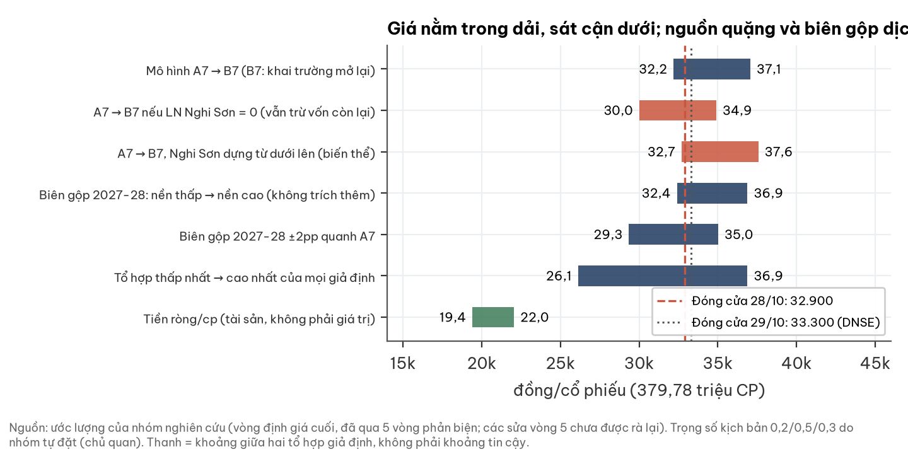
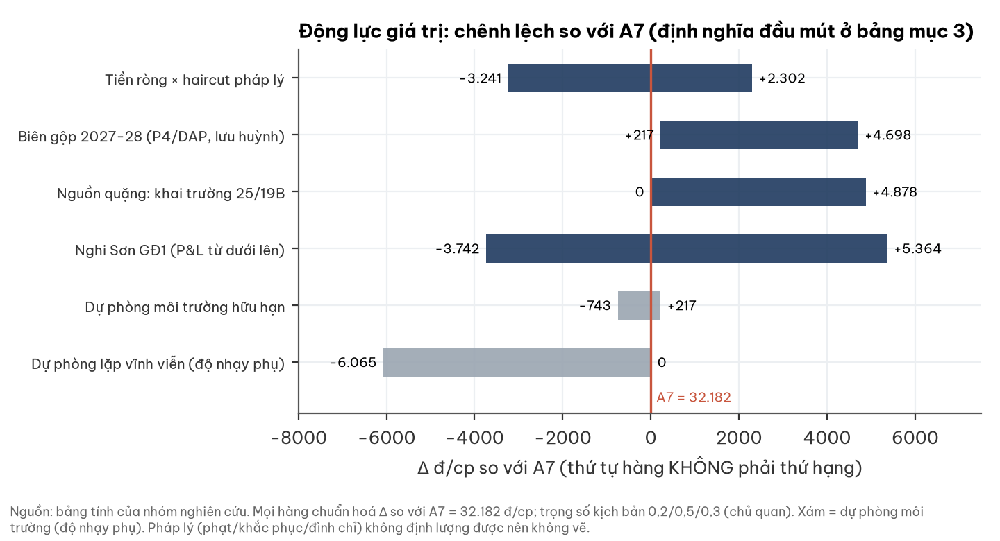
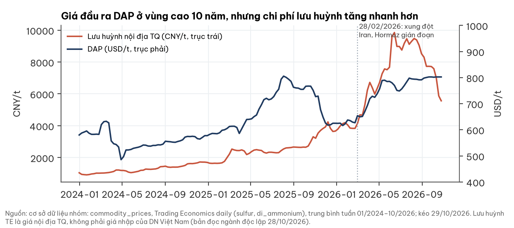
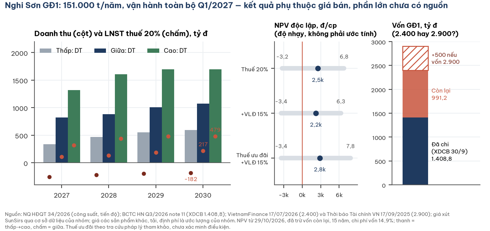
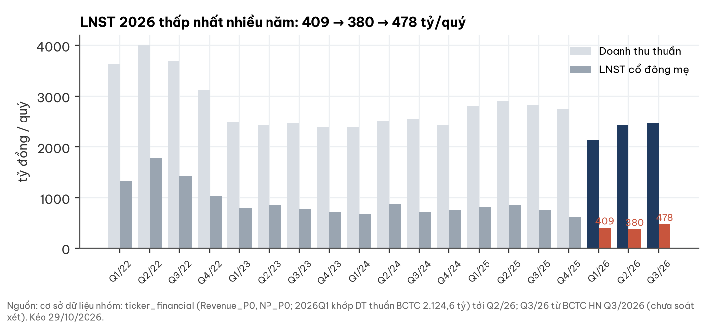
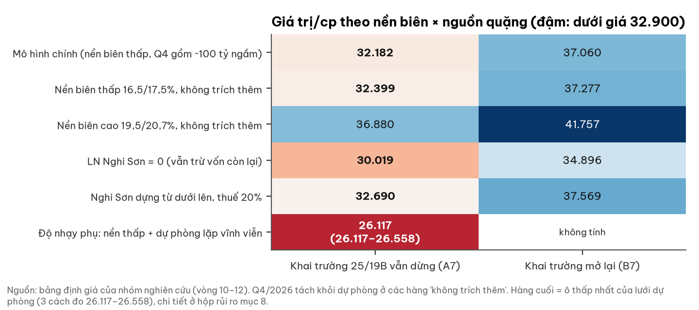
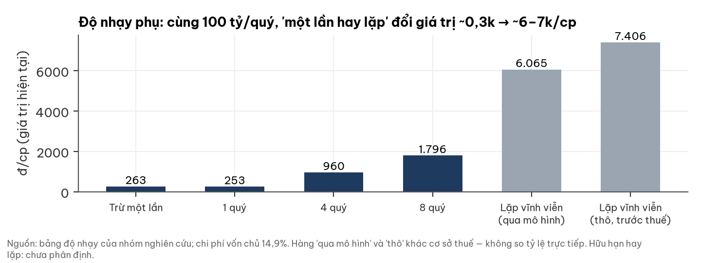
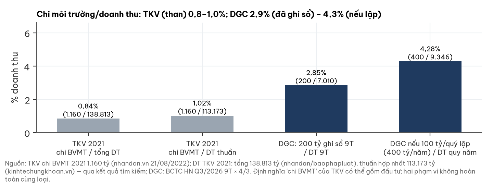
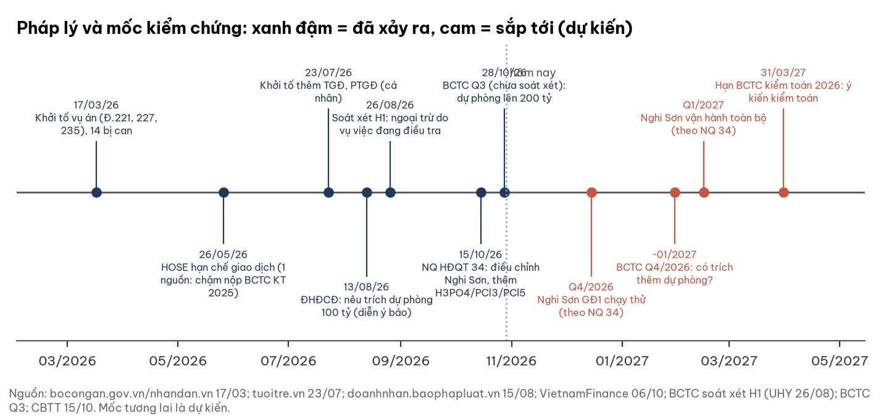

# DGC — CTCP Tập đoàn Hóa chất Đức Giang: tiền ròng ≈ 2/3 thị giá và Nghi Sơn chạy từ 2027, nhưng giá 32.900 sát cận dưới dải mô hình, chưa có đệm cho rủi ro pháp lý

**Báo cáo Due Diligence (bản 2.1, đính chính) · 29/10/2026 · Nhóm nghiên cứu** · Sàn HOSE · Hóa chất phốt pho, phân bón, phụ gia; sắp thêm hóa chất clo-kiềm (Nghi Sơn). Báo cáo này (bản 2.1, đính chính) thay thế bản 2 gửi tối 29/10/2026.

## Investment Summary

**Giá 32.900 đ (đóng cửa 28/10/2026) nằm TRONG vùng giá trị mà nhóm dựng được, sát cận dưới của dải mô hình 32.182–37.060.** Cận dưới (A7) là trường hợp khai trường 25/19B vẫn dừng và biên gộp 2027-28 ở nền thấp. Giá tương thích với A7 nhưng cũng tương thích với các tổ hợp khác (ví dụ khai trường mở lại cùng rủi ro pháp lý cao), nên từ vị trí của giá không suy ra được thị trường đang định giá kịch bản nào. Giá không có đệm rõ ràng nếu rủi ro pháp lý xấu đi: phạt, khắc phục và đình chỉ chưa định lượng được. Phần chắc nhất của luận điểm là bảng cân đối: tiền ròng 8.370 tỷ ≈ 22.040 đ/cp trước haircut, P/B 0,96.

| Dữ liệu chính | Giá trị | Ghi chú |
|---|---|---|
| Đóng cửa 28/10/2026 | **32.900 đ** | Mốc neo cho toàn bộ định giá |
| Giá 29/10/2026, khớp cuối 14:45:02 | 33.300 đ (+1,2%) | DNSE latest_trade, đọc 19:12 ICT; kết luận không đổi ở cả hai mức |
| Dải mô hình A7 (khai trường dừng) – B7 (mở lại) | **32.182 – 37.060** | Ước lượng; trung bình gia quyền 3 kịch bản với w = 0,2 / 0,5 / 0,3 (trọng số do nhóm tự đặt, chủ quan) |
| Ba kịch bản trong A7: thuận / cơ sở / nghịch | 44.213 / 33.778 / 21.501 | Ước lượng; nhóm không chọn kịch bản nào làm cơ sở |
| Ô thấp nhất / cao nhất của lưới biên × dự phòng (cột A7) | ≈ 26,1–26,6 nghìn / 36.880 | Thấp nhất: dự phòng môi trường lặp vĩnh viễn (độ nhạy phụ, mục 9). Cao nhất ở cột B7 (nền biên cao) là 41.757; còn có tổ hợp thấp hơn khi cộng haircut pháp lý lớn |
| Tiền + tiền gửi · vay · tiền ròng (30/9/2026) | 9.761 · 1.391 · **8.370 tỷ** | ≈ 22.040 đ/cp trước haircut; ≈ 19.400 sau phần cổ đông thiểu số PAT và haircut 9% (ước lượng) |
| Cổ tức đã trả 9T/2026 (LCTT) | 4.213,0 tỷ | Gồm đợt 8.000 đ/cp trả 25/09/2026 ≈ 3.038 tỷ |
| BVPS mẹ · P/B · P/E TTM | 34.425 đ · **0,96×** · 6,6× | VCSH mẹ 13.073,9 tỷ; LNST mẹ 4 quý 1.888,8 tỷ (gồm lãi tiền gửi) |
| LNST mẹ 9T/2026 | 1.267,1 tỷ (−47% YoY) | BCTC hợp nhất Q3/2026, chưa soát xét |
| Nghi Sơn GĐ1 | 151.000 t/năm; vận hành toàn bộ Q1/2027 | NQ HĐQT 34/2026; đã chi 1.408,8 tỷ (XDCB 30/9) |
| Vốn hoá (32.900) | 12.495 tỷ đ | 379.779.286 CP |

**Ba luận điểm (MECE):**

1. **Bảng cân đối là phần chắc nhất.** Tiền ròng 8.370 tỷ ≈ 59–67% giá, còn lại sau khi đã trả 4.213 tỷ cổ tức trong 9 tháng. Tiền ròng bằng 1,99 lần mức cổ tức đã chi 9T. P/B 0,96.
2. **Lợi nhuận lõi ở đáy nhiều năm vì chi phí đầu vào và nguồn quặng, không chỉ vì dự phòng.** Biên gộp Q3 20,5% (Q3/25: 31,1%). Khai trường 25 tạm dừng phục vụ điều tra nên công ty dùng toàn bộ quặng nhập/mua ngoài; lưu huỳnh, NH3, điện, than cốc tăng giá (giải trình 28/10/2026). Biên 2027-28 và việc mở lại khai trường là hai động lực đo được, biên độ mỗi cái ≈ 4,5–4,9 nghìn đ/cp (Nghi Sơn, haircut pháp lý và dự phòng lặp có biên độ rộng hơn nhưng bằng chứng yếu hơn).
3. **Nghi Sơn là dự án đầu tư lớn nhất của DGC và sắp vào vận hành, nhưng giá trị của nó phụ thuộc giá bán chưa có nguồn.** Trong mô hình, phần dự án còn lại đang được định giá **thấp hơn** số vốn còn phải chi (ròng −447 đ/cp). Một phép DCF độc lập cho kết quả từ −3,2 tới +6,8 nghìn đ/cp tùy giá bán. Khoảng chênh này chủ yếu do phương pháp, không do dữ kiện mới.

**Điều gì sẽ làm nhận định thay đổi.**
- **Tích cực hơn:**
  - Khai trường 25/19B có văn bản mở lại (B7 − A7 ≈ +4.878 đ/cp theo mô hình).
  - Biên gộp quý (bỏ dự phòng) giữ quanh 20% trong khi giá lưu huỳnh hạ.
  - Nghi Sơn chạy thử đúng Q4/2026, công bố giá bán/sản lượng; ưu đãi thuế được xác nhận.
  - DGC công bố bản chất và tổng mức khoản dự phòng môi trường; kiểm toán gỡ ngoại trừ.
- **Tiêu cực hơn:**
  - Pháp nhân hoặc công ty con bị truy cứu, đình chỉ hoặc kê biên.
  - Q4/2026 trích thêm dự phòng mà không giải thích.
  - Nghi Sơn chậm hoặc giá xút ở đáy chu kỳ kéo dài.
  - BCTC kiểm toán 2026 bị từ chối ý kiến hoặc nộp chậm.

## 1. Tóm tắt điều hành

**Tình huống.** DGC sản xuất phốt pho vàng và hóa chất gốc phốt pho tích hợp từ mỏ apatit ở Lào Cai; khoảng 80% doanh thu từ xuất khẩu (website công ty; 6T/2026: 84% theo BCTC). Doanh nghiệp giữ 9.761 tỷ tiền và tiền gửi tại 30/9/2026, và đang hoàn thành Tổ hợp Hóa chất Nghi Sơn giai đoạn 1 ở Thanh Hoá. Giá điều chỉnh cổ tức giảm từ khoảng 75,0 nghìn (29/10/2025) còn 32.900 (28/10/2026).

**Biến chuyển.** Năm 2026 có bốn việc chồng lên nhau:
- **Vụ án.** Vụ án được công bố ngày 17/03/2026 (theo Bộ Công an, khởi tố từ 25/12/2025 và 14/03/2026; chưa tự đối chiếu): kế toán, khai thác tài nguyên, gây ô nhiễm môi trường; khai trường 25 tạm dừng phục vụ điều tra.
- **Chi phí đầu vào.** Lưu huỳnh, NH3, điện, than cốc tăng; quặng phải nhập hoặc mua ngoài.
- **Dự phòng môi trường.** Q2 và Q3 mỗi quý trích 100 tỷ, số dư 200 tỷ; chưa thuyết minh tổng mức hay lịch chi.
- **Nghi Sơn.** NQ HĐQT 34 (15/10/2026) điều chỉnh dự án: thêm H3PO4/PCl3/PCl5, chạy thử Q4/2026, vận hành toàn bộ Q1/2027.

**Câu hỏi.** Ở 32.900, thấp hơn giá trị sổ sách và cao hơn tiền ròng khoảng 11 nghìn đ/cp, giá đang trả cho kịch bản nào?

**Trả lời.** Giá ≈ cận dưới của dải mô hình, tức theo mô hình tương đương kịch bản khai trường đóng và biên ở nền thấp (đây là đọc theo mô hình, không phải điều thị trường đã nói). Phía cao cần ít nhất một trong hai: mở lại khai trường hoặc biên hồi về run-rate 9T. Phía thấp chỉ cần MỘT trong các yếu tố sau xảy ra đơn lẻ: haircut pháp lý lớn, Nghi Sơn không có lợi nhuận, biên thấp hơn nền thấp 2 điểm phần trăm hoặc dự phòng môi trường lặp; mỗi yếu tố riêng đã đưa giá trị dưới giá hiện tại. Nghi Sơn: lợi nhuận bằng 0 làm A7 giảm khoảng 2,2 nghìn; P&L "thấp" dựng từ dưới lên (có lỗ) giảm khoảng 3,7 nghìn; kịch bản giữa dựng từ dưới lên tăng khoảng 0,5 nghìn đ/cp. Dự phòng môi trường là độ nhạy phụ.

## 2. Thị trường đang định giá gì

**Giá hiện tại ngầm định lợi nhuận lõi thấp hơn khoảng 25–45% so với 9 tháng 2026 năm hoá (ước lượng).**

| Phép định giá ngược (ước lượng, giá 32.900) | Giá trị |
|---|---|
| Vốn hoá | 12.495 tỷ |
| Trừ tiền ròng sau phần cổ đông thiểu số PAT và haircut 9% (19.400 đ/cp) | −7.368 tỷ |
| Giá trị thị trường gán cho hoạt động lõi | **≈ 5.127 tỷ** |
| LNTT lõi 9T/2026 = LN thuần HĐKD 1.568,0 − DT tài chính 576,1 + CP tài chính 61,9 | 1.053,8 tỷ (đã gồm 200 tỷ dự phòng) |
| Năm hoá, sau thuế 13% và phần cổ đông không kiểm soát (7,5%) | ≈ 1.131 tỷ |
| P/E lõi ngầm định | **≈ 4,5×** |
| LNST lõi ngầm định ở P/E lõi 6–8× (khung dùng trong mô hình) | ≈ 640–855 tỷ/năm |

**Đọc hai chiều.**
- **Lạc quan:** P/E lõi ≈ 4,5× là thấp nếu 9T/2026 (đã gánh 200 tỷ dự phòng và quặng nhập) là đáy, và chưa tính Nghi Sơn.
- **Thận trọng:** mô hình hạ doanh thu 2027 xuống 9.261 tỷ (−6,2% so với Q3 × 4) vì giả định giá phốt pho vàng 4.150 USD/t và giữ giá vốn phẳng. Nếu chi phí môi trường lặp lại, LNST lõi có thể rơi vào đúng vùng 640–855 tỷ.

**Diễn biến giá (quan sát, không gán nhân quả).** Giá điều chỉnh giảm khoảng 56% trong 12 tháng, đáy 29.840 ngày 27/07/2026. Các đường dọc trên biểu đồ chỉ đánh dấu thời điểm sự kiện. Ngày 05–06/10/2026, HOSE đưa DGC vào danh sách không được giao dịch ký quỹ quý IV/2026 vì mã đang bị hạn chế giao dịch (cafef, VietnamFinance).

## 3. Động lực giá trị: biên gộp, nguồn quặng, tiền ròng và Nghi Sơn

**Mọi động lực dưới đây được đo cùng một cách: chênh lệch (đ/cp) so với A7 = 32.182, mỗi đầu mút có định nghĩa riêng. Thứ tự hàng không phải thứ hạng.** Các trung bình gia quyền dùng w = thuận 0,2 / cơ sở 0,5 / nghịch 0,3; trọng số do nhóm tự đặt, chủ quan, không phải xác suất đo được.

| Động lực | Đầu thấp (định nghĩa) | Chênh thấp | Đầu cao (định nghĩa) | Chênh cao | Độ chắc của bằng chứng |
|---|---|---|---|---|---|
| Tiền ròng × haircut pháp lý | haircut 29% ở cả 3 kịch bản | −3.241 | haircut 3% ở cả 3 kịch bản | +2.302 | Số dư tiền chắc (BCTC 30/9); haircut là ước lượng |
| Biên gộp 2027-28 (giá P4/DAP, lưu huỳnh, NH3, quặng mua ngoài) | nền thấp 16,5/17,5%, không trích thêm | +217 | nền cao 19,5/20,7% (9T thực 20,7%), giá vốn phẳng | +4.698 | Biên 9T chắc; hướng 2027-28 là ước lượng |
| Nguồn quặng: khai trường 25/19B | không mở lại (A7) | 0 | mở lại (B7) | +4.878 | Chưa có quyết định mở lại |
| Nghi Sơn GĐ1 (vốn còn lại luôn được trừ) | P&L "thấp" dựng từ dưới lên (có lỗ), áp cho cả 3 kịch bản | −3.742 | P&L "cao", áp cho cả 3 kịch bản | +5.364 | Công suất chắc (NQ 34); giá bán phần lớn là ước lượng |
| Dự phòng môi trường hữu hạn | thêm 100 tỷ/quý × 4 quý | −743 | không trích thêm | +217 | Số dư 200 tỷ chắc; tương lai chưa phân định |
| Dự phòng lặp vĩnh viễn (độ nhạy phụ) | nền thấp + 100 tỷ/quý vĩnh viễn (26.117–26.558) | −6.065 | A7 | 0 | Chưa phân định; xem hộp mục 9 |
| Pháp lý: phạt, khắc phục, đình chỉ | không định lượng | | | | Mức phạt luật định không phải trần thiệt hại |

**Cách đọc.**
- Biên gộp và nguồn quặng là hai động lực có cơ sở đo tương đối tốt; cả hai lệch về phía trên A7, vì A7 đã giả định khai trường dừng và biên ở nền thấp.
- Tiền ròng là tài sản chắc, nhưng giá trị thuộc về cổ đông phụ thuộc phần không bị dùng cho nghĩa vụ pháp lý (haircut).
- Nghi Sơn có biên độ rộng vì giá bán chưa có nguồn; hai đầu mút là kịch bản cực, áp đồng loạt cho cả 3 kịch bản.
- Dự phòng môi trường là một hàng trong bảng, không phải trục chính. Cách đọc "lặp vĩnh viễn" cho mức giảm lớn nhất nhưng có bằng chứng yếu nhất về bản chất (hộp mục 9).
- **Cổ tức.** Cổ tức 8.000 đ/cp trả 25/09/2026 (5.000 còn lại của 2025 + 3.000 tạm ứng 2026, theo doanhnhan.baophapluat.vn 13/09). Nhóm không dự báo cổ tức mới; chỉ ghi nhận tiền ròng 8.370 tỷ bằng 1,99 lần mức đã chi 9T (4.213 tỷ).

## 4. Ngành: giá đầu ra ở vùng cao 10 năm, nhưng chi phí đầu vào tăng nhanh hơn

**Chuỗi phốt pho toàn cầu đang chịu cú sốc cung từ eo Hormuz, chồng lên tình trạng thiếu lưu huỳnh. Theo người đọc ngành độc lập, chi phí "giảm về hướng nhưng vẫn cao về mức".** Bản đọc ngành do một nhà phân tích vĩ mô thực hiện mù (không biết mã, giá hay BCTC), as-of 28/10/2026, tập trung vào DAP và chuỗi lưu huỳnh/NH3. Mảng lõi của DGC là phốt pho vàng, chỉ chia một phần chi phí đầu vào. Phần này là bối cảnh, không phải dự báo biên của DGC.

| Chủ đề | Dữ kiện (nguồn, ngày) | Đọc của người đọc ngành (nhận định) |
|---|---|---|
| Lưu huỳnh | Nội địa TQ 5.714 CNY/t (23/10), −38% từ đỉnh 9.261 (tháng 8), vẫn ×1,45 mức trước xung đột. Hợp đồng Trung Đông tháng 10: Qatar 835 USD/t, chỉ −5–10% từ đỉnh (SMM 08/10/2026) | Đỉnh cấp tính đã qua; chi phí thực của nhà nhập khẩu VN giảm ít hơn giá TQ gợi ý |
| DAP | 800,6 USD/t (WB, tháng 9) = phân vị 96,7% của 10 năm | Bền vừa phải tới Q1/2027, vùng 720–830; rủi ro giảm lớn hơn rủi ro tăng |
| Cung TQ | TQ cấm xuất khẩu MAP/DAP từ 19/03/2026 (UkrAgroConsult 16/10/2026) | Đỡ giá tới khi TQ nối lại xuất khẩu (Argus dự kiến khoảng tháng 5/2027) |
| NH3 / khí | Khí TTF +63% từ đầu tháng 8; NH3 vùng Gulf gần như dừng (EnterpriseAM 06/10/2026) | NH3 có thể lấy lại phần biên mà lưu huỳnh trả lại |

**Hàm ý cho DGC.** Giải trình KQKD Q3 (28/10/2026) nêu đúng các yếu tố trên. Theo người đọc ngành, giá vốn thường trễ 1–2 quý so với giá thị trường. Nhóm không dựng được cầu nối định lượng từ giá nguyên liệu tới biên của DGC vì doanh nghiệp không công bố tỷ trọng nguyên liệu trong giá vốn hay cơ cấu doanh thu theo sản phẩm. Một dự báo khoá trước của người đọc ngành (giá lưu huỳnh nội địa TQ, DAP) sẽ được chấm ngày 31/01/2027.

## 5. Doanh nghiệp: hơn 60 năm làm hóa chất phốt pho, đang mở nhánh clo-kiềm

**DGC là một trong số ít doanh nghiệp Việt Nam làm chủ trọn chuỗi từ quặng apatit tới phốt pho vàng và hóa chất tinh khiết. Lợi thế gắn chặt với mỏ ở Lào Cai, nơi rủi ro hiện tại tập trung; Nghi Sơn là bước đa dạng hoá đầu tiên ra ngoài chuỗi phốt pho.**

**Lịch sử hình thành** (website ducgiangchem.vn, truy cập 29/10/2026; BCTC hợp nhất Q3/2026 thuyết minh 1):

| Năm | Mốc |
|---|---|
| 1963 | Thành lập; tiền thân là Công ty Hóa chất Đức Giang, doanh nghiệp nhà nước thuộc Tổng cục Hóa chất |
| 2003–2004 | Cổ phần hoá; GCN đăng ký doanh nghiệp lần đầu 05/03/2004 |
| 2020 | Niêm yết HOSE (DNSE secdef: 28/07/2020) |
| 2021 | Vào rổ FTSE Russell; Top 50 công ty đại chúng uy tín, hiệu quả (VietNamReport) |
| 2022 | Doanh thu gần 15.000 tỷ, vốn điều lệ 3.800 tỷ (theo website) |
| 2025–2026 | Khởi công Nghi Sơn (02/2025). Vụ án khởi tố 03/2026. NQ HĐQT 34 điều chỉnh Nghi Sơn (15/10/2026) |

**Sản phẩm và công suất hiện hữu** (website; công ty không ghi ngày cập nhật):

| Sản phẩm | Công suất công bố | Vai trò |
|---|---|---|
| Phốt pho vàng (P4) | 40.000 t/năm | Sản phẩm lõi, chủ yếu xuất khẩu |
| Axit photphoric (chiết xuất) | 160.000 t/năm | Nguyên liệu cho phân bón, phụ gia |
| Axit photphoric thực phẩm | 30.000 t/năm | Hóa chất tinh khiết |
| Tổ hợp phân bón | 100.000 t/năm | Phân bón |
| DCP & MCP | 60.000 t/năm | Thức ăn chăn nuôi, công nghiệp |
| Bột giặt, chất tẩy rửa | 10.000 t/năm | Tiêu dùng |
| Ắc quy Tia Sáng | 300.000 kWh/năm | Công ty con 51% |

**Khách hàng và thị trường.** Website nêu 80% doanh thu từ xuất khẩu, không nêu thị trường cụ thể; BCTC 6T/2026: xuất khẩu 3.804,6 tỷ (84% doanh thu thuần). Trên bảng cân đối 30/9 thấy một số đối tác: phải thu Mitsubishi 188,3 tỷ; trả trước cho Samsung C&T Singapore 119,5 tỷ. Doanh nghiệp không công bố cơ cấu doanh thu theo sản phẩm, giá bán hay sản lượng.

**Cơ cấu tập đoàn** (BCTC Q3/2026, thuyết minh 1): 3 chi nhánh và 8 công ty con. Đơn vị sản xuất chính: Hóa chất Đức Giang – Lào Cai (100%), Phốt pho Apatit Việt Nam (PAT, 51%), Hóa chất Đức Giang Nghi Sơn (100%, chủ dự án Nghi Sơn), Hóa chất Đức Giang – Đắk Nông (100%), kho bãi Đình Vũ (100%), Ắc quy Tia Sáng (51%). Lao động 2.629 người tại 30/9/2026.

## 6. Nghi Sơn: dự án đầu tư lớn nhất trong lịch sử DGC

**Giai đoạn 1 (151.000 t/năm, vận hành toàn bộ Q1/2027) đã chi 1.408,8 tỷ và còn khoảng 991 tỷ nếu tổng vốn 2.400 tỷ. Ở kịch bản giữa, doanh thu 2030 ≈ 1.073 tỷ, ≈ 11% doanh thu DGC hiện nay (ước lượng). Giá trị của dự án phụ thuộc chủ yếu vào giá bán, mà phần lớn chưa có nguồn công khai.**

### 6a. Dự án gồm gì (NQ HĐQT 34/2026, 15/10/2026, đọc nguyên văn)

Chủ dự án: Công ty TNHH MTV Hóa chất Đức Giang Nghi Sơn (100% DGC), KKT Nghi Sơn, Thanh Hoá. Công suất theo GCN đầu tư thay đổi lần 01 ngày 06/12/2022:

| Sản phẩm | Công suất (t/năm) | Ghi chú |
|---|---|---|
| Xút NaOH (quy 100%) | 50.000 | Sản phẩm chính của điện phân muối |
| HCl 31% | 15.000 | |
| PAC (chất keo tụ xử lý nước) | 30.000 | |
| Hợp chất chứa clo | 46.000 | Javen 30.000 (10.000 dây chuyền + 20.000 phụ phẩm), Ca(OCl)2 20.000, clo lỏng 5.000, Chloramin B 1.000, CaCl2 10.000 |
| H3PO3 | 10.000 | NQ 34 cho phép đổi thành rổ H3PO3/H3PO4/PCl3/PCl5, tối đa 10.000 t quy H3PO3, kèm 75.000 t HCl 31% phụ phẩm |
| **Tổng** | **151.000** | NQ 34 không ghi vốn đầu tư |

**Tiến độ (NQ 34).** Lắp đặt và chạy thử Q4/2026; vận hành phân xưởng xút và PAC Q4/2026; vận hành toàn bộ Q1/2027. Lịch cũ (QĐ 3738/QĐ-UBND 17/09/2024) là hoàn thành Q1/2026.

**Vốn — hai con số, chưa ngã ngũ.**
- 2.400 tỷ: "giai đoạn 1 có diện tích 30ha và tổng vốn đầu tư 2.400 tỷ đồng", 151.000 t (VietnamFinance 17/07/2026). Con số này xuất hiện từ 2020 (nhadautu.vn 13/06/2020, khi đó 136.000 t).
- 2.900 tỷ: "tổng mức đầu tư của dự án được nâng từ 2.400 tỷ đồng lên 2.900 tỷ đồng", Dự án số 1 mở rộng thêm một giai đoạn 75.500 t, dự kiến từ Q4/2027 (Thời báo Tài chính Việt Nam 17/09/2025).
- Nhóm định giá theo 2.400 tỷ. Nếu 2.900 tỷ áp cho cùng phạm vi, vốn còn lại tăng 500 tỷ ≈ −1.317 đ/cp (ước lượng).
- Đã chi: XDCB dở dang Nghi Sơn 1.408,8 tỷ tại 30/9/2026 (BCTC Q3, thuyết minh 11).

### 6b. Doanh thu – EBITDA – LNST 2027–2030 theo ba kịch bản (dựng từ dưới lên, ước lượng)

| Tỷ đồng (thuế 20%) | Thấp | Giữa | Cao |
|---|---|---|---|
| Tải 2027 / 2028 / 2029 / 2030 | 40 / 55 / 65 / 70% | 65 / 70 / 80 / 85% | 70 / 85 / 90 / 90% |
| Doanh thu 2027 / 2028 / 2030 | 339 / 466 / 593 | 820 / 883 / 1.073 | 1.322 / 1.605 / 1.699 |
| EBITDA 2030 | −22 | 431 | 758 |
| LNST 2027 / 2028 / 2030 | −258 / −220 / −182 | 107 / 135 / 217 | 321 / 439 / 479 |
| LNST 2030 nếu được miễn thuế (0% 2027–2030) | −182 | 271 | 598 |

**Giả định và nguồn.**
- **Công suất:** NQ 34. **Tải kịch bản giữa:** Vietcap (04/09/2026) giả định 65% năm 2027, 70% năm 2028 — tiền lệ duy nhất có nguồn.
- **Giá xút:** SunSirs qua cơ sở dữ liệu của nhóm. Thấp = giá nội địa TQ 28/10 (6,98 tr/t quy 100%, đáy chu kỳ); giữa = trung bình 3 năm × 1,15 (10,69 tr/t); cao = quý cao nhất 3 năm (11,47 tr/t). Đối chiếu: CFR Đông Nam Á Q1/2026 380–400 USD/t (nguồn thứ cấp). Giá quy đổi từ 603 CNY/t (28/10) giả định nồng độ 32% [chưa kiểm]; hệ số ×1,15 xấp xỉ chênh giá CFR Đông Nam Á [ước lượng].
- **Các sản phẩm khác** (HCl, Javen, Ca(OCl)2, clo lỏng, CaCl2, H3PO3): giá là ước lượng của nhóm, không có nguồn công khai đáng tin. Định phí 130–200 tỷ/năm, khấu hao 160 tỷ/năm (15 năm) cũng là ước lượng.
- **Ca(OCl)2:** ở giá giả định 15 tr/t, sản phẩm này chiếm 23,8% doanh thu 2030 kịch bản giữa. Giá chào trên sàn B2B quốc tế cho loại 65–70% là 900–1.200 USD/t (≈ 23,7–31,6 tr/t; chỉ thấy qua kết quả tìm kiếm). Clorua vôi (30–35% clo hoạt tính) là sản phẩm rẻ hơn; nhóm không tìm được giá. DGC sản xuất cấp nào: chưa xác minh. Độ nhạy NPV kịch bản giữa theo giá Ca(OCl)2 5–31,6 tr/t: 1.183–4.741 đ/cp.
- **Điện:** mô hình dùng 2.000–2.300 đ/kWh (gần giá bán lẻ bình quân 2.204 đ/kWh). Biểu giá sản xuất cấp 110 kV trở lên theo QĐ 1279/QĐ-BCT (09/05/2025, áp dụng từ 10/05/2025): bình thường 1.811, thấp điểm 1.146, cao điểm 3.266 đ/kWh (chưa VAT). Với phụ tải chạy đều 24/7, giá bình quân ≈ 1.905 đ/kWh (ước lượng theo khung giờ). Khi đó EBITDA 2030 kịch bản thấp đổi dấu từ −22 lên +11 tỷ; LNST vẫn âm. Nhóm chưa kiểm có quyết định giá điện mới hơn hay không.
- **Dây chuyền phốt pho:** chỉ chạy khi giá H3PO3 cao hơn giá cơ hội của phốt pho vàng (≈ 39,5 tr/t ở giá P4 TQ 104,6 tr/t, 28/10). Ở kịch bản thấp và giữa, dây chuyền này không chạy; bán P4 thẳng có lợi hơn.
- **Thuế:** theo tra cứu pháp lý tham khảo, dự án gần như chắc giữ ưu đãi 10% trong 15 năm, miễn 4 năm, giảm 50% trong 9 năm tiếp (khu kinh tế; chuyển tiếp cho dự án có GCN trước 01/10/2025). Nếu năm đầu có doanh thu và lãi là 2027: 0% 2027–2030, 5% 2031–2039, 10% 2040–2041. Điều kiện "dự án đầu tư mới" chưa xác minh trên hồ sơ, nên thuế 20% vẫn là trường hợp chính.
- **Đối chiếu:** doanh thu × biên ròng lịch sử của một doanh nghiệp xút-clo niêm yết (CSV, 2021–2025: 9,7–16,8%) cho LNST 2030 kịch bản giữa 104–180 tỷ. Phép đối chiếu này chỉ kiểm biên, vì doanh thu vẫn là ước lượng của nhóm.

### 6c. Nghi Sơn trong định giá: một cơ sở ròng

**Trong mô hình, phần lợi nhuận Nghi Sơn đóng góp +2.163 đ/cp (số gộp), nhưng mô hình cũng trừ vốn còn phải chi 2.610 đ/cp. Tác động ròng của Nghi Sơn trong A7 là −447 đ/cp.**

| Kịch bản (w) | LNST ổn định trong mô hình (tỷ) | P/E | Gộp (đ/cp) | Vốn còn lại (đ/cp) | **Ròng (đ/cp)** |
|---|---|---|---|---|---|
| Thuận (0,2) | 280 | 8 | 4.196 | −2.610 | **+1.586** |
| Cơ sở (0,5) | 165 | 7 | 2.204 | −2.610 | **−406** |
| Nghịch (0,3) | 70 | 6 | 740 | −2.610 | **−1.870** |
| Trung bình gia quyền (w 0,2/0,5/0,3) | | | 2.163 | −2.610 | **−447** |

**Vì sao mô hình và phép DCF độc lập khác nhau khoảng 2.000 đ/cp (kịch bản giữa).** Hai cách định giá khác nhau về phương pháp:

| Bước (kịch bản giữa, đ/cp, đã trừ vốn còn lại) | Giá trị | Chênh |
|---|---|---|
| Mô hình: LNST ổn định 165 × P/E 7, chiết khấu 2 năm | −306 | |
| Thay LNST 165 bằng 217 (dựng từ dưới lên, 2030) | 420 | +726 |
| DCF 15 năm trên LNST (chưa cộng khấu hao) | 518 | +98 |
| DCF dòng tiền = LNST + khấu hao 160 − duy tu 36 tỷ/năm | 2.524 | +2.006 |
| Thêm vốn lưu động 15% doanh thu (ước lượng), thu hồi cuối kỳ | 2.215 | −309 |
| Như trên, thuế theo lịch ưu đãi (chưa xác minh điều kiện) | 2.848 | +633 |

- Bước lớn nhất là cộng lại phần khấu hao vượt chi phí duy tu (≈ 124 tỷ/năm). P/E trên LNST bỏ qua phần này. Phương pháp nào sát hơn phụ thuộc chi phí duy tu thực tế (1,5% vốn/năm là ước lượng; gấp đôi mức này cho 1.941 đ/cp).
- Đưa LNST dựng từ dưới lên (107/135/217) vào kịch bản cơ sở của mô hình làm Nghi Sơn ròng cơ sở thành +483 đ/cp. Dải mô hình khi đó là 32.690–37.569 (biến thể). Nhóm **không đổi** giả định chính vì khoảng chênh nhỏ hơn độ bất định của giá bán.
- NPV độc lập theo kịch bản thấp/giữa/cao: −3.245 / +2.524 / +6.781 đ/cp (thuế 20%, chưa có vốn lưu động). Đây là **độ nhạy theo giá bán**, không phải ước tính giá trị.

### 6d. Rủi ro riêng của Nghi Sơn
1. **Giá xút theo chu kỳ:** giá nội địa TQ đang ở đáy 3 năm (−37% từ đỉnh Q4/2024).
2. **Tải năm đầu:** không tìm được số liệu tải năm đầu của nhà máy hóa chất VN tương tự.
3. **Giá dẫn xuất clo** (Ca(OCl)2, Javen) và cấp sản phẩm thực tế chưa xác minh.
4. **Cân bằng clo:** 50.000 t xút sinh khoảng 44.000 t clo, phải tiêu thụ hết qua dẫn xuất, nếu không phải giảm tải xút.
5. **Vốn 2.400 hay 2.900 tỷ;** chưa có bằng chứng đã chạy thử tới 29/10.
6. **Ưu đãi thuế:** điều kiện chưa xác minh.

**Giai đoạn 2–3 là tùy chọn dài hạn, tách riêng.** Theo VietnamFinance (17/07/2026): PVC khoảng 6.000 tỷ, soda 400.000 t khoảng 3.600 tỷ; toàn tổ hợp khoảng 12.000 tỷ. Chưa có quyết định đầu tư, nguồn vốn hay tiến độ chính thức nên nhóm **không đưa vào giá trị**. Vốn cần (≈ 9.600 tỷ) ≈ 115% tiền ròng hiện tại; nếu triển khai, nhu cầu vốn này có thể cạnh tranh với cổ tức.

## 7. Phân tích tài chính (bottom-up)

### 7a. Lợi nhuận 2026 ở đáy nhiều năm; một phần lớn LNTT đến từ lãi tiền gửi

**Biên gộp Q3/26 20,5% so với 31,1% Q3/25. Doanh thu tài chính, chủ yếu lãi tiền gửi, chiếm 36,5% LNTT 9 tháng.**

| Tỷ đồng [BCTC hợp nhất Q3/26, chưa soát xét] | Q3/26 | Q3/25 | 9T/26 | 9T/25 |
|---|---|---|---|---|
| Doanh thu thuần | 2.469,5 | 2.816,7 | 7.009,5 | 8.521,4 |
| Lợi nhuận gộp · biên | 506,4 · **20,5%** | 875,5 · 31,1% | 1.451,2 · 20,7% | 2.836,5 · 33,3% |
| Doanh thu tài chính | 209,6 | 192,1 | 576,1 | 542,2 |
| Chi phí bán hàng + quản lý | 125,1 | 144,4 | 397,4 | 425,3 |
| LNTT | 580,6 | 901,3 | 1.577,3 | 2.865,5 |
| **LNST cổ đông mẹ** | **478,2** (−36%) | 751,6 | **1.267,1** (−47%) | 2.403,2 |

- **Theo quý, LNST mẹ 2026:** Q1 408,8 · Q2 380,1 · Q3 478,2 tỷ, thấp hơn mọi quý 2022–2025.
- **Nguyên nhân theo giải trình của công ty** (CV 12/2026/CV-KT-DGC, 28/10/2026): doanh thu −12%; lưu huỳnh, điện, than cốc, amoniac tăng giá; khai trường 25 tạm dừng phục vụ điều tra nên dùng toàn bộ quặng nhập/mua ngoài. Giải trình không nhắc khoản dự phòng.
- **Dự phòng phải trả ngắn hạn** (mã 322): 0 (31/12/2025) tới 100 tỷ (30/6) tới 200 tỷ (30/9). Vị trí trong giá vốn là suy luận loại trừ, chưa xác nhận; nếu bỏ ra, biên Q2 23,0%, Q3 24,6%.

### 7b. Chất lượng lợi nhuận: các điểm chưa được giải trình

| # | Sự kiện (nguồn) | Quy mô | Vì sao quan trọng |
|---|---|---|---|
| 1 | Dự phòng chi phí khôi phục môi trường 100 + 100 tỷ, không thuyết minh lịch chi (H1 note 19; BCTC Q3) | 200 tỷ | Bản chất chưa phân định (hộp mục 9) |
| 2 | Khoản liên quan dự án Đắk Nông 60,09 tỷ về 0 qua "giảm khác" 63,38 tỷ; không thuyết minh | 63,4 tỷ | Chưa giải trình |
| 3 | LCTT 9T: các dòng đầu tư cộng ra 2.850,50, dòng tổng in 2.802,27 (lệch 48,23 tỷ trong bản gốc) | 48,2 tỷ | Lỗi in hoặc thiếu dòng |
| 4 | Thu thanh lý TSCĐ 9T 332,3 tỷ, không nêu bên mua (theo bản trích; cần đối chiếu ảnh LCTT) | 332,3 tỷ | Chưa biết có phải bên liên quan |
| 5 | BCTC Q3 chưa soát xét; soát xét H1/2026 (UHY, 26/08/2026) ngoại trừ vì vụ việc đang điều tra | — | Mọi số 2026 nằm dưới ý kiến này |
| 6 | Kiểm toán 2025 ngoại trừ: 950,9 tỷ tồn kho chưa đủ bằng chứng (VietnamFinance 06/10/2026, một nguồn) | 950,9 tỷ | Tồn kho 30/9 là 2.085,9 tỷ, dự phòng giảm giá 0,29 tỷ |

### 7c. Dòng tiền: biến động mạnh theo quý

**CFO 9T/26 bằng 0,55× LNST hợp nhất, nhưng 4 quý gần nhất là 0,82×; hai quý gần nhất đều cao hơn LNST.**
- CFO Q1 −1.093 · Q2 +852,6 · Q3 +996,1 tỷ. Trong 9 tháng tồn kho tăng 421,7 tỷ; thuế TNDN đã nộp 399,5 tỷ cao hơn chi phí thuế 205,6 tỷ.
- CFO 9T/2025 = 1.250,2 tỷ (0,49× LNST): tỷ lệ 9 tháng thấp không mới. Năm 2015–2025: CFO/LNST ≥ 0,9× trong 9/11 năm.
- Nhận định: dòng tiền không cho thấy lợi nhuận "giấy" rõ ràng, nhưng cũng không đủ ổn định để làm bằng chứng ủng hộ.

### 7d. Bảng cân đối và cổ tức: nhiều tiền, ít nợ, tiền giảm vì cổ tức và vốn đầu tư

- **Tiền và tiền gửi:** tiền 230,2 tỷ + tiền gửi có kỳ hạn 9.531,0 tỷ. Vay ngắn hạn 1.391,0 tỷ; không vay dài hạn. Tiền ròng 8.370 tỷ (≈ 22.040 đ/cp), giảm từ khoảng 11.900 tỷ đầu năm.
- **Cổ tức đã trả 9T: 4.213,0 tỷ** (LCTT). Đợt 8.000 đ/cp trả 25/09/2026 ≈ 3.038 tỷ; phần còn lại ≈ 1.175 tỷ chưa đối chiếu được là đợt nào (chưa xác minh). Nhóm không dự báo cổ tức mới.
- **Chi đầu tư:** mua sắm TSCĐ 9T 511,6 tỷ; XDCB dở dang 1.452,8 tỷ, trong đó Nghi Sơn 1.408,8 tỷ.
- **Khoản cho vay 819 tỷ** (30/6) không còn trên bảng cân đối 30/9; nhóm chưa chứng minh được khoản này và lãi phải thu 326,2 tỷ được tất toán bằng tiền hay phi tiền. Câu hỏi mở cho DGC.
- **Từ tiền ròng tới giá trị (ước lượng):** trừ phần cổ đông thiểu số PAT (274 tỷ) và haircut 9% còn ≈ 19.400 đ/cp. Tiền ròng là tài sản, không phải giá trị.
- **VCSH mẹ** 13.073,9 tỷ; BVPS 34.425 đ; P/B 0,96×.

## 8. Định giá: giá nằm trong dải, sát cận dưới; nhóm không chọn kịch bản cơ sở

**Hai giả định có thể đo chi phối dải: biên gộp 2027-28 (mỗi 1pp ≈ 1.420 đ/cp) và nguồn quặng (B7 − A7 ≈ 4.878 đ/cp). Nghi Sơn có biên độ rộng hơn (từ −3,7 nghìn với P&L thấp có lỗ tới +5,4 nghìn với P&L cao, áp cho cả 3 kịch bản; lợi nhuận bằng 0 là −2,2 nghìn).**

**Phương pháp.**
- Mỗi kịch bản = trung bình ba cách: SOTP, DCF và trung bình ba bội số (P/E lịch sử 10 năm, P/E nhóm so sánh, P/B). Chi phí vốn chủ 14,9%; tiền ròng cộng riêng sau haircut.
- Ba kịch bản gộp theo **w = thuận 0,2 / cơ sở 0,5 / nghịch 0,3** — trọng số do nhóm tự đặt, chủ quan.
- **A7** = khai trường vẫn dừng; **B7** = khai trường 25/19B mở lại.
- **Hai nền biên đối xứng** (2027/2028): nền thấp 16,5/17,5%; nền cao 19,5/20,7% (giá vốn Q3 bỏ dự phòng, giữ phẳng dù NH3 đang tăng). Không nền nào trung tính; hai đầu của lưới biên × dự phòng (cột A7); cột B7 ở nền biên cao đạt 41.757, và còn tổ hợp thấp hơn khi cộng haircut pháp lý lớn.

| Trường hợp (đ/cp) | A7: khai trường dừng | B7: mở lại |
|---|---|---|
| Mô hình chính (nền biên thấp; Q4 gồm khoảng 100 tỷ dự phòng ngầm) | **32.182** | **37.060** |
| Nền biên thấp, không trích thêm (Q4 tách khỏi dự phòng) | 32.399 | 37.277 |
| Nền biên cao, không trích thêm | 36.880 | 41.757 |
| LN Nghi Sơn = 0 (vẫn trừ vốn còn lại) | 30.019 | 34.896 |
| Nghi Sơn dựng từ dưới lên, thuế 20% (biến thể) | 32.690 | 37.569 |
| Biên gộp ±2pp quanh A7 | 29.345 – 35.017 | |
| Độ nhạy phụ: nền thấp + dự phòng 100 tỷ/quý lặp vĩnh viễn | 26.117 – 26.558 | không tính |

**Cách đọc.** Giá 32.900 nằm giữa A7 và B7, gần A7. Theo mô hình, mức giá này tương đương kịch bản khai trường dừng và biên ở nền thấp. Phía dưới A7 chỉ xuất hiện khi Nghi Sơn không có lợi nhuận, biên thấp hơn nền thấp, haircut pháp lý lớn, hoặc dự phòng lặp lại.

## 9. Rủi ro (pre-mortem): "Nếu 18 tháng nữa giá trị thấp hơn hôm nay, vì sao?"

**Nhóm không gán xác suất cho từng rủi ro. Bảng dưới nêu tác động theo mô hình và bằng chứng hiện có.**

| # | Rủi ro | Tác động theo mô hình (đ/cp) | Bằng chứng hiện có | Dấu hiệu sớm | Kiểm khi nào |
|---|---|---|---|---|---|
| R1 | Pháp nhân/công ty con bị truy cứu; đình chỉ; buộc khắc phục | Không định lượng; haircut 29% cả 3 kịch bản = −3.241 | Chưa khởi tố pháp nhân (Báo Pháp luật 15/08; giai đoạn 16/08–30/09 chưa quét) | Quyết định khởi tố pháp nhân, kê biên, đình chỉ | Liên tục |
| R2 | Biên gộp 2027-28 dưới nền thấp (lưu huỳnh/NH3 cao, giá P4 giảm) | ≈ −1.420 mỗi 1pp | Biên 9T 20,7%; chi phí đầu vào giảm về hướng, cao về mức | Biên quý bỏ dự phòng < 20% | Hằng quý |
| R3 | Khai trường 25/19B không mở lại | Đã nằm trong A7; mất phần +4.878 | Tạm dừng phục vụ điều tra | Không có văn bản mốc mở lại | Hằng quý |
| R4 | Nghi Sơn chậm, tải thấp, giá xút ở đáy | Tới −3.742 (P&L thấp cho cả 3 kịch bản) | Công suất, tiến độ có văn bản; giá bán chưa có nguồn | Không có doanh thu mới từ Q1/2027 | BCTC Q4/26, Q1/27 |
| R5 | Dự phòng môi trường lặp lại | −743 (4 quý) tới −6.065 (vĩnh viễn) | Chưa phân định (hộp dưới) | Q4 trích thêm | BCTC Q4/2026 |
| R6 | Kiểm toán 2026 ngoại trừ, từ chối hoặc nộp chậm | Nhỏ đến trung bình | Đã ngoại trừ ở 2025 và H1/2026 | Tiến độ điều tra | 31/03/2027 |
| R7 | Giá DAP/P4 điều chỉnh khi TQ nối lại xuất khẩu | Qua biên gộp | Người đọc ngành: rủi ro giảm lớn hơn tăng | TQ công bố cửa sổ xuất khẩu lân | Khoảng tháng 5/2027 |

**Điều có thể làm nhận định sai theo chiều tích cực:** khoản 200 tỷ được xác nhận là chi phí khôi phục một lần; lưu huỳnh giảm nhanh; khai trường mở lại; Nghi Sơn đạt tải và giá bán như kịch bản cao; ưu đãi thuế được xác nhận.

### Hộp — Dự phòng môi trường 200 tỷ: rủi ro và độ nhạy phụ

**Đây không phải trục chính của định giá, nhưng là một độ nhạy cần theo dõi: nếu 100 tỷ/quý lặp vĩnh viễn, giá trị giảm khoảng 6.065 đ/cp; nếu chỉ trích thêm 4 quý, giảm khoảng 743–960 đ/cp. Bản chất khoản này chưa phân định.**

| Cách đọc dự phòng (A7, đ/cp) | Nền biên thấp: trước thuế / sau lá chắn 20% | Nền biên cao: trước thuế / sau lá chắn 20% |
|---|---|---|
| Không trích thêm (kể cả Q4) | 32.399 | 36.880 |
| 100 tỷ × 1 quý | 32.146 / 32.197 | 36.627 / 36.678 |
| 100 tỷ × 4 quý | 31.439 / 31.631 | 35.920 / 36.112 |
| 200 tỷ × 4 quý | 30.478 / 30.862 | 34.959 / 35.343 |
| 100 tỷ × 8 quý | 30.603 / 30.962 | 35.084 / 35.443 |
| 200 tỷ × 8 quý | 28.807 / 29.525 | 33.288 / 34.006 |
| 100 tỷ/quý lặp vĩnh viễn | 26.117 – 26.558 (ba cách đo) | 30.598 (qua mô hình) |

- Thuế (tra cứu pháp lý tham khảo): dự phòng môi trường không được trừ khi trích; khi chi thật có chứng từ, về nguyên tắc được trừ. Lá chắn 20% là giả định; thuế suất ưu đãi trong mô hình 13%.
- Cùng 100 tỷ/quý: trừ một lần ≈ 263 đ/cp; 8 quý ≈ 1.796; lặp vĩnh viễn ≈ 6.065 (qua mô hình) hoặc 7.406 (thô). Các số khác cơ sở thuế, không so tỷ lệ trực tiếp.

**Một lần hay lặp: bằng chứng hai chiều.**

| Chiều | Bằng chứng (nguồn) |
|---|---|
| Nghiêng hữu hạn | Nhãn khoản mục "Provision for environmental restoration costs" (khôi phục; note 19 H1). Báo chí diễn ý ĐHĐCĐ 13/08: "đã chủ động trích lập dự phòng 100 tỷ đồng để triển khai các biện pháp xử lý" (doanhnhan.baophapluat.vn 15/08, không phải lời nguyên văn) |
| Nghiêng lặp/tăng | Note 19 mô tả chi phí "arising from the Group's production and business activities". Sổ đã có 200 tỷ, gấp đôi mức ĐHĐCĐ mô tả, sau hai quý liên tiếp |
| Không phân định | Chuẩn mực VAS 18 ghi nhận được cả nghĩa vụ phát sinh định kỳ, nên không tự phân biệt hai trường hợp |
| Không nối được với vụ án | Thuyết minh 36 H1: HĐQT chưa đủ cơ sở ước tính đáng tin cậy tác động tài chính của vụ án. Thời điểm trùng nhau chỉ là bối cảnh |

**Tiền lệ và quy mô tương đối.** Có doanh nghiệp VN chi cho môi trường hơn 100 tỷ/quý: TKV "dành ra hơn 1.000 tỷ đồng đầu tư cho công tác bảo vệ môi trường" mỗi năm, "riêng năm 2021 chi 1.160 tỷ đồng" (nhandan.vn 21/08/2022). Vì vậy nhận định "không doanh nghiệp nào ở VN chi ở quy mô này" không đúng về dữ kiện. Nhưng xét quy mô tương đối:
- TKV 2021: 1.160 tỷ ≈ 0,84% tổng doanh thu toàn Tập đoàn (138.813 tỷ), hoặc 1,02% doanh thu thuần hợp nhất (113.173 tỷ). Hai số doanh thu lấy qua kết quả tìm kiếm.
- DGC đã ghi sổ 200 tỷ trong 9T ≈ 2,85% doanh thu 9T (7.009,5 tỷ). Nếu 100 tỷ/quý lặp lại (400 tỷ/năm, giả định): ≈ 4,28% doanh thu quy năm (9.346 tỷ), 5,4% giá vốn, 75% chi phí bán hàng + quản lý quy năm (530 tỷ), 22% LNST hợp nhất quy năm.
- So với TKV theo doanh thu: khoản đã ghi sổ ≈ 2,8–3,4 lần; kịch bản lặp (giả định) ≈ 4–5 lần. TKV là ngành than, chỉ là một điểm so sánh, số của TKV là chi thực (có thể gồm đầu tư) còn số của DGC là dự phòng ghi sổ. Kết luận: cao hơn một điểm so sánh khác ngành; không đủ để kết luận khoản này là một lần hay lặp.
- Vedan (~220 tỷ) và Formosa (500 triệu USD) là các khoản xử lý một lần, không phải chi thường xuyên.
- Phép kiểm vật lý chưa làm được: thạch cao phát sinh tại Đức Giang Lào Cai hơn 600.000 t/năm, tồn khoảng 3 triệu t (Báo Lào Cai 12/12/2021), nhưng nhóm không tìm được đơn giá xử lý.
- "Đổ thải trái phép hàng triệu tấn chất thải" là cáo buộc ban đầu của cơ quan điều tra (vneconomy 17/03/2026 dẫn Bộ Công an), chưa phải kết luận của tòa.

## 10. Pháp lý, quản trị và lịch xúc tác — CẢNH BÁO (không phải lý do chặn phân tích)

**Có vụ án hình sự đang điều tra liên quan trực tiếp tới tài sản lõi (mỏ) và tới tính toàn vẹn của BCTC. Mức thiệt hại cuối cùng chưa được công bố.**

**Phạm vi tra cứu.** Tra cứu pháp lý tham khảo ngày 29/10/2026 (không phải ý kiến luật sư; nhiều điểm ghi "chưa xác minh"). Quét tin công khai 01–29/10/2026: không thấy sự kiện không có nghĩa là không có sự kiện. Chưa đọc trực tiếp trang thông báo của HOSE. Giai đoạn 16/08–30/09/2026 chưa được quét có hệ thống.

**Diễn biến vụ án.**
- **Cảnh báo — khởi tố:** 17/03/2026 Bộ Công an khởi tố vụ án theo Điều 221, 227 và 235 BLHS, 14 bị can, trong đó có Chủ tịch HĐQT Đào Hữu Huyền (theo báo chí). Nội dung gồm đổ thải trái phép tại KCN Tằng Loỏng (Nhân Dân, BNEWS 17/03). Tên tội Đ.221 theo tra cứu tham khảo, chưa đối chiếu nguyên văn.
- **Cảnh báo — khởi tố bổ sung:** 23/07/2026 báo chí đưa tin khởi tố bổ sung lãnh đạo của công ty mẹ, trong đó có Tổng giám đốc (cafef, Tuổi Trẻ 23/07; số người và chức danh giữa các nguồn chưa thống nhất: một nguồn nêu Tổng giám đốc và một Phó tổng giám đốc, nguồn khác nêu ba người). Khởi tố các cá nhân này, cũng như khởi tố giám đốc công ty con, là khởi tố cá nhân, không đồng nghĩa pháp nhân bị khởi tố.
- **Cảnh báo — pháp nhân:** theo Báo Pháp luật 15/08/2026, chưa khởi tố pháp nhân. Quét tin 01–29/10 không thấy sự kiện mới (không thấy không có nghĩa là không có); giai đoạn 16/08–30/09 chưa quét có hệ thống (cần bổ sung).
- **Tiền khắc phục:** 331,3 tỷ là tiền bị can và gia đình tự nguyện nộp (Kenh14 dẫn VKSND, 23/06). Một thành viên HĐQT nói đây "không phải là con số thiệt hại cuối cùng" (Viettimes 13/08).

**Khung pháp lý (tham khảo).** Pháp nhân thương mại có thể bị truy cứu với Đ.227 và Đ.235; tội kế toán chỉ áp cho cá nhân. Mức phạt pháp nhân Đ.235 (bản 2025) 6–40 tỷ **không phải** trần thiệt hại: biện pháp buộc khôi phục/khắc phục (Đ.82) và bồi thường dân sự (BLDS Đ.602) không có trần; đình chỉ hoạt động là rủi ro lớn nhất. Mọi tác động đi vào BCTC hợp nhất vì công ty con sở hữu 100%.

**Giao dịch và quản trị.**
- **Hạn chế giao dịch:** theo VietnamFinance 06/10, DGC bị hạn chế giao dịch từ 26/05/2026 vì chậm nộp BCTC kiểm toán 2025 quá 45 ngày (một nguồn), bị cảnh báo từ 30/06 do ý kiến ngoại trừ. Trạng thái sau 06/10 chưa xác nhận từ thông báo gốc HOSE. Không có nguồn nào nêu ngày gỡ.
- **Nhân sự:** ĐHĐCĐ bất thường 08/05/2026 miễn nhiệm 3 thành viên; Chủ tịch HĐQT PAT miễn chức (hiệu lực 28/07); Ắc quy Tia Sáng đổi lãnh đạo 05–06/10.
- **Cổ đông lớn tại 30/09** (một nguồn báo chí): ông Đào Hữu Huyền 18,38% (đồng thời nằm trong số 14 bị can của vụ án; bị miễn nhiệm HĐQT tại ĐHĐCĐ bất thường 08/05/2026), bà Ngô Thị Ngọc Lan 6,64%, ông Đào Hữu Kha 5,97%.

**Lịch xúc tác.**

| Thời điểm | Sự kiện | Kiểm gì | Hướng tác động |
|---|---|---|---|
| Q4/2026 | Nghi Sơn chạy thử; vận hành xút và PAC (NQ 34) | Văn bản xác nhận chạy thử | Tích cực nếu đúng hạn |
| Q1/2027 | Nghi Sơn vận hành toàn bộ (NQ 34) | Doanh thu mới, giá bán, tải | Xác định phần lớn biên độ Nghi Sơn |
| Bất kỳ lúc nào | Khai trường 25/19B mở lại | Văn bản cho phép | Khoảng +4.878 đ/cp (theo mô hình) |
| Bất kỳ lúc nào | DGC công bố bản chất, tổng mức, lịch chi dự phòng môi trường | Một lần hay định kỳ | Hai chiều |
| Khoảng 01/2027 | BCTC Q4/2026 | Dự phòng có tăng; biên bỏ dự phòng; CFO | Hai chiều |
| Liên tục | Khởi tố pháp nhân, đình chỉ, kê biên, kết luận điều tra | Thông báo cơ quan tố tụng, CBTT | Tiêu cực nếu xảy ra |
| 31/01/2027 | Chấm dự báo khoá trước của người đọc ngành | Hướng chi phí đầu vào | Kiểm giả định biên |
| 31/03/2027 (hạn) | BCTC kiểm toán 2026 | Ý kiến kiểm toán; thuyết minh dự phòng | Gỡ ngoại trừ: tích cực; từ chối/nộp chậm: tiêu cực |

## Phụ lục A. Số liệu tài chính chính

Nguồn: BCTC hợp nhất Q3/2026 (ký 28/10/2026, chưa soát xét, bản scan 45 trang, chép tay từ ảnh); BCTC soát xét H1/2026 (UHY). Đơn vị tỷ đồng.

| Bảng cân đối | 30/09/2026 | 30/06/2026 | 31/12/2025 |
|---|---|---|---|
| Tiền và tương đương tiền | 230,2 | — | 1.040,5 |
| Đầu tư nắm giữ đến đáo hạn (tiền gửi) | 9.531,0 | — | 12.396,2 |
| Tiền + tiền gửi | **9.761,2** | 10.921,5 | 13.436,7 |
| Phải thu ngắn hạn | 811,8 | 1.850,6 | 1.220,4 |
| Hàng tồn kho (dự phòng giảm giá 0,29) | 2.085,9 | 2.460,2 | 1.681,9 |
| XDCB dở dang (Nghi Sơn 1.408,8 tại 30/9) | 1.452,8 | 1.320,9 | 804,8 |
| Tổng tài sản | 16.513,9 | 19.271,2 | — |
| Vay ngắn hạn | 1.391,0 | 1.869,7 | 1.546,2 |
| Dự phòng phải trả ngắn hạn | 200,0 | 100,0 | 0 |
| Quỹ khen thưởng phúc lợi | 592,8 | 405,7 | — |
| VCSH (gồm CĐKKS 400,7) | 13.474,6 | — | — |
| VCSH cổ đông mẹ | 13.073,9 | — | — |

| Lưu chuyển tiền tệ 9T/2026 (gián tiếp) | Tỷ đồng |
|---|---|
| LNTT | 1.577,3 |
| Khấu hao · dự phòng · lãi đầu tư · chi phí lãi vay | +209,4 · +199,95 · −527,1 · +37,7 |
| Tồn kho (tăng) · thuế TNDN đã nộp | −421,7 · −399,5 |
| **CFO 9T/2026** (9T/2025: 1.250,2) | **755,6** |
| Chi mua sắm TSCĐ · thu thanh lý (theo bản trích; cần đối chiếu ảnh) | −511,6 · +332,3 |
| CFI 9T (dòng tổng in; các dòng con cộng ra 2.850,50) | +2.802,3 |
| Cổ tức đã trả · CFF 9T | −4.213,0 · −4.368,2 |

## Phụ lục B. Đối chiếu cơ sở dữ liệu với BCTC

| Chỉ tiêu | Cơ sở dữ liệu | BCTC | Kết luận |
|---|---|---|---|
| Doanh thu Q1/26 | 2.125,5 | DT thuần Q1 = 4.540,0 − 2.415,4 = 2.124,6 | Khớp |
| LNST mẹ Q1 + Q2/26 | 408,8 + 380,1 = 788,9 | LNST mẹ H1 soát xét 788,94 | Khớp |
| Biên gộp Q1 · Q2/26 | 28,7% · 24,8% | 23,0% · 18,9% | Lệch — định nghĩa khác; không dùng làm biên |
| CFO Q1 + Q2/26 | −1.093,0 + 852,6 | CFO 9T 755,6, Q3 ≈ 996,1 | Nhất quán |
| Vay ngắn hạn 30/6 | 1.869,7 | 1.869,7 | Khớp |
| Số cổ phiếu | 379,78 triệu | 379.779.286 | Khớp |
| Sàn niêm yết | — | DNSE secdef: marketId = STO | HOSE |
| Giá đóng cửa 28/10 | 32.900 | DNSE basicPrice 29/10 = 32.900 | Khớp |

## Phụ lục C. Danh mục nguồn

| Nguồn | Ngày | Ghi chú |
|---|---|---|
| BCTC hợp nhất Q3/2026 (scan, chưa soát xét), thuyết minh 11, 19 | 28/10/2026 | ducgiangchem.vn |
| Giải trình KQKD Q3, 12/2026/CV-KT-DGC | 28/10/2026 | ducgiangchem.vn |
| BCTC soát xét H1/2026 (UHY), note 19, 35, 36, 38 | 26/08/2026 | ducgiangchem.vn |
| NQ HĐQT 34/2026/NQ-HĐQT — Dự án Nghi Sơn (đọc nguyên văn ảnh PDF) | 15/10/2026 | ducgiangchem.vn |
| VietnamFinance — Nghi Sơn GĐ1 2.400 tỷ, tổ hợp 12.000 tỷ | 17/07/2026 | vietnamfinance.vn |
| Thời báo Tài chính VN — vốn Dự án số 1 nâng lên 2.900 tỷ | 17/09/2025 | thoibaotaichinhvietnam.vn |
| Nhà đầu tư — Nghi Sơn 2.400 tỷ, 136.000 t | 13/06/2020 | nhadautu.vn |
| Vietcap — giả định tải Nghi Sơn 2027-28 | 04/09/2026 | qua stockbiz.vn |
| QĐ 1279/QĐ-BCT — giá bán điện | 09/05/2025 | luatvietnam.vn |
| Nhân Dân — TKV chi bảo vệ môi trường | 21/08/2022 | nhandan.vn |
| Doanh thu TKV 2021 (tổng / thuần hợp nhất) | 2022 | nhandan.vn, doanhnhan.baophapluat.vn, viettimes.vn — qua kết quả tìm kiếm |
| Báo Lào Cai — thạch cao, chất thải rắn KCN Tằng Loỏng | 12/12/2021 | baolaocai.vn |
| Tra cứu pháp lý tham khảo — ưu đãi thuế KKT Nghi Sơn (NĐ 218/2013; Luật 67/2025; NĐ 320/2025) | 29/10/2026 | Chưa đọc Công báo |
| Bộ Công an; Nhân Dân; BNEWS; vneconomy — khởi tố vụ án | 17/03/2026 | |
| Tuổi Trẻ — khởi tố bổ sung | 23/07/2026 | |
| Báo Pháp luật — ĐHĐCĐ, "chưa khởi tố pháp nhân"; cổ tức 8.000 đ/cp | 13–15/08, 13/09/2026 | doanhnhan.baophapluat.vn |
| Kenh14 (dẫn VKSND); Viettimes | 23/06; 13/08/2026 | |
| VietnamFinance; cafef — hạn chế giao dịch, cắt margin, ngoại trừ 2025 | 05–06/10/2026 | Lý do hạn chế: một nguồn |
| Bản đọc ngành phân bón lân/lưu huỳnh/NH3 (đọc mù) | 28/10/2026 | SMM, Argus, UkrAgroConsult, WB, EnterpriseAM |
| Cơ sở dữ liệu của nhóm: giá, BCTC quý, giá hàng hoá (SunSirs, Trading Economics) | Kéo 29/10/2026 | |
| DNSE OpenAPI latest_trade, secdef | 29/10/2026, 19:12 ICT | |
| Logo DGC | Truy cập 29/10/2026 | ducgiangchem.vn; chỉ để nhận diện, không ngụ ý bảo chứng |

## Phụ lục D. Phương pháp và giới hạn

**Phương pháp.** Giá trị dựng từ dưới lên: chất lượng lợi nhuận, dòng tiền, bảng cân đối, biên 2027-28, Nghi Sơn, rồi SOTP, DCF và bội số; đối chiếu từ trên xuống với bản đọc ngành. Số do nhóm tự tính ghi "(ước lượng)". Trọng số kịch bản w = 0,2/0,5/0,3 do nhóm tự đặt, chủ quan. Biểu đồ và CSV tái lập bằng `build_report.py`.

**Giá.** Định giá neo vào đóng cửa 28/10/2026 (32.900 đ). Giá 29/10 (33.300 đ) không đổi kết luận.

**Giới hạn đã biết.**
- BCTC Q3/2026 chưa soát xét; số chép tay từ bản scan, chữ số cuối có thể sai.
- Không có cơ cấu doanh thu, biên, giá bán, sản lượng theo sản phẩm; không có tỷ trọng nguyên liệu trong giá vốn.
- Nghi Sơn: giá bán các sản phẩm ngoài xút và PAC, tải, định phí, chi phí duy tu và vốn lưu động là ước lượng; vốn 2.400 hay 2.900 tỷ chưa có văn bản gốc; ưu đãi thuế chưa xác minh điều kiện; khung giờ điện chưa đối chiếu văn bản gốc.
- Không có thuyết minh bản chất, tổng mức, lịch chi của dự phòng môi trường; không có đơn giá xử lý thạch cao; không có số ký quỹ cải tạo mỏ của doanh nghiệp.
- Chưa có kết luận điều tra hay cáo trạng; không có số thiệt hại, mức phạt hay quyết định buộc khắc phục có số tiền.
- Trạng thái hạn chế giao dịch HOSE sau 06/10/2026 chưa xác nhận từ nguồn gốc. BCTN 2025 chưa đọc. Chưa tra giao dịch cổ đông nội bộ.
- Haircut tiền ròng, giá phốt pho vàng 4.150 USD/t, hai nền biên, lá chắn thuế 20% đều là giả định. Giá 12 tháng đã điều chỉnh cổ tức tiền mặt.

## Phụ lục E. Quy trình độc lập và các chỗ đã sửa

Báo cáo đi qua ba lớp tách biệt: (1) đọc ngành mù bởi một nhà phân tích vĩ mô độc lập; (2) due diligence: đọc BCTC gốc từng trang và dựng định giá; (3) phản biện độc lập: một người phản biện có nhiệm vụ duy nhất là bác bỏ kết luận, đã qua **sáu vòng**. Ở các vòng cuối, người phản biện tái lập độc lập số học và xác nhận khớp.

**Những gì đã sửa qua sáu vòng.**
1. **Số sai.** "100 tỷ/quý lặp vĩnh viễn ≈ 1.516 đ/cp" thật ra là mức của 100 tỷ/năm; đúng là ≈ 6.065 đ/cp. Dự phòng giảm giá tồn kho từng ghi nhầm 292,9 tỷ (đúng 0,29 tỷ). Dấu thuế hoãn lại được sửa.
2. **Tính đôi Q4.** Biên Q4/2026 nội suy đã ngầm chứa khoảng 100 tỷ dự phòng; các hàng "trích thêm N quý" từng trừ quý đầu hai lần (≈ 217 đ/cp). Đã tách.
3. **VAS 18 bị bỏ.** Lập luận "VAS 18 + dự phòng ngắn hạn nên chỉ một lần" bị bỏ vì chuẩn mực không phân biệt một lần với định kỳ.
4. **Dải đối xứng.** Dải trình bày theo hai nền biên, gồm cả hai cực; thêm ô thấp nhất ≈ 26,1–26,6 nghìn; bỏ nhãn "chồng giả định bi quan" cho riêng một nền; bỏ các tỷ lệ trộn cơ sở thuế.
5. **Một lần hay lặp.** "Nghiêng hữu hạn" sửa thành "chưa phân định; bằng chứng hai chiều".
6. **Pháp lý.** Câu "chưa khởi tố pháp nhân" ghi rõ cửa sổ nguồn; mức phạt Đ.235 kèm lưu ý không phải trần; không nêu ngày gỡ hạn chế giao dịch.
7. **Nghi Sơn gộp và ròng (vòng 5).** Bản trước nêu Nghi Sơn đóng góp "+2.163 đ/cp, 6,6% giá"; đó là số gộp. Trên một cơ sở ròng (trừ vốn còn phải chi), tác động trong A7 là −447 đ/cp. Đã thêm cầu nối giữa cách định giá P/E trên LNST và DCF dòng tiền, vốn lưu động, biến thể thuế ưu đãi, biểu giá điện 110 kV.
8. **Bảng động lực (vòng 5).** Bỏ số thứ hạng; mọi hàng chuẩn hoá về chênh lệch so với A7, có định nghĩa hai đầu mút; công bố trọng số w = 0,2/0,5/0,3.
9. **Nhận định về tiền lệ bị bác (vòng 5).** Bản nháp từng khẳng định chưa doanh nghiệp VN nào chi môi trường thường xuyên ≥100 tỷ/quý. Người phản biện chỉ ra TKV chi hơn 1.000 tỷ/năm; câu đó đã bị bỏ và thay bằng so sánh quy mô tương đối.

10. **Vòng 6.** Người phản biện chỉ ra và nhóm đã sửa: mô tả khởi tố 23/07 và việc Chủ tịch HĐQT là một trong 14 bị can chưa được nêu; nhãn "tổ hợp thấp/cao nhất" sai (nay là ô thấp/cao nhất của lưới cột A7); câu "phía thấp cần giả định chồng lên nhau" mâu thuẫn với bảng (chỉ cần một yếu tố); cách gọi "hai động lực lớn nhất" và "lợi nhuận bằng 0 là đáy" của Nghi Sơn; so sánh TKV dùng số giả định 400 tỷ/năm thay vì 200 tỷ đã ghi sổ (nay nêu cả hai: 2,8–3,4 lần và 4–5 lần); suy diễn từ tiêu đề rằng giá "chưa phản ánh phục hồi" không duy nhất theo mô hình.

**Giới hạn của quy trình.** Các sửa theo vòng 6 được áp sau vòng đó và **chưa** được người phản biện rà lại; số học r12 đã được người phản biện tái lập khớp từng byte. Phần pháp lý là tra cứu tham khảo. Báo cáo này (bản 2.1, đính chính) thay thế bản 2 gửi tối 29/10/2026.

## Phụ lục F. Tuyên bố miễn trừ trách nhiệm

Tài liệu này mang tính thông tin và nghiên cứu. Nó không phải lời khuyên đầu tư cá nhân hoá và không phải đề nghị giao dịch chứng khoán. Các ước lượng, kịch bản và trọng số là chủ quan và có thể sai. Số liệu quá khứ không bảo đảm kết quả tương lai. Thông tin pháp lý chỉ để tham khảo, không phải ý kiến tư vấn pháp lý. BCTC Q3/2026 chưa được soát xét. Người đọc tự chịu trách nhiệm về quyết định của mình và nên tham khảo chuyên gia được cấp phép trước khi đầu tư.
