# DRI — CTCP Đầu tư Cao su Đắk Lắk: lợi nhuận đỉnh chu kỳ, nhưng vườn cây đang già và giá đã trả cho một tương lai không tái canh

**Báo cáo Due Diligence · 29/10/2026 · Nhóm nghiên cứu** · Sàn UPCoM · Cao su thiên nhiên, vườn cây tại Nam Lào

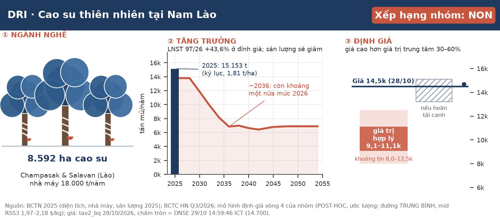

**Xếp hạng của nhóm: NON — không đủ điều kiện đầu tư ở giá hiện tại.** Lợi nhuận 2026 là thật và sạch, nhưng là lợi nhuận ở đỉnh giá cao su. Giá trị hợp lý trung tâm ~9,1–11,1 nghìn đ/cp (ước lượng; khoảng tin sau phản biện 8,0–12,5 nghìn), thấp hơn giá đóng cửa 28/10 từ 30% đến 60%. Giá hiện tại chỉ hợp lý nếu giá cao su giữ quanh 2,5 $/kg nhiều năm, hoặc nếu công ty hoãn chương trình tái canh đã công bố.

| Dữ liệu chính | Giá trị | Ghi chú |
|---|---|---|
| Giá 29/10/2026 (lệnh khớp cuối, 14:59:46 ICT) | **14.700 đ** | DNSE latest_trade; +1,4% so với đóng cửa 28/10 |
| Đóng cửa 28/10/2026 (mốc định giá) | 14.500 đ | Vốn hoá 1.061 tỷ đ · 73,2 triệu CP |
| Giá trị hợp lý trung tâm (ước lượng) | **~9.100 – 11.100 đ** | Khoảng tin 8.000–12.500 |
| Đuôi trên duy nhất vượt giá | 13.225 – 15.115 đ | Chỉ khi DRI hoãn/cắt tái canh (chưa có tín hiệu) |
| P/E TTM · P/B (14.500) | 5,1× · 1,45× | Trên lợi nhuận đỉnh chu kỳ |
| Cổ tức tiền 2025 · tỷ suất | 1.000 đ · 6,9% | Kế hoạch 2026 cũng 10% |
| LNST mẹ Q3/2026 · 9T/2026 | 25,98 tỷ (−33% YoY) · 167,75 tỷ (+44%) | Q3 trượt xa dự báo của nhóm |
| Thanh khoản bình quân 3 tháng | 16,85 tỷ đ/phiên | 63 phiên tới 28/10 |

**Ba luận điểm:** (1) **Lợi nhuận thật nhưng ở đỉnh** — giá cao su ở phân vị ~99% của 10 năm; ±10% giá bán ⇒ ±20–28% LNST (ước lượng). (2) **Quý gần nhất kém chất lượng hơn** — Q3 giữ hàng chờ bán, CFO 9T chỉ bằng 0,75× LNST. (3) **Tuổi vườn giới hạn giá trị dài hạn** — chỉ 48% diện tích đang cạo có dự án tái canh; sản lượng ~2036 còn khoảng một nửa mức 2026.

Thang của nhóm: **QUALIFY** (đủ điều kiện xem xét) · **AMBIGUOUS** (chưa đủ bằng chứng) · **NON** (không đủ điều kiện ở giá hiện tại) — nhãn nghiên cứu, không phải khuyến nghị cá nhân hoá.

## 1. Tóm tắt điều hành

**Một doanh nghiệp làm ăn tốt ở đỉnh chu kỳ: lợi nhuận tăng mạnh, tiền ròng dồi dào, nhưng giá cổ phiếu đã trả cho nhiều năm giá cao su cao.**

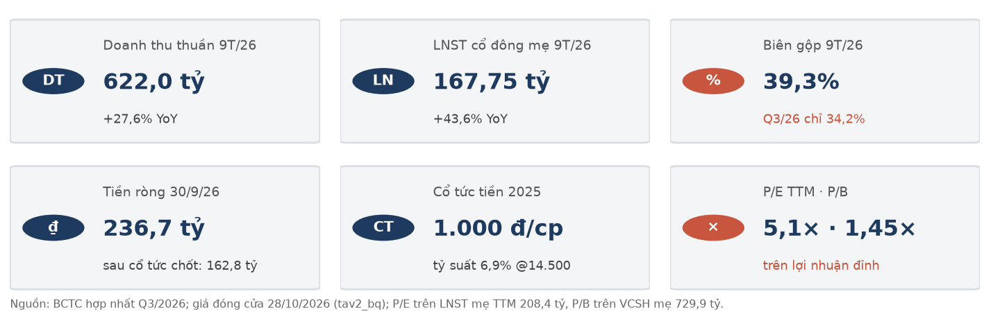

**Tình huống.** DRI trồng và khai thác cao su trên ~8.592 ha tại Nam Lào; giá cao su tăng mạnh đưa 9T/2026 lên doanh thu thuần 622,0 tỷ (+27,6%) và LNST cổ đông mẹ 167,75 tỷ (+43,6%). Cổ phiếu tăng từ đáy ~10.900 (11/2025, giá điều chỉnh) lên đỉnh 16.900 ngày 09/10/2026.

**Biến chuyển.** Q3/2026 LNST mẹ chỉ 25,98 tỷ, −33% so với cùng kỳ (nhóm dự báo 55–65 tỷ): công ty giữ hàng chờ bán và mưa làm giảm sản lượng cạo, không phải giá giảm. Song song, chỉ một nửa diện tích có kế hoạch tái canh; nửa còn lại không có kế hoạch trồng lại nào được công bố.

**Câu hỏi.** Ở 14.500–14.700 đ, nhà đầu tư có được trả đủ cho (a) giá cao su quay về giữa chu kỳ, (b) sản lượng giảm khi vườn già, (c) rủi ro tài sản tại Lào?

**Trả lời: chưa.** Dựng giá trị từ diện tích, lịch tái canh và giá cao su giữa chu kỳ, giá trị trung tâm ~9,1–11,1 nghìn đ/cp (ước lượng). Không ô nào trong lưới 27 ô của mô hình đạt giá hiện tại khi DRI tái canh như kế hoạch. Vấn đề là **giá so với giá trị dài hạn**, không phải gian lận hay lợi nhuận "một lần".

**Điều gì làm chúng tôi đổi ý:** (i) DRI công bố hoãn hoặc thu hẹp tái canh (đuôi trên 13–15 nghìn); (ii) giá cao su giữ quanh 2,5 $/kg qua 2027 và chỉ báo cầu Trung Quốc quay lên (tồn kho Qingdao giảm ≥3 tuần, công suất lốp bán thép ≥70%); (iii) BCTC Q4/2026 cho thấy hàng tồn được bán đúng kế hoạch, CFO quý dương và thưởng được trích minh bạch. Ngược lại, SXKD tháng 10 (~10/11) với lượng bán < 1.000 t hoặc LNTT lũy kế 10T thấp hơn 9T (208,21 tỷ), hay sự kiện xấu ở Lào/Dakruco/Quỹ TDND, làm kết luận NON chắc hơn.

## 2. Luận điểm đầu tư và điều thị trường đang định giá

**Giá cổ phiếu đang ngầm định giá cao su giữa chu kỳ ~2,5 $/kg, cao hơn trung vị thực 10 năm khoảng 16%.**

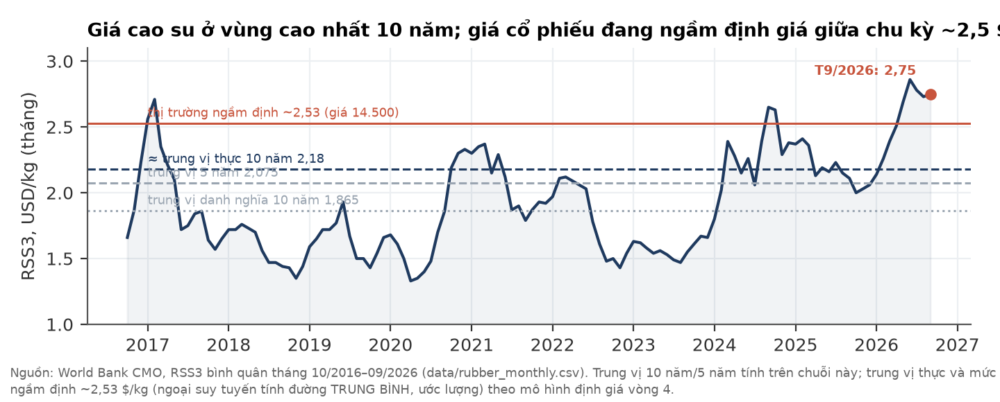

| Phép định giá ngược (ước lượng) | Tại 14.500 (28/10) | Tại 14.700 (29/10) |
|---|---|---|
| Vốn hoá | 1.061,4 tỷ | 1.076,0 tỷ |
| EV (trừ tiền ròng sau cổ tức 162,8 tỷ) | 898,6 tỷ | 913,2 tỷ |
| EV / LNST mẹ TTM 208,4 tỷ | 4,3× | 4,4× |
| Giá RSS3 giữa chu kỳ ngầm định (đường TRUNG BÌNH) | **~2,53 $/kg** | **~2,55 $/kg** |

Đối chiếu: RSS3 bình quân 2025 2,183 $/kg; tháng 9/2026 2,75 $/kg; trung vị thực 10 năm ~2,185 $/kg. EV/LNST ~4× chỉ rẻ nếu lợi nhuận 2026 lặp lại nhiều năm.

**Quan điểm khác biệt.** Thị trường đọc DRI như cổ phiếu "cổ tức cao, P/E thấp". Chúng tôi thấy: (a) lợi nhuận 2026 là lợi nhuận đỉnh — bản đọc ngành độc lập xếp pha đỉnh và giá đã quay đầu từ 13/10; (b) sản lượng không phẳng — tổng sản lượng tự khai thác 2027–2054 chỉ ~227–228 nghìn t, thấp hơn 27% so với giả định sản lượng gần phẳng; (c) tái canh trên đất tô nhượng có NPV âm trong mô hình, nên làm đúng kế hoạch lại làm giá trị/cp thấp hơn.

**Có thể sai theo chiều tích cực nếu:** El Niño rất mạnh kéo dài thiếu cung 2027; công ty hoãn tái canh và vườn cũ giữ năng suất; chuyển sàn HOSE kéo dòng vốn mới; năng suất cây tái canh cao hơn giả định.

## 3. Ngành: giá cao su ở đỉnh do cung, cầu chưa xác nhận

**Cao su thiên nhiên là hàng hoá nông nghiệp có chu kỳ dài: cây cần khoảng bảy năm mới cho mủ, nên cung phản ứng chậm và giá dao động mạnh theo thời tiết và cầu ô tô.**

Mủ cao su được chế biến thành các loại cao su định chuẩn (SVR, RSS) rồi bán cho nhà sản xuất lốp xe và sản phẩm cao su. Giá được quyết định trên các sàn khu vực (TSR20 trên SGX, RSS3) và gắn với giá dầu, vì dầu đắt làm cao su tổng hợp — sản phẩm thay thế — đắt theo. Việt Nam xuất khẩu 3,33 tỷ USD cao su thiên nhiên năm 2025 (BCTN DRI). Phần nhận định dưới đây dựa trên một bản đọc ngành độc lập, thực hiện **mù** (người đọc không biết giá, KQKD Q3 hay mọi phân tích về DRI), as-of 27/10/2026.

| Chỉ báo | Hiện tại | So sánh | Nguồn |
|---|---|---|---|
| TSR20 SGX | 254,3 ¢/kg (23/10); đỉnh 265,4 (13/10) | +50% YoY; phân vị 99,3% từ 2016 | tav2_bq.commodity_prices |
| RSS3 (World Bank, tháng) | 2,75 $/kg (T9/2026) | đỉnh 2,86 (T6); T9/2025 2,11 | World Bank CMO |
| Giá xuất khẩu cao su VN | 2.323 USD/t (T9) | +29,8% YoY; lượng 9T −15,8% | Hải quan, qua báo chí |
| Nhập khẩu cao su Trung Quốc | 588 nghìn t (T9) | −20,8% YoY | ECHEMI 16/10/2026 |
| Bán lẻ ô tô con Trung Quốc | ~1,618 triệu (T9) | −28% YoY | nt |
| Tồn kho Qingdao | 62,77 vạn t (30/08) | ~+45% YoY | Longzhong/Ruida |
| Brent | 116,7 USD/thùng (23/10) | đỡ giá cao su tổng hợp | tav2_bq.commodity_prices |

- **Pha chu kỳ (đọc mù, xác suất chủ quan):** `CYCLICAL_PEAK` ~60% vs đỉnh tiếp diễn ~40%, trên nền cung thắt có tính cấu trúc (độ tin thấp). Mẫu giống các đỉnh do thời tiết 2016–17 và Q4/2024 hơn là siêu chu kỳ cầu 2010–11. Chuyển sang đáy nếu Brent < 85, Qingdao > 70 vạn t và TSR20 < 220¢ trong hai tháng.
- **Mùa vụ Nam Lào:** sản lượng tăng từ tháng 6, đỉnh tháng 9–12; Q1 thấp nhất (rụng lá). Doanh thu ghi khi bán, nên lệch pha khai thác/bán có thể tới một quý — đúng điều xảy ra ở Q3/2026.
- **Dự báo khoá trước của bản đọc ngành:** P(TSR20 < 254,3¢ vào 26/11/2026) = 0,60; vào 25/01/2027 = 0,55.

**Chỗ đứng của DRI trong ngành.** Trong nhóm cao su niêm yết (GVR, PHR, DPR, TRC, HRC), DRI gần như là doanh nghiệp **thuần mủ** duy nhất không có quỹ đất khu công nghiệp tại Việt Nam để đệm lợi nhuận — độ nhạy với giá cao su cao nhất nhóm, cộng rủi ro chính sách và tỷ giá Lào. DRI từng ba năm liên tục (tới 2021) nằm trong "Top 50 doanh nghiệp xuất khẩu cao su tự nhiên dẫn đầu theo kim ngạch" do Hiệp hội Cao su Việt Nam tổng hợp (BCTN 2025).

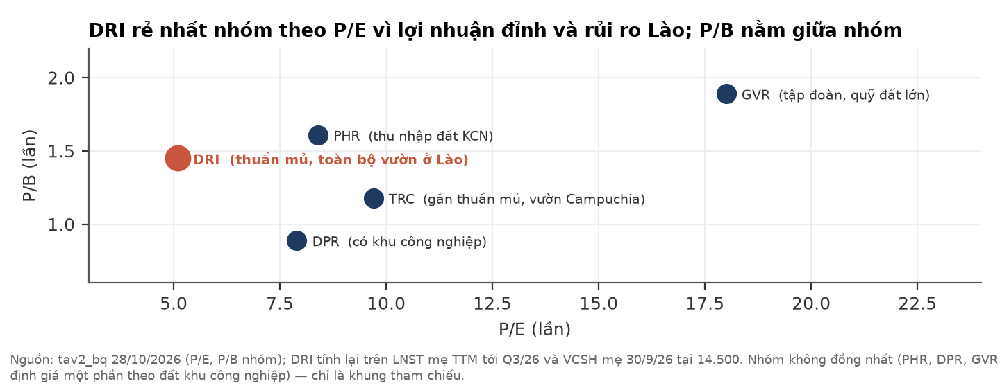

## 4. Doanh nghiệp: một vườn cao su lớn ở Nam Lào

**DRI ra đời để quản lý các vườn cao su mà ngành cao su Đắk Lắk trồng tại Nam Lào; hai mươi năm sau, đó vẫn là gần như toàn bộ giá trị của công ty.**

**Câu chuyện doanh nghiệp.** Dự án cao su của Cao su Đắk Lắk (Dakruco) ở Nam Lào bắt đầu từ thoả thuận dự án với Chính phủ Lào ngày 19/11/2004. Tháng 02/2012, DRI được thành lập theo đề án cổ phần hoá của Công ty TNHH MTV Cao su Đắk Lắk, vốn 500 tỷ, "nhằm quản lý dự án đầu tư cây cao su và các cây công nghiệp khác tại các tỉnh Nam Lào", và tiếp quản công ty con tại Lào (Daklaoruco) từ Dakruco. Công ty tự đặt định hướng trở thành "doanh nghiệp cao su phát triển xanh, bền vững, giảm phát thải", với phương châm "hiệu quả kinh tế – bảo vệ môi trường – trách nhiệm xã hội".

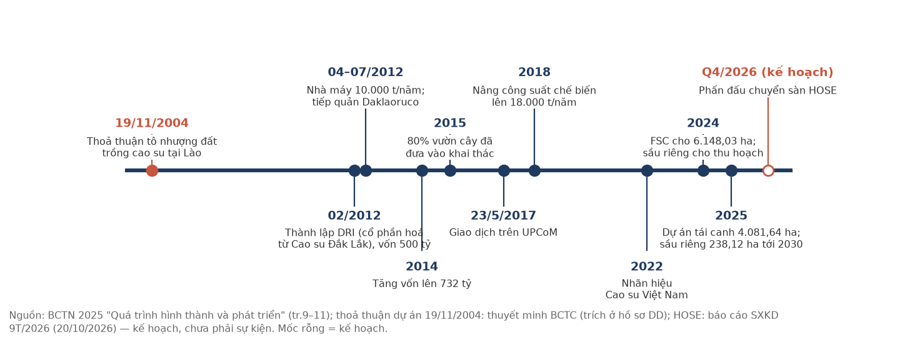

**Từ vườn cây đến khách hàng.** Mọi khâu đều nằm trong tay DRI: vườn cây do Daklaoruco (100% vốn, vốn điều lệ 25 triệu USD) trồng và chăm sóc; công nhân — 2.475 người tại 30/9/2026, phần lớn là lao động Lào — cạo mủ; một nhà máy tại tỉnh Champasak chế biến thành cao su định chuẩn SVR 3L, SVR 10, SVR 20, SVR CV50, SVR CV60; công ty mẹ tại Đắk Lắk bán hàng trong nước và xuất khẩu. Năm 2025 là năm kỷ lục: khai thác 15.152,83 t, năng suất 1,81 t/ha.

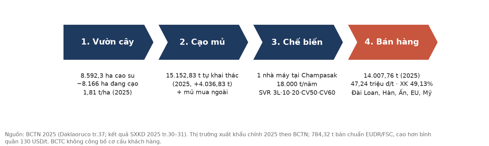

**Địa bàn và tài sản.** Vườn cây trải trên hai tỉnh Champasak và Salavan. Daklaoruco quản lý 9.276,07 ha đất, trong đó 8.592,3 ha cao su. Đất không thuộc sở hữu công ty mà theo hợp đồng tô nhượng với Chính phủ Lào (giấy đăng ký tô nhượng sửa đổi lần 4 ngày 30/03/2016; công ty nêu "tầm nhìn 2054"; thuê đất 6 USD/ha/năm; thuế TNDN Lào 20%). **Chúng tôi chưa thấy văn bản ghi thời hạn và điều kiện gia hạn.** Ngoài Lào, DRI có công ty con nông nghiệp công nghệ cao tại Krông Búk, Đắk Lắk (83,87%).

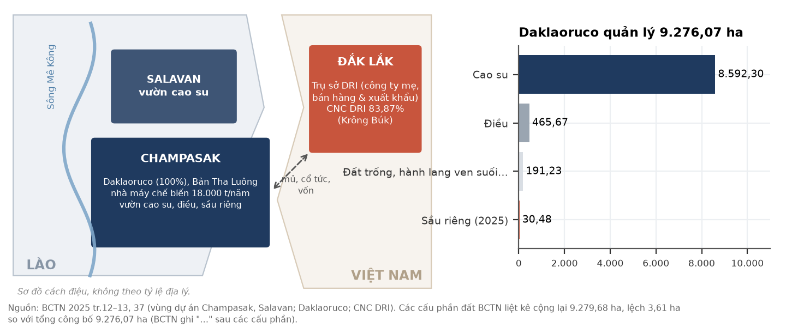

**Sản phẩm, khách hàng, thị trường.** Cao su chiếm 93,6% doanh thu 2025; sầu riêng, điều và thu nhập khác là phần nhỏ. Năm 2025 DRI bán 14.007,76 t với giá bình quân 47,24 triệu đ/t; tỷ lệ xuất khẩu 49,13% (kế hoạch 65%, do tăng bán nội địa và giữ hàng). Thị trường xuất khẩu chính: Đài Loan, Hàn Quốc, Ấn Độ, EU, Mỹ. 784,32 t bán theo chuẩn EUDR/FSC với giá cao hơn bình quân 130 USD/t; 6.148,03 ha vườn có chứng nhận FSC. BCTC không công bố cơ cấu khách hàng.

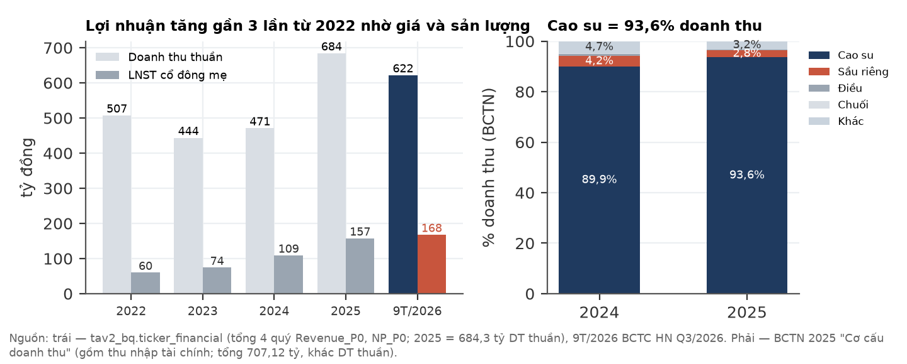

**Vườn cây đang già — câu hỏi lớn nhất.** Năm 2015 đã có 80% diện tích được đưa vào khai thác, nên phần lớn vườn đang ở nửa sau chu kỳ. Công ty đã giao dự án tái canh 4.081,64 ha (NQ 01/2025): trồng 94,56 ha năm 2025 và 37,77 ha theo kế hoạch 2026; thanh lý hàng loạt còn chờ liên doanh nhà máy gỗ (thị trường gỗ thanh lý ở Lào "chưa hình thành"). Phần ~4.216 ha còn lại không có kế hoạch trồng lại được công bố; một phần thuộc quy hoạch rừng bảo tồn sẽ được khoanh nuôi tái sinh rừng khi hết chu kỳ 1.

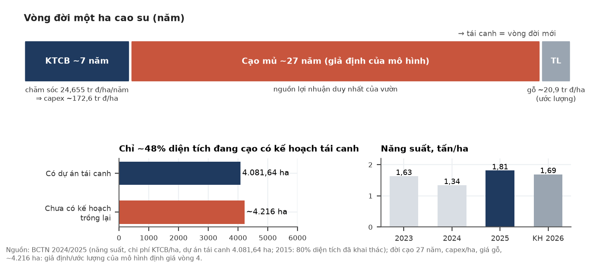

**Định hướng chiến lược công ty công bố (BCTN 2025):** tái canh "phù hợp với hợp đồng tô nhượng đất và chất lượng vườn cây"; tìm đối tác liên doanh nhà máy chế biến gỗ cao su và viên nén năng lượng; dự án sầu riêng 238,12 ha tới 2030; điện mặt trời tại Daklaoruco; nâng công suất dây chuyền mủ phụ từ 1,7 lên 2,2 tấn/giờ; chuẩn bị tín chỉ carbon; và — theo báo cáo SXKD 9T/2026 — phấn đấu chuyển sang HOSE trong Q4/2026. Sầu riêng quy mô < 3% diện tích, nên chúng tôi không cộng vào giá trị (ước tính ròng +176 đ/cp).

## 5. Phân tích tài chính (bottom-up)

### 5a. Q3/2026: giá không giảm, lượng bán giảm

**LNST Q3 giảm vì công ty bán ít hơn nhiều so với lượng chế biến; giá bán 55,75 triệu đ/t vẫn cao hơn cùng kỳ 29%.**

| Tỷ đồng [BCTC hợp nhất Q3/26] | Q3/26 | Q3/25 | 9T/26 | 9T/25 |
|---|---|---|---|---|
| Doanh thu thuần | 136,00 | 184,12 | 622,00 | 487,59 |
| Biên gộp | **34,2%** | 35,5% | 39,3% | 37,9% |
| Doanh thu tài chính | 6,35 | 5,71 | 27,59 | 15,92 |
| Chi phí bán hàng + QLDN | 17,22 | 19,11 | 55,39 | 52,49 |
| LNTT | 31,65 | 49,01 | 208,21 | 141,84 |
| LNST cổ đông mẹ | **25,98** | 38,98 | **167,75** | 116,80 |

| Q3 theo báo cáo SXKD của công ty | Tấn bán | USD/t | triệu đ/t | DT cao su (tỷ) |
|---|---|---|---|---|
| Q2/2026 | 3.841 | 2.109 | 54,7 | 210,15 |
| **Q3/2026** | **2.369** | **2.195** | **55,75** | 132,08 |

- **Lượng bán −38% QoQ, giá +4% (USD).** Q3 khai thác 3.381 t, mua ngoài 666 t, chế biến 4.086 t, chỉ bán 2.369 t ⇒ thành phẩm tăng ~1.717 t (ước lượng), khớp với giá trị thành phẩm 64,99 → 138,81 tỷ.
- **Mưa:** khai thác tháng 8 đạt 71,7% kế hoạch (−524 t so cùng kỳ), tháng 9 đạt 78,7%.
- **Biên gộp 40,6% (H1 soát xét) → 34,2%:** giá vốn/tấn Q3 36,5 triệu so với H1 30,2 triệu. Ba cơ chế (chưa tách được bằng số): chi phí cố định chia trên ít tấn bán hơn; mủ mua ngoài (biên mỏng) chiếm 16% sản lượng chế biến; chi phí dở dang mùa vụ kết chuyển vào Q3.
- **Không do thưởng.** Phải trả người lao động 28,33 → 25,75 tỷ; chi phí phải trả bằng 0. Thưởng 2026 **chưa trích** ⇒ rủi ro chi phí dồn vào Q4.
- **Thu nhập bất thường không đáng kể:** thu nhập khác Q3 0,04 tỷ; chưa có khoản thanh lý vườn lớn.
- **Q3 "kinh tế":** BCTC hợp nhất H1 sau soát xét thấp hơn bản tự lập 4,50 tỷ LNST (điều chỉnh giá vốn giao dịch nội bộ); cộng chênh lệch tỷ giá quy đổi công ty con Lào, Q3 tính từ 9T trừ H1 soát xét là DT 132,08 · LNST mẹ 25,54 tỷ. Kết luận không đổi.
- **Kế hoạch Q4 của ban lãnh đạo:** bán 4.168 t @ 58,97 triệu đ/t, LNTT 22,57 tỷ — rất thận trọng, hoặc đã tính sẵn chi phí cuối năm; chúng tôi không phân biệt được hai khả năng.

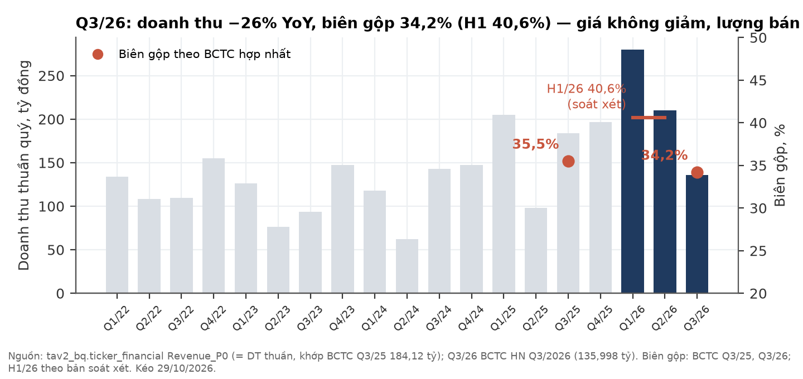

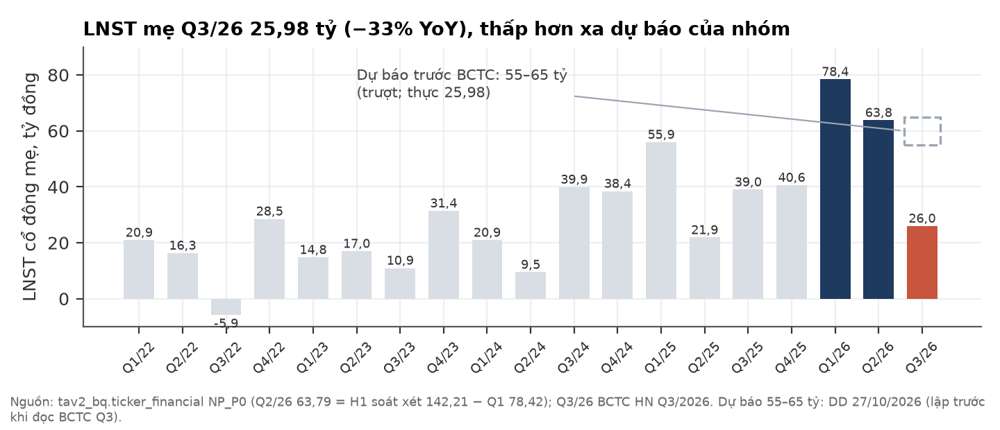

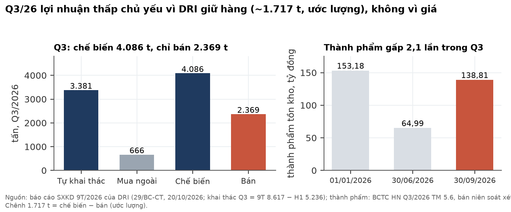

### 5b. Độ nhạy lợi nhuận theo giá bán: đòn bẩy hoạt động cao

**Mỗi ±10% giá bán ⇒ LNST năm khoảng ±20–28% (ước lượng), tuỳ phần doanh thu tăng thêm chảy vào quỹ lương.**

| Giá bán (so với 55,7 triệu đ/t) | Chi phí/tấn cố định | 30% doanh thu tăng/giảm chảy vào lương |
|---|---|---|
| −20% | −57% | −40% |
| −10% | **−28%** | **−20%** |
| +10% | +28% | +20% |
| +20% | +57% | +40% |

Hiệu chỉnh trên mức bán ~14.000 t/năm, giá vốn 33,1 triệu đ/t (2025); hoà vốn LNTT ở khoảng 36 triệu đ/t (≈ −35% so với giá hiện tại), trong trường hợp chi phí cố định. Q3/2026 cho thấy giá vốn/tấn không cố định (36,5 triệu) — một phần chi phí đi theo diện tích và lao động, không theo tấn bán. Kịch bản LNST 2026 cả năm (ước lượng, tuỳ lượng xả tồn, giá và mức trích thưởng Q4): 181 / 217 / 257 tỷ (bear/base/bull).

### 5c. Dòng tiền: lợi nhuận chưa chuyển thành tiền trong Q3

**CFO 9T 125,3 tỷ = 0,75× LNST; riêng Q3 CFO âm khoảng 29 tỷ (tính).**

- H1/2026 CFO 154,45 tỷ (1,05× LNST), có 30 tỷ từ xả tồn kho. Q3 đảo chiều: tích hàng, trả phải trả −68,5 tỷ (9T; phần lớn là lương 2025), thuế đã nộp 25,1 tỷ.
- Capex 9T 32,9 tỷ (gồm tái canh và sầu riêng); khấu hao 9T 35,8 tỷ.
- Cổ tức 2025 (1.000 đ/cp, 73,2 tỷ) đã chốt quyền (GDKHQ ~22/09, suy từ dữ liệu giá) nhưng **chưa chi** tại 30/9 (phải trả cổ tức 73,92 tỷ, trong đó cho Dakruco 32,94 tỷ). Ngày chi trả chưa xác minh.
- LNST riêng công ty mẹ Q3 chỉ 0,15 tỷ (lỗ tỷ giá); cổ tức của công ty mẹ phụ thuộc lợi nhuận chuyển về từ công ty con tại Lào, bị khấu trừ thuế tại nguồn (11,07 tỷ trong 9T).

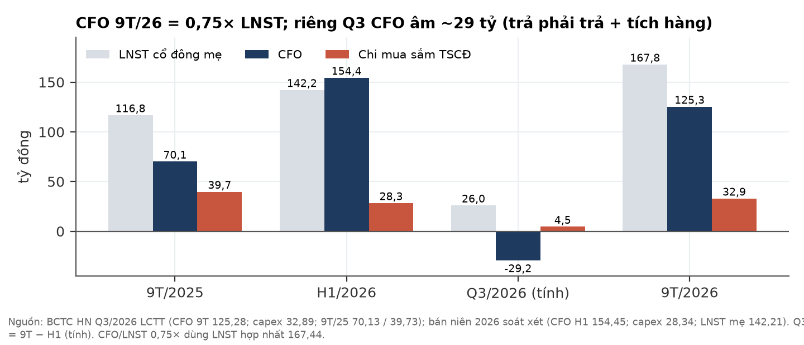

### 5d. Bảng cân đối: tiền nhiều, nhưng nằm ở đâu mới là câu hỏi

**Tiền ròng 236,7 tỷ (30/9/26); trừ cổ tức đã chốt còn ~163 tỷ — trong đó phần lớn ở Lào hoặc ở các bên trong hệ sinh thái cổ đông lớn.**

| Tỷ đồng [BCTC hợp nhất] | 01/01/26 | 30/06/26 | 30/09/26 |
|---|---|---|---|
| Tiền | 93,07 | 61,09 | 72,57 |
| Tiền gửi có kỳ hạn ngắn hạn | 104,22 | 303,50 | 271,81 |
| Vay ngắn + dài hạn | 104,71 | 99,88 | 107,64 |
| **Tiền ròng** | 92,6 | 264,7 | **236,7** |
| Cho Dakruco vay (dài hạn) | 80,00 | 40,00 | 40,00 |
| VCSH cổ đông mẹ | 701,14 | — | 729,86 |
| Chênh lệch tỷ giá trong VCSH | −334,97 | — | −370,84 |

- **Tiền tại Lào ~197 tỷ:** có kỳ hạn tại VietinBank Lào 128,22 + LaoViet 26,44; không kỳ hạn 42,07 (trong đó 2,35 triệu USD ≈ 60,48 tỷ). Nguyên tệ, lãi suất, kỳ hạn của tiền gửi có kỳ hạn ở Lào **không được thuyết minh**. Tiền gửi có kỳ hạn tại Lào giảm 31,6 tỷ trong Q3 — nhiều khả năng dùng cho vốn lưu động (ước lượng); không thấy hạn chế chuyển tiền.
- **Vay 107,6 tỷ:** chủ yếu bằng LAK tại ngân hàng ở Lào (10,95–12,6%/năm), một phần là phòng hộ tự nhiên cho chi phí bằng LAK. Thế chấp bằng vườn cây và nhà máy.
- **Chênh lệch tỷ giá trong VCSH −370,8 tỷ**, xấu thêm 35,9 tỷ trong 9T: LAK mất giá có lợi cho biên (chi phí bằng LAK, doanh thu bằng USD) nhưng bào mòn VCSH quy đổi.
- **Vườn cây:** nguyên giá 567,43 tỷ, đã khấu hao 55,8%, giá trị còn lại 250,74 tỷ; theo tốc độ hiện tại hết khấu hao khoảng 2034.

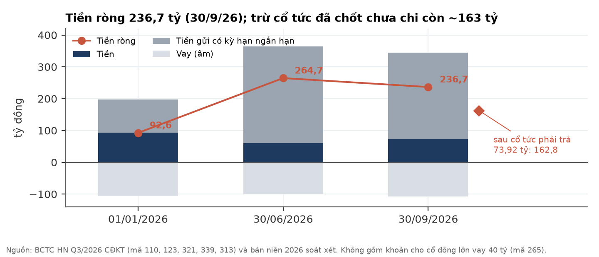

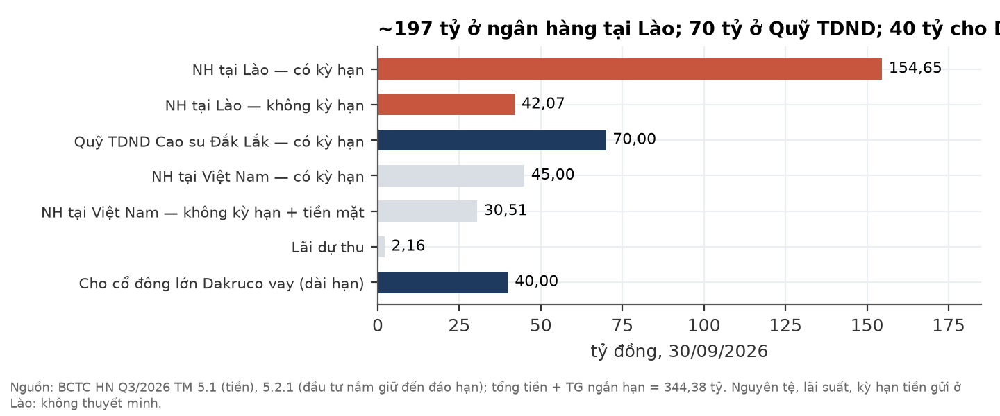

### 5e. Độ tin cậy của mô hình: dự báo Q3 của chúng tôi đã trượt

**Nhóm dự báo LNST Q3 55–65 tỷ; thực tế 25,98 tỷ (−53% đến −60%). Chúng tôi nêu thẳng điều này vì nó ảnh hưởng tới mức tin cậy người đọc nên đặt vào các ước lượng khác trong báo cáo.**

| Nguồn sai lệch LNTT Q3 (ước lượng) | Δ tỷ đồng |
|---|---|
| Lượng bán (giả định 3.750 t, thực 2.369 t) | **−31,3** |
| Giá bán | 0,0 |
| Giá vốn/tấn (33,1 → 36,5 triệu) | −8,1 |
| Chi phí bán hàng + QLDN | +2,0 |
| Tài chính ròng (khoản cho vay giảm một nửa; lỗ tỷ giá) | −3,5 |
| Khác | −2,9 |
| Thưởng | 0 (chưa trích) |

- Một dự báo khoá mù của nhóm (LNST mẹ Q3 ≥ 50 tỷ và biên LNST ≥ 27%, cùng xác suất 0,70) cũng **trượt**. Dự báo này **không được chấm là dự báo mù**: báo cáo SXKD 9T của công ty (đăng 20/10, trước giờ khoá) đã đủ để suy ra LNTT Q3 ~26 tỷ.
- Bài học đã đưa vào phân tích: nowcast quý bằng báo cáo SXKD tháng của chính DRI (đăng ~ngày 10 tháng sau); mô hình hoá lượng bán qua tồn kho, không chia đều theo mùa cạo; tách phần chi phí cố định khỏi giá vốn/tấn; dùng bản BCTC soát xét khi đã có.
- Giá trị hợp lý cũng đã qua bốn vòng: 11,8k (DD ban đầu) → 11,0k (sau Q3) → ba vòng định giá lại bị người phản biện bác (ghép giả định giá giữa các kịch bản; chi phí đơn vị; sản lượng gần phẳng) → vòng 4 xác nhận ở mức trung bình. Chúng tôi chỉ tin giá trị ở mức ±1 nghìn đ/cp quanh tâm.

## 6. Sự kiện vốn và corporate action

**Không có phát hành mới; hai sự kiện đáng theo dõi là cổ tức 2025 chưa chi và kế hoạch chuyển sàn HOSE.**

- **Số cổ phiếu:** 73,2 triệu, không đổi trong 2022–2026 (vốn góp 732 tỷ). Không có quyền mua, ESOP hay cổ tức cổ phiếu trong kỳ.
- **Cổ tức tiền 2025: 1.000 đ/cp** (10%), đã ghi nhận 73,2 tỷ trong VCSH, chưa chi tại 30/9/2026. Kế hoạch 2026: 10%. Tỷ suất 6,9% ở 14.500. Cổ tức 73 tỷ/năm tương đương phần lớn lợi nhuận ở mức giá cao su giữa chu kỳ — chính sách này khó giữ nếu giá về trung vị.
- **Chuyển sàn HOSE:** báo cáo SXKD 9T/2026 (20/10/2026) ghi DRI "phấn đấu hoàn thành chuyển sang HOSE trong quý IV/2026", hồ sơ đang nộp. Nguồn này mới hơn BCTN 2025 (ghi tạm dừng từ 07/2025). **Đây là kế hoạch công bố, chưa phải sự kiện** — chưa có quyết định chấp thuận niêm yết.
- **Quỹ đầu tư phát triển 96,97 tỷ** (trích "nhằm đảm bảo kế hoạch tái canh"); là một dòng trong VCSH, tiền tương ứng đã nằm trong tiền ròng.
- **Sàn niêm yết hiện tại:** UPCoM (DNSE secdef: marketId = UPX), biên độ ±15%.

**Quan sát giá (không gán nhân quả).** Ngày 21/10, phiên ngay sau khi báo cáo SXKD 9T được đăng (20/10, 16:20), giá giảm 16.200 → 15.300 (−5,6%) với khối lượng 3,1 triệu CP, khoảng 6 lần phiên trước. BCTC Q3 lên website công ty 26/10 (17:28); phiên 26–27/10 giá về 14.700 rồi 14.400. Chúng tôi không đủ dữ liệu để kết luận mức độ các tin này đã được phản ánh vào giá.

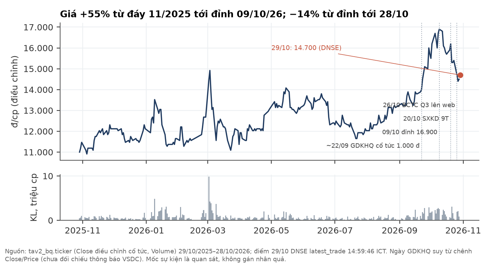

## 7. Định giá: ~9,1–11,1 nghìn đ/cp, thấp hơn giá 30–60%

**Giá trị dựng từ diện tích đang cạo, lịch tái canh và giá cao su giữa chu kỳ — không nhân bội số với lợi nhuận đỉnh.**

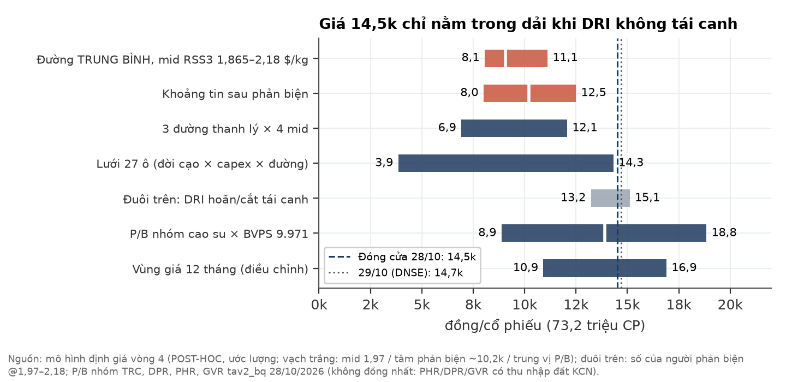

**Phương pháp.** Dòng tiền chủ sở hữu tới hết tô nhượng (2054): sản lượng theo từng lớp tuổi vườn (đời cạo 27 năm), thanh lý và tái canh 4.081,64 ha trong một trong ba cửa sổ 8 năm (bắt đầu 2027 / 2029 / 2031), capex tái canh ~172,6 triệu đ/ha (7 năm × chi phí chăm sóc kiến thiết cơ bản 24,655 triệu đ/ha/năm, đã đối chiếu BCTN 2024), cây mới cho năng suất từ năm 7. Giá bán theo đường giá đỉnh (60%) / giữa chu kỳ (40%); cộng tiền ròng sau cổ tức. Bốn mức giá RSS3 giữa chu kỳ được trình bày ngang hàng: 1,865 và 2,075 $/kg là trung vị danh nghĩa 10 năm và 5 năm; 2,18 $/kg ≈ trung vị thực 10 năm.

| Giá trị/cp (đ, ước lượng) | mid 1,865 | mid 1,97 | mid 2,075 | mid 2,18 |
|---|---|---|---|---|
| Thanh lý/tái canh NHANH (2027–34) | 6.920 | 7.903 | 8.886 | 9.869 |
| **TRUNG BÌNH (2029–36)** | **8.058** | **9.078** | **10.097** | **11.116** |
| CHẬM (2031–38) | 8.906 | 9.961 | 11.015 | 12.070 |
| Lưới 27 ô: min – trung vị – max | 3.853 – 7.871 – 10.926 | 4.705 – 8.919 – 12.057 | 5.557 – 9.771 – 13.188 | 6.409 – 10.623 – 14.319 |
| Giá 14.500 cao hơn đường TRUNG BÌNH | +80% | +60% | +44% | +30% |
| Giá 14.700 cao hơn đường TRUNG BÌNH | +82% | +62% | +46% | +32% |

- **Không ô nào trong lưới 27 ô đạt 14.400 trở lên** — nhưng điều này chỉ đúng **khi DRI thực hiện tái canh**.
- Người phản biện đặt tâm ~9,2 / 10,2 / 11,2 nghìn tại mid 1,97 / 2,075 / 2,18 (khoảng 8,0–12,5 nghìn). Các hiệu chỉnh đối xứng còn lại (thuế trên tiền bán gỗ, định phí nhà máy, năng suất cây mới 1,9 t/ha…) mỗi cái dưới ±0,9 nghìn và ngược chiều nhau.
- **Tái canh làm giảm giá trị trong mô hình:** biên mỗi ha cây mới (sau thuế, ~18,5 triệu đ/ha/năm tại mid 1,97) không trả nổi capex 172,6 triệu đ/ha. Cả chương trình thanh lý + trồng lại làm giá trị giảm khoảng 4,0 nghìn đ/cp so với không thanh lý gì. Kéo dài tô nhượng tới 2064 chỉ thêm ~0,2 nghìn.
- **Tái canh nốt ~4.216 ha còn lại (giai đoạn 2) làm giá trị giảm thêm ~1,3–1,5 nghìn** ⇒ giả định "không có giai đoạn 2" đang có lợi cho giá trị.

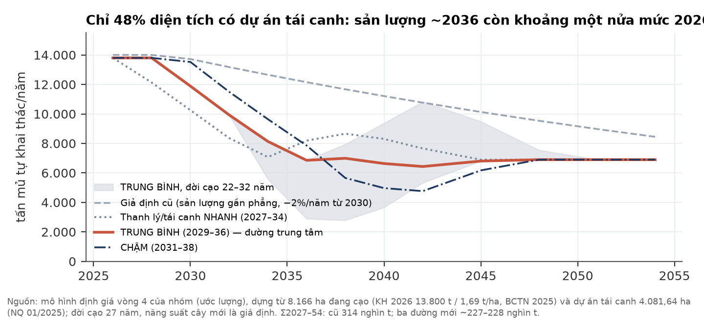

**Trục quyết định của công ty: thực hiện, hoãn hay cắt tái canh** (đ/cp, ước lượng):

| Kịch bản | mid 1,97 | mid 2,18 |
|---|---|---|
| Thực hiện đầy đủ (TRUNG BÌNH) | 9.078 | 11.116 |
| Không tái canh, vườn hết đời sau 27 năm cạo | 13.096 | 15.172 |
| Không tái canh, giữ vườn (khấu hao vườn coi là chi phí duy trì) | 11.463 | 14.100 |
| Người phản biện: không tái canh, giữ vườn | 13.225 | 15.115 |

Đây là **đuôi trên duy nhất** đưa giá trị vượt giá thị trường. Tuy vậy, NQ 01/2025 đã giao dự án 4.081,64 ha và BCTN 2025 ghi "nhiều diện tích phải đưa vào thanh lý sớm do không đảm bảo mật độ khai thác"; hoãn hay cắt phải là quyết định mới của HĐQT, chưa có tín hiệu công bố.

**Phần nào là phân tích sau khi thấy kết quả (POST-HOC).** Kế hoạch phân tích đăng ký trước cho tâm 0,5–3,3 nghìn đ/cp — nhưng con số đó sai vì hai lỗi cơ học: (1) ~212 tỷ/năm chi phí "cố định" vẫn chạy khi nửa diện tích đã rời sổ; (2) khấu hao vườn bị trừ hai lần cùng capex tái canh. Ba hiệu chỉnh (chi phí cố định co theo diện tích, cộng lại khấu hao vườn, tiền thu gỗ thanh lý ~20,9 triệu đ/ha) được chọn **sau** khi thấy kết quả; người phản biện đã xét riêng và chấp nhận ở mức trung bình. Các giả định chưa có nguồn: đời cạo, capex/ha, lịch thanh lý, năng suất cây mới, giá gỗ, năm mở cạo theo lớp tuổi.

**So sánh với nhóm cao su niêm yết** (tav2_bq, 28/10/2026):

| Mã | P/E | P/B | Khác DRI |
|---|---|---|---|
| TRC | 9,7 | 1,18 | Gần "thuần mủ" nhất; vườn Campuchia |
| DPR | 7,9 | 0,89 | Có khu công nghiệp |
| PHR | 8,4 | 1,61 | Thu nhập đền bù/chuyển đổi đất KCN |
| GVR | 18,0 | 1,89 | Tập đoàn, quỹ đất rất lớn |
| **DRI** (14.500) | **5,1** (TTM tới Q3/26) | **1,45** | Thuần mủ, toàn bộ vườn ở Lào |

Nhóm không đồng nhất (PHR, DPR, GVR định giá một phần theo đất khu công nghiệp) — chỉ dùng làm khung tham chiếu. DRI có P/E thấp nhất vì lợi nhuận đỉnh và rủi ro Lào; P/B nằm trong vùng của nhóm. Áp P/B nhóm vào BVPS 9.971 đ cho 8,9–18,8 nghìn (trung vị ~13,9 nghìn) — nhưng P/B không phản ánh việc vườn cây hết chu kỳ trên đất tô nhượng không có giá trị thanh lý chứng minh được.

**Vùng giá cần chạy lại kiểm định (ước lượng, đường TRUNG BÌNH, biên an toàn ≥15%):** ≲ 7,9 nghìn tại mid 1,97 · ≲ 8,8 nghìn tại 2,075 · ≲ 9,7 nghìn tại 2,18; nếu giá cao su về đáy 1,60 $/kg trong 2027–28 thì chỉ còn ≲ 5,9–7,4 nghìn. Ngay cả ở các vùng này, nhãn tối đa là **AMBIGUOUS**: DRI không đạt tiêu chí sàn tài sản thực của khung kiểm định (sổ sách hữu hình ~4.023 đ/cp; vườn cây trên đất tô nhượng không có giá trị thanh lý chứng minh được), và ngành không ở vùng sợ hãi.

## 8. Rủi ro (pre-mortem): "Nếu 18 tháng nữa khoản đầu tư này lỗ, vì sao?"

**Hai rủi ro lớn nhất là giá cao su quay về giữa chu kỳ và sản lượng giảm theo tuổi vườn; rủi ro Lào xác suất thấp nhưng tác động rất lớn.** Xác suất và tác động là nhận định chủ quan của nhóm.

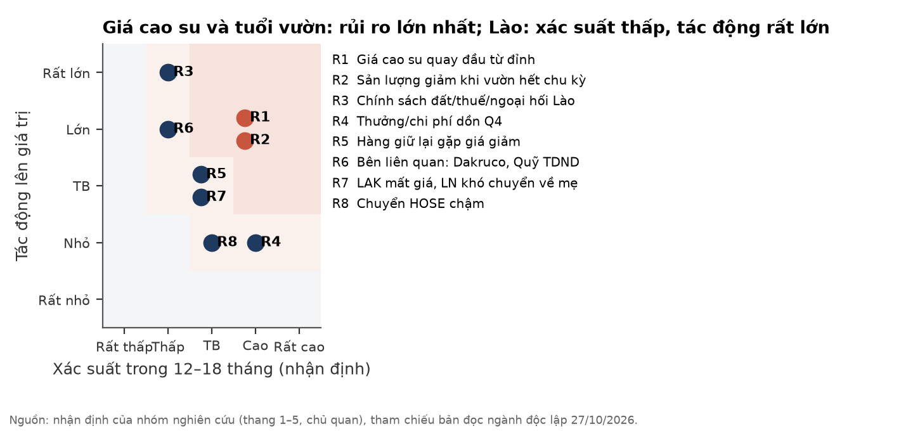

| # | Rủi ro | Xác suất | Tác động | Dấu hiệu sớm | Kiểm khi nào |
|---|---|---|---|---|---|
| R1 | Giá cao su quay về giữa chu kỳ | Cao (pha đỉnh 60/40) | Lớn (±10% giá ⇒ ±20–28% LNST) | TSR20 giảm; Qingdao tăng ≥3 tuần; lốp bán thép < 62% | Hằng tuần; 26/11/2026, 25/01/2027 |
| R2 | Sản lượng giảm khi vườn hết chu kỳ | Cao | Lớn | Năng suất/ha giảm; diện tích thanh lý tăng | BCTN 2026, ĐHĐCĐ 2027 |
| R3 | Chính sách đất/thuế/ngoại hối Lào | Thấp | Rất lớn | Thay đổi thuế, quyền đất, kiểm soát chuyển lợi nhuận hay rút USD | Bất kỳ lúc nào |
| R4 | Thưởng/chi phí dồn vào Q4 | Cao | TB | Phải trả người lao động, chi phí phải trả tăng | BCTC Q4/2026 |
| R5 | Hàng giữ lại gặp giá giảm | TB | TB | Thành phẩm tồn kho không giảm ở Q4; giá bán tháng giảm | SXKD tháng 10, 11 |
| R6 | Bên liên quan: Dakruco, Quỹ TDND | Thấp | Lớn | Cho vay thêm/gia hạn; tiền gửi Quỹ TDND > 70 tỷ; ý kiến kiểm toán | Mỗi kỳ BCTC |
| R7 | LAK mất giá, lợi nhuận khó chuyển về công ty mẹ | TB | TB | Chênh lệch tỷ giá VCSH xấu > 30 tỷ/quý; LNST riêng công ty mẹ thấp | Mỗi kỳ BCTC |
| R8 | Chuyển HOSE chậm | TB | Nhỏ | Không có quyết định chấp thuận trong Q4/2026 | 31/12/2026 |

## 9. Pháp lý và quản trị — CẢNH BÁO (không phải lý do chặn phân tích)

**Không thấy dấu hiệu sai phạm trong các tài liệu đã đọc; có nhiều cấu trúc cần theo dõi.** Phạm vi: BCTC hợp nhất Q3/2026, bán niên 2026 soát xét, BCTN 2024 và 2025, báo cáo SXKD tháng/quý của công ty. **Chưa tra cơ sở dữ liệu xử phạt của UBCKNN/HNX; chưa tra giao dịch cổ đông nội bộ** — vì vậy không khẳng định là không có.

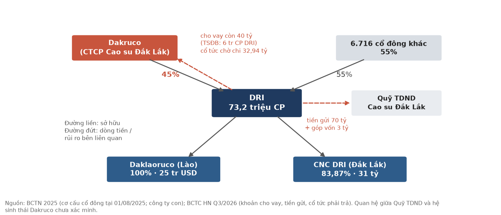

- ⚠️ **Cho cổ đông lớn vay:** DRI cho Dakruco (45%) vay 80 tỷ (05/2023, ~9%/năm, 60 tháng); đã thu hồi 40 tỷ trong H1/2026, còn 40 tỷ, không đổi trong Q3. Tài sản đảm bảo là 6 triệu CP **DRI** do Dakruco sở hữu — giá trị đảm bảo đi cùng chiều với chính rủi ro của DRI.
- ⚠️ **Quỹ TDND Cao su Đắk Lắk:** tiền gửi có kỳ hạn 70 tỷ (01/01: 50 tỷ) và khoản góp vốn 3 tỷ. Báo cáo soát xét bán niên ghi chưa xác định được giá trị có thể thu hồi của khoản góp vốn; BCTC Q3 (chưa soát xét) lại ghi giá trị thu hồi 3 tỷ. Quỹ không được liệt kê là bên liên quan; mối liên hệ với hệ sinh thái Dakruco **chưa xác minh**.
- ⚠️ **Tiền ở Lào ~197 tỷ** không thuyết minh nguyên tệ, lãi suất, kỳ hạn — thiếu minh bạch, chưa phải dấu hiệu vi phạm.
- ⚠️ **Tô nhượng:** chưa thấy văn bản thời hạn, điều kiện gia hạn, xử lý tài sản trên đất khi hết hạn.
- ⚠️ **Chất lượng BCTC quý:** một dòng tiền gửi LAK quy đổi sai tỷ giá; chi phí đi vay Q3/2025 trên thuyết minh (0,55 tỷ) khác KQKD (1,21 tỷ). Không trọng yếu. Bản tự lập H1 lệch 4,50 tỷ LNST so với bản soát xét.
- ⚠️ **Giao dịch bên liên quan có thể mới:** dự án cà phê liên kết với các đơn vị trong hệ sinh thái Dakruco đang được đánh giá (theo tài liệu công ty).
- **EUDR** (áp dụng doanh nghiệp vừa/lớn từ 30/12/2026): DRI đã có lô bán chuẩn EUDR/FSC; EU là thị trường nhỏ với cao su VN ⇒ rủi ro nhỏ.

## 10. Lịch xúc tác và ngưỡng quyết định

**Mốc gần nhất là báo cáo SXKD tháng 10 (~10/11): đây là nowcast sớm nhất cho Q4 và cho thấy hàng giữ lại có được bán hay không.**

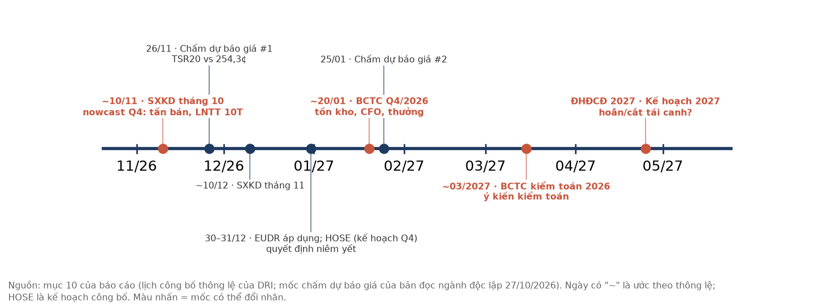

| Ngày | Sự kiện | Kiểm gì | Hệ quả với nhãn |
|---|---|---|---|
| ~10/11/2026 | Báo cáo SXKD tháng 10 của DRI | Tấn bán tháng 10; LNTT lũy kế 10T so với 9T (208,21 tỷ) | Bán < 1.000 t hoặc LNTT 10T < 9T ⇒ NON chắc hơn |
| 26/11/2026 | Mốc chấm dự báo giá của bản đọc ngành | TSR20 so với 254,3¢ | Giá giữ ≥ 254¢ ⇒ hỗ trợ đường giá đỉnh |
| ~10/12/2026 | Báo cáo SXKD tháng 11 | Như trên | — |
| Q4/2026 (kế hoạch công ty) | Chuyển sàn HOSE | Quyết định chấp thuận niêm yết | Catalyst thanh khoản; không đổi giá trị |
| Chưa xác minh | Chi trả cổ tức 2025 (73,2 tỷ) | Dòng tiền thực chi | — |
| 30/12/2026 | EUDR áp dụng | Giá lô đi EU | Nhỏ |
| ~20/01/2027 | BCTC Q4/2026 | Thành phẩm tồn kho giảm; CFO quý ≥ LNST quý; trích thưởng; Dakruco/Quỹ TDND | Cả ba đạt ⇒ chất lượng LN tốt lên, nhãn vẫn phụ thuộc giá |
| 25/01/2027 | Mốc chấm dự báo giá thứ hai | TSR20 so với 254,3¢ | — |
| ~03/2027 | BCTC kiểm toán 2026 | Ý kiến kiểm toán; khoản góp Quỹ TDND | Ngoại trừ ⇒ NON chắc chắn |
| ĐHĐCĐ 2027 | Kế hoạch 2027, lịch tái canh | Có hoãn/thu hẹp tái canh không | Hoãn ⇒ xem lại đuôi trên (mục 7) |
| Bất kỳ lúc nào | Sự kiện Lào; Dakruco vay thêm; tiền gửi Quỹ TDND tăng | — | NON chắc chắn |

## Phụ lục A. Số liệu tài chính hợp nhất Q3/2026 và 9T/2026

Nguồn: BCTC hợp nhất Q3/2026 (phê duyệt 22/10/2026). Đơn vị tỷ đồng, làm tròn từ số VND trên BCTC. Tỷ giá quy đổi KQKD 9T: 1 VND = 0,8431 LAK.

| Kết quả kinh doanh | Q3/26 | Q3/25 | 9T/26 | 9T/25 |
|---|---|---|---|---|
| Doanh thu thuần | 136,00 | 184,12 | 622,00 | 487,59 |
| Giá vốn | 89,53 | 118,76 | 377,40 | 302,57 |
| Lợi nhuận gộp | 46,46 | 65,36 | 244,60 | 185,02 |
| Doanh thu tài chính | 6,35 | 5,71 | 27,59 | 15,92 |
| Chi phí tài chính (trong đó lãi vay) | 3,56 (1,98) | 2,82 (1,21) | 9,69 (6,40) | 4,85 (1,86) |
| Chi phí bán hàng | 5,09 | 7,64 | 19,84 | 21,58 |
| Chi phí quản lý | 12,13 | 11,48 | 35,56 | 30,91 |
| Lợi nhuận thuần từ HĐKD | 32,02 | 49,13 | 207,11 | 143,60 |
| Lợi nhuận khác | −0,37 | −0,12 | 1,10 | −1,76 |
| LNTT | 31,65 | 49,01 | 208,21 | 141,84 |
| LNST | 25,87 | 38,90 | 167,44 | 116,51 |
| LNST cổ đông mẹ | 25,98 | 38,98 | 167,75 | 116,80 |
| EPS cơ bản (đ) | 355 | 519 (trình bày lại) | 2.292 | 1.556 |

| Bảng cân đối | 30/09/2026 | 01/01/2026 |
|---|---|---|
| Tiền | 72,57 | 93,07 |
| Đầu tư nắm giữ đến đáo hạn ngắn hạn | 271,81 | 104,22 |
| Phải thu khách hàng ngắn hạn | 2,45 | 29,44 |
| Hàng tồn kho (thành phẩm) | 183,87 (138,81) | 176,05 (153,18) |
| Tài sản cố định hữu hình | 328,34 | 375,36 |
| Đầu tư nắm giữ đến đáo hạn dài hạn (cho Dakruco vay) | 40,00 | 80,00 |
| **Tổng tài sản** | **1.016,11** | **952,63** |
| Vay ngắn hạn · dài hạn | 87,04 · 20,60 | 83,80 · 20,91 |
| Phải trả cổ tức | 73,92 | 1,28 |
| Phải trả người lao động | 25,75 | 67,58 |
| Nợ phải trả | 280,91 | 245,75 |
| VCSH (gồm lợi ích CĐKKS 5,34) | 735,20 | 706,88 |
| Chênh lệch tỷ giá hối đoái | −370,84 | −334,97 |
| Quỹ đầu tư phát triển | 96,97 | 61,94 |

| Lưu chuyển tiền tệ 9 tháng | 9T/26 | 9T/25 |
|---|---|---|
| LNTT | 208,21 | 141,84 |
| Khấu hao | 35,80 | 32,51 |
| Lợi nhuận trước thay đổi vốn lưu động | 230,69 | 167,70 |
| (Tăng)/giảm phải thu | +15,74 | −18,56 |
| (Tăng) tồn kho | −7,82 | −8,23 |
| Tăng/(giảm) phải trả | −68,50 | −22,60 |
| Thuế TNDN đã nộp | −25,10 | −36,65 |
| **CFO** | **125,28** | **70,13** |
| Chi mua sắm TSCĐ | −32,89 | −39,73 |
| Cổ tức đã trả | −0,56 | −35,99 |

## Phụ lục B. Đối chiếu số liệu cơ sở dữ liệu (BQ) với BCTC

| Chỉ tiêu | Cơ sở dữ liệu tav2_bq | BCTC | Kết luận |
|---|---|---|---|
| Revenue_P0 Q3/25 | 184,12 | DT thuần 184,12 | Khớp; DRI không có giảm trừ doanh thu ⇒ DT gộp = DT thuần |
| ticker_financial Q3/26 | Chưa có (kéo 29/10/2026) | BCTC Q3 phê duyệt 22/10 | Dùng BCTC cho Q3 |
| NP_P0 Q2/26 | 63,79 | Bản tự lập 68,29; H1 soát xét 142,21 − Q1 78,42 = 63,79 | BQ khớp bản soát xét |
| CF_OA_P0 Q1+Q2/26 | 110,46 + 26,51 = 136,97 | CFO H1 soát xét 154,45 | Lệch 17,5 tỷ — dùng BCTC |
| Cash_P0 30/6/26 | 61,09 | Tiền 61,09 + tiền gửi có kỳ hạn 303,50 | BQ chỉ gồm "Tiền" — không dùng làm tiền ròng |
| GPM_P0 Q3/25 | 0,416 | Biên gộp quý 35,5% | Định nghĩa khác — không dùng làm biên quý |
| P/E · P/B ngày 28/10 | 4,8 · 1,32 | 5,1 · 1,45 (tính trên TTM tới Q3/26, VCSH mẹ 30/9) | BQ còn dùng số liệu tới Q2/26 |
| OShares | 73,2 tr | Vốn góp 732 tỷ | Khớp |
| Đóng cửa 28/10 | 14.500 | DNSE giá tham chiếu 29/10: 14.400 | Tham chiếu UPCoM là giá bình quân phiên trước, không phải giá đóng cửa; báo cáo dùng đóng cửa |
| Giá 29/10 | (BQ đã có 14.700) | DNSE latest_trade 14:59:46: 14.700 | Khớp; báo cáo dùng DNSE |
| Sàn niêm yết | — | DNSE secdef marketId = UPX | **UPCoM** |
| Ngày GDKHQ cổ tức 2025 | Close/Price đổi từ 0,9385 sang 1,000 ngày 22/09/2026 | — | Suy luận ~22/09; chưa đối chiếu thông báo VSDC |

## Phụ lục C. Danh mục nguồn

| Nguồn | Ngày | Ghi chú |
|---|---|---|
| BCTC hợp nhất + riêng Q3/2026, CV giải trình 72/CV-CT | Phê duyệt 22/10/2026; đăng web 26/10/2026 17:28 | dri.com.vn; bản scan 35 trang |
| BCTC hợp nhất bán niên 2026, soát xét bởi AFC Việt Nam (kết luận chấp nhận toàn phần) + CV 52/CV-CT | 14/08/2026; 17/08/2026 | dri.com.vn |
| BCTC hợp nhất Q2/2026 (tự lập) + CV giải trình | 27/07/2026 | dri.com.vn |
| Báo cáo SXKD 9 tháng 2026 (29/BC-CT) | 20/10/2026 (đăng 16:20) | Tấn bán, LNTT 9T, kế hoạch Q4, chuyển HOSE |
| Báo cáo SXKD tháng 7, tháng 8, 6 tháng, quý 1/2026 | 22/04 – 09/09/2026 | Tấn, USD theo tháng |
| Báo cáo thường niên 2025 và 2024 | 2026, 2025 | Lịch sử hình thành, sản phẩm, thị trường, cơ cấu doanh thu và cổ đông, diện tích, sản lượng, kế hoạch 2026, tái canh, tô nhượng, chi phí KTCB/ha, định hướng chiến lược |
| tav2_bq.ticker, ticker_financial, commodity_prices | Kéo 29/10/2026 | Cơ sở dữ liệu nội bộ của nhóm |
| DNSE OpenAPI latest_trade, secdef (DRI) | 29/10/2026 14:59:46 ICT | Giá cuối phiên 29/10 |
| World Bank CMO (RSS3 tháng) | tới 09/2026 | Giá giữa chu kỳ |
| Bản đọc ngành cao su độc lập (đọc mù) | 27/10/2026 | Nguồn chi tiết: Thời báo Tài chính VN (17/10), Thương hiệu & Công luận (22/10), Bernama (21/10), ECHEMI (16/10), Mysteel, IRI/WMO (ENSO), ANRPC (qua bản trích) |

## Phụ lục D. Phương pháp và giới hạn

**Phương pháp.** Giá trị được dựng từ dưới lên: chất lượng lợi nhuận → dòng tiền → bảng cân đối → đường sản lượng theo tuổi vườn và lịch tái canh → dòng tiền chủ sở hữu tới 2054 theo bốn mức giá giữa chu kỳ; sau đó đối chiếu từ trên xuống bằng bản đọc ngành và nhóm so sánh. Mọi số liệu doanh nghiệp truy về BCTC/BCTN/báo cáo SXKD gốc; số tính toán ghi "(ước lượng)". Biểu đồ tái lập bằng build_report.py, mỗi hình kèm một tệp CSV.

**Giá dùng trong báo cáo.** Định giá neo vào đóng cửa 28/10/2026 (14.500 đ). Giá 29/10/2026 lấy từ DNSE (lệnh khớp cuối 14:59:46 ICT, 14.700 đ). Kết luận NON **không đổi** ở cả hai mức: giá cao hơn giá trị trung tâm 30–60% (14.500) và 32–62% (14.700).

**Giới hạn đã biết:**

- Không có bảng diện tích theo năm trồng/năm mở cạo; phân bố tuổi vườn suy luận từ một mốc ("2015: 80% đã khai thác").
- Không có dự toán và lịch theo năm của dự án tái canh; capex/ha suy từ chi phí chăm sóc KTCB bình quân, không phải dự toán trồng mới.
- Không có văn bản tô nhượng (thời hạn, gia hạn, xử lý tài sản khi hết hạn).
- Không có cơ cấu giá thành theo yếu tố/theo ha — đây là chỗ giá trị nhạy nhất (±4 nghìn giữa hai cách xử lý chi phí cố định).
- Không có giá sàn gỗ thanh lý, kết quả đấu giá, tình trạng liên doanh nhà máy gỗ.
- Không có nguyên tệ, lãi suất, kỳ hạn tiền gửi tại Lào; không có cơ cấu khách hàng.
- Thưởng 2026 chưa trích; mức trích trong kịch bản Q4 là giả định.
- Chưa tra cơ sở dữ liệu xử phạt UBCKNN/HNX; chưa tra giao dịch cổ đông nội bộ.
- Mối liên hệ giữa Quỹ TDND Cao su Đắk Lắk và Dakruco chưa xác minh.
- Ngày GDKHQ và ngày chi trả cổ tức 2025 chưa đối chiếu với thông báo chính thức.
- Biểu đồ giá 12 tháng dùng giá đã điều chỉnh cổ tức.
- Văn bản thoả thuận dự án 19/11/2004 không có trong BCTN; ngày lấy từ thuyết minh BCTC như trích trong hồ sơ DD.
- Các cấu phần đất BCTN 2025 liệt kê cộng lại 9.279,68 ha, lệch 3,61 ha so với tổng công bố 9.276,07 ha.
- Sơ đồ địa bàn là sơ đồ cách điệu, không theo tỷ lệ địa lý; không có bản đồ ranh giới vườn cây.
- Không có danh sách khách hàng, hợp đồng bán dài hạn hay thị phần chính thức; chỗ đứng trong ngành chỉ dựa trên xếp hạng xuất khẩu do BCTN nêu.

## Phụ lục E. Quy trình độc lập

Báo cáo đi qua ba lớp tách biệt: (1) **Đọc ngành mù** — một nhà phân tích vĩ mô độc lập viết bản đọc ngành cao su mà không biết giá, KQKD hay phân tích nào về DRI; (2) **Due diligence** — đọc BCTC gốc từng trang (bản scan), báo cáo SXKD tháng/quý, BCTN; dựng mô hình sản lượng và định giá; (3) **Phản biện độc lập** — một người phản biện có nhiệm vụ bác bỏ kết luận và đối chiếu lại số trọng yếu.

Minh bạch về những gì đã sai và đã sửa:

- **Dự báo Q3 trượt** (55–65 tỷ dự báo, 25,98 tỷ thực tế); dự báo khoá mù cũng trượt và không được chấm là mù vì kết quả đã suy ra được từ tài liệu công khai trước giờ khoá (mục 5e).
- **Định giá qua bốn vòng phản biện.** Vòng 1 (tâm 14,3 nghìn) bị bác: ghép giả định giá giữa chu kỳ của hai đường giá khác nhau. Vòng 2 (12,5–13,9 nghìn) bị bác: chi phí đơn vị neo quá cao bù cho khoản trích quỹ khen thưởng bị bỏ sót. Vòng 3 (10,5–14,5 nghìn) bị bác: sản lượng gần phẳng tới 2054, không phản ánh dữ liệu diện tích và tái canh. Vòng 4 được **xác nhận ở mức trung bình**, kèm ba yêu cầu sửa đã áp dụng: bỏ nhận định "tái canh gần hoà vốn" (thực tế làm giảm giá trị), thêm trục thực hiện/hoãn/cắt tái canh, kiểm lại đơn giá chi phí chăm sóc với BCTN 2024 (khớp).
- **Dùng bản soát xét thay bản tự lập** cho H1/2026 (LNST thấp hơn 4,50 tỷ).
- **Bản trình bày này** (29/10/2026) dựng lại cách trình bày — thêm hình, viết lại mục Ngành và Doanh nghiệp từ BCTN 2024/2025 — **không đổi số hay kết luận** so với bản trước cùng ngày. Một mô tả được chính xác hoá: vườn cây nằm ở hai tỉnh Champasak và Salavan (bản trước chỉ nêu Champasak).
- **Chuyển sàn HOSE:** nhóm từng ghi "chưa có lịch" theo BCTN 2025; đã cải chính theo báo cáo SXKD 9T (20/10/2026), nguồn mới hơn.

## Phụ lục F. Tuyên bố miễn trừ và xung đột lợi ích

Tài liệu mang tính thông tin/nghiên cứu, không phải lời khuyên đầu tư cá nhân hoá và không phải đề nghị mua hay bán chứng khoán. Nhãn QUALIFY/AMBIGUOUS/NON là đánh giá nghiên cứu theo khung của nhóm, không tính tới mục tiêu, khẩu vị rủi ro hay tình hình tài chính của từng nhà đầu tư. Số liệu quá khứ không bảo đảm kết quả tương lai. Các ước lượng, kịch bản và giả định được nêu rõ và có thể sai; dự báo quý gần nhất của nhóm cho mã này đã trượt đáng kể.

**Xung đột lợi ích:** tác giả và/hoặc tài khoản liên quan có thể đang nắm giữ cổ phiếu DRI.
