# DRI — CTCP Đầu tư Cao su Đắk Lắk: vườn đang cạo và tiền ròng định giá ~15,5 nghìn đ/cp, giá 13.400 đ nằm sát cận dưới vùng hợp lý; đổi lại, vườn già dần và giá mủ đang cao hơn mức giữa chu kỳ ~24%

**Báo cáo Due Diligence · 03/11/2026 · Nhóm nghiên cứu** · Sàn UPCoM · Cao su thiên nhiên, vườn cây tại Nam Lào

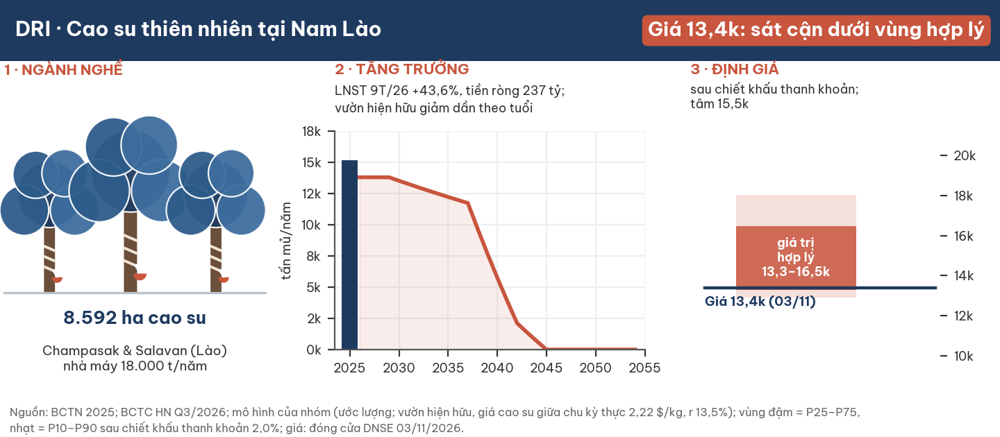

**Kết luận: giá đóng cửa 03/11/2026 (13.400 đ) nằm trong vùng hợp lý, sát cận dưới (P25 13.300 đ/cp sau chiết khấu thanh khoản, vị thế 5 tỷ đ); giá trị trung tâm ~15.500 đ/cp, vùng hợp lý 13.300–16.500 đ/cp (ước lượng).** Giá trị dựng từ vườn đang cạo, giá cao su giữa chu kỳ theo sức mua (2,22 $/kg RSS3, bình quân 2014–9/2026) và tiền ròng; tái canh và dự án mới tính ở giá vốn. Giá hiện tại tương ứng với một trong ba giả định bất lợi: đời cạo chỉ 22 năm (13,3 nghìn), giá cao su 2027–28 về đáy chu kỳ (13,0 nghìn), hoặc thanh lý vườn 2029–36 mà không trồng lại (13,2 nghìn). Nếu tái canh bị buộc với kinh tế dự án kém, giá trị chỉ 10,1–12,5 nghìn.

| Dữ liệu chính | Giá trị | Ghi chú |
|---|---|---|
| Đóng cửa 03/11/2026 | **13.400 đ** | DNSE; vốn hoá 981 tỷ đ · 73,2 triệu CP |
| Giá trị trung tâm (trước → sau chiết khấu thanh khoản) | 15.860 → **15.540 đ** | Ước lượng; chiết khấu 2,0% ở vị thế 5 tỷ đ |
| Vùng hợp lý (P25–P75, sau chiết khấu) | **13.300 – 16.490 đ** | Thang P10–P90: 12.890 – 18.030 |
| Bình quân hai kịch bản theo xác suất | ~14.360 đ | Sau chiết khấu thanh khoản; gồm 20% tái canh bị buộc; mục 7 |
| Chi phí vốn | 13,5% | Neo lãi huy động 12 tháng 7,40% (02/11/2026) |
| P/E TTM · P/B (13.400) | 4,7× · 1,34× | LNST mẹ TTM 208,4 tỷ; VCSH mẹ 729,9 tỷ |
| Tiền ròng 30/9/2026 | 236,7 tỷ | Sau cổ tức 2025: 162,8 tỷ |
| Thanh khoản 250 phiên | 8,33 tỷ đ/phiên (trung vị) | Bình quân 13,04 tỷ |

**Ba luận điểm tích cực:** (1) **Lợi nhuận 2026 thật**: 9T LNST mẹ 167,75 tỷ (+43,6%), biên gộp 39,3%; Q3 yếu do giữ hàng (thành phẩm 138,81 tỷ), không do giá. (2) **Tiền ròng 236,7 tỷ**, cổ tức tiền 1.000 đ/cp (7,5% ở 13.400). (3) **Giá không cần giá cao su đỉnh**: ở mức giữa chu kỳ thấp hơn quý 3/2026 khoảng 19%, giá trị trung tâm vẫn cao hơn giá ~16%.

**Ba luận điểm rủi ro:** (1) **Giá cao su đang ở phân vị ~89% của chuỗi thực 2014–2026**; ±10% giá bán làm LNST đổi ±20–28%. (2) **Vườn già**: phần lớn diện tích vào cạo 2011–2015, sản lượng vườn hiện hữu giảm mạnh sau ~2037. (3) **Lào**: đất tô nhượng, tiền gửi ~197 tỷ tại Lào, chuyển lợi nhuận về công ty mẹ yếu.

## 1. Tóm tắt điều hành

**Một vườn cao su có lãi, tiền ròng dồi dào, được thị trường định giá quanh cận dưới giá trị của chính vườn đang cạo.**

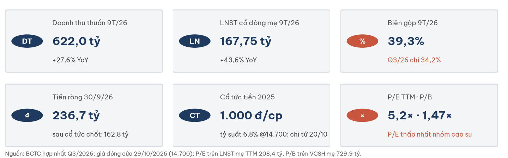

- **Tình huống.** DRI khai thác ~8.166 ha cao su đang cạo ở Champasak và Salavan; 2025 sản lượng kỷ lục 15.153 t.
- **Biến chuyển.** Q3/2026 LNST mẹ 25,98 tỷ (−33% YoY) vì giữ hàng và mưa; công ty có dự án tái canh 4.082 ha, mới trồng 132 ha.
- **Câu hỏi.** Ở 13.400 đ, thị trường trả bao nhiêu cho vườn đang cạo?
- **Trả lời.** Gần cận dưới giá trị của vườn đang cạo cộng tiền ròng ở giá cao su giữa chu kỳ. Giá đã phản ánh một giả định bất lợi (đời cạo ngắn, đáy giá cao su, hoặc thanh lý không trồng lại); chưa phản ánh trường hợp tái canh vừa bắt buộc vừa lỗ.

## 2. Luận điểm và điều thị trường đang định giá

**Ở 13.400 đ, thị trường định giá DRI như thể một giả định bất lợi sẽ xảy ra.**

| Giả định để giá trị = 13.400 (ước lượng, sau chiết khấu) | Giá trị |
|---|---|
| Vườn hiện hữu chỉ cạo 22 năm | 13,3 nghìn: **ngang** giá |
| Giá RSS3 2027–28 về 1,60 $/kg rồi hồi về giữa chu kỳ | 13,0 nghìn: **ngang** giá |
| Thanh lý ~3.949 ha vườn kém hiệu quả 2029–36, không trồng lại | 13,2 nghìn: **ngang** giá |
| Tái canh bị buộc, kinh tế thận trọng (capex 172,6 triệu đ/ha, cây mới 1,69 t/ha) | 10,1–12,5 nghìn: **dưới** giá |

- **Điều thị trường có thể chưa tính:** giá cao su giữa chu kỳ theo sức mua (2,22 $/kg) cao hơn trung vị danh nghĩa 10 năm (1,87 $/kg) vì lạm phát USD; mức giữa chu kỳ không gồm siêu chu kỳ cầu 2010–13.
- **Điều thị trường có thể đã tính đúng:** lợi nhuận 2026 là đỉnh chu kỳ; rủi ro Lào.

## 3. Ngành: giá cao su cao do cung, cầu chưa xác nhận

**Giá RSS3 quý 3/2026 2,75 $/kg cao hơn mức giữa chu kỳ thực 2,22 $/kg khoảng 24%; bản đọc ngành độc lập xếp pha đỉnh 60%, đỉnh kéo dài 40%.**

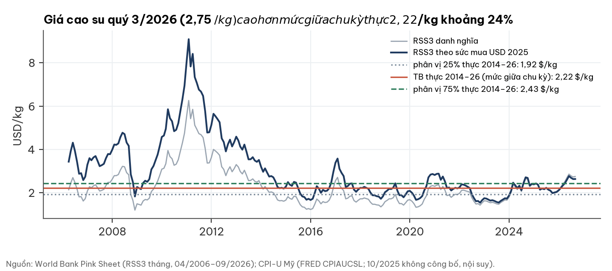

| Chỉ báo | Hiện tại | Nguồn |
|---|---|---|
| TSR20 SGX | 254,3 ¢/kg (23/10), +50% YoY | tav2_bq.commodity_prices |
| Nhập khẩu cao su Trung Quốc T9 | 588 nghìn t, −20,8% YoY | ECHEMI 16/10/2026 |
| Tồn kho Qingdao | 62,77 vạn t (30/08), ~+45% YoY | Longzhong/Ruida |
| Brent | 116,7 USD/thùng (23/10) — đỡ giá cao su tổng hợp | tav2_bq.commodity_prices |

- Chuyển sang đáy nếu Brent < 85, Qingdao > 70 vạn t và TSR20 < 220¢ trong hai tháng.

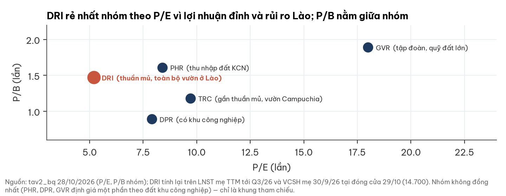

## 4. Doanh nghiệp: một vườn cao su lớn ở Nam Lào

**DRI ra đời năm 2012 để quản lý vườn cao su của ngành cao su Đắk Lắk tại Nam Lào; gần như toàn bộ giá trị vẫn nằm ở đó.**

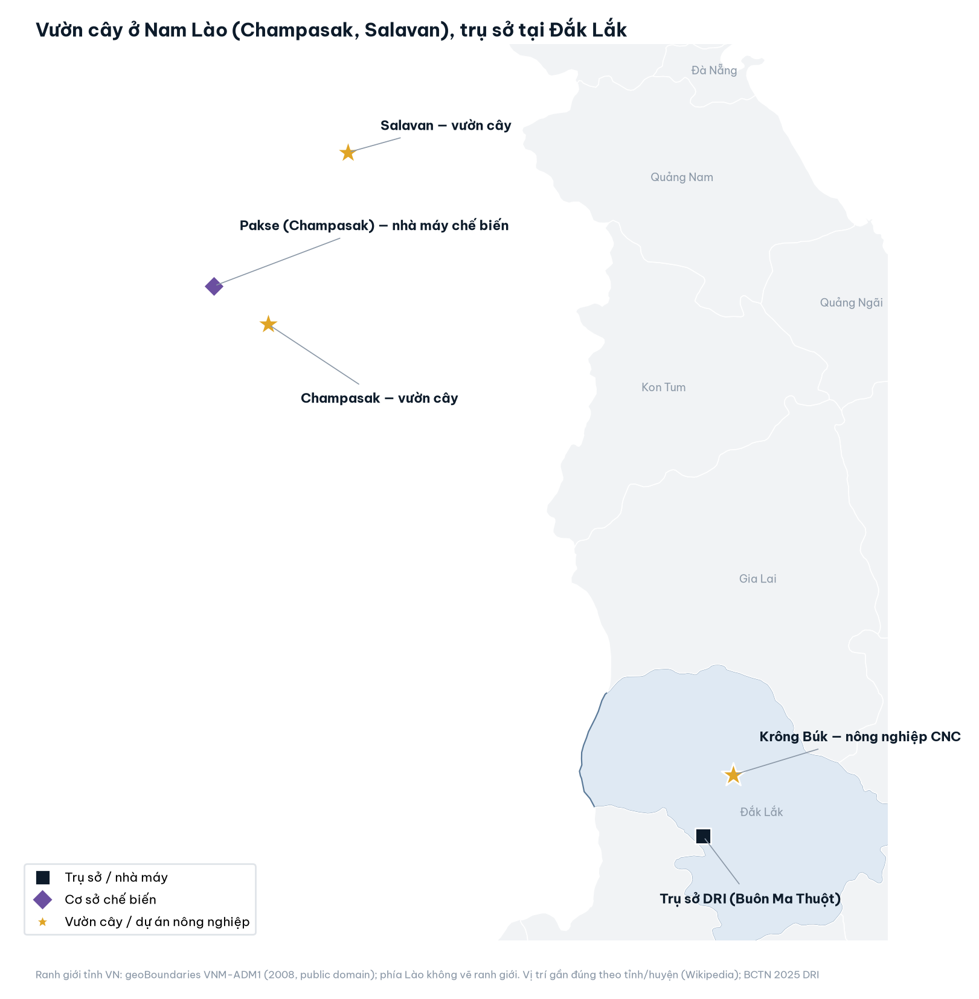

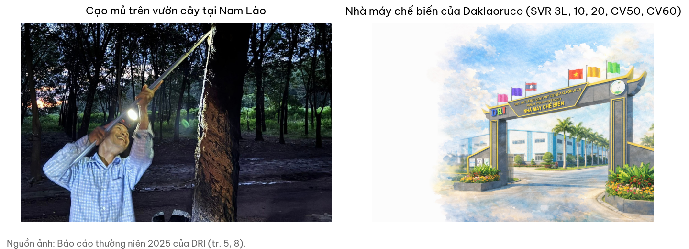

- **Tài sản:** công ty con 100% Daklaoruco quản lý 9.276 ha đất tô nhượng (8.592 ha cao su), nhà máy 18.000 t/năm tại Champasak; sản phẩm SVR 3L/10/20, CV50/CV60.
- **Khách hàng:** 2025 bán 14.008 t, giá bình quân 47,24 triệu đ/t; 49% xuất khẩu.
- **Đất:** tô nhượng (sửa đổi lần 4 ngày 30/3/2016), tầm nhìn 2054; thuê đất 6 USD/ha/năm.

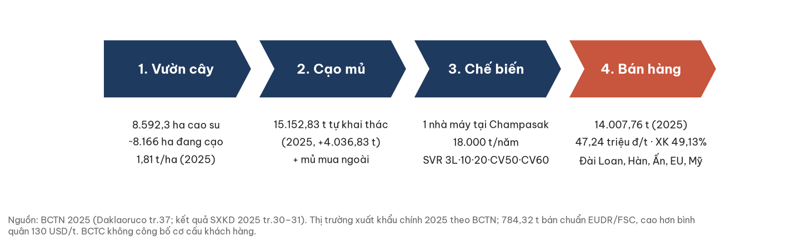

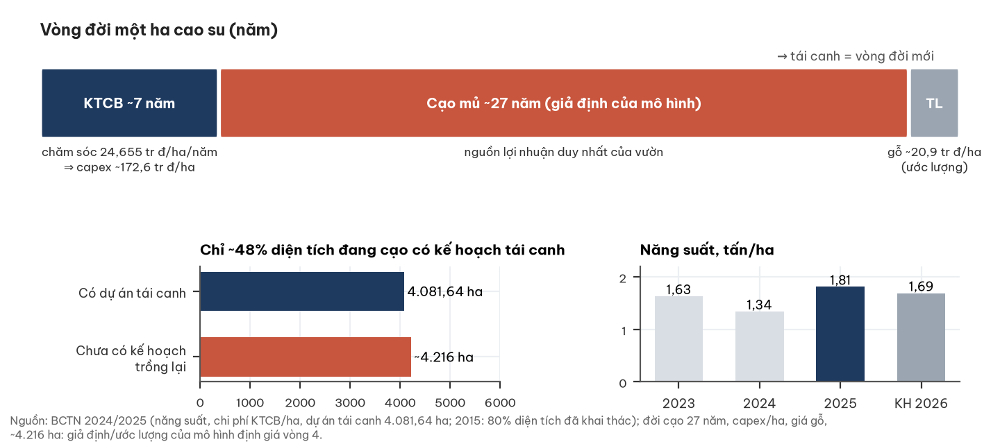

## 5. Phân tích tài chính

**Lợi nhuận 9T tăng mạnh; Q3 thấp vì bán ít hơn chế biến; tiền ròng lớn nhưng phần đáng kể nằm tại Lào.**

| Tỷ đồng [BCTC hợp nhất] | Q3/26 | Q3/25 | 9T/26 | 9T/25 |
|---|---|---|---|---|
| Doanh thu thuần | 136,00 | 184,12 | 622,00 | 487,59 |
| Biên gộp | 34,2% | 35,5% | 39,3% | 37,9% |
| LNST cổ đông mẹ | **25,98** | 38,98 | **167,75** | 116,80 |

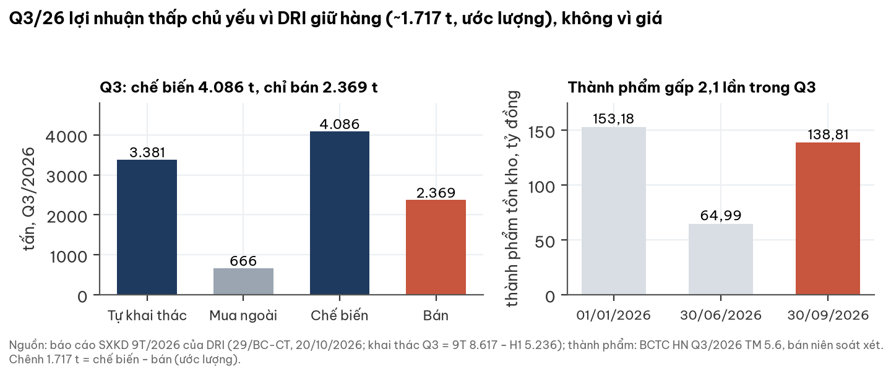

- **Q3:** bán 2.369 t ở 55,75 triệu đ/t (+29% YoY); chế biến 4.086 t ⇒ tồn thêm ~1.717 t. Kế hoạch Q4 của công ty: bán 4.168 t.
- **Dòng tiền:** CFO 9T 125,3 tỷ = 0,75× LNST; thưởng 2026 chưa trích.
- **Bảng cân đối:** tiền + tiền gửi 344,4 tỷ, vay 107,6 tỷ; cho cổ đông lớn Dakruco vay 40 tỷ; XDCB dở dang 72,7 tỷ (tái canh, sầu riêng).

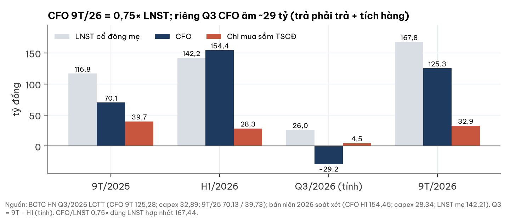

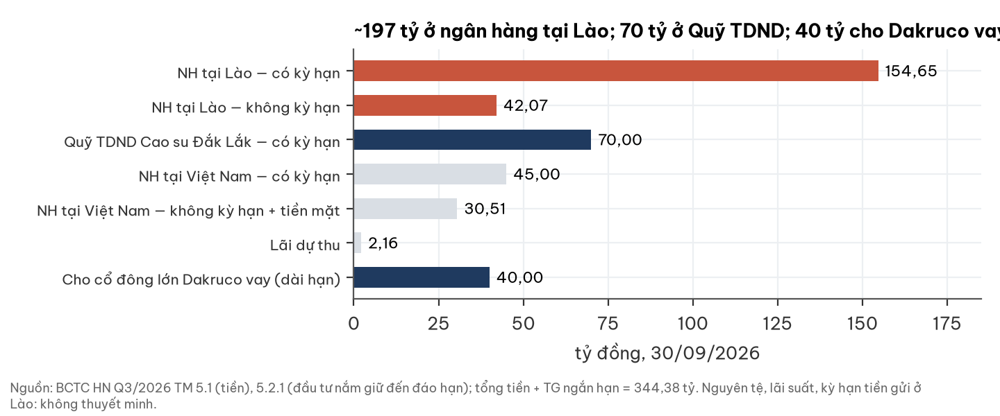

## 6. Sự kiện vốn

**Không phát hành mới; cổ tức 2025 1.000 đ/cp chi từ 20/10/2026; công ty phấn đấu chuyển sàn HOSE trong Q4/2026 (chưa có quyết định chấp thuận).**

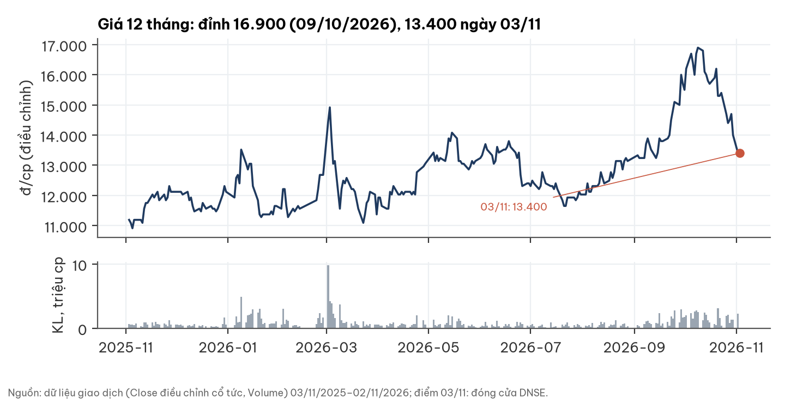

## 7. Định giá: trung tâm ~15,5 nghìn đ/cp sau chiết khấu thanh khoản

**Giá trị = vườn đang cạo tới hết đời + tiền ròng + tài sản dở dang theo giá vốn; tái canh và dự án mới tính ở giá vốn.**

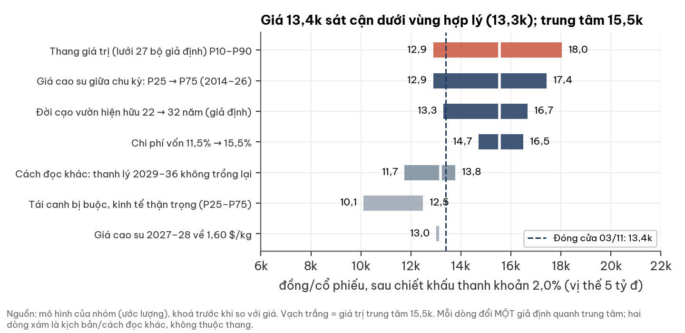

**Phương pháp.** Dòng tiền chủ sở hữu tới 2054 theo lớp tuổi vườn (đời cạo 27 năm, dải 22–32 — giả định), giá bán theo RSS3: 2027–28 hội tụ từ mức hiện tại về mức giữa chu kỳ, sau đó giữ ở mức giữa chu kỳ theo sức mua USD 2025. Trừ thuế tại Lào, khấu trừ chuyển lợi nhuận, quỹ dự phòng, và giữ lại 15% tiền gửi tại Lào. Tài sản dở dang 72,7 tỷ (993 đ/cp) cộng theo giá vốn.

| Cơ sở dữ liệu của các giả định chính | Nguồn |
|---|---|
| Giá giữa chu kỳ 2,22 $/kg = bình quân RSS3 1/2014–9/2026 theo sức mua USD 2025 (dải P25–P75: 1,92–2,43). Cửa sổ chọn trước khi tính: sau siêu chu kỳ 2010–13, gồm ba đáy và ba đỉnh | World Bank Pink Sheet; CPI-U Mỹ (FRED) |
| Diện tích đang cạo 8.166 ha, năng suất 1,69 t/ha | Kế hoạch 2026, BCTN 2025 |
| Đời cạo 27 năm (dải 22–32) | **Giả định** (không có định mức công bố) |
| Tái canh 4.082 ha, giai đoạn 2, sầu riêng, liên doanh gỗ: giá trị bằng vốn bỏ ra; XDCB dở dang 72,7 tỷ theo giá vốn | Không có điều khoản bắt buộc tái canh trong tài liệu công bố; luật Lào chỉ yêu cầu sử dụng đất đúng mục đích |
| Chi chăm sóc vườn kiến thiết 24,7 triệu đ/ha/năm (kịch bản tái canh bị buộc: × 7 năm kiến thiết = 172,6 triệu đ/ha) | BCTN 2024 tr.57; số năm kiến thiết là giả định |

**Cách hiểu kế hoạch thanh lý (diễn giải).** Trung tâm coi việc thanh lý ~3.949 ha vườn kém hiệu quả 2029–36 là một phần chương trình tái canh (ở giá vốn), nên vườn hiện hữu được tính tới hết đời cạo. Nếu coi thanh lý là mất sản lượng vườn hiện hữu và chỉ vốn mới tính theo giá vốn: trung tâm ~13,2 nghìn (P25–P75 11,7–13,8 nghìn).

**Chi phí vốn.** r = 13,5%, neo lãi huy động 12 tháng hiệu dụng 7,40% (02/11/2026); r đổi cùng chiều lãi huy động; dòng tiền có thời hạn (tới 2054) nên độ nhạy thấp.

| Lãi huy động 12T | −100bp | −50bp | 7,40% | +50bp | +100bp |
|---|---|---|---|---|---|
| Giá trị trung tâm sau chiết khấu (đ/cp) | 16.000 | 15.770 | 15.540 | 15.330 | 15.110 |
| Thay đổi | +2,9% | +1,4% | — | −1,4% | −2,8% |

Bối cảnh: lãi suất chiết khấu mà giá thị trường đang ngầm định cho nhóm cổ phiếu niêm yết khoảng 15,1% (phân vị 75% lịch sử 2014–2026); lợi suất TPCP 10 năm 4,58% (+0,62 điểm % trong 12 tháng; nguồn chưa đối chiếu độc lập).

**Thanh khoản.** 250 phiên tới 02/11/2026: giá trị khớp trung vị 8,33 tỷ đ/phiên, biến động ngày 2,58%; free float ~55%. Chiết khấu = biến động ngày × căn (vị thế/thanh khoản).

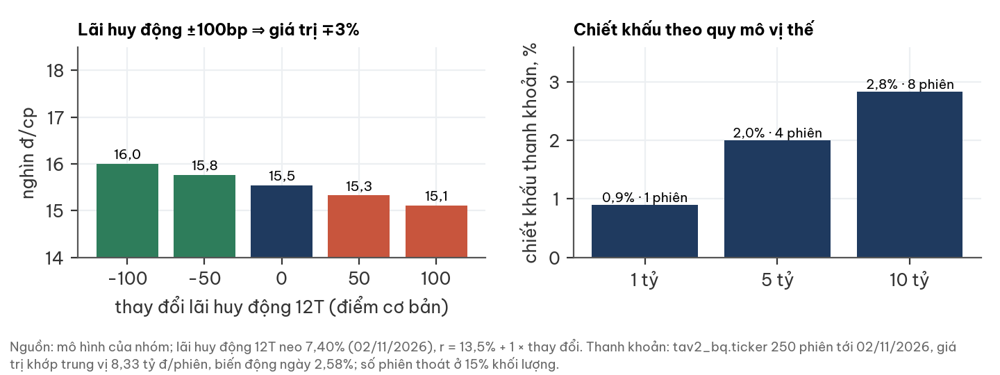

| Vị thế | Chiết khấu (dải) | Số phiên thoát ở 15% thanh khoản | Trung tâm sau chiết khấu | Vùng hợp lý P25–P75 |
|---|---|---|---|---|
| 1 tỷ đ | 0,9% (0,4–1,3%) | 1 | 15.720 | 13.450 – 16.670 |
| 5 tỷ đ | 2,0% (1,0–3,0%) | 4 | 15.540 | 13.300 – 16.490 |
| 10 tỷ đ | 2,8% (1,4–4,2%) | 8 | 15.410 | 13.190 – 16.350 |

Nhận định giá dùng vị thế tham chiếu 5 tỷ đ.

**Hai kịch bản (sau chiết khấu thanh khoản; xác suất là nhận định của nhóm).**

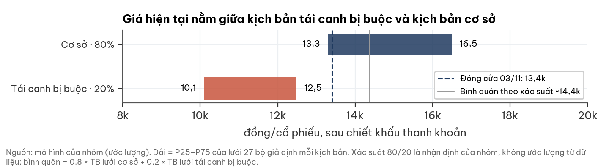

| Kịch bản | Xác suất | Giả định | Giá trị/cp (P25–P75) | So với 13.400 |
|---|---|---|---|---|
| Cơ sở | 80% | Vườn hiện hữu + tiền ròng; tái canh ở giá vốn | 13.300 – 16.490 | −1% đến +23% |
| Tái canh bị buộc | 20% | Thanh lý + trồng lại với kinh tế dự án thận trọng | 10.100 – 12.480 | −25% đến −7% |
| Bình quân | | | ~14.360 | +7% |

Xác suất 20% là nhận định, không ước lượng từ dữ liệu (hợp đồng tô nhượng chưa công khai; luật Lào cho phép thu hồi đất không sử dụng). Độ nhạy: 0% ⇒ 15.100; 10% ⇒ 14.730; 30% ⇒ 13.990.

## 8. Rủi ro: "Nếu 18 tháng nữa giá trị DRI thấp hơn 13.400, vì sao?"

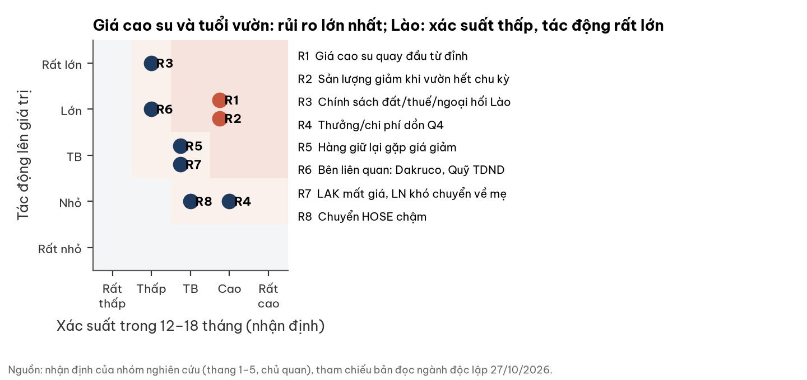

| # | Rủi ro | Xác suất | Tác động | Dấu hiệu sớm |
|---|---|---|---|---|
| R1 | Giá cao su về đáy chu kỳ 2027–28 | Trung bình | Giá trị ~13,0 nghìn | TSR20 < 220¢, Qingdao tăng ≥3 tuần |
| R2 | Tái canh bị buộc, kinh tế kém | Thấp–TB | Giá trị 10,1–12,5 nghìn | Nghị quyết đẩy nhanh thanh lý; dự toán capex > 170 triệu đ/ha |
| R3 | Vườn hết đời sớm (22 năm cạo) | TB | Giá trị ~13,3 nghìn | Năng suất/ha giảm |
| R4 | Chính sách đất/thuế/ngoại hối Lào | Thấp | Rất lớn | Thay đổi thuế, quyền đất, chuyển lợi nhuận |
| R5 | Thưởng/chi phí dồn Q4; hàng tồn gặp giá giảm | TB | TB | SXKD tháng 10–11 |

## 9. Pháp lý và quản trị — CẢNH BÁO

**Không thấy dấu hiệu sai phạm trong tài liệu đã đọc; có cấu trúc cần theo dõi.**

- ⚠️ Cho Dakruco (45%) vay còn 40 tỷ, tài sản đảm bảo là 6 triệu CP DRI.
- ⚠️ Tiền gửi Quỹ TDND Cao su Đắk Lắk 70 tỷ + góp vốn 3 tỷ (kiểm toán bán niên chưa xác định được giá trị thu hồi khoản góp).
- ⚠️ Tiền ~197 tỷ tại Lào không thuyết minh nguyên tệ, lãi suất, kỳ hạn.
- ⚠️ Văn bản tô nhượng (thời hạn, gia hạn, điều kiện sử dụng đất) chưa công khai; một phần đất thuộc quy hoạch rừng bảo tồn Đông Huê Sáo phải trả lại rừng khi hết chu kỳ 1.

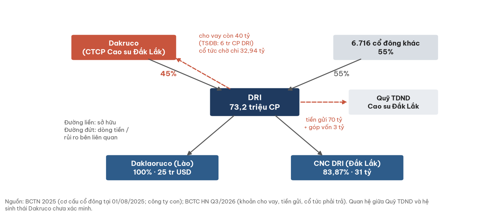

## 10. Lịch xúc tác

| Ngày | Sự kiện | Tích cực hơn nếu | Tiêu cực hơn nếu |
|---|---|---|---|
| ~10/11/2026 | SXKD tháng 10 | Bán ≥ ~1.390 t/tháng | Bán < 1.000 t; LNTT 10T < 9T |
| Q4/2026 | Chuyển sàn HOSE | Được chấp thuận | Chậm |
| ~20/01/2027 | BCTC Q4/2026 | Tồn kho giảm, CFO ≥ LNST | Tồn kho không giảm |
| ĐHĐCĐ 2027 | Lịch tái canh, dự toán | Dự toán có IRR ≥ chi phí vốn | Đẩy nhanh thanh lý, capex cao |
| Bất kỳ | Sự kiện Lào; Dakruco | Dakruco trả nốt 40 tỷ | Sự kiện bất lợi |

## Phụ lục A. Số liệu chính

| Chỉ tiêu | Giá trị | Nguồn |
|---|---|---|
| Tiền 30/9/2026 · tiền gửi có kỳ hạn | 72,57 · 271,81 tỷ | BCTC HN Q3/2026 |
| Vay ngắn + dài hạn | 107,64 tỷ | nt |
| Cổ tức phải trả | 73,92 tỷ | nt |
| XDCB dở dang | 72,71 tỷ | nt (mã 252) |
| Vườn cây: nguyên giá · giá trị còn lại | 567,43 · 250,74 tỷ | nt (5.8) |
| Thuế suất hiệu dụng 9T/2026 | 19,6% | nt |
| Kế hoạch 2026: khai thác · năng suất | 13.800 t · 1,69 t/ha | BCTN 2025 |

## Phụ lục C. Nguồn

BCTC hợp nhất Q3/2026 (ký 22/10/2026) và bán niên 2026 soát xét; báo cáo SXKD 9 tháng 2026 (20/10/2026); BCTN 2024, 2025; thông báo chi cổ tức 94/TB-CT; World Bank Pink Sheet (RSS3 tháng); FRED CPIAUCSL; tav2_bq (ticker, commodity_prices); Luật Khuyến khích Đầu tư Lào 14/NA (2016), Luật Đất đai Lào 70/NA (2019) qua tóm tắt của Tilleke & Gibbins, DFDL, UNEP LEAP; giá đóng cửa: DNSE.

## Phụ lục D. Phương pháp và giới hạn

- Định giá dựng từ dưới lên và chạy trước khi so với giá thị trường; giá thị trường không là đầu vào của mô hình.
- Phân bố năm mở cạo suy từ mốc "2015: 80% diện tích đã khai thác"; chưa có bảng diện tích theo năm trồng.
- Đời cạo 27 năm là giả định, không có định mức công bố (dải 22–32 trình bày ở mục 7).
- Không có văn bản tô nhượng; giá trị sau 2054 tính bằng 0.
- Chưa tra cơ sở dữ liệu xử phạt UBCKNN/HNX và giao dịch nội bộ.
- Xác suất kịch bản là nhận định, không ước lượng từ dữ liệu.
- Chiết khấu thanh khoản dùng hệ số tác động giá phổ biến trong nghiên cứu; chưa hiệu chỉnh bằng lệnh khớp lớn của chính mã.

## Phụ lục E. Quy trình độc lập

Số liệu doanh nghiệp đối chiếu BCTC/BCTN gốc; bản đọc ngành thực hiện độc lập, không biết giá cổ phiếu; cửa sổ giá cao su, lưới giả định và ngưỡng nhận định được đăng ký trước khi tính; mô hình định giá được khoá (mã băm) trước bước so giá; mỗi hình kèm tệp dữ liệu.

## Phụ lục F. Tuyên bố miễn trừ trách nhiệm

Tài liệu mang tính thông tin và nghiên cứu, không phải lời khuyên đầu tư cá nhân hoá và không phải đề nghị mua hay bán chứng khoán. Nhận định không tính tới mục tiêu, khẩu vị rủi ro hay tình hình tài chính của từng nhà đầu tư. Số liệu quá khứ không bảo đảm kết quả tương lai. Các ước lượng, kịch bản, xác suất và giả định được nêu rõ và có thể sai. Thông tin lấy từ nguồn công khai được cho là đáng tin cậy nhưng không được bảo đảm đầy đủ hay chính xác tuyệt đối. Nhà đầu tư tự chịu trách nhiệm về quyết định của mình.
