# FPT — CTCP FPT: lãi vẫn tăng 13% và tiền ròng 12.233 tỷ là thật, nhưng xuất khẩu Q3 chậm hẳn và 9 tháng chưa thu được tiền — giá 52.700 dưới vùng cơ sở 55–67k, phần rẻ chỉ thành hiện thực nếu Q4 thu được tiền

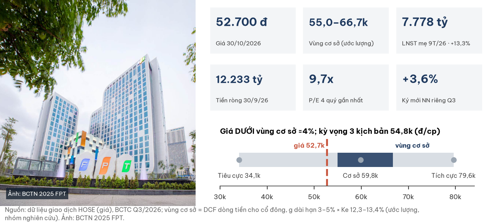

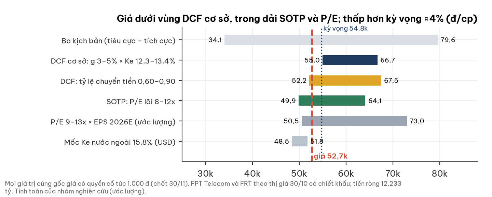

## Investment Summary

| Chỉ tiêu | Giá trị |
|---|---|
| Giá tham chiếu | **52.700 đ** — khớp cuối 30/10/2026 14:45 (HOSE; 01/11 là Chủ Nhật). Giá còn quyền cổ tức 1.000 đ (chốt 30/11) |
| Vùng giá trị cơ sở (ước lượng) | **55,0–66,7k**, tâm 59,8k — giá **DƯỚI** vùng ≈4% |
| Ba kịch bản (xác suất) | Tiêu cực 34,1k (0,35) · Cơ sở 59,8k (0,45) · Tích cực 79,6k (0,20) |
| Kỳ vọng có trọng số | **54,8k (+4%)** |
| LNST cổ đông mẹ 9T/2026 | 7.778 tỷ (+13,3%); Q3 2.723 tỷ (+11,8%) |
| P/E 4 quý gần nhất | 9,7x — thấp nhất ≈8 năm (p10 của 10 năm: 10,5x) |
| Tiền ròng 30/9/2026 | 12.233 tỷ (6.487 đ/cp) |
| Pháp lý & quản trị | Cảnh báo mức thấp–trung bình (mục 9) |

**3 điều cần biết**
- **Tăng trưởng còn, nhưng chậm dần:** ký mới nước ngoài +32% ở 6T, chỉ +3,6% riêng Q3; trong nước tăng tốc +43%.
- **Tiền là biến quyết định:** 9T/2026 tỷ lệ chuyển lãi lõi thành tiền âm (−0,12); Q4 lịch sử là quý thu tiền chính.
- **Giá đã rẻ theo lịch sử:** P/E 9,7x; tiền ròng và cổ phần liên kết theo thị giá ≈23k đ/cp.

## 1. Tóm tắt điều hành

| | |
|---|---|
| **Bối cảnh** | Tập đoàn CNTT lớn nhất Việt Nam: xuất khẩu phần mềm (71% doanh thu 9T), CNTT trong nước, giáo dục; FPT Telecom từ 2026 là công ty liên kết (45,66%) |
| **Vấn đề** | Q3 xuất khẩu giảm tốc; 52% mức tăng LNTT 9T đến từ lãi liên kết; dòng tiền 9T âm |
| **Câu hỏi** | Giá −45% từ đỉnh đã trả đủ cho kịch bản AI làm chậm xuất khẩu chưa? |
| **Trả lời** | Gần đủ: giá thấp hơn kỳ vọng có trọng số ≈4%, dưới vùng cơ sở ≈4%; vùng cơ sở chỉ đạt nếu dòng tiền về lại mức 2024–2025 |

## 2. Thị trường đang định giá gì

**Giá 52,7k ngầm định FPT chỉ chuyển ≈60% lãi lõi thành tiền — thấp hơn mức 2024 (1,07), ngang 2025 (0,60).**

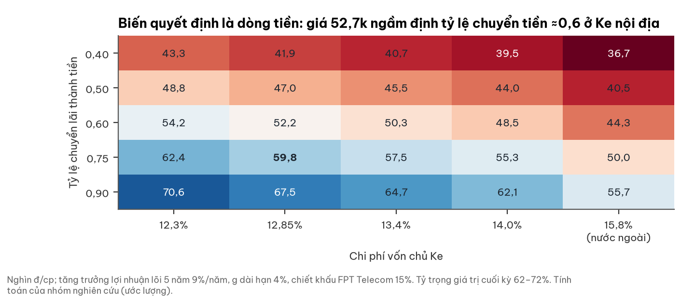

- Trừ tiền ròng, FPT Telecom, FRT theo thị giá, phần lõi vận hành được trả ≈8,0 lần lợi nhuận (ước lượng).
- Ke nội địa 12,3–13,4%; mốc 15,8% là góc nhìn nhà đầu tư nước ngoài (USD), không phải khung chính.

## 3. Ngành: ba đồng hồ khác nhau

**Xuất khẩu phần mềm đứng giữa cấu trúc và chu kỳ; CNTT trong nước theo ngân sách; giáo dục theo chính sách.**

| Khối | Đọc chế độ (người đọc ngành độc lập) | Hàm ý với FPT |
|---|---|---|
| Xuất khẩu phần mềm | Cấu trúc 0,45 / chu kỳ 0,45: AI làm giảm người-tháng; bookings peer vẫn cao | Nhật nghiêng chu kỳ (tỷ giá, thiếu người); Mỹ/EU nghiêng cấu trúc |
| Chuyển đổi số nội địa | Hành chính 0,60: NQ 57, giải ngân 41% tại 26/10 | Cầu có, nhưng phụ thuộc nghiệm thu khu vực công |
| Viễn thông / TTDL | Băng rộng bão hoà; TTDL phụ thuộc giá điện, cấp điện | FPT hưởng qua lãi liên kết FPT Telecom |
| Giáo dục tư | Hành chính 0,55: trần học phí, siết tuyển sinh học bạ; ĐH tư thuận về quy mô | Khối giáo dục hút 56% capex 9T |

## 4. Doanh nghiệp: kỹ sư xuất khẩu là lõi lợi nhuận

**FPT bán dịch vụ kỹ sư ra 4 khu vực; Nhật là thị trường lớn nhất, châu Âu tăng nhanh nhất.**

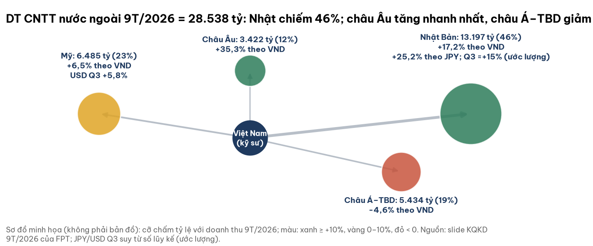

- Thành lập 13/09/1988; trụ sở 10 Phạm Văn Bạch, Hà Nội; nhân sự CNTT 37.618 người (30/9/2026).
- Hợp đồng >1 triệu USD 9T: 163 (+29,4%); nhưng chỉ 2 hợp đồng >10 triệu USD trong Q3 (cùng kỳ ≈8, ước lượng).
- AI/Data Analytics 2.915 tỷ (+55%) — mảng nhỏ nhưng tăng nhanh.

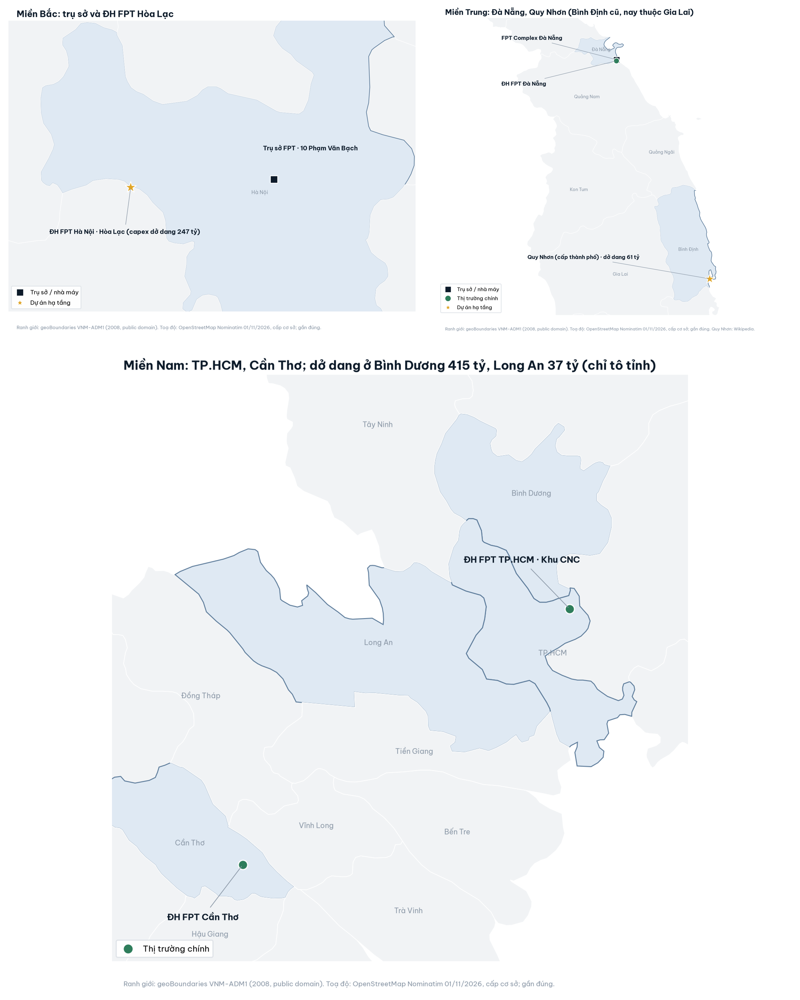

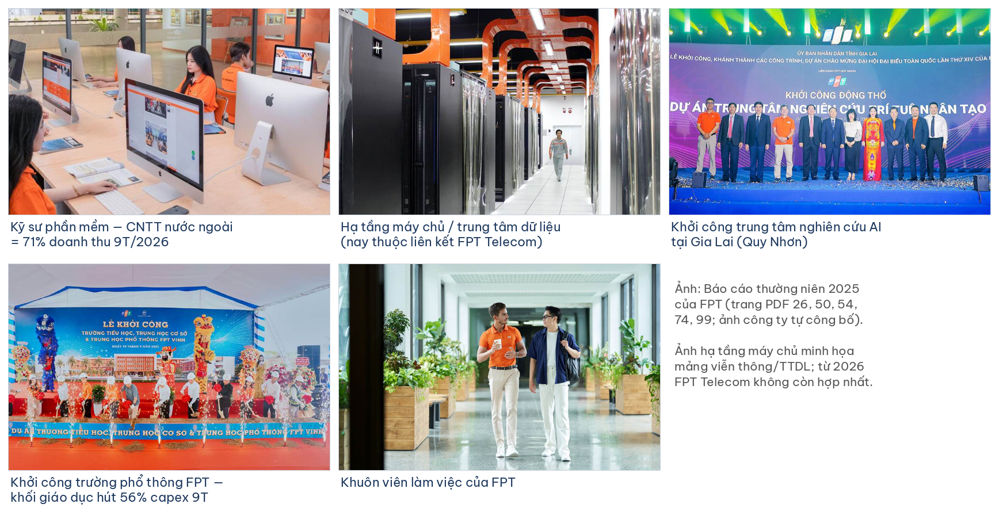

## 5. Tài chính dựng từ dưới lên

### 5a. Tăng trưởng giảm tốc ở xuất khẩu, tăng tốc trong nước

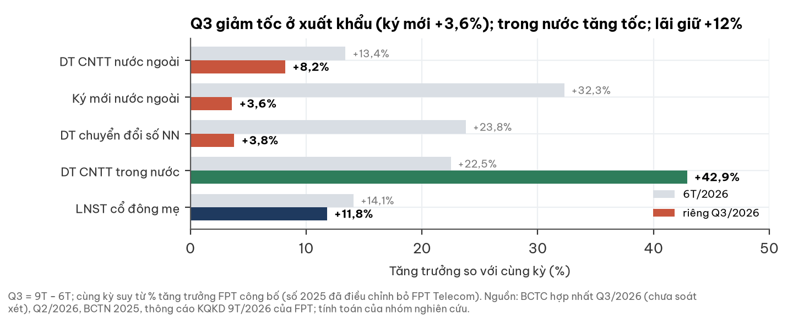

- Doanh thu Q3 13.754 tỷ (+12,1%), LNTT 3.056 tỷ (+15,0%).
- Doanh thu thu bằng JPY: 6T +22,6%, Q3 ≈+15,3%; USD Q3 +5,8% (ước lượng từ lũy kế).

### 5b. Chất lượng lợi nhuận: liên kết đóng góp lớn

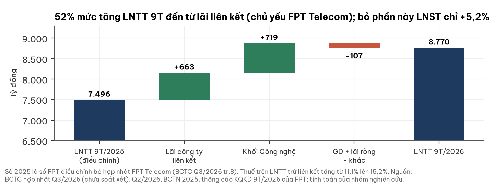

- Bỏ lãi liên kết, LNST 9T chỉ +5,2% vì thuế suất hiệu dụng tăng từ 11,1% lên 15,2%.
- LN lõi 9T có hoàn nhập dự phòng ≈133 tỷ; phần giáo dục + lãi ròng + khác −6,7%.

### 5c. Dòng tiền: biến quyết định

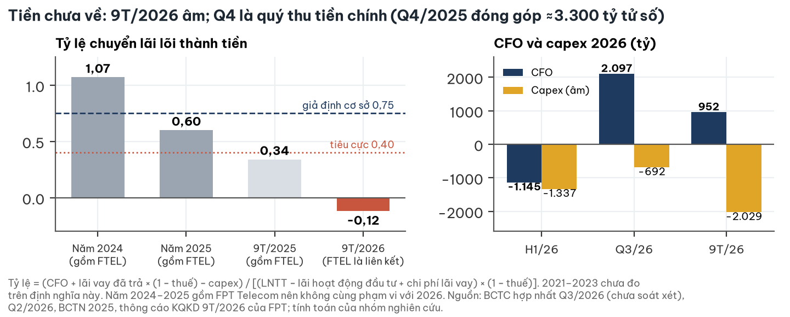

- Một định nghĩa xuyên suốt (chú thích hình); số tham khảo khác gốc cho 9T/2026: 0,22 và 0,28 (Phụ lục D).
- Phải thu khách hàng đi ngang trong Q3 (từ 10.851 xuống 10.847 tỷ), thu về ≈473 tỷ.

### 5d. Bảng cân đối vững; tiền kẹt ở chi phí chờ nghiệm thu

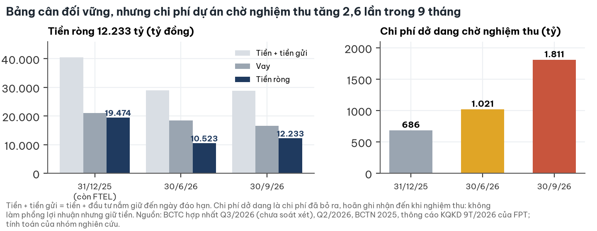

- Chi phí dở dang là chi phí đã bỏ ra, chờ nghiệm thu: không làm phồng lãi, có thể thành doanh thu Q4.
- Số ngày phải thu (tổng phải thu ngắn hạn) 86,5 ngày — dưới 90 nhưng đệm mỏng.
- Vay JPY 36,85 tỷ JPY là phòng ngừa tự nhiên cho doanh thu JPY.

## 6. Giá cổ phiếu và sự kiện vốn

**Giá −45% từ đỉnh 1 năm cùng cả nhóm CNTT; P/E về vùng thấp nhất ≈8 năm.**

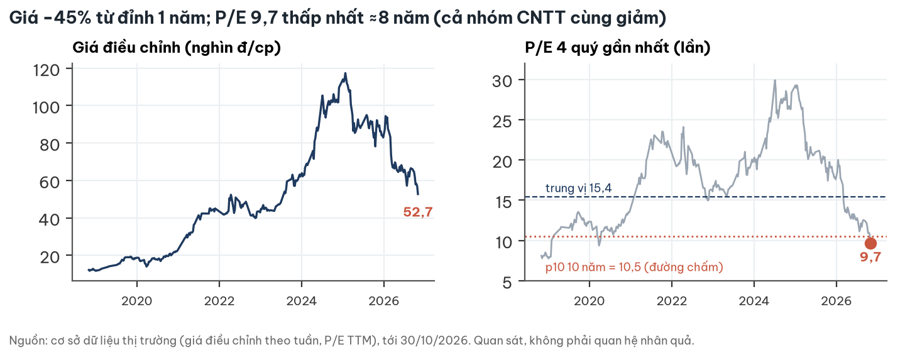

| Sự kiện | Ngày | Ghi chú |
|---|---|---|
| ESOP 10,82 triệu cp, giá 10.000 đ | Phát hành 26/06/2026 | Đã nằm trong 1.885,73 triệu cp; hạn chế 3 năm |
| Thưởng cổ phiếu 10:1 | 21/09/2026 | Không pha loãng kinh tế |
| Tạm ứng cổ tức tiền 1.000 đ/cp | Chốt 30/11, trả 10/12/2026 | Giá 52.700 còn quyền này |

## 7. Định giá

**Cộng từng phần: lõi vận hành (DCF dòng tiền cho cổ đông) + FPT Telecom và FRT theo thị giá có chiết khấu + tiền ròng.**

| Kịch bản | Xác suất | Tăng LN lõi 5 năm | Tỷ lệ chuyển tiền | g dài hạn | Ke | Chiết khấu FPT Telecom | Giá trị |
|---|---|---|---|---|---|---|---|
| Tiêu cực: AI giảm phát giá, tiền không về | 0,35 | 3%/năm | 0,40 | 3,0% | 13,4% | 30% | **34,1k** |
| Cơ sở: Nhật giữ, Mỹ đi ngang, tiền về theo mùa | 0,45 | 9%/năm | 0,75 | 4,0% | 12,85% | 15% | **59,8k** |
| Tích cực: Nhật + AI cộng thêm | 0,20 | 14%/năm | 0,85 | 4,0% | 12,3% | 0% | **79,6k** |

- Kỳ vọng 54,8k; tỷ trọng giá trị cuối kỳ 62–72%; kịch bản tiêu cực dùng đúng mức chuyển tiền đã quan sát.
- Chưa đưa vào số tâm: liên kết khác theo P/E (+1,1 đến +2,4k), tiền khách ứng trước nếu coi là nợ (−1,26k).

## 8. Rủi ro — pre-mortem

**Rủi ro lớn nhất là dòng tiền và giảm phát giá do AI, không phải nợ vay.**

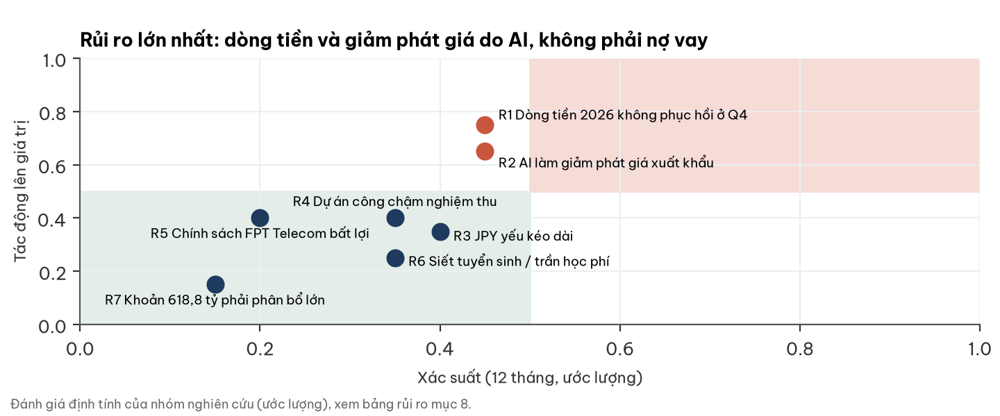

| Rủi ro | Xác suất | Tác động | Dấu hiệu sớm | Ngày kiểm |
|---|---|---|---|---|
| Dòng tiền 2026 không phục hồi | 0,45 | Cao | CFO cả năm < 3.400 tỷ | BCTC Q4, cuối 01/2027 |
| AI giảm phát giá xuất khẩu | 0,45 | Cao | Ký mới lũy kế < +15%; Mỹ < +5% | KQKD tháng 11–12/2026 |
| JPY yếu kéo dài | 0,40 | Trung bình | USD/JPY ≥ 148 | Hằng tháng |
| Dự án công chậm nghiệm thu | 0,35 | Trung bình | Chi phí dở dang > 1.811 tỷ | BCTC Q4 |
| Siết tuyển sinh, trần học phí | 0,35 | Thấp | Văn bản học phí ĐH tự chủ | Năm học 2027 |

## 9. Pháp lý & quản trị — cảnh báo mức thấp–trung bình

**Không thấy vi phạm trọng yếu; rủi ro chính mang tính cấu trúc ở FPT Telecom.**

| Hạng mục | Phát hiện |
|---|---|
| Kiểm toán | PwC soát xét bán niên 2026: chấp nhận toàn phần, không nhấn mạnh. BCTC Q3 tự lập |
| Thuế | QĐ 24/06/2026: 0,244 tỷ, đã nộp — không trọng yếu |
| FPT Telecom | Phía Nhà nước (Bộ Công an) kiểm soát ≈50,16%; free float FOX ≤ ≈4,2%; báo chí nêu khó đạt tiêu chí công ty đại chúng |
| Khoản cần giải thích | Chi phí phát triển khách hàng 618,8 tỷ (có từ 30/6); bản chất và lịch phân bổ chưa thuyết minh |
| Giao dịch bên liên quan | < 2% doanh thu, quan hệ thương mại thường |
| Quét tin 01/11/2026 | Không thấy quyết định xử phạt mới trong 10/2026 với FPT/FPT Telecom |

## 10. Lịch xúc tác và mốc hai chiều

| Mốc | Tích cực hơn nếu | Tiêu cực hơn nếu |
|---|---|---|
| KQKD tháng 10–11 (12/2026) | Ký mới NN lũy kế ≥ +20%, thêm ≥ 2 hợp đồng >10 triệu USD | Lũy kế < +15% |
| BCTC Q4/2026 (cuối 01/2027) | CFO cả năm ≥ 6.000 tỷ (tỷ lệ ≥ 0,6), dở dang < 1.200 tỷ | CFO < 3.400 tỷ (tỷ lệ < 0,2) |
| Doanh thu theo JPY/USD 2026 | Mỹ ≥ +10%, châu Á–TBD hết âm | Nhật theo JPY < +15% cả năm |
| ĐHCĐ 2027 (≈04/2027) | Kế hoạch LNTT ≥ +15% kèm mục tiêu dòng tiền | Kế hoạch < +10% |
| FPT Telecom | Cổ tức 2026 ≥ 2.000 đ/cp | Tăng vốn/pha loãng, mất tư cách đại chúng |
| Khoản 618,8 tỷ | Có doanh thu đối ứng, phân bổ ngắn | Phân bổ lớn vào chi phí |

## Phụ lục A — Số BCTC chính (tỷ đồng)

| Chỉ tiêu | 9T/2026 | 9T/2025 (điều chỉnh) | Thay đổi |
|---|---|---|---|
| Doanh thu thuần | 40.023 | 35.600 | +12,4% |
| LNTT | 8.770 | 7.496 | +17,0% |
| Lãi công ty liên kết | 2.220 | 1.557 | +42,6% |
| LNST cổ đông mẹ | 7.778 | 6.867 | +13,3% |
| CFO / capex | 952 / 2.029 | – | – |
| Tiền + tiền gửi / vay (30/9) | 28.830 / 16.596 | – | – |

## Phụ lục B — Đối chiếu dữ liệu thị trường với BCTC

- Trường tiền mặt trong cơ sở dữ liệu thị trường (7.377 tỷ) thiếu 21.450 tỷ tiền gửi kỳ hạn — báo cáo dùng BCTC.
- LNST mẹ Q3 trên một số báo là 2.273 tỷ; BCTC gốc ghi 2.723 tỷ.
- Số cổ phiếu 1.885,73 triệu (sau thưởng 10:1); số cũ 1.714,3 triệu không còn dùng.

## Phụ lục C — Nguồn

BCTC hợp nhất Q3/2026 (fpt.com, 28/10/2026) và Q2/2026; soát xét bán niên 2026 (PwC); thông cáo và slide KQKD 9T/2026; Báo cáo thường niên 2025 (KQKD tr.168, LCTT tr.170; ảnh trang PDF 23, 26, 50, 54, 74, 99); CBTT ESOP, cổ tức, cổ phiếu thưởng, xử phạt thuế; giá HOSE qua DNSE (latest_trade 30/10/2026 14:45:03); cơ sở dữ liệu thị trường (giá, P/E, FOX/FRT). Logo: fpt.com (`/fpt-logo.svg`), chỉ để nhận diện. Toạ độ: OpenStreetMap Nominatim 01/11/2026 (Quy Nhơn: Wikipedia, cấp thành phố); ranh giới tỉnh geoBoundaries VNM-ADM1 (2008). Đọc ngành: người đọc ngành độc lập, 01/11/2026. Tin pháp lý: tìm kiếm web 01/11/2026 (index.vn, baophapluat.vn).

## Phụ lục D — Phương pháp và giới hạn

- **Tỷ lệ chuyển lãi thành tiền** = (CFO + lãi vay đã trả × (1 − t) − capex) / [(LNTT − lãi hoạt động đầu tư + chi phí lãi vay) × (1 − t)]; t = thuế / (LNTT − lãi liên kết). Tham khảo khác gốc 9T/2026: CFO/(LNTT − lãi đầu tư − thuế) = 0,22; (CFO + lãi và cổ tức thu về)/LNST = 0,28.
- Vùng cơ sở = lưới g dài hạn 3–5% × Ke 12,3–13,4% ở tỷ lệ chuyển tiền 0,75; mọi giá trị cùng gốc giá có quyền cổ tức.
- Ke: lãi suất phi rủi ro chuẩn hoá ≈6,75%, phần bù rủi ro nhà đầu tư nội địa, β ≈1,1.
- Giới hạn: BCTC Q3 chưa soát xét; FPT không công bố backlog, định nghĩa ký mới, tuổi nợ khu vực công; lãi liên kết không tách theo công ty; chuỗi tỷ lệ chuyển tiền 2021–2023 chưa đo; năm 2024–2025 gồm FPT Telecom (khác phạm vi 2026); LN lõi Q4/2025 là ước lượng; P/E peer khu vực chưa đo; báo cáo quản trị 6T/2026 chưa rà.

## Phụ lục E — Quy trình độc lập

Nghiên cứu – người đọc ngành độc lập (đọc mù) – người phản biện đối chiếu 31 số với ảnh BCTC (đều khớp) và yêu cầu sửa trình bày:

| Điểm phản biện | Trước | Sau |
|---|---|---|
| Vùng cơ sở | 51–62k, ghép hai trục | 55,0–66,7k, một lưới tham số ghi rõ; giá dưới vùng |
| Tỷ lệ chuyển tiền | 0,12 = CFO/LNST (lệch gốc); 3 định nghĩa | Một định nghĩa; chuỗi 2024–2026 |
| Kịch bản tiêu cực | Tỷ lệ chuyển tiền 0,60, giá trị 40,1k | 0,40 (mức đã quan sát), 34,1k; xác suất từ 0,30 lên 0,35 |
| Kịch bản tích cực | Vừa hạ Ke vừa g 5%, 84,6k | g 4%, 79,6k |
| Cổ tức | Trừ khỏi giá trị dù giá còn quyền | So cùng gốc (+1.000 đ) |
| Chi phí dở dang | Gọi là doanh thu chưa lập hoá đơn | Chi phí chờ nghiệm thu |
| Khoản 618,8 tỷ | Suy là trả trước cho khách ở Anh | Câu hỏi mở cho doanh nghiệp |
| Số ngày phải thu | 72 (sai định nghĩa) | 86,5 |
| Cân bằng | Thiếu dữ kiện tích cực/tiêu cực | Thêm hợp đồng lớn, thu tiền, JPY/USD Q3 |
| Thay đổi so với nghiên cứu 14/10 (49,6k) | – | ≈+7,7k do đổi khung Ke; phần còn lại do cộng tài sản theo thị giá; không do tin Q3 |

## Phụ lục F — Tuyên bố miễn trừ trách nhiệm

Tài liệu này chỉ nhằm mục đích cung cấp thông tin nghiên cứu, không phải lời khuyên, khuyến nghị hay chào mua/bán chứng khoán, và không tính đến mục tiêu, tình hình tài chính hay nhu cầu của bất kỳ cá nhân nào. Số liệu lấy từ nguồn được cho là đáng tin cậy nhưng không được bảo đảm đầy đủ hay chính xác; các ước lượng và kịch bản có thể thay đổi mà không báo trước. Kết quả quá khứ không bảo đảm kết quả tương lai. Người đọc tự chịu trách nhiệm về quyết định đầu tư của mình.
