# HHS — CTCP Đầu tư Dịch vụ Hoàng Huy: không vay và đang hưởng đợt bàn giao New City-II qua 51% CRV, nhưng sổ sách chứa ≈4.130 tỷ thặng dư định giá chưa thực hiện và lãi Q3 chưa soát xét — giá chỉ thấp hơn tâm giá trị ≈5–8%

**Báo cáo Due Diligence · 01/11/2026 · Nhóm nghiên cứu** · HOSE · Holding bất động sản (51,15% CRV) và nhập khẩu, phân phối xe tải Dongfeng · niên độ dương lịch (Q3/26 = 7–9/2026)

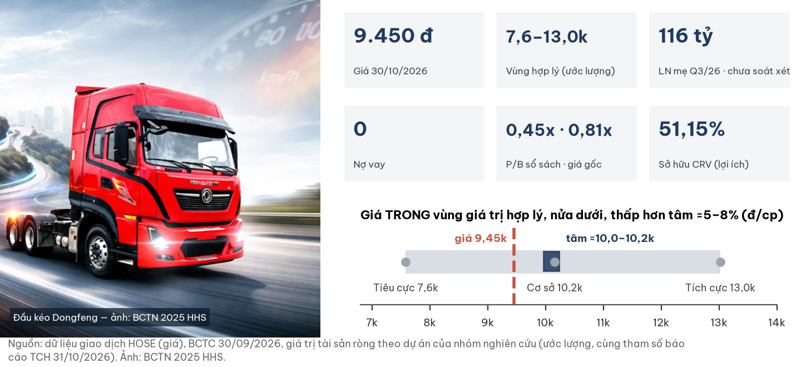

## Investment Summary

**Giá 9.450 đ (đóng cửa 30/10/2026) nằm TRONG vùng giá trị hợp lý ≈7.600–13.000 đ, thấp hơn tâm ≈9.950–10.250 đ (ước lượng) khoảng 5–8%.** Lãi quý tăng là thật; phần lớn giá trị nằm ở quỹ đất của CRV, sau hai tầng holding.

| Dữ liệu chính | Giá trị | Ghi chú |
|---|---|---|
| Giá · vốn hoá | **9.450 đ** · 4.082 tỷ | khớp cuối 14:45:04 ngày 30/10/2026; 431,99 tr cp |
| Vùng giá trị hợp lý · tâm | **7.600–13.000 · ≈9.950–10.250 đ** | giá trị tài sản ròng theo dự án, cùng tham số báo cáo TCH 31/10/2026 |
| LNST Q3/26 hợp nhất · thuộc cổ đông mẹ | 198,4 tỷ · **115,8 tỷ** | ×6,7 cùng kỳ (mẹ); **chưa soát xét** |
| P/B: sổ sách · cơ sở giá gốc | **0,45x · 0,81x** | sổ sách gồm thặng dư định giá CRV |
| Nợ vay | **0** | tiền + tiền gửi 1.031 tỷ (công ty mẹ 171 tỷ) |
| Người mua trả trước New City-II | 3.099 tỷ | chỉ giảm 354 tỷ trong 9T dù DT BĐS 9T ≈1.876 tỷ |
| Thanh khoản 3 tháng · nước ngoài | ≈10,8 tỷ đ/phiên · 0,59% | TCH nắm 58,31% |

**Ba điều cần biết**

1. **Lãi Q3 đến từ CRV bàn giao New City-II, biên kinh tế ≈52%:** biên báo cáo chỉ 15,6% vì phần lớn lãi dự án đã được ghi năm 2025 dưới dạng lãi đánh giá lại 3.488,7 tỷ.
2. **Sổ sách 21.188 đ/cp không phải giá trị đã có:** ≈9.570 đ/cp là thặng dư định giá chưa thực hiện; soát xét 6T đã hạ LNST mẹ 34%, Q3 chưa được soát xét.
3. **Trên cùng cơ sở với báo cáo TCH, giá chỉ thấp hơn tâm ≈5–8%;** cơ sở định giá theo PPA của chính HHS cho tâm ≈11.700 đ (giá −19%).

| Điều làm nhận định đổi | Điều kiện (kiểm tại BCTC năm 2026 kiểm toán, ≤ 31/03/2027) | Tâm mới (ước lượng) |
|---|---|---|
| Tích cực hơn | LN mẹ 9T không bị điều chỉnh > 10%; NC-II giữ biên ≈52%; CRV chia cổ tức tiền ≥ 500 tỷ | ≈11.200–11.900 |
| Tiêu cực hơn | kiểm toán điều chỉnh > 10% hoặc có ngoại trừ; người bán HHS Capital là người liên quan; xử phạt mới | ≈8.500–9.000 |

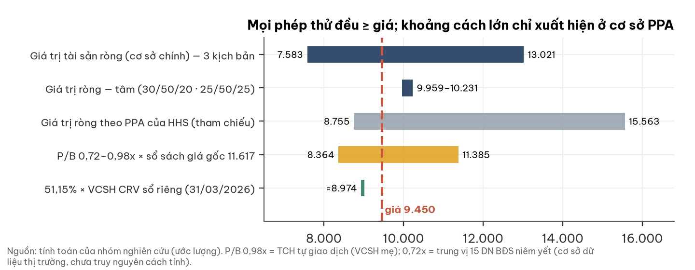

## 1. Tóm tắt điều hành

**Bảng cân đối sạch, lãi thật; điều chưa chắc là bao nhiêu giá trị CRV thực sự chảy về cổ đông HHS.**

- **Tình huống:** Q3/26 doanh thu 1.901 tỷ (×5,9), LNST mẹ 115,8 tỷ; CRV bàn giao đợt đầu New City-II tại Thủy Nguyên.
- **Vấn đề:** tiền dự án nằm ở CRV (thiểu số 48,85%); sổ sách phóng đại bởi PPA; mảng xe đang dồn tồn kho.
- **Trả lời:** giá trong vùng, nửa dưới; ở ±5% quanh giá (8.980–9.920) kết luận không đổi.

## 2. Thị trường đang định giá gì

**Ở 9.450 đ, thị trường trả xấp xỉ phần của HHS trong sổ sách riêng của CRV, gần như không trả cho thặng dư quỹ đất.**

| Phép định giá ngược (ước lượng) | Giá trị |
|---|---|
| 51,15% × VCSH CRV sổ riêng (31/03/2026) | **≈8.974 đ/cp** — sát giá |
| Thặng dư quỹ đất CRV ngầm định (chiết khấu cơ sở) | **≈20%**, tương ứng biên gộp ≈28% — so biên lịch sử ≈52% |
| Chiết khấu so VCSH mẹ trên sổ sách | 55% — nhưng sổ sách gồm thặng dư PPA |

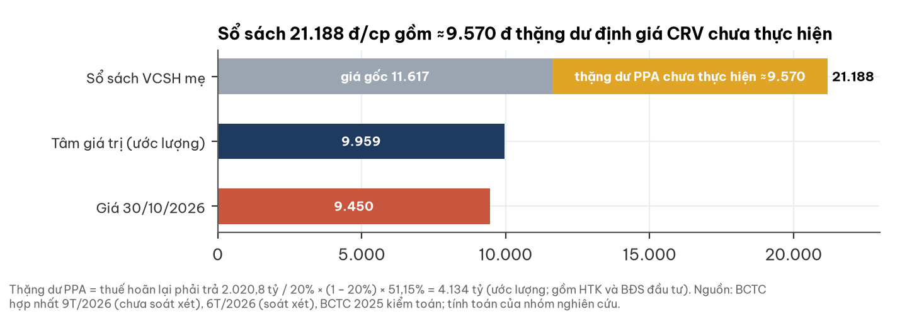

## 3. Ngành: xe tải vào pha muộn của nhịp tăng; nhà ở Hải Phòng đầu pha chững

**Hai mảng đều ở cuối nhịp tốt: xe tải giảm tốc từ Q3, BĐS phía Bắc chậm lại về khối lượng.**

| Yếu tố (người đọc ngành độc lập, 31/10–01/11/2026) | Trạng thái | Ảnh hưởng HHS |
|---|---|---|
| Xe thương mại VN | 2025 +24%; 9T/26 +17% nhưng Q3 ≈−3% đến 0% (ước lượng); nhập khẩu xe tải Trung Quốc giảm từ tháng 4 | mảng Dongfeng chịu nền cao |
| Cầu nền vận tải | hàng hoá Q3 +18%, hàng nội địa qua cảng +28%, đầu tư công 2027 dự kiến lớn | đỡ xe nặng, đầu kéo |
| Nhà ở Hà Nội | đầu đến giữa pha suy về khối lượng; căn hộ bán Q3 −48 đến −66% YoY | cầu đầu tư Hà Nội về Hải Phòng yếu đi |
| Hải Phòng | cuối pha tăng, sang đầu pha chững; một siêu dự án chiếm ≈47% giao dịch thấp tầng Đông Hải Phòng H1/26 | New City-II cạnh tranh trực diện |
| Lãi vay mua nhà · mua xe | nhà: cố định ≈10,9%, thả nổi 13–15%; lãi cho vay chung đang tăng | giảm sức mua cả hai mảng |

## 4. Doanh nghiệp: tầng giữa của nhóm Hoàng Huy

**HHS khởi đầu là nhà phân phối xe tải, nay giá trị chủ yếu là 51,15% của chủ đầu tư New City-II.**

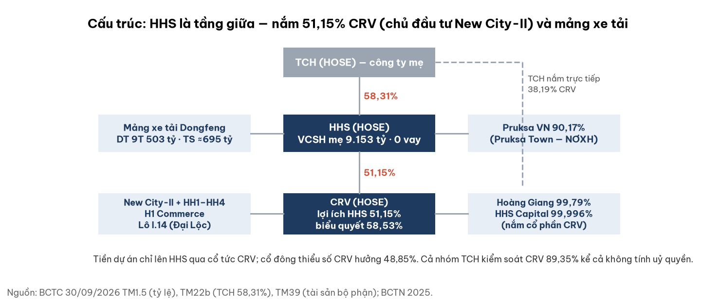

- Thành lập với vốn 90 tỷ (giai đoạn 2008–2012), vào VN30 từ 07/2015; trụ sở 116 Nguyễn Đức Cảnh, Hải Phòng; xe bán toàn quốc.
- 06/2025 nắm quyền kiểm soát CRV; ĐHĐCĐ 24/04/2025 đã duyệt; TCH góp thêm 800 tỷ (12.500 đ/cp).
- Pruksa VN (90,17%) đã bàn giao xong Pruksa Town 20 ha (An Đồng); Hoàng Giang phân phối Sinotruk/Howo.

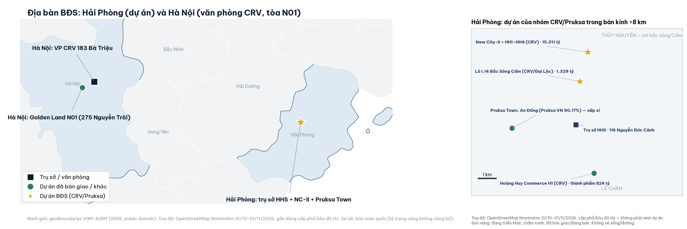

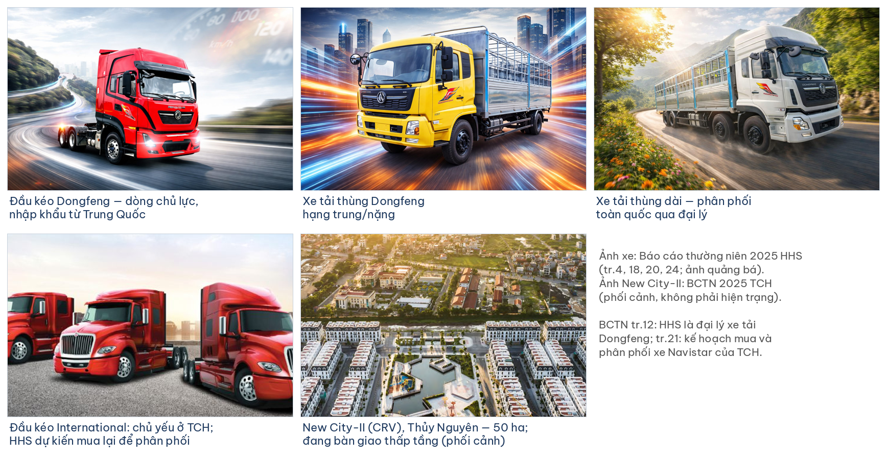

| Mảng / dự án | Pháp nhân | Số chính (30/09/2026) | Trạng thái |
|---|---|---|---|
| New City-II + HH1–HH4 | CRV | HTK 15.011 tỷ (gồm thặng dư PPA); trả trước 3.099 | bàn giao thấp tầng; cao tầng đang làm |
| Lô I.14 Bắc Sông Cấm | Đại Lộc (qua CRV) | HTK 1.329 tỷ | đã nộp tiền đất |
| Hoàng Huy Commerce H1 | CRV | thành phẩm 824 tỷ | đang bán phần còn lại |
| Xe tải Dongfeng | HHS mẹ | DT 9T 503 tỷ; tồn kho 608 tỷ | đại lý Dongfeng; DT 2025 700 tỷ |

## 5. Tài chính dựng từ dưới lên

### 5a. Doanh thu và biên

**Biên BĐS báo cáo thấp vì PPA, không vì dự án kém; bỏ phần PPA, biên ≈52% khớp số của TCH.**

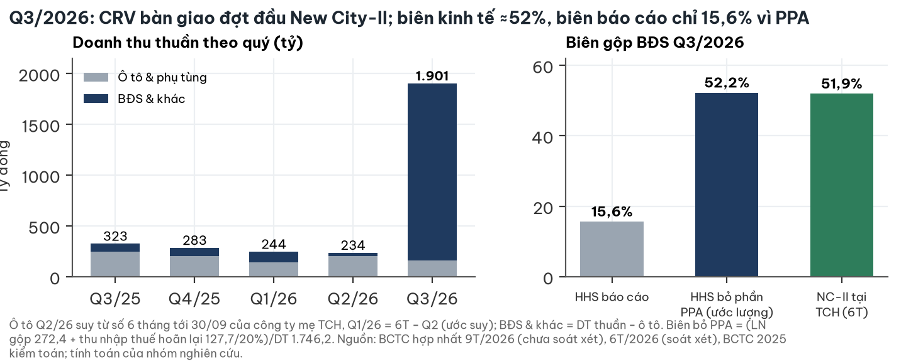

- Người mua trả trước New City-II chỉ giảm 354 tỷ trong 9T: dự án vẫn bán thêm ≈1.670 tỷ (ước lượng, gồm phải thu).
- Lãi BĐS hằng quý của HHS thấp hơn lãi kinh tế có hệ thống, nên P/E (≈19x năm hoá) không dùng để định giá.

### 5b. Lợi nhuận và điều chỉnh soát xét

**Soát xét 6T hạ LNST mẹ từ 65,5 xuống 43,3 tỷ, ở chính các dòng chịu ảnh hưởng PPA (giá vốn, bán BĐS đầu tư).**

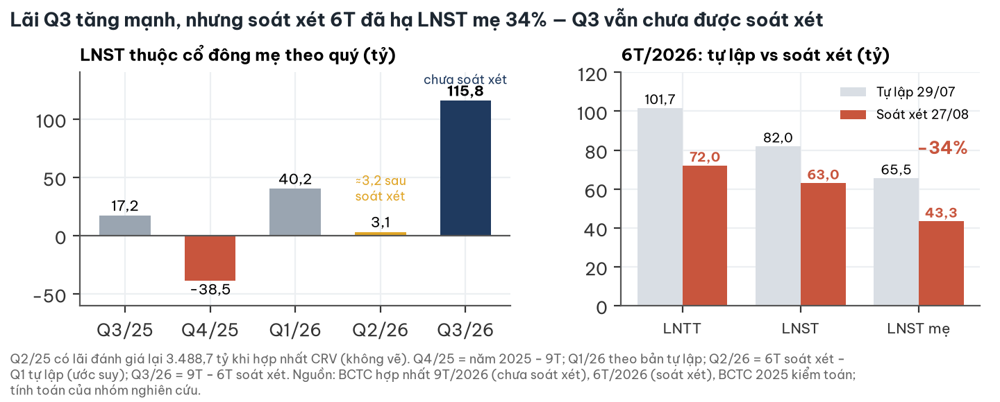

- Q2/26 sau soát xét chỉ ≈12,6 tỷ LNST (báo chí dùng 31,6 tỷ tự lập).
- Q3 (115,8 tỷ) chưa soát xét; mốc kiểm là BCTC năm 2026 kiểm toán.

### 5c. Mảng xe tải

**Doanh số 9T đi ngang (+1,4%); mức −37% của Q3 là so với quý nền đột biến. Cờ thật là tồn kho.**

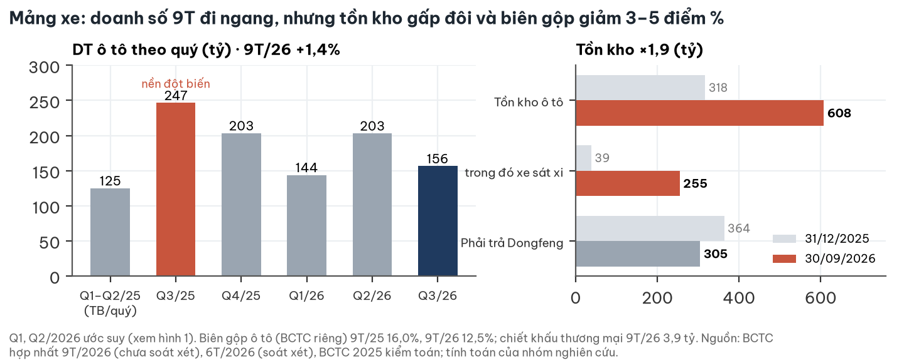

- Tồn kho ×1,9, biên gộp 16,0% xuống 12,5%, bắt đầu có chiết khấu thương mại.
- BCTC 2025 kiểm toán không có thuyết minh bảo lãnh hay cam kết mua lại xe; mảng xe chỉ ≈3–10% giá trị.

### 5d. Dòng tiền và bảng cân đối

**Không còn nợ vay; tiền giảm vì đổi thành đất I.14 và chi phí xây New City-II.**

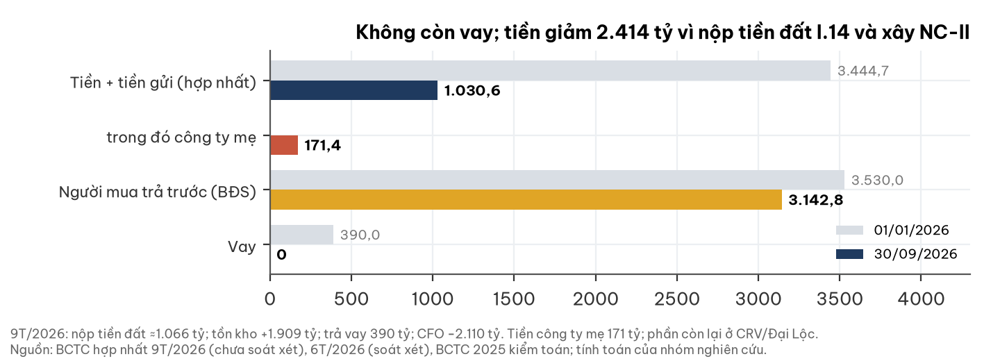

- CFO 9T −2.110 tỷ: tiền đất ≈1.066 tỷ và tồn kho tăng; 9T chưa có cổ tức CRV về HHS.
- Khoản vay duy nhất năm 2025 (390 tỷ) do CRV vay, thế chấp tài sản New City-II, đã trả hết.

## 6. Giá cổ phiếu và sự kiện

**Giá giảm mạnh trong 12 tháng; phản ứng quanh các kỳ BCTC chỉ là quan sát, không chứng minh nhân quả.**

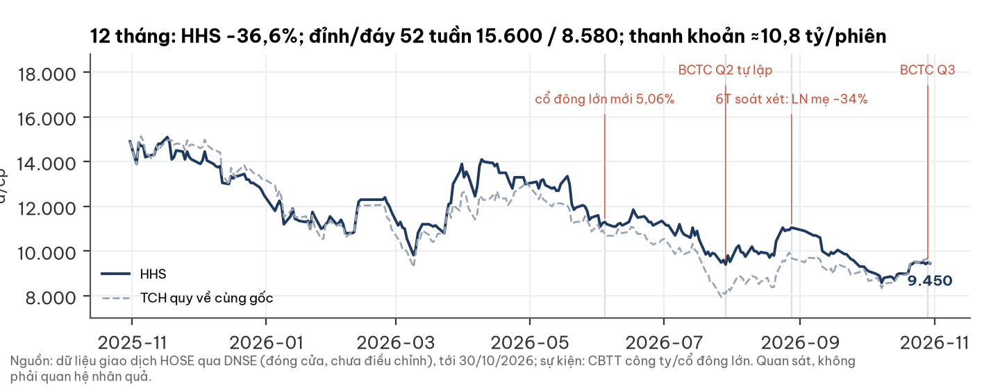

- Nhóm cổ đông Đinh Quang Chiến – PT Đô thị Từ Liêm – Thuỷ điện Trà Xom lên 5,12% (19/10/2026).
- Free float thực ≈36–37%; khối ngoại gần như vắng mặt (0,59%).

## 7. Định giá

**Giá trị tài sản ròng theo dự án, ba kịch bản cho ≈7.600–13.000 đ; tâm ≈9.960 đ (30/50/20) đến ≈10.230 đ (25/50/25).**

| Kịch bản | Xác suất | Điều kiện | Giá trị |
|---|---|---|---|
| Tích cực | 0,20 | thặng dư quỹ đất 55% (biên ≈47%); xe 50 tỷ × 8x; chiết khấu holding 15% / quản trị 5% | **≈13.020** |
| Cơ sở | 0,50 | thặng dư 40% (biên ≈40%); biên ròng backlog 33,5%; xe 35 tỷ × 6x; chiết khấu 25% / 10% | **≈10.160** |
| Tiêu cực | 0,30 | thặng dư 15% (biên ≈24%); xe 25 tỷ × 5x; chiết khấu 35% / 15% | **≈7.580** |

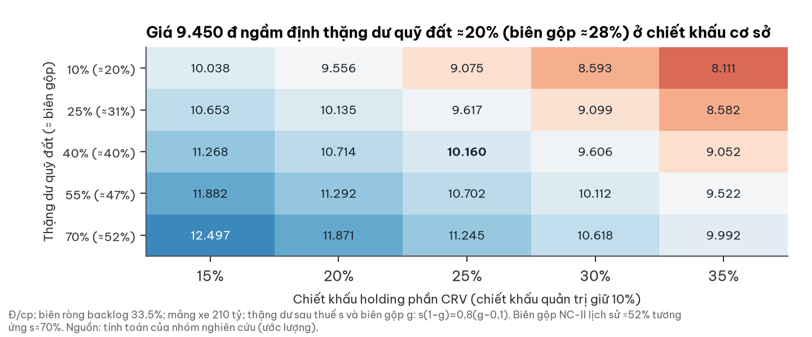

- Cùng tham số với báo cáo TCH (backlog × PV 0,886; quỹ đất × PV 0,617; Ke 12,3–13,4%), vì cùng tài sản CRV.
- Cả ba kịch bản đặt biên dưới mức lịch sử ≈52%: đệm cho chi phí hoàn thành cao tầng chưa quan sát được.
- Chưa cộng thặng dư BĐS đầu tư CRV (tối đa ≈+650 đ/cp): lợi suất cho thuê chỉ ≈2,3%.

## 8. Rủi ro — pre-mortem

**Rủi ro lớn nhất là tốc độ bán quỹ đất CRV và việc tiền có chảy về HHS hay không.**

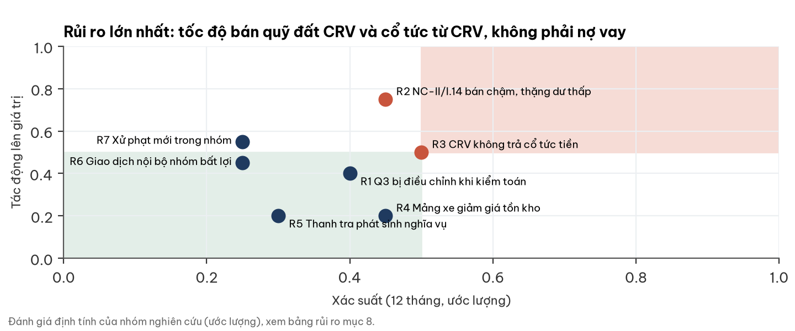

| Rủi ro | Xác suất | Tác động | Dấu hiệu sớm | Ngày kiểm |
|---|---|---|---|---|
| R1 Q3 bị điều chỉnh khi kiểm toán | TB | TB | giá vốn/bán BĐS đầu tư điều chỉnh | 31/03/2027 |
| R2 NC-II/I.14 bán chậm, thặng dư thấp | TB | cao | trả trước NC-II không bổ sung 2 quý | 31/01/2027 |
| R3 CRV không trả cổ tức tiền | TB | TB | CRV dồn tiền vào quỹ đất mới | 31/12/2027 |
| R4 Mảng xe giảm giá tồn kho | TB | thấp | tồn kho ô tô > 600 tỷ, dự phòng giảm giá | 31/01/2027 |
| R5 Thanh tra phát sinh nghĩa vụ | thấp–TB | thấp | văn bản nghĩa vụ đất N01, điều chỉnh giá NƠXH | 31/03/2027 |
| R6 Giao dịch nội bộ nhóm bất lợi | thấp | TB | khoản ký quỹ/tạm ứng cá nhân mới | hằng quý |
| R7 Xử phạt mới trong nhóm | thấp | TB | QĐ xử phạt/CBTT bất thường | 31/03/2027 |

## 9. Pháp lý & quản trị — WARNING (mức trung bình, chưa đóng)

**Chưa thấy QĐ xử phạt nào với HHS; điểm cần theo dõi là cấu trúc thương vụ HHS Capital và hai kết luận thanh tra đang mở.**

| Hạng mục | Nội dung | Đánh giá |
|---|---|---|
| Lãi 3.488,7 tỷ (2025) | đánh giá lại phần CRV đã nắm khi giành quyền kiểm soát; CRV vốn đã thuộc nhóm TCH | ghi nhận kế toán nội bộ nhóm, không tạo giá trị kinh tế mới |
| Thương vụ HHS Capital | ĐHĐCĐ duyệt 24/04/2025; trả 1.302,5 tỷ (≈26.000 đ/cp CRV) cho người bán **không nêu tên**; không định giá độc lập; TCH được biểu quyết; HHS điều hành HHS Capital trước khi trả tiền | premium ≈143,5 tỷ (≈3,5% vốn hoá); tờ trình nói người bán không liên quan nhưng không kiểm được |
| Uỷ quyền 7,53% tại CRV (2025) | từ một nhóm cổ đông không nêu tên | nay không cần: HHS 51,15% lợi ích; cả nhóm 89,35% |
| KL 08/KL-TTTP (26/02/2026) | Thanh tra Hải Phòng: Pruksa VN rà soát, điều chỉnh giá bán NƠXH theo quyết toán | mở, chưa lượng hoá; mảng nhỏ |
| TB 2124/TB-TTCP (2024) | đất khối đế N01 (275 Nguyễn Trãi) của CRV: tạm trích 7,87 tỷ, chưa có văn bản nghĩa vụ | mở, chưa lượng hoá |
| Ký quỹ 28,4 tỷ cho một cá nhân | phát sinh 2026, mục đích chưa công bố | ≈66 đ/cp; cờ quản trị |
| Công ty mẹ TCH | 2 QĐ xử phạt (thuế 20,21 tỷ 04/2026; UBCKNN 295 tr 12/2024) | ảnh hưởng gián tiếp |
| Kiểm toán, giám sát | AASC chấp nhận toàn phần 2025 và 6T/26; HĐQT 1/5 độc lập | sạch nhưng giám sát yếu |

## 10. Lịch xúc tác và mốc hai chiều

| Mốc | Ngày | Nếu tích cực | Nếu tiêu cực |
|---|---|---|---|
| BCTC TCH 6T soát xét (số CRV/NC-II) | 30/11/2026 | khớp: giữ | điều chỉnh lớn ở CRV |
| BCTC Q4/2026: DT BĐS, trả trước NC-II | 31/01/2027 | DT BĐS ≥ 1.000 tỷ, trả trước có bổ sung | DT BĐS < 500 tỷ, trả trước không bổ sung |
| Mảng xe Q4/2026 | 31/01/2027 | DT ≥ 200 tỷ và tồn kho < 450 tỷ | DT < 150 tỷ và tồn kho > 600 tỷ |
| BCTC năm 2026 kiểm toán | 31/03/2027 | không điều chỉnh > 10%: giữ | điều chỉnh > 10%/ngoại trừ: tâm −1.000 đến −1.500 đ |
| Danh tính người bán HHS Capital | bất kỳ | bên độc lập: +≈565 đ | người liên quan: −≈565 đ, WARNING cao hơn |
| Cổ tức tiền CRV | 31/12/2027 | ≥ 500 tỷ: +≈555 đ | không có: giữ chiết khấu 25–35% |
| Xử phạt mới trong nhóm | 31/03/2027 | không có: giữ | có: −≈1.130 đ |

## Phụ lục A — Số BCTC chính (tỷ đồng)

| Chỉ tiêu | Q3/26 | Q3/25 | 9T/26 | 6T/26 soát xét | 2025 kiểm toán |
|---|---|---|---|---|---|
| Doanh thu thuần | 1.901,1 | 323,4 | 2.379,4 | 478,3 | 892,8 |
| LNST hợp nhất · mẹ | 198,4 · 115,8 | 10,6 · 17,3 | 261,4 · 159,1 | 63,0 · 43,3 | 3.529,8 · 3.553,2 |
| trong đó lãi đánh giá lại CRV | – | – | – | – | 3.488,7 |
| CFO | | | −2.110 | −2.038 | |
| Tiền + tiền gửi · vay (30/09/26) | 1.030,6 · 0 | | | | |
| VCSH mẹ · NCI (30/09/26) | 9.152,9 · 7.727,0 | | | | |

## Phụ lục B — Đối chiếu dữ liệu thị trường với BCTC

- P/B 0,24x của dữ liệu thị trường chia tổng VCSH gồm cổ đông thiểu số; theo VCSH mẹ là 0,45x, cơ sở giá gốc 0,81x.
- Q2/26 báo chí (DT 233,8; LNST 31,6) khớp BCTC tự lập; sau soát xét LNST Q2 ≈12,6 (suy ra).
- P/E ngành xe (trung vị ≈5,9x: HTL, TMT, SVC, VEA, HAX) theo dữ liệu thị trường 30/10/2026.

## Phụ lục C — Nguồn

- BCTC hợp nhất & riêng 9T/2026 (29/10/2026); BCTC Q2/2026 tự lập (29/07); 6T/2026 soát xét AASC (27/08); BCTC 2025 kiểm toán AASC; BCTN 2025; tài liệu ĐHĐCĐ 24/04/2025; báo cáo sở hữu cổ đông lớn 04/06 và 19/10/2026 — hoanghuyhhs.vn. Báo cáo TCH/CRV liên quan — hoanghuy.vn.
- Giá: dữ liệu giao dịch HOSE qua DNSE (khớp cuối 30/10/2026 14:45:04; lấy 01/11/2026 10:40). Ngành: hai báo cáo của người đọc ngành độc lập (xe tải 01/11/2026; nhà ở phía Bắc 31/10/2026), nguồn gốc VAMA, Tổng cục Hải quan, Cục Thống kê, HPREA.
- Logo: hoanghuyhhs.vn (header trang chủ). Ảnh xe: BCTN 2025 HHS tr.4, 18, 20, 24; ảnh New City-II: BCTN 2025 TCH (phối cảnh). Toạ độ: OpenStreetMap Nominatim 31/10–01/11/2026; ranh giới: geoBoundaries VNM-ADM1 (2008; Hải Dương cũ nay thuộc Hải Phòng).

## Phụ lục D — Phương pháp và giới hạn

- Giá trị = [51,15% × CRV × (1 − CK holding) + phần khác ≈678 tỷ + mảng xe] × (1 − CK quản trị). CRV = sổ sách giá gốc ≈7.735 tỷ + lãi backlog (trả trước ex-VAT × biên ròng × PV 0,886) + thặng dư quỹ đất còn lại 7.339 tỷ × PV 0,617.
- Sổ sách giá gốc = VCSH mẹ − thặng dư PPA sau thuế (thuế hoãn lại phải trả / 20% × 80% × 51,15%). Thặng dư s và biên gộp g: s(1−g) = 0,8(g−0,1).
- Giới hạn: Q3 chưa soát xét; PPA chỉ thuyết minh dạng tổng; không có dự toán chi phí hoàn thành, số xe bán, hợp đồng Dongfeng; danh tính người bán HHS Capital và nhóm uỷ quyền chưa công bố; vị trí lô 17B Bà Triệu chưa xác định (không vẽ); mọi tham số định giá là ước lượng.

## Phụ lục E — Quy trình độc lập

Báo cáo qua ba bước: đọc BCTC gốc – đọc ngành độc lập (không xem kết luận doanh nghiệp) – người phản biện kiểm từng số trên ảnh BCTC. Người phản biện đã sửa:

| Điểm sửa | Trước | Sau |
|---|---|---|
| Cơ sở định giá CRV | thặng dư PPA trừ haircut 25/40/60%, tâm ≈11.900 | cùng tham số báo cáo TCH; tâm ≈9.950–10.250; PPA giữ làm tham chiếu |
| Khoảng cách giá – tâm | ≈20% | ≈5–8% |
| Q2/2026 | "chưa kiểm" | dùng BCTC Q2; thêm bảng tự lập vs soát xét (LN mẹ −34%) |
| Cảnh báo uỷ quyền / HHS Capital | "lợi nhuận phụ thuộc thoả thuận ngoài sở hữu" | viết lại theo NQ ĐHĐCĐ, biên bản 06/05/2025; premium 143,5 tỷ |
| Mức cảnh báo quản trị | trung bình–cao | trung bình, mở; thêm 2 kết luận thanh tra |
| Mảng xe | "Q3 −37%" | kèm nền đột biến; 9T +1,4%; P/E theo trung vị ngành 6x |
| Tiêu đề | "sổ sách là thật" | thặng dư định giá chưa thực hiện |
| Điểm tích cực | thiếu | thêm thu mới New City-II; biên kinh tế ≈52% |

## Phụ lục F — Tuyên bố miễn trừ trách nhiệm

Tài liệu này chỉ nhằm mục đích cung cấp thông tin nghiên cứu, không phải lời khuyên, chào mời hay khuyến nghị mua, bán hoặc nắm giữ bất kỳ chứng khoán nào, và không tính đến mục tiêu, tình hình tài chính hay nhu cầu của bất kỳ cá nhân nào. Thông tin dựa trên nguồn công khai được cho là đáng tin cậy nhưng không được bảo đảm về độ chính xác hay đầy đủ; các ước lượng, kịch bản và xác suất là đánh giá tại thời điểm 01/11/2026 và có thể thay đổi mà không cần thông báo. Hiệu quả trong quá khứ không bảo đảm kết quả tương lai. Nhà đầu tư cần tự đánh giá và tham khảo tư vấn chuyên môn trước khi ra quyết định. Logo và hình ảnh thuộc quyền của doanh nghiệp, chỉ dùng để nhận diện, không hàm ý doanh nghiệp tài trợ hay xác nhận báo cáo.
