# HPG — CTCP Tập đoàn Hòa Phát: lợi nhuận Q3 gấp đôi thật và bảng cân đối khỏe, nhưng hơn một phần ba tăng trưởng 9 tháng là lãi thoái vốn một lần và giá đã ở nửa trên vùng giá trị hợp lý

**Báo cáo Due Diligence · 31/10/2026 · Nhóm nghiên cứu** · HOSE · Thép tích hợp (thép xây dựng, HRC, ống, tôn), nông nghiệp

**Phiên bản 3 (hiệu đính 31/10/2026) — thay bản gửi trước.** Vùng giá trị hợp lý không đổi; phần quản trị và giao dịch TLSH được làm rõ (xem Phụ lục E).

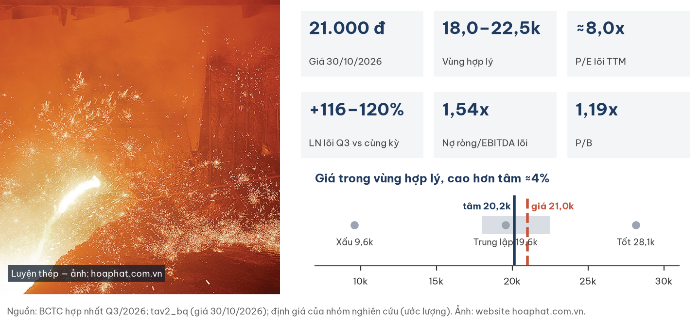

## Investment Summary

**Giá 21.000 đ (đóng cửa 30/10/2026) nằm TRONG vùng giá trị hợp lý 18.000–22.500 đ, cao hơn tâm ≈20.200 đ (ước lượng) khoảng 4%.** Doanh nghiệp tốt lên thật; giá đã trả cho phần lớn điều đó.

| Dữ liệu chính | Giá trị | Ghi chú |
|---|---|---|
| Giá đóng cửa 30/10/2026 | **21.000 đ** | Phiên gần nhất (thị trường nghỉ 31/10); vốn hoá 177.302 tỷ |
| Vùng giá trị hợp lý · tâm | **18.000–22.500 · ≈20.200 đ** | Ước lượng; 2/3 thu nhập thặng dư + 1/3 EV/EBITDA 5x |
| LNST lõi Q3/26 · cùng kỳ | **7,7–8,0 nghìn tỷ · +116–120%** | Lõi so lõi; báo cáo 8.265 tỷ (+106%) |
| LNST lõi 9T/26 | **19,2 ± 0,4 nghìn tỷ** | Báo cáo 23.746 tỷ (+104%) |
| P/E TTM báo cáo · lõi | 6,5x · **≈8,0x** | Lõi sau trích quỹ 2,16% |
| P/B · ROE lõi TTM | 1,19x · ≈16–17% | Ngang đáy P/B 2025 (1,19), trên đáy 2023 (1,14) |
| Nợ ròng / EBITDA lõi | **1,54x** (1,62x gồm phải trả NB dài hạn) | 1,35x nếu coi toàn bộ tiền gửi là tự do |
| CFO 9T / LN lõi | 1,09x · **0,82x bỏ hoàn VAT một lần** | Capex 9T 14.607 tỷ |
| Thanh khoản 3 tháng | 410 tỷ đ/phiên | −74% so với 02/2026; nước ngoài sở hữu 21,8% |

**Bốn điều cần biết**

1. **Lợi nhuận vận hành gấp đôi là thật** — biên gộp ≈19% hai quý liền khi spread đi ngang; động lực là khối lượng Dung Quất 2, không phải hoàn nhập hay vốn hoá lãi vay.
2. **Nhưng con số 9 tháng bị thổi** — lãi bán công ty con bất động sản 4.929 tỷ trước thuế ở Q1; lợi nhuận đã gánh đủ khấu hao và lãi vay dự án mới.
3. **Và giá ngầm định ROE dài hạn ≈12,4% sau thuế đầy đủ** — gần chi phí vốn; thị trường không trả cho mức lợi nhuận Q3 kéo dài.
4. **Cờ quản trị cần theo dõi: giao dịch TLSH** — cổ phần BĐS Hòa Phát góp ở ≈ mệnh giá, bằng 1/3 phương án công bố trước, không giải thích; HPG còn là thành viên một liên danh dự án BT. Không trừ vào giá trị sổ sách.

| Điều làm nhận định đổi | Điều kiện (kiểm tại BCTC Q4/26 và Q1/27) | Vùng mới (ước lượng) |
|---|---|---|
| Tích cực hơn | ≥ 2 trong 3: biên gộp Q4/26 ≥ 18%; LN lõi Q4/26 ≥ 8.000 tỷ; biên Q1/27 ≥ 17,5% — và thuế chống bán phá giá HRC giữ sau rà soát | tâm ≈21–22k |
| Tiêu cực hơn | Biên gộp 2 quý liên tiếp thấp hơn cùng kỳ, hoặc mức thuế HRC < 20% sau rà soát | tâm ≈16–17,5k |

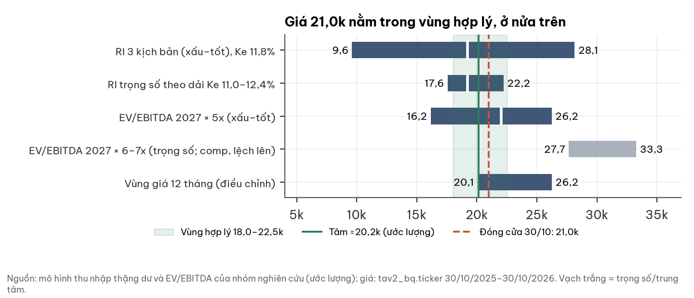

## 1. Tóm tắt điều hành

**Lợi nhuận lõi tăng mạnh và có chất lượng; điều còn tranh luận là độ bền của nó.**

- **Tình huống:** Q3/26 doanh thu thuần 62.214 tỷ (+71%), LNST 8.265 tỷ (+106%); Dung Quất 2 đã chạy ≈81% công suất HRC.
- **Vấn đề:** 9T có lãi thoái vốn một lần; ưu đãi thuế không vĩnh viễn; thuế chống bán phá giá HRC đang rà soát; cầu nhà ở chậm lại.
- **Trả lời:** giá 21.000 đ nằm trong vùng hợp lý, nửa trên. Không rẻ như P/E 6,5x gợi ý, cũng không đắt.

## 2. Thị trường đang định giá gì

**Ở 21.000 đ, thị trường trả cho ROE dài hạn ≈12,4% — thấp hơn ROE lõi hiện tại ≈16–17%.**

| Phép định giá ngược (ước lượng) | Giá trị |
|---|---|
| P/E năm 2027 theo kịch bản trung lập (LN 26 nghìn tỷ) | 6,8x |
| EV/EBITDA lõi TTM · trên EBITDA 2027 trung lập | 5,2x · 4,7x |
| ROE dài hạn sau thuế 20% ngầm định (Ke 11,8%) | **12,4%** |
| So sánh: trung vị P/E thép VN · khu vực | 13,4x · 13,5x |

- Chiết khấu P/E ≈40% so với ngành tương đương kỳ vọng ROE trôi về 11–12%.
- Quan điểm khác biệt: Q3 cao một phần do mùa vụ, không phải đỉnh chu kỳ; kịch bản trung lập giữ lợi nhuận đi ngang, không đi xuống.
- Quỹ ngoại chủ động nắm ở mức trung tính: VOF 5,0%, VEIL 3,8% (30/6), VEOF 6,1% (31/7), VanEck VNM 5,01% (29/10) — chưa phải vị thế đông người.

## 3. Ngành: thép Việt Nam giữa chu kỳ, được bảo hộ ở HRC

**Spread HRC ≈250 USD/t đi ngang giữa chu kỳ; lợi thế của HPG đến từ quy mô tích hợp và thuế chống bán phá giá.**

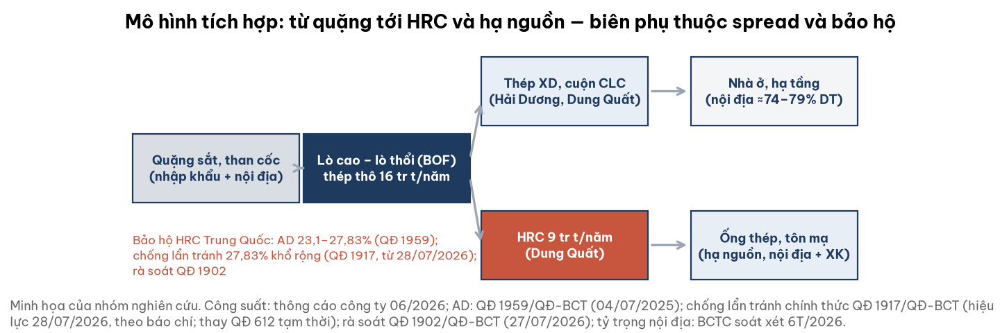

| Yếu tố ngành | Trạng thái 10/2026 | Ảnh hưởng HPG |
|---|---|---|
| Chống bán phá giá HRC Trung Quốc (QĐ 1959/QĐ-BCT) | 23,10–27,83%, tới ≈07/2030; rà soát hành chính QĐ 1902 (27/07/2026) | Giá trị bảo hộ ≈4.700–8.500 tỷ LNTT/năm (ước lượng) |
| Chống lẩn tránh (QĐ 1917/QĐ-BCT, thay QĐ 612 tạm thời) | 27,83% với HRC Trung Quốc khổ rộng >1.880–≤2.300 mm, hiệu lực 28/07/2026 (theo báo chí; chưa đối chiếu văn bản gốc) | Bịt kênh né thuế qua khổ rộng |
| Mỹ: thép cây | Biên phá giá cuối 128,53% + đối kháng 6,80% | Nhỏ: Mỹ ≈4% DT 6T/26 |
| EU: HRC · CBAM | HPG 0% · đã kiểm kê phát thải, chưa công bố tCO₂/t | Nhỏ: EU 3,6% DT |
| Cầu thép xây dựng | Ngành +19,6% 9T, miền Nam +29,9%; mở bán nhà ở chậm lại từ Q3/2026 | Độ trễ sang thép ≈H2/2027 |

- Đối thủ HRC thứ hai có thể xuất hiện sau 2027; nhập khẩu ASEAN là kênh thay thế khi AD giảm.

## 4. Doanh nghiệp: nhà sản xuất thép lớn nhất Việt Nam

**Hòa Phát vận hành hai khu liên hợp gang thép (Hải Dương, Dung Quất), công suất thép thô 16 triệu tấn/năm, HRC 9 triệu tấn.**

| KPI | Giá trị | Nguồn |
|---|---|---|
| Sản lượng bán 9T/26 | 10,3 triệu tấn (+39%); HRC 5,47 (+59%) | Thông cáo công ty |
| Thị phần thép xây dựng | ≈35–36% (2026); 2024: toàn quốc 38%, Bắc 35% · Trung 51% · Nam 22%, xuất khẩu 61% | Công ty / hiệp hội; BCTN 2024 |
| Thị phần HRC | ≈60% phần sản xuất trong nước; ≈40% nếu mẫu số là tổng tiêu thụ gồm nhập khẩu | Công ty; factsheet VEOF 07/2026 |
| Hiệu suất HRC · thép thô | ≈81% · ≈89% (ước lượng) | Tự tính |
| Cơ cấu DT 6T/26 | Việt Nam 79%, châu Á 12%, Âu–Mỹ–Úc 8,6% | BCTC soát xét |
| XDCB · cam kết vốn | 16.113 tỷ (Dung Quất 11.146) · ≈19.472 tỷ | BCTC Q3, 6T |

- Trụ sở KCN Phố Nối A (Hưng Yên); miền Nam là thị trường tăng nhanh nhất, nhà máy Long An đang xây.
- Nông nghiệp ≈3% doanh thu; bất động sản đã chuyển thành khoản đầu tư liên kết từ Q3/2026.

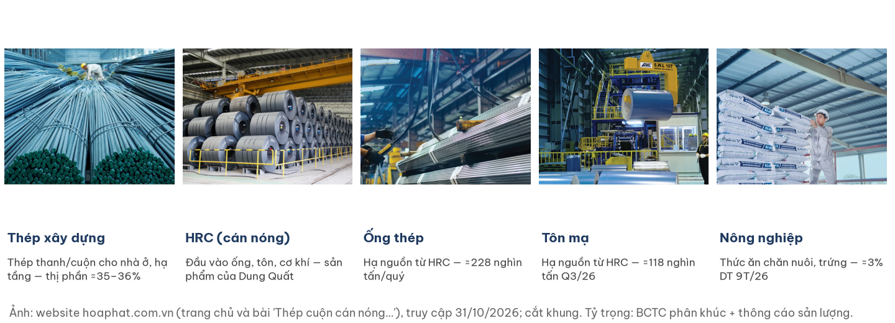

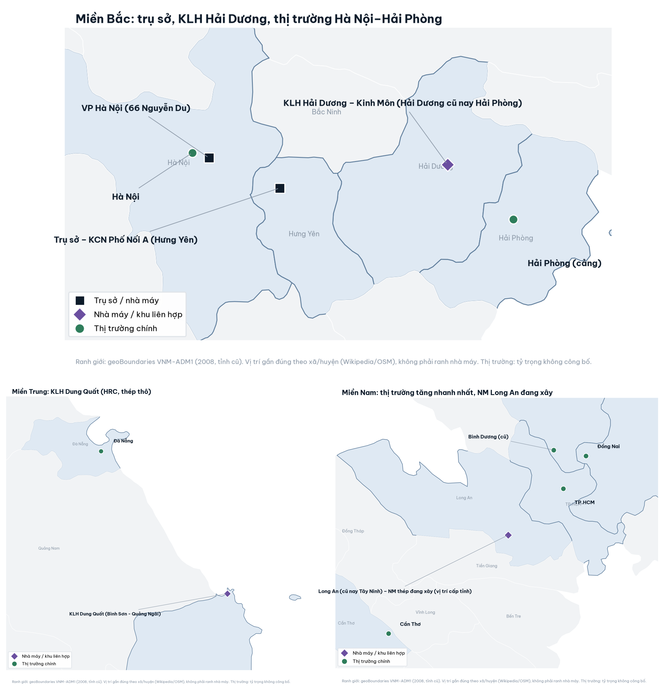

## 5. Tài chính dựng từ dưới lên

### 5a. Biên và lợi nhuận

**Biên gộp 19% đến từ khối lượng và hấp thụ chi phí cố định; khấu hao và lãi vay Dung Quất 2 đã vào giá thành.**

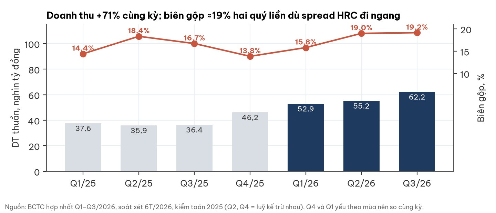

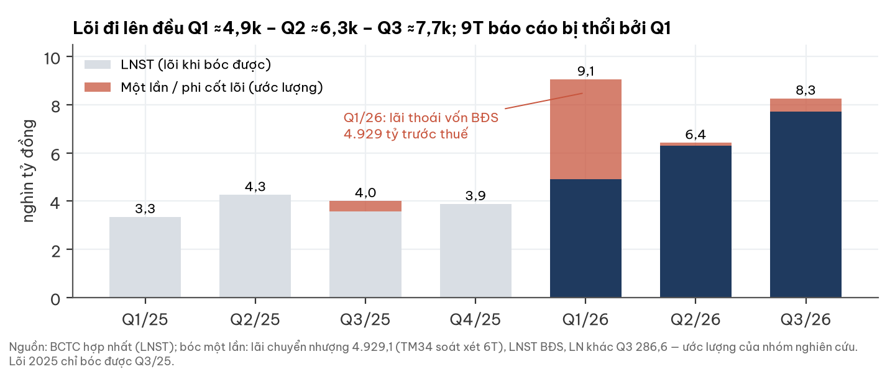

- Không có hoàn nhập dự phòng tồn kho; lãi vay vốn hoá giảm từ 1.877 tỷ (2025) xuống 162 tỷ (6T/26).
- Thuế suất hiệu dụng thép 6T/26 chỉ 6,5%; thời hạn ưu đãi không được BCTC công bố.

### 5b. Khối lượng

**HRC gần gấp đôi cùng kỳ; thép xây dựng tăng chậm hơn ngành.**

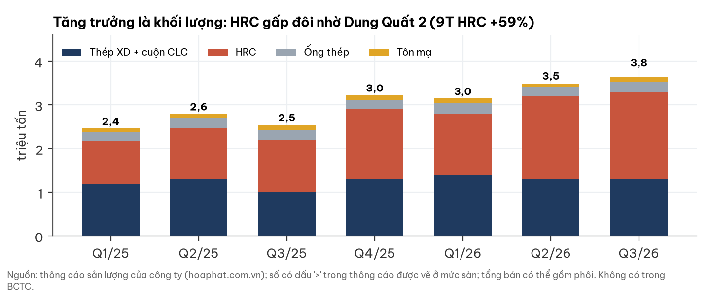

### 5c. Dòng tiền

**CFO 9T 20.936 tỷ, nhưng 5.136 tỷ là hoàn thuế GTGT một lần của dự án.**

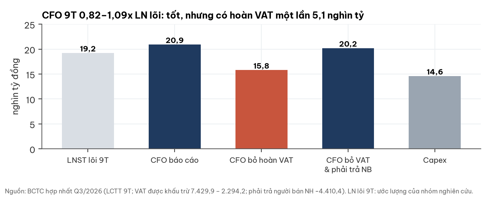

- Bỏ hoàn VAT: CFO 0,82x LN lõi; bỏ thêm phần giảm phải trả người bán: 1,05x.

### 5d. Đòn bẩy

**Nợ ròng/EBITDA 1,5–1,6x khi không tính ≈8.294 tỷ tiền gửi bị cầm cố — vẫn thấp.**

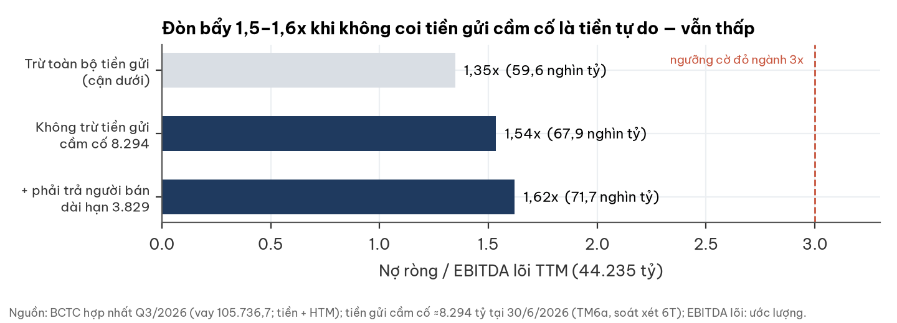

- Vay 105.737 tỷ; ≈90% vay ngắn hạn có bảo đảm; vay USD 12.612 tỷ (30/6).

## 6. Giao dịch Tương lai Sông Hồng (TLSH)

**Khoảng 8,5% vốn chủ nằm ở cổ phần TLSH và BĐS Hòa Phát, cộng tư cách thành viên một liên danh BT — HPG không kiểm soát các thực thể này.**

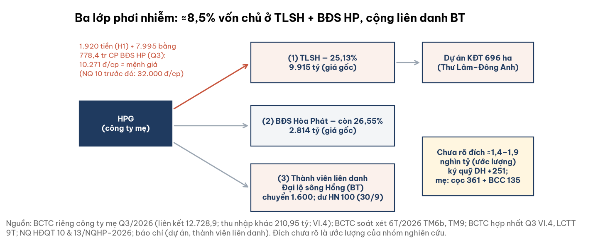

- **Giá hoán đổi ≈ mệnh giá.** 25,13% TLSH = 1.920 tỷ tiền mặt + 7.995 tỷ trả bằng 778,4 triệu cổ phần BĐS Hòa Phát, tức **10.271 đ/cp (mệnh giá +2,7%)**. Con số khớp tuyệt đối khoản thu nhập khác 210,95 tỷ của công ty mẹ Q3.
- Phương án công bố 10 tuần trước (NQ 10) là 32.000 đ/cp, chỉ cần 249,8 triệu cổ phần; HPG giao **thêm 528,6 triệu cổ phần (≈49,9% vốn BĐS Hòa Phát)**. Lý do đổi và đơn vị thẩm định không được công bố.
- **Thủ tục hợp lệ:** giao dịch bằng 3,1% tổng tài sản (2,8% theo số 30/9), dưới ngưỡng 35% phải lên ĐHĐCĐ theo Điều lệ, nên thuộc thẩm quyền HĐQT. Cờ nằm ở công bố thông tin và giá, không ở thủ tục.
- Phần giá trị có thể đã chuyển ra ngoài ≈0–1.500 đ/cp (ước lượng) là **chi phí cơ hội**, không trừ vào giá trị sổ sách: định giá dựng trên sổ đã ghi ≈ mệnh giá.
- **Liên danh BT:** HPG là thành viên liên danh Dự án Đại lộ cảnh quan sông Hồng, cùng Đại Quang Minh (đứng đầu) và THACO (theo báo chí); thoả thuận liên danh ngày 08/05/2026. Nghĩa vụ góp vốn/bảo lãnh về sau chưa được thuyết minh.
- Dòng tiền: 1.600 tỷ chuyển cho liên danh tại 30/6, số dư hợp nhất còn 100 tỷ tại 30/9 (khả năng nằm trong BĐS Hòa Phát đã rời hợp nhất — chưa xác nhận). Đích chưa rõ còn ≈1,4–1,9 nghìn tỷ (ước lượng).
- TLSH là bên liên quan theo VAS 26, nhưng BCTC không thuyết minh giao dịch này như giao dịch bên liên quan. Mất 50% khoản TLSH ≈ −590 đ/cp.

## 7. Định giá

**Thu nhập thặng dư ba kịch bản cho ≈19.200 đ; EV/EBITDA 5x cho ≈22.000 đ; tâm ghép ≈20.200 đ.**

| Kịch bản | Xác suất | LNST mẹ 2027 · 2029 (nghìn tỷ) | ROE dài hạn sau thuế 20% | Điều kiện | Giá trị (đ/cp) |
|---|---|---|---|---|---|
| Tốt | 25% | 31 · 35 | 14,3% | LN/tấn ≈2,0 triệu đ, 15,5–16 triệu tấn; bảo hộ mở rộng | 28.147 |
| Trung lập | 50% | 26 · 27 | 11,8% | 15 triệu tấn; LN/tấn 1,87 giảm về ≈1,73 | 19.563 |
| Xấu | 25% | 16 · 16 | 7,9% | AD HRC giảm sau rà soát; spread 150–200 USD/t | 9.612 |
| **Trọng số** | | | | Ke 11,83% (β đo 0,90–0,93) | **19.221** |

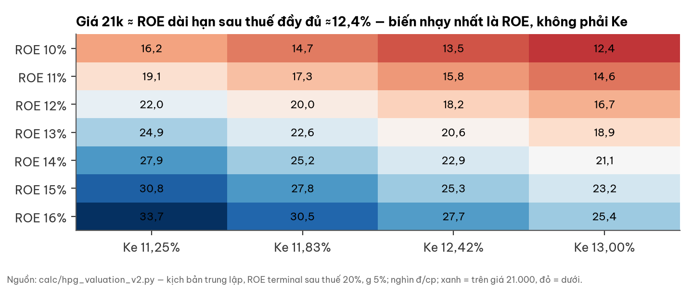

| So sánh (30/10/2026) | P/E | P/B | EV/EBITDA | ROE |
|---|---|---|---|---|
| HPG | 6,5 / ≈8,0 lõi | 1,19 | 5,2 | ≈16–17% lõi |
| Trung vị thép Việt Nam (9 mã) | 13,4 | 0,67 | 11,1 | 8,0% |
| Trung vị khu vực (8 hãng) | 13,5 | 0,57 | 7,8 | 4,1% |

- Peers đang ở đáy chu kỳ nên bội số lợi nhuận của họ bị thổi lên; vì vậy chỉ dùng 5x, không 6–7x.
- Ưu đãi thuế được giả định hết ở giai đoạn dài hạn (thuế 20%); giữ nguyên ưu đãi sẽ cộng ≈2.900 đ/cp.
- β ngành thép Việt Nam (mã đủ thanh khoản) ≈0,9–1,1, cao hơn β đo của HPG; dùng β 1,0 thì giá trị trung lập giảm ≈1.200 đ/cp (ước lượng), vẫn trong vùng — lý do để không nâng tâm.

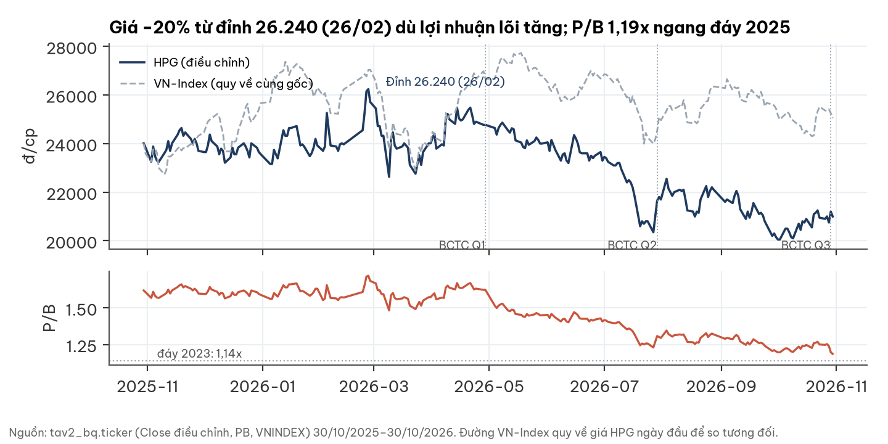

## 8. Rủi ro — pre-mortem

**Rủi ro lớn nhất là chính sách bảo hộ và spread; dễ xảy ra nhất là cầu nhà ở và thuế.**

| Rủi ro | Xác suất 12–18 tháng | Tác động | Dấu hiệu sớm | Ngày kiểm |
|---|---|---|---|---|
| R1 Rà soát AD HRC hạ mức | Thấp | Rất lớn (−15–25% LNTT) | Kết luận sơ bộ rà soát QĐ 1902 | 31/03/2027 |
| R2 Nhà ở chậm lại kéo thép XD | TB | TB | Sản lượng XD quý, giá thép thanh | 05/02/2027 |
| R3 Spread HRC về 150–200 USD/t | Thấp | Lớn | Giá HRC Trung Quốc FOB < 450 USD/t | Hằng tháng |
| R4 Hết ưu đãi thuế / truy thu | TB | TB (−9% LN mỗi năm) | Thuế suất hiệu dụng quý | 05/02/2027 |
| R5 TLSH / liên danh BT: suy giảm, góp vốn hoặc bảo lãnh thêm | TB | Nhỏ–TB | Thuyết minh BCTC kiểm toán 2026 (nghĩa vụ liên danh) | 15/04/2027 |
| R6 Đối thủ HRC mới | TB | Nhỏ | Tiến độ dự án đối thủ | 2027 |

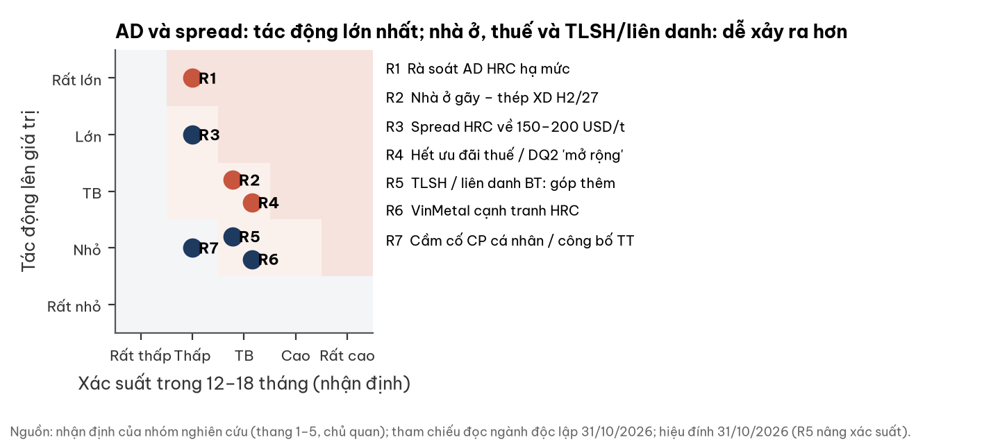

## 9. Pháp lý & quản trị — WARNING (không chặn phân tích)

**Ý kiến kiểm toán sạch; cờ TLSH nặng hơn sau hiệu đính — giá hoán đổi ≈ mệnh giá, tư cách thành viên liên danh BT và bên mua lãi thoái vốn chưa công bố.**

| WARNING | Bằng chứng | Phạm vi tra cứu |
|---|---|---|
| TLSH: giao dịch bên liên quan không thuyết minh; giá hoán đổi 10.271 đ/cp so với 32.000 đ/cp trước đó, không giải thích | BCTC riêng & hợp nhất Q3, NQ HĐQT 10 & 13/2026 | Chưa thấy báo cáo thẩm định giá |
| Liên danh BT Đại lộ sông Hồng: nghĩa vụ góp vốn/bảo lãnh tương lai chưa thuyết minh | BCTC soát xét 6T/2026 (thoả thuận 08/05/2026); báo chí | Văn bản liên danh không công bố |
| Bán hai công ty con BĐS (lãi 4.929 tỷ trước thuế): bên mua và giá không công bố | BCTC soát xét 6T/2026 | CBTT, tra cứu doanh nghiệp |
| Cầm cố: cổ phiếu HPG do cá nhân sở hữu bảo đảm vay công ty; ≈8.294 tỷ tiền gửi cầm cố | BCTC kiểm toán 2025, soát xét 6T/2026 | Số cổ phiếu cầm cố không công bố |
| Thuế suất hiệu dụng thấp (thép 6,5%); Dung Quất 2 dự án mới hay mở rộng chưa có kết luận | BCTC; công văn cơ quan thuế 2024 | Thời hạn ưu đãi không công bố |

- Ghi nhận, không phải cờ: kiểm toán 2024 là KPMG (chấp nhận toàn phần); ĐHĐCĐ 2025 duyệt danh sách 4 hãng Big-4 và uỷ quyền Tổng giám đốc chọn — Deloitte được chọn, lý do không công bố.
- Không tìm thấy xử phạt, khởi tố hay truy thu 2025–2026 trong nguồn đã quét; "không tìm thấy" không có nghĩa "đã xác minh".

## 10. Lịch xúc tác và mốc hai chiều

**Ba mốc lợi nhuận đầu 2027 và kết quả rà soát AD sẽ quyết định kịch bản.**

| Mốc | Ngày | Tích cực nếu | Tiêu cực nếu |
|---|---|---|---|
| Biên gộp Q4/26 (cùng kỳ 13,85%) | 05/02/2027 | ≥ 18,0% | < 13,85% |
| LNST lõi Q4/26 | 05/02/2027 | ≥ 8.000 tỷ | < 5.500 tỷ |
| CFO 2026 bỏ hoàn VAT / LN lõi | 05/02/2027 | ≥ 1,0x | < 0,7x |
| Mức AD HRC sau rà soát QĐ 1902 | 31/03/2027 | Giữ ≥ 23,1% | < 20% hoặc huỷ |
| BCTC kiểm toán 2026: TLSH và khoản ứng liên danh | 15/04/2027 | Thuyết minh đủ, hoàn ứng | Góp/bảo lãnh thêm ≥ 2.000 tỷ |
| BCTC kiểm toán 2026: bên mua Mỹ Hào/Khu đô thị xanh và nghĩa vụ HPG trong liên danh BT | 15/04/2027 | Công bố đủ; nghĩa vụ < 2.000 tỷ | Không công bố, hoặc nghĩa vụ ≥ 2.000 tỷ (trừ ≈590 đ/cp) |
| Biên gộp Q1/27 (cùng kỳ 15,81%) | 05/05/2027 | ≥ 17,5% | < 14,0% |
| Kế hoạch LNST 2027 (ĐHĐCĐ) | 31/05/2027 | ≥ 28.000 tỷ | < 22.000 tỷ |

- **Nâng nhận định** khi ≥ 2 mốc lợi nhuận/biên tích cực và AD giữ: vùng dịch lên, tâm ≈22.100 đ (ước lượng).
- **Hạ nhận định** khi biên gộp 2 quý liền dưới cùng kỳ hoặc AD bị giảm/huỷ: tâm ≈15.800 đ (ước lượng).
- Một quý lệch đơn lẻ do mùa vụ không tự đổi nhận định; TLSH xấu đi trừ thêm ≈590 đ/cp.

## Phụ lục A — Số BCTC chính (tỷ đồng)

| Quý | DT thuần | Biên gộp | Lãi vay | LNTT | LNST | LNST mẹ |
|---|---|---|---|---|---|---|
| Q3/25 | 36.407,4 | 16,72% | 812,2 | 4.628,3 | 4.012,3 | 3.988,3 |
| Q4/25 | 46.176,5 | 13,85% | 1.236,6 | 4.600,1 | 3.888,3 | 3.864,1 |
| Q1/26 | 52.900,8 | 15,81% | 1.333,4 | 10.762,2 | 9.055,9 | 8.994,0 |
| Q2/26 | 55.158,9 | 19,01% | 1.519,6 | 7.184,7 | 6.424,5 | 6.371,0 |
| Q3/26 | 62.214,2 | 19,16% | 1.774,0 | 9.108,7 | 8.265,4 | 8.217,3 |

| Bảng cân đối 30/09/2026 | Giá trị | Bảng cân đối 30/09/2026 | Giá trị |
|---|---|---|---|
| Tổng tài sản | 283.449,8 | Vay ngắn + dài hạn | 105.736,7 |
| Tiền + tương đương tiền | 6.852,9 | Tiền gửi có kỳ hạn | 39.276,2 |
| Hàng tồn kho | 46.949,2 | Đầu tư liên kết | 12.664,1 |
| Vốn chủ sở hữu | 149.568,4 | Cổ phiếu lưu hành | 8.442.964.520 |

Bóc một lần 9T: lãi chuyển nhượng công ty con 4.929,1 trước thuế (thuế 1.030,2); LN khác thuần Q3 286,6; LNST BĐS vận hành ≈599. Thu nhập khác hợp nhất Q3 (485,6) có thể chứa phần hoán đổi; ảnh hưởng tối đa lên lõi 9T ≈ −211 tỷ (≈ −1%, ước lượng). Cổ tức: năm 2025 = 10% cổ phiếu + 5% tiền; kế hoạch 2026 dự kiến 15% (hình thức chưa công bố).

## Phụ lục B — Đối chiếu dữ liệu thị trường với BCTC

- P/E 6,46 của nguồn dữ liệu thị trường khớp EPS TTM báo cáo 3.251 đ, tức đã gồm lãi thoái vốn; P/E lõi ≈8,0x.
- Slide kết quả kinh doanh ghi tiền 2.099 tỷ là chỉ dòng "Tiền"; tiền + tương đương tiền là 6.852,9 tỷ. EBITDA slide 14.307 lệch 361 tỷ so với tự tính 13.945,8 (định nghĩa khác).
- Trung vị P/E năm 2023 là 14,5 (tính trên mọi phiên).

## Phụ lục C — Nguồn

- BCTC hợp nhất Q3/2026 (ký 29/10/2026); BCTC riêng công ty mẹ Q3/2026; BCTC hợp nhất 6T/2026 soát xét (Deloitte VN, 28/08/2026); BCTC hợp nhất 2025 kiểm toán (Deloitte VN, 24/03/2026); BCTC Q1/2026. Số đọc từ ảnh trang gốc.
- Nghị quyết HĐQT 10/NQHP-2026 (22/07/2026), 13/NQHP-2026 (30/09/2026); NQ ĐHĐCĐ 01/NQ-ĐHĐCĐ.2026.
- Quyết định 1959/QĐ-BCT (04/07/2025, AD gốc), 612/QĐ-BCT (02/04/2026, chống lẩn tránh tạm thời), 1902/QĐ-BCT (27/07/2026, rà soát); 1917/QĐ-BCT (chống lẩn tránh chính thức, hiệu lực 28/07/2026 — theo SMM và doanhnghiephoinhap 30/07/2026, chưa đối chiếu văn bản gốc trên moit.gov.vn); Federal Register (thép cây Mỹ).
- Điều lệ HPG 28/04/2026 (Điều 46); Báo cáo thường niên 2024 (kiểm toán, thị phần theo vùng); tài liệu ĐHĐCĐ 2025 (chọn kiểm toán); factsheet VOF, VEIL (06/2026), VEOF (07/2026). Liên danh Đại lộ sông Hồng: Tuổi Trẻ 06/05/2026, VietnamFinance.
- Giá, P/B, khối lượng: cơ sở dữ liệu thị trường nội bộ tới phiên 30/10/2026. Peers khu vực: stockanalysis.com (một nguồn tổng hợp, tin cậy trung bình). Sở hữu nước ngoài: 24hmoney.vn.
- Sản lượng: thông cáo của công ty trên hoaphat.com.vn; báo Thời báo Tài chính, Báo Đấu thầu.
- Logo và ảnh sản phẩm: website hoaphat.com.vn (trang chủ; bài "Thép cuộn cán nóng: Át chủ bài…"), truy cập 31/10/2026. Logo chỉ để nhận diện, không ngụ ý công ty bảo chứng báo cáo.
- Bản đồ: ranh giới geoBoundaries VNM-ADM1 (bản 2008, tỉnh cũ); vị trí gần đúng theo xã/huyện (Wikipedia/OSM): KCN Phố Nối A (Hưng Yên), Kinh Môn (Hải Dương cũ, nay Hải Phòng), KKT Dung Quất (Bình Sơn, Quảng Ngãi), Long An cũ (nay Tây Ninh, vị trí cấp tỉnh — địa điểm nhà máy chưa xác định), văn phòng 66 Nguyễn Du (Hà Nội). Tỷ trọng thị trường theo vùng không được công bố.

## Phụ lục D — Phương pháp và giới hạn

- Thu nhập thặng dư: vốn chủ cổ đông mẹ 148.795,5 tỷ; chi trả tiền 20%; tăng trưởng dài hạn 5% (xấu 3%); lợi nhuận tới 2029 ở thuế suất ≈12%, giai đoạn dài hạn thuế 20%; ROE dài hạn suy ra từ lợi nhuận 2029, không tự chọn.
- Chi phí vốn: lãi suất phi rủi ro chuẩn hoá 6,75%; phần bù rủi ro nội địa 5,0–6,1%; β tuần 2–3 năm 0,84–0,89, điều chỉnh Blume 0,90–0,93; Ke 11,2–12,4%, tâm 11,83%. β ngành (mã đủ thanh khoản, có hiệu chỉnh giao dịch mỏng) ≈0,9–1,1.
- EV/EBITDA: EBITDA 2027 = LN/0,88 + lãi vay ≈7,1 nghìn tỷ + khấu hao ≈12,3 nghìn tỷ (ước lượng); nợ ròng gồm phải trả người bán dài hạn.
- Giới hạn: BCTC không tách doanh thu theo sản phẩm; không công bố thời hạn ưu đãi thuế, số cổ phiếu cầm cố, covenant; đích ≈1,4–1,9 nghìn tỷ góp vốn (ước lượng), đối tác ký quỹ/BCC (ký quỹ dài hạn hợp nhất tăng 251 tỷ; công ty mẹ cọc/ký quỹ 361,2 + BCC 134,6) và số phận 1.500 tỷ ứng liên danh chưa xác nhận; bên mua hai công ty con BĐS và nghĩa vụ trong liên danh BT không công bố; văn bản gốc QĐ 1917 chưa đối chiếu.

## Phụ lục E — Quy trình độc lập

Báo cáo đi qua ba lớp: nhóm nghiên cứu đọc BCTC gốc; một người đọc ngành độc lập viết nhận định ngành trước khi xem số doanh nghiệp; một người phản biện kiểm lại số và lập luận. Các điểm người phản biện đã sửa:

| Điểm | Bản đầu | Sau phản biện |
|---|---|---|
| Nợ ròng/EBITDA | 1,35x, gọi là nợ ròng "thật" | 1,54x không tính tiền gửi cầm cố; 1,62x gồm phải trả người bán dài hạn |
| P/B | "thấp nhất kể từ 2022" | Ngang đáy 2025, trên đáy 2023 (1,14); giá −20% từ đỉnh 26.240 |
| β | Giả định 1,1, chưa đo | Đo 0,84–0,89; Blume 0,90–0,93; đi cùng thuế dài hạn 20% |
| Bội số so sánh | EV/EBITDA 6x không có so sánh | So sánh có số; chỉ dùng 5x, nêu chiều lệch |
| Kịch bản | Cả ba kịch bản lợi nhuận đi xuống | Trung lập đi ngang; ROE dài hạn suy ra nhất quán |
| Mốc theo dõi | Một chiều; kích hoạt bởi một quý | Hai chiều; so cùng kỳ; cần hai quý liên tiếp |
| Tăng trưởng lõi Q3 | +99% (lõi so báo cáo) | +116–120% (lõi so lõi) |

Vòng hiệu đính nội dung của nhóm nghiên cứu (31/10/2026, phiên bản 3) — đây là hiệu đính của chính nhóm nghiên cứu sau khi đọc thêm văn bản gốc, không phải điểm của người phản biện:

| Điểm | Phiên bản trước | Phiên bản 3 |
|---|---|---|
| Quyết định thương mại HRC | Chỉ nêu QĐ 1959 | Làm rõ phân biệt QĐ 1959 (chống bán phá giá gốc) và QĐ 1917 (chống lẩn tránh chính thức, thay QĐ 612) |
| Dòng tiền TLSH/liên danh | ≈2.973 + ≈500 + 1.500 tỷ chưa rõ đích | Bỏ phần đếm trùng ≈1.500–1.600 tỷ; đích chưa rõ ≈1,4–1,9 nghìn tỷ (ước lượng); ký quỹ tăng 251, không phải 500 mới |
| Giá hoán đổi BĐS Hòa Phát | "Xấp xỉ mệnh giá" | 10.271 đ/cp, khớp thu nhập khác công ty mẹ; giao thêm 528,6 triệu cổ phần so với phương án 32.000; HĐQT đủ thẩm quyền |
| Kiểm toán | "2024 do hãng khác", là cờ | KPMG (đọc báo cáo thường niên gốc); đổi qua quy trình ĐHĐCĐ — hạ khỏi danh sách cờ |
| Liên danh BT | Chỉ nêu khoản ứng 1.600 tỷ | HPG là thành viên liên danh; thêm rủi ro nghĩa vụ góp/bảo lãnh và mốc kiểm tra 15/04/2027 |
| Tỷ lệ vốn chủ gắn với TLSH | ≈9,5% | ≈8,5% (cổ phần TLSH + BĐS Hòa Phát), cộng tư cách thành viên liên danh |

## Phụ lục F — Tuyên bố miễn trừ trách nhiệm

Tài liệu này chỉ nhằm mục đích cung cấp thông tin nghiên cứu, không phải lời mời chào, khuyến nghị mua/bán hay tư vấn đầu tư cá nhân hoá. Số liệu lấy từ nguồn được cho là đáng tin cậy nhưng không được bảo đảm tuyệt đối; các ước lượng, kịch bản và giá trị hợp lý là nhận định tại thời điểm viết và có thể thay đổi mà không cần thông báo. Nhà đầu tư tự chịu trách nhiệm với quyết định của mình và nên tham khảo tư vấn chuyên nghiệp phù hợp với hoàn cảnh riêng.
