# LLM — Tổng Công ty Lắp máy Việt Nam (Lilama): nhà thầu EPC năng lượng từ 1995 với tài chính ròng dương 1.466 tỷ (18.390 đ/cp), nhưng lợi nhuận 9T/26 dựa vào khoản một lần và biên quyết toán, kiểm toán ngoại trừ 3 năm liền, và giá 33.300 đ đã cao hơn tâm giá trị 1,35 lần

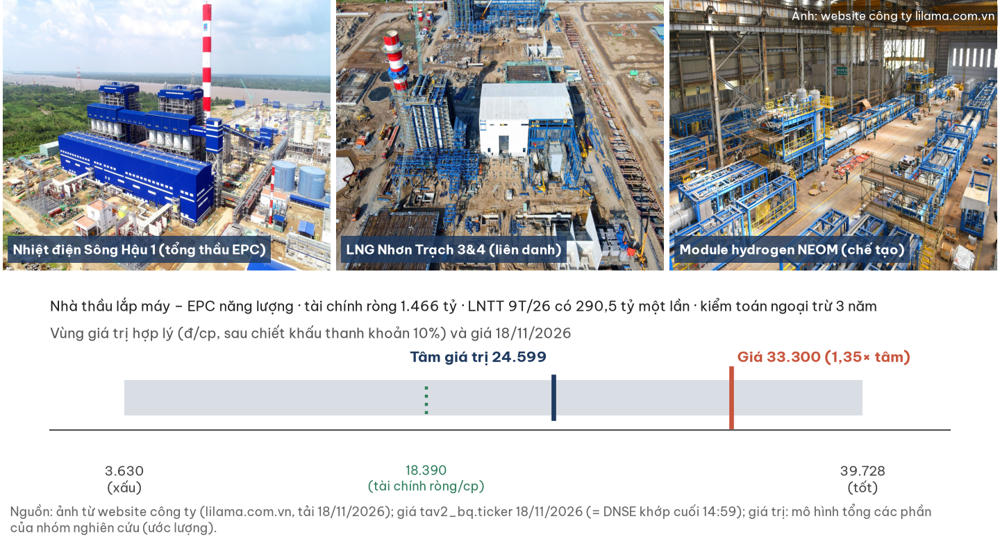

| Chỉ tiêu | Giá trị | Chỉ tiêu | Giá trị |
|---|---|---|---|
| Giá (UPCoM) | **33.300 đ** (đóng cửa 18/11/2026; DNSE khớp cuối 14:59:55 cùng giá) | Vùng giá trị hợp lý | **3.630 – 39.728 đ** |
| Tâm giá trị sau chiết khấu thanh khoản 10% | **24.599 đ** (trước chiết khấu 27.332) | Giá / tâm | **1,35 lần** — giá TRÊN tâm |
| LNST mẹ 9T/2026 | 695,0 tỷ · EPS 8.717 đ | P/E 12 tháng · P/B (mẹ) | 2,63 (gồm khoản một lần) · 1,22 |
| Tài chính ròng sau nợ vận hành | 1.466,2 tỷ = 18.390 đ/cp | Tiền + tiền gửi · vay | 3.576 tỷ · 620,7 tỷ |
| Cổ đông Nhà nước | Bộ Xây dựng 97,88% | Thanh khoản | ~15.200 cp ≈ 0,45 tỷ đ/phiên |

**Ba điều cần biết**

- **Tích cực:** tiền ròng 2.956 tỷ, còn 1.466 tỷ sau nợ vận hành; vị trí lâu năm trong lắp máy điện; có việc mới ở Quảng Trạch II, Ô Môn I.
- **Tiêu cực:** 290,5 tỷ LNTT 9T là khoản một lần; phần còn lại mang biên quyết toán 31,3% so với trung vị lịch sử 4,5%; kiểm toán ngoại trừ 3 năm liền.
- **Định giá:** giá chỉ ngang tâm nếu biên gộp bền ≥10,3%; ở mọi biến thể độ nhạy, **giá nằm trên vùng giá trị trung tâm**, chỉ còn dưới kịch bản tốt.

## 1. Tóm tắt điều hành

| | Nội dung |
|---|---|
| **Tình huống** | Tổng thầu lắp máy nhà nước; LNST mẹ 9T/26 695 tỷ, cao nhất nhiều năm, sau 7 năm 2018–2024 cộng dồn −71 tỷ. |
| **Vấn đề** | Lợi nhuận 2025–2026 đến từ quyết toán các công trình cũ và hoàn nhập dự phòng; công ty xác nhận biên cao là do quyết toán. |
| **Câu hỏi** | Giá 33.300 đ đang trả cho mức biên và cách dùng tiền nào? |
| **Trả lời** | Giá ngầm định ROE ~17,9% vĩnh viễn, hoặc biên gộp bền ≥10,3%; chưa năm nào đạt nếu bỏ khoản một lần. Giá TRÊN vùng giá trị trung tâm. |

## 2. Luận điểm và điều thị trường đang định giá

| Luận điểm tích cực | Luận điểm tiêu cực |
|---|---|
| Tiền + tiền gửi 3.576 tỷ, vay 620,7 tỷ; nộp thuế TNDN thật 225,3 tỷ (lợi nhuận chịu thuế) | Biên gộp năm 2017–2024 chỉ 1,7–5,9%; ROE thấp nhất 5 năm −0,7% |
| Việc mới: tạm ứng Quảng Trạch II 586,4 tỷ, Ô Môn I 338,5 tỷ | Phần lớn tiền là tiền của dự án: nợ vận hành 5.169 tỷ |
| Dự phòng bảo hành dài hạn 737,7 tỷ có thể hoàn nhập dần | Cổ tức chọn trả bằng cổ phiếu (31,7%) dù cầm 3,6 nghìn tỷ tiền |
| Lãi ẩn cổ phần Thuỷ điện Hủa Na ~77 tỷ sau thuế | Công ty con có ~330 tỷ vay ngân hàng quá hạn |

- **Thị trường đang định giá:** biên quyết toán 2025–2026 kéo dài, hoặc tiền mặt sớm được phân phối/sinh lời cao.
- **Điều thị trường có thể chưa tính:** hoàn nhập bảo hành dài hạn, 160,4 tỷ bảo lãnh Hamon chưa ghi nhận, quyết toán Vũng Áng 1 — đều hai chiều, chưa vào giá trị.
- **Điều thị trường có thể đã tính quá tay:** lợi nhuận 9T năm hoá (P/E 2,6) không lặp lại khi hết quyết toán; Q4 lịch sử chiếm 32–48% doanh thu năm.

## 3. Ngành: cầu điện lớn, nhưng biên của nhà thầu nội mỏng về cấu trúc

| Động lực | Dữ kiện (đọc ngành độc lập 18/11/2026) |
|---|---|
| Cầu điện | Thiếu công suất 4.256 MW (2027) → 13.964 MW (2030); ~45% công suất quy hoạch chưa có chủ trương |
| Gói đã trao | Quảng Trạch II 25.202 tỷ (PowerChina đứng đầu), Ô Môn IV (Doosan), Long Phú 1 (PTSC) — lắp đặt cao điểm 2027–2028 |
| Ai đứng đầu | Gói lớn: nhà thầu Trung Quốc/Hàn Quốc; nhà thầu nội là thành viên hoặc thầu phụ |
| Giá thầu | Dự toán chủ đầu tư thấp: gói Long Phú T24 bị huỷ vì hồ sơ cao hơn dự toán 40–42% |
| Đầu tư công | Giải ngân 10T/2026 74,1% kế hoạch; trung hạn 2026–2030 8,22 triệu tỷ |

- Phân loại 12 tháng: hành chính quyết định nhịp 0,45 · chu kỳ 0,30 · cấu trúc 0,25; biên nhà thầu nội "mỏng cấu trúc" xác suất 0,65.
- Rủi ro ngành đặc thù: doanh thu theo tiến độ là ước tính quản trị, lỗ có thể dồn khi quyết toán nhiều năm sau vận hành.

## 4. Doanh nghiệp: tổng thầu lắp máy nhà nước, cổ phần hoá 2016

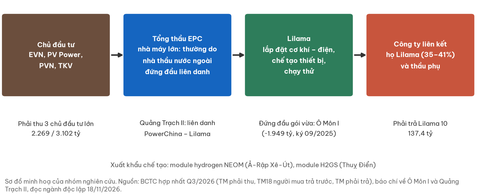

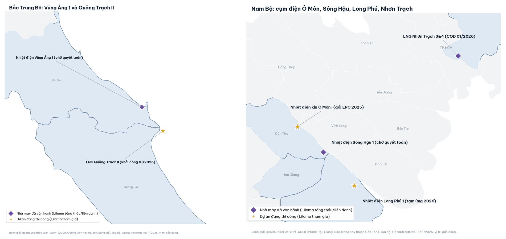

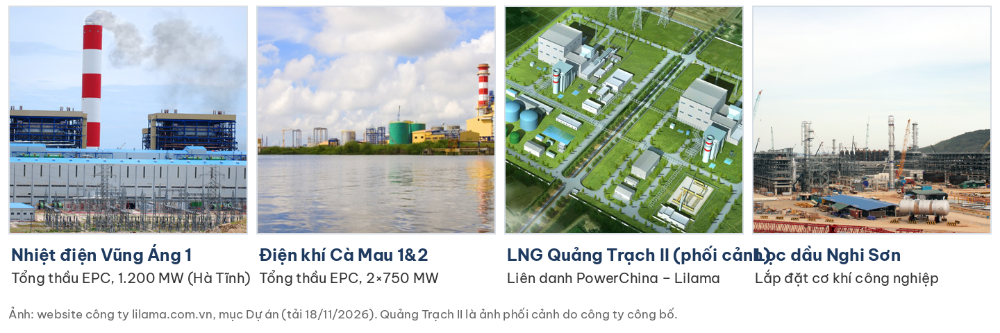

| Hạng mục | Thông tin |
|---|---|
| Lịch sử | 1995 thành lập Tổng công ty (Bộ Xây dựng) · 2015 duyệt phương án cổ phần hoá · 06/04/2016 thành CTCP · 16/08/2017 lên UPCoM |
| Công trình tiêu biểu | Tổng thầu EPC: Vũng Áng 1, Sông Hậu 1, Cà Mau 1&2; liên danh: Nhơn Trạch 3&4 (Samsung C&T), Quảng Trạch II (PowerChina) |
| Mảng | Gần như 100% xây lắp (9T/26: 2.392,4/2.425,7 tỷ); chế tạo xuất khẩu module NEOM, H2GS |
| Quy mô | Vốn điều lệ 797,26 tỷ · 79,73 triệu cp · 714 nhân viên công ty mẹ (30/06/2026) · trụ sở 124 Minh Khai, Hà Nội |
| Tập đoàn | 5 công ty con nhỏ (Lilama 5, 7, Cơ khí Lắp máy 51%); Lilama 10, 18, 69-x, 45.x là công ty liên kết 35–41% |

- **Lợi thế cạnh tranh: chưa thấy bằng chứng** thành lợi nhuận vượt chi phí vốn qua nhiều chu kỳ; thương hiệu và kinh nghiệm có thật nhưng khách hàng có sức mạnh đàm phán rất cao.
- Kế hoạch thoái 17 khoản đầu tư 2026–2030; Lilama 69-1 (41,1%) đấu giá khởi điểm 13.200 đ/cp (~41 tỷ).

## 5. Tài chính: lợi nhuận kỷ lục đến từ quyết toán, tiền mặt phần lớn là tiền dự án

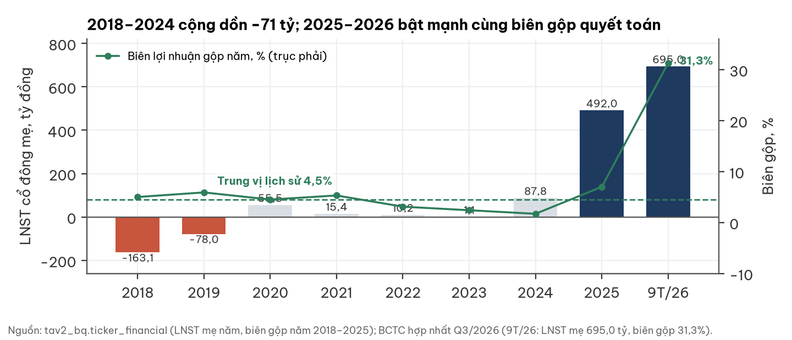

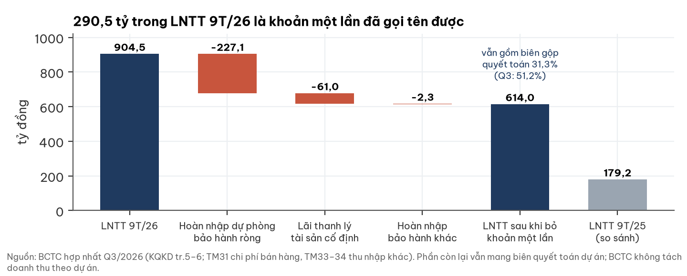

- **Công ty tự giải trình:** lợi nhuận gộp 6T tăng 85,06 → 576,89 tỷ "chủ yếu do quyết toán một số dự án ở giai đoạn kết thúc, cho biên cao".
- Năm hoá LNTT sau khi bỏ khoản một lần vẫn cho ROE ~30% — mức chỉ có ở pha quyết toán; LNST chuẩn hoá theo trung vị 12 quý là 107,2 tỷ (ROE 4,9%).
- Doanh thu 9T/26 giảm 34,7% (2.425,7 so với 3.712,8 tỷ): khối lượng mới chưa vào pha lắp đặt.

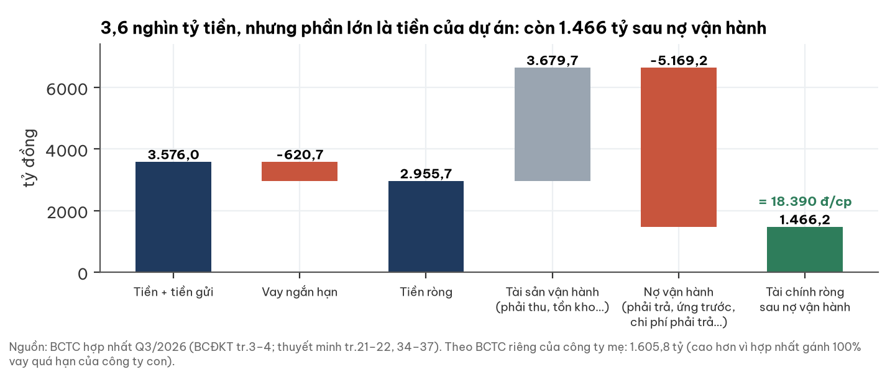

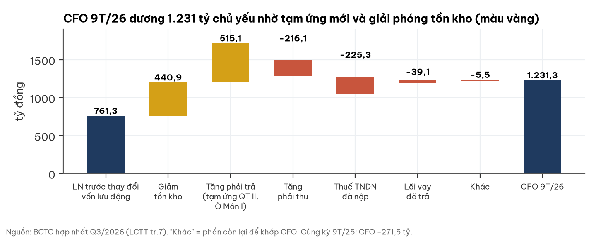

- Bỏ tạm ứng mới 657,8 tỷ và giải phóng tồn kho 440,9 tỷ, dòng tiền hoạt động bình quân 3 năm còn ~229–261 tỷ/năm.
- 79% tồn kho (242,7/307,4 tỷ) nằm ở công ty con, trùng khoản dở dang bị kiểm toán ngoại trừ.
- Đã dự phòng 100%: cho vay các đơn vị họ Lilama 394,7 tỷ, lãi cho vay 292,4 tỷ.

## 6. Định giá: tổng các phần, giá trị nhạy nhất với biên gộp bền vững

| Kịch bản | Giả định chính | đ/cp trước / sau chiết khấu 10% | Xác suất |
|---|---|---|---|
| **Xấu** | Lỗ hoạt động 30 tỷ/năm; tổn thất phải thu cũ 200 tỷ; tiền nằm yên, chỉ hưởng lãi tiền gửi | 4.033 / 3.630 | 0,25 |
| **Cơ sở** | Doanh thu 4.500 tỷ × biên gộp 4,5% (trung vị lịch sử); tiền theo sổ | 30.577 / 27.519 | 0,50 |
| **Tốt** | Doanh thu 6.000 tỷ × biên 7,0% (mức năm 2025, cao nhất 9 năm) | 44.142 / 39.728 | 0,25 |
| **Có trọng số** | | **27.332 / 24.599** | |

- Giá trị = lợi nhuận hoạt động sau thuế ÷ r (g = 0) + tài chính ròng sau nợ vận hành + đầu tư tài chính dài hạn theo sổ 553,7 tỷ + lãi ẩn Hủa Na 77,2 tỷ.
- Trọng số 25/50/25 là **giả định đối xứng**, không có cơ sở định lượng độc lập; lưới 5 bộ trọng số cho 16.795–30.013, không bộ nào cho giá/tâm < 1.
- Doanh thu cơ sở: bình quân 2023–25 5.538 tỷ, kế hoạch 2026 của công ty mẹ 3.378 tỷ, cộng việc mới.

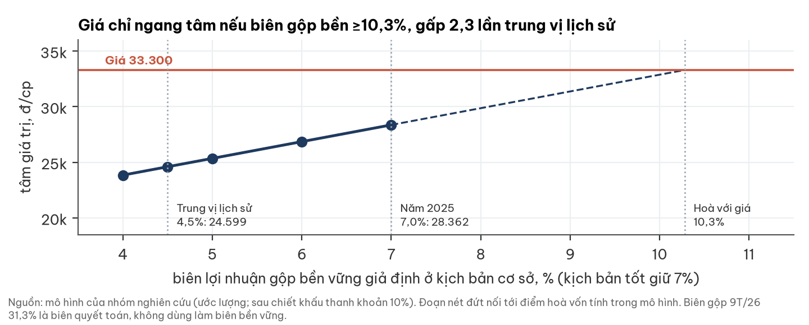

**Chi phí vốn:** r = **13,5%**, neo lãi huy động 12 tháng hiệu dụng **7,4%** (18/11/2026); r đi cùng lãi huy động theo tỷ lệ 1:1; g = 0.

| Lãi huy động | −100 điểm cơ bản | −50 | Neo | +50 | +100 |
|---|---|---|---|---|---|
| r | 12,5% | 13,0% | 13,5% | 14,0% | 14,5% |
| Tâm sau chiết khấu (đ/cp) | 25.024 (+1,7%) | 24.803 (+0,8%) | 24.599 | 24.409 (−0,8%) | 24.233 (−1,5%) |

- **Bối cảnh lãi suất:** lãi suất chiết khấu thị trường đang ngầm định ≈ 15,1% (147 mã, 30/10/2026), phân vị 75% giai đoạn 2014–2026 (đỉnh 2022: 15,9%; đáy 2022–23: 12,1%) — cao hơn r của mô hình. TPCP 10 năm 4,57% (17/11/2026), +0,57 điểm % trong 12 tháng (nguồn chưa đối chiếu độc lập). Chỉ để tham khảo, không đổi giá trị hợp lý.
- **Chiết khấu thanh khoản 10%** (ước lượng): ~15.200 cp ≈ 0,45 tỷ đ/phiên, free float 2,12%; vị thế 0,25–0,5 tỷ cần 3–11 phiên để thoát ở 10–20% khối lượng, 1 tỷ cần 11–22 phiên. Chiết khấu 0% / 5% / 20% ⇒ 27.332 / 25.965 / 21.866.

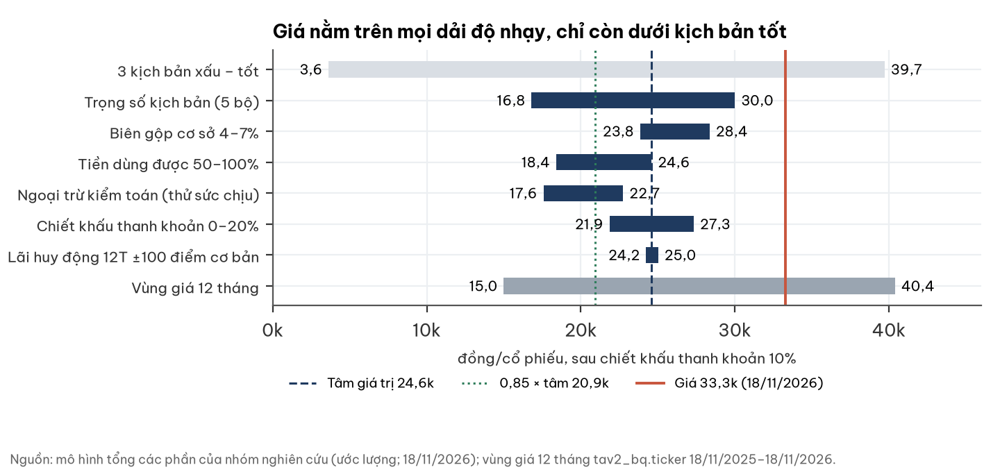

| So sánh (18/11/2026) | P/E 12 tháng | P/B | ROE thấp nhất 5 năm |
|---|---|---|---|
| LLM | 2,63 (gồm khoản một lần) | 1,22 (mẹ) | −0,7% |
| Lilama 10 (L10) | 2,37 | 0,91 | 5,9% |
| Lilama 18 (LM8) | 13,63 | 0,52 | 3,9% |
| CTD | 9,87 | 0,79 | 0,3% |
| VCG | 9,27 | 0,81 | 5,5% |
| TV2 | 8,89 | 1,41 | 3,9% |
| **Trung vị 10 mã xây lắp – EPC** | **~9,1** | **0,80** | |

- **Kết luận:** giá 33.300 = 1,35 × tâm 24.599, nằm trong vùng 3.630–39.728 nhưng ở phần trên, giữa tâm và kịch bản tốt ⇒ **giá TRÊN vùng giá trị trung tâm (đắt so với giá trị nội tại)**.
- P/B 1,22 cao hơn trung vị nhóm 52% dù ROE thấp nhất 5 năm thấp nhất nhóm; các mã họ Lilama giao dịch dưới giá sổ sách.
- Sau cổ tức cổ phiếu 31,7%: tâm quy đổi ~18.678, giá quy đổi ~25.285 (không đổi tỷ lệ).

## 7. Rủi ro: độ bền của biên và việc dùng tiền là biến lớn nhất

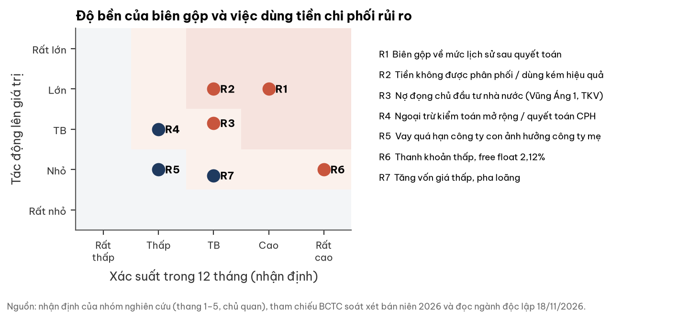

| Rủi ro | Tác động ước tính | Dấu hiệu sớm | Ngày kiểm |
|---|---|---|---|
| R1 Biên về mức lịch sử | Biên cơ sở 4,0%: tâm 23.846; −1.505 đ/cp mỗi điểm % | Biên gộp Q4/26 > 20% hay không | ~20/01/2027 |
| R2 Tiền dùng kém | Tiền dùng được 50%: tâm 18.392 | Tiền + tiền gửi 31/12/2026 < 2.500 tỷ không kèm dự án cụ thể | BCTC Q4/2026 |
| R3 Nợ đọng chủ đầu tư | Kịch bản xấu: tổn thất 200 tỷ (ước lượng) | Phải thu TKV 1.080 tỷ quá hạn > 12 tháng | 2027 |
| R4 Ngoại trừ kiểm toán | Xoá khoản mục bị ngoại trừ: 21.278; thêm liên kết về 0: 17.573 | Ý kiến BCTC kiểm toán 2026 | ~03/2027 |
| R5 Vay quá hạn công ty con | Đã trừ 100% trong số hợp nhất | Thuyết minh bảo lãnh của công ty mẹ | ~03/2027 |
| R6 Thanh khoản | Chiết khấu 20%: tâm 21.866 | Khối lượng, free float | Liên tục |

## 8. Pháp lý, quản trị, kiểm toán — cảnh báo cần biết

| Vấn đề | Bằng chứng | Phạm vi |
|---|---|---|
| Kiểm toán ngoại trừ | BCTC hợp nhất 2023, 2024, 2025 (AASC) đều ngoại trừ ⇒ HNX duy trì diện cảnh báo (QĐ 381/QĐ-SGDHN, 06/04/2026) | Khoản mục ở công ty con và công ty liên kết |
| Soát xét H1/2026 | Ngoại trừ: phải thu quá hạn 87,61; dở dang 250,22; lãi vay quá hạn Lilama 5; lãi vay vốn hoá 36,6; BHXH 8,03 tỷ; giá trị liên kết 69-3, BĐS Lilama | Lặp lại từ 2025 |
| Quyết toán cổ phần hoá | Kiểm toán nhấn mạnh: chưa có quyết định duyệt giá trị vốn Nhà nước | Điều chỉnh hai chiều, chưa lượng hoá |
| Vay quá hạn công ty con | ~330 tỷ (Lilama 5 222,2; Cơ khí Lắp máy 80,5; Lilama 7 27,7) | Không thấy bảo lãnh của mẹ trong các trang đã đọc |
| Cơ cấu sở hữu | Bộ Xây dựng 97,88% ⇒ free float 2,12% | Cổ đông thiểu số ít ảnh hưởng tới chính sách dùng tiền |
| Tăng vốn | Kế hoạch vốn điều lệ 1.500 tỷ (2026–27), 2.500 tỷ (2028–30) | Giá phát hành chưa rõ |

- Lợi nhuận 2025 sau kiểm toán cao hơn số tự lập (hợp nhất 356,9 → 473,3 tỷ), công ty không nêu khoản mục điều chỉnh.
- Không tìm thấy khởi tố liên quan doanh nghiệp. Các điểm trên là cảnh báo, **không đưa vào kịch bản cơ sở**; ảnh hưởng thể hiện qua độ nhạy.

## 9. Lịch xúc tác và mốc đổi nhận định hai chiều

| Mốc | Nhận định tích cực hơn nếu | Nhận định tiêu cực hơn nếu |
|---|---|---|
| BCTC Q4/2026 (~20/01/2027) | LNTT bỏ khoản một lần > 150 tỷ, biên Q4 > 20% | Lỗ hoạt động khi hết quyết toán |
| Hai quý không quyết toán | Biên gộp ≥10% ⇒ biên cơ sở 10%, tâm ~32.900 (giá/tâm ~1,0) | Biên về 2–5% như 2017–2024 |
| Chính sách tiền mặt | Cổ tức tiền ≥3.000 đ/cp hoặc mua lại ⇒ trọng số 10/50/40: 30.013 | Cho vay/đầu tư vào đơn vị họ Lilama yếu, hoặc trả nợ thay công ty con |
| BCTC kiểm toán 2026 (~03/2027) | Gỡ ngoại trừ, ra khỏi diện cảnh báo | Ngoại trừ lan sang công ty mẹ hoặc thành từ chối ý kiến |
| Quyết toán & thoái vốn | Thu đủ Vũng Áng 1; Hamon 160,4 tỷ thành thu nhập | Quyết toán cổ phần hoá giảm vốn chủ; phát hành giá thấp |

## Phụ lục A — Số liệu BCTC chính (tỷ đồng, hợp nhất)

| Chỉ tiêu | Q3/26 | Q3/25 | 9T/26 | 9T/25 |
|---|---|---|---|---|
| Doanh thu thuần | 340,7 | 668,2 | 2.425,7 | 3.712,8 |
| Lợi nhuận gộp (biên) | 174,5 (51,2%) | 56,6 (8,5%) | 760,2 (31,3%) | 146,9 (4,0%) |
| Chi phí bán hàng | 0 | 0 | −227,1 (hoàn nhập) | 0 |
| Chi phí quản lý | 33,9 | −7,6 | 150,0 | 14,6 |
| LNTT | 127,6 | 102,5 | 904,5 | 179,2 |
| LNST cổ đông mẹ | 99,2 | 98,2 | 695,0 | 177,2 |

Bảng cân đối 30/9/2026: tiền 2.707,9 · tiền gửi có kỳ hạn 868,1 · vay ngắn hạn 620,7 (không vay dài hạn) · phải thu khách hàng 3.101,8 (dự phòng 422,8) · tồn kho 307,4 · người mua trả trước 1.119,1 · chi phí phải trả 1.600,2 (Vũng Áng 1 752,1) · dự phòng bảo hành 747,1 · vốn chủ cổ đông mẹ 2.167,7 (BVPS 27.190 đ) · lợi ích không kiểm soát −66,3.

## Phụ lục B — Đối chiếu dữ liệu thị trường với BCTC gốc

| Chỉ tiêu | Dữ liệu thị trường | BCTC gốc | Ghi chú |
|---|---|---|---|
| Tiền | 2.708 | 2.707,9 + tiền gửi 868,1 | Dữ liệu thị trường thiếu tiền gửi có kỳ hạn |
| CFO 9T/26 | 1.137,7 | 1.231,3 | Dùng BCTC |
| LNST mẹ Q2/26 | 490,3 | H1 sau soát xét 595,8 (tự lập 606,2) | Dữ liệu thị trường giữ số tự lập |
| Số cổ phiếu | 79,73 triệu | 79.726.104 | Khớp |

## Phụ lục C — Nguồn

- **Công ty** (lilama.com.vn): BCTC hợp nhất và riêng Q3/2026 (ký 27/10/2026); BCTC hợp nhất bán niên 2026 do AASC soát xét; giải trình LNST Q2, 6T/2026; BCTC kiểm toán 2025 và công văn giải trình ngoại trừ; QĐ 381/QĐ-SGDHN và công văn giải trình cảnh báo; logo và ảnh công trình mục Dự án (tải 18/11/2026).
- **Báo chí:** người quan sát (07/11/2026), Báo Đấu thầu (19/05, 20/10/2026), Báo Kiểm toán (ĐHĐCĐ 2026), Kinh tế Chứng khoán (Ô Môn I 25/08/2025; thoái vốn 14/10/2026), Nhà đầu tư (Quảng Trạch II), Vietstock (Hủa Na).
- **Dữ liệu thị trường:** chuỗi tài chính quý, giá, khối lượng, P/E, P/B (đến 18/11/2026); giá khớp DNSE 18/11/2026; lãi huy động 12 tháng hiệu dụng.
- **Ngành:** đọc ngành độc lập 18/11/2026 (Bộ Công Thương, Bộ Tài chính, Báo Đấu thầu, Tiền Phong và các nguồn khác).
- **Bản đồ:** ranh giới geoBoundaries VNM-ADM1 (2008); toạ độ OpenStreetMap theo tên nhà máy/xã ghi trên website công ty — vị trí gần đúng.

## Phụ lục D — Phương pháp và giới hạn

- Tổng các phần: lợi nhuận hoạt động sau thuế chia r (g = 0, vì ROE cơ sở < r nên tăng trưởng không tạo giá trị); dự án mới tính theo giá vốn (NPV = 0). Kịch bản xấu coi tiền "mắc kẹt" chỉ có giá trị bằng lãi tiền gửi thực nhận (~1,3%/năm, hệ số 0,077).
- Biên gộp cơ sở 4,5% = trung vị biên 12 tháng 2017Q3–2024Q4 (30 quý); kịch bản tốt 7,0% = năm 2025. Biên của Quảng Trạch II, Ô Môn I không công bố.
- Chiết khấu thanh khoản 10% và trọng số kịch bản là giả định; không có dữ liệu thực thi độc lập.
- **Chưa có dữ liệu:** phần giá trị của Lilama trong Quảng Trạch II; doanh thu/giá vốn theo dự án; bảo lãnh đang phát hành; nguồn hai quý CFO dương lớn Q3/24, Q2/25; số cổ phần Hủa Na còn giữ; thuyết minh cam kết của công ty mẹ.

## Phụ lục E — Quy trình nghiên cứu

Số liệu đối chiếu trực tiếp với BCTC gốc do công ty công bố (đọc từ ảnh trang). Bối cảnh ngành do một người đọc ngành độc lập soạn, không dựa trên giá cổ phiếu. Định giá dựng trước khi so với giá thị trường. Toàn bộ số liệu, mô hình và giả định đã được một người phản biện độc lập kiểm tra. Các giới hạn dữ liệu nêu ở Phụ lục D.

## Phụ lục F — Tuyên bố miễn trừ trách nhiệm

Tài liệu này chỉ nhằm mục đích cung cấp thông tin nghiên cứu, không phải lời khuyên, đề nghị hay khuyến nghị mua, bán hoặc nắm giữ bất kỳ chứng khoán nào, và không tính đến mục tiêu, tình hình tài chính hay nhu cầu của từng nhà đầu tư. Thông tin được tổng hợp từ các nguồn được cho là đáng tin cậy tại thời điểm lập, nhưng không được bảo đảm về tính đầy đủ hay chính xác. Các ước lượng, kịch bản và giá trị hợp lý phản ánh giả định tại ngày lập và có thể thay đổi mà không cần thông báo. Kết quả trong quá khứ không bảo đảm kết quả tương lai. Nhà đầu tư cần tự đánh giá và chịu trách nhiệm với quyết định của mình.
