# MBB — Ngân hàng TMCP Quân đội: lợi nhuận tăng thật và giá ở nửa dưới vùng hợp lý, nhưng nợ nhóm 2 vừa tăng 42% trong một quý và MBV là rủi ro ngoài bảng

**Báo cáo Due Diligence · 31/10/2026 · Nhóm nghiên cứu** · HOSE · Ngân hàng thương mại cổ phần tư nhân, top 5 theo tổng tài sản

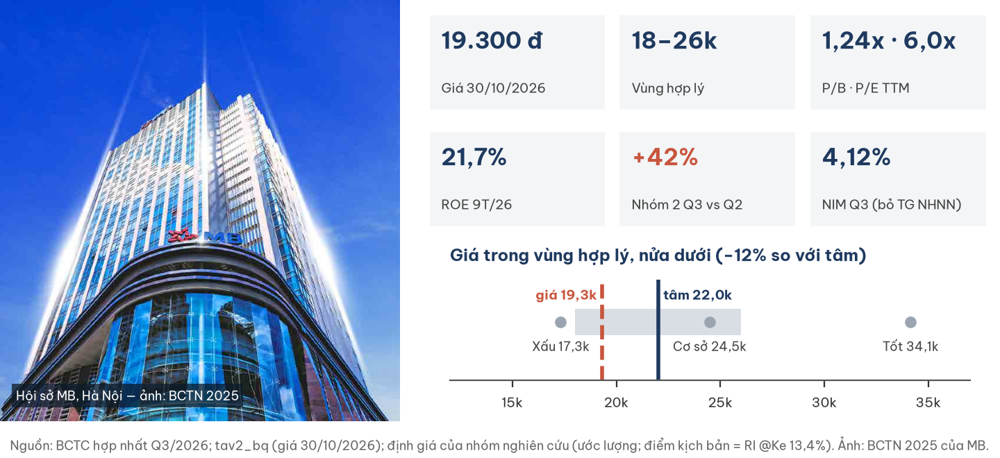

## Investment Summary

**Giá 19.300 đ (đóng cửa 30/10/2026) nằm TRONG vùng giá trị hợp lý 18.000–26.000 đ, thấp hơn tâm ≈22.000 đ (ước lượng) khoảng 12%.** Ở chi phí vốn mà thị trường đang ngụ ý (~15%), giá xấp xỉ hợp lý.

| Dữ liệu chính | Giá trị | Ghi chú |
|---|---|---|
| Giá đóng cửa 30/10/2026 | **19.300 đ** | Thị trường nghỉ 31/10; thanh khoản 20 phiên ~221 tỷ đ/phiên |
| Vùng giá trị hợp lý · tâm | **18.000–26.000 · ≈22.000 đ** | Ước lượng; tâm 22,1–22,5k tuỳ trọng số kịch bản xấu |
| P/B · P/E TTM | **1,24x · 5,97x** | BVPS 15.594 đ (30/09/2026); trung vị 11 ngân hàng 1,17x |
| ROE 9T/26 · ROA | **21,7% · 1,89%** | Năm hoá; đòn bẩy 11,2x |
| LNTT 9T/26 | **30.518 tỷ, +31,9%** | 77% kế hoạch năm 39.408 tỷ |
| NIM Q3/26 (bỏ tiền gửi NHNN) | **4,12%** | −9 bp so với Q2, +4 bp so với cùng kỳ |
| Nợ nhóm 2 · nợ xấu · bao phủ | **1,32% · 1,67% · 84,7%** | Nhóm 2 +42% trong Q3; bao phủ −8,9 điểm % |
| Dư nợ 9T · tiền gửi KH | **+18,8% · +7,9%** | Phần chênh tài trợ bằng giấy tờ có giá |

**Ba điều cần biết**

1. **Động cơ lợi nhuận là thật** — lợi nhuận trước dự phòng Q3 +41% cùng kỳ; NIM giữ ~4,1% dù chi phí lãi +115%; phần một lần chỉ 8,6% LNTT.
2. **Nhưng chất lượng tài sản xấu đi nhanh trong Q3** — nhóm 2 ngân hàng mẹ +67% trong quý; dự phòng tăng thêm chỉ bằng 68% nợ xấu tăng thêm.
3. **Và có một khoản ngoài bảng chưa đo được hết** — MBV (OceanBank cũ) không hợp nhất; phơi nhiễm ước 2–10% vốn chủ sở hữu.

| Điều làm nhận định đổi | Điều kiện (kiểm tại BCTC Q4/26, ~tháng 1–2/2027) | Tâm mới (ước lượng) |
|---|---|---|
| Tích cực hơn | Nhóm 2 về < 13.000 tỷ **và** bao phủ ≥ 90%; tiền gửi KH Q4 > +5% QoQ; NIM ≥ 4,05% | ≈24k |
| Tiêu cực hơn | Nhóm 2 > 20.000 tỷ hoặc nhóm 2–5 > 3,5%; bao phủ < 75%; hỗ trợ MBV > 5.000 tỷ | ≈19–20k (vùng 16–22k) |

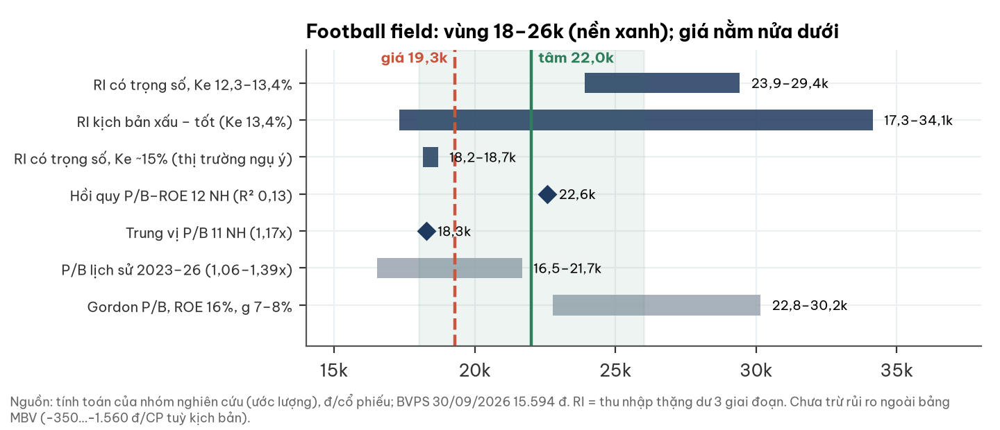

## 1. Tóm tắt điều hành

**Một ngân hàng sinh lời cao, định giá ngang ngành, đang bước vào pha xấu đi của chu kỳ chất lượng tài sản.**

- **Tình huống:** 9T/26 LNTT +31,9%, ROE 21,7%; tín dụng +18,8% YTD so với toàn hệ thống +11,6%.
- **Vấn đề:** nhóm 2 tăng vọt Q3; tiền gửi không kỳ hạn giảm tuyệt đối; nguồn vốn đắt hơn; MBV ngoài bảng.
- **Trả lời:** giá nằm nửa dưới vùng hợp lý. Rẻ theo chi phí vốn nội địa, xấp xỉ hợp lý theo chi phí vốn thị trường.

## 2. Thị trường đang định giá gì

**Ở P/B 1,24x, thị trường trả cho ROE bền vững chỉ 13–15%, hoặc chiết khấu chi phí vốn ~14–17%.**

| Phép định giá ngược (ước lượng) | Giá trị |
|---|---|
| ROE bền vững ngụ ý (Ke 12,3–13,4%, g 8%) | **13,3–14,7%** (hiện tại 21,7%) |
| Ke ngụ ý (ROE bền vững 16–20%, g 6–7%) | **14,1–17,5%** |
| P/E 2027 kịch bản cơ sở | 5,8x |
| P/B ngụ ý kịch bản cơ sở (Ke 13,4%) | 1,57x |

- Khoảng cách là **chiết khấu toàn ngành**: P/B 1,1–1,4x với ROE > 20% kéo dài từ 2023.
- Quan điểm khác biệt hai chiều: tăng trưởng khối lượng có thể bù chi phí tín dụng; ngược lại, chu kỳ nợ có thể kéo ROE về 13%.
- Room ngoại đã kín: cầu thụ động từ nâng hạng FTSE khó vào — kênh định giá bị chặn, không phải luận điểm lợi nhuận.

## 3. Ngành: tín dụng do văn bản điều hành, chu kỳ nợ ở pha sớm–giữa

**Năm 2026 ngành ngân hàng chịu hai lực: mệnh lệnh hành chính (room, lãi suất) và chu kỳ chất lượng tài sản sau năm tín dụng +19%.**

| Yếu tố ngành (31/10/2026) | Trạng thái | Hàm ý cho MBB |
|---|---|---|
| Tín dụng toàn hệ thống | +11,6% YTD (30/09); định hướng năm ~15% | MBB +18,8% YTD; MB được hưởng trần tăng trưởng ưu đãi gắn với MBV (báo chí; chưa tách được phần đóng góp) |
| CV 9608 (18/10) | Huy động −0,5 điểm %; cho vay SXKD −1,5–2 điểm %; trừ LC miễn truy đòi khỏi room | MBB 59% dư nợ doanh nghiệp; LC miễn truy đòi 13.597 tỷ (+69%) |
| TT 50/2026 (hiệu lực 01/12) | Trần LDR 85% → 95% theo công thức mới | Nới dư địa thanh khoản |
| Chất lượng tài sản 27 NH (Q2) | Nợ xấu ~2,0%; nhóm 2 1,45%; bao phủ ~79–83% | Mức Q3 của MBB (nhóm 2 1,32%, nợ xấu 1,67%, bao phủ 84,7%) không xấu hơn mức ngành Q2; tốc độ Q3 chưa so được |
| CASA ngành (Q2) | 20,2%, 22/27 ngân hàng giảm | MBB vẫn thuộc nhóm dẫn đầu (MB công bố 37,8% năm 2025) |

- Người đọc ngành độc lập xếp chế độ ngành: hành chính chi phối 0,45 · chu kỳ 0,35 · cấu trúc 0,20.
- So sánh nhóm 2 Q3 với ngân hàng khác **chưa kiểm** (chưa có số Q3 toàn ngành).

## 4. Doanh nghiệp: gốc quân đội, quy mô đại chúng, vận hành số

**MB thành lập 1994, nay là tập đoàn tài chính top 5 với ~35 triệu khách hàng, 8 công ty con (gồm MBV) và mạng lưới phủ 33/34 tỉnh.**

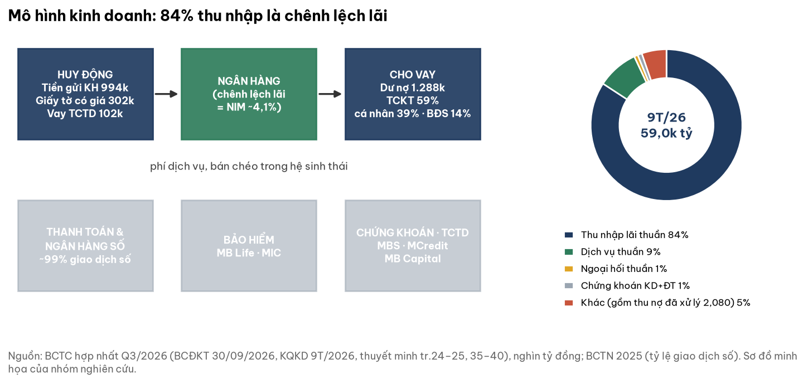

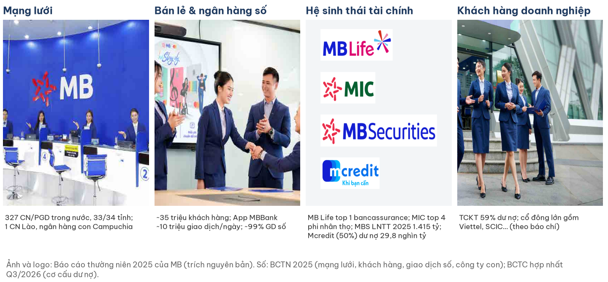

| Mốc | Sự kiện |
|---|---|
| 1994 | Thành lập, trụ sở Hà Nội; cổ đông lớn gồm doanh nghiệp quân đội (Viettel, Tân Cảng…) và SCIC (theo báo chí) |
| 2016–2020 | Mở rộng sang bảo hiểm nhân thọ (MB Life), tài chính tiêu dùng (Mcredit) |
| 2023 | Chuyển chi nhánh Campuchia thành ngân hàng con 100% |
| 10/2024 | Nhận chuyển giao bắt buộc OceanBank, đổi tên MBV |
| 2025 | Tổng tài sản 1,62 triệu tỷ (+43%); ~99% giao dịch qua kênh số |

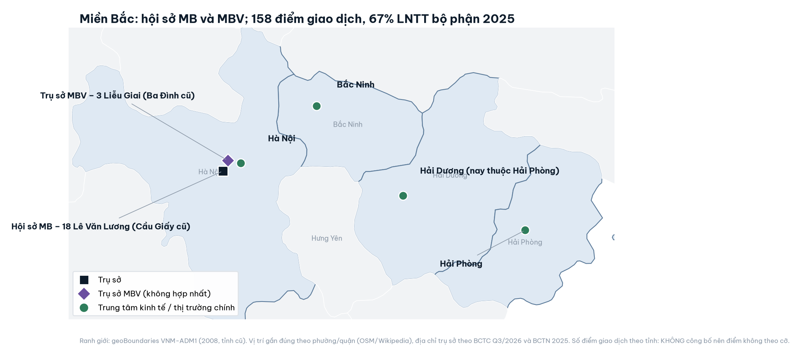

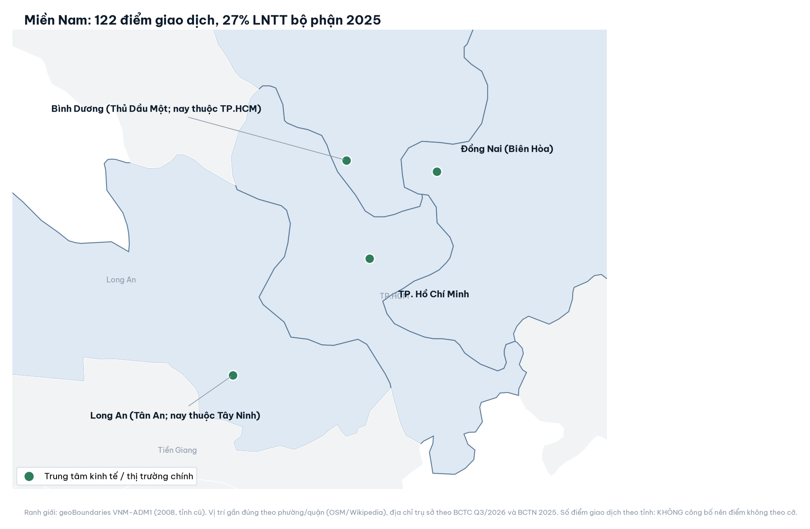

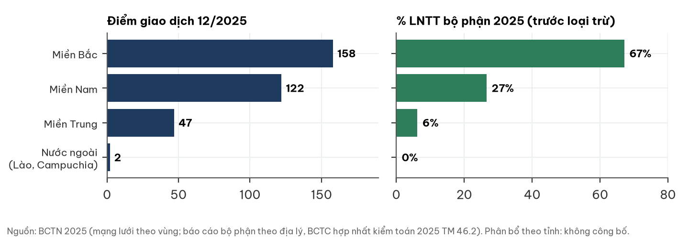

## 5. Tài chính theo khung ngân hàng

### 5a. Thu nhập và biên lãi

**NIM giữ được nhờ lợi suất tài sản tăng nhanh; chiều quý gần nhất đã quay xuống.**

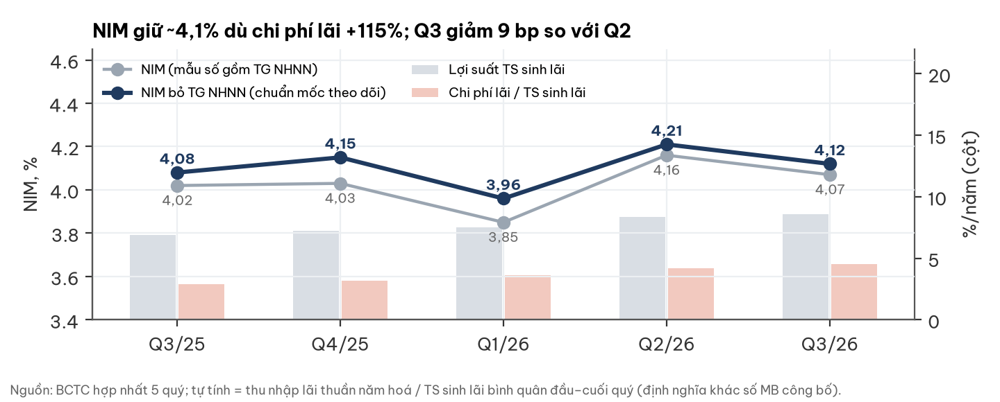

- Hai cách đo cùng chiều: gồm tiền gửi NHNN 4,07%, bỏ tiền gửi NHNN 4,12%.
- Q4/26: CV 9608 và 152 nghìn tỷ chứng chỉ tiền gửi ≤12 tháng tái tục ⇒ NIM nghiêng giảm ~10 bp (ước lượng).

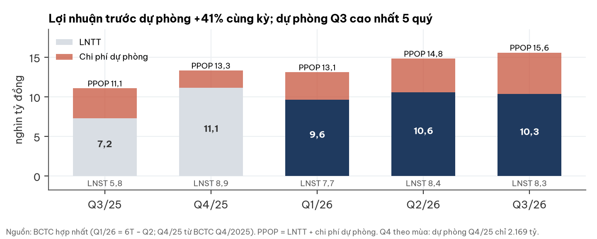

### 5b. Huy động và nguồn vốn

**Tăng trưởng vượt tiền gửi: 56% phần dư nợ tăng thêm tài trợ bằng giấy tờ có giá.**

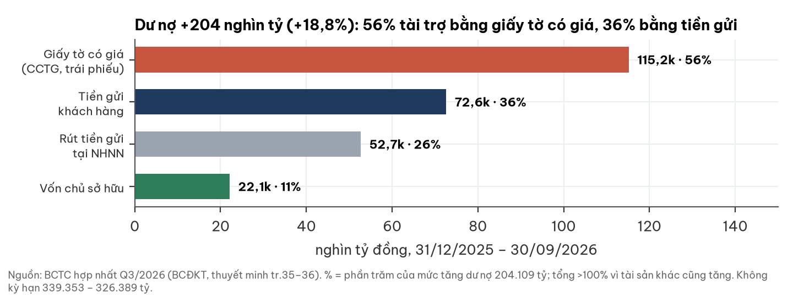

| 31/12/25 → 30/09/26 | Số |
|---|---|
| Tiền gửi không kỳ hạn / tiền gửi KH | 36,8% → 32,8% (giảm tuyệt đối 12.964 tỷ) |
| Chứng chỉ tiền gửi | 140.830 → 248.417 tỷ; chi phí giấy tờ có giá bình quân 6,22%/năm |
| Dư nợ / tiền gửi KH (thô) | 117,7% → 129,6% |

### 5c. Chất lượng tài sản

**Q3 là điểm gãy: rủi ro mới nằm ở ngân hàng mẹ, không phải công ty tài chính tiêu dùng.**

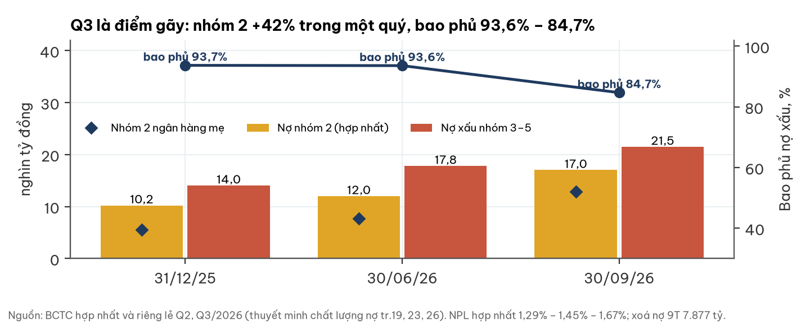

- Nợ xấu hình thành mới 9T: 15.324 tỷ = 1,73%/năm dư nợ; chi phí tín dụng 1,46%.
- Lãi dự thu +46% so với dư nợ +19%; cần ~1.940 tỷ dự phòng để giữ bao phủ đầu năm.

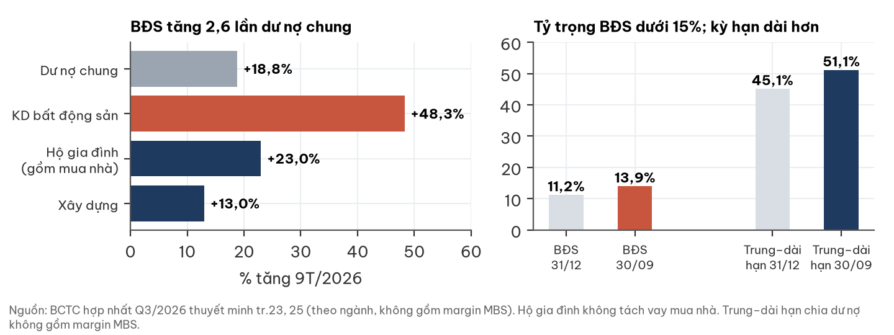

### 5d. Vốn và DuPont

**ROE cao nhờ biên lãi và chi phí thấp; vốn tự sinh ~13–15%/năm không đủ cho tốc độ ~25%/năm.**

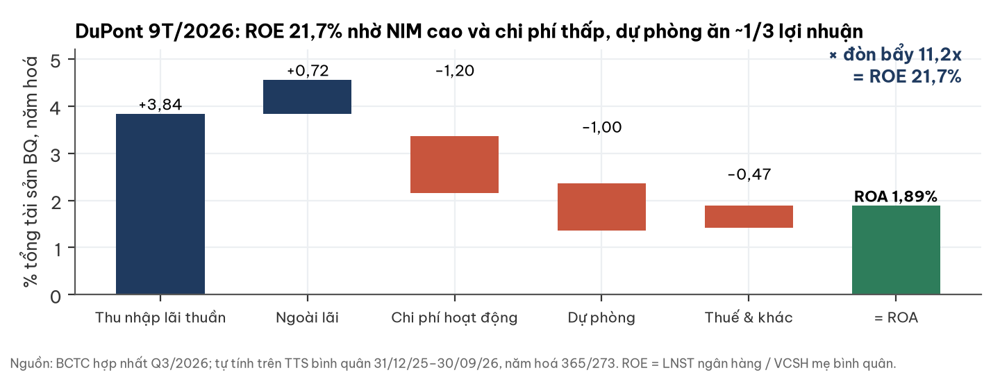

- 9T/26 đã huy động vốn ngoài: phát hành cổ phiếu 9.228 tỷ; giấy tờ có giá đủ điều kiện vốn cấp 2 14.600 tỷ (trả 8.200).
- Tier 1 riêng lẻ 9,02% (30/06, nguồn thứ cấp, trước khi nhận tiền quyền mua): theo dõi, chưa là cờ. CAR 30/09: chưa công bố.

## 6. Sự kiện vốn và MBV

**⚠ MBV là rủi ro ngoài bảng: không hợp nhất, MB chưa góp vốn tới 30/09/2026.**

| Mục | Số | Nguồn |
|---|---|---|
| Hợp nhất | **Không** — theo điểm c k.1 Điều 185 Luật các TCTD 2024 | BCTC hợp nhất Q3/2026, thuyết minh tr.2 |
| Góp vốn tới 30/09/2026 | **Chưa có khoản góp nào** | như trên |
| Phải thu bán nợ từ MBV | 11.248 tỷ (31/12/2025; 5.853 tỷ năm trước) | BCTC kiểm toán 2025, bên liên quan |
| Quyết định góp vốn | 3.500 tỷ, ngày 01/10/2026 (sau kỳ báo cáo) | Báo chí (thứ cấp) |
| Lỗ luỹ kế MBV | 15.688 tỷ (31/12/2024); số 2025–26 không công bố | Báo chí (thứ cấp) |
| Ưu đãi đi kèm | Trần tăng trưởng tín dụng tới 35%/năm trong 4 năm | Báo chí (thứ cấp) |

| Kịch bản phơi nhiễm (ước lượng) | % vốn chủ mẹ | BVPS | P/B tại 19.300 |
|---|---|---|---|
| Góp 3.500–5.000 tỷ phải dự phòng toàn bộ | −2,2…−3,2% | −350…−500 đ | 1,27–1,28x |
| Mất 30% phải thu bán nợ | −2,1% | −335 đ | 1,26x |
| Cận trên thô: bù toàn bộ lỗ luỹ kế 2024 | −10,0% | −1.560 đ | 1,37x |

- Góp vốn tự nó chỉ đổi tiền thành khoản đầu tư; giá trị sổ sách chỉ giảm khi phải trích lập.
- Vốn điều lệ 80.550 → 100.687 tỷ trong 9T; còn 200 triệu cổ phiếu riêng lẻ chờ phát hành (~2% pha loãng).

## 7. Định giá

**Ba kịch bản cho giá trị có trọng số ≈23,9k ở Ke 13,4% và ≈18,7k ở Ke ~15%.**

| Kịch bản | Xác suất | Điều kiện 2027 (ước lượng) | LNTT 2026 · 2027 | Giá trị Ke 13,4% · Ke 15% |
|---|---|---|---|---|
| Tích cực | 20% | Tín dụng +24%, NIM 4,1%, chi phí tín dụng 1,3% | 45,0k · 55,2k tỷ | 34,1k · 25,8k |
| Cơ sở | 45% | Tín dụng +18%, NIM 3,9%, chi phí tín dụng 1,7% | 42,5k · 43,2k tỷ | 24,5k · 19,2k |
| Tiêu cực | 35% | Tín dụng +12%, NIM 3,6%, chi phí tín dụng 2,2% | 39,0k · 29,1k tỷ | 17,3k · 13,9k |
| **Có trọng số** | | | | **23,9k · 18,7k** |

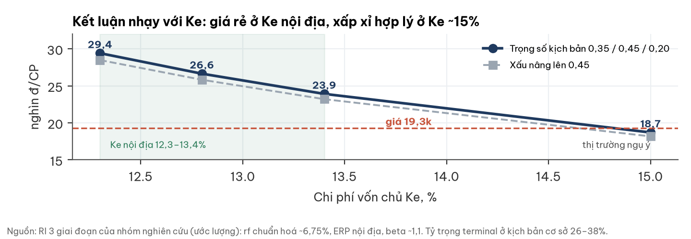

- Tâm 22,0k = ½ RI có trọng số + ¼ hồi quy P/B–ROE (R² 0,13, trọng số thấp) + ¼ P/B lịch sử 1,25x.
- Nâng xác suất tiêu cực lên 45%: RI còn 23,2k (Ke 13,4%); tâm còn ~22,1k.
- Chưa trừ rủi ro MBV (bảng mục 6).

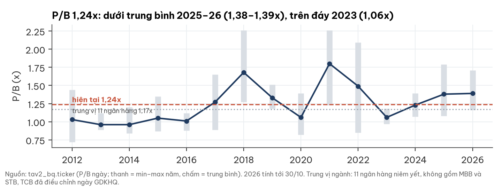

| Ngân hàng (30/10/2026) | P/B | ROE 5 năm |
|---|---|---|
| VCB · BID · CTG | 1,89 · 1,31 · 1,18 | 20,4% · 17,9% · 18,1% |
| ACB · HDB · VPB | 1,17 · 1,62 · 1,15 | 23,0% · 23,8% · 14,8% |
| TCB (điều chỉnh ngày GDKHQ) · VIB · TPB | 1,16 · 1,04 · 0,81 | 17,4% · 23,6% · 18,6% |
| **MBB** | **1,24** | **22,7%** |

## 8. Rủi ro (pre-mortem)

**Nếu sai, khả năng cao nhất là vì chất lượng tài sản xấu nhanh hơn dự phòng.**

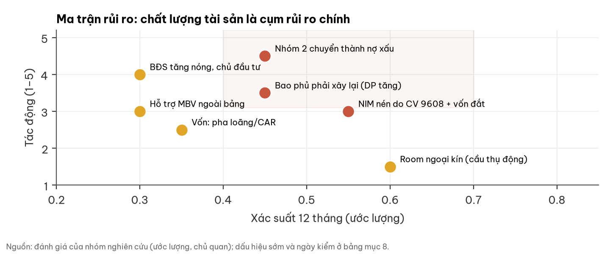

| Rủi ro | Xác suất 12T | Tác động | Dấu hiệu sớm | Ngày kiểm |
|---|---|---|---|---|
| Nhóm 2 chuyển thành nợ xấu | 0,45 | Cao | Nhóm 2 Q4 ≥ 17.014 tỷ | BCTC Q4/26 |
| Phải xây lại bao phủ | 0,45 | Trung bình–cao | Dự phòng Q4 < 4.000 tỷ khi nợ xấu tăng | BCTC Q4/26 |
| NIM nén (CV 9608, vốn đắt) | 0,55 | Trung bình | NIM bỏ tiền gửi NHNN < 3,85% | BCTC Q4/26 |
| Hỗ trợ MBV ngoài bảng | 0,30 | Trung bình | Công bố góp vốn > 5.000 tỷ / trích lập | CBTT, BCTC năm 2026 |
| Tín dụng BĐS tăng nóng | 0,30 | Cao | BĐS > 15% dư nợ | BCTC Q4/26 |
| Vốn / pha loãng | 0,35 | Thấp–trung bình | CAR < 10,5% | BCTN 2026 |

## 9. Pháp lý và quản trị

**Kiểm toán sạch; không tìm thấy vụ thanh tra/pháp lý 2025–26; WARNING duy nhất là MBV (mục 6).**

- KPMG: chấp nhận toàn phần BCTC 2025; soát xét 6T/2026 không ngoại trừ.
- Phạm vi tra cứu: báo chí và CBTT công khai 2025–26; "không tìm thấy" không đồng nghĩa "không có".

## 10. Lịch xúc tác và mốc theo dõi

| Thời điểm | Sự kiện | Theo dõi |
|---|---|---|
| 01/12/2026 | TT 50/2026 hiệu lực (trần LDR 95%) | Dư địa cho vay |
| Q4/2026 | Hiệu ứng CV 9608 lên lãi suất; hoàn tất góp vốn MBV | NIM, CBTT MBV |
| ~Tháng 1–2/2027 | BCTC Q4/2026 | Nhóm 2, bao phủ, NIM, LNTT năm |
| ~Tháng 4/2027 | ĐHCĐ 2027 | Kế hoạch tăng vốn, cổ tức, MBV |
| Trước 30/06/2027 | Phát hành 200 triệu cổ phiếu riêng lẻ | Giá phát hành so với P/B |

| Mốc khoá trước (lập 31/10/2026) | Xác suất | Chấm |
|---|---|---|
| Nhóm 2 hợp nhất 31/12/26 ≥ 17.014 tỷ | 0,55 | 15/02/2027 |
| Nợ xấu hợp nhất 31/12/26 trong 1,5–2,0% | 0,70 | 15/02/2027 |
| Bao phủ 31/12/26 ≥ 85% | 0,45 | 15/02/2027 |
| LNTT 2026 ≥ kế hoạch 39.408 tỷ | 0,70 | 15/02/2027 |
| NIM Q4/26 bỏ tiền gửi NHNN ≤ 4,12% | 0,65 | 15/02/2027 |
| Tiền gửi KH 31/12/26 ≥ +12% so với đầu năm | 0,40 | 15/02/2027 |
| CAR hợp nhất 31/12/26 ≥ 10,5% | 0,60 | 30/04/2027 |
| Hoàn tất phát hành riêng lẻ trước 30/06/2027 | 0,50 | 15/07/2027 |

## Phụ lục A — Số liệu BCTC chính (hợp nhất, tỷ đồng)

| Chỉ tiêu | Q3/25 | Q4/25 | Q1/26 | Q2/26 | Q3/26 |
|---|---|---|---|---|---|
| Thu nhập lãi thuần | 12.991 | 14.555 | 14.913 | 16.894 | 17.836 |
| Lợi nhuận trước dự phòng | 11.051 | 13.298 | 13.083 | 14.807 | 15.571 |
| Chi phí dự phòng | 3.802 | 2.169 | 3.455 | 4.247 | 5.241 |
| LNTT | 7.250 | 11.129 | 9.628 | 10.560 | 10.330 |
| LNST | 5.800 | 8.903 | 7.703 | 8.445 | 8.252 |

30/09/2026: tổng tài sản 1.837.857; cho vay KH 1.288.128; tiền gửi KH 993.988; giấy tờ có giá 302.399; vốn chủ (gồm lợi ích CĐ không kiểm soát) 164.142; vốn chủ mẹ 157.017; xoá nợ 9T 7.877.

## Phụ lục B — Đối chiếu dữ liệu thị trường ↔ BCTC

- P/B và ROE 5 năm của các ngân hàng lấy từ cơ sở dữ liệu thị trường nội bộ, chưa đối chiếu BCTC từng ngân hàng.
- TCB: P/B 0,78x ngày 30/10 là sai lệch kỹ thuật ngày giao dịch không hưởng quyền (giá điều chỉnh, giá trị sổ sách chưa điều chỉnh); dùng 1,16x.
- P/E thị trường của MBB 6,5x khác P/E tự tính 5,97x (khác kỳ lợi nhuận).

## Phụ lục C — Nguồn

- BCTC hợp nhất và riêng lẻ Q3/2026 (ký 20/10 và 14/10/2026), Q2/2026, Q1/2026, Q4/2025, Q3/2025, Q2/2025; BCTC hợp nhất kiểm toán 2025 (KPMG, 07/03/2026); soát xét 6T/2026 (KPMG, 01/08/2026). Bản PDF scan tải từ static2.vietstock.vn.
- Báo cáo thường niên 2025 của MB: mạng lưới, công ty con, báo cáo bộ phận, bên liên quan; ảnh và logo (logo trích từ trang bìa; chỉ để nhận diện, không ngụ ý công ty bảo chứng báo cáo).
- Báo chí (thứ cấp): Baodautu 11/04/2025 (MBV); Thị trường Tài chính Tiền tệ 03/10/2026 (góp vốn MBV); Vietstock 20/04/2026 (trần tín dụng, room ngoại); Vietcap, Elibook, ACBS (CAR, LDR quý 2).
- Ngành: nhận định ngành độc lập 31/10/2026 (NHNN, Cục Thống kê, SSI, VDSC, TCBS qua báo chí).
- Bản đồ: ranh giới geoBoundaries VNM-ADM1 (2008, tỉnh cũ); vị trí gần đúng theo phường/quận (OSM/Wikipedia): 18 Lê Văn Lương (Cầu Giấy cũ), 3 Liễu Giai (Ba Đình cũ); trung tâm các tỉnh/thành.
- Giá, P/B: cơ sở dữ liệu thị trường nội bộ tới phiên 30/10/2026.

## Phụ lục D — Phương pháp và giới hạn dữ liệu

- NIM tự tính: thu nhập lãi thuần năm hoá / tài sản sinh lãi bình quân đầu–cuối quý; khác định nghĩa MB công bố.
- Thu nhập thặng dư (RI) 3 giai đoạn: vốn chủ mẹ cuối 2026 theo kịch bản; chi trả tiền 30%; ROE 2027–29 rồi ROE dài hạn 14/16/18%, g 6/7/8%. Ke nội địa 12,3–13,4% (rf chuẩn hoá ~6,75%, ERP nội địa, beta ~1,1); 15% = mức thị trường ngụ ý.
- Kịch bản Q4/26 phản ánh mùa vụ (Q4/25: lợi nhuận trước dự phòng +20% QoQ, dự phòng 2.169 tỷ).
- **Chưa kiểm được:** CASA theo chuẩn MB và tách cá nhân/doanh nghiệp (Q3); CAR 30/09/2026 và phương pháp tính; LDR theo TT22/TT50 tại 30/09; nợ ngoại bảng và nợ cơ cấu; tập trung khách hàng lớn, bên liên quan, trái phiếu doanh nghiệp BĐS nắm giữ; phân rã BĐS chủ đầu tư/người mua nhà; số liệu MBV 2025–26 và cam kết hỗ trợ cụ thể; Mcredit 9T/2026; quota tín dụng 2026; nhóm 2 Q3 các ngân hàng khác.
- Lỗ phái sinh tiền tệ 1.066 tỷ có thể gắn với hoán đổi tài trợ ngoại tệ (suy luận); đọc gộp với ngoại hối giao ngay, thuần +467 tỷ.
- Phân bổ điểm giao dịch theo tỉnh không công bố; bản đồ chỉ thể hiện trụ sở và trung tâm kinh tế.

## Phụ lục E — Quy trình độc lập

Báo cáo đi qua ba lớp: nhóm nghiên cứu đọc BCTC gốc; một người đọc ngành độc lập viết nhận định ngành trước khi xem số doanh nghiệp; một người phản biện kiểm lại số và lập luận. Các điểm người phản biện đã sửa:

| Điểm | Bản đầu | Sau phản biện |
|---|---|---|
| MBV | Suy "sở hữu 100% ⇒ hợp nhất", vốn 3.500 tỷ | Không hợp nhất, chưa góp vốn tới 30/09 (BCTC); tách thành rủi ro ngoài bảng |
| Vốn | "Vốn cấp 2 10–15 nghìn tỷ H2", Tier 1 là cờ | Theo lưu chuyển tiền tệ: cổ phiếu 9.228, vốn cấp 2 14.600; Tier 1 hạ xuống theo dõi |
| So sánh | TCB 0,78x; trung vị gồm MBB | TCB 1,16x; trung vị loại MBB; hồi quy trọng số thấp |
| NIM | Một cách đo | Thêm cách đo bỏ tiền gửi NHNN; mốc theo dõi dùng cách này |
| Kịch bản Q4/26 | Cả ba kịch bản LNTT Q4 ≤ 11,8k | Phản ánh mùa vụ hai chiều; xác suất tiêu cực 30% → 35% |
| Ngôn từ | "Trích thiếu", "sớm và nhanh hơn ngành", "lãi tới 11,18%" | Dự phòng bằng 68% nợ xấu tăng thêm; so sánh ngành chưa kiểm; chi phí bình quân 6,22% |

## Phụ lục F — Tuyên bố miễn trừ trách nhiệm

Tài liệu này chỉ nhằm mục đích cung cấp thông tin nghiên cứu, không phải lời mời chào, khuyến nghị mua/bán hay tư vấn đầu tư cá nhân hoá. Số liệu lấy từ nguồn được cho là đáng tin cậy nhưng không được bảo đảm tuyệt đối; các ước lượng, kịch bản và giá trị hợp lý là nhận định tại thời điểm viết và có thể thay đổi mà không cần thông báo. Nhà đầu tư tự chịu trách nhiệm với quyết định của mình và nên tham khảo tư vấn chuyên nghiệp phù hợp với hoàn cảnh riêng.
