# NNC — CTCP Đá Núi Nhỏ: lợi nhuận đỉnh nhờ giá đá, giá đã chiết khấu sâu "vách" cung–cầu 2028 — nhưng giá trị treo vào giá đá sau khi mỏ mới vào cuộc

**Báo cáo Due Diligence · 31/10/2026 · Nhóm nghiên cứu** · Sàn HOSE · Khai thác và chế biến đá xây dựng, mỏ Mũi Tàu (Đồng Phú, Đông Nam Bộ)

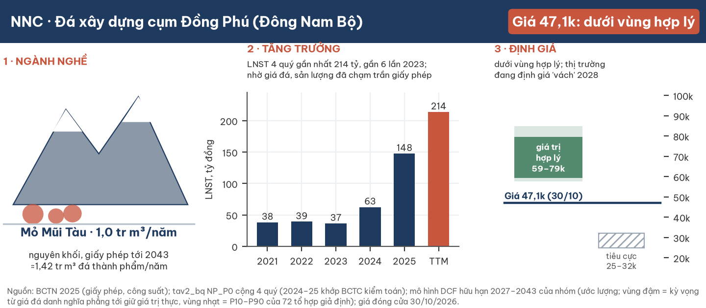

**Kết luận: ở giá đóng cửa 30/10/2026 (47.100 đ), NNC nằm DƯỚI vùng giá trị hợp lý ~59.000–79.000 đ/cp (điểm giữa ~69.000; ước lượng) — nghiêng rẻ, nhưng không phải rẻ chắc chắn.** Lợi nhuận 2026 là thật và chủ yếu đến từ giá đá: sản lượng đã chạm trần giấy phép từ 2025, biên gộp lên 54%, bảng cân đối có tiền ròng ~22% vốn hoá. Thị trường trả P/E 4,8× vì lo hai mỏ mới trong cùng cụm (Tam Lập 2, 3) ép giá đá từ 2028. Dựng giá trị bằng dòng tiền hữu hạn tới hạn giấy phép 2043, giá hiện tại tương đương xác suất ~52–76% cho kịch bản "vách" sâu — cao hơn 2–3 lần mức 25% mà bằng chứng hiện có ủng hộ. Vị trí trong vùng phụ thuộc gần như hoàn toàn vào một giả định: sau 2028 giá đá danh nghĩa đi ngang (cận dưới) hay theo kịp lạm phát (cận trên).

| Dữ liệu chính | Giá trị | Ghi chú |
|---|---|---|
| Đóng cửa 30/10/2026 (mốc định giá) | **47.100 đ** | Phiên gần nhất; thị trường đóng cửa cuối tuần, phiên kế tiếp 02/11 · vốn hoá 1.032 tỷ · 21,92 triệu CP |
| Vùng giá trị hợp lý (ước lượng) | **~59.000 – 79.000 đ** | Cận dưới: giá đá danh nghĩa đi ngang tới 2043; cận trên: giá đá giữ giá trị thực |
| Khoảng rộng (72 tổ hợp giả định) | 57.600 – 84.800 đ (P10–P90) | Thấp nhất 50.700 · cao nhất 94.400 |
| Ba kịch bản (xác suất 25/50/25) | 24.800–32.100 · 56.700–77.400 · 99.100–131.100 đ | Tiêu cực · cơ sở · tích cực; xem mục 7 |
| P/E TTM · EV/EBITDA TTM | 4,8× · ~2,3× | Trên lợi nhuận đỉnh; nhóm đá niêm yết 3,7–7,1× |
| Tiền ròng sau nghĩa vụ (30/9/2026) | 223,6 tỷ (10.200 đ/cp) | Thô 273,2 tỷ; đã trừ truy thu, quỹ khen thưởng, cổ tức phải trả |
| LNST 9T/2026 · Q3/2026 | 160,1 tỷ (+70%) · 69,3 tỷ (+63%) | 9T đã gánh 21,5 tỷ truy thu một lần ở mỏ cũ Núi Nhỏ |
| Cổ tức tiền 2025 · tỷ suất | 1.000 đ · 2,1% | ~15% LNST 2025; phần lớn lợi nhuận chuyển quỹ đầu tư phát triển |
| Thanh khoản bình quân | ~1,4–1,5 tỷ đ/phiên | 20–120 phiên; rất mỏng |

**Ba luận điểm tích cực:** (1) **Lợi nhuận sạch và có cơ chế rõ** — doanh thu đá thành phẩm 2025 +40% trong khi giá vốn đá thành phẩm đi ngang (178,6 so với 178,3 tỷ), tức là giá bán tăng chứ không phải chi phí giảm một lần; kiểm toán 2025 chấp nhận toàn phần. (2) **Tài sản hữu hạn nhưng dài** — mỏ Mũi Tàu còn ~20,2 triệu m³ trữ lượng và giấy phép tới 2043, dài hơn hai mỏ cạnh tranh mới 8–10 năm; khi hai mỏ đó hết hạn, cung cụm lại thắt. (3) **Bảng cân đối dày** — tiền ròng sau nghĩa vụ 223,6 tỷ, cổ phần MVC/NHC ~110 tỷ, lãi tiền gửi ~20 tỷ/năm; kịch bản xấu nhất vẫn có sàn ~18.600 đ/cp từ tiền và khoản đầu tư.

**Ba luận điểm rủi ro:** (1) **Vách cung–cầu 2028** — hai mỏ Tam Lập mới cấp 2025 có thể ép giá đá cụm; một công ty chứng khoán dự phóng giá bán bình quân giảm từ ~480 nghìn đ/m³ (2027) về ~210 nghìn (2029). (2) **Đòn bẩy chi phí cố định** — sản lượng không tăng được, nên mỗi 10% giá đá làm lợi nhuận đổi mạnh; chi phí ±10% đổi giá trị ±5–6 nghìn đ/cp. (3) **Quản trị và phân phối** — sở hữu chéo với cổ đông lớn MVC (44%), bán chịu cho bên liên quan NHC (61% phải thu), phạt hành chính nhỏ 2024–25, lợi nhuận giữ lại nhiều mà chưa có kế hoạch sử dụng vốn công bố.

## 1. Tóm tắt điều hành

**Một mỏ đá đã chạy hết công suất, ăn giá đá cao ở đỉnh chu kỳ hạ tầng phía Nam; câu hỏi định giá duy nhất là giá đá sau 2028.**

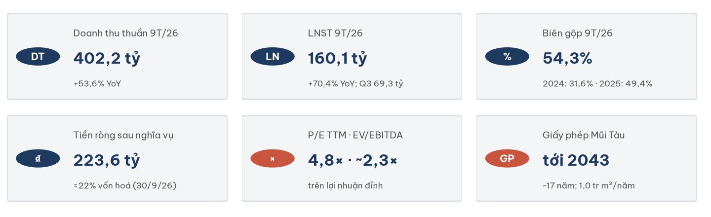

**Tình huống.** NNC khai thác mỏ đá Mũi Tàu (51,5 ha, Đồng Phú) với giấy phép 1,0 triệu m³ nguyên khối/năm tới 2043. Đầu tư công hạ tầng phía Nam (sân bay Long Thành, Vành đai 3, cao tốc) và việc nhiều mỏ bị đình chỉ hoặc vướng thuê đất đã đẩy giá đá tại mỏ lên mạnh trong 2025–2026. 9T/2026 doanh thu thuần 402,2 tỷ (+53,6%), LNST 160,1 tỷ (+70,4%), biên gộp 54,3%.

**Biến chuyển.** Sản lượng không còn là động lực: 2025 công ty "khai thác đạt 100% công suất cấp phép". Tăng trưởng đến từ giá. Cùng lúc, hai mỏ Tam Lập trong cùng cụm được cấp phép 2025 và sẽ tăng dần sản lượng; khoảng 2027 cầu dự án lớn có thể chững lại trước làn sóng Vành đai 4.

**Câu hỏi.** Ở 47.100 đ, với P/E 4,8× trên lợi nhuận đỉnh, thị trường đang định giá kịch bản nào cho giá đá sau 2028, và kịch bản đó hợp lý đến đâu?

**Trả lời.** Dựng giá trị từ sản lượng giấy phép, giá đá theo bốn kịch bản và chi phí hiệu chỉnh trên số kiểm toán, giá trị kỳ vọng nằm ~59.000–79.000 đ/cp. Giá hiện tại thấp hơn cả cận dưới (giả định giá đá danh nghĩa đi ngang 17 năm, tức giá thực giảm ~3%/năm). Để 47.100 là "đúng giá", cần tin xác suất kịch bản vách sâu (0,8 triệu m³ × ~250 nghìn đ/m³ tới hết đời mỏ) khoảng 52–76%. Vấn đề là **mức chiết khấu cho rủi ro cung**, không phải chất lượng lợi nhuận.

**Điều gì làm nhận định tích cực hơn:** (i) giá đá 1x2 công bố của Sở Xây dựng Đồng Nai bình quân Q2/2027 cao hơn Q3/2026 trên 7%; (ii) Vành đai 4 đạt ≥20% khối lượng tới 06/2027 (cầu năm 2027–28 không trũng); (iii) BCTC Q4/2026 và Q1/2027 giữ doanh thu ≥130 tỷ/quý với biên gộp ≥55%; (iv) giấy phép khai thác Tam Lập 1 khu II được cấp; (v) công ty công bố sản lượng m³, cho thấy giá bán bình quân ≥394 nghìn đ/m³.

**Điều gì làm nhận định tiêu cực hơn:** (i) giá đá công bố Q2/2027 thấp hơn Q3/2026 trên 7%; (ii) biên gộp quý dưới 45% khi doanh thu đi ngang; (iii) các mỏ đấu giá 2025–26 trong cụm được cấp phép khai thác sớm; (iv) quyết định xử phạt hoặc truy thu mới trên 20 tỷ; (v) thêm giao dịch tiền lớn với bên liên quan, hoặc MVC vượt 51% kèm phương án thoái cổ phần MVC dưới giá.

## 2. Luận điểm và điều thị trường đang định giá

**Giá 47.100 đ tương đương việc tin ~52–76% vào kịch bản "vách" sâu từ 2028 — gấp 2–3 lần xác suất mà bằng chứng hiện có ủng hộ.**

| Phép định giá ngược (ước lượng, r 13%) | Giá đá danh nghĩa đi ngang | Giá đá giữ giá trị thực |
|---|---|---|
| Giá trị kỳ vọng ba kịch bản (25/50/25) | 59.300 đ | 79.500 đ |
| Xác suất tiêu cực hàm ý ở 47.100 | **~52%** | **~76%** |
| Xác suất tiêu cực hàm ý ở 45.000 / 52.000 | 56% / 41% | 80% / 69% |
| Xác suất tiêu cực trong báo cáo này | 25% | 25% |

Cách tính: giữ tỉ lệ tích cực : cơ sở = 1 : 2, tìm xác suất tiêu cực để giá trị kỳ vọng bằng giá thị trường.

**Hai cách đọc NNC.**

- **Cách đọc tích cực.** NNC là một "mỏ tiền" chạy đầy công suất, giá vốn đá thành phẩm không tăng dù giá bán tăng 40%, tiền ròng ~22% vốn hoá. Bản đọc ngành độc lập xếp pha chu kỳ là "đỉnh, chuyển sang bình nguyên", với cầu 2027 trũng (~7–11 triệu m³) rồi hồi ở 2028 (~8–12 triệu m³) nhờ Vành đai 4, và nêu khả năng không có khoảng trũng mà là đỉnh kéo dài tới 2028; chỉ gán 15% xác suất cho việc giá đá công bố Q2/2027 giảm hơn 7%. Cung đá phía Nam bị nghẽn bởi thủ tục hành chính (thuê đất, đấu giá, đình chỉ) — loại nghẽn có thể gỡ, nhưng cũng có thể kéo dài. Hai mỏ cạnh tranh mới chỉ còn 7–9 năm giấy phép, ngắn hơn Mũi Tàu 8–10 năm. Giá đá tại mỏ đã tăng từ ~140–150 nghìn đ/tấn (trước 2020) lên ~177–240 nghìn đ/tấn (đầu 2026), không có dấu hiệu quay về mặt bằng cũ.
- **Cách đọc thận trọng.** Một công ty chứng khoán (07/01/2026) dự phóng sản lượng NNC giảm ~44% từ 2028 xuống ~0,8 triệu m³ và giá bán bình quân về ~210–238 nghìn đ/m³ khi hai mỏ Tam Lập đạt công suất; chi phí cố định khi đó làm biên lợi nhuận co mạnh. Cổ phiếu đã giảm từ đỉnh 74.660 (29/12/2025) xuống đáy 36.950 (14/09/2026) dù lợi nhuận tăng 87% — thị trường không trả tiền cho lợi nhuận đỉnh. Kế hoạch 2026 của chính công ty chỉ đặt LNTT 120 tỷ, đã vượt 67% sau 9 tháng.

Hai cách đọc đều dựa trên dữ liệu công bố. Chúng khác nhau ở **giá đá sau 2028** và **tốc độ mỏ mới vào công suất** — hai biến báo cáo này không dự báo được chắc chắn, nên được đưa cả hai đầu vào dải.

## 3. Ngành: đá xây dựng phía Nam ở đỉnh chu kỳ, cung bị nghẽn hành chính

**Đá xây dựng là hàng nặng, rẻ trên mỗi tấn và đắt khi chở xa: thị trường của một mỏ là bán kính vài chục cây số, nên giá đá là chuyện của từng cụm mỏ, không phải giá quốc gia.**

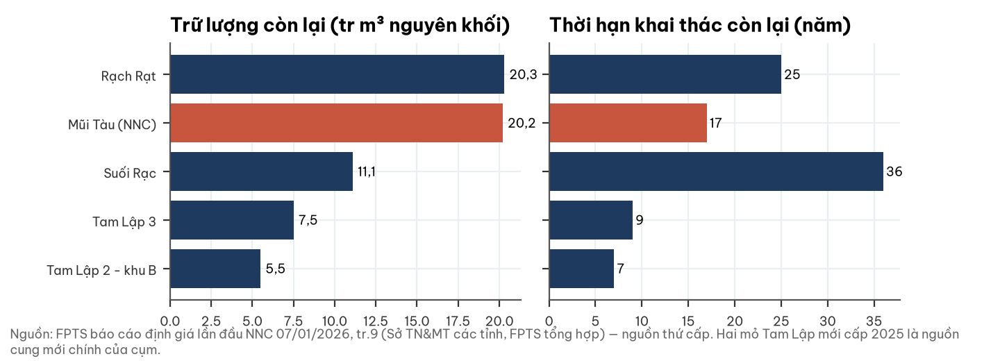

**Cầu.** Đá 1x2 là cốt liệu chính của bê tông xi măng và bê tông nhựa; đá 0x4 và đá hộc dùng cho móng đường, kè. Cầu phía Nam 2025–2026 đến từ các dự án trọng điểm: theo báo chí (03/2026), riêng dự án trọng điểm phía Nam cần ~15 triệu m³ đá năm 2026, Đồng Nai cấp gần 9 triệu m³. Làn sóng kế tiếp là Vành đai 4 TP.HCM (~207 km, khởi công các gói lớn 30/09 và 15/10/2026, mục tiêu xong cuối 2028) và các cao tốc hướng Tây Bắc, đồng bằng sông Cửu Long. Kênh nhà ở yếu dần: tiêu thụ căn hộ sơ cấp TP.HCM Q3/2026 giảm 66% so với quý trước.

**Cung.** Giấy phép, thuê đất, đấu giá quyền khai thác (Luật Địa chất và Khoáng sản 2024) và các đợt đình chỉ quyết định cung nhiều hơn trữ lượng. Đợt tăng giá 2025 có nguyên nhân gần nhất là đình chỉ mỏ và nghẽn thuê đất, không phải cạn tài nguyên. Trong cụm Đồng Phú – Phú Giáo, Mũi Tàu có trữ lượng còn lại lớn thứ hai (20,2 triệu m³) và thời hạn dài thứ ba (17 năm); hai mỏ Tam Lập mới có trữ lượng 5,5–7,5 triệu m³ và thời hạn 7–9 năm.

**Giá.** Giá đá 1x2 tại mỏ khoảng 140–150 nghìn đ/tấn trước 2020; đầu 2026 báo giá tại mỏ Đồng Nai cũ ~177 nghìn đ/tấn, Bình Phước cũ 230–240 nghìn đ/tấn, trong khi giá công bố tại TP.HCM 400–500 nghìn đ/m³. Chính sách bình ổn giá và giá công bố của Sở Xây dựng neo phân khúc dự án, đặt trần cho sức định giá.

**Pha chu kỳ.** Người đọc ngành độc lập xếp pha hiện tại là "đỉnh, chuyển sang bình nguyên", độ tin cậy ~60/40, và nêu rõ chiều ngược: Vành đai 4 cùng nhu cầu ĐBSCL có thể biến khoảng trũng 2027 thành đỉnh kéo dài tới 2028. Các chỉ báo theo dõi: giá công bố của Sở Xây dựng, tiến độ Vành đai 4, giấy phép các mỏ đấu giá mới (mục 10).

## 4. Doanh nghiệp: một mỏ đá 50 năm tuổi nghề của Bình Dương cũ

**Từ đội khai thác đá Châu Thới năm 1975 thành công ty niêm yết HOSE năm 2010; nay toàn bộ sản xuất dồn vào một mỏ — Mũi Tàu — và mỏ gốc Núi Nhỏ đã thành bãi kho cho thuê.**

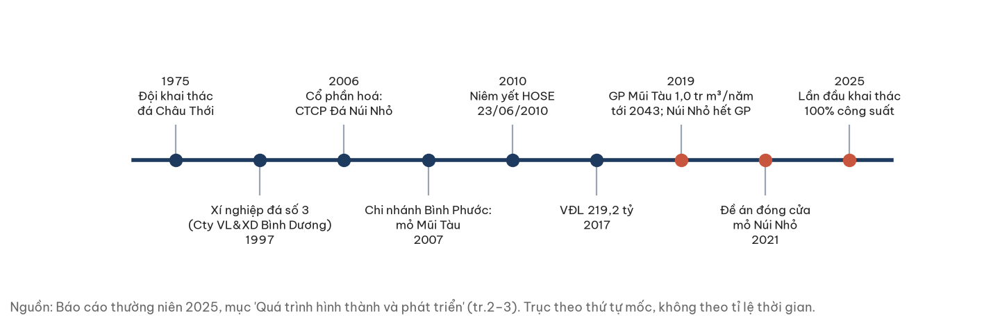

**Lịch sử.** NNC khởi đầu là Đội khai thác đá Châu Thới (1975), qua nhiều lần tổ chức lại thành Xí nghiệp đá số 3 thuộc Công ty Vật liệu và Xây dựng Bình Dương (1997), cổ phần hoá thành CTCP Đá Núi Nhỏ năm 2006 với vốn điều lệ 38 tỷ. Năm 2007 công ty mở chi nhánh Bình Phước để khai thác mỏ Mũi Tàu; cổ phiếu niêm yết HOSE ngày 23/06/2010. Vốn điều lệ tăng qua cổ phiếu thưởng và cổ tức bằng cổ phiếu lên 219,2 tỷ (2017). Năm 2019 mỏ Mũi Tàu được nâng trữ lượng lên 22,5 triệu m³, công suất 1,0 triệu m³/năm tới 2043; cùng năm mỏ Núi Nhỏ (Dĩ An) hết giấy phép và đóng cửa theo đề án phê duyệt năm 2021. 2025 là năm đầu tiên Mũi Tàu khai thác đủ 100% công suất cấp phép.

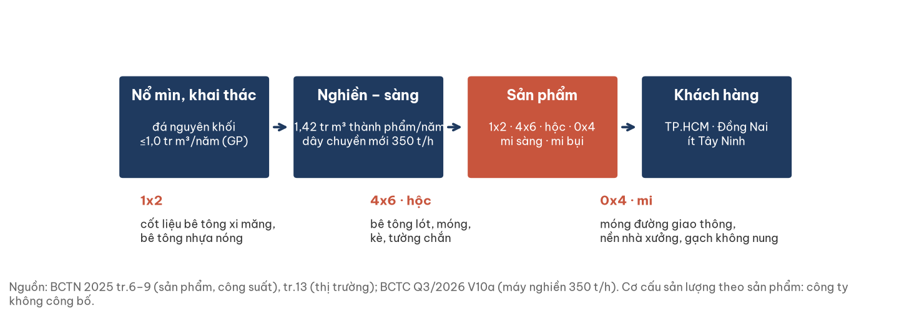

**Sản phẩm.** Công ty nổ mìn khai thác đá nguyên khối rồi nghiền – sàng thành các cỡ hạt: **đá 1x2** (hai loại vĩ sàng 25 và 27 mm, cốt liệu bê tông xi măng và bê tông nhựa nóng), **đá 4x6** (bê tông lót, móng đường), **đá hộc** (móng, tường chắn, kè chống sạt lở), **đá 0x4** các loại Dmax 25/37,5 (móng đường giao thông, nền nhà xưởng), **đá mi sàng, mi bụi** (cốt liệu, gạch không nung, san lấp thay cát). Công suất chế biến 1,421 triệu m³ thành phẩm/năm. Kế hoạch 2026: đầu tư dây chuyền nghiền 1.000 tấn/giờ thay máy cũ, chuyển dần thiết bị sang điện, thêm sản phẩm giá trị cao hơn (đá cấp phối Dmax 25, đá 1x1, cát nghiền). Tỷ trọng sản lượng theo sản phẩm: công ty không công bố.

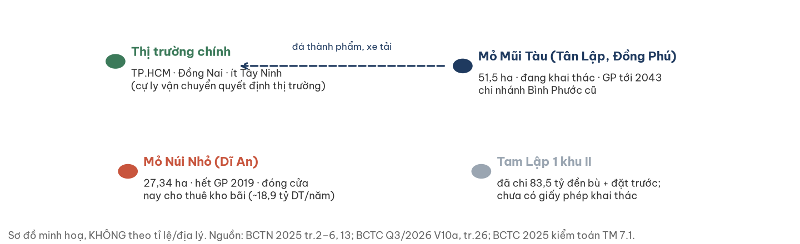

**Khách hàng và thị trường.** Theo báo cáo thường niên, thị trường chính của Mũi Tàu là TP.HCM, Đồng Nai và một lượng nhỏ Tây Ninh — cự ly vận chuyển quyết định khu vực bán. Công ty bán qua hai nhà phân phối (một là MVC) và trực tiếp cho khách hàng; 2025 "kéo được những khách hàng truyền thống lớn quay lại". Danh sách và tỷ trọng khách hàng lớn: không công bố. Bên liên quan NHC (Gạch ngói Nhị Hiệp) mua 18,4 tỷ đá năm 2025.

**Tài sản ngoài mỏ đang khai thác.** (i) Mỏ Núi Nhỏ đã đóng, 27,34 ha ở Dĩ An, cho thuê kho bãi (doanh thu dịch vụ 18,9 tỷ năm 2025, lợi nhuận gộp 11,1 tỷ); công ty phối hợp cổ đông Thái Bình xin quy hoạch đất sau đóng mỏ — chưa có quyết định. (ii) Dự án Tam Lập 1 khu II: đã chi 83,5 tỷ (đền bù đất 79,5 tỷ + đặt trước tiền cấp quyền 4,0 tỷ), vay Public Bank; trữ lượng, công suất và ngày cấp phép chưa được công bố. (iii) Cổ phần 10,3 triệu CP MVC (~10,3%) và 23,35% NHC.

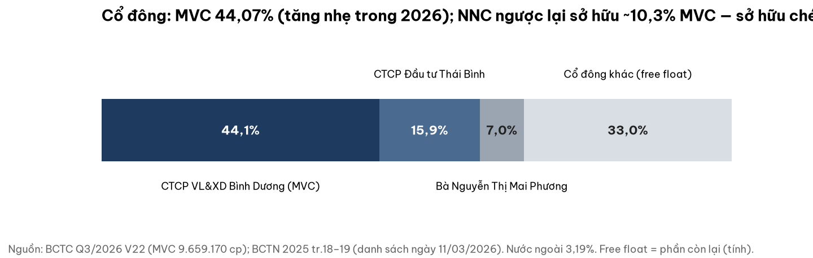

**Cổ đông và quản trị.** CTCP Vật liệu và Xây dựng Bình Dương (MVC — công ty mẹ cũ của xí nghiệp) nắm 44,07% (tăng 113.900 CP trong 2026), CTCP Đầu tư Thái Bình 15,93%, bà Nguyễn Thị Mai Phương 7,01%; nước ngoài 3,19%. HĐQT 5 thành viên (1 độc lập), Ban kiểm soát 3 thành viên; Giám đốc Phạm Thanh Liêm (từ 07/2022) không sở hữu cổ phần.

**Định hướng công bố.** Giai đoạn 2026–2030: khai thác hiệu quả nhất tài sản hiện có, giữ Mũi Tàu ở công suất cấp phép; nhận chuyển nhượng đất còn lại trong ranh mỏ; tìm thêm ít nhất một mỏ đá (TP.HCM, Đồng Nai, Lâm Đồng) qua chuyển nhượng, hợp tác hoặc đấu giá; nghiên cứu mở rộng sang bất động sản nhà ở và xây dựng dân dụng; tiếp tục đầu tư vào NHC. Dài hạn (2026–2050): trở thành một trong 20 doanh nghiệp vật liệu xây dựng mạnh của Đông Nam Bộ.

## 5. Phân tích tài chính (bottom-up)

### 5a. Tăng trưởng đến từ giá đá, không từ sản lượng hay khoản một lần

**Doanh thu đá thành phẩm 2025 tăng 40% trong khi giá vốn đá thành phẩm đi ngang; 2026 tiếp tục cùng cơ chế.**

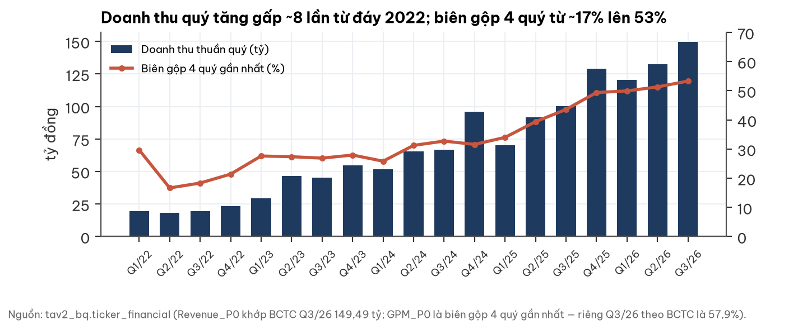

| Tỷ đồng | 2024 | 2025 | 9T/2025 | 9T/2026 | Q3/2025 | Q3/2026 |
|---|---|---|---|---|---|---|
| Doanh thu thuần | 280,07 | 390,95 | 261,89 | 402,20 | 100,27 | 149,49 |
| — đá thành phẩm | 257,44 | 360,39 | n/a | n/a | 91,41 | 139,97 |
| Giá vốn đá thành phẩm | 178,29 | 178,59 | n/a | n/a | 43,72 | 56,07 |
| Biên gộp toàn công ty | 31,6% | 49,4% | 49,0% | 54,3% | 50,5% | 57,9% |
| LNST | 62,6 | 147,83 | 93,95 | 160,08 | 42,56 | 69,29 |

Nguồn: BCTC 2025 kiểm toán TM 7.1–7.2; BCTC riêng Q3/2026 tr.4, VI.1–2.

- **Sản lượng đã chạm trần.** Giấy phép 1,0 triệu m³ nguyên khối ≈ 1,42 triệu m³ thành phẩm/năm. Với doanh thu đá Q3/2026 139,97 tỷ, nếu sản lượng quý đúng bằng một phần tư trần năm, giá bán bình quân ~394 nghìn đ/m³. Giá tham chiếu Bình Phước cũ 1x2 230–240 nghìn đ/tấn ≈ 334–360 nghìn đ/m³ (quy đổi ước lượng 1,45–1,5 tấn/m³), cộng cơ cấu có cả đá 0x4/hộc rẻ hơn ⇒ giá bình quân thực có thể dưới 394 nghìn, tức sản lượng quý có thể vượt nhịp trần. **Chưa xác minh** — công ty không công bố m³; vượt nhịp một quý chưa chắc vượt trần năm.
- **Khoản một lần (âm).** 9T/2026 chi phí khác 22,0 tỷ, chủ yếu truy thu tiền cấp quyền khai thác mỏ Núi Nhỏ 15,58 tỷ và tiền thuê đất bổ sung năm 2019 5,95 tỷ. Loại trừ, LNST 9T ≈ 177 tỷ (ước lượng, thuế 20%).
- **Bên liên quan trong tăng trưởng Q3.** Doanh thu bán cho NHC Q3/2026 là 12,27 tỷ (Q3/2025: 4,39 tỷ) — phần tăng 7,88 tỷ chiếm ~16% mức tăng doanh thu Q3 so với cùng kỳ (49,22 tỷ); NHC mới trả 2,0 tỷ trong quý.
- **Lãi tiền gửi** 15,6 tỷ/9T; cổ tức từ MVC 4,6 tỷ (2025).

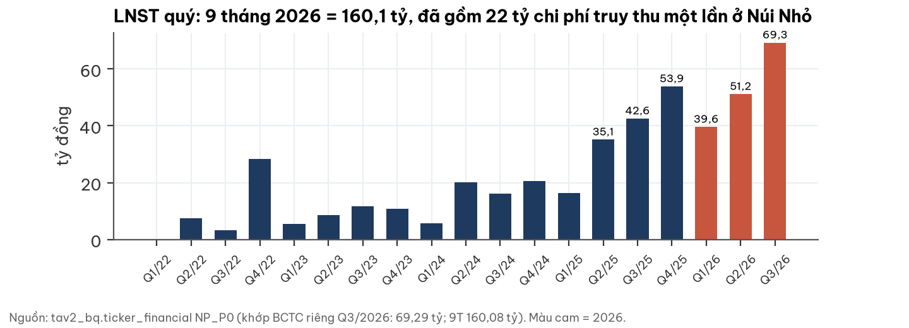

### 5b. Phải thu: thấp, nhưng tập trung ở bên liên quan

Phải thu khách hàng 21,29 tỷ (đầu năm 6,79; số ngày thu tiền ~13 ngày, ước lượng) — không có dấu hiệu nợ đọng của nhà thầu dự án công. Nhưng **12,92 tỷ (61%) là của NHC**, công ty liên kết có doanh thu ~29–30 tỷ/quý; cùng kỳ NNC mua máy nghiền 350 t/h trị giá 21,29 tỷ từ "Công ty NHC". Dòng tiền hai chiều với bên liên quan nhỏ là điểm cần theo dõi, chưa phải bằng chứng sai phạm.

### 5c. Dòng tiền: hai năm cộng lại gần bằng lợi nhuận

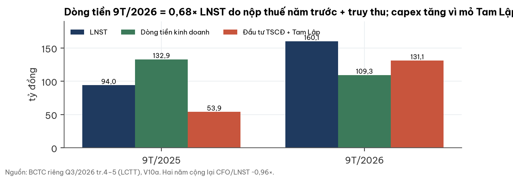

CFO 9T/2026 109,3 tỷ = 0,68× LNST, bị kéo bởi thuế TNDN nộp 45,9 tỷ (gồm thuế năm 2025), tiền cấp quyền Núi Nhỏ 20,4 tỷ, phải thu và tồn kho tăng; 9T/2025 là 1,41×. Cộng hai kỳ ~0,96× — không phải cờ đỏ. Capex 9T 131,1 tỷ (máy nghiền 24,5 tỷ, Tam Lập 1 khu II 83,5 tỷ, TSCĐ khác), dòng tiền tự do 9T ≈ −21,8 tỷ, tài trợ bằng vay dài hạn +47,7 tỷ và rút tiền gửi.

### 5d. Bảng cân đối: tiền ròng dày sau khi trừ đủ nghĩa vụ

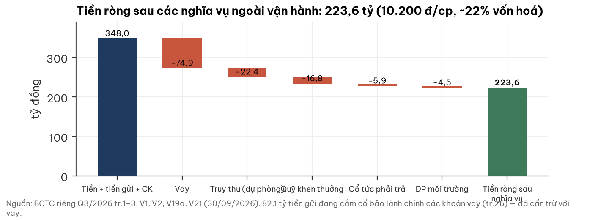

Tiền + tiền gửi có kỳ hạn 347,9 tỷ, vay 74,9 tỷ ⇒ tiền ròng thô 273,2 tỷ (12.460 đ/cp). Trừ dự phòng truy thu 22,4, quỹ khen thưởng phúc lợi 16,8, cổ tức phải trả 5,9, dự phòng phục hồi môi trường 4,5 ⇒ **223,6 tỷ (10.200 đ/cp, ~22% vốn hoá)**. 82,1 tỷ tiền gửi đang cầm cố bảo lãnh chính các khoản vay (Vietinbank, Public Bank) — đã cấn trừ với vay. Vốn chủ sở hữu 655,7 tỷ (BVPS 29.915 đ; P/B 1,57×).

### 5e. Chi phí: mô hình hiệu chỉnh trên số kiểm toán, sai số ±10%

Mô hình chi phí (biến đổi ~107 nghìn đ/m³ + cố định ~68 tỷ/năm theo giá 2026, cộng chi phí bán hàng – quản lý 20 tỷ) được hiệu chỉnh trên giá vốn đá thành phẩm kiểm toán 2024–2025 (hệ số 1,02 và 0,91 so với mô hình gốc; tâm 0,97). Hiệu chỉnh theo riêng Q3/2026 — quý giá dầu diesel tăng ~109% so với cùng kỳ — cho hệ số 1,00, nằm trong dải ±10% (0,87–1,07). Sản lượng 2024–25 dùng để hiệu chỉnh lấy từ nguồn thứ cấp (một công ty chứng khoán), vì công ty không công bố m³.

## 6. Cổ tức, lợi nhuận giữ lại và sở hữu chéo

**Không có sự kiện vốn đang mở; điểm cần biết là phần lớn lợi nhuận được giữ lại, và NNC với cổ đông lớn sở hữu chéo nhau.**

- **Cổ tức.** 2026 công ty chi 21,92 tỷ (1.000 đ/cp) cho năm 2025, ~15% LNST 2025; tỷ suất 2,1% ở 47.100. Báo cáo thường niên ghi "tỷ lệ lợi nhuận trả cổ tức 61,37%" — không khớp với số tiền đã chi; chưa xác minh được (có thể là kế hoạch).
- **Lợi nhuận giữ lại.** Phân phối lợi nhuận 2025 đưa ~264 tỷ vào quỹ đầu tư phát triển. Tới 30/09/2026 quỹ này lên 353,26 tỷ (đầu năm 87,27), và "lợi nhuận chưa phân phối kỳ này" chỉ còn 80,04 tỷ trên LNST 9T 160,08 tỷ — tức ~80 tỷ lợi nhuận 2026 đã được chuyển đi trong năm. Báo cáo này không tìm thấy nghị quyết công bố giải thích bước chuyển đó. Định hướng sử dụng vốn được công bố: mỏ mới, đất trong ranh mỏ, bất động sản nhà ở, đầu tư NHC.
- **Sở hữu chéo.** MVC sở hữu 44,07% NNC; NNC sở hữu ~10,3% MVC (10,3 triệu CP, giá gốc 103 tỷ, thị giá 145,2 tỷ). Vì cổ phần NNC chiếm ~32% vốn hoá MVC, phần giá trị MVC "không phải chính NNC" là ~98,4 tỷ (4.490 đ/cp) — cộng thẳng 145,2 tỷ sẽ đếm NNC hai lần. MVC thanh khoản mỏng (~0,4–0,6 tỷ đ/phiên) nên báo cáo trình bày cả hai mức: không chiết khấu và chiết khấu thanh khoản 30% (−1.300 đ/cp).

## 7. Định giá: vùng hợp lý ~59–79 nghìn đ/cp; giá hiện tại nằm dưới vùng

**Định giá bằng dòng tiền HỮU HẠN 2027–2043 (hết giấy phép Mũi Tàu, không giá trị cuối kỳ), cộng tiền ròng sau nghĩa vụ và khoản đầu tư; giả định quan trọng nhất là đường giá đá danh nghĩa.**

**Chi phí vốn.** Lãi suất chiết khấu danh nghĩa 13% (dải 11–15%). Vì dòng tiền có thời hạn ~17 năm và kết thúc khi mỏ đóng, báo cáo không dùng chi phí vốn của mô hình tăng trưởng vô hạn; 13% lấy theo chi phí vốn chủ sở hữu nội địa cho beta ~1,1 (khoảng 12,3–13,4%) cộng nhẹ cho rủi ro tập trung một tài sản. Độ nhạy: 11% / 15% đổi giá trị kỳ vọng +3,6 / −3,1 nghìn đ/cp (giá danh nghĩa phẳng) và +7,4 / −6,1 nghìn (giá giữ giá trị thực).

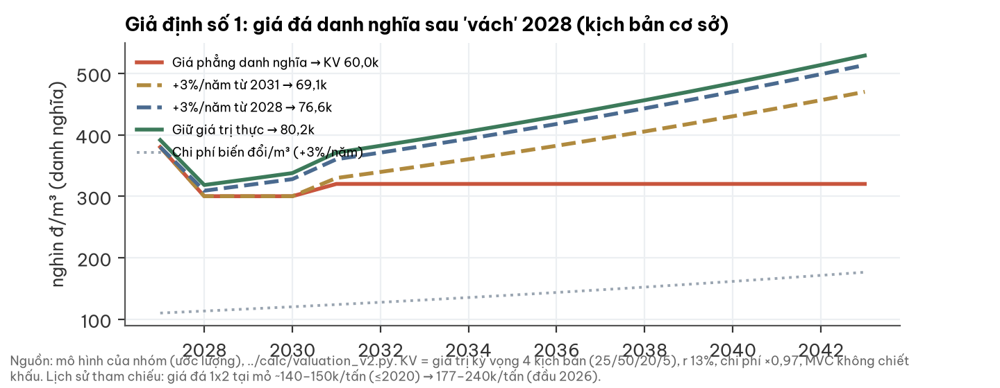

**Giả định số 1 — giá đá danh nghĩa.** Chi phí trong mô hình tăng 3%/năm. Nếu giá bán danh nghĩa đi ngang tới 2043, giá thực giảm ~3%/năm và đến 2043 chỉ còn ~60% giá trị thực hôm nay — một giả định bất lợi nằm chồng lên kịch bản vách 2028. Nếu giá đá theo kịp lạm phát, biên lợi nhuận thực được giữ. Lịch sử (giá tại mỏ ~140–150 nghìn đ/tấn trước 2020 lên ~177–240 nghìn đ/tấn đầu 2026) nghiêng về phía giá danh nghĩa không đi ngang, nhưng mốc cũ không rõ năm và khác vùng. Cả hai đầu hợp lý ⇒ cả hai vào dải; tâm là điểm giữa.

| Đường giá đá danh nghĩa (kịch bản 25/50/20/5) | Giá trị kỳ vọng | So với 47.100 |
|---|---|---|
| Đi ngang tới 2043 | 60.000 đ | +27% |
| +3%/năm từ 2031 | 69.100 đ | +47% |
| +3%/năm từ 2028 | 76.600 đ | +63% |
| Giữ giá trị thực (+3%/năm từ 2027) | 80.200 đ | +70% |

Bảng trên: chi phí ×0,97, MVC không chiết khấu, r 13%.

**Bốn kịch bản trong mô hình** (sản lượng triệu m³ / giá nghìn đ/m³, theo giá 2026): **tốt** 1,4 / 400–420 suốt đời mỏ (xác suất 25%); **cơ sở** 2027 1,4 × 380, 2028–30 1,1 × 300, 2031+ 1,2 × 320 (50%); **xấu** 2027 1,3 × 330, từ 2028 0,8 × 250 — đường gần với dự phóng cơ sở của một công ty chứng khoán (20%); **rất xấu** 0,8 × 210–230 ngay từ 2027 (5%). Xác suất là nhận định của nhóm: người đọc ngành độc lập gán 15% cho việc giá đá công bố Q2/2027 giảm hơn 7%, 55% đi ngang ±7%, 30% tăng hơn 7%; xác suất tiêu cực 25% ở đây cao hơn 15% vì cộng thêm rủi ro vách 2028.

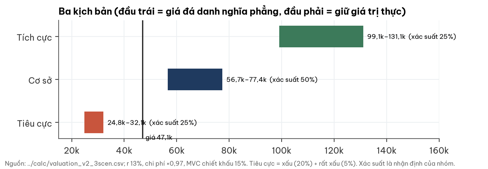

| Kịch bản | Xác suất | Giá trị (giá đá phẳng … giữ giá trị thực) | Điều phải đúng |
|---|---|---|---|
| Tích cực | 25% | 99.100 – 131.100 đ | Giá đá giữ ~400–420 nghìn đ/m³ và sản lượng 1,4 triệu m³ tới 2043 (giá "tốt" thấp hơn 5% làm giảm ~7.000–8.700 đ) |
| Cơ sở | 50% | 56.700 – 77.400 đ | Cầu trũng 2027–28, giá đá giảm ~20% rồi bình nguyên; sản lượng 1,1–1,2 triệu m³ |
| Tiêu cực | 25% | 24.800 – 32.100 đ | Hai mỏ Tam Lập đủ công suất, NNC còn 0,8 triệu m³ × ~250 nghìn đ/m³ tới hết đời mỏ (hoặc tệ hơn) |
| **Kỳ vọng** | | **59.300 – 79.500 đ** | Điểm giữa ~69.400 đ |

Bảng: r 13%, chi phí ×0,97, MVC chiết khấu 15% (giữa 0% và 30%); tiêu cực = xấu và rất xấu theo tỉ lệ 20 : 5.

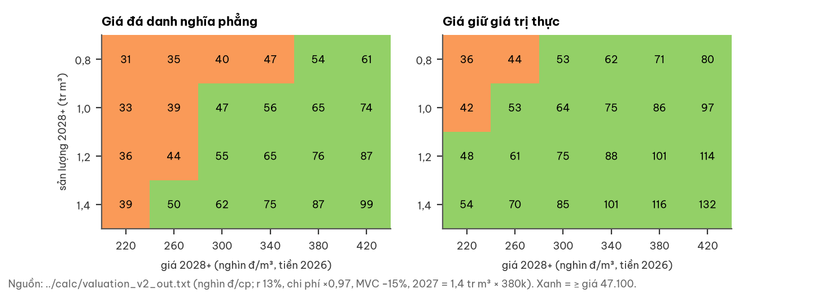

**Độ nhạy khác (giá trị kỳ vọng, đ/cp).** Chi phí ±10%: 54.600–65.600 (giá phẳng) / 74.200–86.300 (giá thực). MVC chiết khấu 0% / 30%: chênh ~1.350. Nếu kịch bản xấu có hồi phục từ 2035 (khi hai mỏ Tam Lập hết giấy phép): +1.300 (phẳng) / +3.000 (thực). Lưới 72 tổ hợp (4 đường giá × 3 mức chi phí × 2 mức MVC × 3 mức lãi suất): thấp nhất 50.700, P10 57.600, trung vị 70.300, P90 84.800, cao nhất 94.400.

**Không tính vào giá trị** (cả hai chiều): (+) mỏ Tam Lập 1 khu II nếu được cấp phép (ước lượng thô 0 đến +10.000 đ/cp; có thể ăn mòn chính Mũi Tàu vì cùng cụm); (+) giá trị đất Núi Nhỏ sau cải tạo (chưa có quy hoạch); (+) lợi nhuận cho thuê sau 2043; (−) truy thu/phạt nếu sản lượng vượt trần; (−) MVC lên ≥51% buộc NNC thoái cổ phần MVC ở giá xấu; (−) chi phí đóng cửa mỏ 2043 vượt dự phòng; (−) lợi nhuận giữ lại được đầu tư với suất sinh lời thấp.

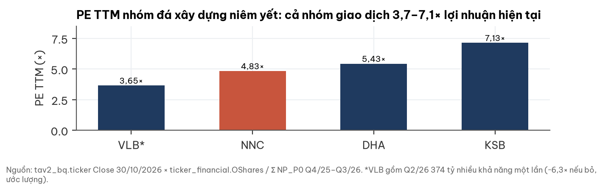

| Mã (BQ 30/10/2026) | Vốn hoá (tỷ) | LNST 4 quý (tỷ) | P/E TTM | Ghi chú |
|---|---|---|---|---|
| **NNC** | 1.032 | 214,0 | **4,83×** | Tiền ròng sau nghĩa vụ ~22% vốn hoá |
| DHA | 824 | 151,7 | 5,43× | Q3/2026 79,6 tỷ — đột biến, chưa phân tích |
| KSB | 1.459 | 204,6 | 7,13× | Q2/2026 96,8 tỷ cao bất thường |
| VLB | 2.434 | 666,7 | 3,65× | Gồm Q2/2026 374,4 tỷ nhiều khả năng một lần; ~6,3× nếu bỏ (ước lượng) |

Cả nhóm đá niêm yết giao dịch 3,7–7,1× lợi nhuận hiện tại — thị trường định giá cả ngành như lợi nhuận đỉnh. NNC rẻ nhẹ so với nhóm, không lệch ngoại lai.

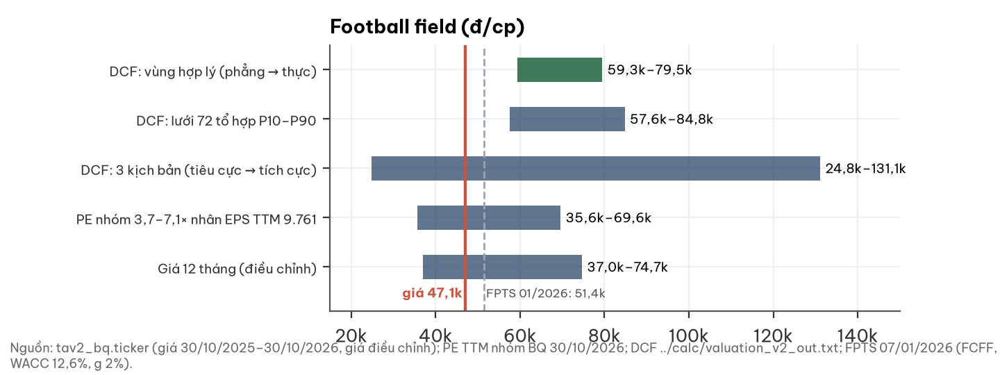

**Đối chiếu nguồn thứ cấp.** Một công ty chứng khoán (07/01/2026, giá khi đó 65.200) đặt giá mục tiêu 51.400 đ bằng dòng tiền tự do vô hạn (WACC 12,6%, tăng trưởng dài hạn 2%). Trên cùng đường giá/sản lượng cơ sở của họ (0,8 triệu m³ từ 2028, giá ~210–238 nghìn đ/m³), mô hình hữu hạn ở đây cho ~24.900 đ — lệch khoảng hai lần, vì họ dùng đỉnh 2026–27 cao hơn (455–480 nghìn đ/m³), giữ biên gộp 30,6% ở đáy, và có giá trị cuối kỳ vượt hạn giấy phép 2043. Do đó con số 51.400 **không** phải xác nhận độc lập cho định giá ở đây.

**Kết luận theo các mức giá.** Ở 45.000–52.000 đ, kết luận không đổi (xác suất tiêu cực hàm ý 41–80%). Giá vào vùng hợp lý từ ~57.000–59.000 đ; trên ~80.000 đ, giá cần cả giá đá giữ giá trị thực lẫn kịch bản tích cực kéo dài.

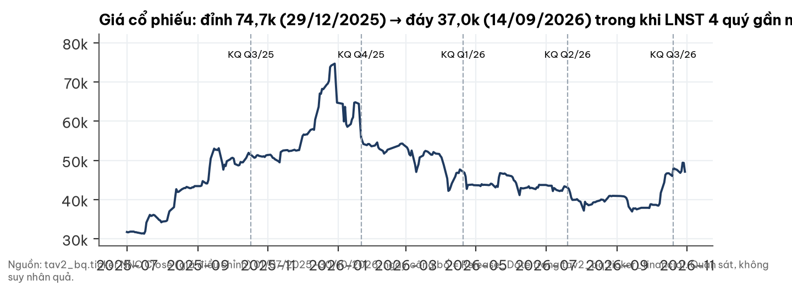

**Quan sát giá quanh công bố kết quả** (không suy nhân quả): 4 lần công bố gần nhất đều có LNST tăng mạnh so với cùng kỳ, nhưng giá 5 phiên sau lần lượt −9,6% / −8,3% / −8,0% / +1,7% (Q3/2026, công bố 20/10).

## 8. Rủi ro (pre-mortem): "Nếu 18 tháng nữa giá trị NNC thấp hơn mức thị trường đang trả, vì sao?"

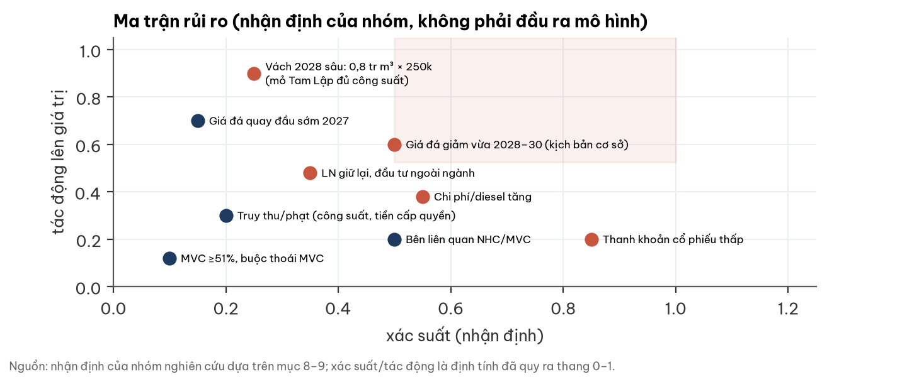

| Rủi ro | Xác suất (nhận định) | Tác động | Dấu hiệu sớm | Kiểm khi nào |
|---|---|---|---|---|
| Vách 2028 sâu: hai mỏ Tam Lập đủ công suất, giá về ~250 nghìn đ/m³ | 20–25% | Rất lớn (giá trị ~25–32 nghìn) | Giá công bố Sở XD giảm; biên gộp quý <45% | Mỗi quý; Q2/2027 |
| Giá đá quay đầu sớm 2027 (khoảng trũng cầu) | ~15% | Lớn | Vành đai 4 trượt tiến độ; doanh thu quý <120 tỷ | BCTC Q4/26, Q1/27 |
| Chi phí tăng (diesel, thuê ngoài, vật liệu nổ) | Trung bình | Trung bình (±5–6 nghìn đ/cp với ±10%) | Biên gộp giảm khi doanh thu đi ngang | Mỗi quý |
| Truy thu/phạt (tiền cấp quyền, công suất) | Thấp–trung bình | Trung bình | Dự phòng mới trong thuyết minh; quyết định của cơ quan quản lý | Mỗi quý |
| Bên liên quan NHC/MVC | Trung bình | Thấp–trung bình | Phải thu NHC tăng; giao dịch tài sản với bên liên quan | Mỗi quý |
| Lợi nhuận giữ lại đầu tư ngoài ngành (bất động sản) | Trung bình | Trung bình | Nghị quyết đầu tư, mua đất ngoài ranh mỏ | ĐHĐCĐ 2027 |
| Thanh khoản cổ phiếu thấp | Cao | Thấp (với giá trị), cao (với khả năng giao dịch) | ADV ~1,4 tỷ đ/phiên | Liên tục |

## 9. Pháp lý và quản trị — CẢNH BÁO (không phải lý do chặn phân tích)

Phạm vi: đọc BCTC, BCTN và tìm kiếm công khai; không phải tra cứu pháp lý chính thức.

1. **Phạt vi phạm hành chính nhỏ 2024–2025.** Thuyết minh BCTC 2025 kiểm toán (mục 7.8) ghi "tiền phạt vi phạm hành chính" 630,43 triệu đồng (2024) và 39,37 triệu đồng (2025), cùng dự phòng tiền cấp quyền khai thác 1,735 tỷ (2025) và chi phí cải tạo mỏ 0,445 tỷ (2024). Nội dung vi phạm chưa được công bố — chưa xác minh.
2. **Truy thu lan từ mỏ đã đóng sang mỏ đang khai thác.** Ngoài truy thu ở Núi Nhỏ (15,58 tỷ tiền cấp quyền + 5,95 tỷ tiền thuê đất 2019, đã dự phòng; 20,43 tỷ đã nộp trong 2026), Q3/2026 có dự phòng 0,84 tỷ tiền cấp quyền cho chính Mũi Tàu.
3. **Sở hữu chéo NNC – MVC.** MVC 44,07% và đang tăng. Nếu MVC vượt 51%, NNC thành công ty con và có thể phải thoái cổ phần MVC theo quy định về sở hữu chéo (cần ý kiến pháp lý).
4. **Giao dịch bên liên quan NHC.** 61% phải thu là NHC; NNC đồng thời mua thiết bị 21,3 tỷ từ NHC.
5. **Công suất.** Chưa loại trừ khả năng sản lượng quý vượt nhịp trần giấy phép (mục 5a).
6. **Phân phối lợi nhuận.** Chi cổ tức ~15% LNST 2025; phần lớn lợi nhuận vào quỹ đầu tư phát triển; ban điều hành không sở hữu cổ phần; ngành nghề đăng ký và định hướng có bất động sản.

Kiểm toán 2025 (AASCs): ý kiến chấp nhận toàn phần, không có đoạn nhấn mạnh. BCTC quý không được soát xét. Không tìm thấy công bố thông tin mới từ 26/10/2026 tới ngày lập báo cáo.

## 10. Lịch xúc tác: các mốc có thể làm đổi nhận định, theo cả hai chiều

| Mốc | Thời điểm | Tích cực hơn nếu | Tiêu cực hơn nếu |
|---|---|---|---|
| BCTC Q4/2026 | ~20/01/2027 | DT ≥130 tỷ/quý, biên gộp ≥55% | Biên gộp <45% khi DT đi ngang |
| BCTC Q1/2027 | ~20/04/2027 | Như trên, dù Long Thành/VĐ3 đã giảm cầu | Doanh thu giảm >15% so với cùng kỳ |
| Tiến độ Vành đai 4 | tới 30/06/2027 | ≥20% khối lượng xây lắp | <20% (khoảng trũng sâu hơn) |
| Giấy phép mỏ đấu giá 2025–26 trong cụm | tới 30/06/2027 | Chưa cấp (cung mới chậm) | Cấp sớm, công suất lớn |
| Giá đá 1x2 công bố Sở XD Đồng Nai | Q2/2027 (kiểm 31/08/2027) | Cao hơn Q3/2026 >7% | Thấp hơn Q3/2026 >7% |
| Giấy phép Tam Lập 1 khu II | chưa có ngày | Được cấp, công suất ≥0,7 triệu m³/năm | Huỷ/ trả lại, mất khoản 83,5 tỷ |
| ĐHĐCĐ 2027 | ~Q2/2027 | Cổ tức tiền cao hơn, kế hoạch vốn rõ | Đầu tư bất động sản lớn |
| MVC / NHC | không định trước | Giảm giao dịch liên quan | MVC ≥51%; thêm giao dịch tiền lớn |

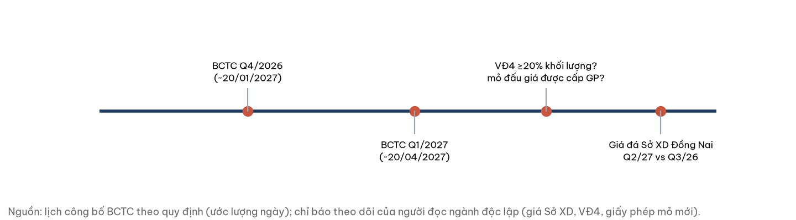

## Phụ lục A. Số liệu tài chính (BCTC riêng Q3/2026 và BCTC 2025 kiểm toán)

| Chỉ tiêu (tỷ đồng) | Q3/2026 | Q3/2025 | 9T/2026 | 9T/2025 | Nguồn |
|---|---|---|---|---|---|
| Doanh thu thuần | 149,49 | 100,27 | 402,20 | 261,89 | Q3 tr.4 |
| Đá thành phẩm | 139,97 | 91,41 | | | VI.1 |
| Hàng hoá (dầu DO…) | 3,35 | 3,89 | | | VI.1 |
| Dịch vụ (cho thuê Núi Nhỏ…) | 6,17 | 4,97 | | | VI.1 |
| Giá vốn hàng bán | 62,95 | 49,61 | 183,68 | 133,54 | tr.4 |
| Lợi nhuận gộp | 86,54 | 50,67 | 218,52 | 128,34 | tr.4 |
| Doanh thu tài chính | 6,07 | 7,60 | 15,60 | 13,48 | VI.3 |
| Chi phí bán hàng + quản lý | 5,14 | 4,00 | 12,87 | 14,02 | tr.4 |
| Lợi nhuận khác | −0,00 | −1,88 | −19,29 | −4,18 | VI.8 |
| LNST | 69,29 | 42,56 | 160,08 | 93,95 | tr.4 |
| CFO | | | 109,3 | 132,9 | tr.5 |

| Bảng cân đối 30/09/2026 (tỷ đồng) | Giá trị | Nguồn |
|---|---|---|
| Tiền và tương đương | 25,47 | V1 |
| Tiền gửi có kỳ hạn (6T 278,97 + 12T 43,47) | 322,44 | V2 |
| Vay ngắn hạn + dài hạn | 5,00 + 69,89 | tr.3 |
| Dự phòng phải trả ngắn hạn (truy thu) | 22,37 | V19a |
| Quỹ khen thưởng phúc lợi | 16,78 | tr.3 |
| Cổ tức phải trả | 5,89 | tr.3 |
| Dự phòng phải trả dài hạn (môi trường) | 4,50 | V21 |
| Đầu tư MVC (giá gốc) · NHC (giá gốc, dự phòng 5,35) | 103,0 · 21,67 | V11 |
| Chi phí XDCB dở dang (Tam Lập 1 khu II) | 83,51 | V10a |
| Quỹ đầu tư phát triển | 353,26 (đầu năm 87,27) | tr.3 |
| LNST chưa phân phối kỳ này | 80,04 | tr.3 |
| Vốn chủ sở hữu | 655,73 | tr.3 |

| Năm (tỷ đồng) | 2024 | 2025 | Nguồn |
|---|---|---|---|
| Doanh thu thuần | 280,07 | 390,95 | KT25 7.1 |
| DT dịch vụ · GV dịch vụ | 11,75 · 2,51 | 18,92 · 7,79 | KT25 7.1–7.2 |
| Bán cho NHC · MVC | 12,45 · 12,46 | 18,41 · 1,57 | KT25 7.1 |
| Tiền phạt vi phạm hành chính | 0,630 | 0,039 | KT25 7.8 |
| LNST | 62,6 | 147,83 | KT25 / BQ |

## Phụ lục B. Đối chiếu cơ sở dữ liệu (BQ) với BCTC

| Chỉ tiêu | BQ | BCTC | Kết luận |
|---|---|---|---|
| Doanh thu Q3/2026 | 149,49 tỷ (Revenue_P0) | 149,49 tỷ | Khớp |
| LNST Q3/2026 | 69,29 tỷ (NP_P0) | 69,29 tỷ | Khớp |
| CFO Q1+Q2+Q3/2026 | −3,24 + 49,66 + 63,13 = 109,55 | 109,3 (9T) | Lệch 0,25 tỷ (làm tròn/ phân loại), chấp nhận |
| Biên gộp Q3/2026 | 53,3% (GPM_P0) | 57,9% (quý) | GPM_P0 là biên 4 quý gần nhất: (218,52 + 64,67)/531,3 = 53,3% — không phải biên quý |
| Số cổ phiếu | 21,92 triệu (OShares) | VĐL 219,2 tỷ / 10.000 | Khớp |
| P/E 30/10/2026 | 4,83 (PE) | 1.032,4 / 214,0 = 4,83 | Khớp |
| Giá đóng cửa 30/10/2026 | 47.100 (Close = Price) | — | Phiên gần nhất trước ngày lập báo cáo |

## Phụ lục C. Danh mục nguồn

- BCTC riêng Q3/2026 CTCP Đá Núi Nhỏ, ký 19/10/2026 (33 trang), gồm CV 53/CV-NN26 giải trình biến động LNST.
- BCTC năm 2025 đã kiểm toán, AASCs, BC 48/BCKT/TC/2026 ngày 26/02/2026.
- Báo cáo thường niên 2025 (lịch sử, sản phẩm, thị trường, cổ đông, định hướng, kế hoạch 2026).
- Báo cáo định giá lần đầu NNC của một công ty chứng khoán (FPTS), 07/01/2026 — nguồn thứ cấp (tr.1, 9, 17).
- Bản đọc ngành đá xây dựng Nam Bộ của người đọc ngành độc lập, 30/10/2026 (đọc mù với định giá), dẫn các nguồn báo chí: Kinh tế Sài Gòn/TTXVN 25/03/2026, Báo Đấu thầu 29/10/2025 và 04/03/2026, Tuổi Trẻ, VnEconomy, Bộ Công Thương (giá xăng dầu).
- Cơ sở dữ liệu giá và tài chính nội bộ (bảng ticker, ticker_financial), truy vấn 30–31/10/2026.
- Logo: website công ty http://nuinho.vn (ảnh upload/hinhanh/logo-3594.png, tải 31/10/2026) — chỉ để nhận diện, không ngụ ý công ty tài trợ hay xác nhận báo cáo.

## Phụ lục D. Phương pháp và giới hạn

**Phương pháp.** Giá trị = giá trị hiện tại dòng NOPAT 2027–2043 (capex duy trì ≈ khấu hao, thuế 20%, chiết khấu giữa năm từ 30/10/2026) + LNST Q4/2026 ước 60 tỷ + tiền ròng sau nghĩa vụ 223,6 tỷ + MVC phần không vòng tròn (98,4 tỷ, chiết khấu 0–30%) + NHC thị giá 13,2 tỷ + chi phí Tam Lập theo giá gốc 83,5 tỷ (chỉ ở kịch bản tốt và cơ sở). Doanh thu = sản lượng × giá; chi phí = biến đổi × sản lượng + cố định, tăng 3%/năm; cộng lợi nhuận gộp cho thuê Núi Nhỏ 11,1 tỷ/năm (+3%/năm) tới 2043. Không giá trị cuối kỳ. Toàn bộ mã tính toán tái lập được.

**Giới hạn.**
- Công ty **không công bố sản lượng m³** ⇒ tách giá × sản lượng là suy luận; sản lượng 2024–25 dùng hiệu chỉnh chi phí lấy từ nguồn thứ cấp.
- Kịch bản giá/sản lượng 2028+ và xác suất là nhận định của nhóm; khác biệt giữa "giá phẳng" và "giá thực" lớn hơn mọi sai số khác.
- Trữ lượng còn lại 20,2 triệu m³ và dữ liệu các mỏ cạnh tranh từ nguồn thứ cấp (dẫn Sở TN&MT).
- Số cổ phiếu MVC lưu hành (100 triệu) lấy từ cơ sở dữ liệu, chưa đối chiếu điều lệ MVC; giá NHC là phiên cuối 16/09/2026 (rất kém thanh khoản).
- Không có: cơ cấu sản lượng theo sản phẩm, danh sách khách hàng lớn, giá bán theo hợp đồng, nội dung các quyết định xử phạt, nghị quyết chuyển lợi nhuận 2026 vào quỹ, tỷ lệ sở hữu nước ngoài tối đa.
- Không có cập nhật giá trong phiên: báo cáo lập thứ Bảy 31/10/2026, giá neo vào đóng cửa 30/10.

## Phụ lục E. Quy trình độc lập

Báo cáo đi qua bốn bước tách vai: (1) người đọc ngành độc lập viết bản đọc ngành **mù** với định giá; (2) nhóm nghiên cứu đọc lại BCTC gốc từ ảnh trang và dựng mô hình; (3) một người phản biện độc lập chạy lại mô hình, đổi từng giả định và đối chiếu mọi con số với nguồn (kết luận: số BCTC khớp, nhưng nhận định chưa được gửi nguyên văn); (4) nhóm nghiên cứu kiểm lại từng đính chính tại nguồn trước khi sửa. Mọi đính chính dưới đây đã được xác nhận tại trang nguồn; không có đính chính nào bị bác.

| Người phản biện đã bắt | Sửa thế nào |
|---|---|
| Bản trước ghi "không thấy xử phạt" — sai: thuyết minh 7.8 BCTC 2025 có tiền phạt vi phạm hành chính 2024–25 | Đưa vào mục 9 với số tiền; nội dung ghi "chưa xác minh" |
| Gán nhầm đường giá "2027 cao rồi vách 2028" cho người đọc ngành độc lập (bản đọc ngành đặt trũng ở 2027, hồi 2028, chỉ 15% xác suất giá Q2/2027 giảm >7%) | Ghi đúng nguồn; chỉnh xác suất 20/45/25/10 → 25/50/20/5 |
| Coi giá mục tiêu của một công ty chứng khoán là xác nhận độc lập, trong khi cùng đường giá/sản lượng hai mô hình lệch ~2 lần | Bỏ câu "gần với kỳ vọng"; nêu rõ lệch và lý do |
| Giả định ẩn: giá đá danh nghĩa đi ngang 17 năm với chi phí +3%/năm (giá thực −3%/năm) | Công bố là giả định số 1, trình bày 4 đường giá và đưa cả hai đầu vào vùng hợp lý |
| Bỏ sót lợi nhuận gộp cho thuê Núi Nhỏ (~11,1 tỷ/năm) trong khi đã trừ đủ chi phí quản lý toàn công ty | Cộng vào (+~2.700 đ/cp) |
| Phép kiểm chi phí so giá vốn toàn công ty với mô hình chỉ mảng đá | Hiệu chỉnh lại trên giá vốn đá thành phẩm kiểm toán 2024–25, dải ±10% |
| Cổ phần MVC định giá theo thị giá dù thanh khoản mỏng; giá "tốt" chưa có bằng chứng giá bán | Trình bày cả hai mức MVC; nêu độ nhạy giá "tốt" |
| Thiếu phân tích đóng góp bên liên quan NHC vào tăng trưởng Q3, thiếu bảng so sánh ngang ngành, chưa giải thích dòng lợi nhuận giữ lại | Bổ sung mục 5a, 5b, 6, 7 |

**Ảnh hưởng:** giá trị kỳ vọng từ ~50.300 đ (bản trước, một điểm, ngầm giá thực giảm) lên vùng 59.300–79.500 đ; kết luận từ "xấp xỉ hợp lý" sang "dưới vùng hợp lý, nghiêng rẻ". Các ngưỡng vùng giá cũ (≤42.000 rẻ / ≥58.000 đắt) bị bỏ vì quá mạnh so với độ bất định của giả định giá.

## Phụ lục F. Tuyên bố miễn trừ trách nhiệm

Báo cáo này chỉ nhằm mục đích cung cấp thông tin nghiên cứu, không phải lời mời hay khuyến nghị mua, bán hoặc nắm giữ bất kỳ chứng khoán nào, và không phải tư vấn đầu tư cá nhân hoá. Thông tin được lấy từ các nguồn được cho là đáng tin cậy (BCTC, báo cáo thường niên, công bố thông tin của doanh nghiệp, báo chí và cơ sở dữ liệu giá) nhưng không được bảo đảm là chính xác hoặc đầy đủ. Các ước lượng, kịch bản và xác suất là nhận định tại ngày lập báo cáo và có thể thay đổi mà không cần thông báo. Kết quả quá khứ không bảo đảm kết quả tương lai. Nhà đầu tư tự chịu trách nhiệm về quyết định của mình và nên tham khảo ý kiến chuyên gia khi cần.
