# NNC: biên đá ở đỉnh chu kỳ, giá trị chuẩn hoá chu kỳ ≈60.700 đ/cp (≈58.500 sau chiết khấu thanh khoản); ở 46.100 cổ phiếu rẻ nếu giá đá cụm từ 2028 giữ trên ≈229 nghìn đ/m³ (biên mỏng nếu biên về bình quân)

**Báo cáo Due Diligence · dữ liệu đến 03/11/2026 · Nhóm nghiên cứu** · Sàn HOSE · Khai thác và chế biến đá xây dựng (mỏ Mũi Tàu, cụm Đồng Phú); sở hữu 10,3% CTCP Vật liệu và Xây dựng Bình Dương (MVC)

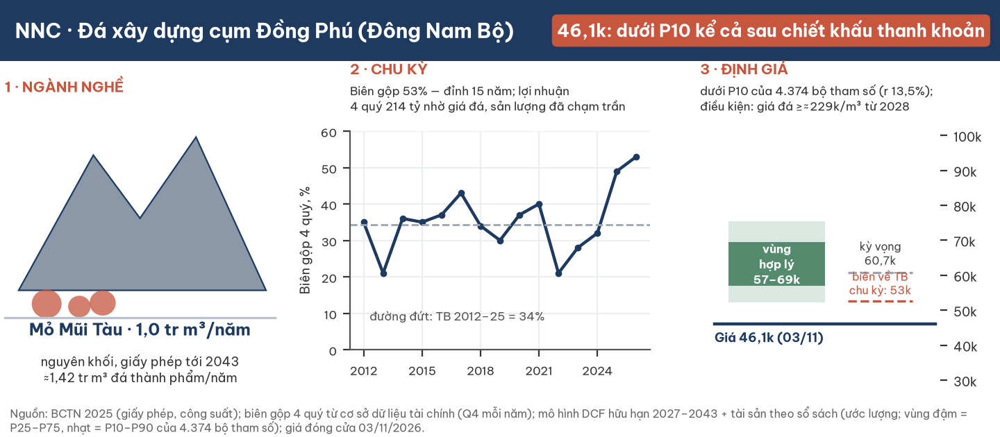

**Kết luận: giá trị kỳ vọng chuẩn hoá chu kỳ ≈60.700 đ/cp ở lãi suất chiết khấu 13,5%; vùng hợp lý 57.100–69.400 (ước lượng). Sau chiết khấu thanh khoản cho vị thế 5 tỷ đồng (≈3,6%): kỳ vọng ≈58.500, vùng hợp lý 55.000–66.900. Ở giá đóng cửa 03/11/2026 (46.100 đ), NNC dưới P10 cả trước (52.300) lẫn sau chiết khấu thanh khoản (50.400): RẺ. Biên an toàn CÓ ĐIỀU KIỆN: giá đá cụm từ 2028 giữ trên ≈229 nghìn đ/m³ (tiền 2026), tức biên gộp đá ≈27–29% (hoà vốn 218–236 nghìn tuỳ sản lượng), dưới bình quân chu kỳ ≈34%.** Biên gộp đang ở mức cao nhất 15 năm (53%). Giá trị kỳ vọng trộn ba trạng thái biên theo phân loại của người đọc ngành độc lập: biên đỉnh bền (20%), nghẽn hành chính được gỡ (45%; biên hồi trọn về bình quân, trễ một năm), chu kỳ dự án (35%). Kiểm tra chéo bằng lợi nhuận trên vốn chủ chuẩn hoá (cùng lãi suất 13,5%) cho ≈40.500, **thấp hơn giá ≈12%**: nếu biên về bình quân, giá hiện tại không còn biên an toàn theo thước đo này.

| Dữ liệu chính | Giá trị | Ghi chú |
|---|---|---|
| Kỳ vọng · trung vị lưới · vùng hợp lý (ước lượng) | **≈60.700 · ≈63.000 · 57.100–69.400 đ/cp** | Vùng = P25–P75 của 4.374 bộ tham số; lãi suất chiết khấu 13,5% |
| Sau chiết khấu thanh khoản (vị thế 5 tỷ đ) | **≈58.500 · vùng 55.000–66.900** | Chiết khấu ≈3,6%; mục 5 |
| Ngưỡng nhận định (sau chiết khấu thanh khoản) | Rẻ ≤50.400 · rẻ có điều kiện 50.400–55.000 · nghiêng đắt 66.900–72.800 · đắt ≥72.800 | P10 · P25 · P75 · P90 của lưới × (1 − 3,6%) |
| Ba trạng thái biên (20/45/35) | 82.200–95.600 · 49.900–59.200 · 48.000–57.100 | Biên đỉnh bền · nghẽn hành chính được gỡ (hồi trọn, trễ một năm) · chu kỳ dự án (giá tăng theo lạm phát từ 2031 → giữ giá trị thực) |
| Giá đá hoà vốn (giá trị = giá) | ≈229 nghìn đ/m³ (tiền 2026); 218–236 nghìn tuỳ sản lượng | Năm 2024: ≈245 nghìn danh nghĩa, sản lượng ≈1,05 tr m³, biên đá 30,7% |
| LNST 9T/2026 | 160,1 tỷ (+70%) | Q3: 69,3 tỷ (+63%); 4 quý gần nhất 214,0 tỷ |
| P/E · P/B tại 46.100 | 4,7× · 1,54× | EPS 4 quý 9.761 đ; vốn chủ/cp 29.915 đ |
| Tiền ròng sau nghĩa vụ 30/9/2026 | 223,6 tỷ (10.200 đ/cp) | Sau khi trừ truy thu, quỹ khen thưởng, cổ tức phải trả, dự phòng môi trường |
| Thanh khoản | Giá trị giao dịch trung vị ≈2,10 tỷ đ/phiên (bình quân 2,79) | 250 phiên tới 03/11/2026; cổ phiếu tự do chuyển nhượng ≈36% |

## 1. Tóm tắt điều hành

**Một mỏ đá có giấy phép tới 2043 đang bán đá ở giá đỉnh chu kỳ; khoảng 40% giá trị kỳ vọng nằm ở tiền, cổ phần và vốn đã chi.**

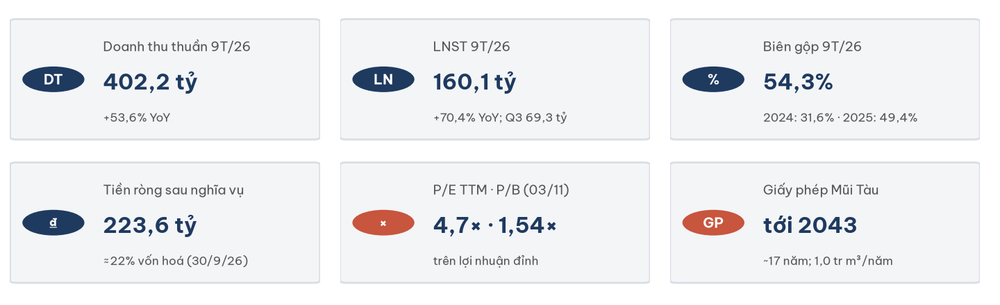

- **Câu hỏi.** Biên đá sau 2028 về đâu khi cầu dự án trọng điểm qua đỉnh và cung mới trong cụm vào cuộc, và giá cổ phiếu đang trả cho bao nhiêu phần của mỏ?
- **Trả lời.** Kỳ vọng ≈60.700 = mỏ Mũi Tàu 35.500 + tiền ròng 10.200 + 10,3% MVC 7.800 + Tam Lập 1 khu II theo vốn đã chi 3.400 + phần khác 3.800 (đ/cp). Trừ phần ngoài mỏ (≈25.200), giá 46.100 trả ≈20.900 cho mỏ, so với ≈35.500 kỳ vọng và ≈28.300 nếu biên về bình quân chu kỳ.

**Điều đổi nhận định:** biên gộp quý dưới 45% khi doanh thu đi ngang, giá đá công bố giảm >7%, giấy phép mỏ mới trong cụm cấp sớm, hoặc tiền giữ lại được dồn vào bất động sản.

## 2. Ngành: đá xây dựng phía Nam ở đỉnh chu kỳ, cung bị nghẽn hành chính

**Đá là hàng nặng, rẻ theo tấn và đắt theo cự ly: giá đá là chuyện của từng cụm mỏ quanh TP.HCM.**

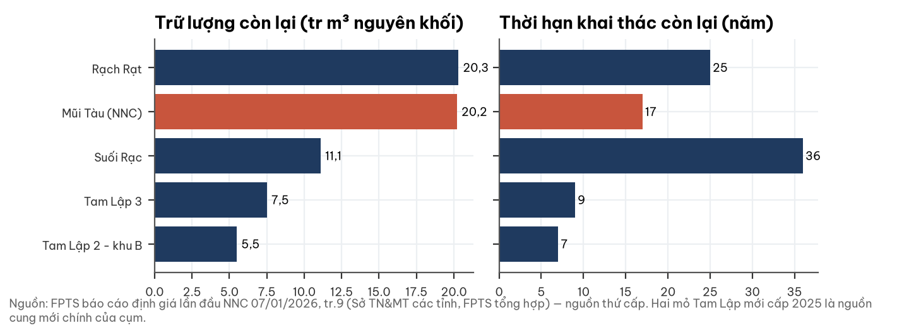

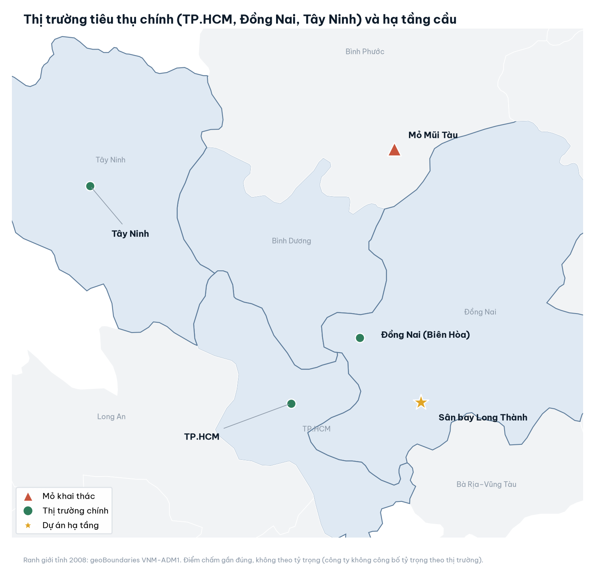

Vị trí gần đúng theo trung tâm tỉnh/thành; công ty không công bố tỷ trọng theo thị trường. Ranh giới tỉnh là bản 2008.

- **Cầu:** dự án trọng điểm phía Nam (Long Thành, Vành đai 3; Vành đai 4 khởi công các gói lớn 30/09 và 15/10/2026, mục tiêu cuối 2028). Kênh nhà ở yếu dần.
- **Cung:** giấy phép, thuê đất, đấu giá và đình chỉ quyết định cung hơn trữ lượng. Giá 1x2 tại mỏ ≈140–150 nghìn đ/tấn (trước 2020) lên ≈177–240 nghìn (đầu 2026). Cung mới đã biết 2028–30: hai mỏ mới của MVC và Tam Lập 1 khu II của NNC; độ lớn tác động lên giá chưa có số liệu, nên đặt ở độ nhạy.
- **Pha chu kỳ:** người đọc ngành độc lập xếp "đỉnh, chuyển sang bình nguyên" (độ tin ≈60/40) và phân loại nguyên nhân giá cao: nghẽn hành chính, gỡ được trong 6–18 tháng (0,45); chu kỳ dự án (0,35); cạn mỏ gần đô thị, giá sàn dâng dài hạn (0,20). Ba xác suất này là trọng số định giá ở mục 5. Phần giá sàn cao bền (đấu giá, mỏ xa) chỉ nằm ở trạng thái thứ ba; nghẽn hành chính khi được gỡ thì biên hồi trọn.

## 3. Doanh nghiệp: từ đội khai thác đá 1975 thành một mỏ chủ lực

**Toàn bộ sản xuất dồn vào mỏ Mũi Tàu (Đồng Phú); mỏ gốc Núi Nhỏ ở Dĩ An đã đóng, nay cho thuê kho bãi.**

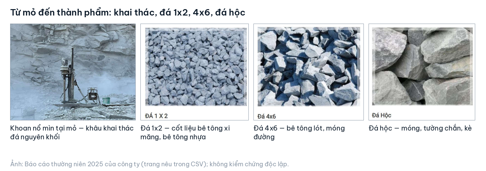

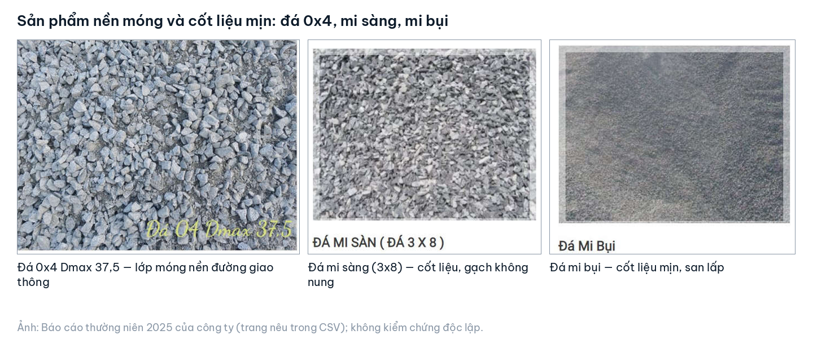

Ảnh: Báo cáo thường niên 2025 của công ty (tr.6–9), không kiểm chứng độc lập; công ty không công bố cơ cấu sản lượng theo sản phẩm.

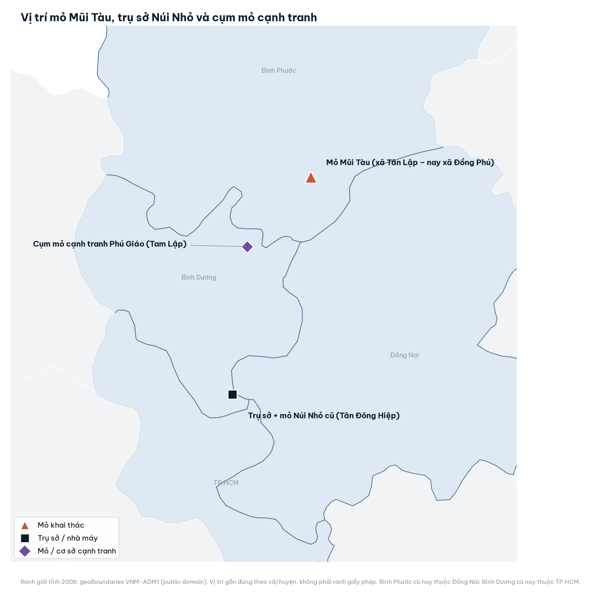

Vị trí gần đúng theo xã/huyện, không phải ranh giấy phép; vị trí mỏ Tam Lập 1 khu II không tra được nên không vẽ.

| Tài sản | Số liệu chính | Nguồn |
|---|---|---|
| Mỏ Mũi Tàu (51,5 ha) | 1,0 tr m³ nguyên khối/năm (≈1,42 tr m³ thành phẩm), hạn 2043; còn 20,2 tr m³ | BCTN 2025; tài liệu thứ cấp |
| Núi Nhỏ (27,34 ha, Dĩ An) | Hết giấy phép 2019; cho thuê, lợi nhuận gộp 11,1 tỷ (2025) | KT 2025 mục 7.1–7.2 |
| Tam Lập 1 khu II | Đã chi 83,5 tỷ (đền bù đất + đặt trước tiền cấp quyền); chưa công bố giấy phép, trữ lượng | BCTC Q3/2026 V10a |
| Cổ phần | 10,3 tr cp MVC (≈10,3%); 23,35% NHC | BCTC Q3/2026 V11 |

MVC nắm 44,07% NNC (tăng 113.900 cp trong 2026), CTCP Đầu tư Thái Bình 15,93%; giám đốc không sở hữu cổ phần.

## 4. Tài chính: tăng trưởng từ giá đá, bảng cân đối dày tiền

**Sản lượng đã chạm trần giấy phép từ 2025; lợi nhuận tăng gần như hoàn toàn nhờ giá.**

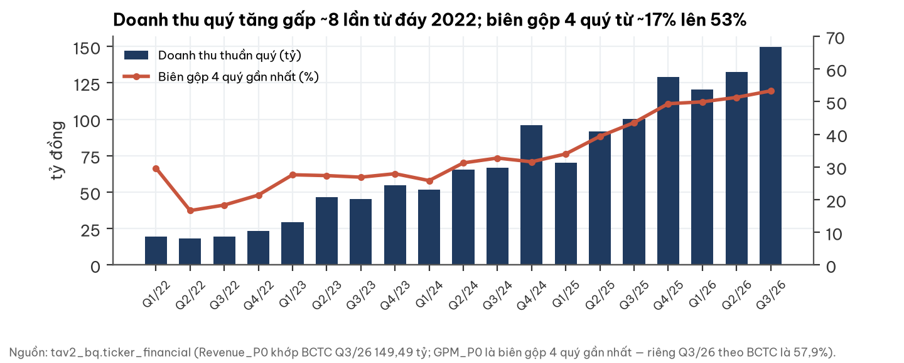

- Biên gộp 2024 31,6% → 2025 49,4% → Q3/2026 57,9%; riêng đá thành phẩm Q3 59,9%.
- Bán cho bên liên quan NHC chiếm 16% phần tăng doanh thu Q3; 61% phải thu là NHC.
- Dòng tiền kinh doanh 9T 109,3 tỷ (0,68× LNST, do nộp thuế 2025 và truy thu); hai năm cộng lại ≈0,96×.

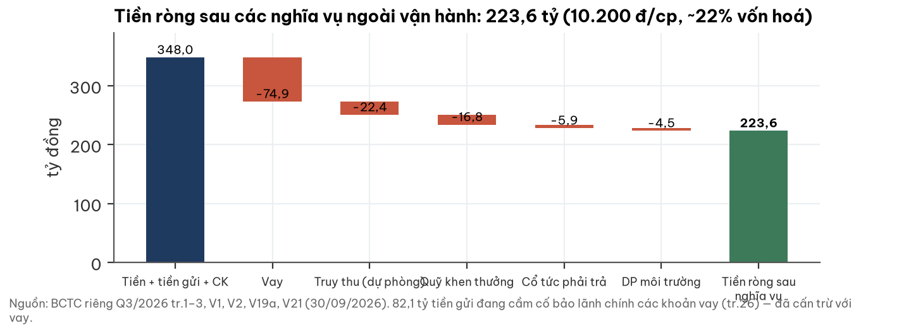

Cổ tức tiền 2025 chỉ ≈15% LNST; quỹ đầu tư phát triển tăng từ 87 lên 353 tỷ trong 9 tháng.

## 5. Định giá: chuẩn hoá chu kỳ biên đá, không dùng giá thị trường làm đầu vào

**Biên gộp là biến quyết định: ở đỉnh 15 năm, trong khi các mã đá khác không đồng loạt ở đỉnh.**

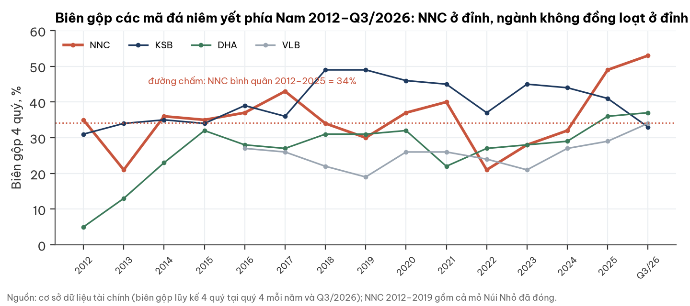

**Phương pháp.** Mỏ Mũi Tàu chiết khấu dòng tiền 2027–2043 ở 13,5% (dải 11,5–15,5%), không giá trị cuối kỳ; chi phí hiệu chỉnh trên giá vốn đá thành phẩm kiểm toán 2024–2025. Giá cơ sở 380 nghìn đ/m³ (2027), trượt về 320 (2030). Từ 2028 giá trị trộn ba trạng thái:

| Trạng thái | Xác suất | Biên và sản lượng từ 2028 | Giá trị (đ/cp) |
|---|---|---|---|
| Biên đỉnh bền | 20% | Đường giá cơ sở; sản lượng 1,40 tr m³ (trần giấy phép) | 82.200–95.600 |
| Nghẽn hành chính được gỡ | 45% | Năm 2028 giá đi nửa đường về giá chu kỳ, từ 2029 về hẳn; sản lượng năm thường 1,10 (2028–30) / 1,20 tr m³ | 49.900–59.200 |
| Chu kỳ dự án | 35% | Từ 2028 giá trần ≈250 nghìn đ/m³ (tiền 2026) = biên đá 34% ở sản lượng năm thường | 48.000–57.100 |

Giá chu kỳ tính từ dữ liệu: biên gộp NNC bình quân 2012–2025 là 34,2%, biên đá thành phẩm kiểm toán 2024–2025 gần như bằng biên toàn công ty. Biên 34% giữ nguyên khi giá đá theo kịp lạm phát; nếu giá danh nghĩa đi ngang tới 2030 trong khi chi phí tăng 3%/năm, biên năm 2030 ≈26%. Neo giá chu kỳ ở sản lượng năm thường (≈250 nghìn) hay ở trần sản lượng (≈236 nghìn) đều hợp lệ; neo ở trần giảm giá trị ≈3.300 (độ nhạy). Sản lượng năm thường neo vào năm 2024: ≈1,05 tr m³ ở giá ≈245 nghìn, khoảng 74% trần. Mỗi trạng thái đã gồm bốn kịch bản giá. Tam Lập 1 khu II ghi theo vốn đã chi, trừ chi phí trễ giấy phép có xác suất. Cổ phần MVC định giá bằng mô hình nội tại, cùng logic biên và sản lượng cho mỏ Tân Lập, giải sở hữu chéo đồng thời; NHC theo sổ sách.

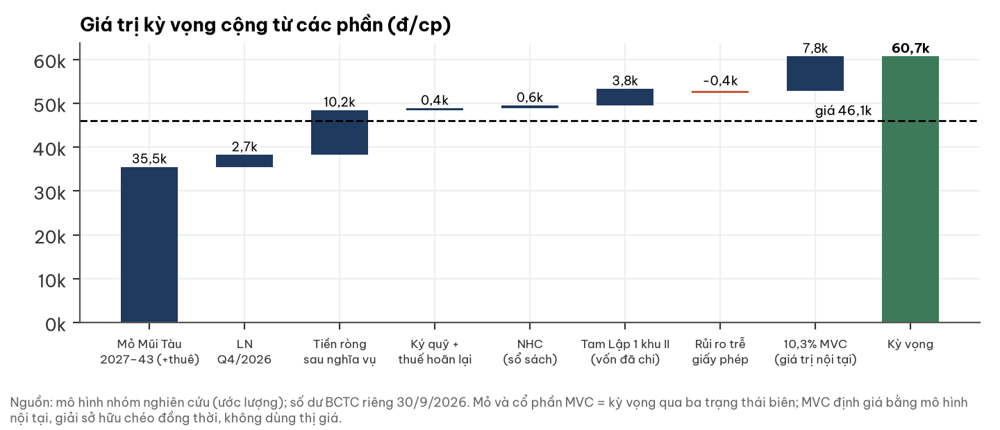

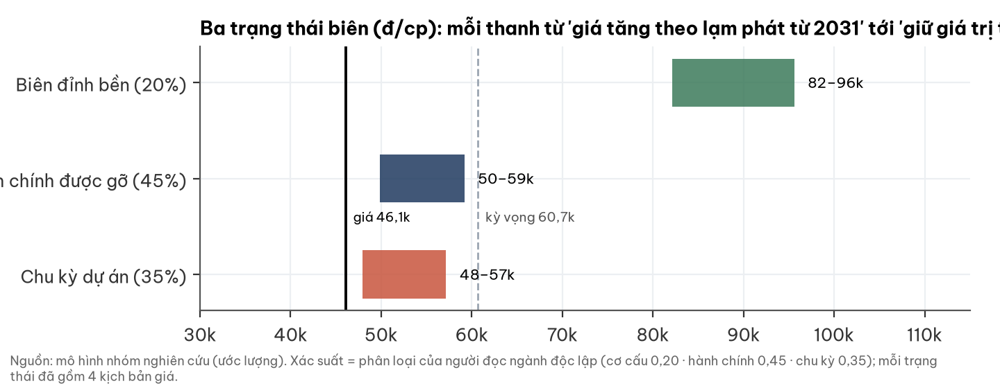

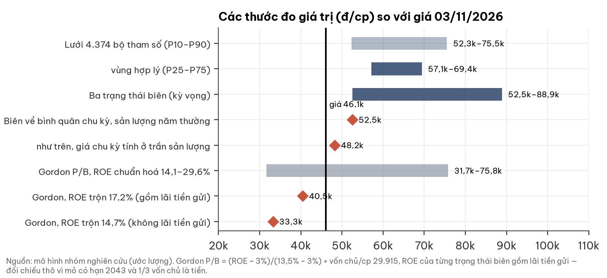

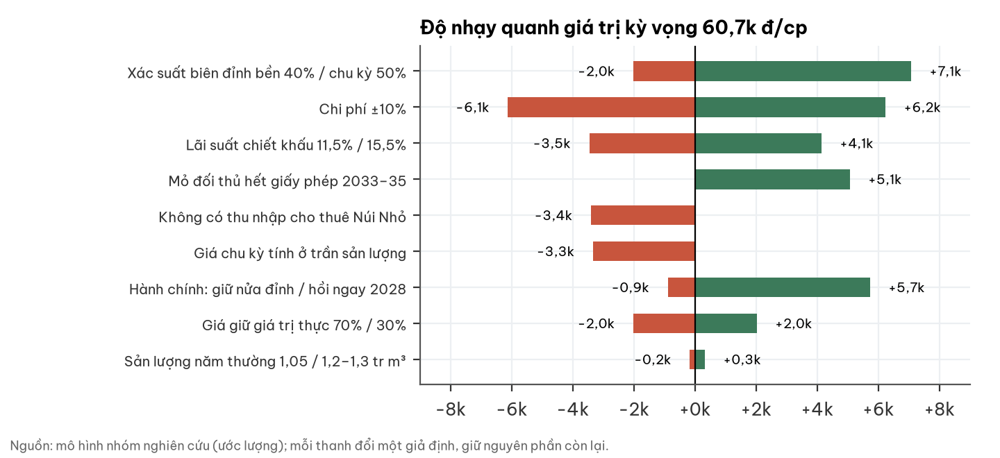

- **Điều kiện của chữ "rẻ".** Giá trị về bằng giá khi giá đá cụm từ 2028 ≈229 nghìn đ/m³ (tiền 2026) ở sản lượng năm thường; theo sản lượng, hoà vốn 218–236 nghìn, tức biên đá ≈27–29%. Mức này thấp hơn giá thực hiện 2024 (≈245 nghìn danh nghĩa) và dưới bình quân chu kỳ.
- **Biên mỏng khi biên về bình quân.** Trạng thái "về bình quân chu kỳ" cho ≈52.500 (+14% so với giá); nếu tính giá chu kỳ ở trần sản lượng ≈48.200 (+5%); thêm giá đá danh nghĩa đi ngang ≈41.400 (−10%).
- **Kiểm tra chéo (ngược chiều).** Lợi nhuận trên vốn chủ chuẩn hoá theo ba trạng thái: 29,6% · 14,1% · 14,1% (gồm lãi tiền gửi), trộn theo xác suất 17,2% ⇒ ≈40.500 ở P/B = (ROE − 3%)/(13,5% − 3%), **thấp hơn giá ≈12%**; không tính lãi tiền gửi: 14,7% ⇒ ≈33.300. Giá 46.100 hàm ý lợi nhuận trên vốn chủ bền ≈19,2%. Kỳ vọng ≈60.700 hàm ý ≈24,3%. Hai thước đo lệch nhau vì mỏ có hạn 2043, một phần ba vốn chủ là tiền, và mô hình dòng tiền giữ giá đá cao tới 2027.
- **Chiều tăng có cơ sở:** Tam Lập 2 (≈2033) và Tam Lập 3 (≈2035) hết giấy phép trong khi Mũi Tàu còn tới 2043. Nếu từ 2034 áp lực biên giảm một nửa, giá trị tăng ≈5.100.
- **Cổ phần MVC.** Nếu chỉ tính theo thị giá MVC 03/11/2026, phần này giảm ≈1.600 đ/cp.
- **Thu nhập cho thuê Núi Nhỏ.** Mô hình giả định tới 2043; thời hạn hợp đồng chưa xác minh. Nếu chỉ tới 2030: −2.000; nếu không còn: −3.400.

**Lãi suất chiết khấu gắn lãi huy động.** Mô hình dùng 13,5%, neo vào lãi huy động 12 tháng hiệu dụng 7,40% (chứng chỉ tiền gửi 12 tháng, 02/11/2026). Khi lãi huy động đổi, lãi suất chiết khấu đổi cùng mức (giả định truyền dẫn đủ; truyền dẫn một nửa cho tác động bằng một nửa). Lãi suất giảm thì giá trị tăng: đó là lý do thị trường thường phản ứng tốt khi lãi suất hạ.

| Lãi huy động 12T | −100bp (6,40%) | −50bp (6,90%) | Neo 7,40% | +50bp (7,90%) | +100bp (8,40%) |
|---|---|---|---|---|---|
| Lãi suất chiết khấu | 12,5% | 13,0% | 13,5% | 14,0% | 14,5% |
| Giá trị kỳ vọng (đ/cp) | 62.700 (+3,3%) | 61.700 (+1,6%) | 60.700 | 59.800 (−1,5%) | 58.900 (−3,0%) |

Mỗi 0,5 điểm % lãi suất đổi giá trị ≈900–1.000 đ/cp (≈1,5%): thấp vì mỏ có hạn 2043 và hơn 40% giá trị là tiền, cổ phần, vốn đã chi.

**Rủi ro thanh khoản.** 250 phiên tới 03/11/2026: giá trị giao dịch trung vị 2,10 tỷ đ/phiên (bình quân 2,79), biến động ngày 2,35%, không có phiên trắng; cổ phiếu tự do chuyển nhượng ≈36%. Chiết khấu = biến động ngày × căn bậc hai (quy mô vị thế / giá trị giao dịch trung vị) (quy luật căn bậc hai thực nghiệm; hệ số 1,0, độ nhạy 0,5–1,5). Kiểm chéo bằng hệ số kém thanh khoản Amihud: bán 15% thanh khoản mỗi phiên làm giá lệch ≈0,1%/phiên, nên hệ số 1,0 là phía thận trọng.

| Quy mô vị thế | 1 tỷ đ | 5 tỷ đ | 10 tỷ đ |
|---|---|---|---|
| Số phiên để thoát ở 10% / 20% thanh khoản | 5 / 2 | 24 / 12 | 48 / 24 |
| Chiết khấu (hệ số 0,5 / 1,0 / 1,5) | 0,8% / 1,6% / 2,4% | 1,8% / 3,6% / 5,4% | 2,6% / 5,1% / 7,7% |
| Kỳ vọng sau chiết khấu (hệ số 1,0) | 59.700 | 58.500 | 57.600 |
| Nhận định ở giá 46.100 | Rẻ | Rẻ | Rẻ |

Nhận định dùng quy mô 5 tỷ đồng.

**Điều thị trường có thể chưa tính:** (i) ≈25.300 đ/cp là tiền, cổ phần và vốn đã chi; (ii) mỏ đối thủ hết giấy phép trước Mũi Tàu 8–10 năm; (iii) tiền thuê Núi Nhỏ. **Điều thị trường có thể đã đúng:** biên ở đỉnh, cầu dự án trọng điểm qua đỉnh 2027, cung mới 2028–30, cổ tức thấp. Ở giá này, thị trường định giá như thể biên về bình quân chu kỳ và sản lượng giảm về năm thường.

## 6. Rủi ro, quản trị và mốc theo dõi

| Rủi ro | Mức | Cách đọc |
|---|---|---|
| Biên đá về bình quân chu kỳ từ 2028–29 | Cao | Đã có trong kỳ vọng (80%: hành chính được gỡ + chu kỳ dự án); riêng hai trạng thái này ≈52.500–54.500; giá đá dưới ≈229 nghìn ⇒ giá trị dưới giá |
| Cung mới trong cụm 2028–30 | Trung bình | Chiều xuống có cơ sở; độ lớn chưa có số liệu |
| Truy thu, phạt hành chính | Thấp–TB | Phạt 0,63 tỷ (2024), 0,04 tỷ (2025); truy thu Núi Nhỏ đã dự phòng; 0,84 tỷ chạm Mũi Tàu |
| Sở hữu chéo với MVC | TB | MVC ≥51% có thể buộc thoái cổ phần MVC (cần ý kiến pháp lý) |
| Bên liên quan NHC, tiền giữ lại | TB | Phải thu tập trung; định hướng có bất động sản |

Kiểm toán 2025 (AASCs): chấp nhận toàn phần. Rủi ro pháp lý chỉ là cảnh báo, không đưa vào kịch bản cơ sở.

| Mốc | Thời điểm | Tích cực hơn nếu | Tiêu cực hơn nếu |
|---|---|---|---|
| BCTC Q4/2026, Q1/2027 | ~20/01, ~20/04/2027 | Biên gộp ≥55% | Biên <45% khi doanh thu đi ngang |
| Giá đá công bố Sở XD | Q2/2027 | Cao hơn Q3/2026 >7% | Thấp hơn >7% |
| Vành đai 4; giấy phép mỏ đấu giá trong cụm | tới 30/06/2027 | ≥20% khối lượng; mỏ mới chậm | <20%; mỏ mới cấp sớm |
| Phân loại ngành | giữa 2027 | Cụm Phước Tân–Tam Phước đóng, giá vẫn tăng (cạn mỏ ≥0,40) | Vành đai 4 trượt, giá Q2/2027 giảm (chu kỳ ≥0,50) |
| Tam Lập 1 khu II; ĐHĐCĐ 2027 | chưa định ngày | Có giấy phép; cổ tức tiền cao hơn | Huỷ dự án; đầu tư bất động sản lớn |

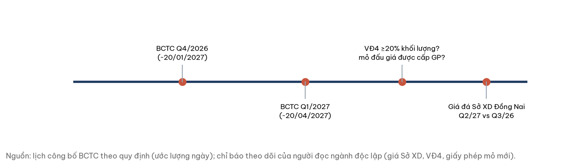

## Phụ lục A. Số liệu tài chính (BCTC riêng Q3/2026 và BCTC 2025 kiểm toán)

| Chỉ tiêu (tỷ đồng) | Q3/2026 | Q3/2025 | 9T/2026 | 9T/2025 | Nguồn |
|---|---|---|---|---|---|
| Doanh thu thuần | 149,49 | 100,27 | 402,20 | 261,89 | Q3 tr.4 |
| Giá vốn hàng bán | 62,95 | 49,61 | 183,68 | 133,54 | tr.4 |
| Lợi nhuận gộp | 86,54 | 50,67 | 218,52 | 128,34 | tr.4 |
| Doanh thu tài chính | 6,07 | 7,60 | 15,60 | 13,48 | VI.3 |
| Lợi nhuận khác | −0,00 | −1,88 | −19,29 | −4,18 | VI.8 |
| LNST | 69,29 | 42,56 | 160,08 | 93,95 | tr.4 |
| Dòng tiền kinh doanh | | | 109,3 | 132,9 | tr.5 |

| Bảng cân đối 30/09/2026 (tỷ đồng) | Giá trị | Nguồn |
|---|---|---|
| Tiền + tiền gửi có kỳ hạn | 25,47 + 322,44 | V1, V2 |
| Vay ngắn hạn + dài hạn | 5,00 + 69,89 | tr.3 |
| Dự phòng truy thu · quỹ khen thưởng · cổ tức phải trả · dự phòng môi trường | 22,37 · 16,78 · 5,89 · 4,50 | V19a, tr.3, V21 |
| Ký quỹ phục hồi môi trường · tài sản thuế hoãn lại | 4,57 · 4,31 | V9, tr.2 |
| Chi phí XDCB dở dang Tam Lập 1 khu II | 83,51 | V10a |
| Vốn chủ sở hữu | 655,73 | tr.3 |

## Phụ lục C. Danh mục nguồn

- BCTC riêng Q3/2026 (ký 19/10/2026) kèm CV 53/CV-NN26; BCTC 2025 kiểm toán AASCs (BC 48/BCKT/TC/2026); Báo cáo thường niên 2025.
- Báo cáo định giá lần đầu NNC của FPTS (07/01/2026) — thứ cấp (trữ lượng, thời hạn mỏ cạnh tranh).
- Bản đọc ngành đá xây dựng Nam Bộ của người đọc ngành độc lập (30/10/2026), dẫn báo chí và giá công bố.
- Cơ sở dữ liệu tài chính và giá nội bộ: biên gộp, lợi nhuận trên vốn chủ NNC/KSB/DHA/VLB 2012–2026 (03/11/2026); giá và khối lượng NNC 250 phiên tới 03/11/2026. Lãi huy động: chứng chỉ tiền gửi 12 tháng 7,40% (02/11/2026).
- Bản đồ: geoBoundaries VNM-ADM1 (2008); toạ độ Wikipedia tiếng Việt (31/10/2026). Ảnh sản phẩm: BCTN 2025 tr.6–9. Logo: nuinho.vn.

## Phụ lục D. Phương pháp và giới hạn

**Phương pháp.** Giá trị = PV NOPAT mỏ Mũi Tàu 2027–2043 (thuế 20%, capex duy trì ≈ khấu hao, chi phí +3%/năm) + lợi nhuận gộp cho thuê Núi Nhỏ + LNST Q4/2026 ước 60 tỷ + tiền ròng sau nghĩa vụ + ký quỹ và thuế hoãn lại + Tam Lập 1 khu II theo vốn đã chi (trừ chi phí trễ giấy phép kỳ vọng 9,3 tỷ, xác suất trễ 0/1/2 năm = 0,30/0,40/0,30) + NHC sổ sách + 10,3% MVC (mô hình nội tại MVC, giải đồng thời). Từ 2028 trộn ba trạng thái biên 20/45/35 (trạng thái hành chính: năm 2028 nửa đường, từ 2029 về hẳn giá chu kỳ). Giá chu kỳ (tiền 2026) = chi phí đơn vị ở sản lượng năm thường ÷ (1 − biên chu kỳ 34,3%). Lưới 4.374 bộ: cách hồi biên của trạng thái hành chính (giữ nửa mức đỉnh vĩnh viễn / trễ một năm / hồi ngay 2028) × lãi suất 11,5/13,5/15,5% × chi phí ±10% × 3 bộ xác suất kịch bản giá × 3 tỷ trọng đường giá × 3 bộ xác suất trạng thái (20/45/35; 40/35/25; 15/35/50 — hai bộ sau là điều kiện đổi phân loại của người đọc ngành) × sản lượng năm thường 1,05 / 1,10–1,20 / 1,20–1,30 × giá chu kỳ tính ở sản lượng năm thường hoặc ở trần. Ngưỡng nhận định và phương pháp chiết khấu thanh khoản đăng ký trước khi so giá; nhận định dựa trên thang sau chiết khấu thanh khoản.

**Giới hạn.** Công ty không công bố sản lượng m³ (2024–2025 lấy từ tài liệu thứ cấp), nên giá × sản lượng là suy luận. Biên 2012–2020 gồm cả mỏ Núi Nhỏ. Xác suất ba trạng thái là nhận định của người đọc ngành, không phải tần suất đo được. Trữ lượng còn lại và dữ liệu mỏ cạnh tranh là thứ cấp. Tam Lập 1 khu II chưa có giấy phép, trữ lượng, công suất công bố nên không cộng lợi nhuận tiềm năng. Khoản trả trước dài hạn 59,2 tỷ chưa rõ bản chất (nếu là tiền thuê đất đã trả: +2.100). Thời hạn cho thuê Núi Nhỏ chưa xác minh. Bản đồ định vị gần đúng.

## Phụ lục E. Quy trình độc lập

Người đọc ngành viết bản đọc ngành mù với định giá; nhóm nghiên cứu đọc BCTC gốc và dựng mô hình không dùng giá thị trường làm đầu vào, khoá kết quả trước khi so giá; một người phản biện độc lập kiểm số liệu và nguồn. Mọi khoản giảm trừ giá trị trong kịch bản cơ sở đều có nguồn dữ liệu; giả định không có nguồn chỉ nằm ở độ nhạy.

## Phụ lục F. Tuyên bố miễn trừ trách nhiệm

Báo cáo này chỉ nhằm mục đích cung cấp thông tin nghiên cứu, không phải lời mời hay khuyến nghị mua, bán hoặc nắm giữ bất kỳ chứng khoán nào, và không phải tư vấn đầu tư cá nhân hoá. Thông tin được lấy từ các nguồn được cho là đáng tin cậy (BCTC, báo cáo thường niên, công bố thông tin của doanh nghiệp, báo chí và cơ sở dữ liệu giá) nhưng không được bảo đảm là chính xác hoặc đầy đủ. Các ước lượng, kịch bản và xác suất là nhận định tại ngày lập báo cáo và có thể thay đổi mà không cần thông báo. Kết quả quá khứ không bảo đảm kết quả tương lai. Nhà đầu tư tự chịu trách nhiệm về quyết định của mình và nên tham khảo ý kiến chuyên gia khi cần.
