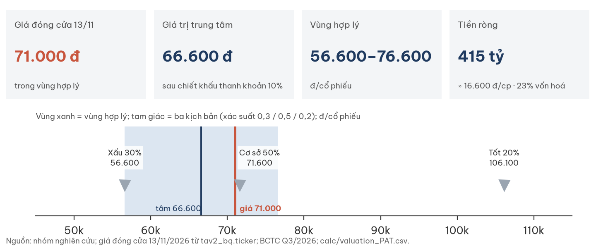
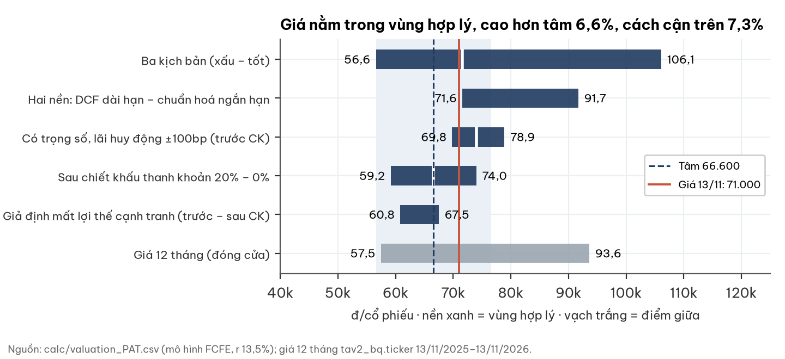
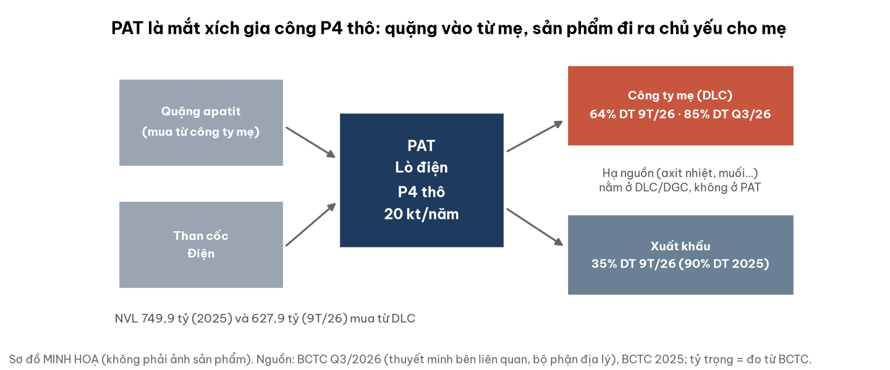
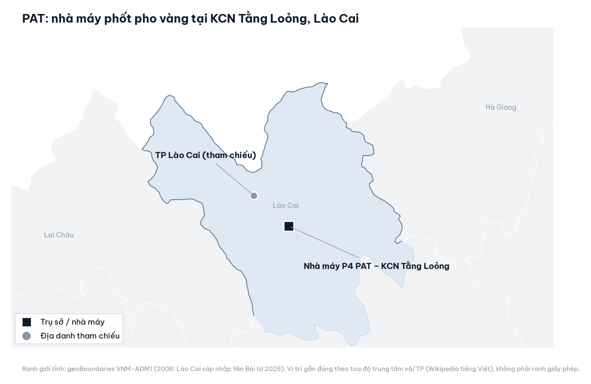
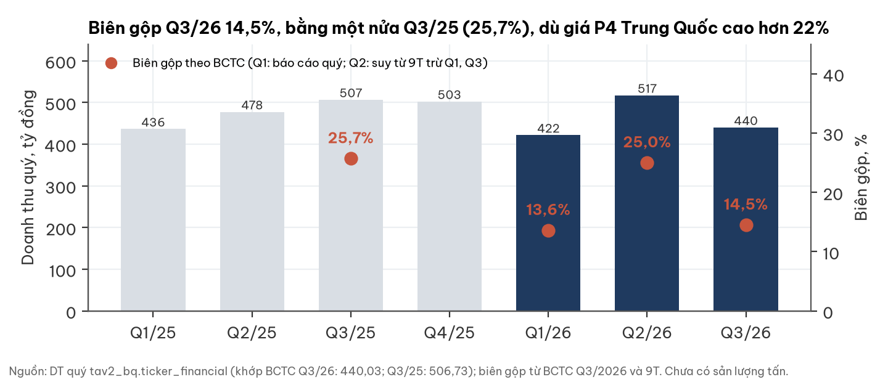
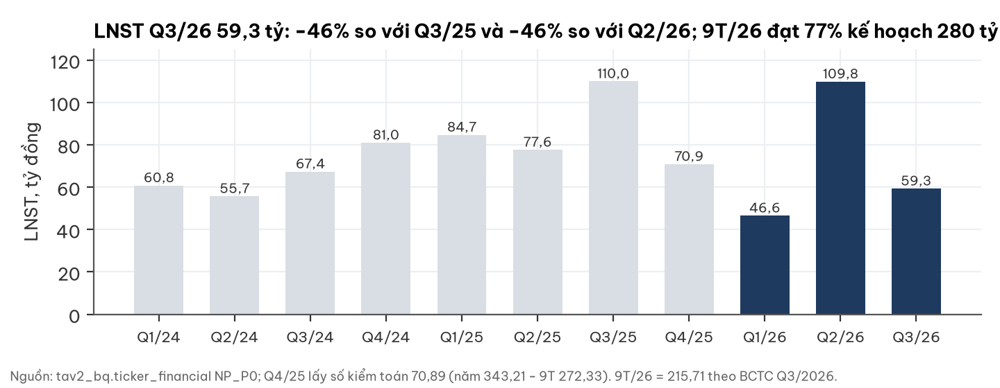
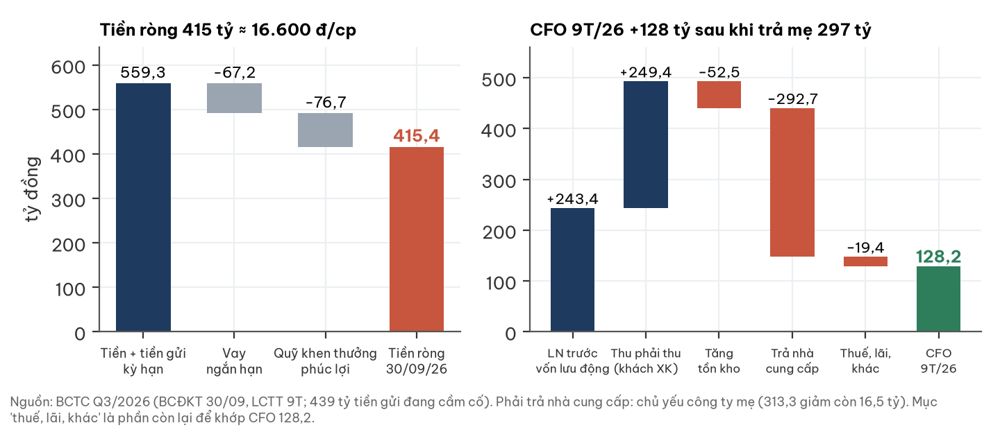
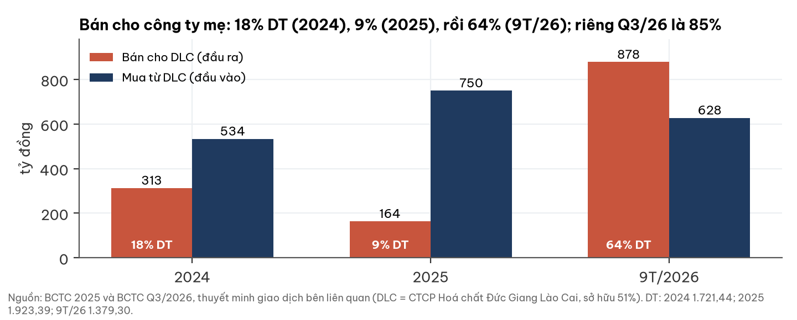
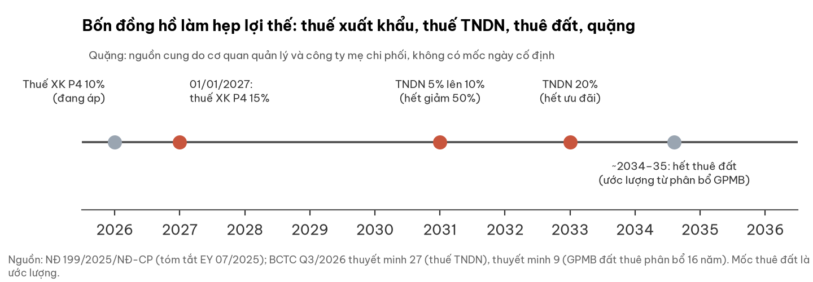
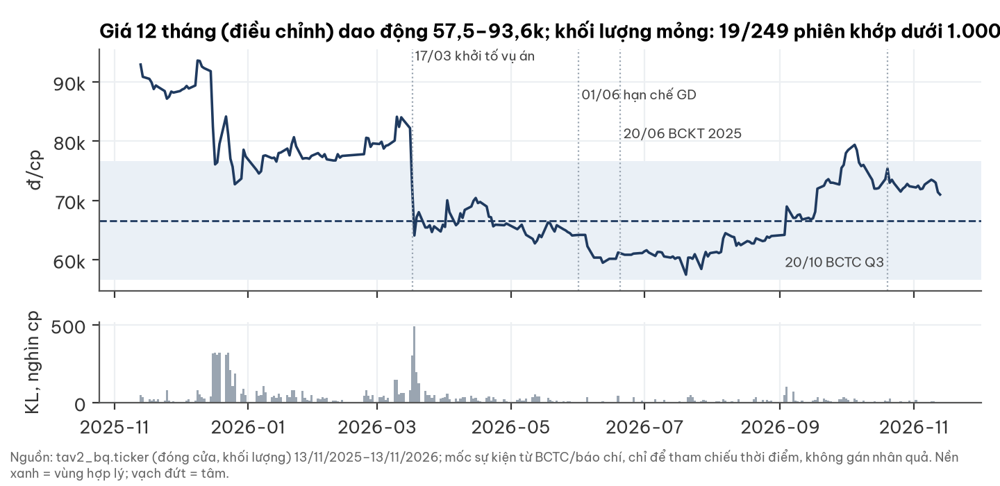

# PAT — CTCP Phốt pho Apatit Việt Nam: cỗ máy tiền mặt đơn sản phẩm với tiền ròng ~415 tỷ (≈16.600 đ/cp) và cổ tức tiền mặt cao, nhưng lợi nhuận phụ thuộc công ty mẹ ở cả hai đầu, biên gộp sập về 14,5% và kiểm toán ngoại trừ khi vụ án chưa kết luận

UPCoM: PAT · Nhóm nghiên cứu · Giá đóng cửa 13/11/2026 · BCTC đến Q3/2026 (duyệt 20/10/2026) · Số tiền: tỷ đồng nếu không ghi khác

## Tóm tắt (tear sheet)

| Chỉ tiêu | Giá trị | Chỉ tiêu | Giá trị |
|---|---|---|---|
| Giá đóng cửa 13/11 | 71.000 đ | P/E TTM · P/B | 6,2 · 2,5 |
| Giá trị trung tâm (sau chiết khấu thanh khoản 10%) | 66.600 đ | Vốn hoá | 1.775 tỷ |
| Vùng hợp lý | 56.600–76.600 đ | Tiền ròng (30/09/26) | 415,4 tỷ (16.600 đ/cp) |
| Giá so với tâm / cận trên | +6,6% / −7,3% | LNST 9T/26 · biên gộp Q3/26 | 215,7 tỷ · 14,5% |
| Giá trị trước chiết khấu thanh khoản | 74.000 đ | Cổ tức kế hoạch 2026 (chỉ nguồn báo chí) | 9.000 đ (12,7%) |

**Giá nằm TRONG vùng hợp lý, cao hơn tâm 6,6% và cách cận trên 7,3%.** Ba điều cần biết:
- **Tiền và cổ tức:** tiền ròng bằng 23% vốn hoá; capex gần bằng 0 nên LNST gần như thành tiền. Kế hoạch cổ tức 90% chưa có nghị quyết.
- **Phụ thuộc mẹ:** DLC mua 64% doanh thu 9T/26 (85% riêng Q3) và cung cấp toàn bộ quặng. Biên gộp rơi về 14,5% mà chưa có đơn giá nội bộ để giải thích.
- **Vụ án:** chỉ là cảnh báo, chưa đưa vào kịch bản cơ sở; ý kiến kiểm toán ngoại trừ hai kỳ liên tiếp.

## 1. Kết luận: giá nằm trong vùng hợp lý, thiên về nửa trên

Giá trị có trọng số 74.000 đ; sau chiết khấu thanh khoản 10% còn 66.600 đ. Xác suất kịch bản là giả định, không có cơ sở độc lập để đổi.

| Kịch bản | Xác suất | Điều kiện | đ/cp |
|---|---|---|---|
| Xấu | 0,3 | LNTT hoạt động 150 tỷ (2027–28), 200 tỷ sau đó; một nửa xác suất hết thuê đất năm 2034 | 56.600 |
| Cơ sở | 0,5 | LNTT hoạt động 202,6 tỷ/năm (run-rate Q3/26 trừ bước thuế xuất khẩu) | 71.600 |
| Tốt | 0,2 | LNTT 330 tỷ (xấp xỉ mức 2025): quặng thông lại, giá P4 cao | 106.100 |
| **Có trọng số / sau chiết khấu 10%** | | | **74.000 / 66.600** |

## 2. Doanh nghiệp và ngành: mắt xích gia công P4 thô trong chuỗi của DLC

PAT luyện phốt pho vàng (P4) thô bằng lò điện tại KCN Tằng Loỏng, Lào Cai, công suất 20 kt/năm, khoảng 16% công suất P4 cả nước (khoảng 125 kt, nguồn báo chí). Không có công ty con. Thành phẩm, chủ yếu P4, chiếm 96,5% doanh thu 2025.

| Khía cạnh | Số liệu (BCTC) |
|---|---|
| Cổ đông (30/09/26) | DLC 51,00%; hai cổ đông cá nhân 9,03% và 7,69%; các cổ đông khác 32,28% |
| Vốn · nhân sự | 25 triệu cổ phiếu, vốn điều lệ 250 tỷ · 264 người |
| Khách hàng | Nội địa: DLC. Xuất khẩu năm 2025: ICL Specialty, KS International, Italmatch (phải thu 31/12/25) |
| Doanh thu xuất khẩu | 90% (2025) rồi 35% (9T/26) khi chuyển sang bán cho DLC |
| Ưu đãi thuế | Dự án P4 hưởng ưu đãi từ 2018; thuế suất hiệu dụng 9T/26 là 6,4% |

**Ngành (đọc độc lập, đến 13/11/2026):**

| Yếu tố | Dữ liệu | Hàm ý cho PAT |
|---|---|---|
| Giá P4 Trung Quốc | 28.466 CNY/t, phân vị 80% chuỗi 2018+, +24% YoY | Nền giá cao, nhưng biên PAT 2026 không đi theo giá |
| Than cốc | Q3/26 2.040 CNY/t, +52% YoY | Áp lực chi phí |
| Quặng apatit | Từ T6/2026 một số dây chuyền tuyển ở KCN Tằng Loỏng giảm hoặc dừng (Báo Lào Cai 20/10/2026) | Rủi ro sản lượng |
| Thuế xuất khẩu P4 | 10% (2026), 15% từ 01/01/2027 (NĐ 199/2025, tóm tắt EY) | Trừ trực tiếp vào bước thuế cơ sở |
| Cầu | Glyphosate và pin LFP hỗ trợ; LFP chủ yếu dùng tuyến axit ướt | Cầu không phải điểm yếu |

## 3. Tài chính: tiền mạnh, nhưng chất lượng biên và đối tác duy nhất là câu hỏi

### 3a. Biên gộp giảm một nửa trong khi giá P4 tăng

- Chi phí nguyên vật liệu 9T/26 tăng 19% trong khi doanh thu giảm 3%; chi phí NVL trên mỗi đồng doanh thu từ 0,42 lên 0,51.
- Giải thích hợp lý nhất là sản lượng thấp do thiếu quặng cộng than cốc đắt; chưa có số tấn để chốt. Không có khoản một lần.

### 3b. Tiền ròng 415 tỷ; dòng tiền 9T đã gánh khoản trả mẹ 297 tỷ

- Quý I CFO âm 408 tỷ vì trả nợ thương mại cho DLC (313,3 giảm còn 16,5 tỷ), không phải lỗ vốn lưu động.
- 439 tỷ tiền gửi đang cầm cố. Capex 0,8 / 8,1 / 0,4 tỷ (2024 / 2025 / TTM) thấp hơn khấu hao 45 tỷ/năm; tài sản cố định đã khấu hao 62%.

### 3c. Phụ thuộc công ty mẹ: tỷ trọng bán cho DLC tăng vọt đúng lúc biên giảm

- Hai giả thuyết (thiếu quặng và né thuế xuất khẩu; hay định giá nội bộ bất lợi cho PAT) chưa phân biệt được nếu thiếu đơn giá bán cho DLC.
- Cổ tức: tiền mặt chi 425 tỷ (2024) và 322,5 tỷ (9T/26). Cổ đông chi phối nhận phần lớn, nên có động cơ giữ tỷ lệ chi cao.

## 4. Lợi thế cạnh tranh hẹp, có bốn đồng hồ đếm ngược

PAT là người chấp nhận giá (giá do Trung Quốc đặt) và không sở hữu mỏ; cơ chế bảo vệ (quyền tiếp cận quặng, giấy phép) thuộc về DLC. ROIC 5 năm thấp nhất 31,8% bị thổi phồng bởi tài sản đã khấu hao và chi trả cổ tức khoảng 100%. Xếp loại: hẹp.

## 5. Định giá: r = 13,5% gắn lãi huy động, trước và sau chiết khấu thanh khoản

- **Phương pháp:** FCFE = LNST × (1 − 5,5% trích quỹ khen thưởng phúc lợi) cộng tiền ròng 415,4 tỷ; g dài hạn 2% (ước lượng); thuế TNDN theo lộ trình (5% đến 2030, 10% 2031–32, 20% từ 2033); ngày định giá 30/09/2026.
- **Chi phí vốn:** r = 13,5% tại lãi huy động 12 tháng hiệu dụng 7,40% (điểm neo); điều chỉnh khi lãi huy động đổi, độ nhạy ở bảng dưới.
- **Chiết khấu thanh khoản 10% (giả định):** trung vị giá trị giao dịch 6 tháng chỉ 0,446 tỷ/phiên, 17/129 phiên không khớp. Độ nhạy 5% cho 70.300; 20% cho 59.200.

| Độ nhạy (giá trị có trọng số, trước chiết khấu) | −100bp | −50bp | Neo | +50bp | +100bp |
|---|---|---|---|---|---|
| Lãi huy động đổi hoàn toàn vào r (β = 1) | 78.900 | 76.300 | 74.000 | 71.800 | 69.800 |
| Đổi một nửa vào r (β = 0,5) | 76.300 | 75.100 | 74.000 | 72.900 | 71.800 |

| Hai nền và độ nhạy khác | đ/cp |
|---|---|
| Nền dài hạn (DCF cơ sở) · nền ngắn hạn (LNST chuẩn hoá trung vị 12 quý 287,7 tỷ) | 71.600 · 91.700 |
| Mất lợi thế cạnh tranh (biên co dần 30% đến 2033), sau chiết khấu thanh khoản | 60.800 |
| Trừ 42,6 tỷ tiền gửi cầm cố cho khoản vay nhóm công ty thành viên, tâm | 65.100 |
| Mỗi 1 tỷ LNTT hoạt động/năm vĩnh viễn (kịch bản cơ sở) | ±263 |

**Bối cảnh lãi suất (chỉ để tham khảo, không đổi giá trị hợp lý):** lãi suất chiết khấu mà giá thị trường đang ngầm định (r*) là 15,1% (khảo sát 147 mã đến 30/10/2026; phân vị 75% giai đoạn 2014–2026; đỉnh 2022 15,9%, đáy 2022–23 12,1%), so với r 13,5% của báo cáo. Trái phiếu Chính phủ 10 năm 4,57% (13/11/2026), +0,57 điểm % so với 12 tháng trước (nguồn chưa đối chiếu độc lập).

- Giá giảm 22% trong hai phiên 17–18/03/2026 (82.210 xuống 64.100), trùng ngày công bố khởi tố; không đủ dữ liệu để gán nguyên nhân.

## 6. Rủi ro pre-mortem

| Rủi ro | Xác suất (nhận định) | Tác động đo được | Dấu hiệu sớm | Ngày kiểm |
|---|---|---|---|---|
| Giá chuyển nhượng với DLC | Trung bình | Cơ sở xuống LNTT khoảng 160 tỷ: tâm 61.400 (−5.200) | Đơn giá bán DLC thấp hơn giá xuất khẩu ròng thuế hơn 5% | ĐHCĐ 2027 |
| Vụ án (khởi tố 17/03/2026 tại tập đoàn mẹ và đơn vị liên quan; nguyên lãnh đạo PAT là bị can; đã thay toàn bộ HĐQT/BGĐ) | Chưa có kết luận | Chưa đưa vào cơ sở; kiểm toán ngoại trừ chưa lượng hoá | Cáo trạng, thiệt hại, nghĩa vụ môi trường; ý kiến kiểm toán 2026 | BCKT 2026 (tháng 3/2027) |
| Thiếu quặng Lào Cai | Trung bình–cao | Nghiêng kịch bản xấu (56.600) | Quyết định cấp quặng loại III; nhà máy tuyển chạy ≥ 80% | 31/05/2027 |
| Thuế xuất khẩu P4 15% | Cao (đã có trong cơ sở) | Bước thuế −12,7 tỷ LNTT; nếu hoãn: +1.600 đ/cp (tâm) | Công báo, hướng dẫn hải quan | 01/01/2027 |
| Tài sản thế chấp cho nợ nhóm (40 tỷ + 100.000 USD tại Vietinbank) | Thấp–trung bình | Tâm 65.100 (−1.500) | Dư nợ nhóm công ty thành viên tại ngân hàng | BCTC Q4/2026 |
| Tập trung cổ đông (67,7%) và thanh khoản mỏng | Cao | Chiết khấu 20%: 59.200 | Khối lượng khớp, phiên không khớp | Hằng quý |

## 7. Điều làm nhận định đổi, theo cả hai chiều

| Mốc | Ngày | Tích cực hơn | Tiêu cực hơn |
|---|---|---|---|
| M1 BCTC Q4/2026 | khoảng 20–25/01/2027 | Biên gộp ≥ 22% và doanh thu ≥ 500 tỷ: tâm 72.600 | Biên gộp ≤ 15%: tâm 62.300 |
| M2 Thuế xuất khẩu | 01/01/2027 | Hoãn tăng thuế: +1.600 đ/cp | Đúng lịch: đã nằm trong cơ sở |
| M3 Đơn giá nội bộ | ĐHCĐ 2027 | Đơn giá bán DLC ngang giá xuất khẩu: gỡ rủi ro chuyển nhượng | Thấp hơn quá 5%: tâm 61.400 |
| M4 Kiểm toán 2026 | tháng 3/2027 | Gỡ ngoại trừ: chiết khấu 5%, tâm 70.300 | Điều chỉnh hồi tố: trừ đúng số tiền |
| M5 Quặng | 31/05/2027 | Quặng thông: nghiêng kịch bản tốt | Không thông: nghiêng kịch bản xấu |
| M6 Giá P4 | 14/05 và 12/11/2027 | > 32.000 CNY/t: tâm khoảng 82.100 | < 24.000 CNY/t: tâm khoảng 60.200–61.400 |

**Dấu hiệu làm nhận định tiêu cực hơn rõ rệt:** PAT bị khởi tố pháp nhân; lò bị đình chỉ hoặc rút giấy phép môi trường; tiền gửi cầm cố bị phong toả; DLC ngừng cấp quặng; cổ tức đã công bố bị huỷ; kiểm toán từ chối đưa ý kiến.

**Thanh khoản ở mức nhà đầu tư:** khối lượng tham gia 15% tương ứng khoảng 0,067 tỷ/phiên; lệnh 0,5 tỷ cần khoảng 7 phiên, 2 tỷ khoảng 30 phiên. Lệnh lớn nên dùng chiết khấu 20% (tâm 59.200).

## Phụ lục A. Số liệu BCTC chính (tỷ đồng)

| | Q3/25 | Q3/26 | 9T/25 | 9T/26 |
|---|---|---|---|---|
| Doanh thu thuần | 506,7 | 440,0 | 1.420,8 | 1.379,3 |
| Lợi nhuận gộp | 130,5 | 63,6 | 347,1 | 250,6 |
| Biên gộp | 25,7% | 14,5% | 24,4% | 18,2% |
| LNST | 110,0 | 59,3 | 272,3 | 215,7 |
| CFO | | | 214,4 | 128,2 |

Bảng cân đối 30/09/2026: tiền và tiền gửi kỳ hạn 559,3; vay 67,2; quỹ khen thưởng phúc lợi 76,7; vốn chủ sở hữu 708,5. Doanh thu quý 1/2026 421,9, LNST 46,6; quý 2/2026 517,4, LNST 109,8 (quý 2 suy ra từ 9T trừ quý 1 và quý 3).

## Phụ lục B. Nguồn

- BCTC riêng Q3/2026 (duyệt 20/10/2026), BCTC bán niên 2026 soát xét (UHY, ngoại trừ), BCTC 2025 kiểm toán (UHY, ngoại trừ): bản scan do doanh nghiệp công bố trên trang tin tài chính.
- Dữ liệu thị trường: cơ sở dữ liệu của nhóm (giá, khối lượng, doanh thu/LNST quý, giá P4 và than cốc); lãi huy động và lãi suất chiết khấu: mô-đun nghiên cứu nội bộ.
- Thuế xuất khẩu: NĐ 199/2025/NĐ-CP, tóm tắt EY Customs Update 07/2025 (chưa đọc phụ lục bản Công báo). Báo chí: Báo Pháp luật 24/10 và 28/04/2026, Viettimes, Người quan sát.
- Bản đồ: ranh giới tỉnh geoBoundaries VNM-ADM1 (2008); toạ độ trung tâm xã Tằng Loỏng và TP Lào Cai từ Wikipedia tiếng Việt, là **vị trí gần đúng**, không phải ranh giấy phép. Không dùng logo (website công ty không truy cập được); hình chuỗi giá trị là sơ đồ minh hoạ, không phải ảnh sản phẩm.

## Phụ lục C. Phương pháp

- Hai nền giá trị hiển thị cùng nhau: nền dài hạn 71.600 và nền ngắn hạn 91.700, chênh lệch logarit 0,25.
- LNTT hoạt động cơ sở 202,6 tỷ = 4 × (LNTT Q3 63,75 − tài chính ròng 9,90) = 215,4, trừ bước thuế xuất khẩu 12,7 (5 điểm % × xuất khẩu Q3 quy năm 255,0).
- Capex bằng khấu hao; thay đổi vốn lưu động bằng 0; không có dự án đầu tư mới nên giá trị hiện tại ròng của dự án bằng 0.

## Phụ lục D. Giới hạn dữ liệu

- Chưa có sản lượng tấn theo quý, đơn giá bán P4 cho DLC so với giá xuất khẩu, kWh/tấn, hạn thuê đất và nội dung kết luận điều tra.
- Cổ tức 90% kế hoạch chỉ có nguồn báo chí; chưa tìm thấy nghị quyết. Hệ số sử dụng lò khoảng 80–90% là ước lượng.
- Xác suất kịch bản, chiết khấu thanh khoản 10% và tăng trưởng dài hạn 2% là giả định (đã kèm độ nhạy).

## Phụ lục E. Quy trình độc lập

Số liệu được đối chiếu với BCTC gốc và dữ liệu thị trường; mô hình tính lại bằng mã nguồn lưu kèm; có người phản biện độc lập kiểm tra số liệu, nguồn và giả định. Người dựng mô hình biết mức giá thị trường khi nhận đề; giả định được chọn theo dữ liệu quý 2026 và khoá trước khi tính.

## Phụ lục F. Tuyên bố miễn trừ trách nhiệm

Tài liệu này chỉ nhằm cung cấp thông tin nghiên cứu, không phải lời khuyên đầu tư, lời mời hay khuyến nghị mua, bán hoặc nắm giữ bất kỳ chứng khoán nào, và không tính đến mục tiêu, tình hình tài chính hay khả năng chịu rủi ro của từng người đọc. Các ước lượng, kịch bản và xác suất là nhận định của nhóm nghiên cứu tại thời điểm viết, có thể sai; kết quả quá khứ không bảo đảm kết quả tương lai. Người đọc tự chịu trách nhiệm về quyết định đầu tư của mình.
