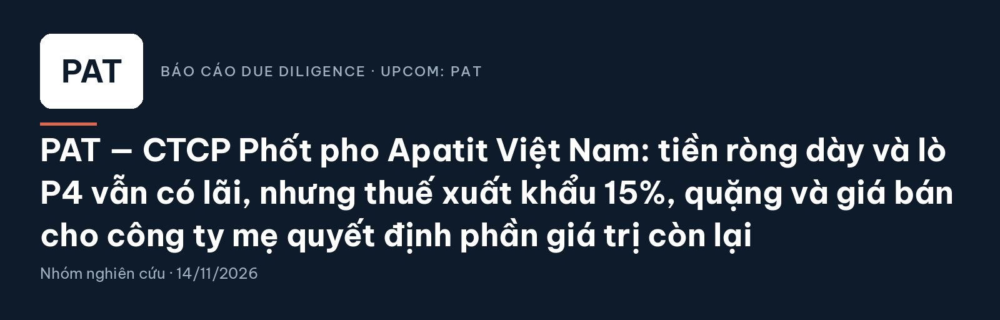
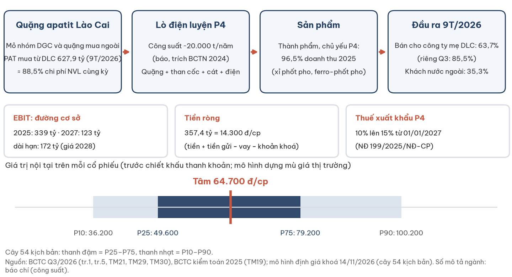
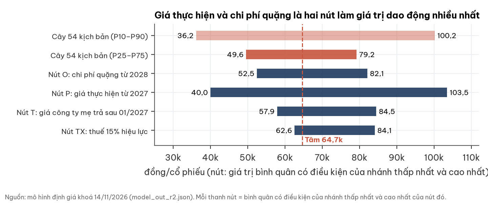
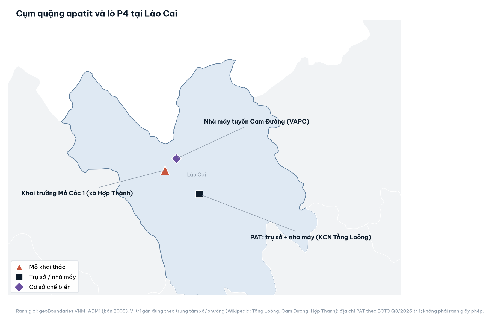
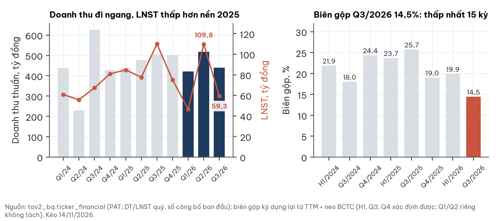
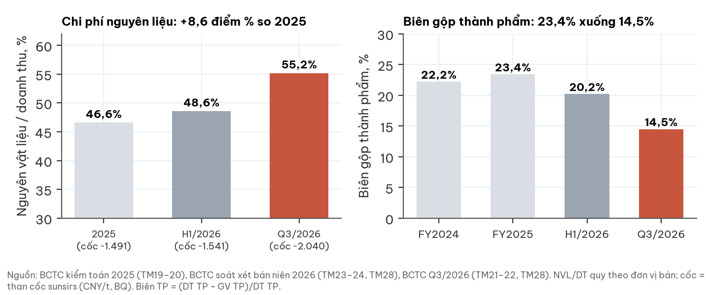
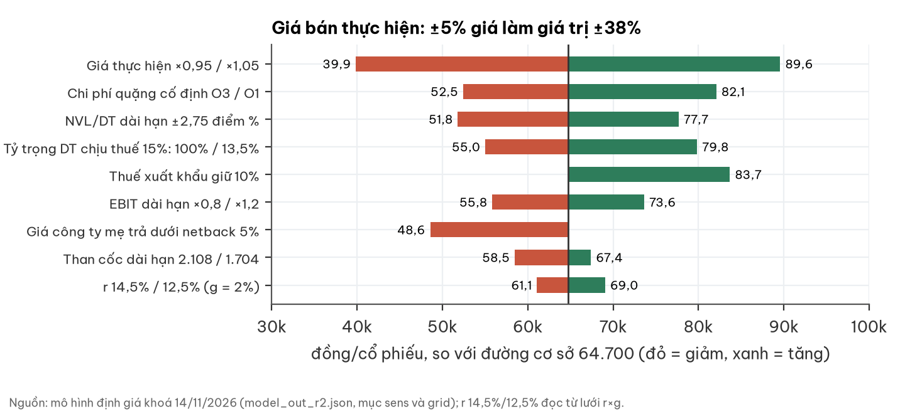
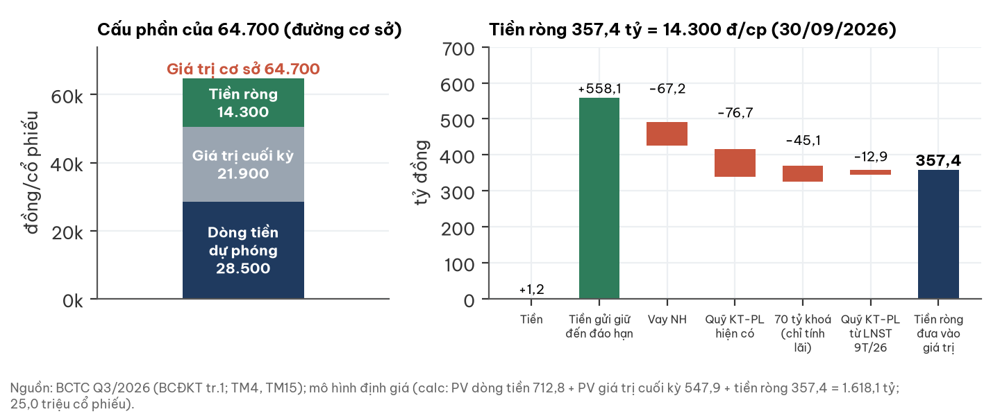
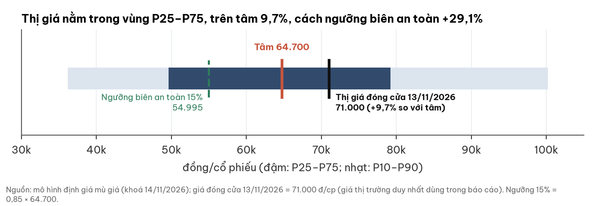

# PAT — CTCP Phốt pho Apatit Việt Nam: tiền ròng dày và lò P4 vẫn có lãi, nhưng thuế xuất khẩu 15%, quặng và giá bán cho công ty mẹ quyết định phần giá trị còn lại

**Báo cáo Due Diligence · 14/11/2026 · Nhóm nghiên cứu** · UPCoM: PAT · Sản xuất phốt pho vàng (P4) · Dữ liệu BCTC đến quý 3/2026

## Investment Summary

**Giá trị nội tại trước chiết khấu thanh khoản: tâm 64.700 đ/cp; vùng P25–P75 là 49.600–79.200; vùng P10–P90 là 36.200–100.200.** Đây là định giá dựng mù giá thị trường: người định giá không thấy giá, vốn hoá hay P/E của PAT. Đối chiếu với thị giá ở mục 8.

| Chỉ tiêu | Giá trị | Ghi chú |
|---|---|---|
| Giá trị tâm; vùng P25–P75 | **64.700**; 49.600–79.200 đ/cp | Tâm = bình quân có trọng số xác suất của 54 kịch bản |
| Khoảng sau phản biện độc lập hai chiều | 56.100–68.000 đ/cp | Tâm 64.700 nằm trong khoảng; chênh lệch chủ yếu do nút giá DLC chưa có văn bản (mục 6) |
| Trong đó tiền ròng | 357,4 tỷ = 14.300 đ/cp | Đã trừ vay, quỹ khen thưởng – phúc lợi và 70 tỷ khoá cầm cố |
| DT; LNST 9T/2026 | 1.379,3; 215,7 tỷ | −2,9%; −20,8% so với 9T/2025 |
| Biên gộp Q3/2026 (Q3/2025) | 14,5% (25,7%) | Thấp nhất trong 15 kỳ quan sát được từ 2021 |
| EBIT đường cơ sở | 123 tỷ (2027); 172 tỷ (dài hạn) | EBIT 2025: 339 tỷ |
| Bán cho công ty mẹ DLC | 85,5% DT Q3/2026 | 9T/2026: 63,7%; nguyên tắc giá không công bố |
| Thuế xuất khẩu P4 | 10% lên 15% từ 01/01/2027 | NĐ 199/2025/NĐ-CP |
| Số cổ phần; cổ tức năm 2025 | 25 triệu; 129% bằng tiền | 322,5 tỷ, bằng 94% LNST kiểm toán 2025 |

**Ba điều cần biết**

1. **Nền lợi nhuận đã đổi.** Biên gộp rơi từ 25,7% xuống 14,5% (Q3/2025 so với Q3/2026), chủ yếu do chi phí nguyên vật liệu; giá bán trên tấn không xác định được vì không có sản lượng.
2. **Giá trị phụ thuộc ba quyết định bên ngoài.** Cách công ty mẹ trả giá sau thuế 15% (nút lớn nhất, chưa có văn bản), nguồn quặng và giá P4 Trung Quốc. Giá thực hiện ±5% làm giá trị ±38%.
3. **Bảng cân đối vững, quản trị còn WARNING.** Không vay dài hạn, tiền và tiền gửi 559 tỷ; nhưng lãnh đạo bị khởi tố và kiểm toán ngoại trừ, chưa có kết luận.

Điều làm nhận định tích cực hơn hay tiêu cực hơn: bảng mốc ở mục 11.

## 1. Tóm tắt điều hành

- **Tình huống.** PAT luyện P4 bằng lò điện tại KCN Tằng Loỏng (Lào Cai); công ty mẹ DLC nắm 51%. 9T/2026 LNST 215,7 tỷ, giảm 20,8%.
- **Biến chuyển.** Ba thay đổi cùng lúc: chi phí quặng lên chế độ mới, thuế xuất khẩu P4 lên 15% từ 01/01/2027, và 85,5% doanh thu Q3 bán cho công ty mẹ.
- **Câu hỏi.** Lợi nhuận bền vững là bao nhiêu khi ba biến số trên đều do bên ngoài quyết định?
- **Trả lời.** Tâm 64.700 đ/cp, trong đó 14.300 là tiền ròng. Vùng giá trị rộng vì ba nút đều chưa có văn bản xác nhận.

## 2. Doanh nghiệp và ngành: một lò điện nhận giá thế giới, bị chặn ở đầu vào quặng

*Sơ đồ chuỗi giá trị ở trang 1 là hình minh họa tự vẽ; công ty chưa có ảnh sản phẩm công bố mà nhóm truy cập được.*

- **Doanh nghiệp.** Thành lập 13/01/2014, 264 nhân viên, công suất khoảng 20.000 tấn P4 mỗi năm, khoảng 14% sản lượng cả nước (báo, trích BCTN 2024). Thành phẩm, chủ yếu P4, chiếm 96,5% doanh thu 2025.
- **Quan hệ với công ty mẹ.** PAT mua từ DLC 627,9 tỷ nguyên liệu (9T/2026), khoảng 88,5% chi phí nguyên vật liệu cùng kỳ, và bán cho DLC 878,1 tỷ.
- **Ngành.** Giá P4 do Trung Quốc đặt: 28.466 CNY/t ngày 13/11/2026, +24% so với cùng kỳ, đang ở mức p90 của chế độ giá từ 2023. Cầu P4 (glyphosate, pin LFP) không phải điểm yếu.
- **Cung bị chặn ở quặng.** Từ 06/2026 ba nhà máy tuyển của VAPC (1,37 triệu tấn/năm) dừng hoặc giảm công suất; 3,53 triệu tấn quặng loại III tồn kho chờ quyết định. Thuế xuất khẩu nhằm đẩy chế biến sâu trong nước.

## 3. Tài chính: doanh thu đi ngang, lợi nhuận thấp hơn nền 2025, tiền mặt dày

- **Kết quả.** Q3/2026 LNST 59,3 tỷ, giảm 46,1% so với Q3/2025. Kế hoạch 2026 theo báo là LNST 280 tỷ; sau 9 tháng đạt 77%.
- **Dòng tiền.** CFO 9T/2026 là 128,2 tỷ, thấp hơn LNST vì phải trả người bán giảm 292,7 tỷ, được bù bằng thu hồi phải thu 249,4 tỷ.
- **Bảng cân đối.** Vay ngắn hạn 67,2 tỷ, không vay dài hạn. Khoảng 79,6% gốc tiền gửi kỳ hạn đang cầm cố cho hạn mức vay và bảo lãnh tiền điện.

## 4. Phán đoán khả năng sinh lời thực: lợi nhuận bền vững khoảng một nửa năm 2025

**EBIT bền vững 172 tỷ (đường cơ sở), bằng 51% EBIT 2025 (339 tỷ), vì chi phí quặng, than cốc và thuế xuất khẩu cùng tăng mà giá bán không chắc tăng theo.**

| Hạng mục (đường cơ sở) | Giá trị | Cơ sở |
|---|---|---|
| Doanh thu thành phẩm | 1.822 tỷ/năm | 9T/2026 quy năm (giá, lượng 9T) |
| Nguyên vật liệu/doanh thu | 48,2% đến 54,2% dài hạn; 51,3% đến 55,5% năm 2027 | Theo chế độ quặng (nút O) |
| Dịch vụ mua ngoài; khác | 25,2%; 5,8% doanh thu | Dịch vụ, giả định chủ yếu là điện |
| Biên gộp thành phẩm dài hạn | 12,9% | Sau thuế 15% và chế độ quặng |
| EBIT 2027; dài hạn | 123 tỷ; 172 tỷ | Giá 2028 cho dài hạn |
| Thuế TNDN | 5% (2027–2030); 10%; 20% (từ 2033) | Ưu đãi theo văn bản |
| Chi đầu tư | 45 tỷ/năm, bằng khấu hao | Kế hoạch |

**Vì sao biên gộp thành phẩm giảm 8,9 điểm % (23,4% xuống 14,5%)**

| Nguyên nhân | Đóng góp vào NVL/DT | Tính chất |
|---|---|---|
| Quặng chế độ 1 (từ Q4/2025) | ≈ +1,8 điểm % | Kéo dài ba kỳ |
| Quặng chế độ 2 (Q3/2026): khai trường 25 của công ty mẹ tạm dừng phục vụ điều tra | ≈ +4,2 điểm % | Hành chính, pháp lý |
| Than cốc 1.491 lên 2.040 CNY/t | ≈ +2,6 điểm % | Chu kỳ, cùng cú sốc năng lượng 2026 |
| Giá bán trên tấn | Không xác định (±7 điểm %) | Thiếu sản lượng |
| Dịch vụ mua ngoài (chủ yếu điện) | Giữ 23–26% doanh thu | Không phải nguồn giảm |

*Các đóng góp là tự tính từ yếu tố chi phí và giá than cốc (tổng ≈ +8,6 điểm %).*

**Vì sao đây là lõi của định giá**

- PAT nhận giá theo Trung Quốc; biên gộp dài hạn chỉ 12,9% nên giá ±5% làm giá trị ±38%.
- Chi phí quặng do giấy phép, giải phóng mặt bằng và điều tra quyết định, nằm ngoài quyền kiểm soát của PAT.
- Định giá nhanh trên LNST lịch sử cho 90.500 đ/cp, cao hơn 64.700 vì lịch sử chưa có thuế 15% và chế độ quặng Q3/2026.

## 5. Định giá: tâm 64.700 từ cây 54 kịch bản, phân phối lệch trái (trung vị 68.500)

| Nút | Nhánh (xác suất) | Giá trị có điều kiện, đ/cp | Cơ sở xác suất |
|---|---|---|---|
| **O**: chi phí quặng từ 2028 | Về mức 2025 (0,1375); giữ chế độ H1/2026 (0,3875); chế độ Q3/2026 vĩnh viễn (0,475) | 82.100; 73.600; 52.500 | Mỏ riêng nhóm DGC chạy lại 0,5; cung quặng nhà nước bình thường hoá trước 2028 0,55; hai điều kiện độc lập |
| **P**: giá thực hiện từ 2027 | −6,3% (0,32); giữ (0,58); +6,3% (0,10) | 40.000; 71.700; 103.500 | Biên độ bằng mức PAT đã thay đổi 2025 đến 9T/2026; xác suất theo dự báo khoá trước giá P4 12 tháng |
| **T**: giá DLC trả sau 01/01/2027 | Netback, thuế chạm ~100% DT (0,65); giữ cơ cấu, chạm 35% (0,25); DLC bù và dồn lượng, chạm 13,5% (0,10) | 57.900; 74.700; 84.500 | Chuẩn giao dịch độc lập ở nước xuất ròng; động cơ bên kiểm soát |
| **TX**: thuế 15% hiệu lực | Có (0,90); giữ 10% (0,10) | 62.600; 84.100 | Đã đọc bản chép Phụ lục NĐ 199; có dự thảo chưa đọc được |

*Netback (T_a): giá trong nước bằng giá xuất khẩu trừ thuế xuất khẩu; T_b: giữ cơ cấu giá; T_c: DLC bù thuế và dồn lượng. Giá trị lá chính (đ/cp; thuế 15%, giá giữ):*

| | T: netback | T: giữ cơ cấu | T: DLC bù |
|---|---|---|---|
| O1: quặng về mức 2025 | 79.200 | 98.100 | 108.700 |
| O2: giữ chế độ H1/2026 | 70.700 | 89.600 | 100.200 |
| O3: chế độ Q3/2026 vĩnh viễn | 49.600 | 68.500 | 79.100 |

**Độ nhạy theo chi phí vốn** (đ/cp; r = 13,5% neo tại lãi huy động 12 tháng hiệu dụng 7,4%, β = 1: mỗi ±50 điểm cơ bản lãi huy động tương ứng ±0,5 điểm % r)

| r \ g | 0% | 1% | 2% | 3% |
|---|---|---|---|---|
| 12,5% | 61.600 | 65.000 | 69.000 | 73.900 |
| 13,5% | 58.500 | 61.400 | **64.700** | 68.700 |
| 14,5% | 55.700 | 58.200 | 61.100 | 64.400 |

## 6. Điểm kém chắc nhất (xếp hạng)

| # | Điểm | Vì sao kém chắc | Tác động |
|---|---|---|---|
| 1 | Giá DLC trả sau 01/01/2027 (nút T) | Chưa có văn bản; xác suất 0,65/0,25/0,10 dựa trên lập luận kinh tế và quản trị, không phải điều khoản hợp đồng | Trả dưới netback 5%: 48.600 |
| 2 | Truyền dẫn giá TQ sang PAT (nút P) | Tương quan biên gộp với giá P4 giai đoạn H1/2024–Q3/2026 là −0,57 (8 kỳ, không có ý nghĩa thống kê); 2025 PAT +9,4% khi giá TQ đi ngang | Giữ giá thực hiện: ~71.700; ±5% giá: ±38% |
| 3 | Chi phí quặng (nút O) | Hai đầu vào đều là phán đoán: xác suất 0,5 trung tính; ca đúng một nguyên nhân chia đều | Cố định O3: 52.500; O1: 82.100 |
| 4 | Giá/tấn và nguyên liệu/tấn 2026 | Không có sản lượng; sai số ±7 điểm % | Không tách được giá khỏi chi phí trên tấn |

### Phản biện độc lập hai chiều

Hai người phản biện, mỗi người chỉ đọc một chiều (tích cực hoặc tiêu cực) và không biết thị giá, cùng đối chiếu 20 số trọng yếu với ảnh BCTC Q3/2026 (đều khớp) và chạy lại mô hình (tái lập 64.736). Không có lỗi dữ kiện. Các hiệu chỉnh CÓ bằng chứng nằm trong khoảng 56.100–68.000:

| Chiều | Hiệu chỉnh có bằng chứng | Tâm hiệu chỉnh |
|---|---|---|
| Tích cực (tìm chỗ lạc quan) | Nhánh DLC trả trên giá xuất khẩu sau thuế (xác suất 0,35) chưa có bằng chứng, nhưng nhánh trả dưới giá đó chưa được tính: đặt đối xứng ⇒ 57.900; chi phí vận chuyển theo 9T/2026 (4,69% doanh thu xuất khẩu) −1.150; hỗ trợ giá quặng chưa có quyết định −580 | ≈ 56.100 (−13,4%) |
| Tiêu cực (tìm chỗ bi quan) | Biên độ giá ±6,3% suy ra dưới giả định DLC trả giá xuất khẩu sau thuế, không nên áp cho nhánh còn lại (+2.500); chi phí theo từng chế độ quặng nhất quán (+730) | ≈ 68.000 (+5,0%) |

Cả hai cùng chỉ ra nút giá DLC là điểm quyết định: tờ trình giao dịch bên liên quan của ĐHĐCĐ 12/05 và 14/08/2026 có thể đưa tâm về đầu trên hoặc đầu dưới của khoảng. Tâm 64.700 được giữ nguyên vì các hiệu chỉnh trái chiều và đều nhỏ hơn bất định của nút này.

## 7. Khoản đã tính và khoản đã loại vì thiếu bằng chứng

| Khoản | Trong cơ sở? | Bằng chứng |
|---|---|---|
| Thuế xuất khẩu 15% theo nút T | Có (−) | NĐ 199/2025; BCTC TM13 |
| 70 tỷ cầm cố bảo lãnh tiền điện: chỉ tính phần lãi (−45,1 tỷ) | Có (−) | Có mặt liên tục 7 quý; lãi 6,0%/năm |
| Quỹ khen thưởng – phúc lợi 6% trên LNST 9T (−12,9 tỷ) | Có (−) | Chính sách trích hằng năm |
| Than cốc: 2027 giao ngay 2.108; từ 2028 trung bình 2023–Q3/2026 là 1.825; định mức 1,37 t/t | Có (±) | Dữ liệu sunsirs; hoá học lò P4 |
| Điện: −2% từ 01/11/2026; kỳ vọng tăng +2,35% từ 2027 | Có (≈ 0) | QĐ 1305/QĐ-EVN; dự báo khoá trước |
| Tiền ròng 357,4 tỷ; thuế TNDN ưu đãi; chi đầu tư bằng khấu hao | Có (+/−) | BCTC Q3/2026 |
| Công ty mẹ hấp thụ thuế cho PAT | Không; chỉ là nhánh T (0,35) | Không có bằng chứng; ngược động cơ bên kiểm soát |
| 42,6 tỷ cầm cố cho công ty thành viên; phạt hoặc truy thu vụ án; hoàn nguyên đất | Không (WARNING, độ nhạy) | Thiếu số tổn thất; có bảo đảm chéo hai chiều |
| Hỗ trợ giá quặng (chỉ trong O1); mở rộng; phần bù moat; giải phóng vốn lưu động | Không | Chưa có quyết định hoặc số |
| Sản lượng 2027 theo nhịp bán Q3 | Không; giữ 1.822 tỷ | Tồn kho thành phẩm tăng 16,65 tỷ trong Q3 |

## 8. Đối chiếu với thị giá

- **Phương pháp.** Định giá trên mù giá thị trường: giả định được khoá (có dấu md5 và thời điểm) trước khi chạy mô hình và trước khi so với giá.
- **Kết quả.** Đóng cửa 13/11/2026 là 71.000 đ/cp: cao hơn tâm 9,7%, nằm trong vùng P25–P75 (49.600–79.200). Theo cây, khoảng 67% xác suất rơi vào các kịch bản có giá trị thấp hơn 71.000 (tự tính).
- **Biên an toàn.** Ngưỡng 15% (0,85 × tâm) là 54.995; thị giá cao hơn ngưỡng này 29,1%. Thị giá không có biên an toàn và gần với giá trị của nhánh giữ nguyên giá thực hiện (71.700).
- **Thanh khoản.** Khối lượng trung vị khoảng 9.300 cp/phiên; thoát 50.000 cp với mức tham gia 10% mất khoảng 54 phiên, chiết khấu minh hoạ phần thời gian 1,5% (≈ 63.700). Không trừ vào tâm.

## 9. Pháp lý và quản trị: WARNING, không đưa vào cơ sở định giá

- **Vụ án.** 17/03/2026 cơ quan điều tra khởi tố các tội về kế toán, khai thác tài nguyên, ô nhiễm môi trường tại nhóm DGC; bị can gồm nguyên Chủ tịch, thành viên HĐQT, Giám đốc, Kế toán trưởng của PAT. 23/07/2026 khởi tố thêm Chủ tịch đương nhiệm khi đó. Chưa có kết luận.
- **Kiểm toán.** BCTC 2025 (UHY, 20/06/2026) và soát xét bán niên 2026 (UHY, 14/08/2026) đều ngoại trừ; Ban Giám đốc chưa ước được ảnh hưởng tài chính. Minh hoạ: lỗ một lần 50 tỷ bằng −2.000 đ/cp.
- **Tác động đã biết.** Thay toàn bộ lãnh đạo, chậm nộp BCTC kiểm toán 2025, hạn chế giao dịch từ 01/06/2026 và diện cảnh báo đến 24/08/2026. Chưa có phạt, truy thu hay đình chỉ đích danh PAT; rủi ro lan sang PAT tồn tại vì PAT ở KCN Tằng Loỏng.
- **Bên liên quan.** Bán cho DLC chiếm 85,5% DT Q3/2026, nguyên tắc giá không công bố. 40 tỷ và 100.000 USD tiền gửi cầm cố cho vay của công ty thành viên; mất toàn bộ: −1.700 đ/cp.

## 10. Điều thị trường có thể chưa tính, và điều có thể đã tính quá tay

| Hướng | Điều kiện | Bằng chứng | Kiểm chứng |
|---|---|---|---|
| Có thể chưa tính (+) | Công ty mẹ không trả theo netback (tổng xác suất 0,35): +10.000 đến +20.000 | Hợp đồng bên liên quan duyệt theo năm | Tờ trình ĐHĐCĐ 12/05 và 14/08/2026; BCTC Q1/2027 |
| Có thể chưa tính (+) | Thuế giữ 10% (xác suất 0,10): 83.700 | Có dự thảo nghị định chưa đọc được; tiền lệ giảm thuế fluorit 2026 | Tờ khai 01/2027 |
| Có thể chưa tính (+) | Quặng bình thường hoá trước 2028 (xác suất 0,55) | Nhà máy Tam Đỉnh 250 kt/năm đã chạy; Cam Đường dự kiến Q4/2026; khai trường 19 thi công lại 18/09/2026 | Quyết định về quặng tồn trước 31/05/2027 |
| Có thể đã tính quá tay (−) | Giá P4 đang ở p90 của chế độ 2023+; hai lần xuất phát từ mức cao đều giảm 12–33% | Dự báo khoá trước: P4 tháng 11/2027 giảm 12% (trung vị) | 14/05 và 12/11/2027 |
| Có thể đã tính quá tay (−) | Than cốc 2.108 CNY/t (+41% so với cùng kỳ) giữ lâu | Cú sốc năng lượng 2026; lưu huỳnh cùng cú sốc đã rút 44% | Giá than cốc quý 1/2027 |
| Có thể đã tính quá tay (−) | Thuế 15% chạm toàn bộ DT: 55.000 | Chuẩn giao dịch độc lập | BCTC Q1/2027 |

## 11. Điều làm đổi ý: mốc kiểm tra hai chiều

| Mốc | Nâng giá trị | Hạ giá trị | Tài liệu cần đối chiếu |
|---|---|---|---|
| Khi có tờ trình giao dịch bên liên quan (ĐHĐCĐ 12/05 và 14/08/2026) | Giá DLC cố định hoặc không phụ thuộc thuế: +10.000 đến +20.000 | Giá = giá xuất khẩu trừ thuế: nút T_a chắc chắn | Tài liệu ĐHĐCĐ trên HNX; NQ 02/2026/NQ-ĐHCĐ |
| 15/01/2027 | Thuế 15% hoãn hoặc giảm: 83.700 | — | Phụ lục I NĐ 199/2025 (văn bản chính thức) |
| Cuối 01/2027: BCTC Q4/2026 | NVL/DT ≤ 50%: nghiêng O2/O1 | NVL/DT ≥ 55% thêm một quý: nghiêng O3 | TM chi phí theo yếu tố |
| Cuối 04/2027: BCTC Q1/2027 (quý đầu thuế 15%) | DT thành phẩm không giảm dù xuất khẩu giảm: T_b/T_c | Giá ngầm định giảm ~5,6% ở cả hai kênh: T_a | TM doanh thu theo địa lý, TM bên liên quan |
| 31/05/2027 | Quyết định dùng 3,53 triệu tấn quặng tồn; 3 nhà máy VAPC ≥ 80% công suất | Không có cả hai: tăng xác suất O3 | Báo Lào Cai, Bộ Công Thương |
| Từ 01/2027: giấy phép KT25, kết luận điều tra | Gia hạn hoặc mỏ chạy lại | Không gia hạn | CBTT của DGC |
| 14/05 và 12/11/2027: giá P4 Trung Quốc | P4 > 32.000 CNY/t | P4 < 23.000 CNY/t và giá PAT đi theo | sunsirs; sản lượng nếu PAT công bố |
| BCTN 2025/2026 | Có sản lượng (tấn): đóng mâu thuẫn ±7 điểm % | — | BCTN PAT |

## Phụ lục A. Số liệu BCTC chính (tỷ đồng)

| Chỉ tiêu | Q3/2026 | Q3/2025 | 9T/2026 | 9T/2025 | FY2025 | FY2024 |
|---|---|---|---|---|---|---|
| Doanh thu thuần | 440,0 | 506,7 | 1.379,3 | 1.420,8 | 1.923,4 | 1.721,4 |
| Lợi nhuận gộp | 63,6 | 130,5 | 250,6 | 347,1 | 439,4 | 363,2 |
| Biên gộp | 14,5% | 25,7% | 18,2% | 24,4% | 22,8% | 21,1% |
| LNST | 59,3 | 110,0 | 215,7 | 272,3 | 343,2 | 264,9 |
| EPS (đ/cp) | 2.230 | 4.135 | 8.111 | 10.240 | 12.905 | 10.058 |

Ngày 30/09/2026: tiền 1,2; tiền gửi giữ đến đáo hạn 558,1; vay ngắn hạn 67,2; hàng tồn kho 120,2; vốn chủ sở hữu 708,4. Nguồn: BCTC Q3/2026 (tr.1, tr.5, TM4, TM15, TM21–TM22), BCTC kiểm toán 2025, BCTC soát xét bán niên 2026. Chuỗi quý từ cơ sở dữ liệu nội bộ là số công bố ban đầu; số năm 2025 trong báo cáo lấy từ BCTC kiểm toán.

## Phụ lục B. Đối chiếu dữ liệu quý với BCTC (tỷ đồng)

| Chỉ tiêu | Cơ sở dữ liệu | BCTC |
|---|---|---|
| DT thuần Q3/2026; LNST Q3/2026 | 440,032; 59,320 | 440,032; 59,320 (Q3/2026, tr.5) |
| DT thuần Q3/2025; LNST Q3/2025 | 506,727; 109,967 | 506,727; 109,967 (Q3/2026, tr.5) |
| DT thuần H1/2026 (Q1 + Q2) | 939,271 | 939,271 (soát xét bán niên 2026, tr.8) |
| LNST FY2024 | 264,941 | 264,941 (kiểm toán 2025) |
| Lợi nhuận gộp Q3/2026 (dựng từ chuỗi 4 quý) | 63,603 | 63,604 (Q3/2026, tr.5) |
| Hàng tồn kho 30/06/2026 | 74,843 | 74,843 (soát xét bán niên 2026, tr.6) |

## Phụ lục C. Nguồn

BCTC Q3/2026 (lập 20/10/2026); BCTC soát xét bán niên 2026 (UHY, số 907/2026/UHY-BCSX, 14/08/2026); BCTC kiểm toán 2025 (UHY, số 749/2026/UHY-BCKT, 20/06/2026). NĐ 199/2025/NĐ-CP (bản chép, thutucxuatnhapkhau.vn); QĐ 1305/QĐ-EVN ngày 30/10/2026. Báo Lào Cai 06/10/2026 và 20/10/2026; Báo Pháp luật Việt Nam 24/10/2026 và 29/10/2026; sunsirs (giá P4, than cốc) qua cơ sở dữ liệu giá hàng hoá; đọc ngành độc lập 14/11/2026. Vị trí bản đồ: Wikipedia (xã Tằng Loỏng, phường Cam Đường, xã Hợp Thành), ranh giới geoBoundaries VNM-ADM1 (bản 2008). Huy hiệu tiêu đề là chữ theo mã cổ phiếu, không phải logo công ty.

## Phụ lục D. Phương pháp và giới hạn

- Định giá FCFE hai giai đoạn, r = 13,5%, g = 2%, tâm = bình quân có trọng số 54 lá; vùng = phân vị có trọng số. Dự án mới có NPV = 0; vụ án là WARNING, không đưa vào cơ sở.
- Chưa có: sản lượng và giá/tấn; nguyên tắc giá giao dịch với DLC; định mức quặng, cốc, điện riêng của PAT; BCTN 2025 (không mở được); tách Q1 và Q2 riêng.
- NĐ 199/2025 đọc qua bản chép. Một số số báo chí chưa đối chiếu nguồn gốc. Xác suất kịch bản là nhận định có neo số liệu, không phải đo đạc.
- Bản đồ chỉ cụm khu vực, vị trí gần đúng; nhà máy tuyển Bắc Nhạc Sơn không vẽ vì chưa có toạ độ có nguồn.

## Phụ lục E. Quy trình độc lập

Số liệu đối chiếu với trang BCTC gốc; ngành được đọc độc lập mù; giả định định giá khoá trước khi chạy mô hình; hai người phản biện độc lập, mỗi người đọc một chiều (tích cực / tiêu cực), đều không biết thị giá; kết quả ở mục 6.

## Phụ lục F. Tuyên bố miễn trừ trách nhiệm

Tài liệu này chỉ nhằm cung cấp thông tin nghiên cứu, không phải lời khuyên đầu tư, khuyến nghị mua hoặc bán chứng khoán, và không tính đến mục tiêu, tình hình tài chính của bất kỳ nhà đầu tư cụ thể nào. Số liệu lấy từ nguồn được cho là đáng tin cậy nhưng không bảo đảm đầy đủ hoặc chính xác tuyệt đối. Các ước lượng, xác suất và dự báo là nhận định có thể sai. Người đọc tự chịu trách nhiệm với quyết định của mình.
