# PNJ — CTCP Vàng bạc Đá quý Phú Nhuận: thương hiệu và mạng lưới còn nguyên, nhưng giá đã trả cho một cú hồi phục vượt kế hoạch của chính doanh nghiệp

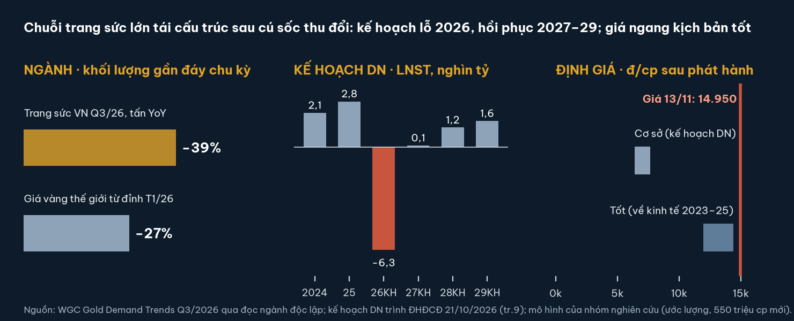

**Kết luận:** giá 14.950 đ/cp (đóng cửa 13/11/2026) nằm **TRÊN** vùng giá trị hợp lý cơ sở **6.370–7.640 đ/cp** và ngang đầu trên kịch bản tốt (11.930–14.370 đ/cp). Đây là khoảng rộng, không phải điểm vào. Thị trường đang trả cho mức LNST 2029 khoảng 2,7 nghìn tỷ, gần bằng năm 2025, trong khi kế hoạch của doanh nghiệp là 1,6 nghìn tỷ.

| Chỉ tiêu | Giá trị | Ghi chú |
|---|---|---|
| Giá tham chiếu | 14.950 đ/cp | Khớp cuối 14:45:04 ngày 13/11/2026 (DNSE); 14/11 là thứ Bảy, không có phiên |
| Vùng giá trị cơ sở | 6.370–7.640 đ/cp | Theo kế hoạch doanh nghiệp, sau phát hành 550 triệu cp (ước lượng) |
| Vốn hoá | khoảng 7.650 tỷ đồng | 511,72 triệu cp lưu hành |
| P/B theo sổ 30/9 / sau Q4 kế hoạch | 0,58x / khoảng 1,19x | BVPS 25.760 / khoảng 12.590 (ước lượng) |
| LNST 9T/2026 / kế hoạch 2026 | +471,7 / −6.270 tỷ | Kế hoạch điều chỉnh do doanh nghiệp công bố |
| Giá trị thu đổi còn lại | 21.057,9 tỷ | 1,6 lần vốn chủ sở hữu 30/9 |
| Nợ ròng 30/9 | khoảng 2.996 tỷ | Vay ngắn hạn 4.320,6 − tiền và đầu tư đáo hạn 1.324,8 |
| Thanh khoản | 141,3 tỷ/phiên | Trung vị 20 phiên; không cần chiết khấu thanh khoản |

**Ba điều cần biết**
- **Cú sốc là niềm tin, không phải ngành:** vụ án tại công ty con giám định P-Lab kéo theo làn sóng thu đổi; nghĩa vụ thu đổi còn lại 21.058 tỷ, dự phòng kế hoạch 7.071 tỷ.
- **Nền tảng kinh doanh còn:** 403 cửa hàng ở 31/34 tỉnh thành, giấy phép kinh doanh vàng miếng, biên gộp Q3 trước dự phòng 13,3–20,3% (cùng kỳ 19,8%).
- **Pha loãng và thời gian là cái giá:** phát hành riêng lẻ tối đa 550 triệu cp (khoảng 107%), khả thi sớm nhất sau BCTC kiểm toán 2026; kế hoạch biên gộp 2027–29 chỉ 8,8–10,9%.

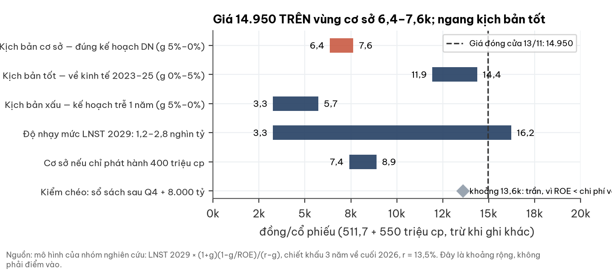

## 1. Tóm tắt điều hành — tình huống, vấn đề, câu trả lời

| | Nội dung |
|---|---|
| Tình huống | Chuỗi bán lẻ trang sức có thương hiệu, ROE trung bình 5 năm 21,5% đến trước 2026; niêm yết HOSE từ 23/03/2009 |
| Biến cố | 02/07/2026 cựu giám đốc công ty con P-Lab bị khởi tố trong vụ buôn lậu kim cương; khách thu đổi ồ ạt theo chính sách mua lại trọn đời |
| Vấn đề | Thu đổi tháng 7 gần bằng cả năm 2025; chậm thanh toán từ 21/07; kế hoạch LNST 2026 −6.270 tỷ; cần huy động 8.000 tỷ năm 2027 |
| Câu trả lời | Doanh nghiệp có đường hồi phục được ĐHĐCĐ thông qua; giá hiện tại đã phản ánh kịch bản tốt hơn kế hoạch đó |

| Luận điểm tích cực | Luận điểm tiêu cực |
|---|---|
| Thương hiệu + mạng lưới 403 cửa hàng, 31/34 tỉnh thành | Thanh khoản căng: tiền PNJ riêng khoảng 3.700 tỷ (30/6) còn 770 tỷ (30/9) |
| Biên gộp Q3 trước dự phòng 13,3–20,3%, không chứng minh suy giảm cấu trúc | CFO 9T/2026 −883 tỷ; Q3 −2.874 tỷ |
| PwC soát xét H1/2026: kết luận chấp nhận toàn phần (có đoạn nhấn mạnh) | Pha loãng tối đa khoảng 107%; sàn giá phát hành = giá trị sổ sách |
| Pháp nhân PNJ không bị khởi tố; công an xác nhận hồ sơ nhập khẩu đầy đủ | Kế hoạch biên gộp 2027–29 8,8–10,9% vs 17,5–21,8% (2024–25) |
| Giấy phép kinh doanh vàng miếng (GP 293/GP-NHNN, 2012) | Thuyết minh TM17 có hai con số dự phòng không khớp — chờ kiểm toán |
| Chủ tịch HĐQT cho vay 700 tỷ tín chấp; VietinBank tăng hạn mức +707 tỷ | ACB, HSBC rút hẳn; VCB giảm 802 tỷ; GĐCC Tài chính từ nhiệm 06/11 |

## 2. Thị trường đang định giá điều gì

**Ở 14.950 đ/cp, thị trường ngầm định LNST 2029 khoảng 2.670 tỷ (ước lượng, nội suy) — 94% mức 2025 và 1,7 lần kế hoạch doanh nghiệp.**

| Mức LNST 2029 (tỷ) | Cơ sở | đ/cp, g 5% | đ/cp, g 0% |
|---|---|---|---|
| 1.200 | Kế hoạch 2028 (trễ 1 năm) | 3.263 | 5.726 |
| 1.600 | Kế hoạch 2029 | 6.446 | 7.635 |
| 2.113 | Trung vị 2023–25 | 10.527 | 10.082 |
| 2.828 | Thực hiện 2025 | 16.221 | 13.497 |
| khoảng 2.670 | Ngầm định trong giá 14.950 | 14.950 | — |

- Giá trị nhạy mạnh theo MỨC lợi nhuận (gấp khoảng 5 lần từ 1.200 lên 2.828 tỷ), hơn mọi tham số khác.
- Cùng giá đó, nếu chỉ phát hành 400 triệu cp thì mức lợi nhuận cần thiết thấp hơn (giá cao giúp ít cổ phiếu mới hơn).

## 3. Ngành — cầu trang sức gần đáy chu kỳ, khung pháp lý chính thức hoá có lợi chuỗi lớn

| Chỉ báo | Số | Đọc |
|---|---|---|
| Trang sức VN Q3/2026 (WGC) | 1,4 tấn, −39% YoY | Khối lượng yếu nhất khu vực; thế giới thấp nhất từ 2000 |
| Giá vàng thế giới | khoảng 4.030–4.053 USD/oz (11/11), −27% từ đỉnh T1/2026 | Giá ổn định, giảm thường thuận cho khối lượng trang sức |
| NĐ 390/2026 (hiệu lực 16/10) | Giao dịch vàng ≥5 triệu đ/ngày phải chuyển khoản | Đẩy thị phần từ tiệm nhỏ sang chuỗi có hoá đơn, KYC |
| Kim cương nhân tạo (LGD) | Giá bán lẻ 1ct −30,1% (03/2025–09/2026) | Rủi ro giá trị tồn kho kim cương tự nhiên |
| Tổng mức bán lẻ T10/2026 | +14,7% YoY | Tiêu dùng chung khoẻ; ô tô −28,4% YoY |

- Người đọc ngành độc lập xếp 12 tháng: chu kỳ 0,40 / hành chính 0,40 / cấu trúc 0,20; 36 tháng nghiêng cấu trúc (0,45).
- Khủng hoảng của PNJ là riêng doanh nghiệp; ngành không gặp cú sốc tương tự.

## 4. Doanh nghiệp — chuỗi trang sức đa nhãn hàng, đang thu gọn để giữ thanh khoản

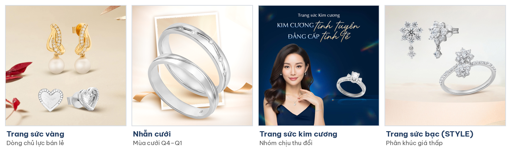

Ảnh: website pnj.com.vn (tải 14/11/2026). Nhãn hàng: PNJ, STYLE by PNJ, CAO Fine Jewellery, ARTA by PNJ.

| Hạng mục | 30/09/2026 | Ghi chú |
|---|---|---|
| Cửa hàng | 403 (PNJ 396 · STYLE 2 · CAO 4 · sỉ 1) | 31/08: 432; 9T mở 10, đóng 38 |
| Địa bàn | 31/34 tỉnh thành | Phân bổ theo tỉnh không công bố |
| Nhân sự | 7.123 | Đầu năm 8.164 (−12,7%) |
| Cơ cấu doanh thu Q3 | Lẻ 60,4% · Sỉ 21,4% · 24K 17,2% | Lẻ −20,1%, sỉ +69%, 24K −41,4% YoY |
| Tồn kho (giá gốc) | 18.855 tỷ | Kim cương 5.160 tỷ, dự phòng 32,7% |

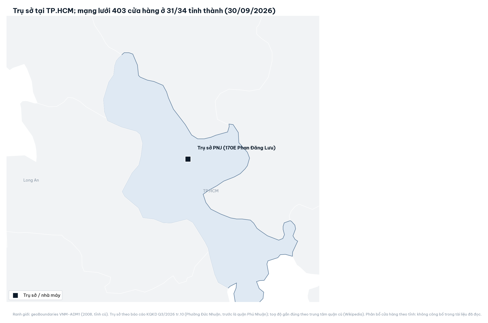

- Chiến lược 2027–29 doanh nghiệp công bố: giải quyết tồn kho kim cương, tối ưu cửa hàng, tái cấu trúc bộ máy.

## 5. Tài chính — lợi nhuận lõi còn, dòng tiền bị nghĩa vụ thu đổi hút cạn

### 5a. Biên gộp báo cáo sập vì dự phòng; trước dự phòng ngang cùng kỳ

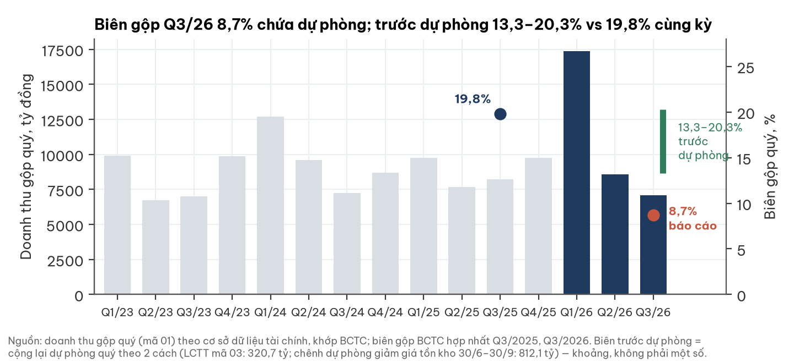

### 5b. Lỗ bắt đầu từ Q2; Q4 gánh phần lớn dự phòng theo kế hoạch

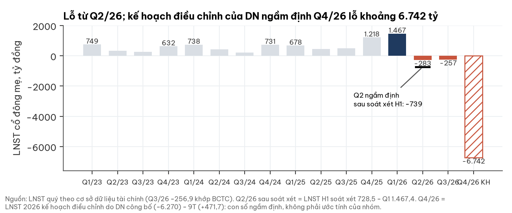

- 9T/2026: doanh thu thuần 32.704 tỷ (+29%), LNST mẹ 471,7 tỷ (−71%).
- Q2 sau soát xét khoảng −739 tỷ, sâu hơn số tự lập −283 tỷ.

### 5c. Nghĩa vụ thu đổi lớn hơn vốn chủ

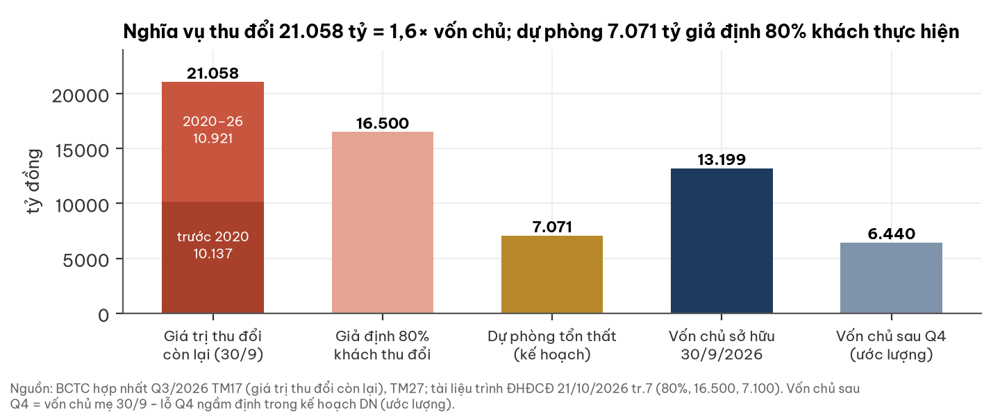

- 100% khách thu đổi thay vì 80%: lỗ thêm khoảng 1.768 tỷ (ước lượng tuyến tính).

### 5d. Dòng tiền và ngân hàng

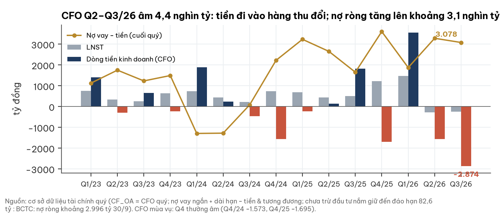

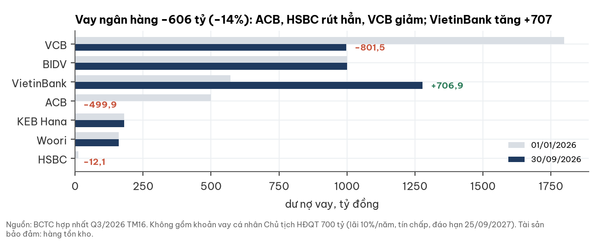

- Ban điều hành đánh giá đủ khả năng đáp ứng nghĩa vụ 12 tháng nhờ giãn thanh toán, hạn mức ngân hàng và phát hành (BCTC soát xét TM2.1).

## 6. Sự kiện vốn — phát hành riêng lẻ 550 triệu cp, sớm nhất sau kiểm toán 2026

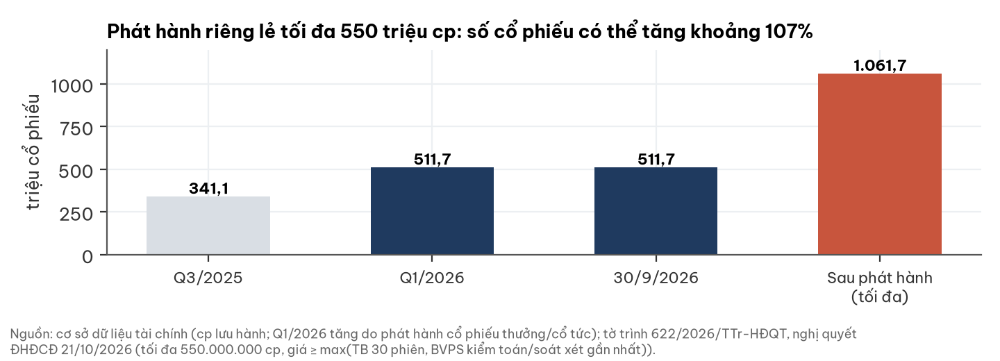

| Điều khoản | Nội dung |
|---|---|
| Quy mô | Tối đa 550 triệu cp (khoảng 107% lưu hành), mục tiêu 8.000 tỷ năm 2027 |
| Sử dụng vốn | 60% xử lý thu đổi · 20% vốn lưu động · 20% trả vay |
| Sàn giá | ≥ max(TB 30 phiên, BVPS BCTC kiểm toán/soát xét gần nhất) |
| Hệ quả | BVPS 30/6 khoảng 26.263 > giá, nên khó phát hành trước BCTC kiểm toán 2026 (khoảng 03/2027) |
| Ở BVPS khoảng 12.590 | 550 triệu cp huy động khoảng 6.923 tỷ < 8.000; cần giá ≥ 14.545 để đủ 8.000 |

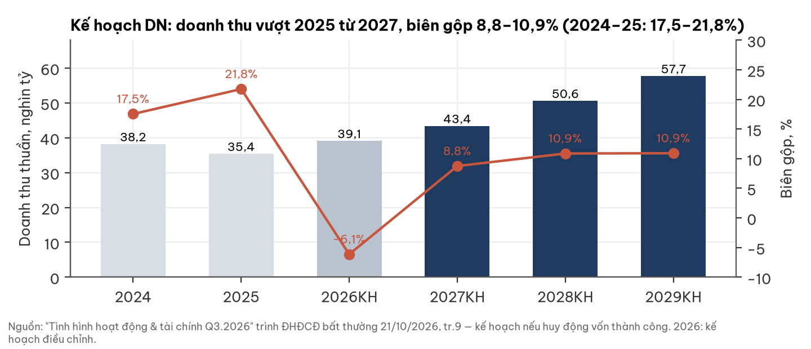

## 7. Định giá — vùng cơ sở 6.370–7.640 đ/cp; giá nằm trên vùng

**Khung:** giá trị vốn chủ sau tái cấp vốn = LNST 2029 × (1+g)(1 − g/ROE)/(r − g), chiết khấu 3 năm về cuối 2026, chia cho 511,72 + 550 triệu cp. Tiền huy động mới được tiêu cho nghĩa vụ thu đổi nên không cộng thêm.

| Kịch bản | Điều kiện | LNST 2029 / ROE | Giá trị (đ/cp) | Xác suất (nhận định) |
|---|---|---|---|---|
| Tốt | Niềm tin hồi, về kinh tế 2023–25 | 2.500 tỷ / 18% (ước lượng) | 11.930–14.370 | khoảng 20% |
| Cơ sở | Đúng kế hoạch ĐHĐCĐ thông qua | 1.600 tỷ / 10% | 6.370–7.640 | khoảng 50% |
| Xấu | Kế hoạch trễ 1 năm (2029 = mức KH 2028) | 1.200 tỷ / 7,6% | 3.270–5.730 | khoảng 30% |

- Xác suất là nhận định định tính, không dùng để tính giá trị kỳ vọng. Cơ sở: kế hoạch đã được ĐHĐCĐ thông qua; cầu trang sức còn yếu; phát hành phụ thuộc kiểm toán 2026.
- Khung có thể thiên thận trọng: năm 2029 trong kế hoạch vẫn đang hồi phục (biên ròng 2,8% vs 6,4% 9T/2025).
- Kiểm chéo sổ sách: BVPS sau Q4 + 8.000 tỷ mới khoảng 13.600 đ/cp; ROE < chi phí vốn nên P/B hợp lý < 1.

**Chi phí vốn và lãi suất**

| Lãi huy động 12T (neo 7,40%, CCTG 02/11) | −100bp | −50bp | Neo | +50bp | +100bp |
|---|---|---|---|---|---|
| Giá trị cơ sở, g 5% (đ/cp) | 7.409 | 6.854 | 6.366 | 5.934 | 5.548 |

- r = 13,5% gắn lãi huy động 12 tháng (hệ số 1:1). Thanh khoản 141,3 tỷ/phiên nên chiết khấu thanh khoản 0%: giá trị trước và sau chiết khấu như nhau.
- Lãi suất chiết khấu thị trường đang ngầm định (r*) 15,1% (147 mã, 30/10/2026), phân vị 75% giai đoạn 2014–2026; đỉnh 2022 15,9%, đáy 2022–23 12,1%; so với r 13,5% của mô hình.
- TPCP 10 năm 4,57% (13/11/2026), +0,57 điểm % trong 12 tháng (nguồn chưa đối chiếu độc lập). Hai dòng này để tham khảo, không đổi vùng giá trị.

## 8. Rủi ro — vốn và biên gộp quyết định

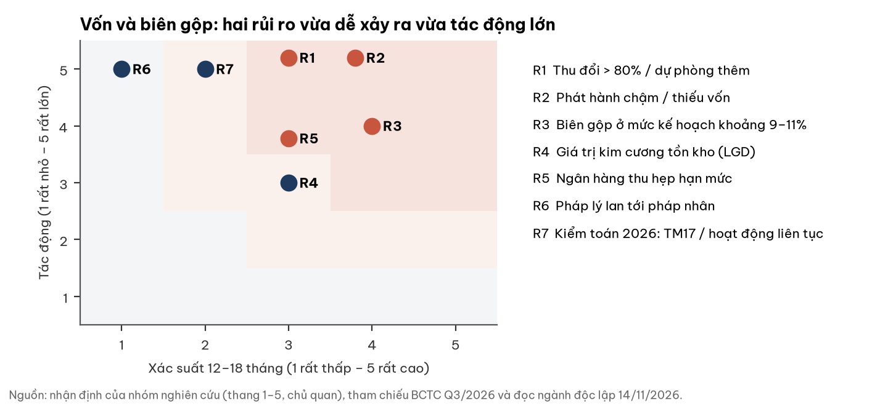

| Rủi ro | Xác suất × tác động | Dấu hiệu sớm | Ngày kiểm |
|---|---|---|---|
| R1 Thu đổi > 80% | TB × rất lớn | Dự phòng luỹ kế > 7.071 tỷ | BCTC Q4/2026 (khoảng 30/01/2027) |
| R2 Phát hành chậm | Cao × rất lớn | Chưa có hồ sơ sau BCTC kiểm toán | 03–09/2027 |
| R3 Biên gộp ở mức kế hoạch | Cao × lớn | Biên gộp trước dự phòng < 15% | Q4/2026, Q1/2027 |
| R4 Giá kim cương (LGD) | TB × TB | Dự phòng giảm giá kim cương tăng | Mỗi quý |
| R5 Ngân hàng thu hẹp | TB × lớn | Dư nợ giảm, thêm vay bên liên quan | Mỗi quý |
| R7 Kiểm toán 2026 | Thấp × rất lớn | Ngoại trừ / nghi ngờ hoạt động liên tục | khoảng 03/2027 |

## 9. Pháp lý & quản trị — WARNING (thông tin, không phải kết luận)

| Vấn đề | Trạng thái | Nguồn |
|---|---|---|
| Vụ buôn lậu kim cương | Bị can là cựu GĐ P-Lab (con 100%); pháp nhân PNJ không bị khởi tố; CA Thanh Hoá xác nhận hồ sơ nhập khẩu đầy đủ | BCTC soát xét TM39; CBTT 21/08 |
| Thuế | Phạt 2,0 tỷ + truy nộp 10,0 + chậm nộp 0,97 tỷ (khai sai VAT) | CBTT 13/11; QĐ khác 13/02 |
| Nhân sự | GĐCC Tài chính từ nhiệm 06/11; 2 thành viên HĐQT rời; TGĐ đổi 03/04 | CBTT 06/11, BCTC Q3 |
| Bên liên quan | Vay Chủ tịch HĐQT 700 tỷ, 10%/năm, tín chấp, đáo hạn 25/09/2027 | BCTC Q3 TM16 |
| Thoái vốn | Chủ trương thoái toàn bộ CTCP Giải pháp Tài sản An Tín (65%) | CBTT 06/11 |
| TM17 | Lời thuyết minh nêu dự phòng 6.104 tỷ (luỹ kế 6.783 tỷ) "vào BCTC Q3", nhưng số dư bảng 821,4 tỷ, LNST Q3 −256,9 tỷ | BCTC Q3 TM17 |

- Phạm vi tra cứu: CBTT trên pnj.com.vn đến 13/11/2026; không tra hồ sơ toà án. Báo cáo dùng số bảng/KQKD (khớp LCTT); câu chữ TM17 là câu hỏi cho kiểm toán 2026.

## 10. Lịch xúc tác — điều gì làm nhận định đổi, cả hai chiều

| Mốc | Tích cực hơn nếu | Tiêu cực hơn nếu |
|---|---|---|
| BCTC Q4/2026 (khoảng 30/01/2027) | Dự phòng ≤ 7.071 tỷ; CFO Q4 tốt hơn −1.695 tỷ cùng kỳ; biên gộp trước dự phòng ≥ 15% | Dự phòng > 7.071 tỷ; CFO xấu hơn cùng kỳ |
| Tết + Thần Tài (khoảng T2/2027), Q1/2027 | Bán lẻ YoY ≥ −10%, cửa hàng ổn định | Bán lẻ tiếp −20%, đóng thêm >30 cửa hàng |
| BCTC kiểm toán 2026 (khoảng 03/2027) | Chấp nhận toàn phần; TM17 được làm rõ | Ngoại trừ / nghi ngờ hoạt động liên tục / điều chỉnh hồi tố |
| Phát hành riêng lẻ (2027) | ≥ 6.000 tỷ với nhà đầu tư tổ chức có tên | Chưa xong trước 31/12/2027, < 4.000 tỷ, hoặc chủ yếu bên liên quan |
| Ngân hàng | ≥1 ngân hàng nước ngoài nối lại hạn mức | Vi phạm điều khoản vay; thêm vay bên liên quan |
| Ngành | Trang sức VN Q1/2027 ≥ Q1/2026 (WGC) | Khởi tố mới chạm pháp nhân PNJ |

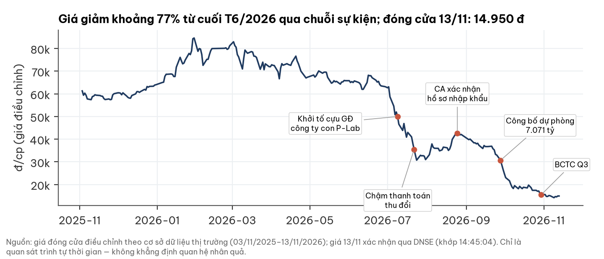

## Phụ lục A. Số liệu BCTC chính (tỷ đồng)

| Chỉ tiêu | Q3/2025 | Q3/2026 | 9T/2025 | 9T/2026 |
|---|---|---|---|---|
| Doanh thu thuần | 8.135,5 | 6.994,7 | 25.353,1 | 32.703,9 |
| Lợi nhuận gộp | 1.607,2 | 609,1 | 5.284,5 | 3.383,1 |
| Biên gộp | 19,8% | 8,7% | 20,8% | 10,3% |
| CP bán hàng + QLDN | 997,9 | 869,2 | 3.256,2 | 2.708,3 |
| CP lãi vay | 24,1 | 80,4 | 85,6 | 187,8 |
| LNST cổ đông mẹ | 495,7 | −256,9 | 1.610,4 | 471,7 |
| CFO | — | −2.874,1 | 1.713,9 | −883,0 |

Bảng cân đối 30/9/2026: tiền 1.242,2 · đầu tư đáo hạn 82,6 · vay ngắn hạn 4.320,6 · vốn chủ 13.198,7 (mẹ 13.182,3) · tài sản thuế hoãn lại 773,3 · dự phòng giảm giá tồn kho 2.229,0. Nguồn: BCTC hợp nhất Q3/2026; BCTC hợp nhất bán niên 2026 soát xét.

## Phụ lục B. Đối chiếu dữ liệu thị trường với BCTC

| Trường dữ liệu | Giá trị | BCTC | Ghi chú |
|---|---|---|---|
| Doanh thu Q3/2026 | 7.076,8 | 6.994,7 | Dữ liệu là doanh thu gộp (mã 01) |
| LNST Q2/2026 | −282,9 | khoảng −738,9 | Chưa cập nhật số soát xét H1 |
| Biên gộp Q3/2026 | 13,7% | 8,7% | Dữ liệu là 4 quý gần nhất |
| P/E | 4,72 | — | Dựa trên 4 quý chưa gồm lỗ Q4 kế hoạch: gây ảo giác "rẻ" |
| LNST Q3/2026 | −256,9 | −256,87 | Khớp |

## Phụ lục C. Nguồn

BCTC hợp nhất Q3/2026 (29/10/2026) và riêng; công văn giải trình chênh lệch lợi nhuận (29/10); BCTC hợp nhất bán niên 2026 soát xét PwC (03/09); báo cáo KQKD Q3/2026; "Tình hình hoạt động & tài chính Q3.2026" (ĐHĐCĐ bất thường 21/10); báo cáo KQKD T7–T8/2026 (25/09); tờ trình 622/2026/TTr-HĐQT, nghị quyết và biên bản ĐHĐCĐ 21/10; CBTT 13/02, 27/02, 21/08, 15/09, 06/11, 13/11; giấy phép kinh doanh vàng miếng 293/GP-NHNN — tất cả tải từ pnj.com.vn. Giá: DNSE (13/11/2026) và cơ sở dữ liệu giá ngày. Ngành: đọc ngành độc lập 14/11/2026 (WGC, NSO, NĐ 232/2025, NĐ 390/2026). Lãi suất: chuỗi lãi huy động 12 tháng nội bộ. Logo và ảnh sản phẩm: pnj.com.vn; logo chỉ để nhận diện, không hàm ý doanh nghiệp bảo chứng báo cáo. Bản đồ: geoBoundaries VNM-ADM1 (2008); toạ độ trụ sở gần đúng theo Wikipedia.

## Phụ lục D. Phương pháp & giới hạn

- Mô hình vốn hoá lợi nhuận năm 2029 theo kế hoạch doanh nghiệp; không dựng DCF dòng tiền tự do vì CFO 4 quý gần nhất âm.
- Giả định (ước lượng): ROE 2029 theo vốn chủ khoảng 15,8 nghìn tỷ sau tái cấp vốn; g 0–5%; LNST kịch bản tốt 2.500 tỷ.
- Chưa có: biên gộp theo mảng; peer niêm yết cùng mô hình; tỷ lệ biểu quyết ĐHĐCĐ; hiệu lực giấy phép vàng miếng theo NĐ 232/2025 và NĐ 390/2026; phân bổ cửa hàng theo tỉnh; ý kiến kiểm toán BCTC 2025 chưa đọc chi tiết; chưa đối chiếu thông tin báo chí về quan hệ nhân thân của các bị can với người nội bộ.

## Phụ lục E. Quy trình

Số liệu đối chiếu với BCTC gốc và tài liệu doanh nghiệp công bố; phần ngành do người đọc ngành độc lập thực hiện trước, không xem dữ liệu doanh nghiệp; toàn bộ số liệu, nguồn và giả định đã qua người phản biện độc lập.

## Phụ lục F. Tuyên bố miễn trừ trách nhiệm

Tài liệu này chỉ nhằm mục đích cung cấp thông tin, không phải lời mời chào, khuyến nghị mua/bán hay tư vấn đầu tư cá nhân hoá. Thông tin được tổng hợp từ nguồn công khai được cho là đáng tin cậy nhưng không được bảo đảm về tính đầy đủ hay chính xác. Các ước tính, kịch bản và vùng giá trị phản ánh nhận định tại ngày lập và có thể thay đổi mà không cần báo trước. Nhà đầu tư tự chịu trách nhiệm về quyết định của mình và nên tham khảo ý kiến chuyên gia khi cần.
