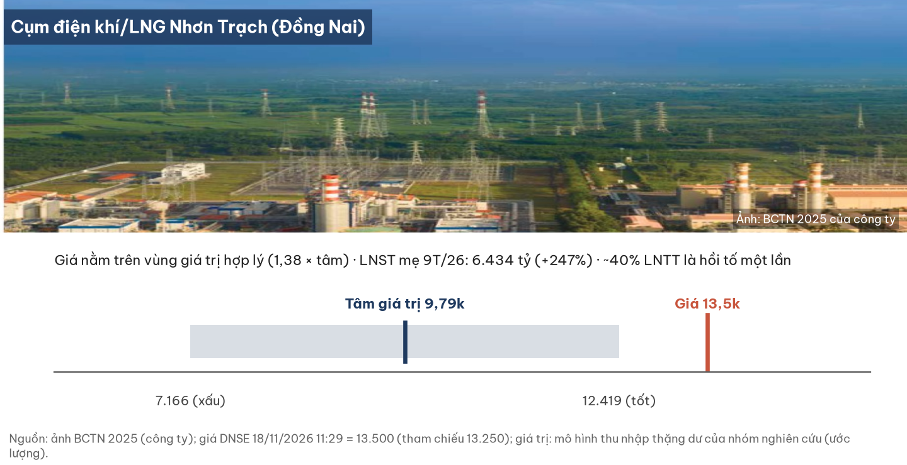
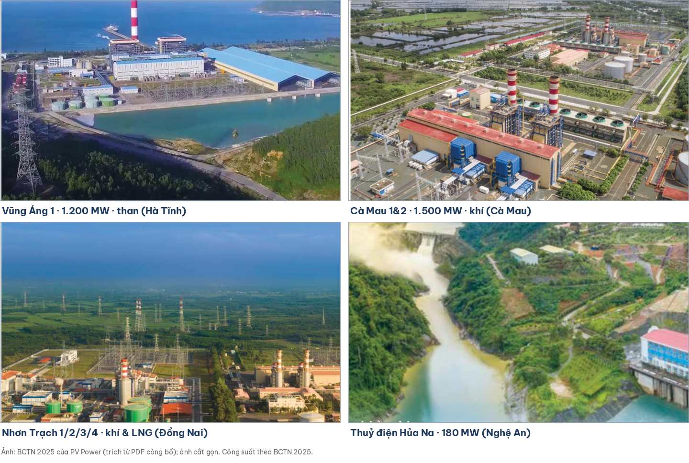
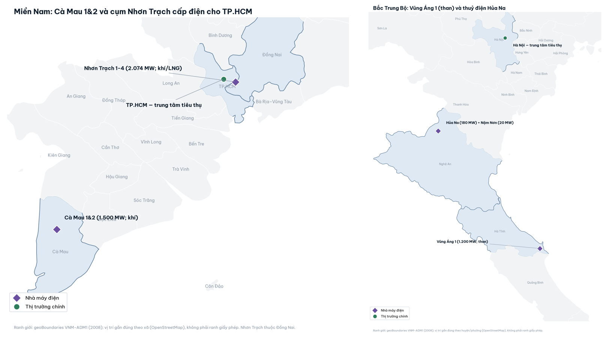
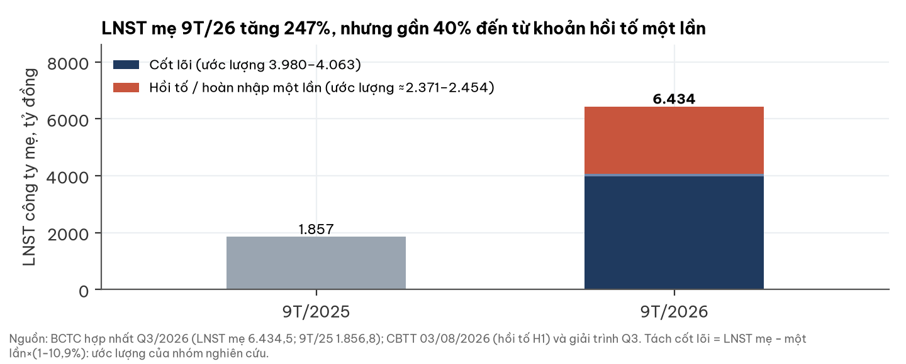
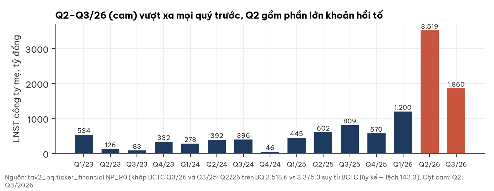
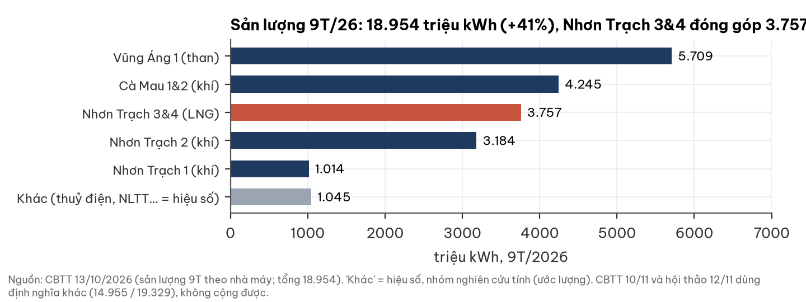
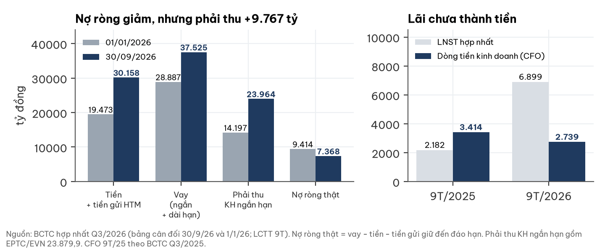
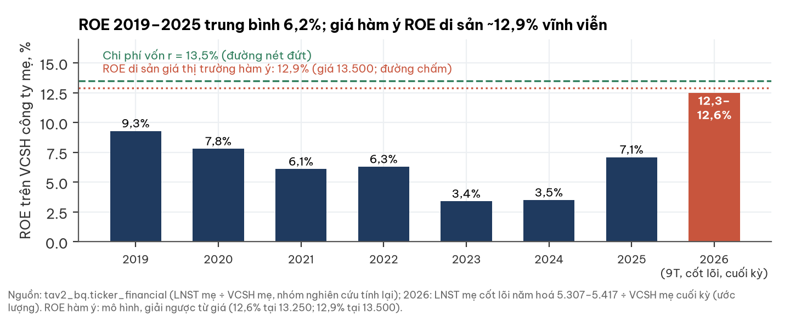
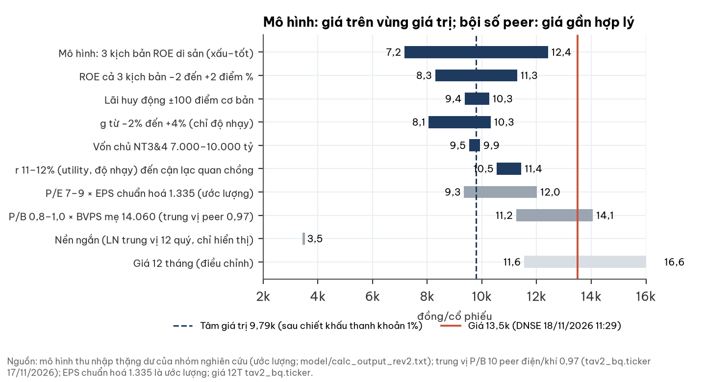
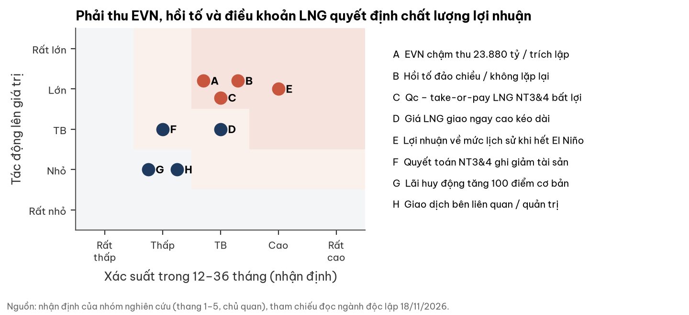

# POW — PV Power: lãi 9 tháng 6.434 tỷ, sản lượng +41% và LNG Nhơn Trạch 3&4 vào vận hành, nhưng ~40% lợi nhuận trước thuế là hồi tố một lần, 23.880 tỷ phải thu EVN chưa về và giá đã trả cho ROE di sản ~12,9% vĩnh viễn

| Chỉ tiêu | Giá trị | Chỉ tiêu | Giá trị |
|---|---|---|---|
| Giá (HOSE) | **13.500 đ** (DNSE 18/11 11:29; đóng cửa 17/11: 13.250) | Vùng giá trị hợp lý | **7.166 – 12.419 đ** |
| Tâm giá trị (sau chiết khấu thanh khoản 1%) | **9.792 đ** (trước chiết khấu 9.891) | Giá / tâm | **1,38 lần** (1,35 lần tại 13.250) |
| LNST mẹ 9T/2026 | **6.434,5 tỷ** (+247%); cốt lõi ≈ 3.980–4.063 (ước lượng) | P/B tại tâm · BVPS mẹ | 0,70 · 14.060 đ |
| Nợ ròng thật 30/9/2026 | **7.368 tỷ** (nợ/VCSH mẹ 0,17) | Phải thu EPTC/EVN | **23.880 tỷ** (+9.827 từ đầu năm) |
| CFO 9T/2026 | **2.739 tỷ** (9T/25: 3.414) | Thanh khoản · free float | 63,3 tỷ/phiên · ~20% |

**Ba điều cần biết**

- **Tích cực:** sản lượng 9T +41%, nợ ròng giảm còn 7.368 tỷ, Deloitte chấp nhận toàn phần BCTC 2025, Nhơn Trạch 3&4 (1.624 MW) đã vận hành.
- **Tiêu cực:** khoảng 2.755 tỷ LNTT 9T là hồi tố/hoàn nhập; CFO thấp hơn cùng kỳ vì phải thu EVN phình.
- **Định giá:** giá nằm trên vùng giá trị hợp lý của mô hình, nhưng dưới trung vị P/E và P/B peer trên lợi nhuận năm đỉnh; chênh lệch là câu hỏi "2026 có lặp lại không".

## 1. Tóm tắt điều hành

| | Nội dung |
|---|---|
| **Tình huống** | Nhà phát điện đa nhiên liệu (than, khí, LNG, thuỷ điện), bán điện cho EVN; năm 2026 sản lượng và lợi nhuận tăng vọt, có thêm 1.624 MW LNG. |
| **Vấn đề** | Lợi nhuận báo cáo lẫn khoản hồi tố tỷ giá, giá khí và chi phí O&M; tiền chưa về (phải thu EVN). |
| **Câu hỏi** | Giá 13.500 đ đang trả cho mức lợi nhuận bền vững nào? |
| **Trả lời** | Giá ngầm định ROE mảng di sản ~12,9%/năm vĩnh viễn; lịch sử 2019–2025 trung bình 6,2%, lợi nhuận cốt lõi 2026 ≈ 12–14%. Mô hình chuẩn hoá cho 9.792 đ. |

## 2. Luận điểm và điều thị trường đang định giá

| Luận điểm tích cực | Luận điểm tiêu cực |
|---|---|
| Sản lượng 9T 18.954 triệu kWh (+41%); LN gộp cốt lõi ≈ 349 đ/kWh (ước lượng) | ~40% LNTT 9T là hồi tố; hợp đồng EVN quyết toán có thể đảo chiều |
| Nợ ròng 9.414 → 7.368 tỷ; tiền + tiền gửi 30.158 tỷ | Vay ngắn hạn 11.250 → 19.438 tỷ, đồng thời giữ 19.548 tỷ tiền gửi (đòn bẩy carry) |
| Vị trí hệ thống, giấy phép, quy mô khó nhân bản | ROE tối thiểu 5 năm 3,4%, ROIC 2,0%: chưa năm nào vượt chi phí vốn |
| Cung điện miền Nam, LNG có Qc tối thiểu 65% (PPA sửa đổi 08/2026) | CFO 9T giảm 20% dù LNST tăng 216%; phải thu EVN ~149 ngày doanh thu |

- **Thị trường đang định giá:** ROE di sản ~12,9% bền vững, tức lặp lại lợi nhuận cốt lõi 2026.
- **Có thể chưa tính:** chênh lệch tỷ giá VA1 còn ~490 tỷ (≈ +142 đ/cp, hai chiều); cầu điện thiếu nguồn 2027–30.
- **Có thể đã tính đúng:** năm 2026 là đỉnh sản lượng nhiệt điện; lịch sử POW không cho thấy El Niño ⇒ ROE cao (ROE thấp nhất 3,1–3,2% rơi vào 2023–24).

## 3. Ngành: sản lượng nhiệt điện ở đỉnh chu kỳ, giá do cơ chế và văn bản quyết định

| Động lực | Dữ kiện (nguồn: đọc ngành độc lập 18/11/2026; số liệu công ty) |
|---|---|
| Cầu điện | Hệ thống 10T/2026 +9,8%, tháng 10 +14,3%; sản xuất công nghiệp T10 +15,0% |
| Giá bán | EVN giảm giá bán lẻ 2% từ 01/11/2026; CPI 5,09% hạn chế dư địa tăng giá |
| Nhiên liệu | Brent T11 96,7 USD (+52% so cùng kỳ, qua đỉnh T10); LNG giao ngay 27,6 USD/MMBtu (16/11), ~2 lần giá hợp đồng |
| Quy hoạch | Bộ Công Thương: thiếu 4.256 MW nguồn năm 2027; Qc 65% theo NĐ 100/2025 cho LNG, dự thảo 75%/15 năm |
| Chu kỳ | Người đọc ngành độc lập: 12 tháng tới chính sách/hành chính 0,45 · chu kỳ 0,40 · cấu trúc 0,15 |

- Khối lượng nhiệt điện đang ở **đỉnh chu kỳ** tới mùa khô 2027; thuỷ điện hồi lại có thể giảm huy động.
- Giá bán là **giá hợp đồng EVN/EPTC**: biên phụ thuộc Qc, giá khí/LNG chuyển trễ và quyết toán, không phải giá thị trường tự do.

## 4. Doanh nghiệp: sáu nhà máy lớn, một khách hàng chính, đang chuyển trọng tâm sang điện khí/LNG

PV Power (POW) là doanh nghiệp phát điện của Tập đoàn Dầu khí Việt Nam (PVN nắm 79,94%), vận hành nhiệt điện than, điện khí, LNG, thuỷ điện và năng lượng tái tạo; ngoài ra cung ứng nhiên liệu và dịch vụ kỹ thuật điện. Theo BCTN 2025, mục tiêu đến 2030 là 7.532 MW (~5% công suất hệ thống), trong đó điện khí/LNG 4.324 MW.

| Nhà máy | Nhiên liệu · công suất | Vận hành | Sản lượng 9T/26 (triệu kWh) |
|---|---|---|---|
| Vũng Áng 1 (Hà Tĩnh) | Than · 1.200 MW (TMĐT 33.651 tỷ) | 2015 | 5.709 (+20%) |
| Cà Mau 1&2 (Cà Mau) | Khí · 1.500 MW | 2008 | 4.245 |
| Nhơn Trạch 1 (Đồng Nai) | Khí · 450 MW | 2009 | 1.014 |
| Nhơn Trạch 2 (công ty con) | Khí · 750 MW | 2011 | 3.184 (+48%) |
| Nhơn Trạch 3&4 (Đồng Nai) | LNG · 1.624 MW (TMĐT 32.487 tỷ) | 2025 | 3.757 |
| Thuỷ điện | Hủa Na 180 MW, Đakđrinh 125 MW, Nậm Nơn 20 MW | 2013–2024 | trong mục "khác" |

- **Khách hàng chính:** EVN/EPTC mua điện; khí từ PV GAS, LNG qua hợp đồng định hạn 20,7 triệu MMBtu/năm 2027–2031 (ký 16/7/2026), phần còn lại mua giao ngay.
- **Vị thế:** quy mô ~10% nhu cầu điện toàn quốc ngày 14/4/2026 (100 triệu kWh/ngày); BCTC hợp nhất không tách lợi nhuận theo nhà máy.

## 5. Tài chính: lợi nhuận tăng thật, nhưng chưa thành tiền

- **Một lần ≈ 2.755 tỷ LNTT 9T:** tỷ giá VA1 2019–21 1.103; quyết toán giá khí/tiền điện Cà Mau 991; giảm trích O&M 381; hoàn nhập dự phòng phải thu Q3 ~280 (ước lượng).
- **Chi phí NT3&4 đã vào KQKD:** lãi vay 9T 1.536 tỷ (cùng kỳ 410), khấu hao +782 tỷ.

- **Phải thu EPTC +9.827 tỷ** (DSO ~149 ngày, ước lượng): hồi tố đang nằm ở phải thu; điểm kiểm chính là Q4/26–Q1/27.
- Vay nước ngoài ≈ 19,7 nghìn tỷ, đồng tiền không công bố; ±1% USD/VND ≈ ±150–200 tỷ đánh giá lại (cận trên, ước lượng).

## 6. LNG Nhơn Trạch 3&4: mảng có độ bất định cao nhất

| Hạng mục | Dữ kiện | Chưa biết |
|---|---|---|
| Dự án | 1.624 MW, TMĐT 32.487 tỷ; vận hành 21/11 và 17/12/2025 | — |
| Hợp đồng điện | PPA sửa đổi 08/2026: Qc tối thiểu dài hạn 65% | Mẫu số của 65%, thời hạn, độ trễ chuyển giá |
| Thực phát | 3.757 triệu kWh 9T ⇒ hệ số công suất ~35% (ước lượng) | Kế hoạch giao sản lượng 2027 (hạn 15/01/2027) |
| Nhiên liệu | 8 chuyến LNG 9T; hợp đồng định hạn ≈ 3,2 tỷ kWh/năm (ước lượng) | Điều khoản take-or-pay, công thức giá |
| Nợ dự án | Citibank & ING 11.262 tỷ; SMBC 4.036 tỷ | Đồng tiền, lãi suất |

- Mô hình ghi NT3&4 theo **sổ sách (NPV = 0)**: vốn chủ 9.000 tỷ (ước lượng, dải 8.000–10.000) = chi phí vốn hoá 23–25 nghìn tỷ trừ nợ dự án 15.298.

## 7. Định giá: thu nhập thặng dư trên vốn chủ mẹ, dựng độc lập với giá thị trường

| Kịch bản | ROE mảng di sản | Cơ sở | Xác suất | đ/cp (sau CK 1%) |
|---|---|---|---|---|
| Xấu | 4,5% | ≈ 2023–24: khí huy động thấp, Qm < Qc | 25% | **7.166** |
| Cơ sở | 8,0% | Trung bình 2019–25 (6,2%) điều chỉnh vốn XDCB và hồi tố ≈ 7–8% (ước lượng) | 50% | **9.792** |
| Tốt | 11,5% | Đỉnh 2019, thiếu nguồn 2027–30 | 25% | **12.419** |
| **Có trọng số** | | trước / sau chiết khấu thanh khoản 1% | | **9.891 / 9.792** |

Công thức: giá trị = vốn chủ di sản 31.395 tỷ × ROE/r + NT3&4 theo sổ 9.000 + dự án mới theo sổ 2.740 (g = 0; NPV = 0 cho vốn đã chi).

**Chi phí vốn:** r = **13,5%** tại điểm neo lãi huy động 12 tháng hiệu dụng **7,4%** (đo 03/11 và 18/11/2026, đi ngang); r đi cùng lãi huy động theo β = 1.

| Lãi huy động | −100 điểm cơ bản | −50 | Neo | +50 | +100 |
|---|---|---|---|---|---|
| Giá trị (sau CK) | 10.272 (+4,9%) | 10.023 (+2,4%) | **9.792** | 9.578 (−2,2%) | 9.378 (−4,2%) |

- **Bối cảnh lãi suất:** lãi suất chiết khấu thị trường đang ngầm định ≈ 15,1% (147 mã, 30/10/2026), phân vị 75% giai đoạn 2014–2026 (đỉnh 12/2022: 15,9%; đáy 08/2023: 12,1%), cao hơn r của mô hình. TPCP 10 năm 4,57% (17/11/2026), +0,57 điểm % so với 12 tháng trước (nguồn chưa đối chiếu độc lập). Chỉ để tham khảo, không đổi giá trị hợp lý.
- **Chiết khấu thanh khoản 1%** (ước lượng; dải 0–3%): ADV trung vị 63 phiên 63,3 tỷ/phiên; giao dịch ≤30 tỷ thoát trong ≤5 phiên ở 10% tham gia.
- **Độ nhạy lớn nhất:** ROE di sản ±2 điểm % ⇒ 8.291 / 11.293; vốn chủ NT3&4 7.000–10.000 ⇒ 9.529–9.924; r 11% ⇒ 11.157; cận lạc quan chồng (r 11%, dự án mới 5.000, NT3&4 10.000) ⇒ 11.443 — vẫn dưới giá.

**Hai nền giá trị (chỉ hiển thị, không đổi tâm)**

| Nền | Giá trị (đ/cp) | Ghi chú |
|---|---|---|
| V_ngắn: LNST chuẩn hoá = trung vị TTM mẹ 12 quý (1.444 tỷ), g = 0 | 3.487 | Neo vào giai đoạn trước NT3&4 và năm khí thấp 2023–24 |
| V_dài: FCFE = CFO − capex | âm (−8.558) | Capex/CFO 1,94 do xây NT3&4 và phải thu phình ⇒ chỉ dùng V_ngắn |
| Dòng C4, D2 (chỉ theo dõi) | 2.042 · 6.590 | Chưa qua tiêu chí khoá trước |

**Kiểm chéo bằng bội số** (peer điện/khí, BQ 17/11/2026; trailing, peer cũng đang ở năm đỉnh)

| | POW | Trung vị 10 peer |
|---|---|---|
| P/E | 5,8 (gồm hồi tố); 7,7 trên LNST mẹ cốt lõi năm hoá; 9,9 trên LN chuẩn hoá (ước lượng) | 8,7 |
| P/B | 0,88 (trên VCSH tổng); 0,94 (trên VCSH mẹ, giá 13.250) | 0,97 |
| EV/EBITDA | 5,43; ~4,1 trên EBITDA cốt lõi năm hoá (ước lượng) | ~6,1 |

- **Cách đọc:** theo bội số trailing POW **không đắt** so với peer; theo mô hình giá cao hơn vùng giá trị vì mô hình dùng ROE chuẩn hoá thay vì năm đỉnh. Hai cách nhìn khác nhau ở giả định "2026 có lặp lại không".
- **Kết luận:** giá 13.500 = 1,38 × tâm, trên cận trên vùng (12.419). Tại mức 13.250 (đóng cửa 17/11): 1,35 lần; kết luận không đổi ở cả hai mức.

## 8. Rủi ro: chất lượng lợi nhuận và điều khoản LNG

| Rủi ro | Tác động ước tính | Dấu hiệu sớm | Ngày kiểm |
|---|---|---|---|
| A EVN chậm thu | Chiết khấu thêm; trích lập hồi tố | Phải thu ≥ 20.000 tỷ cuối năm, EVN trả > 180 ngày | 31/12/2026 |
| B Hồi tố đảo chiều | Quyết toán VA1/Cà Mau giảm giá | Khoản hồi tố mới hoặc điều chỉnh giá đầu tư VA1 | BCTC Q4/2026 |
| C Điều khoản LNG | NT3&4 lỗ hoặc Qc 2027 < 65% | Công bố ToP, công thức giá, kế hoạch vận hành 2027 | Trước 15/01/2027 |
| D Giá LNG giao ngay cao kéo dài | Giảm lợi nhuận NT3&4 (chưa đo) | Giá giao ngay so với giá hợp đồng | Hằng tháng |
| E Hết El Niño | ROE di sản về kịch bản xấu 4,5%: 7.166 (−27% so tâm) | Thuỷ văn 2027, huy động nhiệt điện | H2/2027 |
| F Quyết toán NT3&4 | Ghi giảm tài sản cố định | Công bố quyết toán dự án | 2027 |

## 9. Pháp lý, chính sách và quản trị — cảnh báo

- **Kiểm toán FY2025 (Deloitte):** chấp nhận toàn phần; nhấn mạnh chưa phê duyệt quyết toán cổ phần hoá. Không ngoại trừ.
- **Lợi nhuận phụ thuộc quyết định hành chính:** hồi tố 2026 chiếm ~40% LNTT 9T, có thể đảo chiều khi EVN quyết toán.
- **Bên liên quan dày:** PVN, PV GAS, PV OIL, PVPS; giá trị từng giao dịch chưa đọc. PVN 79,94% ⇒ free float ~20%.
- Không thấy khởi tố hay xử phạt trong 83 công bố thông tin 11/2025–11/2026 (chưa tra trực tiếp cơ quan quản lý).

## 10. Lịch xúc tác và mốc đổi nhận định hai chiều

| Mốc | Nhận định tích cực hơn nếu | Nhận định tiêu cực hơn nếu |
|---|---|---|
| BCTC Q4/2026 (~30/01/2027) | LNST mẹ Q4 > 2.000 tỷ (khoảng kỳ vọng 900–2.000), phải thu < 20.000 tỷ, CFO năm ≥ 5.000 tỷ | LNST mẹ Q4 < 900 tỷ; phải thu không giảm |
| 2 quý 2027 liên tiếp | ROE mẹ cốt lõi năm hoá ≥ 11% không hồi tố và CFO ≥ LNST ⇒ tâm lên ~10.542 | Lợi nhuận quay về mức 2023–25 |
| Kế hoạch vận hành 2027 | NT3&4 Qc ≥ 65%; công bố ToP với biên dương | Qc < 65% |
| Quyết toán VA1/NT3&4 | Duyệt thêm ~490 tỷ chênh lệch tỷ giá (+142 đ/cp) | Điều chỉnh giảm giá đầu tư |
| Lãi huy động | −100 điểm cơ bản (+4,9%) | +100 điểm cơ bản (−4,2%) |

Giá về ≤ 8.323 đ (0,85 × tâm) sẽ nằm trong vùng giá trị theo mô hình. Xác suất các mốc là ước lượng của nhóm nghiên cứu (T1 0,60 · T2 0,45 · T3 0,50 · T4 0,65).

## Phụ lục A — Số liệu BCTC chính (tỷ đồng, hợp nhất)

| Chỉ tiêu | Q3/26 | Q3/25 | 9T/26 | 9T/25 |
|---|---|---|---|---|
| Doanh thu thuần | 16.772,2 | 7.855,2 | 49.405,5 | 25.404,3 |
| Lợi nhuận gộp | 2.311,2 | 1.290,8 | 8.701,3 | 3.274,5 |
| Chi phí tài chính (lãi vay) | 523,1 (616,1) | 295,1 (153,7) | 1.594,2 (1.569,0) | 869,3 (411,0) |
| LNTT | 2.414,0 | 1.011,8 | 7.743,5 | 2.332,1 |
| LNST hợp nhất | 2.073,1 | 948,4 | 6.898,6 | 2.182,0 |
| LNST mẹ | 1.859,6 | 809,3 | 6.434,5 | 1.856,8 |

Bảng cân đối 30/9/2026: tiền 10.609,4 · tiền gửi giữ đến đáo hạn 19.548,3 · vay ngắn hạn 19.438,3 · vay dài hạn 18.087,1 · phải thu KH ngắn hạn 23.964,3 · VCSH mẹ 43.134,5 · số cổ phiếu 3.067.845.688 (gồm 281.024.592 cp chào bán 01/2026, thu 2.810 tỷ).

## Phụ lục B — Đối chiếu dữ liệu thị trường với BCTC gốc

| Chỉ tiêu | Dữ liệu thị trường | BCTC gốc | Ghi chú |
|---|---|---|---|
| LNST mẹ Q3/26 · Q3/25 | 1.859,6 · 809,3 | 1.859,6 · 809,3 | Khớp |
| LNST mẹ 9T/26 | 6.577,8 | 6.434,5 | Lệch +143,3 (Q2 trên dữ liệu thị trường 3.518,6 vs 3.375,3 suy từ BCTC) |
| CFO 9T/26 | 8.556,7 | 2.739,0 | Cột dòng tiền quý của dữ liệu thị trường không tin cậy; dùng BCTC |
| P/E trailing 5,8 | gồm hồi tố | — | Không dùng làm cơ sở |

## Phụ lục C — Nguồn

- **Công ty** (pvpower.vn): BCTC hợp nhất Q3/2026 và giải trình, BCTC kiểm toán 2025 (Deloitte), BCTN 2025 (ảnh nhà máy trích từ BCTN; logo từ website), BCTC Q1, Q2/2026 và các công bố thông tin 11/2025–11/2026 (có hồi tố 03/08/2026, sản lượng và LNG 13/10/2026, kế hoạch điều chỉnh 10/11/2026).
- **Dữ liệu thị trường:** chuỗi tài chính quý, giá, khối lượng và bội số peer đến 17/11/2026; giá trong phiên DNSE 18/11/2026 11:29; lãi huy động 12 tháng hiệu dụng.
- **Ngành:** đọc ngành độc lập 18/11/2026 (phát điện); snapshot vĩ mô 18/11/2026.
- **Bản đồ:** ranh giới geoBoundaries VNM-ADM1 (2008); toạ độ theo OpenStreetMap (phường Vũng Áng, xã Khánh An, xã Đại Phước, huyện Quế Phong; TP.HCM, Hà Nội trung tâm) — vị trí gần đúng. Đakđrinh và Nậm Nơn chưa vẽ do chưa xác minh toạ độ.

## Phụ lục D — Phương pháp và giới hạn

- Thu nhập thặng dư trên VCSH mẹ, g = 0; lợi nhuận chuẩn hoá không dùng năm 2026; chiết khấu thanh khoản 1% (ước lượng).
- ROE di sản cơ sở 8% là ước lượng (cận trên dải 7–8% của nhóm nghiên cứu); vốn chủ NT3&4 9.000 tỷ là ước lượng.
- **Chưa có dữ liệu:** lợi nhuận theo nhà máy; Qc/Qm từng nhà máy; ToP và công thức giá LNG; đồng tiền vay ngoại; giá trị từng giao dịch bên liên quan; room ngoại; mực nước hồ thuỷ điện.
- Ba con số sản lượng (18.954; 19.329; 14.955 triệu kWh) khác định nghĩa, chưa đối chiếu được; báo cáo dùng 18.954 (công bố 13/10/2026).
- Kế hoạch 2026 điều chỉnh (LNST mẹ 4.317 tỷ) thấp hơn thực hiện 9T vì căn cứ tờ trình tháng 8–9; không đọc là dự báo Q4 lỗ.

## Phụ lục E — Quy trình nghiên cứu

Số liệu đối chiếu trực tiếp với BCTC gốc do công ty công bố. Mô hình định giá được dựng trước, độc lập với giá thị trường, rồi mới so với giá. Bối cảnh ngành do một người đọc ngành độc lập soạn khi chưa biết giá cổ phiếu. Số liệu, mô hình và giả định đã được một người phản biện độc lập kiểm tra. Các giới hạn dữ liệu nêu ở Phụ lục D.

## Phụ lục F — Tuyên bố miễn trừ trách nhiệm

Tài liệu này chỉ nhằm mục đích cung cấp thông tin nghiên cứu, không phải lời khuyên, đề nghị hay khuyến nghị mua, bán hoặc nắm giữ bất kỳ chứng khoán nào, và không tính đến mục tiêu, tình hình tài chính hay nhu cầu của từng nhà đầu tư. Thông tin được tổng hợp từ các nguồn được cho là đáng tin cậy tại thời điểm lập, nhưng không được bảo đảm về tính đầy đủ hay chính xác. Các ước lượng, kịch bản và giá trị hợp lý phản ánh giả định tại ngày lập và có thể thay đổi mà không cần thông báo. Kết quả trong quá khứ không bảo đảm kết quả tương lai. Nhà đầu tư cần tự đánh giá và chịu trách nhiệm với quyết định của mình.
