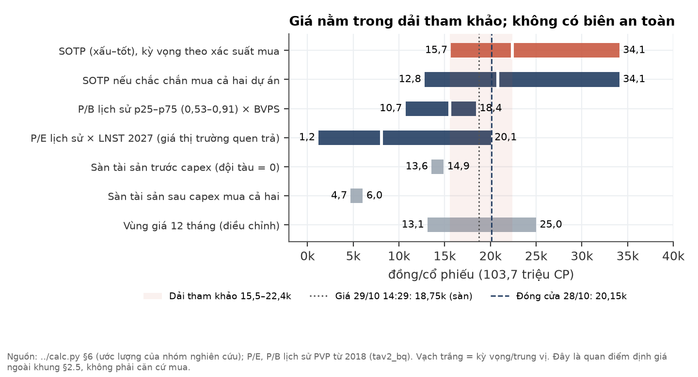
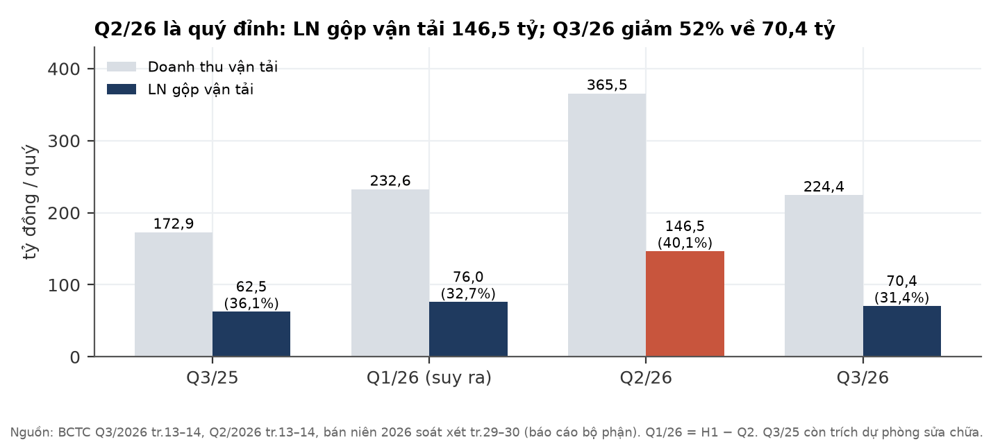
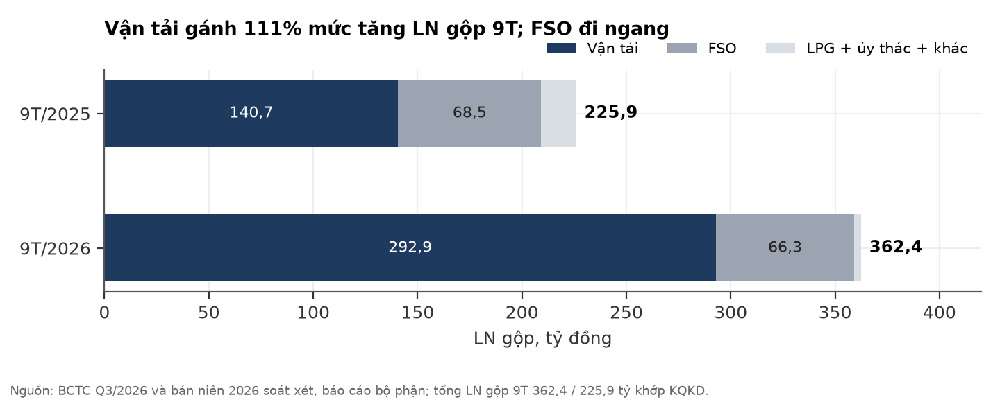
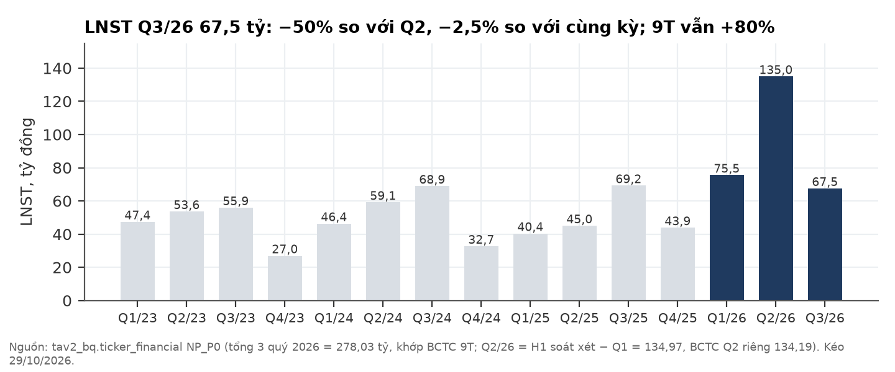
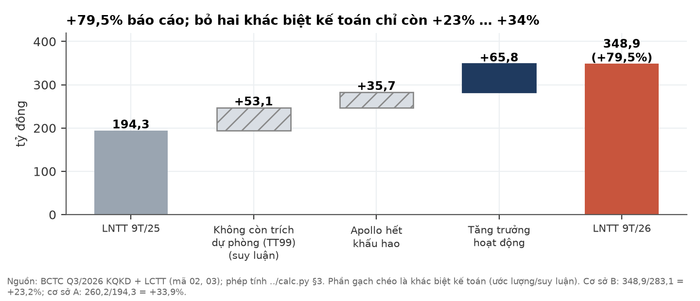
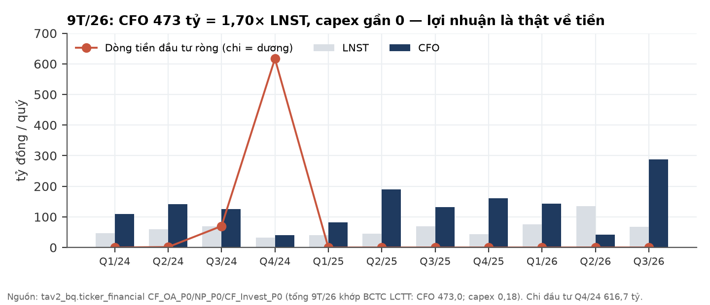
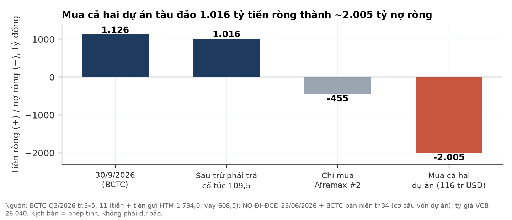
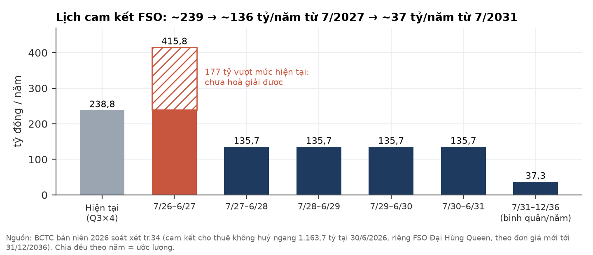
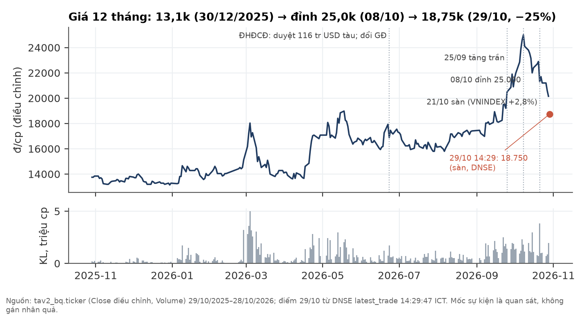
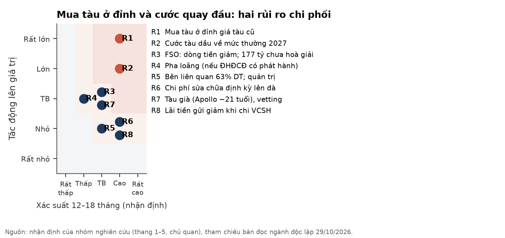

# PVP — CTCP Vận tải Dầu khí Thái Bình Dương: lợi nhuận đỉnh chu kỳ, tiền mặt sắp vào tàu mua ở đỉnh giá

**Báo cáo Due Diligence · 29/10/2026 · Nhóm nghiên cứu** · Sàn HOSE · Vận tải biển chuyên dụng dầu khí (tàu dầu thô/sản phẩm chạy quốc tế, kho nổi FSO, thương mại LPG, ủy thác khai thác tàu)

## Investment Summary

**Xếp hạng của nhóm: NON — không phải trường hợp của khung kiểm định chu kỳ ngành (§2.5).** Khung §2.5 chỉ xem xét một doanh nghiệp chu kỳ khi đáy chu kỳ đã tới hoặc đang tới. PVP đang ở **đỉnh** chu kỳ lợi nhuận, không phải đáy; một tiêu chí trượt là loại. Phần định giá trong báo cáo là **quan điểm định giá ngoài khung §2.5** — dải tham khảo 15,5–22,4 nghìn đồng/cp (ước lượng) — **không phải căn cứ mua**.

Thang của nhóm: **QUALIFY** (đủ điều kiện xem xét) · **AMBIGUOUS** (chưa đủ bằng chứng) · **NON** (không đủ điều kiện) — nhãn nghiên cứu, không phải khuyến nghị cá nhân hoá.

| Dữ liệu chính | Giá trị | Ghi chú |
|---|---|---|
| Giá 29/10/2026, 14:29:47 ICT (trong phiên) | **18.750 đ** | DNSE latest_trade; **giá sàn**, −6,9% so với tham chiếu 20.150; KL khớp lô chẵn 294.240 cp |
| Đóng cửa 28/10/2026 | 20.150 đ | tav2_bq; trùng giá tham chiếu 29/10 (DNSE secdef) |
| Đỉnh gần nhất | 25.000 đ (08/10/2026) | Giá 29/10 thấp hơn đỉnh 25% |
| Vốn hoá (18.750 / 20.150) | 1.944 / 2.090 tỷ đ | 103,70 triệu CP, không đổi |
| P/E TTM · P/B (18.750 / 20.150) | 6,04× · 0,93× / 6,49× · 1,00× | LNST TTM 321,9 tỷ; BVPS 20.246 đ |
| Tiền ròng 30/9 → sau trừ phải trả cổ tức | 1.125,6 → **1.016 tỷ ≈ 9.797 đ/cp** | ≈ 52% vốn hoá tại 18.750 |
| Dự án mua tàu ĐHĐCĐ đã duyệt | **116 tr USD ≈ 3.021 tỷ = 1,55× vốn hoá** (tại 18.750) | VCSH 916 tỷ + vay 2.104 tỷ; chưa ký hợp đồng nào |
| Dải tham khảo (ngoài §2.5) | **15,5–22,4 nghìn (ước lượng)** | P/B trung vị lịch sử → SOTP kỳ vọng |
| Sàn tài sản (đội tàu cũ = 0) | **13,6–14,9k trước capex / 4,7–6,1k sau capex** | Cận dưới = 177 tỷ cam kết FSO năm 1 chưa hoà giải không thành tiền |
| Lợi tức cổ tức tiền (1.000 đ) | 5,3% / 5,0% | Cổ tức 2025; kế hoạch tạm ứng 2026 10% chưa có ngày |
| Thanh khoản bình quân 20 phiên | 33,1 tỷ đ/phiên | tav2_bq tới 28/10 (cuối 2025 chỉ 1,3–2,2 tỷ) |

**Ba luận điểm (MECE):**

1. **Lợi nhuận là thật về tiền, nhưng đang ở đỉnh và tăng ít hơn con số báo cáo** — CFO 9T/26 473,0 tỷ = 1,70× LNST; nhưng LNTT +79,5% chỉ còn **+23% … +34%** khi bỏ hai khác biệt kế toán (ngừng trích dự phòng sửa chữa theo TT99, tàu Apollo hết khấu hao). Q3/26 LN gộp vận tải đã giảm 52% so với Q2.
2. **Phần tiền mặt bảo vệ giá sắp được tiêu vào tàu mua ở đỉnh giá tàu cũ** — ĐHĐCĐ đã duyệt 116 tr USD; báo cáo khả thi của chính công ty cho IRR cấp dự án 7,67%, thấp hơn ngưỡng 11% công ty tự đặt. Mua cả hai dự án ⇒ tiền ròng 1.016 tỷ thành nợ ròng ~2.005 tỷ, sàn tài sản từ 13,6–14,9k xuống 4,7–6,1k.
3. **Giá đã chiết khấu một phần, nhưng không có biên an toàn** — giá 18.750 nằm trong dải tham khảo 15,5–22,4k; thị trường đang định giá đội tàu cũ ~609 tỷ, dưới sổ sách 838 tỷ. Dòng tiền FSO theo lịch cam kết giảm từ ~239 xuống ~136 tỷ/năm từ 7/2027.

**Điều gì làm chúng tôi đổi ý.** Nhãn chỉ được xét lại khi có **tín hiệu chu kỳ chạm đáy**: (a) LNST 4 quý ≤ ~200 tỷ (về mức nền 2023–25), hoặc (b) chỉ số cước tàu dầu bẩn BDTI ≤ 3.500 ngày 30/09/2027; (c) P/B ≲ 0,75 **chỉ được tính khi đi kèm (a) hoặc (b)**. Khi đó nhóm chạy lại toàn bộ kiểm định §2.5 (kết quả có thể là QUALIFY, AMBIGUOUS hoặc NON). **Giá giảm một mình không đủ**: giá ≤ ~13.200 mà không có tín hiệu chu kỳ chỉ dẫn tới việc xem lại định giá ngoài §2.5, không gán nhãn mới. Mốc gần nhất: văn kiện ĐHĐCĐ bất thường (hạn ≤ 30/11/2026) về giá và tuổi tàu.

## 1. Tóm tắt điều hành

**Tình huống (Situation).** PVP (PVTrans Pacific, công ty con 64,92% của PVTrans) sở hữu 3 tàu dầu (Apollo — Aframax, Pacific Era và Pacific Pride — MR) và kho nổi FSO Đại Hùng Queen; mảng vận tải chạy 100% tuyến quốc tế. Cước tàu dầu năm 2026 lên mức lịch sử do cú sốc cung ngoại sinh (eo Hormuz bị hạn chế từ tháng 3). 9T/2026 doanh thu 2.205,7 tỷ, LNST 278,0 tỷ (+79,8% YoY), đã vượt 28,7% kế hoạch LNST cả năm. Giá cổ phiếu tăng từ 13,1k cuối 2025 lên đỉnh 25,0k ngày 08/10/2026.

**Biến chuyển (Complication).** Q3/26 LN gộp vận tải giảm 52% so với Q2 do doanh thu vận tải quốc tế giảm 39%. Cùng lúc, ĐHĐCĐ 23/06/2026 đã duyệt mua tàu 116 tr USD — bằng 1,55 lần vốn hoá — đúng lúc giá tàu cũ ở đỉnh; ban điều hành vừa thay giám đốc cùng ngày; ĐHĐCĐ bất thường bàn dự án tàu thứ ba đã hoãn hai lần (hạn mới ≤ 30/11/2026). Giá giảm sàn hai phiên 21/10 và 29/10.

**Câu hỏi (Question).** Với P/E 6× và tiền ròng ≈ 52% vốn hoá, PVP có phải cơ hội "mua khi sợ hãi ở đáy chu kỳ" không?

**Trả lời (Answer).** Không. Đây là đỉnh chu kỳ lợi nhuận, không phải đáy; P/E thấp phản ánh lợi nhuận đỉnh, và phần tiền mặt bảo vệ giá có kế hoạch chi vào tài sản mua ở đỉnh. Nhãn NON không đổi ở cả hai mức giá 18.750 và 20.150. Về định giá thuần tuý (ngoài khung §2.5), giá nằm trong dải tham khảo 15,5–22,4k nhưng không có biên an toàn so với cận dưới.

## 2. Luận điểm đầu tư và điều thị trường đang định giá

**Thị trường đang định giá đội tàu cũ dưới sổ sách — tức đã chiết khấu một phần cước 2027 — nhưng chưa chiết khấu việc tiền mặt bị tiêu vào tàu mới.**

| Định giá ngược (ước lượng) | Tại 18.750 (29/10) | Tại 20.150 (28/10) |
|---|---|---|
| Vốn hoá | 1.944 tỷ | 2.090 tỷ |
| Trừ: tiền ròng sau cổ tức 1.016 + giá trị hiện tại dòng tiền FSO 761 − dự phòng sửa chữa 233 − chi phí công ty 208 | | |
| = Giá trị thị trường ngầm định cho đội tàu dầu cũ | **~609 tỷ** | ~754 tỷ |
| Cộng lại thiệt hại kỳ vọng "mua đắt" ở kịch bản cơ sở (−203 tỷ) | ~811 tỷ | ~957 tỷ |
| So sánh: giá trị sổ sách Era + Pride + Apollo | 838 tỷ | 838 tỷ |
| So sánh: EBITDA vận tải 9T/26 năm hoá (đỉnh) | 561 tỷ | 561 tỷ |

**Quan điểm khác biệt (variant perception).** Thị trường đọc PVP là "P/E 6×, tiền mặt bằng nửa vốn hoá, rẻ". Chúng tôi cho rằng: (a) P/E 6× là P/E trên lợi nhuận đỉnh — LNST TTM bằng 1,64 lần bình quân 2023–25 (196,5 tỷ), và một phần tăng trưởng đến từ thay đổi kế toán; (b) tiền mặt không thuộc về cổ đông theo nghĩa "sàn" khi ĐHĐCĐ đã duyệt chi 916 tỷ VCSH vào tàu; (c) dòng tiền FSO — mảng ổn định nhất — theo lịch cam kết sẽ giảm ~100 tỷ/năm từ H2/2027. Ba điểm này không làm doanh nghiệp yếu đi về sống sót (nợ vay toàn VND, lãi vay/EBITDA 5,6%), nhưng làm **phần bảo vệ giá** mỏng hơn vẻ ngoài.

**Điều có thể làm chúng tôi sai theo chiều tích cực:** công ty hoãn/huỷ dự án tàu (sàn quay về 13,6–14,9k); Hormuz leo thang khiến cước neo cao kéo dài (kịch bản leo thang, xác suất 0,15 theo bản đọc ngành); Apollo đã tái ký thuê 70.000 USD/ngày (nguồn báo chí, chưa kiểm) với thời hạn dài hơn chúng tôi giả định; hoặc công ty bán Apollo (hết khấu hao) ở giá tàu cũ kỷ lục.

## 3. Ngành: cước tàu dầu ở "cuối đỉnh"; cả hai nhánh địa chính trị đều kéo cước về trong 2027

**Cước đỉnh đến từ mất năng suất đội tàu (Hormuz), không từ cầu dầu — loại đỉnh này tự đảo chiều khi nút thắt được gỡ, hoặc khi cầu bị huỷ.** Phần này dựa trên một bản đọc ngành độc lập, thực hiện **mù** (người đọc không biết mã cổ phiếu, giá hay BCTC của PVP), as-of 29/10/2026, cước tới 23/10/2026.

| Chỉ báo | Hiện tại (nguồn, ngày) | Mốc so sánh | Đọc |
|---|---|---|---|
| BDTI (cước tàu dầu bẩn) | 7.171 (Optima, 23/10) | 2023–25 khoảng 900–1.400 (nền) | Gấp 5–8 lần mức thường |
| Aframax TCE | 336.059 USD/ngày (Optima, 23/10); rổ Baltic kỷ lục 385.000 (26/10) | Tuyến Mỹ–Âu −39% từ đỉnh 06/10 | Giao ngay đã qua đỉnh |
| TD14 Aframax ĐNÁ–Đông Úc (gần VN nhất) | 229.049 (23/10) | −6% từ kỷ lục (19/10) | Thái Bình Dương mạnh hơn Đại Tây Dương |
| Giá tàu cũ | T9: tàu 10 tuổi +37% MoM, 15 tuổi +36% (Riviera 28/10) | — | Tài sản còn tăng, trễ giao ngay ⇒ dấu hiệu "cuối đỉnh" |
| Nhiên liệu VLSFO Singapore | 959 USD/t (23/10) | 2024–25 khoảng 550–650 | Chi phí chuyến cao |
| Cung tàu 2027 | Giao 88 Aframax, 56 Suezmax, 62 VLCC (Clarksons) | Sổ đặt VLCC ~35% đội tàu | Cung +5–6%/năm |

**Phân loại chế độ ngành (đọc mù, xác suất chủ quan):** CYCLICAL 0,55 · ADMIN_GATED 0,30 (phần thuê định hạn nội địa, giá đàm phán trong hệ sinh thái nhà nước) · STRUCTURAL 0,15. Vị trí chu kỳ: **cuối đỉnh**, độ tin cậy ~65/35. Dự báo khoá trước của bản đọc ngành: BDTI ngày 31/03/2027 trung vị ~4.200 (xác suất thấp hơn hiện tại 0,78); ngày 30/09/2027 trung vị ~2.800, **xác suất BDTI ≤ 3.500 là 0,58**. Hai nhánh: nếu eo mở, cầu tàu tăng nhưng các yếu tố kém hiệu quả (chuyển tải, đường vòng, phí rủi ro) bị tháo bỏ; nếu eo vẫn hạn chế, cầu dầu thô vận chuyển giảm (BIMCO ước −11 đến −13% năm 2026, thêm −8,5 đến −10,5% năm 2027).

**Cầu nội địa ở trần kỹ thuật:** Dung Quất và Nghi Sơn đều chạy ~124–125% công suất; mở rộng Dung Quất không trước ~2029. Khối lượng vận tải nội địa 2027 gần như đi ngang.

**Hàm ý cho PVP:** mảng vận tải của PVP chạy 100% quốc tế, nên nhạy với cước quốc tế hơn các đơn vị có tỷ trọng thuê định hạn nội địa cao. Bản đọc ngành nêu đúng hai rủi ro áp vào PVP: **chi phí tàu mua ở đỉnh** chuyển thành khấu hao cao nhiều năm, và **khách hàng quốc tế từ chối tàu > 15–20 tuổi** (vetting). Ưu đãi miễn VAT nhập khẩu tàu cho chủ tàu VN đến hết 2026 **không áp dụng** cho dự án của PVP: báo cáo khả thi ghi tàu treo cờ nước ngoài, không nhập khẩu, không phát sinh thuế nhập khẩu/VAT.

## 4. Doanh nghiệp: đội tàu nhỏ, chạy quốc tế, khách hàng chính trong cùng hệ thống

**Gần như toàn bộ lợi nhuận gộp đến từ 3 tàu dầu và 1 FSO; doanh thu thương mại LPG và ủy thác lớn nhưng biên ≈ 0.**

- **Đội tàu sở hữu** (BCTC Q3/26): Apollo (Aframax, **hết khấu hao**, giá trị sổ sách 0; ~21 tuổi theo báo chí); Pacific Era (MR, giá trị sổ sách 342,5 tỷ, thế chấp Woori); Pacific Pride (MR, 495,7 tỷ, thế chấp VCB); FSO Đại Hùng Queen (389,1 tỷ, còn ~2,6 năm khấu hao). Có thuê tàu ngoài (Signal Maritime Aframax Pool, Sokana). BCTC không ghi tuổi tàu.
- **Mảng** (9T/26, LN gộp): vận tải 292,9 tỷ (gấp 2,08 lần 9T/25), FSO 66,3 tỷ (đi ngang), thương mại LPG và ủy thác khai thác tàu cho PVTrans ≈ 0. Vận tải chiếm **111%** mức tăng LN gộp toàn công ty.
- **Khách hàng:** bên liên quan chiếm **63,3% doanh thu 6T/26** (865,4/1.367,3 tỷ; BCTC bán niên soát xét): PVTrans 555,7 tỷ (FSO + ủy thác), BSR (Dung Quất) 199,5 tỷ, LPG Việt Nam 94,5 tỷ. Phải thu khách hàng 30/9/2026 534,8 tỷ, trong đó PVTrans 299,8 tỷ.
- **Hợp đồng FSO:** cam kết cho thuê không huỷ ngang **1.163,7 tỷ** tại 30/6/2026, **riêng FSO**, đã theo đơn giá và thời hạn mới đến 31/12/2036 (biên bản 03/06/2025); phụ lục hợp đồng đang hoàn tất thủ tục ký.
- **Không có trong BCTC:** tỷ trọng thuê định hạn / chuyến / pool, ngày đáo hạn từng hợp đồng tàu dầu, số ngày off-hire. Giá thuê Apollo 70.000 USD/ngày chỉ có từ một nguồn báo chí (25/05/2026), không nêu thời hạn và bên thuê.

## 5. Phân tích tài chính (bottom-up)

### 5a. Tăng trưởng: +79,5% báo cáo, +23% … +34% cùng cơ sở

**Gần một nửa mức tăng LNTT 9T đến từ hai khác biệt kế toán, không từ hoạt động.**

| Tỷ đồng [BCTC Q3/2026] | Q3/26 | Q3/25 | 9T/26 | 9T/25 |
|---|---|---|---|---|
| Doanh thu thuần | 838,4 | 833,5 | 2.205,7 | 1.811,6 |
| LN gộp | 93,9 | 85,3 | 362,4 | 225,9 |
| — trong đó vận tải | 70,4 | 62,5 | 292,9 | 140,7 |
| LNTT | 85,2 | 85,9 | 348,9 | 194,3 |
| LNST | 67,5 | 69,2 | 278,0 | 154,6 |

- **Khác biệt 1 — dự phòng sửa chữa định kỳ (TT99).** Dòng LCTT mã 03 "Các khoản dự phòng" là 53,1 tỷ ở 9T/25 và 0 ở 9T/26. Dòng này là dự phòng **chung**; việc gán nó cho trích trước chi phí sửa chữa định kỳ tàu là **suy luận** của nhóm (BCTC bán niên ghi công ty ngừng trích trước theo TT99; số dư dự phòng 232,9 tỷ chuyển hết sang ngắn hạn).
- **Khác biệt 2 — Apollo hết khấu hao.** Khấu hao 9T giảm từ 275,2 xuống 239,5 tỷ (−35,7); Q2 riêng 98,5 → 79,8. Gán phần chênh cho Apollo (hết khấu hao khoảng giữa 2025) là suy luận.
- **Cùng cơ sở:** nếu cả hai kỳ đều trích và đều khấu hao Apollo: 260,2 so với 194,3 = **+33,9%**; nếu cả hai kỳ đều không: 348,9 so với 283,1 = **+23,2%**. Hai con số khác nhau chỉ vì mẫu số.
- **Q3/26 so với cùng kỳ:** LN gộp vận tải báo cáo +12,6%; cộng lại ~17,7 tỷ/quý trích sửa chữa vào Q3/25 (giả định chia đều, suy luận) thì là **−12,3%**.
- **Lãi tiền gửi** 9T/26 57,4 tỷ = 16,5% LNTT — phần này giảm khi chi ~916 tỷ VCSH mua tàu.
- **9T so với kế hoạch** (NQ ĐHĐCĐ 23/06/2026: doanh thu 2.700 / LNTT 270 / LNST 216 tỷ): đạt 81,7% / 129,2% / 128,7%.

### 5b. Vì sao Q3 giảm một nửa so với Q2: doanh thu, không phải chi phí

**Doanh thu vận tải quốc tế giảm 39% (365,5 → 224,4 tỷ) trong khi chi phí nhiên liệu đi ngang (77,1 so với 80,7 tỷ).**

- LN gộp vận tải −52% (146,5 → 70,4 tỷ), biên 40,1% → 31,4%. Tỷ giá không trọng yếu (ròng khoảng −4,5 tỷ trong Q3); vay toàn bằng VND.
- BCTC không nêu nguyên nhân gốc (off-hire, thời điểm chuyến, tỷ trọng tàu thuê ngoài) — **chưa kiểm được**.
- Biên vận tải dao động 24–40% theo quý ⇒ mức nhạy cước cao; một phần doanh thu đi qua Aframax pool.

### 5c. Dòng tiền: lợi nhuận là thật về tiền

**CFO 9T/26 473,0 tỷ = 1,70 lần LNST; capex chỉ 0,18 tỷ — chưa có đồng nào chi cho dự án tàu.**

- EBITDA 9T/26 (LN gộp − QLDN + khấu hao) 563,1 tỷ, năm hoá 750,7 tỷ (mức đỉnh). Lãi vay/EBITDA 5,6%.
- Chi đầu tư lớn gần nhất theo cơ sở dữ liệu: Q2/2023 (567,7 tỷ) và Q4/2024 (616,7 tỷ); BCTC các kỳ đó nhóm chưa đọc lại.
- Giá vốn FSO gần như toàn bộ là khấu hao (148 tỷ/năm, hết khoảng 2029).

### 5d. Bảng cân đối: tiền ròng lớn, nhưng đã có chỗ tiêu

**Tiền ròng 1.125,6 tỷ tại 30/9; sau trừ phải trả cổ tức còn 1.016 tỷ ≈ 9.797 đ/cp.**

| Tỷ đồng [BCTC Q3/2026] | 30/09/2026 | 01/01/2026 |
|---|---|---|
| Tiền + tương đương / Tiền gửi giữ đến đáo hạn | 718,2 / 1.015,9 | 503,9 / 818,8 |
| Vay ngắn hạn / dài hạn (toàn VND) | 134,9 / 473,5 | 157,6 / 574,7 |
| **Tiền ròng** | **1.125,6** | 590,4 |
| Phải trả cổ tức | 109,5 | 6,3 |
| Dự phòng sửa chữa định kỳ (ngắn hạn) | 232,9 | 232,9 |
| VCSH / BVPS | 2.099,6 / 20.246 đ | 1.931,3 |

- **Cổ tức:** phải trả cổ tức 109,5 tỷ tại 30/9 gồm cổ tức năm 2025 10% (103,7 tỷ; ĐKCC 18/09, **lịch thanh toán 20/10/2026 theo NQ 17/NQ-TBD-HĐQT** — nhóm chưa có chứng từ sau 20/10) và ~5,8 tỷ tồn cũ. Báo cáo trừ toàn bộ 109,5 tỷ. Ngoài ra kế hoạch **tạm ứng cổ tức 2026 10%** (~103,7 tỷ) chưa có ngày.
- Lịch trả nợ gốc ~134,9 tỷ/năm, khoản cuối đáo hạn 2030. Lãi tiền gửi Q3 năm hoá ≈ 5,3% trên tiền + tiền gửi.
- Dự phòng sửa chữa 232,9 tỷ chuyển hết sang ngắn hạn ⇒ dự kiến được sử dụng (lên đà) trong 12 tháng (suy luận).

## 6. Dự án mua tàu 116 tr USD và dòng tiền FSO: hai biến số quyết định giá trị

**ĐHĐCĐ đã duyệt chi 916 tỷ VCSH (≈ 90% tiền ròng sau cổ tức) vào tàu, theo một báo cáo khả thi cho IRR cấp dự án thấp hơn chính ngưỡng của công ty.**

| Hạng mục (NQ ĐHĐCĐ 23/06/2026, BCTC bán niên tr.34) | Aframax số 2 | Aframax số 3 hoặc 2 tàu MR1/MR2 | Tổng |
|---|---|---|---|
| Giá trị | 56,5 tr USD | 59,5 tr USD | **116,0 tr USD ≈ 3.021 tỷ** |
| VCSH / vay | 17,08 / 39,42 tr USD | 18,11 / 41,39 tr USD | 916 / 2.104 tỷ |
| Tình trạng (14/08/2026) | Có báo cáo khả thi riêng | ĐHĐCĐ bất thường dự kiến bàn | **Chưa ký thoả thuận nào** |

**Báo cáo khả thi Aframax số 2 của công ty** (phụ lục 11 tài liệu ĐHĐCĐ): giá tàu 56,318 tr USD, tàu ≤ 15 tuổi, treo cờ nước ngoài; giá thuê bình quân đời dự án 30.240 USD/ngày, 346 ngày khai thác/năm. Kết quả: **NPV dự án 43.719 USD (≈ 0)**, **IRR 7,67% — ở cấp dự án**, ROE 10,03%; **NPV vốn chủ sở hữu +2.237.928 USD**; ngưỡng **IRRmin = 10% + 1% rủi ro**. Dự báo giá thuê 1 năm (bình quân 3 môi giới) cho tàu non-eco: 53.800 (2026) → 43.800 (2027) → 39.400 USD/ngày (2028).

- **Đọc:** IRR cấp dự án 7,67% thấp hơn ngưỡng 11% chính công ty đặt; NPV vốn chủ dương là nhờ đòn bẩy vay 70%. Giả định "mua đắt −10%" ở kịch bản cơ sở của nhóm vì vậy **thận trọng hơn** mô hình của công ty — đó là nhận định của nhóm, không phải kết luận của báo cáo khả thi.
- **Kịch bản mua (xác suất là ước lượng chủ quan của nhóm):**

| Kịch bản | Xác suất (ước lượng) | Giá trị tàu | VCSH chi | Lý do gán xác suất |
|---|---|---|---|---|
| Mua cả hai dự án | 0,50 | 116,0 tr USD | 916 tỷ | ĐHĐCĐ đã duyệt cả hai; ĐHĐCĐ bất thường được triệu tập riêng cho tàu thứ ba |
| Chỉ Aframax số 2 | 0,35 | 56,5 tr USD | 445 tỷ | Số 2 đã có báo cáo khả thi; số 3 có thể hoãn khi giá tàu cao |
| Không mua | 0,15 | 0 | 0 | Đã 4 tháng chưa ký; ĐHĐCĐ bất thường đã gia hạn hai lần |
| **Kỳ vọng** | | **77,8 tr USD ≈ 2.025 tỷ** | **614 tỷ** | |

**Dòng tiền FSO theo lịch cam kết giảm mạnh từ H2/2027.** Doanh thu FSO đang chạy ~239 tỷ/năm (Q3 × 4). Lịch cam kết tại 30/6/2026: năm đầu (7/26–6/27) 415,8 tỷ; năm 2–5 bình quân 135,7 tỷ/năm; sau năm 5 bình quân 37,3 tỷ/năm (5,5 năm). Giá vốn FSO gần như toàn là khấu hao 148 tỷ/năm ⇒ LN gộp FSO 2027–29 về gần 0 hoặc âm.

- **Chưa hoà giải được mục năm đầu 415,8 tỷ:** tại 01/01/2026 mục này là 234,6 tỷ (khớp mức doanh thu hiện tại); trong H1 công ty đã thu 117,8 tỷ nhưng tổng cam kết vẫn tăng 38,0 tỷ ⇒ có ~155,8 tỷ cam kết mới, dồn vào năm đầu. Giả thuyết: chênh lệch giá hồi tố chưa ghi nhận doanh thu vì phụ lục chưa ký — **chưa kiểm được**. Nếu phần vượt mức hiện tại (177 tỷ) không thành tiền: −1.319 đ/cp; đây là lý do sàn tài sản viết dạng dải.
- **Giá trị hiện tại dòng tiền FSO** (sau thuế, chiết khấu 10%/năm, ước lượng): **760,7 tỷ ≈ 7.335 đ/cp**. Độ nhạy: 8% → 792,5 tỷ (+307 đ/cp); 12% → 731,8 tỷ (−278 đ/cp).

**Quan sát giá (không gán nhân quả).** 25/09 tăng trần (+6,8%). 08/10 đỉnh 25.000. 21/10 — phiên sau công bố BCTC Q3 — giảm sàn về 21.300 (−7,0%) với khối lượng 3,84 triệu cp, trong khi VNINDEX +2,8%. 23/10 công ty công bố gia hạn ĐHĐCĐ bất thường lần hai. 29/10 giá sàn 18.750; cùng phiên, PVT (cùng nhóm vận tải dầu khí) cũng ở giá sàn 21.300 (DNSE 14:29). Các phiên này trùng thời điểm với công bố thông tin, nhưng chúng tôi không đủ dữ liệu (luồng lệnh, nhà đầu tư nước ngoài, ký quỹ) để kết luận nguyên nhân. Đầu năm 2026 giá ở 13.240–14.660.

## 7. Định giá ngoài khung §2.5: dải tham khảo 15,5–22,4 nghìn, không có biên an toàn

**Ba cách nhìn cho ba con số rất khác nhau; chúng tôi dùng P/B trung vị lịch sử làm cận dưới và SOTP kỳ vọng làm cận trên.** Đây là quan điểm định giá, không phải căn cứ mua theo §2.5. Trọng số kịch bản xấu / cơ sở / tốt = 0,40 / 0,45 / 0,15: nhánh tốt bằng xác suất kịch bản leo thang trong bản đọc ngành (0,15); nhánh xấu được nâng vì bản đọc ngành gán CYCLICAL 0,55 và xác suất BDTI ≤ 3.500 ngày 30/09/2027 là 0,58.

| Phương pháp | Xấu / cơ sở / tốt (đ/cp) | Kỳ vọng | Đọc |
|---|---|---|---|
| **SOTP** (kỳ vọng theo xác suất mua tàu) | 15.701 / 24.428 / 34.095 | **22.387** | Cộng tài sản; nhạy với bội số đội tàu tự đặt |
| SOTP nếu chắc chắn mua cả hai dự án | 12.821 / 23.468 / 34.095 | 20.803 | |
| **P/B trung vị lịch sử** 0,77 × BVPS 20.246 | — | **15.545** | Neo trung tính |
| P/E lịch sử × LNST 2027 + thiệt hại mua đắt | 1.229 / 10.255 / 20.057 | 8.115 | "Giá thị trường quen trả" cho lợi nhuận chu kỳ; P/E thấp áp lên cả phần lãi tiền gửi ⇒ đánh giá thấp; không dùng làm cận dải |

**Thành phần SOTP** (tỷ đồng): tiền ròng sau cổ tức **1.016** + giá trị hiện tại FSO **761** + đội tàu cũ (EBITDA chuẩn hoá 300 / 400 / 550 × bội số 3,0 / 3,5 / 4,0 — ước lượng) − dự phòng sửa chữa **233** − chi phí công ty **208** (QLDN ~52 tỷ/năm × 0,8 × 5, ước lượng) − thiệt hại "mua đắt" kỳ vọng **608 / 203 / 0** (−30% / −10% / 0 trên mỗi dự án được mua, nhân xác suất mua; nếu mua cả hai: −906 / −302 / 0).

- **LNST 2027** cho P/E lịch sử: 150 / 200 / 260 tỷ (ước lượng), đã trừ ~40 tỷ cho phần doanh thu FSO giảm từ 7/2027. P/E lịch sử PVP từ 2018: p25 / p50 / p75 = 4,90 / 6,33 / 8,00; P/B = 0,53 / 0,77 / 0,91.
- **Độ nhạy trọng số:** 0,35/0,45/0,20 ⇒ SOTP 23.307; 0,45/0,40/0,15 ⇒ 21.951. Bội số đội tàu ±0,5 lần × EBITDA 400 tỷ ⇒ ±1.930 đ/cp. Chiết khấu FSO ±2pp ⇒ +307 / −278 đ/cp.

**Sàn tài sản** (đội tàu cũ = 0; dải: cận dưới = 177 tỷ cam kết FSO năm đầu không thành tiền):

| | đ/cp |
|---|---|
| Trước capex: tiền ròng sau cổ tức + FSO − dự phòng sửa chữa | **13.568 – 14.887** |
| Sau capex mua cả hai (tàu mới chỉ đáng bằng nợ vay, VCSH bỏ vào coi = 0) | **4.731 – 6.050** |
| … trừ thêm tạm ứng cổ tức 2026 10% (kế hoạch, chưa chốt) — cận trên | 5.050 |

**Kết luận định giá.** Ở cả hai mức giá (18.750 và 20.150), giá nằm trong dải 15,5–22,4k và không có biên an toàn so với cận dưới 15.545. Biên an toàn 15% dưới cận dưới tương ứng ~13.200 đ — nhưng như mục Investment Summary, giá chạm mức đó mà không có tín hiệu chu kỳ chỉ dẫn tới việc **xem lại định giá ngoài §2.5**, không phải chạy lại kiểm định hay gán nhãn mới. Không có so sánh bội số với nhóm doanh nghiệp cùng ngành trong báo cáo này (xem Phụ lục D).

## 8. Rủi ro (pre-mortem): "Nếu 18 tháng nữa giá trị PVP thấp hơn hôm nay, vì sao?"

**Mua tàu ở đỉnh và cước quay đầu là hai rủi ro chi phối; cả hai có mốc kiểm cụ thể trong 6 tháng tới.** Xác suất và tác động là nhận định chủ quan của nhóm.

| # | Rủi ro | Xác suất | Tác động | Dấu hiệu sớm | Kiểm khi nào |
|---|---|---|---|---|---|
| R1 | Mua tàu ≥ 56,5 tr USD, 10–15 tuổi, ở đỉnh giá tàu cũ | Cao | Rất lớn | Văn kiện ĐHĐCĐ bất thường: giá, tuổi tàu, lịch giao | ≤ 30/11/2026 |
| R2 | Cước tàu dầu về mức thường trong 2027 | Cao | Lớn | BDTI < 5.000; LN gộp vận tải quý < 50 tỷ | BCTC Q4/26 (~20/01/2027); 31/03/2027 |
| R3 | FSO: dòng tiền giảm từ 7/2027; 177 tỷ năm đầu không thành tiền | TB | TB | Phụ lục hợp đồng FSO; doanh thu FSO quý | Khi phụ lục ký; BCTC quý |
| R4 | Pha loãng nếu ĐHĐCĐ bất thường có phương án phát hành | Thấp | TB | Tờ trình phát hành trong văn kiện | ≤ 30/11/2026 |
| R5 | Bên liên quan 63,3% doanh thu; giá giao dịch không kiểm được | TB | Nhỏ | Nghị quyết giao dịch bên liên quan mới | BCTC kiểm toán 2026 (~03/2027) |
| R6 | Chi phí sửa chữa định kỳ (lên đà) dùng hết dự phòng 232,9 tỷ | Cao | Nhỏ | Dự phòng ngắn hạn giảm; giá vốn vận tải tăng | BCTC Q4/26 |
| R7 | Tàu già (Apollo ~21 tuổi): bị từ chối vetting, off-hire | TB | TB | Doanh thu vận tải giảm không do cước | Hàng quý |
| R8 | Lãi tiền gửi (16,5% LNTT 9T) giảm khi chi VCSH | Cao | Nhỏ | Tiền gửi HTM giảm | BCTC quý sau khi ký mua tàu |

## 9. Pháp lý và quản trị — CẢNH BÁO (không phải lý do chặn phân tích)

**Không tìm thấy khởi tố, xử phạt hay hạn chế giao dịch; có bốn điểm quản trị cần lưu ý.** Phạm vi tra cứu: BCTC Q2, Q3 và bán niên 2026 (soát xét), nghị quyết và biên bản ĐHĐCĐ thường niên 2026, 8 công bố thông tin trên website công ty, báo chí. **Chưa tra trực tiếp cơ sở dữ liệu UBCKNN/HOSE; chưa tra giao dịch cổ đông nội bộ; chưa kiểm room ngoại.**

- ⚠️ **Thay giám đốc ngày 23/06/2026** — cùng ngày ĐHĐCĐ duyệt dự án tàu: ông Hoàng Đức Chính miễn nhiệm; ông Phan Công bổ nhiệm giám đốc và thành viên HĐQT, đại diện pháp luật từ 10/07 (BCTC bán niên tr.4). Phó giám đốc Vũ Ngọc Khôi miễn nhiệm 12/08; ông Vũ Thanh Tùng được bổ nhiệm phó giám đốc có thời hạn (QĐ 20/QĐ-TBD-HĐQT ngày 03/09/2026). Quy trình bổ nhiệm theo thủ tục nội bộ; không thấy liên quan khởi tố. Rủi ro: ban điều hành mới quyết định khoản đầu tư bằng 1,55 lần vốn hoá ở đỉnh chu kỳ.
- ⚠️ **ĐHĐCĐ bất thường hoãn hai lần:** NQ 22/NQ-TBD-HĐQT (02/10) gia hạn tới ≤ 15/11/2026; NQ 23/NQ-TBD-HĐQT (23/10) gia hạn tới ≤ 30/11/2026; cả hai lần lý do là "hoàn thiện các văn kiện". Văn kiện chưa công bố.
- ⚠️ **Giao dịch bên liên quan 63,3% doanh thu 6T/26** (BCTC bán niên tr.38). NQ 16/NQ-TBD-HĐQT (18/08/2026) duyệt giao dịch với 6 đối tác trong hệ thống PVTrans, giá trị "theo thực tế phát sinh" — không có trần ⇒ không kiểm được giá chuyển nhượng.
- Phải thu khó đòi cũ (Huỳnh Thị Huyền Như) 73,07 tỷ đã dự phòng 100%. Soát xét bán niên 2026 (Deloitte, 0152/VN1A-HC-BC, 14/08/2026): kết luận chấp nhận toàn phần. BCTC năm 2025 kiểm toán: nhóm chưa đọc.
- Cổ đông lớn: PVTrans 64,92%, Lê Ngọc Anh 6,66%. Xếp hạng tín nhiệm VIS Rating A, triển vọng ổn định (nguồn báo chí).

## 10. Lịch xúc tác và ngưỡng quyết định

**Mốc quan trọng nhất là văn kiện ĐHĐCĐ bất thường (≤ 30/11/2026): nó quyết định sàn tài sản là 13,6–14,9k hay 4,7–6,1k.**

| Ngày | Sự kiện | Kiểm gì | Hệ quả với nhãn |
|---|---|---|---|
| ≤ 30/11/2026 | ĐHĐCĐ bất thường | Giá/tuổi tàu số 2, số 3; có phát hành cổ phiếu không | Hoãn/huỷ cả hai dự án ⇒ NON giữ, sàn về 13,6–14,9k, cập nhật định giá. Mua ≥ 56,5 tr USD tàu 10–15 tuổi ⇒ NON giữ, thiệt hại −30% thành kịch bản chính. Có phát hành pha loãng ⇒ NON giữ, hạ định giá |
| Chưa có ngày | Ký phụ lục hợp đồng FSO | Đơn giá, lịch thu; giải thích mục năm đầu 415,8 tỷ | NON giữ; nếu 177 tỷ không thành tiền ⇒ −1,3k/cp |
| Chưa có ngày | Tạm ứng cổ tức 2026 10% (kế hoạch) | Ngày chốt, số tiền | — |
| ~20/01/2027 | BCTC Q4/2026 | LN gộp vận tải Q4 so với 70,4 tỷ; chi lên đà dùng dự phòng 232,9 | NON giữ; Q4 < 50 tỷ ⇒ chu kỳ đang xuống (chưa phải đáy) |
| ~03/2027 | BCTC kiểm toán 2026 | Ý kiến kiểm toán; hợp đồng thuê tàu | — |
| 31/03/2027 | Chấm dự báo cước của bản đọc ngành | Aframax TCE < 150k mà LN gộp vận tải ≥ 60 tỷ/quý? | NON giữ; nếu có ⇒ dấu hiệu hợp đồng khoá giá, nâng nhánh cơ sở khi chạy lại |
| Bất kỳ lúc nào | **Tín hiệu chu kỳ đáy**: (a) LNST 4 quý ≤ ~200 tỷ, hoặc (b) BDTI ≤ 3.500 ngày 30/09/2027; (c) P/B ≲ 0,75 chỉ tính khi kèm (a) hoặc (b) | Kèm điều kiện: biết rõ tiền đã/không bị tiêu vào tàu | **Chạy lại kiểm định §2.5** — có thể ra QUALIFY, AMBIGUOUS hoặc NON |
| Bất kỳ lúc nào | Chỉ có giá ≤ ~13.200, không có tín hiệu chu kỳ | — | Xem lại định giá ngoài §2.5; không chạy §2.5, không gán nhãn mới |
| Bất kỳ lúc nào | Giá > 22.400 không có tin mới | — | NON giữ; đắt so với SOTP kỳ vọng |

## Phụ lục A. Số liệu tài chính Q3/2026 và 9T/2026

Nguồn: BCTC riêng Q3/2026 (PVP không có công ty con/liên kết); bán niên 2026 soát xét. Đơn vị tỷ đồng, làm tròn từ số VND trên BCTC.

| Kết quả kinh doanh | Q3/26 | Q3/25 | 9T/26 | 9T/25 |
|---|---|---|---|---|
| Doanh thu thuần | 838,41 | 833,47 | 2.205,75 | 1.811,57 |
| Giá vốn | 744,52 | — | 1.843,30 | — |
| Lợi nhuận gộp | 93,89 | 85,31 | 362,44 | 225,88 |
| Doanh thu tài chính | 19,14 | — | 61,84 | — |
| Chi phí tài chính | 10,57 | — | 36,42 | — |
| Chi phí quản lý | 17,30 | — | 38,90 | — |
| Lợi nhuận thuần từ HĐKD | 85,16 | — | 348,96 | — |
| Lợi nhuận khác | 0,01 | — | −0,02 | — |
| LNTT | 85,17 | 85,88 | 348,94 | 194,34 |
| LNST | 67,51 | 69,21 | 278,03 | 154,61 |

| Báo cáo bộ phận (DT / LN gộp) | Q3/26 | Q2/26 | Q3/25 | 9T/26 | 9T/25 |
|---|---|---|---|---|---|
| Vận tải | 224,4 / 70,4 | 365,5 / 146,5 | 172,9 / 62,5 | 822,5 / 292,9 | 501,1 / 140,7 |
| FSO | 59,7 / 22,6 | 59,3 / — | 60,0 / 21,9 | 177,4 / 66,3 | 182,9 / 68,5 |
| Thương mại LPG | 272,2 / 0,06 | 51,6 / ~0 | 451,8 / ~0 | — | — |
| Ủy thác khai thác tàu cho PVTrans | 280,0 / 0,66 | 244,4 / 0,8 | 147,3 / 0,9 | — | — |

| Bảng cân đối | 30/09/2026 |
|---|---|
| Tiền và tương đương tiền | 718,16 |
| Tiền gửi giữ đến ngày đáo hạn | 1.015,87 |
| Phải thu khách hàng | 534,8 |
| **Tổng tài sản** | **3.597,45** |
| Vay ngắn hạn / dài hạn | 134,95 / 473,53 |
| Phải trả cổ tức | 109,53 |
| Dự phòng sửa chữa định kỳ | 232,94 |
| Nợ phải trả | 1.497,84 |
| Vốn chủ sở hữu | 2.099,61 |

| Lưu chuyển tiền tệ 9 tháng | 9T/26 | 9T/25 |
|---|---|---|
| Khấu hao (mã 02) | 239,51 | 275,16 |
| Các khoản dự phòng (mã 03) | 0 | 53,14 |
| Lãi hoạt động đầu tư (mã 05) | 57,41 | 38,6 |
| **CFO** | **473,03** | — |
| Chi mua sắm TSCĐ | 0,18 | — |

## Phụ lục B. Đối chiếu số liệu cơ sở dữ liệu (BQ) với BCTC

Chỉ ghi các chỉ tiêu đã đối chiếu trực tiếp.

| Chỉ tiêu | Cơ sở dữ liệu tav2_bq | BCTC | Kết luận |
|---|---|---|---|
| Revenue_P0 Q3/26 · Q3/25 | 838,41 · 833,47 | DT thuần 838,41 · 833,47 | Khớp |
| NP_P0 ba quý 2026 | 75,54 + 134,97 + 67,51 = 278,03 | LNST 9T 278,03 | Khớp tổng. Q2 BQ 134,97 = H1 soát xét − Q1; BCTC Q2 riêng 134,19 — chênh 0,78 là điều chỉnh khi soát xét |
| CF_OA_P0 ba quý 2026 | 143,76 + 41,89 + 287,24 = 472,89 | CFO 9T 473,03 | Khớp (làm tròn) |
| CF_Invest_P0 ba quý 2026 | −0,18 | Chi mua sắm TSCĐ 0,18 | Khớp |
| Cash_P0 30/9/26 | 718,16 | Tiền và tương đương 718,16 | Khớp — **không gồm** tiền gửi HTM 1.015,87; tiền ròng phải cộng HTM |
| StDebt_P0 + LtDebt_P0 30/9/26 | 134,95 + 473,53 | 134,95 + 473,53 | Khớp |
| GPM_P0 Q3/26 | 0,153 | Biên gộp quý 11,2%; 9T 16,4% | Định nghĩa khác — không dùng làm biên quý |
| OShares | 103,70 tr | 103.702.452 CP | Khớp |
| Sàn niêm yết | — | DNSE secdef: marketId = STO | **HOSE** |
| Đóng cửa 28/10 (Close = Price) | 20.150 | DNSE giá tham chiếu 29/10: 20.150 | Khớp |

## Phụ lục C. Danh mục nguồn

| Nguồn | Ngày | Ghi chú |
|---|---|---|
| BCTC riêng Q3/2026 (scan, chưa soát xét) | 10/2026 | pacificshipping.vn; KQKD, LCTT, thuyết minh bộ phận, TSCĐ, vay |
| BCTC bán niên 2026 soát xét bởi Deloitte (0152/VN1A-HC-BC), chấp nhận toàn phần | 14/08/2026 | Cam kết FSO (tr.34), bên liên quan (tr.38), ban điều hành (tr.4) |
| BCTC Q2/2026 | 07/2026 | Bộ phận, khấu hao Q2 |
| NQ 01-2026/NQ-TBD-ĐHĐCĐ + biên bản ĐHĐCĐ thường niên (72 trang, gồm phụ lục 11 báo cáo khả thi Aframax số 2) | 23/06/2026 | pacificshipping.vn/dai-hoi-co-dong |
| NQ 16 (giao dịch bên liên quan), NQ 17 (cổ tức), QĐ 20 (phó giám đốc), NQ 22 và NQ 23 (gia hạn ĐHĐCĐ bất thường) | 18/08 – 23/10/2026 | pacificshipping.vn/tin-co-dong |
| tav2_bq.ticker, ticker_financial | Kéo 29/10/2026 (giá tới 28/10) | Cơ sở dữ liệu nội bộ của nhóm |
| DNSE OpenAPI latest_trade, secdef (PVP, PVT) | 29/10/2026 14:29–14:42 ICT | Giá trong phiên |
| Optima Shipbroking, Lloyd's List, Riviera, BRS, BIMCO, Breakwave, Clarksons (cước, cung tàu) | 08 – 10/2026 | Qua bản đọc ngành độc lập 29/10/2026 |
| Báo chí: doanhnhan.baophapluat.vn (ĐHĐCĐ bất thường, 12/09/2026); elibook.vn (Apollo 70k USD/ngày, 25/05/2026); cafef.vn (VIS Rating A); tapchicongthuong.vn (đội tàu) | 2026 | Nguồn thứ cấp, chưa đối chiếu |

## Phụ lục D. Phương pháp và giới hạn

**Phương pháp.** Giá trị dựng từ dưới lên: chất lượng lợi nhuận (cùng cơ sở kế toán) → dòng tiền → bảng cân đối → dòng tiền FSO theo lịch cam kết → kịch bản mua tàu → tổng các phần (SOTP), đối chiếu với P/B và P/E lịch sử; sau đó đối chiếu từ trên xuống bằng bản đọc ngành độc lập. Mọi số liệu doanh nghiệp truy về BCTC gốc; số tính toán được ghi "(ước lượng)" hoặc "suy luận". Phép tính nằm trong một tệp tính toán có 29 phép tự kiểm (0 lỗi); biểu đồ tái lập bằng build_report.py, mỗi hình kèm một tệp CSV cùng tên.

**Giá dùng trong báo cáo.** Giá 29/10/2026 lấy từ DNSE lúc 14:29:47 ICT (18.750 đ, giá sàn, trong phiên — chưa phải giá đóng cửa); đóng cửa 28/10 là 20.150 đ. Nhãn NON và kết luận định giá không đổi ở cả hai mức.

**Giới hạn đã biết:**

- Không có tỷ trọng thuê định hạn / chuyến / pool và ngày đáo hạn từng hợp đồng tàu dầu.
- Tuổi từng tàu chỉ từ báo chí (BCTC không ghi).
- Giá thuê Apollo 70.000 USD/ngày chỉ từ một nguồn thứ cấp, không có thời hạn và bên thuê.
- Mục cam kết FSO năm đầu 415,8 tỷ (177 tỷ vượt mức hiện tại) chưa hoà giải được.
- Gán dòng LCTT 03 cho trích sửa chữa định kỳ, và gán phần chênh khấu hao cho Apollo, đều là suy luận.
- Xác suất mua tàu, bội số đội tàu, EBITDA chuẩn hoá, suất chiết khấu FSO và LNST 2027 là ước lượng chủ quan.
- Room ngoại chưa kiểm. Chưa tra giao dịch cổ đông nội bộ; chưa tra trực tiếp UBCKNN/HOSE. BCTC năm 2025 kiểm toán chưa đọc.
- Nguyên nhân gốc của việc doanh thu vận tải Q3 giảm 39% không có trong BCTC.
- Không có bảng so sánh bội số với doanh nghiệp cùng ngành; định giá tương đối dựa trên lịch sử của chính PVP.
- Giá trong biểu đồ 12 tháng là giá đã điều chỉnh cho các sự kiện cổ tức.

## Phụ lục E. Quy trình độc lập

Báo cáo đi qua ba lớp tách biệt: (1) **Đọc ngành mù** — một nhà phân tích vĩ mô độc lập viết bản đọc ngành vận tải biển dầu khí mà không biết mã cổ phiếu, giá hay BCTC của doanh nghiệp được phân tích; (2) **Due diligence** — đọc BCTC, nghị quyết và công bố thông tin gốc từng trang, dựng kịch bản và định giá; (3) **Phản biện độc lập** — một người phản biện có nhiệm vụ bác bỏ kết luận, đối chiếu lại mọi số trọng yếu với trang gốc.

Minh bạch: **bản nháp đầu gắn nhãn AMBIGUOUS và bị người phản biện bác nhãn** — khung §2.5 có một tiêu chí trượt ("đáy chu kỳ chưa tới") nên nhãn đúng là NON. Số nền của bản nháp khớp trang BCTC. Bản thứ hai đã sửa:

| Hạng mục | Bản nháp | Bản sửa | Lý do |
|---|---|---|---|
| Nhãn | AMBIGUOUS | **NON** | Một tiêu chí trượt là loại |
| Hợp đồng FSO | Nhân hệ số giảm giá; cho rằng có thể gồm tàu khác; "+148 tỷ/năm khi FSO hết khấu hao" | Lịch cam kết riêng FSO, đã theo giá mới; dòng tiền giảm ~239 → 136 → 37 tỷ/năm | Đọc lại thuyết minh: đã đếm trùng và đọc sai |
| Tăng trưởng LNTT cùng cơ sở | +52% | +23% … +34% | Bổ sung khấu hao Apollo |
| LN gộp vận tải Q3 so với cùng kỳ | +12,6% | −12% cùng cơ sở (suy luận) | Trừ trích sửa chữa Q3/25 |
| Định giá SOTP kỳ vọng | 23.107 | 22.387 | Thêm thiệt hại mua đắt cho dự án thứ hai; FSO theo lịch; trọng số nhánh tốt 0,15 |
| Sàn tài sản | 12.768 (tiền còn nguyên) | Trước / sau capex | Thêm kịch bản chi 916 tỷ VCSH |
| Điều kiện chạy lại kiểm định | Giá ≤ ~15.500 | Tín hiệu chu kỳ đáy | Sai số học; thiếu điều kiện chu kỳ |
| Kế hoạch 2026 | Từ báo chí | Từ nghị quyết ĐHĐCĐ gốc | Tìm được văn bản gốc |

**Vòng phản biện thứ hai: CONFIRMED** nhãn NON, kèm bảy sửa nhỏ — **đã áp dụng toàn bộ trong báo cáo này**: (a) P/B ≲ 0,75 chỉ được tính là tín hiệu khi đi kèm tín hiệu lợi nhuận hoặc cước; giá thấp một mình chỉ dẫn tới xem lại định giá, không gán nhãn; (b) sàn tài sản viết dạng dải 13,6–14,9k / 4,7–6,1k (có/không 177 tỷ cam kết FSO năm đầu); (c) bỏ lý do "hạn ưu đãi VAT 31/12/2026" khỏi xác suất mua tàu, vì tàu treo cờ nước ngoài không phát sinh thuế nhập khẩu/VAT; (d) trích đủ báo cáo khả thi: NPV vốn chủ +2.237.928 USD, ngưỡng IRRmin 10% + 1%, IRR 7,67% là cấp dự án, và giả định mua đắt −10% thận trọng hơn mô hình công ty; (e) dòng LCTT 53,1 tỷ là dự phòng chung, gán cho sửa chữa định kỳ là suy luận; (f) phải trả cổ tức 109,5 tỷ gồm ~5,8 tỷ tồn cũ, và ngày 20/10 là lịch thanh toán theo nghị quyết, chưa có chứng từ; (g) bổ sung độ nhạy suất chiết khấu FSO 8% / 10% / 12%.

## Phụ lục F. Tuyên bố miễn trừ và xung đột lợi ích

Tài liệu mang tính thông tin/nghiên cứu, không phải lời khuyên đầu tư cá nhân hoá và không phải đề nghị mua hay bán chứng khoán. Nhãn QUALIFY/AMBIGUOUS/NON là đánh giá nghiên cứu theo khung của nhóm, không tính tới mục tiêu, khẩu vị rủi ro hay tình hình tài chính của từng nhà đầu tư. Số liệu quá khứ không bảo đảm kết quả tương lai. Các ước lượng, kịch bản và trọng số được nêu rõ và có thể sai. Nguồn báo chí chưa đối chiếu được ghi chú riêng.

**Xung đột lợi ích:** tác giả và/hoặc các tài khoản liên quan có thể đang nắm giữ cổ phiếu PVP.
