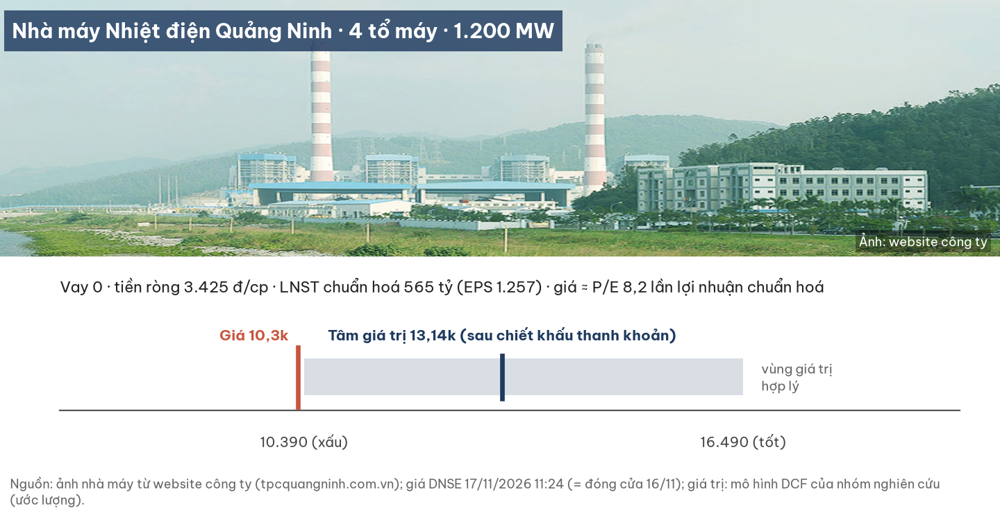
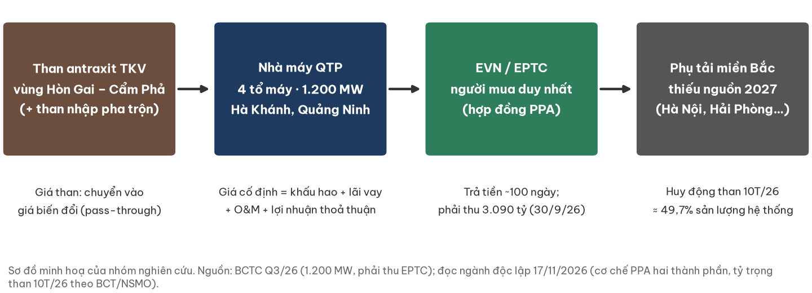
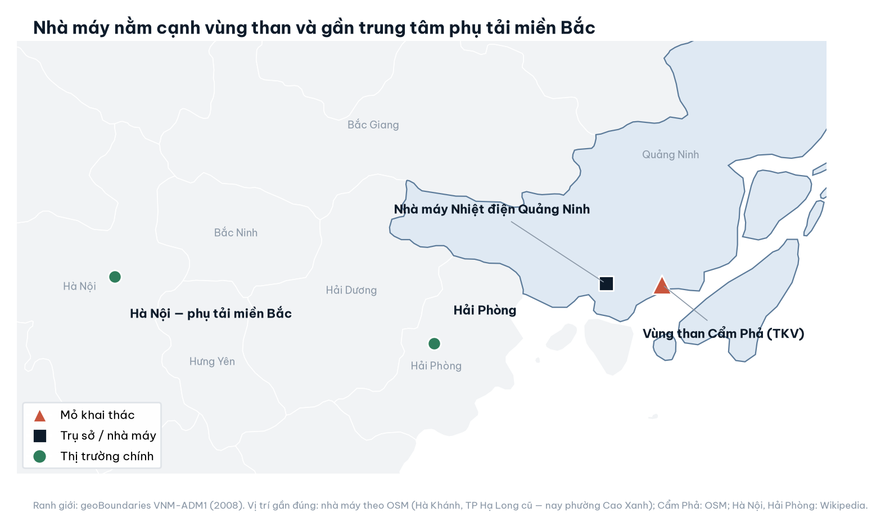
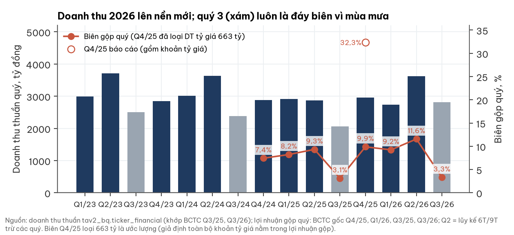
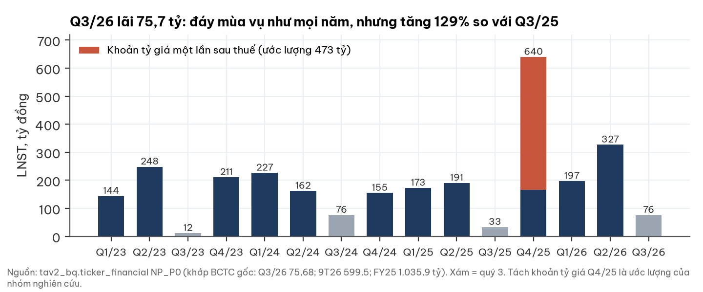
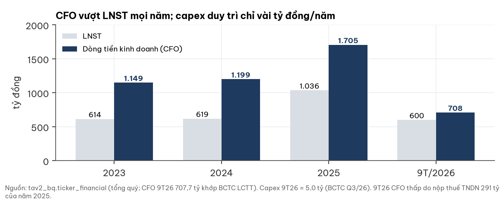
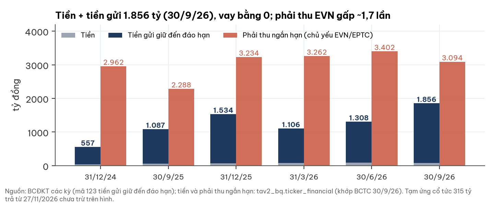
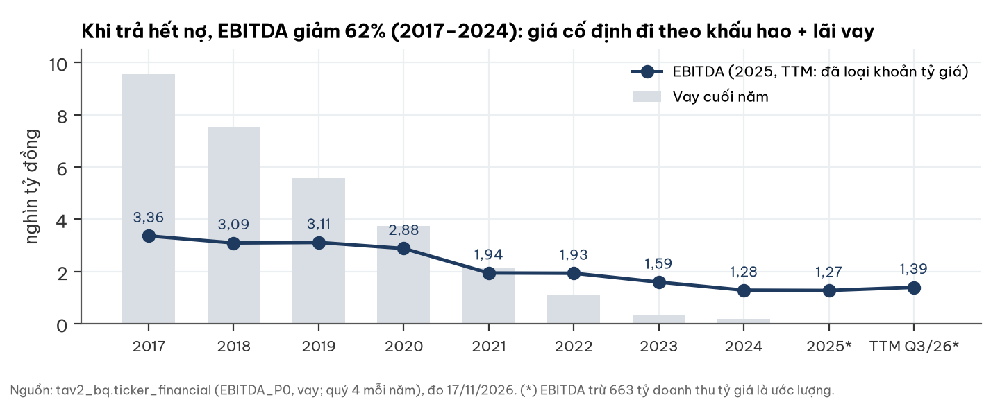
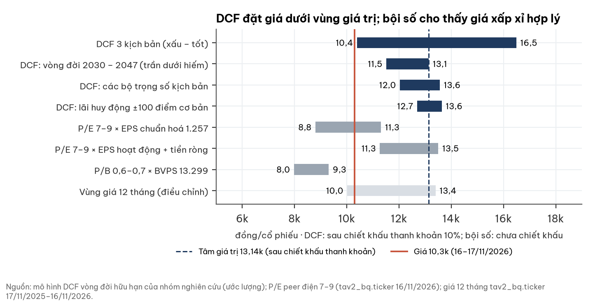
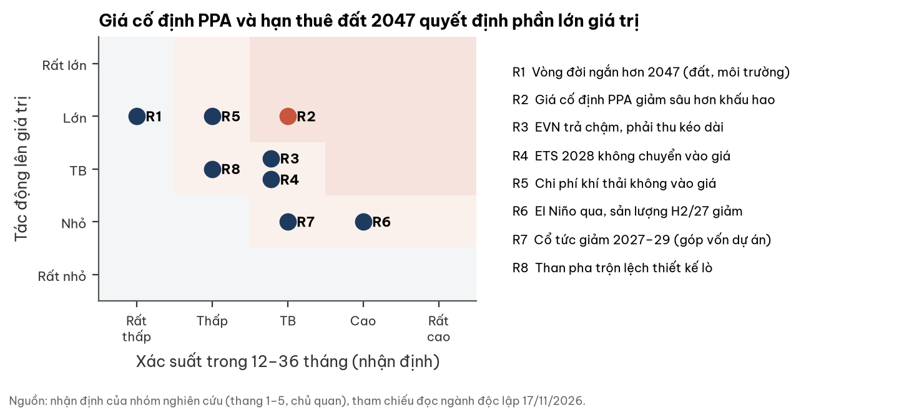

# QTP — Nhiệt điện Quảng Ninh: sạch nợ, tiền mặt dày và sản lượng đang ở đỉnh nhờ El Niño, nhưng giá trị còn tuỳ giá cố định hợp đồng điện sau khi hết khấu hao

| Chỉ tiêu | Giá trị | Chỉ tiêu | Giá trị |
|---|---|---|---|
| Giá (UPCOM) | **10.300 đ** (đóng cửa 16/11; DNSE 17/11 11:24 vẫn 10.300) | Vùng giá trị hợp lý | **10.390 – 16.490 đ** |
| Tâm giá trị sau chiết khấu thanh khoản 10% | **≈13.140 đ** (trước chiết khấu 14.599) | Giá / tâm | **0,78 lần** |
| LNST chuẩn hoá (bỏ khoản một lần) | 565 tỷ · EPS 1.257 đ | P/E trên EPS chuẩn hoá | **≈8,2 lần** (peer điện 7–9) |
| Vay nợ 30/9/2026 | **0** | Tiền ròng sau tạm ứng cổ tức | 1.541 tỷ · 3.425 đ/cp |
| Phải thu EVN/EPTC | 3.090 tỷ (~100 ngày doanh thu) | BVPS · ROE chuẩn hoá | 13.299 đ · ~9,4% |
| Cổ tức bền (ước lượng) | 900–1.000 đ/năm · 8,7–9,7% | Thanh khoản | 1,22 tỷ đ/phiên · free float 19,6% |

**Ba điều cần biết**

- **Tích cực:** không vay, 1.856 tỷ tiền và tiền gửi, CFO vượt LNST mọi năm; khấu hao còn lại chỉ 8,6% nguyên giá nên dòng tiền tự do cao.
- **Tiêu cực:** LNST 2025 (1.036 tỷ) phồng nhờ 663 tỷ doanh thu chênh lệch tỷ giá một lần; lợi nhuận bền ≈ 565 tỷ.
- **Định giá:** giá ở sát cận dưới vùng giá trị theo DCF và xấp xỉ hợp lý theo bội số; khoảng chênh nằm ở giá cố định hợp đồng mua bán điện (PPA) sau khi hết khấu hao và hạn thuê đất 2047; quy hoạch điện không cắt vòng đời nhà máy trước mốc này.

## 1. Tóm tắt điều hành

| | Nội dung |
|---|---|
| **Tình huống** | Nhà máy than 1.200 MW, đã trả hết nợ, khấu hao 91,4%; bán toàn bộ điện cho EVN. Năm 2026 El Niño đẩy huy động than lên mức cao. |
| **Vấn đề** | Lợi nhuận báo cáo lẫn khoản một lần; giá trị còn lại phụ thuộc biến chưa công bố là giá cố định PPA sau khi hết khấu hao; vòng đời nhà máy bị chặn bởi hạn thuê đất 2047, không phải bởi quy hoạch. |
| **Câu hỏi** | Giá 10.300 đ đang trả cho kịch bản nào? |
| **Trả lời** | Giá ≈ kịch bản xấu sau chiết khấu thanh khoản (10.390) và ≈ P/E 8 lần lợi nhuận chuẩn hoá. DCF có trọng số cho 13.140; bội số cho 8.800–11.300 (không cộng tiền ròng) hoặc 11.300–13.500 (có cộng). |

## 2. Luận điểm và điều thị trường đang định giá

| Luận điểm tích cực | Luận điểm tiêu cực |
|---|---|
| Vay 0; tiền ròng 3.425 đ/cp ≈ 33% giá | Lợi nhuận bền 565 tỷ, thấp hơn nhiều LNST báo cáo |
| Q3/26 lãi gấp 2,3 lần cùng kỳ; 9T26 LNST 599,5 tỷ (+51%) | Giá cố định PPA có xu hướng giảm khi hết khấu hao (lịch sử 2017–2024) |
| Miền Bắc thiếu 4.256 MW năm 2027: sản lượng gần như chắc cao | Vòng đời hữu hạn: hạn thuê đất 2047, chưa có căn cứ gia hạn |
| Khi dừng, thu hồi vốn lưu động ~2.259 tỷ | Dự án khí thải ~3.485 tỷ, vay 2.788 tỷ trong 2027–29 |

- **Thị trường đang định giá:** lợi nhuận hoạt động giảm còn một nửa từ 2028 và dừng 2040, hoặc chỉ trả bội số lợi nhuận, không tính tiền mặt.
- **Điều thị trường có thể chưa tính:** vốn lưu động thu hồi khi dừng; khả năng EVN duyệt thêm chênh lệch tỷ giá các năm cũ (cấp hệ thống còn ~17.500 tỷ chưa phân bổ).
- **Điều thị trường có thể đã tính đúng:** giá cố định PPA giảm theo khấu hao; nhà máy than cũ bị điều độ ít hơn sau 2028.

## 3. Ngành: sản lượng than ở đỉnh chu kỳ thuỷ văn xấu, giá trị do văn bản quyết định

| Động lực | Dữ kiện (nguồn: đọc ngành độc lập 17/11/2026) |
|---|---|
| Cầu điện | 10T/2026 +9,8%; Q4/2026 dự báo +14% ở miền Bắc (BCT/NSMO) |
| Tỷ trọng than | 10T/2026 = 49,7% sản lượng hệ thống; ước +19% so với cùng kỳ |
| Thuỷ điện | Dòng về ~80% trung bình nhiều năm; El Niño có thể kéo dài tới ~T6/2027 |
| Thiếu nguồn 2027 | 4.256 MW và 2,9 tỷ kWh nếu nguồn mới không kịp |
| Quy hoạch | QĐ 768/2025: than 31.055 MW tới 2030, khẩn trương hoàn thành 5 dự án 4.360 MW đang xây; định hướng 2050 không dùng than; BCT đề xuất thêm 5.300 MW (báo chí 07/11) |
| Carbon | Hạn ngạch miễn phí 100% 2025–26; tuân thủ bắt buộc từ 2028 |

- Người đọc ngành độc lập xếp driver 12 tháng: **chính sách/văn bản 0,45 · chu kỳ 0,40 · cấu trúc 0,15**; 36 tháng: 0,50 · 0,20 · 0,30.
- Rủi ro đảo chu kỳ: El Niño tắt giữa 2027 ⇒ thuỷ điện hồi, huy động than H2/2027 có thể giảm so cùng kỳ.

## 4. Doanh nghiệp: một nhà máy, một khách hàng, một hợp đồng

| Hạng mục | Thông tin |
|---|---|
| Tài sản | Nhà máy Nhiệt điện Quảng Ninh, 4 tổ máy, 1.200 MW; Hà Khánh, Quảng Ninh (BCTC Q3/26) |
| Vận hành thương mại | Tổ 1–2 khoảng 2011; tổ 3–4 năm 2014 (tài liệu bên thứ ba, chưa đối chiếu báo cáo thường niên) |
| Thuê đất chính | Tới 15/3/2047 (thuyết minh BCTC 2025) |
| Tài sản cố định | Nguyên giá 21.075 tỷ, đã khấu hao 91,4%, còn 1.803 tỷ |
| Cổ đông | EVNGENCO1 42,0% · Nhiệt điện Phả Lại 16,35% · SCIC 11,42% · Điện lực TKV 10,62% · khác 19,6% |
| Công ty con | Không có (BCTC riêng = hợp nhất) |

- Giá bán điện gồm hai phần: **giá biến đổi** chuyển chi phí than sang EVN; **giá cố định** hoàn khấu hao, lãi vay, O&M và lợi nhuận thoả thuận.
- Q3/26 nhiên liệu/vật liệu = 87% chi phí: biên tuyệt đối chủ yếu đến từ giá cố định.

## 5. Tài chính: lợi nhuận lõi tăng thật, nhưng 2025 có khoản một lần lớn

- **Mùa vụ:** quý 3 luôn là đáy (Q3/23 11,6 · Q3/24 76,1 · Q3/25 33,0 · Q3/26 75,7 tỷ) vì mùa mưa ưu tiên thuỷ điện.
- **Tăng trưởng 2026:** lợi nhuận gộp 9T +193 tỷ, trong đó khấu hao giảm 83,5 tỷ, phần còn lại từ sản lượng.
- **Chuẩn hoá:** trung vị LNST 12 quý gần nhất (bỏ tỷ giá, thuế 20%) = **565,5 tỷ**; mức 766 tỷ quý gần nhất chưa coi là bền.

- Kiểm toán BCTC 2025: chấp nhận toàn phần, không có đoạn nhấn mạnh.
- Phải thu EVN chưa quá hạn, chưa trích dự phòng; rủi ro là **kéo dài** kỳ thu khi EVN bị ép biên 2026–27.

## 6. Sự kiện vốn: cổ tức cao và dự án khí thải

| Hạng mục | Chi tiết |
|---|---|
| Tạm ứng cổ tức 2026 | 700 đ/cp; GDKHQ 05/11, ĐKCC 06/11, trả từ 27/11/2026 (~315 tỷ) |
| Cổ tức 12 tháng | 1.000 + 700 đ ⇒ 16,5% trên giá; nhờ năm có khoản tỷ giá |
| Cổ tức bền (ước lượng) | Tỷ lệ chi ~75–80% × EPS 1.257 ⇒ 900–1.000 đ (8,7–9,7%) |
| Dự án nâng cấp xử lý khí thải | Tổng mức ~3.485 tỷ; EPC ~89,2 triệu USD + 901,8 tỷ đ, 38 tháng |
| Nguồn vốn | Vay 2.787,9 tỷ (80%), vốn chủ ~697 tỷ; ngân hàng: liên danh, BIDV, Vietcombank |

- Dự án mang tính tuân thủ môi trường; mô hình coi giá trị hiện tại ròng bằng 0 (vốn bỏ ra = tài sản).
- Giá điều chỉnh cổ tức gần như đi ngang quanh ngày GDKHQ (10.400–10.500 đ); giá danh nghĩa giảm chủ yếu do trừ quyền 700 đ.

## 7. Định giá: DCF vòng đời hữu hạn tới 2047, dựng độc lập với giá thị trường

| Kịch bản | Giả định | đ/cp | Xác suất |
|---|---|---|---|
| **Xấu** | LN hoạt động 85% năm 2027, 50% từ 2028 (carbon, sản lượng hợp đồng, giá cố định bị ép); dừng 2040 | 11.546 | 0,25 |
| **Cơ sở** | LN hoạt động phẳng 503,8 tỷ tới 2047; giá cố định giảm đúng bằng khấu hao đã hết | 15.200 | 0,65 |
| **Tốt** | Giá cố định không giảm sau khi hết khấu hao | 18.324 | 0,10 |
| **Có trọng số** | trước / sau chiết khấu thanh khoản 10% | **14.599 / 13.140** | |

- **Cơ sở trọng số:** EBITDA giảm 62% khi trả hết nợ (2017–2024) ủng hộ kịch bản cơ sở; chưa có dữ liệu trực tiếp cho kịch bản tốt nên chỉ gán 0,10.
- Bộ trọng số khác (sau chiết khấu): 0,25/0,75/0 → 12.858 · 0,5/0,5/0 → 12.035 · 0,25/0,5/0,25 → 13.561.

**Độ nhạy theo vòng đời (kịch bản dừng sớm là trần dưới hiếm; mô hình cơ sở = 2047)**

| Dừng sau | Trước chiết khấu | Sau chiết khấu 10% | Giá / tâm |
|---|---|---|---|
| 2030 | 12.785 | 11.507 | 0,90 |
| 2035 | 13.819 | 12.437 | 0,83 |
| 2040 | 14.274 | 12.847 | 0,80 |
| 2047 (mô hình) | 14.599 | 13.139 | 0,78 |

**Chi phí vốn:** r = **13,5%**, neo lãi huy động 12 tháng hiệu dụng **7,40%** (đo 03/11 và 17/11/2026, không đổi); r đi cùng lãi huy động theo tỷ lệ 1:1.

| Lãi huy động | −100 điểm cơ bản | −50 | Neo | +50 | +100 |
|---|---|---|---|---|---|
| Giá trị trước / sau chiết khấu | 15.151 / 13.636 | 14.868 / 13.381 | 14.599 / 13.139 | 14.343 / 12.909 | 14.101 / 12.691 |

- **Bối cảnh lãi suất:** lãi suất chiết khấu thị trường đang ngầm định ≈ 15,1% (147 mã, 30/10/2026), phân vị 75% giai đoạn 2014–2026 (đỉnh 2022: 15,9%, đáy 2022–23: 12,1%) — cao hơn r của mô hình. TPCP 10 năm 4,57% (16/11/2026), +0,57 điểm % trong 12 tháng (nguồn chưa đối chiếu độc lập). Chỉ để tham khảo, không đổi giá trị hợp lý.
- **Chiết khấu thanh khoản 10%** (ước lượng): ADV trung vị 1,22 tỷ đ/phiên (63 phiên tới 16/11), free float 19,6%; giao dịch 1 tỷ đ ở mức 15% ADV cần ~5–6 phiên. 5% → 13.869 · 15% → 12.409.

**Kiểm chéo bằng bội số** (P/E peer điện, 16/11/2026: trung vị 22 mã 8,99; 8 mã điện chọn lọc 7,96; 8 mã nhiệt điện + thuỷ điện 5,83)

| P/E | 6 | 7 | 8 | 9 |
|---|---|---|---|---|
| × EPS chuẩn hoá 1.257 (không cộng tiền ròng) | 7.540 | 8.796 | 10.053 | 11.310 |
| × EPS hoạt động 1.120 + tiền ròng 3.425 | 10.143 | 11.262 | 12.382 | 13.502 |

- **Cách đọc bội số:** giá 10.300 ≈ P/E 8,2 trên EPS chuẩn hoá, sát trung vị peer ⇒ **xấp xỉ hợp lý**. Khoảng cách tới DCF chính là giá trị gán cho vòng đời dài và giá cố định hoàn vốn.
- **Kết luận:** giá thấp hơn tâm DCF ~22%, sát cận dưới vùng giá trị; biên này co lại nếu coi kịch bản xấu ngang cơ sở (0,86 lần) hoặc nếu giá cố định hợp đồng giảm mạnh hơn khấu hao; vòng đời dừng sớm (2030: 0,90 lần) chỉ là trần dưới hiếm vì văn bản quy hoạch không có mốc này.

## 8. Rủi ro: giá cố định hợp đồng là biến lớn nhất, vòng đời bị chặn bởi hạn thuê đất

| Rủi ro | Tác động ước tính | Dấu hiệu sớm | Ngày kiểm |
|---|---|---|---|
| R1 Vòng đời ngắn hơn 2047 (không gia hạn đất, quy chuẩn môi trường) | Dừng 2035: tâm 12.437 (−5%); dừng 2030: 11.507 (−12%) | Văn bản hướng dẫn chuyển đổi nhà máy >20 năm; tiêu chuẩn môi trường | Theo dõi tới 31/12/2027 |
| R2 Giá cố định giảm sâu | Kịch bản xấu 11.546 trước chiết khấu | Biên gộp giảm khi sản lượng tăng | BCTC Q1–Q2/2027 |
| R3 EVN trả chậm | Chiết khấu thêm, giảm cổ tức | Phải thu > 3.800 tỷ (>120 ngày) | 31/12/2026, 31/3/2027 |
| R4 Carbon 2028 | Nằm trong kịch bản xấu | Quy định chuyển chi phí carbon vào giá | 2027–2028 |
| R5 Khí thải không vào giá | Tối đa −1.550 đ/cp nếu mất toàn bộ vốn chủ (cực đoan) | Phê duyệt giá cố định sau dự án | 2027–2029 |
| R6 Hết El Niño | Lợi nhuận 12 tháng, ít ảnh hưởng giá trị | Thuỷ văn mùa lũ 2027 | H2/2027 |

## 9. Pháp lý, chính sách và quản trị — cảnh báo

- **QĐ 768/QĐ-TTg (15/04/2025), đã đối chiếu văn bản gốc:** nhiệt điện than chỉ tiếp tục các dự án đã có trong quy hoạch và đang xây tới 2030 (~31.055 MW); nhà máy vận hành 20 năm được định hướng chuyển sang sinh khối/amoniac **khi giá thành phù hợp**; **dừng nhà máy trên 40 năm nếu không chuyển đổi được**; định hướng 2050 không còn dùng than phát điện.
- Với 4 tổ máy vận hành thương mại 2011 và 2014 (tài liệu bên thứ ba), mốc 20 năm là 2031/2034 và mốc 40 năm là 2051/2054, sau hạn thuê đất 2047 của mô hình. Văn bản cuối không có mốc "dừng sau 2030"; thông tin về một dự thảo có nêu tên "Quảng Ninh" chỉ từ báo chí và không có trong điều khoản cuối.
- Bối cảnh cung–cầu ủng hộ việc duy trì vận hành: miền Bắc thiếu 4.256 MW năm 2027, 5 dự án than 4.360 MW đang xây dở và Bộ Công Thương đề xuất thêm 5.300 MW. Phụ lục của quyết định chỉ được đọc lướt mẫu; chưa thấy danh sách dừng nhà máy hiện hữu.
- Rủi ro còn lại: hạn thuê đất 2047 chưa có căn cứ gia hạn; tiêu chuẩn môi trường (dự án khí thải ~3.485 tỷ nhằm đáp ứng); điều độ ít hơn khi nguồn khác vào sau 2028.
- **Quản trị:** cổ đông nhà nước ~80%; không thấy khởi tố hay xử phạt trong các công bố thông tin 2026 đã đọc; đổi kiểm toán từ năm 2025.

## 10. Lịch xúc tác và mốc đổi nhận định hai chiều

| Mốc | Nhận định tích cực hơn nếu | Nhận định tiêu cực hơn nếu |
|---|---|---|
| BCTC Q4/2026 (~21/01/2027) | LNST Q4 ≥ ~190 tỷ và lợi nhuận gộp ≥ ~160 tỷ, sản lượng không giảm | LNST Q4 ≤ ~130 tỷ hoặc lợi nhuận gộp < 120 tỷ |
| Biên gộp Q1–Q2/2027 | Sản lượng và biên cùng tăng | Biên giảm trong khi sản lượng tăng (giá cố định bị cắt) |
| Phải thu EVN (31/12/2026, 31/3/2027) | < 2.500 tỷ | > 3.800 tỷ |
| Cổ tức cả năm 2026 (ĐHĐCĐ 04/2027) | ≥ 1.200 đ | < 800 đ |
| Hướng dẫn chuyển đổi nhà máy >20 năm / gia hạn thuê đất | Cho phép chuyển đổi hoặc gia hạn đất sau 2047 | Quy định buộc dừng hoặc chuyển đổi trước 2047 |
| Chênh lệch tỷ giá (văn bản EVN) | Được duyệt thêm: cộng giá trị một lần | — |
| Dự án khí thải | — | Vượt dự toán hoặc không được tính vào giá cố định |

Ngưỡng 190/130 tỷ quanh mức kỳ vọng ~160 tỷ là ước lượng (Q4/24 154,8; Q4/25 bỏ khoản tỷ giá 166,3).

## Phụ lục A — Số liệu BCTC chính (tỷ đồng)

| Chỉ tiêu | Q3/26 | Q3/25 | 9T26 | 9T25 | FY2025 |
|---|---|---|---|---|---|
| Doanh thu thuần | 2.814,6 | 2.056,4 | 9.173,3 | 7.832,6 | — |
| Lợi nhuận gộp | 93,1 | 64,2 | 764,4 | 571,0 | 1.525,8 |
| Doanh thu tài chính | 25,7 | 8,0 | 59,6 | — | — |
| LNTT | 94,7 | 41,3 | 749,7 | 495,5 | — |
| LNST | 75,7 | 33,0 | 599,5 | 396,2 | 1.035,9 |
| Khấu hao | 104,5 | 136,8 | 329,2 | 412,7 | — |
| CFO | — | — | 707,7 | 1.168,7 | 1.705 |

Bảng cân đối 30/9/2026: tiền 82,2 · tiền gửi giữ đến đáo hạn 1.774,1 · vay 0 · phải thu khách hàng 3.091,5 · hàng tồn kho 729,3 · nợ phải trả 1.578,5 · vốn chủ 5.984,7.

## Phụ lục B — Đối chiếu dữ liệu thị trường với BCTC gốc

| Chỉ tiêu | Dữ liệu thị trường | BCTC gốc | Ghi chú |
|---|---|---|---|
| Doanh thu Q3/26 | 2.814,6 | 2.814,6 | Khớp |
| LNST Q3/26 / Q2/26 / Q4/25 | 75,7 / 326,6 / 639,7 | 75,7 / 326,6 / 639,7 | Khớp (Q2, Q4 suy từ lũy kế) |
| Biên gộp ~14% | Số 12 tháng | 9T26 8,3%; Q3 3,3% | Số 12 tháng chứa khoản tỷ giá 663 tỷ |
| P/E 3,7; tỷ suất cổ tức 16,5% | Lợi nhuận/cổ tức thô | — | Phồng do khoản một lần; P/E chuẩn hoá ≈ 8,2 |

## Phụ lục C — Nguồn

- **Công ty** (tpcquangninh.com.vn): BCTC Q3/2026 + giải trình, BCTC kiểm toán 2025 (UHY), soát xét bán niên 2026, BCTC Q1/26, Q2/26, Q3/25, Q4/25; thông báo tạm ứng cổ tức 2026; quyết định EPC và vay dự án khí thải; logo và ảnh nhà máy từ website.
- **Dữ liệu thị trường:** chuỗi tài chính quý, giá, khối lượng (đến 16/11/2026); giá trong phiên DNSE 17/11/2026 11:24; lãi huy động 12 tháng hiệu dụng.
- **Ngành:** đọc ngành độc lập 17/11/2026 (BCT, NSMO, VietnamPlus, VnEconomy, Tạp chí Công Thương; QĐ 263/QĐ-TTg; QĐ 2887/QĐ-BCT).
- **Bản đồ:** ranh giới geoBoundaries VNM-ADM1 (2008); toạ độ nhà máy và Cẩm Phả theo OpenStreetMap, Hà Nội và Hải Phòng theo Wikipedia — vị trí gần đúng.

## Phụ lục D — Phương pháp và giới hạn

- DCF dòng tiền vốn chủ, vòng đời hữu hạn 2027–2047 + dòng tiền Q4/2026 (ước lượng 546 đ/cp); giá trị cuối = vốn lưu động thu hồi, nhà máy = 0; không có tăng trưởng vĩnh viễn.
- Lợi nhuận phẳng danh nghĩa 21 năm (độ nhạy +3%/năm: +1.643 đ/cp); chưa tính chi phí đóng cửa/hoàn nguyên bãi tro (200–1.000 tỷ ⇒ −42 đến −211 đ/cp nếu dừng 2047).
- **Chưa có dữ liệu:** điều khoản PPA và lịch giá cố định; sản lượng hợp đồng 2027; số dư chênh lệch tỷ giá còn phải thu; room ngoại; số USD chính xác của hợp đồng EPC; gia hạn thuê đất sau 2047; phụ lục QĐ 768 mới được đọc lướt mẫu.
- Trọng số kịch bản, chiết khấu thanh khoản, cổ tức bền là ước lượng có nêu cơ sở; độ nhạy kèm theo.

## Phụ lục E — Quy trình nghiên cứu

Số liệu đối chiếu trực tiếp với BCTC gốc do công ty công bố. Mô hình định giá được dựng trước, độc lập với giá thị trường, rồi mới so với giá. Bối cảnh ngành do một người đọc ngành độc lập soạn mà không biết giá cổ phiếu và kết quả kinh doanh. Toàn bộ số liệu, mô hình và giả định đã được một người phản biện độc lập kiểm tra. Các giới hạn dữ liệu nêu ở Phụ lục D.

## Phụ lục F — Tuyên bố miễn trừ trách nhiệm

Tài liệu này chỉ nhằm mục đích cung cấp thông tin nghiên cứu, không phải lời khuyên, đề nghị hay khuyến nghị mua, bán hoặc nắm giữ bất kỳ chứng khoán nào, và không tính đến mục tiêu, tình hình tài chính hay nhu cầu của từng nhà đầu tư. Thông tin được tổng hợp từ các nguồn được cho là đáng tin cậy tại thời điểm lập, nhưng không được bảo đảm về tính đầy đủ hay chính xác. Các ước lượng, kịch bản và giá trị hợp lý phản ánh giả định tại ngày lập và có thể thay đổi mà không cần thông báo. Kết quả trong quá khứ không bảo đảm kết quả tương lai. Nhà đầu tư cần tự đánh giá và chịu trách nhiệm với quyết định của mình.
