# QTP — Nhiệt điện Quảng Ninh: sạch nợ, tiền mặt dày, sản lượng cao nhờ El Niño, nhưng dự án khí thải 3.485 tỷ có thể không được bù vào giá điện, nên giá đã cao hơn vùng giá trị hợp lý

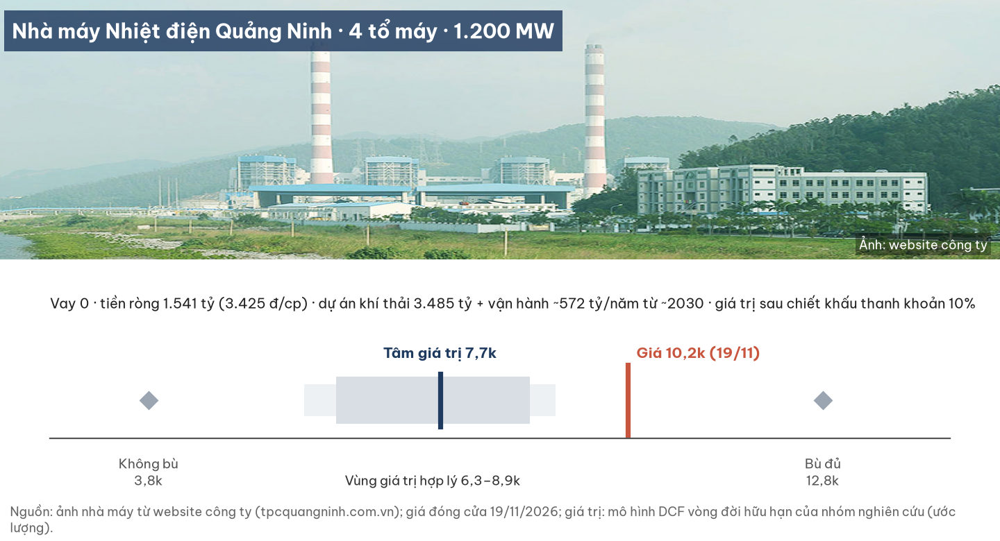

| Chỉ tiêu | Giá trị | Chỉ tiêu | Giá trị |
|---|---|---|---|
| Giá (UPCOM) | **10.200 đ** (đóng cửa 19/11/2026) | Vùng giá trị hợp lý | **6.300 – 8.900 đ** (kết hợp thuận lợi/bất lợi 5.900 – 9.200) |
| Tâm giá trị sau chiết khấu thanh khoản 10% | **≈7.700 đ** (trước chiết khấu 8.557) | Giá / tâm | **1,32 lần** (10.300 ngày 16/11: 1,34) |
| Vay nợ 30/9/2026 | **0** | Tiền ròng sau tạm ứng cổ tức | 1.541 tỷ · 3.425 đ/cp |
| LNST chuẩn hoá (bỏ khoản một lần) | 565 tỷ · EPS 1.257 đ | P/E trên EPS chuẩn hoá | ≈8,1 lần (chưa tính dự án khí thải) |
| Dự án xử lý khí thải | 3.485 tỷ, vay 2.787,9 tỷ (80%) | Chi phí vận hành thêm từ ~2030 | ~572 tỷ/năm ≈ 101% LNST chuẩn hoá |
| Cổ tức 2027–29 (ước lượng) | 900–1.000 đ/năm · 8,8–9,8% | Thanh khoản | 1,22 tỷ đ/phiên · free float 19,6% |

**Ba điều cần biết**

- **Tích cực:** không vay, 1.856 tỷ tiền và tiền gửi, CFO vượt LNST mọi năm; miền Bắc thiếu nguồn 2027 nên sản lượng gần như chắc ở mức cao.
- **Tiêu cực:** dự án khí thải bắt buộc (QCVN 19:2024) thêm ~572 tỷ chi phí/năm từ ~2030; chưa có văn bản nào bảo đảm khoản này được tính vào giá điện.
- **Định giá:** giá 10.200 đ cao hơn mọi biến thể giả định đơn lẻ (6.300–8.900) và cả tổ hợp thuận lợi nhất (9.240); giá chỉ hợp lý nếu chi phí dự án gần như chắc chắn được bù.

## 1. Tóm tắt điều hành

| | Nội dung |
|---|---|
| **Tình huống** | Nhà máy than 1.200 MW, đã trả hết nợ, khấu hao 91,4%, bán toàn bộ điện cho EVN; năm 2026 El Niño đẩy huy động than lên cao. |
| **Vấn đề** | Từ 2027 công ty đầu tư 3.485 tỷ cho hệ thống xử lý khí thải; giá trị phụ thuộc việc chi phí vốn và vận hành của hệ thống này có được bù vào giá điện hay không. |
| **Câu hỏi** | Giá 10.200 đ đang trả cho kịch bản nào? |
| **Trả lời** | Giá tương đương giả định gần như chắc chắn được bù (xác suất không bù ≈ 0). Với xác suất không bù 0,40, tâm giá trị ≈7.700 đ; giá cao hơn tâm 32%. |

## 2. Luận điểm và điều thị trường đang định giá

| Luận điểm tích cực | Luận điểm tiêu cực |
|---|---|
| Vay 0; tiền ròng 3.425 đ/cp ≈ 34% giá | Dự án khí thải 3.485 tỷ + ~572 tỷ/năm vận hành, chưa có cơ chế bù |
| 9T/2026 LNST 599,5 tỷ (+51%); Q3 gấp 2,3 lần cùng kỳ | Không bù: dòng tiền toàn công ty âm từ 2030 (−119 đến −424 tỷ/năm) |
| Miền Bắc thiếu 4.256 MW năm 2027 | Không bù + cổ tức 900 đ: tiền ròng âm từ 2032 |
| Luật Điện lực 2024 Đ52.4 mở đường thoả thuận lại giá; EVN vừa mua điện vừa là chủ chi phối | Từ 2017 chưa có cơ chế bù được áp; chưa nhà máy than nào được bù |

- **Thị trường đang định giá:** giá 10.200 ≈ giá trị khi xác suất không bù bằng 0 (10.293); tức thị trường coi việc bù gần như chắc.
- **Điều thị trường có thể chưa tính:** chi phí vận hành 572 tỷ/năm bằng cả lợi nhuận bền hiện tại; cổ tức cao 2026 không kéo dài nếu không được bù.
- **Điều thị trường có thể đã tính đúng:** bên mua và cổ đông chi phối cùng thuộc EVN; vấn đề mang tính hệ thống nên một cơ chế chung có thể ra đời; khi đó giá trị lên ~12.800 đ.

## 3. Ngành: sản lượng than ở đỉnh chu kỳ thuỷ văn xấu, giá trị do văn bản quyết định

| Động lực | Dữ kiện (nguồn: đọc ngành độc lập 17/11/2026) |
|---|---|
| Cầu điện | 10T/2026 +9,8%; Q4/2026 dự báo +14% ở miền Bắc (BCT/NSMO) |
| Tỷ trọng than | 10T/2026 = 49,7% sản lượng hệ thống; ước +19% so với cùng kỳ |
| Thuỷ điện | Dòng về ~80% trung bình nhiều năm; El Niño có thể kéo dài tới ~T6/2027 |
| Thiếu nguồn 2027 | 4.256 MW và 2,9 tỷ kWh nếu nguồn mới không kịp |
| Quy hoạch | QĐ 768/2025: than 31.055 MW tới 2030; định hướng 2050 không dùng than |
| Môi trường | QCVN 19:2024 về khí thải công nghiệp bắt buộc với nhà máy hiện hữu từ 01/01/2032 |
| Carbon | Hạn ngạch miễn phí 100% 2025–26; tuân thủ bắt buộc từ 2028 |

- Driver 12 tháng (người đọc ngành độc lập): **chính sách/văn bản 0,45 · chu kỳ 0,40 · cấu trúc 0,15**.
- Rủi ro đảo chu kỳ: El Niño tắt giữa 2027, thuỷ điện hồi, huy động than H2/2027 có thể giảm.

## 4. Doanh nghiệp: một nhà máy, một khách hàng, một hợp đồng

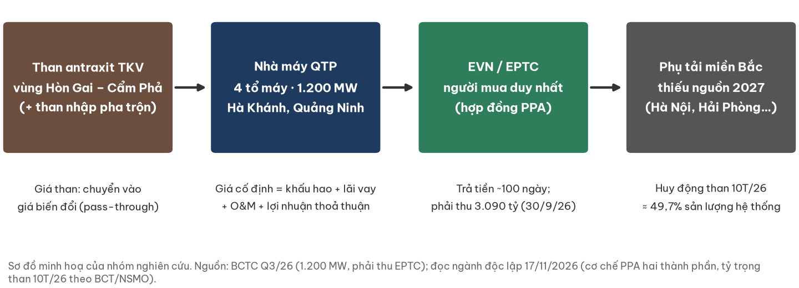

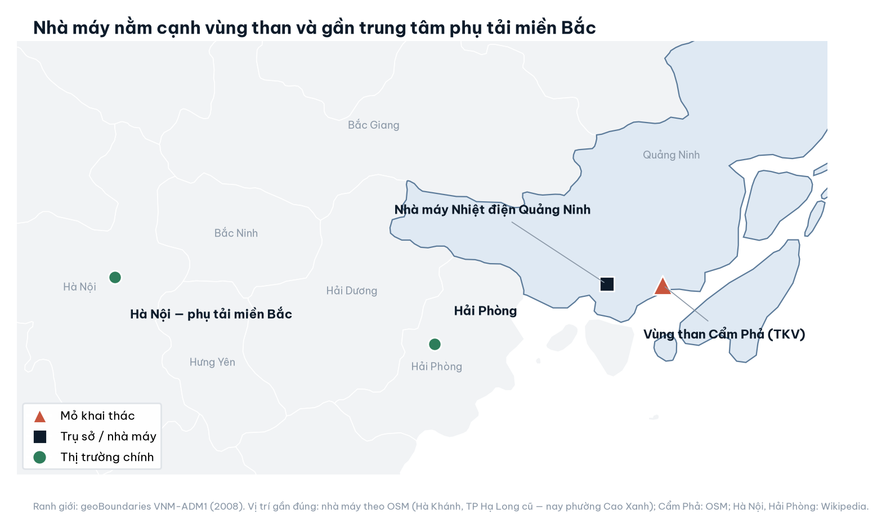

| Hạng mục | Thông tin |
|---|---|
| Tài sản | Nhà máy Nhiệt điện Quảng Ninh, 4 tổ máy, 1.200 MW; Hà Khánh, Quảng Ninh |
| Vận hành thương mại | Tổ 1–2 khoảng 2011; tổ 3–4 năm 2014 (tài liệu bên thứ ba) |
| Thuê đất chính | Tới 15/3/2047 (thuyết minh BCTC 2025) |
| Tài sản cố định | Nguyên giá 21.075 tỷ, đã khấu hao 91,4% |
| Cổ đông | EVNGENCO1 42,0% · Nhiệt điện Phả Lại 16,35% · SCIC 11,42% · Điện lực TKV 10,62% · khác 19,6% |

- Giá bán điện hai phần: **giá biến đổi** chuyển chi phí than sang EVN; **giá cố định** hoàn khấu hao, lãi vay, O&M và lợi nhuận thoả thuận.
- Chi phí hệ thống khí thải chỉ vào doanh thu nếu được thêm vào một trong hai phần giá này.

## 5. Tài chính: lợi nhuận lõi tăng thật, bảng cân đối không nợ

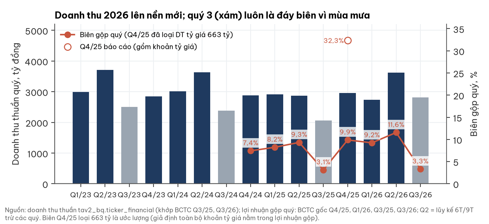

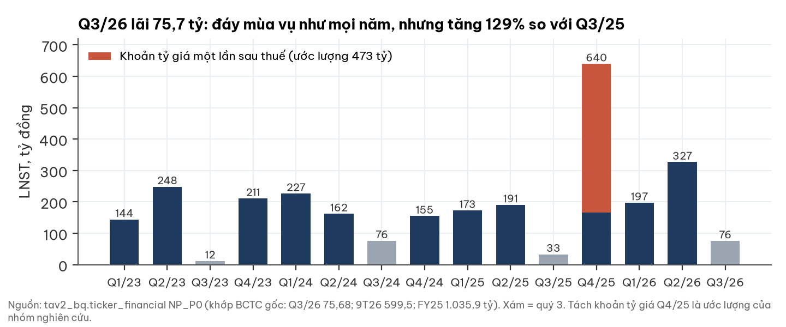

- **Mùa vụ:** quý 3 luôn là đáy vì mùa mưa ưu tiên thuỷ điện; Q3/26 75,7 tỷ, gấp 2,3 lần Q3/25.
- **Chuẩn hoá:** LNST 2025 (1.036 tỷ) gồm 663 tỷ doanh thu chênh lệch tỷ giá một lần; lợi nhuận bền ≈ **565 tỷ**.

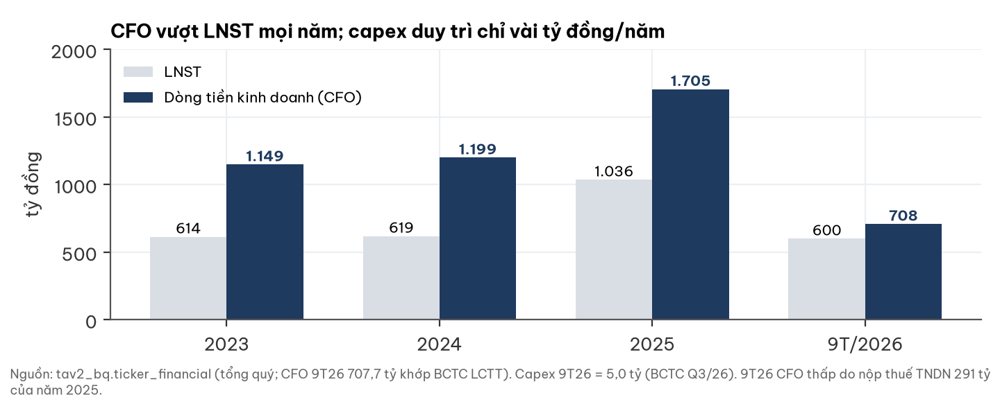

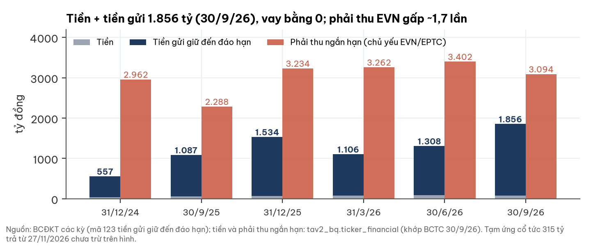

- Kiểm toán BCTC 2025 chấp nhận toàn phần; phải thu EVN chưa quá hạn, chưa trích dự phòng.
- Rủi ro là kỳ thu **kéo dài** khi EVN bị ép biên 2026–27.

## 6. Dự án xử lý khí thải: khoản đầu tư quyết định giá trị

| Hạng mục | Chi tiết | Nguồn |
|---|---|---|
| Tổng mức đầu tư | **3.484,9 tỷ** trước VAT (3.799,2 tỷ sau VAT); thiết bị 2.941 tỷ | Báo cáo thẩm tra FS 22/5/2026, CBTT 11/6/2026 |
| Vốn vay | **2.787,9 tỷ = 80%**: BIDV Hạ Long 1.787,9 + Vietcombank Quảng Ninh 1.000; lãi suất chưa công bố | QĐ 917 (15/6/2026), QĐ 1490 (21/9/2026) |
| EPC | 89.756.813 USD + 901,82 tỷ đ, trọn gói, 38 tháng (SEC–Pacific) | QĐ 1710 (6/10/2026) |
| Tiến độ | Giải ngân 2027–29; vận hành thương mại ~01/2030 (ước lượng) | Từ thời hạn EPC |
| Hạn tuân thủ | QCVN 19:2024 bắt buộc từ **01/01/2032**; tỉnh có thể yêu cầu sớm hơn | Giấy phép môi trường 517/GPMT-BTNMT (03/12/2024) |
| Chi phí vận hành thêm | **~572 tỷ/năm** = O&M 102,0 + điện, nước, hoá chất 470,3 (amoniac 317,4) | FS mục 3.1.7 |
| Giá đề nghị cộng thêm | **169,44 đ/kWh** (vốn 81,42 + O&M 15,69 + biến đổi 72,33); FIRR 11,0% | FS + báo cáo thẩm tra |

**Cơ chế bù giá: lập luận hai phía**

| Ủng hộ được bù | Chống lại |
|---|---|
| Luật Điện lực 61/2024 Đ52.4: điều chỉnh giá khi chính sách thay đổi bất lợi (a) hoặc nâng cấp để đáp ứng tiêu chuẩn mới (c) | TT12/2025 (thay TT07/2024) không có điều khoản thoả thuận bổ sung chi phí môi trường vào giá |
| TT07/2024 Đ27.4 từng cho thoả thuận bổ sung chi phí này; FS thẩm tra vẫn dẫn căn cứ cùng loại | Căn cứ FS dẫn là điều khoản đã bị bãi bỏ |
| EVN kiến nghị cơ chế ngày 29/12/2025; bên mua và cổ đông chi phối cùng thuộc EVN | Dự án phê duyệt lần đầu 2017; đến nay chưa có cơ chế bù được áp |
| Vấn đề mang tính hệ thống (nhiều nhà máy than của EVN cùng cải tạo) | Chưa có tiền lệ nhà máy than được bù; cụm từ trong Đ52.4(c) có thể loại trừ hệ thống trong nhà máy |
| Không bù thì doanh nghiệp nhà nước cấp điện miền Bắc cạn tiền trong ~10 năm | EVN là bên mua đang chịu áp lực tài chính; bù không hồi tố |

| Kịch bản | Điều kiện | Xác suất (ước lượng) | Giá trị sau chiết khấu |
|---|---|---|---|
| **Không bù** | Không có thoả thuận bổ sung giá | 0,40 | **3.813 đ** |
| **Bù một phần** | Bù 50% phần tăng thêm (vốn, O&M, biến đổi) | 0,36 | **8.618 đ** |
| **Bù đủ** | Cộng đủ 169,44 đ/kWh từ ngày vận hành | 0,24 | **12.805 đ** |
| **Có trọng số** | | | **7.701 đ** |

- **Xác suất là nhận định**, chưa có tần suất đo được (không có tiền lệ); độ nhạy ở mục 7.
- **Không áp giả định giá trị hiện tại ròng bằng 0:** đây là chi phí tuân thủ, không tạo sản lượng hay doanh thu mới; kể cả bù đủ, FIRR bị trần 12% (TT12/2025), thấp hơn r 13,5%.

## 7. Định giá: DCF vòng đời hữu hạn tới 2047, dựng độc lập với giá thị trường

**Giá trị trước chiết khấu thanh khoản theo kịch bản vận hành × kịch bản bù giá (đ/cp)**

| Kịch bản vận hành (trọng số) | Không bù | Bù một phần | Bù đủ |
|---|---|---|---|
| Xấu: LN giảm còn 50% từ 2028, dừng 2040 (0,25) | 1.281 | 6.247 | 10.618 |
| Cơ sở: LN hoạt động phẳng tới 2047 (0,65) | 4.722 | 10.269 | 15.014 |
| Tốt: giá cố định không giảm sau khấu hao (0,10) | 8.469 | 13.394 | 18.138 |

**Độ nhạy theo xác suất không bù** (bù một phần : bù đủ giữ 60:40; sau chiết khấu)

| Xác suất không bù | 0 | 0,2 | 0,3 | **0,4** | 0,5 | 0,6 |
|---|---|---|---|---|---|---|
| Giá trị (đ/cp) | 10.293 | 8.997 | 8.349 | **7.701** | 7.053 | 6.405 |

**Biến thể giả định** (sau chiết khấu): bỏ 115 tỷ chi phí FS chưa thuyết minh 8.287 · chi phí vận hành từ 2032 8.458 · chi phí biến đổi 50% 8.894 · bù chậm từ 2033 6.315 · bù một phần chỉ phần vốn 6.838 · lãi vay 7%/11% 8.062/7.337 · **kết hợp thuận lợi 9.240 · kết hợp bất lợi 5.887**.

**Chi phí vốn:** r = **13,5%**, neo lãi huy động 12 tháng hiệu dụng **7,40%** (19/11/2026); r và lãi vay dự án đi cùng lãi huy động theo tỷ lệ 1:1.

| Lãi huy động | −100 điểm cơ bản | −50 | Neo | +50 | +100 |
|---|---|---|---|---|---|
| Giá trị trước / sau chiết khấu | 9.031 / 8.128 | 8.787 / 7.908 | 8.557 / 7.701 | 8.338 / 7.504 | 8.130 / 7.317 |

- **Chiết khấu thanh khoản 10%** (ước lượng): ADV trung vị 1,22 tỷ đ/phiên (63 phiên tới 16/11), free float 19,6%. 5% cho 8.129; 15% cho 7.273.
- **Bối cảnh lãi suất:** thị trường đang ngầm định lãi suất chiết khấu ≈15,1% (147 mã, 30/10/2026), phân vị 75% giai đoạn 2014–2026; TPCP 10 năm 4,57% (19/11/2026), +0,57 điểm % trong 12 tháng (nguồn chưa đối chiếu độc lập). Chỉ để tham khảo.
- **Kiểm chéo bội số:** P/E 7–9 × EPS 1.257 cho 8.800–11.300, nhưng EPS này chưa trừ chi phí dự án; từ 2030 EPS phụ thuộc kịch bản bù giá nên P/E hiện tại không dùng làm mỏ neo.

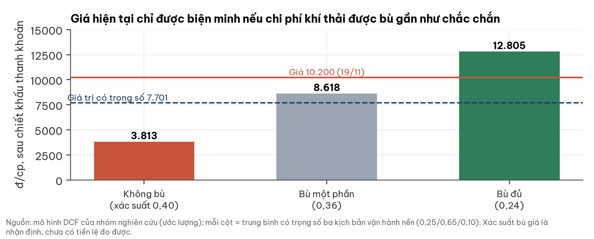

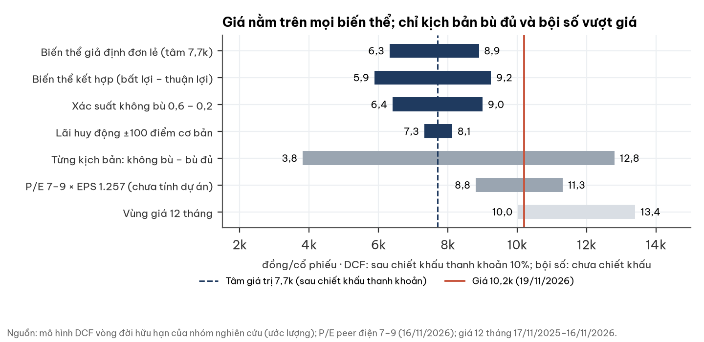

## 8. Dòng tiền và cổ tức nếu chi phí không được bù

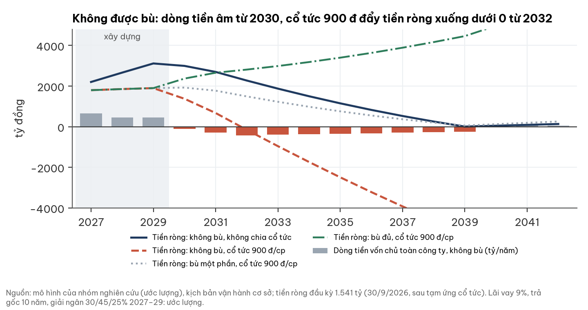

| Năm (kịch bản không bù, vận hành cơ sở) | 2027 | 2029 | 2030 | 2032 | 2035 | 2039 | 2040 |
|---|---|---|---|---|---|---|---|
| Dòng tiền vốn chủ toàn công ty (tỷ) | +660 | +450 | −119 | −424 | −349 | −249 | +42 |
| Tiền ròng, không chia cổ tức (tỷ) | 2.202 | 3.114 | 2.994 | 2.272 | 1.149 | 3 | 46 |
| Tiền ròng, cổ tức 900 đ/cp (tỷ) | 1.797 | 1.899 | 1.374 | −158 | −2.496 | −5.262 | −5.624 |

- **2027–29:** vốn chủ dự án + lãi thời gian xây dựng cần ~1.086 tỷ (2.413 đ/cp); tiền ròng đủ trả, cổ tức 900–1.000 đ vẫn giữ được (ước lượng).
- **Từ 2030, không bù:** lợi nhuận âm, cổ tức 500 đ làm tiền ròng âm từ 2034, 900 đ từ 2032; khi đó cần vay thêm hoặc cắt cổ tức.
- **Bù một phần / bù đủ:** EPS bình quân 2030–39 ~300 / ~1.290 đ (ước lượng); tỷ suất cổ tức kỳ vọng có trọng số ~3% sau 2030.

## 9. Rủi ro: cơ chế bù giá là biến lớn nhất

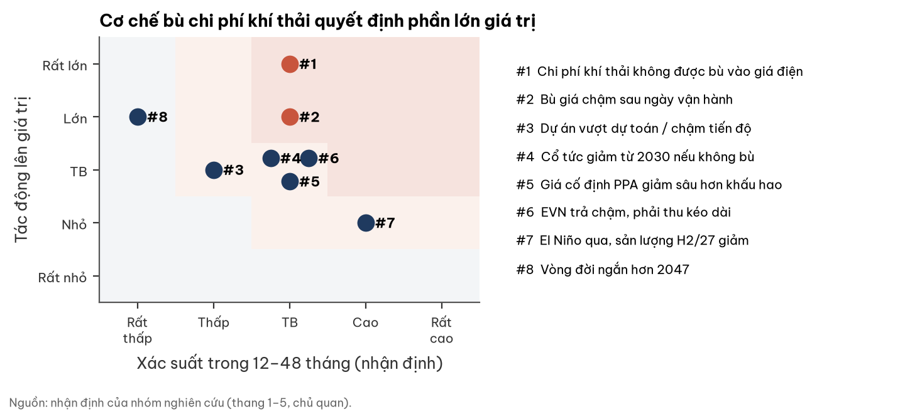

| Rủi ro | Tác động ước tính | Dấu hiệu sớm | Ngày kiểm |
|---|---|---|---|
| #1 Không được bù | Giá trị 3.813 đ | Văn bản EVN/BCT về giá PPA bổ sung | Đến COD ~12/2029 |
| #2 Bù chậm (từ 2033) | Tâm 6.315 đ (−18%) | Thoả thuận chưa ký khi vận hành | 2029–2030 |
| #3 Vượt dự toán, chậm tiến độ | Mỗi ~185 tỷ TMĐT: ~250 đ/cp (ước lượng) | Giải ngân, CBTT tiến độ EPC | BCTC mỗi quý 2027–29 |
| #4 Cổ tức giảm từ 2030 | Tỷ suất kỳ vọng ~3% | Chính sách cổ tức ĐHĐCĐ | 04/2027 trở đi |
| #5 Giá cố định giảm sâu hơn khấu hao | Kịch bản vận hành xấu | Biên gộp giảm khi sản lượng tăng | BCTC Q1–Q2/2027 |
| #6 EVN trả chậm | Chiết khấu thêm | Phải thu > 3.800 tỷ | 31/12/2026, 31/3/2027 |
| #7 Hết El Niño | Lợi nhuận 12 tháng | Thuỷ văn mùa lũ 2027 | H2/2027 |

## 10. Pháp lý, chính sách và quản trị — cảnh báo

- **QĐ 768/QĐ-TTg (15/4/2025):** nhà máy than vận hành 20 năm định hướng chuyển nhiên liệu khi giá thành phù hợp; dừng nhà máy trên 40 năm nếu không chuyển đổi được (với QTP: 2051/2054, sau hạn đất 2047).
- **Khung giá:** Luật Điện lực 61/2024 Đ52.4 cho phép điều chỉnh giá theo thoả thuận; TT12/2025 không có điều khoản riêng cho chi phí môi trường; chưa có văn bản hướng dẫn hiệu lực của giá mới ngoài thoả thuận hai bên.
- **Quản trị:** cổ đông nhà nước ~80%; không thấy khởi tố hay xử phạt trong công bố thông tin 2026 đã đọc; đổi kiểm toán từ năm 2025.

## 11. Mốc đổi nhận định hai chiều

| Mốc | Nhận định tích cực hơn nếu | Nhận định tiêu cực hơn nếu |
|---|---|---|
| Thoả thuận giá PPA bổ sung (trước COD ~12/2029) | Ký bù một phần: tâm lên ~8.600; bù đủ: ~12.800 | Chưa ký khi vận hành, hoặc EVN/BCT từ chối bằng văn bản: ~3.800 |
| Giấy phép môi trường / lộ trình QCVN 19 | Chỉ buộc vận hành hệ thống từ 2032: tâm 8.458 | Buộc vận hành đủ ngay từ ~2030 (giả định hiện tại của tâm) |
| Hợp đồng tín dụng (lãi suất thật) | Lãi ≤ 7%: tâm 8.062 | Lãi ≥ 11%: tâm 7.337 |
| Tiến độ giải ngân 2027–29 | Đúng dự toán 3.485 tỷ | Vượt dự toán, chậm COD sau 2031 |
| Cổ tức (ĐHĐCĐ 04/2027 trở đi) | Giữ ≥ 900 đ kèm thông tin bù giá | Cắt cổ tức, vay thêm hoặc tăng vốn để tài trợ dự án |
| BCTC Q4/2026 (~21/01/2027) | LNST Q4 ≥ ~190 tỷ | LNST Q4 ≤ ~130 tỷ |
| Phải thu EVN (31/12/2026) | < 2.500 tỷ | > 3.800 tỷ |

## Phụ lục A — Số liệu BCTC chính (tỷ đồng)

| Chỉ tiêu | Q3/26 | Q3/25 | 9T26 | 9T25 | FY2025 |
|---|---|---|---|---|---|
| Doanh thu thuần | 2.814,6 | 2.056,4 | 9.173,3 | 7.832,6 | — |
| Lợi nhuận gộp | 93,1 | 64,2 | 764,4 | 571,0 | 1.525,8 |
| LNTT | 94,7 | 41,3 | 749,7 | 495,5 | — |
| LNST | 75,7 | 33,0 | 599,5 | 396,2 | 1.035,9 |
| Khấu hao | 104,5 | 136,8 | 329,2 | 412,7 | — |
| CFO | — | — | 707,7 | 1.168,7 | 1.705 |

Bảng cân đối 30/9/2026: tiền 82,2 · tiền gửi giữ đến đáo hạn 1.774,1 · vay 0 · phải thu khách hàng 3.091,5 · hàng tồn kho 729,3 · nợ phải trả 1.578,5 · vốn chủ 5.984,7.

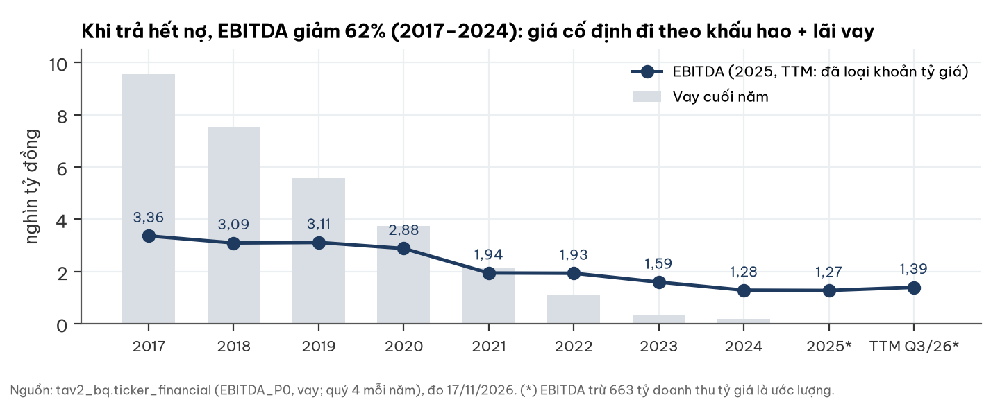

## Phụ lục B — Đối chiếu dữ liệu thị trường với BCTC gốc

| Chỉ tiêu | Dữ liệu thị trường | BCTC gốc | Ghi chú |
|---|---|---|---|
| Doanh thu Q3/26 | 2.814,6 | 2.814,6 | Khớp |
| LNST Q3/26 / Q2/26 / Q4/25 | 75,7 / 326,6 / 639,7 | 75,7 / 326,6 / 639,7 | Khớp (Q2, Q4 suy từ lũy kế) |
| P/E 3,7; tỷ suất cổ tức 16,5% | Lợi nhuận/cổ tức thô | — | Phồng do khoản một lần; P/E chuẩn hoá ≈ 8,1 |

## Phụ lục C — Nguồn

- **Công ty** (tpcquangninh.com.vn): BCTC Q3/2026, BCTC kiểm toán 2025, soát xét bán niên 2026; thông báo tạm ứng cổ tức 2026; báo cáo thẩm tra FS dự án khí thải (CBTT 11/6/2026); QĐ 917, QĐ 1490 (vay), QĐ 1710 (EPC); logo và ảnh nhà máy từ website.
- **Văn bản pháp lý:** Luật Điện lực 61/2024 (Đ52); TT07/2024/TT-BCT; TT12/2025/TT-BCT; QCVN 19:2024/BTNMT; QĐ 768/QĐ-TTg; Giấy phép môi trường 517/GPMT-BTNMT (văn bản đầy đủ chưa truy cập được).
- **Dữ liệu thị trường:** chuỗi tài chính quý, giá, khối lượng; lãi huy động 12 tháng hiệu dụng (19/11/2026); lãi suất chiết khấu ngầm định thị trường; TPCP 10 năm.
- **Ngành:** đọc ngành độc lập 17/11/2026 (BCT, NSMO, VietnamPlus, VnEconomy, Tạp chí Công Thương).
- **Bản đồ:** ranh giới geoBoundaries VNM-ADM1 (2008); toạ độ theo OpenStreetMap/Wikipedia — vị trí gần đúng.

## Phụ lục D — Phương pháp và giới hạn

- DCF dòng tiền vốn chủ, vòng đời hữu hạn 2027–2047; giá trị cuối = vốn lưu động thu hồi, nhà máy = 0; không có tăng trưởng vĩnh viễn.
- Dự án: giải ngân 30/45/25% (2027–29), lãi vay 9% (biên 7–11%), trả gốc 10 năm, khấu hao 10 năm, thuế 20%, lá chắn thuế giới hạn bởi thuế của chính công ty: đều là ước lượng.
- **Chưa có dữ liệu:** lãi suất/kỳ hạn hợp đồng tín dụng; phụ lục giấy phép môi trường (có buộc vận hành hệ thống trước 2032 không); 115 tỷ/năm trong chi phí vận hành FS chưa thuyết minh; điều khoản PPA; gia hạn thuê đất sau 2047.
- Không đưa vào tâm: phương án dừng nhà máy sớm khi không được bù (chưa rõ hợp đồng/pháp lý cho phép).

## Phụ lục E — Quy trình nghiên cứu

Số liệu đối chiếu trực tiếp với BCTC và văn bản gốc do công ty công bố. Mô hình định giá được dựng trước, độc lập với giá thị trường, rồi mới so với giá. Bối cảnh ngành do một người đọc ngành độc lập soạn mà không biết giá cổ phiếu. Điểm pháp lý về cơ chế giá được tra cứu văn bản gốc. Toàn bộ số liệu, mô hình và giả định đã được một người phản biện độc lập kiểm tra. Giới hạn dữ liệu nêu ở Phụ lục D.

## Phụ lục F — Tuyên bố miễn trừ trách nhiệm

Tài liệu này chỉ nhằm mục đích cung cấp thông tin nghiên cứu, không phải lời khuyên, đề nghị hay khuyến nghị mua, bán hoặc nắm giữ bất kỳ chứng khoán nào, và không tính đến mục tiêu, tình hình tài chính hay nhu cầu của từng nhà đầu tư. Thông tin được tổng hợp từ các nguồn được cho là đáng tin cậy tại thời điểm lập, nhưng không được bảo đảm về tính đầy đủ hay chính xác. Các ước lượng, kịch bản và giá trị hợp lý phản ánh giả định tại ngày lập và có thể thay đổi mà không cần thông báo. Kết quả trong quá khứ không bảo đảm kết quả tương lai. Nhà đầu tư cần tự đánh giá và chịu trách nhiệm với quyết định của mình.
