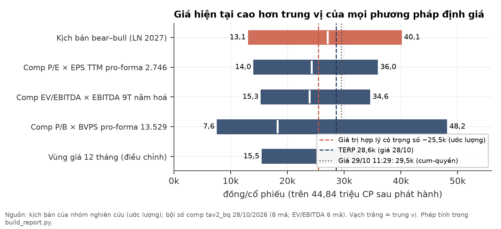
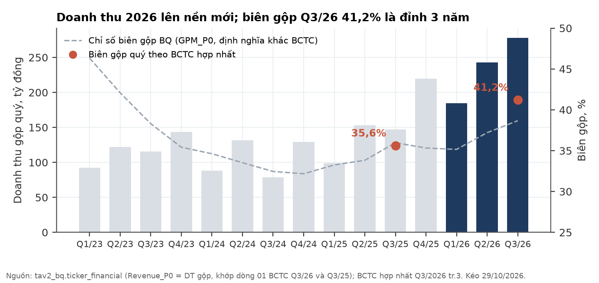
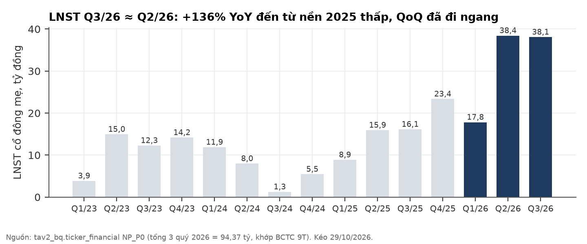
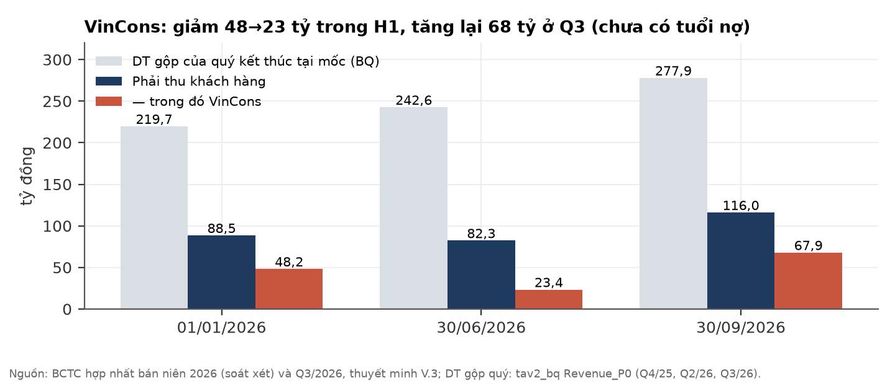
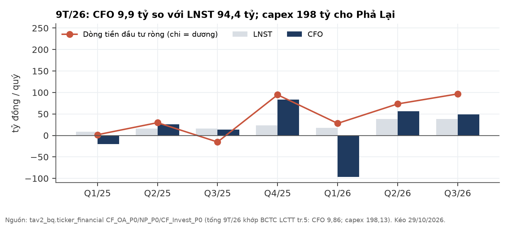
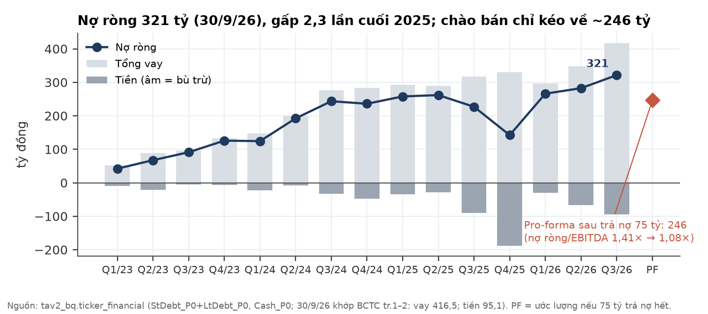
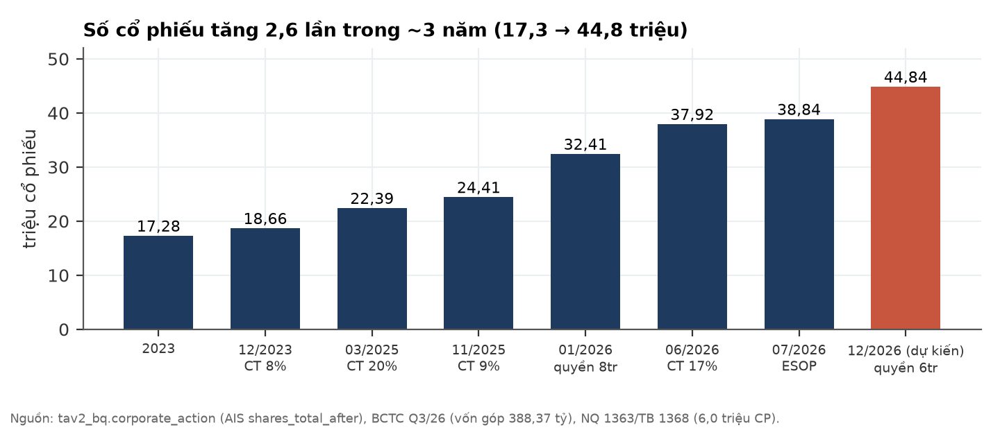
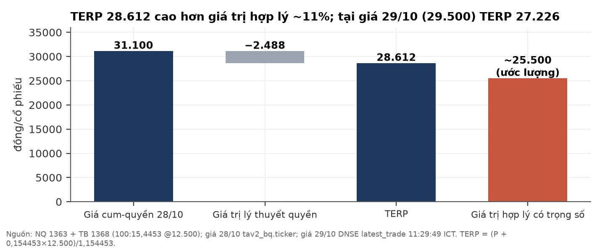
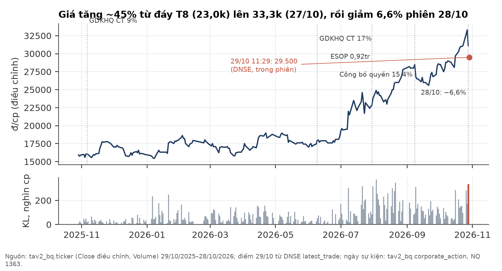
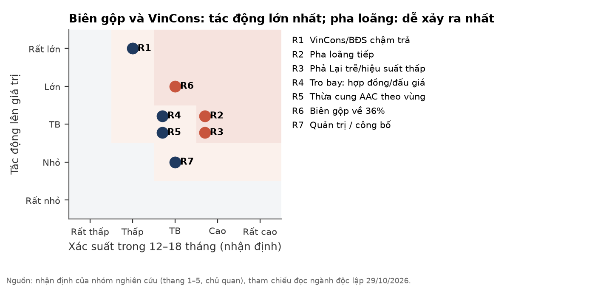

# SCL — CTCP Sông Đà Cao Cường: doanh nghiệp tốt lên thật, nhưng giá đã trả trước kịch bản cơ sở

**Báo cáo Due Diligence · 29/10/2026 · Nhóm nghiên cứu** · Sàn UPCoM · Ngành vật liệu xây dựng nhẹ (gạch AAC, vữa khô, keo dán, phụ gia, tro bay)

## Investment Summary

**Xếp hạng của nhóm: NON — không đủ điều kiện đầu tư ở giá hiện tại.** Chất lượng lợi nhuận và bảng cân đối không có cờ đỏ, nhưng giá trị hợp lý có trọng số (~25.500 đ/cp, ước lượng) thấp hơn giá lý thuyết sau quyền (TERP) 6–11%, và hồ sơ rủi ro/lợi nhuận bất đối xứng theo chiều xấu.

Thang của nhóm: **QUALIFY** (đủ điều kiện xem xét) · **AMBIGUOUS** (chưa đủ bằng chứng) · **NON** (không đủ điều kiện ở giá hiện tại) — nhãn nghiên cứu, không phải khuyến nghị cá nhân hoá.

| Dữ liệu chính | Giá trị | Ghi chú |
|---|---|---|
| Giá 29/10/2026, 11:29 ICT (trong phiên, cum-quyền) | **29.500 đ** | DNSE latest_trade; −5,1% so với đóng cửa 28/10 |
| Đóng cửa 28/10/2026 (cum-quyền) | 31.100 đ | Mốc dùng cho toàn bộ phân tích định giá |
| TERP (tại 31.100 / tại 29.500) | **28.612 / 27.226 đ** | Quyền 100:15,4453 @12.500 |
| Giá trị hợp lý có trọng số | **~25.500 đ (ước lượng)** | Dải 13.050 – 40.150; thấp hơn TERP 10,9% / 6,4% |
| Downside bear / upside bull (so với TERP 28.612) | **−54% / +40%** | Bất đối xứng xấu |
| Số CP: hiện tại → sau phát hành | 38,84 tr → 44,84 tr (+15,4%) | Gấp 2,6 lần năm 2023 (17,28 tr) |
| Vốn hoá cum (31.100 / 29.500) | 1.208 / 1.146 tỷ đ | Trên 38,84 tr CP |
| P/E TTM · P/B · EV/EBITDA (31.100) → P/E · P/B tại TERP | 10,3× · 2,27× · 6,7× → 10,4× · 2,11× | EBITDA 9T năm hoá 227,6 tỷ; EPS PF 2.746 đ |
| Nợ ròng / EBITDA (30/9 → pro-forma) | 1,41× → 1,08× | Nợ ròng 321,4 → 246,4 tỷ nếu 75 tỷ trả nợ hết |
| Thanh khoản bình quân 3 tháng (ADV) | 4,01 tỷ đ/phiên | 63 phiên, Price × Volume |

**Ba luận điểm (MECE):**

1. **Lợi nhuận là thật và từ hoạt động lõi** — biên gộp Q3/26 41,2%, thu nhập tài chính và thu nhập khác không đáng kể, kiểm toán 2025 chấp nhận toàn phần, soát xét bán niên 2026 không ngoại trừ.
2. **Nhưng tiền mặt và vốn chủ chưa theo kịp lợi nhuận** — CFO 9T/26 9,9 tỷ so với LNST 94,4 tỷ; nợ ròng gấp 2,3 lần trong 9 tháng; số cổ phiếu tăng 2,6 lần trong ~3 năm.
3. **Và giá đã phản ánh kịch bản cơ sở** — tại TERP, thị trường ngầm định LNST 2027 ~128–143 tỷ đ (P/E 9–10×), tức là gần như bằng kịch bản cơ sở và bỏ qua xác suất kịch bản xấu của chu kỳ nhà ở 2027–2028.

**Điều gì làm chúng tôi đổi ý** (kiểm tại BCTC Q4/2026, dự kiến ~20/01/2027): (i) LNST quý ≥ 38 tỷ; (ii) biên gộp ≥ 39%; (iii) CFO quý ≥ LNST quý; (iv) phải thu VinCons giảm so với 67,9 tỷ. Cả 4 đạt ⇒ nâng kịch bản cơ sở (giá trị hợp lý lên ~29–30 nghìn, ước lượng) và nhãn có thể lên AMBIGUOUS. Biên gộp < 36% hoặc VinCons tăng tiếp mà không thu ⇒ nghiêng kịch bản bear.

## 1. Tóm tắt điều hành

**Tình huống (Situation).** SCL sản xuất gạch bê tông khí chưng áp (AAC), vữa khô, keo dán gạch, phụ gia và kinh doanh tro bay, nhà máy chính ở Hải Phòng, công ty con Green SCL (85,834%) ở Lâm Đồng. 9T/2026 doanh thu thuần 665,5 tỷ (+81% YoY), LNST cổ đông mẹ 94,4 tỷ (+130%). Giá cổ phiếu tăng ~45% từ đáy tháng 8 (23.000) lên 33.300 ngày 27/10.

**Biến chuyển (Complication).** Ngày 26–27/10 công ty công bố đợt chào bán quyền mua 6,0 triệu CP giá 12.500 đ để trả nợ BIDV — đợt tăng vốn thứ năm trong 13 tháng. Cùng lúc, dòng tiền kinh doanh 9 tháng chỉ 9,9 tỷ, nợ ròng lên 321 tỷ, phải thu tập trung vào VinCons (58,5% phải thu khách hàng), và chỉ báo dẫn của kênh nhà ở thương mại đã quay xuống từ Q3/2026.

**Câu hỏi (Question).** Ở giá hiện tại, sau khi điều chỉnh cho đợt pha loãng, nhà đầu tư có đang được trả đủ cho rủi ro chu kỳ, dòng tiền và pha loãng không?

**Trả lời (Answer).** Chưa. Giá trị hợp lý có trọng số ~25.500 đ (ước lượng) thấp hơn TERP; downside kịch bản bear (−54%) lớn hơn upside kịch bản bull (+40%). Doanh nghiệp không có dấu hiệu gian lận hay lợi nhuận "một lần" — vấn đề là **giá**, không phải **chất lượng**. Mốc kiểm tiếp theo là BCTC Q4/2026.

## 2. Luận điểm đầu tư và điều thị trường đang định giá

**Thị trường đang định giá LNST 2027 ≈ kịch bản cơ sở; chúng tôi định giá thêm 30% xác suất kịch bản xấu.**

| Phép định giá ngược (ước lượng) | Tại TERP 28.612 (giá 28/10) | Tại TERP 27.226 (giá 29/10) |
|---|---|---|
| Vốn hoá pro-forma (44,84 tr CP) | 1.282,8 tỷ | 1.220,7 tỷ |
| LNST 2027 ngầm định ở P/E 9× | **142,5 tỷ** | **135,6 tỷ** |
| LNST 2027 ngầm định ở P/E 10× | 128,3 tỷ | 122,1 tỷ |

Đối chiếu: LNST TTM 117,7 tỷ; LNST 2026 ước ~133–135 tỷ (9T 94,4 + Q4 xấp xỉ Q3, ước lượng); Q3/26 × 4 = 152,4 tỷ. P/E 9× ≈ trung vị P/E nhóm so sánh (8,85×).

**Quan điểm khác biệt (variant perception).** Thị trường đang ngoại suy Q2–Q3/2026 (hai quý liên tiếp ~38 tỷ) thành mức bền vững. Chúng tôi cho rằng: (a) biên gộp 41% là đỉnh 3 năm trong một ngành không có quyền định giá; (b) cầu tường/hoàn thiện cho nhà ở thương mại sẽ yếu đi từ cuối 2027 khi đợt mở bán đỉnh H1/2026 tiêu thụ hết; (c) nhu cầu vốn cho nhà máy Phả Lại và phải thu tăng khiến lợi nhuận chưa chuyển thành tiền. Ba điểm này không làm doanh nghiệp xấu đi — chúng làm **giá trị kỳ vọng** thấp hơn giá.

**Điều có thể làm chúng tôi sai theo chiều tích cực:** Phả Lại đi vào vận hành nhanh với hiệu suất cao, doanh thu xuất khẩu dài hạn (công ty có đề cập nhưng không công bố số) bù đắp kênh nhà ở, và biên giữ ≥ 39% qua 2027.

## 3. Ngành: cầu 2026 mạnh, 2027 còn được đỡ, 2028 là năm rủi ro nhất

**Ngành vật liệu không nung có hướng đi đúng nhưng thực thi chính sách yếu; doanh thu đi theo chu kỳ xây dựng.** Phần này dựa trên một bản đọc ngành độc lập, thực hiện **mù** (người đọc không biết mã cổ phiếu, giá hay BCTC của SCL), as-of 29/10/2026. Số liệu ngành dưới đây đều có nguồn công bố; nhận định được ghi rõ.

| Kênh cầu | Dữ kiện (nguồn, ngày) | Độ trễ tới vật liệu tường/hoàn thiện | Đọc |
|---|---|---|---|
| Nhà ở thương mại | VARS Q3/26: 31.844 SP mở bán, 12.520 giao dịch; DKRA TP.HCM Q3: tiêu thụ 3.471 (−66% QoQ); CBRE Hà Nội Q3: ~6.200 căn mở bán (−40% YoY); BCĐ TW 13/10: tồn kho 51.950 căn/lô | 12–30 tháng | Đỉnh mở bán H1/2026; backlog đỡ tới giữa–cuối 2027; rủi ro dồn vào 2028 (nhận định) |
| Nhà ở xã hội | Bộ XD 15/10: 9T hoàn thành 46.962 căn; dự kiến cả năm 87.601 căn (≈55% chỉ tiêu 158.700) | Khởi công 2026–H1/2027 ⇒ cầu 2027–2028 | Khối lượng lớn nhưng trượt tiến độ, áp lực giá bán |
| Đầu tư công | Giải ngân 660.739,5 tỷ = 64,6% kế hoạch (15/10/2026) | Ngắn với phụ gia bê tông | Tốt cho phụ gia, trung bình cho AAC |
| KCN / nhà xưởng | FDI đăng ký 9T 50,4 tỷ USD (+76,4%), giải ngân 21,1 tỷ USD (SSI 08/10/2026) | Ngắn | Kênh mạnh nhất; AAC dùng cho tường bao, khối văn phòng |

**Cạnh tranh.** Gạch AAC là thị trường **theo vùng** (bán kính vận chuyển kinh tế ~150–300 km, nhận định), rào cản thấp–trung bình, đối thủ thay thế rẻ (gạch block xi măng, gạch tuynel — tuynel **không bị cấm**). Tro bay — đầu vào chính — đã thành tài nguyên có người tranh: nguồn báo chí 02/10/2026 mô tả tro xỉ "cháy hàng"; giá khởi điểm đấu giá 2026 Cẩm Phả 50.000 đ/t, Thái Bình 2 98.000 đ/t; đợt Thái Bình 2 năm 2023 trúng gấp đôi giá khởi điểm. Mục tiêu vật liệu không nung 35–40% năm 2025 (QĐ 2171/QĐ-TTg) gần như chắc chắn trượt; một nguồn ghi tỷ lệ thực tế khoảng 28%.

**Phân loại chế độ ngành (đọc mù, xác suất chủ quan):** CYCLICAL 0,50 · ADMIN_GATED 0,30 · STRUCTURAL 0,20. Vị trí chu kỳ: giữa → muộn của nhịp tăng; độ tin cậy "ambiguous" (~60/40). Kịch bản xấu nhất cho ngành là đóng băng thanh khoản BĐS cục bộ (xác suất 20–25% theo khung vĩ mô của nhóm): chủ đầu tư chậm trả, cấn trừ công nợ bằng sản phẩm BĐS.

**Hàm ý cho SCL:** khách hàng lớn nhất là một tổng thầu thuộc hệ sinh thái BĐS lớn (mục 4) ⇒ SCL nằm đúng ở kênh chịu rủi ro chu kỳ + tín dụng cao nhất. Một dự báo khoá trước của bản đọc ngành (biên gộp các DN thuần AAC/vữa khô bình quân Q4/26–Q3/27 không vượt mức một năm trước + 2pp, xác suất 0,70) sẽ được chấm vào 30/11/2027; SCL có mảng tro bay lớn nên có thể không thuộc nhóm "thuần AAC".

## 4. Doanh nghiệp: sản phẩm, khách hàng, công suất

**SCL bán hàng hoá thành phẩm, ghi nhận khi giao hàng — không mang rủi ro ghi nhận theo tiến độ kiểu xây lắp, nhưng phụ thuộc lớn vào một khách hàng.**

- **Sản phẩm:** AAC, vữa khô, keo dán, phụ gia, tro bay/thạch cao. BCTC **không công bố cơ cấu doanh thu theo mảng** — mọi tỷ trọng mảng đều không kiểm được.
- **Khách hàng:** VinCons chiếm **58,5% phải thu khách hàng** tại 30/9/2026 (67,9/116,0 tỷ; sự kiện, BCTC). Vingroup ~25% doanh thu theo phát biểu của Chủ tịch HĐQT trên báo chí 10/2026 — **nguồn báo chí, chưa đối chiếu** với tài liệu của công ty. Các khách hàng khác có số dư: Trọng Phóng 10,8 tỷ, Vạn Thiên A 4,7 tỷ.
- **Chiết khấu thương mại:** 14,6 tỷ/quý ≈ 5,2% doanh thu gộp Q3/26.
- **Backlog:** không công bố. Giải trình KQKD Q3 chỉ nói "ký nhiều hợp đồng cung cấp lớn" và "xuất khẩu ký dài hạn", không có số.
- **Công suất / Phả Lại:** XDCB dở dang 206,6 tỷ tại 30/9/2026, gồm dự án Phả Lại 178,0 + 12,7 tỷ (tổng vốn đầu tư 262,9 tỷ ⇒ còn ~72 tỷ phải chi, ước lượng) và tách tro Vĩnh Hảo giai đoạn 2 14,8 tỷ. Công ty dự kiến Phả Lại vận hành ~T11/2026. Thiết bị nhập từ Anhui Keda (Trung Quốc): khoản trả trước 30,0 tỷ đã về 0 từ 30/6 và nay là phải trả 6,5 tỷ ⇒ thiết bị đã giao. Không có số công suất thiết kế/hiệu suất theo dây chuyền.

## 5. Phân tích tài chính (bottom-up)

### 5a. Tăng trưởng thật, nhưng đã đi ngang theo quý

**Biên gộp 41% là hoạt động lõi, không phải khoản một lần — nhưng là đỉnh 3 năm.**

| Tỷ đồng [BCTC hợp nhất Q3/26] | Q3/26 | Q3/25 | 9T/26 | 9T/25 |
|---|---|---|---|---|
| Doanh thu thuần | 263,4 | 133,1 | 665,5 | 367,5 |
| Biên gộp | **41,2%** | 35,6% | 40,1% | 36,1% |
| Chi phí bán hàng | 39,5 | 17,7 | 98,1 | 54,8 |
| Chi phí lãi vay | 5,2 | 3,3 | 15,5 | 9,7 |
| LNST cổ đông mẹ | 38,09 | 16,14 | 94,36 | 40,95 |
| Thu nhập tài chính + thu nhập khác | 0,24 | 0,30 | 5,56 | 0,94 |

- **Q3 ≈ Q2** (38,09 so với 38,45 tỷ): tăng +136% YoY đến từ nền 2025 thấp; theo quý đã đi ngang.
- Khấu hao Q3 9,89 tỷ (Q3/25: 5,40 tỷ) đã nằm trong giá vốn ⇒ biên 41% là biên **sau** khi gánh khấu hao nhà máy Lâm Đồng.
- Không thấy dấu hiệu vốn hoá lãi vay đáng kể: lãi đã trả 9T 14,29 tỷ < chi phí lãi ghi nhận 15,55 tỷ.
- Biên gộp H1/26 tính ngược từ 9T trừ Q3: 39,4%. Lịch sử theo chỉ số BQ (định nghĩa khác BCTC): ~46% (Q1/23) → ~32% (Q4/24) → ~35% (2025) → 39–41% (2026).
- **EPS cần điều chỉnh hồi tố.** BCTC so sánh EPS Q3 995 đ với 721 đ (Q3/25) nhưng 721 chưa điều chỉnh cho cổ tức cổ phiếu 9% và 17% (VAS 30 yêu cầu). Điều chỉnh ⇒ ~565 đ, tức EPS tăng **~+76%**, không phải +38%.
- **Độ nhạy (ước lượng):** trên doanh thu thuần ~930 tỷ/năm, mỗi 1pp biên gộp ≈ 7,4 tỷ LNST; biên về 36% (−5,2pp) ≈ −39 tỷ LNST/năm.

### 5b. Phải thu: luận điểm "cờ đỏ" không đứng, nhưng chưa có tuổi nợ

**Số dư VinCons dao động theo hoá đơn, không giống nợ treo — điểm cần kiểm là tốc độ thu ở Q4.**

| Tỷ đồng [BCTC bán niên soát xét / Q3] | 01/01/26 | 30/06/26 | 30/09/26 |
|---|---|---|---|
| Phải thu khách hàng | 88,5 | 82,3 | **116,0** |
| — trong đó VinCons | 48,2 | 23,4 | **67,9** |
| Trả trước người bán | 46,4 | 56,2 | 86,6 |
| Dự phòng phải thu khó đòi | −4,2 | −4,1 | −4,1 |

- VinCons giảm 48,2 → 23,4 tỷ trong H1 (đã thu) rồi tăng +44,5 tỷ trong Q3 = hoá đơn mới trong quý.
- DSO phải thu khách hàng ~37 ngày. Nợ xấu cũ 5,57 tỷ gốc đứng yên từ đầu năm, không phát sinh mới.
- Điểm cần theo dõi: phải thu khách hàng +41% QoQ trong khi doanh thu gộp +14,6% QoQ — chênh lệch dồn vào VinCons. Tuổi nợ **không được công bố** trong cả ba bộ BCTC đã đọc.
- Trả trước người bán tăng ở Q3 chủ yếu do Điện Kym 16,0 tỷ (mới) và nhóm "khác" (+14,1 tỷ, 19,8 → 33,9). Một khoản trả trước 19,3 tỷ cho XNK Quốc tế LS đứng yên ≥ 1 quý, không nêu mục đích.
- Không thấy bất động sản đầu tư hay hàng hoá BĐS trên bảng cân đối ⇒ **chưa có dấu hiệu cấn trừ công nợ bằng sản phẩm BĐS**.

### 5c. Dòng tiền: lợi nhuận chưa chuyển thành tiền

**CFO 9T/26 chỉ 9,9 tỷ so với LNTT 118,0 tỷ — vốn lưu động và trả trước thiết bị hấp thụ gần hết lợi nhuận.**

- CFO theo quý 2026: Q1 −96,2 · Q2 +56,7 · Q3 +49,3 tỷ. Q2 + Q3 = 1,39× LNST hai quý đó ⇒ quý 1 là điểm yếu chính.
- Trong 9T: phải thu tăng 68,2 tỷ, tồn kho tăng 33,4 tỷ (39,8 → 73,3; thành phẩm 12,8 → 20,2), phải trả giảm 15,0 tỷ.
- Cùng kỳ 2025, CFO 9T là 86,1 tỷ.
- Capex 9T 198,1 tỷ, gần như toàn bộ cho Phả Lại ⇒ dòng tiền tự do âm, tài trợ bằng vay và tăng vốn.

### 5d. Đòn bẩy và thanh khoản

**Nợ ròng/EBITDA 1,41× chưa nguy hiểm, nhưng cơ cấu dùng vay ngắn hạn tài trợ tài sản dài hạn.**

- Vay 416,5 tỷ = ngắn hạn 259,7 (BIDV 252,9 + dài hạn đến hạn 6,8) + dài hạn 156,7 (BIDV 130,7 + **vay cổ đông lớn CTCP CN-DV Cao Cường 26,0 tỷ, lãi 10%/năm**, đáo hạn 05/02/2028). Tiền 95,1 tỷ ⇒ nợ ròng 321,4 tỷ; nợ ròng/VCSH 0,60.
- Thuyết minh vẫn mô tả hợp đồng hạn mức BIDV 230 tỷ "cho đến khi hạn mức 2026–2027 được duyệt", trong khi thông báo chào bán dẫn hợp đồng tín dụng ký 29/07/2026 — rất có thể là hạn mức mới chưa cập nhật vào thuyết minh; **chưa xác minh**.
- Khoản BIDV 184 tỷ (HĐ 12/03/2026) dùng cho Phả Lại dưới dạng bảo lãnh/mở L/C.

## 6. Đợt chào bán quyền mua: giảm đòn bẩy một phần, không đổi bản chất

**Đợt chào bán kéo nợ ròng/EBITDA từ 1,41× về ~1,08×, nhưng capex còn lại của Phả Lại và CFO yếu có thể đưa đòn bẩy quay lại.**

| Điều khoản (đã xác minh) | Nội dung |
|---|---|
| Giấy chứng nhận chào bán | 632/GCN-UBCK ngày 23/10/2026 |
| Số lượng · giá | 6.000.000 CP · 12.500 đ/CP |
| Tỷ lệ | 100 : 15,4453 (1 CP được 1 quyền; 100 quyền mua 15,4453 CP mới) |
| Ngày đăng ký cuối cùng | 10/11/2026 |
| Ngày GDKHQ | ~09/11/2026 (ước lượng — 1 phiên trước ĐKCC; chưa thấy thông báo VSDC) |
| Phiên cuối còn quyền | 06/11/2026 |
| Chuyển nhượng quyền | 17/11 – 03/12/2026 (một lần) |
| Đăng ký mua và nộp tiền | 17/11 – 08/12/2026 |
| Mục đích 75 tỷ thu được | Trả khoản vay BIDV theo HĐ tín dụng ngày 29/07/2026 và nợ thuê tài chính |
| Tư vấn · kiểm toán | TVSI · AVA |

| Tác động (giá cum 31.100, đóng cửa 28/10) | Trước | Sau |
|---|---|---|
| Giá lý thuyết (TERP) | 31.100 | **28.612** (−8,0%) |
| Giá trị lý thuyết một quyền/CP đang giữ | — | **2.488 đ** |
| Số cổ phiếu | 38,84 tr | 44,84 tr |
| BVPS · P/B | 13.688 · 2,27× | 13.529 · 2,11× (tại TERP) |
| Nợ ròng · /EBITDA · /VCSH | 321,4 · 1,41× · 0,60 | **246,4** · 1,08× · 0,41 |
| EPS TTM | 3.031 | **2.746** pro-forma (gồm tiết kiệm lãi ~5,4 tỷ sau thuế, ước lượng lãi 9%); P/E @TERP 10,4× |

Tính tại giá 29/10 (29.500): TERP 27.226, giá trị quyền 2.274 đ. Chênh nhỏ: 6,0 tr / 38,837 tr = 15,449% so với tỷ lệ công bố 15,4453% — không trọng yếu.

- **Có giải quyết đòn bẩy không?** Giảm một phần (nợ ròng −23%). Phả Lại còn ~72 tỷ capex (ước lượng) và CFO 9T chỉ ~10 tỷ ⇒ nợ ròng/EBITDA cuối năm có thể quay lại ~1,4× nếu không có đợt huy động khác (ước lượng).
- **Cổ đông nội bộ:** ông Kiều Văn Mát 11,54% và CTCP CN-DV Cao Cường 12,50% (tổng 24,0%). Thông báo không nêu cam kết mua; cách xử lý phần không đăng ký chưa kiểm.
- **Lịch sử pha loãng:** 17,28 tr CP (2023) → 44,84 tr (pro-forma) = **2,6×**. Năm đợt trong 13 tháng: quyền mua 8,0 tr (@12.500, GDKHQ 17/10/2025), cổ tức cổ phiếu 9% (11/2025), 17% (06/2026), ESOP 0,92 tr (@10.000, 07/2026), và đợt 6,0 tr hiện tại.
- **ESOP 0,92 tr @10.000** khi giá đóng cửa ngày chốt 30/07/2026 là 22.800 đ ⇒ giá trị chuyển giao ~11,8 tỷ (ước lượng, tuỳ ngày định giá), không ghi nhận chi phí theo VAS.

**Quan sát giá phiên 28/10 (không gán nhân quả).** Phiên 28/10 SCL giảm 6,6% (33.300 → 31.100) với khối lượng 335.400 CP — cao nhất kể từ 21/08/2026. Thông báo chào bán (ký số 27/10, 15:03) và nghị quyết chốt quyền (26/10) được công bố ngay trước phiên đó. Lưu ý về cơ chế: giá cum-quyền **không** mất giá trị một cách cơ học vì điều khoản được công bố — quyền vẫn gắn với cổ phiếu tới GDKHQ; tỷ lệ 15,4% đã biết từ 08/09/2026. Tin thật sự mới là giá phát hành, ngày chốt và mục đích trả nợ. Đợt giảm có thể phản ánh tâm lý, bán trước sự kiện, hoặc yếu tố khác — chúng tôi không đủ dữ liệu để kết luận. Sáng 29/10 giá tiếp tục ở 29.500 (11:29 ICT), khối lượng buổi sáng 38.910 CP.

## 7. Định giá: ~25.500 đ/cp có trọng số, thấp hơn TERP

**Ba kịch bản trên 44,84 triệu CP sau phát hành; trọng số là xác suất chủ quan của nhóm.**

| Kịch bản (LN 2027, ước lượng) | Giả định | LNST | P/E | Giá trị/CP | Trọng số |
|---|---|---|---|---|---|
| Bear | Biên về mức 2025, doanh thu −20% do kênh nhà ở gãy (năm rủi ro nhất 2027–28) | 65 tỷ ≈ 2025 | 9× | **13.050** | 0,30 |
| Base | LNST giữ ≈ mức ước 2026 (9T 94,4 + Q4 ≈ Q3) | 135 tỷ | 9× | **27.100** | 0,50 |
| Bull | Phả Lại chạy, +~34 tỷ (vòng quay tài sản 1,3× trên vốn 263 tỷ, biên ròng 10%) | 180 tỷ | 10× | **40.150** | 0,20 |
| **Có trọng số** | | | | **~25.500** | |

Kịch bản cơ sở 135 tỷ **là ước LNST 2026 giữ nguyên sang 2027**, không phải "Q3 × 4 chuẩn hoá biên" (Q3 × 4 chuẩn hoá về biên gộp ~38% cho khoảng 125 tỷ, ước lượng). Trọng số 0,30/0,50/0,20 là chủ quan; chỉ cần đổi 0,10 từ bear sang bull, giá trị có trọng số tăng ~2.700 đ — vẫn dưới TERP 28.612.

**So sánh với doanh nghiệp cùng nhóm vật liệu xây dựng** (tav2_bq, 28/10/2026):

| Mã | P/E | P/B | EV/EBITDA |
|---|---|---|---|
| VGC | 10,8 | 1,61 | 5,6 |
| VCS | 8,7 | 0,98 | 6,2 |
| PLC | 11,8 | 1,23 | 7,9 |
| DHA | 5,5 | 1,47 | n/a |
| NNC | 5,1 | 1,65 | 4,1 |
| HT1 | 13,1 | 1,02 | 4,1 |
| KSB | 7,8 | 0,56 | n/a |
| BMP | 9,0 | 3,56 | 6,0 |
| **Trung vị** | **8,85** | **1,35** | **5,8** |
| **SCL** (cum 31.100 / PF @TERP) | 10,3 / 10,4 | 2,27 / 2,11 | 6,7 (9T năm hoá) / 6,1 (Q3×4), tại 31.100 |

Nhóm so sánh không đồng nhất (xi măng, đá, nhựa, đá thạch anh) — dùng làm khung tham chiếu, không làm mục tiêu giá. SCL rẻ nếu Q3 bền vững; đắt theo P/B (2,1–2,3× so với nhóm ~1,0–1,6×).

Áp bội số trung vị nhóm vào SCL (ước lượng): P/E 8,85× × EPS PF 2.746 ≈ 24.300 · EV/EBITDA 5,8× × EBITDA 9T năm hoá 227,6 tỷ trừ nợ ròng PF ≈ 23.900 · P/B 1,35× × BVPS PF 13.529 ≈ 18.300. Cả ba đều thấp hơn TERP.

**P/E chuẩn hoá chu kỳ.** Bình quân LNST 2023–2025 và TTM ≈ 63 tỷ ⇒ ~1.410 đ/CP trên 44,84 tr CP ⇒ P/E chuẩn hoá ~20× tại TERP. Con số này **lệch bi quan**: nó chia lợi nhuận của giai đoạn quy mô vốn nhỏ hơn cho số cổ phiếu sau bốn đợt tăng vốn (một phần tiền tăng vốn mới đang được đầu tư và chưa sinh lợi nhuận). Chỉ dùng như chỉ báo rằng giá đang phản ánh lợi nhuận gần đỉnh, không dùng để định giá.

**Vùng giá cần chạy lại kiểm định.** Nếu giá ex-quyền về vùng ~21.700 (biên an toàn 15% dưới 25.500, ước lượng), đây là vùng **cần chạy lại bài kiểm định đầy đủ của nhóm** — nhãn tối đa ở vùng đó là **AMBIGUOUS**, không phải QUALIFY, vì hồ sơ hiện tại có pha loãng liên tục, P/B cao và không có yếu tố khủng hoảng định giá. Chưa có kế hoạch giải ngân theo đợt hay quy mô vị thế cho bất kỳ vùng giá nào.

## 8. Rủi ro (pre-mortem): "Nếu 18 tháng nữa khoản đầu tư này lỗ, vì sao?"

**Hai rủi ro tác động lớn nhất là biên gộp và VinCons; rủi ro dễ xảy ra nhất là pha loãng tiếp.** Xác suất và tác động là nhận định chủ quan của nhóm.

| # | Rủi ro | Xác suất | Tác động | Dấu hiệu sớm | Kiểm khi nào |
|---|---|---|---|---|---|
| R1 | VinCons/BĐS đóng băng: chậm trả, cấn trừ bằng sản phẩm | Thấp (kịch bản vĩ mô 20–25%) | Rất lớn | Số dư VinCons tăng mà không giảm ở quý sau; xuất hiện BĐS đầu tư/hàng hoá BĐS trên BCĐKT | BCTC Q4/26 (~20/01/2027) |
| R2 | Pha loãng tiếp (phát hành riêng lẻ, ESOP, quyền mua) | Cao | TB | Nghị quyết HĐQT/ĐHĐCĐ về phương án vốn 2027 | ĐHĐCĐ 2027 (~Q2/2027) |
| R3 | Phả Lại trễ tiến độ / hiệu suất thấp năm đầu | Cao | TB | Không có doanh thu mới từ Q1/27; XDCB dở dang không giảm | BCTC Q4/26, Q1/27 |
| R4 | Tro bay: mất/tái đấu giá hợp đồng ở giá cao | TB | TB | Kết quả đấu giá tro nhiệt điện; giá vốn tăng nhanh hơn doanh thu | Hàng quý |
| R5 | Thừa cung AAC theo vùng (dây chuyền mới vào cùng bán kính) | TB | TB | Biên gộp giảm trong khi sản lượng tăng | Hàng quý |
| R6 | Biên gộp mean-revert về 36% (≈ −39 tỷ LNST/năm, ước lượng) | TB | Lớn | Biên gộp quý < 39% | BCTC Q4/26 |
| R7 | Quản trị / chất lượng công bố | TB | Nhỏ | Giao dịch bên liên quan mới; sai sót trình bày lặp lại | BCTC kiểm toán 2026 (~03/2027) |

## 9. Pháp lý và quản trị — CẢNH BÁO (không phải lý do chặn phân tích)

**Không tìm thấy xử phạt hay hạn chế giao dịch; có nhiều điểm quản trị cần lưu ý.** Phạm vi tra cứu giới hạn: tìm kiếm công khai; **chưa tra trực tiếp cơ sở dữ liệu UBCKNN/HNX**; **chưa tra giao dịch cổ đông nội bộ**.

- Không tìm thấy khởi tố, xử phạt hay hạn chế giao dịch đối với SCL trong phạm vi tra cứu.
- ⚠️ Pha loãng liên tục: năm đợt phát hành trong 13 tháng (mục 6).
- ⚠️ ESOP giá 10.000 đ khi thị giá ~22.800 đ — chuyển giá trị ~11,8 tỷ (ước lượng) cho người lao động/quản lý.
- ⚠️ Giao dịch bên liên quan: vay 26,0 tỷ từ cổ đông lớn Cao Cường lãi 10%/năm; mua hàng ~0,54 tỷ/quý từ cùng bên.
- ⚠️ Chất lượng trình bày: EPS kỳ so sánh không điều chỉnh hồi tố; nhãn cột bảng thuế ghi sai kỳ. Kiểm toán viên là AVA (hãng quy mô nhỏ, thành viên MGI).
- ⚠️ Phải thu khác 0,78 tỷ từ ba cá nhân — tiền thoái vốn Thạch Cao Đình Vũ (02/2024) chưa thu sau hơn 2,5 năm (nhỏ).
- Rủi ro lây từ hệ sinh thái BĐS: tín dụng tập trung vào một tổng thầu (mục 5b, R1).

## 10. Lịch xúc tác và ngưỡng quyết định

**Mốc quan trọng nhất là BCTC Q4/2026: bốn điều kiện đo được quyết định có nâng kịch bản cơ sở hay không.**

| Ngày | Sự kiện | Kiểm gì | Hệ quả với nhãn |
|---|---|---|---|
| 06/11/2026 | Phiên cuối giao dịch cum-quyền | — | — |
| ~09/11/2026 (ước lượng) | Ngày GDKHQ | Xác nhận ngày qua thông báo VSDC; giá điều chỉnh | — |
| 10/11/2026 | Ngày đăng ký cuối cùng | — | — |
| 17/11 – 03/12/2026 | Chuyển nhượng quyền | Thanh khoản của quyền | — |
| 17/11 – 08/12/2026 | Đăng ký mua, nộp tiền | Tỷ lệ đăng ký; cổ đông nội bộ có mua không | Sau 08/12 quyền chưa thực hiện mất giá trị |
| ~T11/2026 (theo công ty) | Phả Lại vận hành | Doanh thu mới xuất hiện từ Q1/27 | Hỗ trợ kịch bản bull |
| ~20/01/2027 | BCTC Q4/2026 | (i) LNST quý ≥ 38 tỷ; (ii) biên gộp ≥ 39%; (iii) CFO quý ≥ LNST; (iv) VinCons giảm | Cả 4 đạt ⇒ nâng kịch bản cơ sở, có thể AMBIGUOUS; biên < 36% ⇒ nghiêng bear |
| ~03/2027 | BCTC kiểm toán 2026 | Ý kiến kiểm toán; tuổi nợ (nếu có) | Ý kiến ngoại trừ ⇒ NON chắc chắn |
| Bất kỳ lúc nào | VinCons chậm trả / cấn trừ BĐS / đợt phát hành mới | — | NON chắc chắn |

## Phụ lục A. Số liệu tài chính hợp nhất Q3/2026 và 9T/2026

Nguồn: BCTC hợp nhất Q3/2026 (ký 15/10/2026). Đơn vị tỷ đồng, làm tròn từ số VND trên BCTC.

| Kết quả kinh doanh (tr.3–4) | Q3/26 | Q3/25 | 9T/26 | 9T/25 |
|---|---|---|---|---|
| Doanh thu bán hàng (gộp) | 277,94 | 147,25 | 705,18 | 398,84 |
| Giảm trừ doanh thu | 14,56 | 14,19 | 39,63 | 31,38 |
| Doanh thu thuần | 263,39 | 133,06 | 665,55 | 367,46 |
| Giá vốn | 154,79 | 85,68 | 398,36 | 234,68 |
| Lợi nhuận gộp | 108,59 | 47,38 | 267,19 | 132,79 |
| Doanh thu tài chính | 0,17 | 0,30 | 0,80 | 0,94 |
| Chi phí tài chính (trong đó lãi vay) | 5,95 (5,17) | 3,35 (3,35) | 17,43 (15,55) | 9,71 (9,71) |
| Chi phí bán hàng | 39,52 | 17,65 | 98,13 | 54,76 |
| Chi phí quản lý | 13,92 | 6,29 | 35,92 | 17,47 |
| Lợi nhuận thuần từ HĐKD | 49,37 | 20,39 | 116,52 | 51,78 |
| Lợi nhuận khác | −1,71 | −0,04 | 1,52 | −0,20 |
| LNTT | 47,66 | 20,35 | 118,03 | 51,58 |
| LNST | 38,10 | 16,14 | 94,37 | 40,95 |
| LNST cổ đông mẹ | 38,09 | 16,14 | 94,36 | 40,95 |
| EPS cơ bản (đ, theo BCTC, chưa điều chỉnh hồi tố) | 995 | 721 | 2.481 | 1.829 |

| Bảng cân đối (tr.1–2) | 30/09/2026 | 01/01/2026 |
|---|---|---|
| Tiền và tương đương tiền | 95,10 | 188,11 |
| Phải thu khách hàng ngắn hạn | 115,97 | 88,45 |
| Trả trước cho người bán | 86,60 | 46,39 |
| Hàng tồn kho | 73,26 | 39,84 |
| Tài sản cố định hữu hình | 451,16 | 479,39 |
| XDCB dở dang | 206,63 | 11,35 |
| **Tổng tài sản** | **1.061,03** | **877,02** |
| Vay và nợ thuê tài chính ngắn hạn | 259,74 | 218,22 |
| Vay và nợ thuê tài chính dài hạn | 156,72 | 112,15 |
| Nợ phải trả | 527,39 | 444,11 |
| Vốn chủ sở hữu (gồm lợi ích CĐKKS 2,02) | 533,64 | 432,91 |
| Vốn góp | 388,37 | 324,08 |

| Lưu chuyển tiền tệ 9 tháng (tr.5) | 9T/26 | 9T/25 |
|---|---|---|
| LNTT | 118,03 | 51,58 |
| Khấu hao | 37,11 | 21,96 |
| Lợi nhuận trước thay đổi vốn lưu động | 171,19 | 82,36 |
| (Tăng) phải thu | −68,20 | +13,41 |
| (Tăng) tồn kho | −33,42 | −10,72 |
| Tăng/(giảm) phải trả | −15,02 | +28,21 |
| Lãi vay đã trả · thuế TNDN đã nộp | −14,29 · −16,80 | −9,71 · −7,04 |
| **CFO** | **9,86** | **86,12** |
| Chi mua sắm/XDCB | −198,13 | −78,02 |
| Lưu chuyển tiền thuần từ đầu tư | −198,04 | −72,98 |

## Phụ lục B. Đối chiếu số liệu cơ sở dữ liệu (BQ) với BCTC

Chỉ ghi các chỉ tiêu đã đối chiếu trực tiếp.

| Chỉ tiêu | Cơ sở dữ liệu tav2_bq | BCTC | Kết luận |
|---|---|---|---|
| Revenue_P0 Q3/26 · Q3/25 | 277,94 · 147,25 | DT gộp 277,94 · 147,25; DT thuần 263,39 · 133,06 | Trường BQ là **doanh thu gộp**; báo cáo dùng DT thuần cho tỷ số |
| GPM_P0 Q3/26 | 0,387 | Biên gộp quý 41,2% | Định nghĩa khác — không dùng làm biên quý |
| NP_P0 ba quý 2026 | 17,83 + 38,45 + 38,09 = 94,37 | LNST 9T 94,37 | Khớp |
| CF_OA_P0 ba quý 2026 | −96,16 + 56,71 + 49,32 = 9,86 | CFO 9T 9,86 | Khớp |
| CF_Invest_P0 ba quý 2026 | −198,13 | Chi mua sắm/XDCB 198,13 | Khớp |
| Cash_P0 30/9/26 | 95,10 | 95,10 | Khớp |
| StDebt_P0 + LtDebt_P0 30/9/26 | 259,74 + 156,72 | 259,74 + 156,72 | Khớp |
| OShares Q2/26 | 38,84 tr | 37,92 tr tại 30/6 (ESOP 0,92 tr phát hành Q3) | BQ cập nhật sớm một quý |
| Sàn niêm yết | — | DNSE secdef: marketId = UPX | **UPCoM** |
| Đóng cửa 28/10 (Close = Price) | 31.100 | DNSE giá tham chiếu 29/10: 31.800 | Tham chiếu UPCoM khác giá đóng cửa; báo cáo dùng đóng cửa |
| Tỷ lệ quyền trong bảng sự kiện BQ (corporate_action) | 0,15384615; ngày GDKHQ/ĐKCC trống | 0,154453; ĐKCC 10/11/2026 | Dữ liệu sự kiện của nhà cung cấp chưa đầy đủ — dùng nghị quyết gốc |

## Phụ lục C. Danh mục nguồn

| Nguồn | Ngày | Ghi chú |
|---|---|---|
| BCTC hợp nhất Q3/2026 (scan, ký số) | Ký 15/10/2026, ký số 16/10/2026 | songdacaocuong.com.vn, mục Quan hệ cổ đông; tr.1–5 |
| BCTC riêng Q3/2026 | 15/10/2026 | Như trên |
| Giải trình biến động KQKD Q3/2026, số 1295/GT-SCL | 15/10/2026 | Như trên |
| BCTC hợp nhất bán niên 2026, soát xét bởi AVA (590/BCKT-TC/AVA) | 06/08/2026 | Như trên |
| BCTC hợp nhất 2025, kiểm toán bởi AVA (245/BCKT-TC/AVA.NV5), ý kiến chấp nhận toàn phần | 20/03/2026 | Như trên |
| Nghị quyết HĐQT 1363 (chốt quyền, giá phát hành) | 26/10/2026 | Như trên |
| Thông báo chào bán 1368/TB-SCL | Ký số 27/10/2026 15:03 | Như trên |
| Giấy chứng nhận chào bán 632/GCN-UBCK | 23/10/2026 | Dẫn trong TB 1368 |
| tav2_bq.ticker, ticker_financial, corporate_action | Kéo 29/10/2026 (giá tới 28/10) | Cơ sở dữ liệu nội bộ của nhóm |
| DNSE OpenAPI latest_trade, secdef (SCL) | 29/10/2026 11:29:49 ICT | Giá trong phiên |
| VARS, CBRE, DKRA, BCĐ TW (thị trường nhà ở Q3/2026) | 10/2026 | Dẫn qua báo chí; danh sách URL trong hồ sơ đọc ngành |
| Bộ Xây dựng: NOXH (họp báo 15/10/2026); NĐ 209/2026/NĐ-CP (thông cáo 03/07/2026) | 2026 | moc.gov.vn |
| Báo Đấu thầu: đấu giá tro Cẩm Phả (16/07/2026), Thái Bình 2; Tuổi Trẻ: tro xỉ "cháy hàng" (02/10/2026) | 2026 | baodauthau.vn; tuoitre.vn |
| Giải ngân đầu tư công 64,6% | 15/10/2026 | Thời báo Tài chính, Báo Lào Cai |
| SSI Research: FDI 9T/2026 | 08/10/2026 | Dẫn qua báo Pháp luật |
| Phát biểu của Chủ tịch HĐQT về tỷ trọng Vingroup | 10/2026 | Báo chí; chưa đối chiếu |

## Phụ lục D. Phương pháp và giới hạn

**Phương pháp.** Giá trị được dựng từ dưới lên: chất lượng lợi nhuận → dòng tiền → bảng cân đối → kịch bản LNST 2027 → bội số P/E, sau đó đối chiếu từ trên xuống bằng bản đọc ngành và nhóm so sánh. Mọi số liệu doanh nghiệp truy về BCTC gốc; số tính toán được ghi "(ước lượng)". Biểu đồ và dữ liệu vẽ được tái lập bằng build_report.py, mỗi hình kèm một tệp CSV cùng tên.

**Giá dùng trong báo cáo.** Phân tích định giá neo vào đóng cửa 28/10/2026 (31.100 đ). Giá 29/10/2026 lấy từ DNSE lúc 11:29:49 ICT (29.500 đ, trong phiên, chưa phải giá đóng cửa); kết luận không đổi ở cả hai mức.

**Giới hạn đã biết:**

- Không có cơ cấu doanh thu/biên theo mảng sản phẩm.
- Không có backlog hay hợp đồng ký theo dự án.
- Không có tuổi nợ phải thu (đặc biệt VinCons).
- Chưa đọc bản cáo bạch của đợt chào bán.
- Không có công suất thiết kế và hiệu suất theo dây chuyền; không có hợp đồng tro bay/thạch cao (giá, thời hạn).
- Không có số công suất AAC toàn quốc, hiệu suất ngành hay giá bán AAC chính thức 2026.
- Chưa tra giao dịch cổ đông nội bộ; chưa tra trực tiếp UBCKNN/HNX.
- Tỷ trọng Vingroup ~25% doanh thu chỉ từ báo chí.
- Ngày GDKHQ là ước lượng; chưa có thông báo VSDC.
- Biểu đồ biên gộp quý dùng chỉ số BQ có định nghĩa khác BCTC cho các quý không có BCTC quý riêng; chỉ hai điểm Q3/25 và Q3/26 là biên gộp quý theo BCTC.
- Giá trong biểu đồ 12 tháng là giá đã điều chỉnh cho các sự kiện quyền/cổ tức cổ phiếu.

## Phụ lục E. Quy trình độc lập

Báo cáo đi qua ba lớp tách biệt: (1) **Đọc ngành mù** — một nhà phân tích vĩ mô độc lập viết bản đọc ngành vật liệu xây dựng nhẹ mà không biết mã cổ phiếu, giá hay BCTC của doanh nghiệp được phân tích; (2) **Due diligence** — đọc BCTC gốc từng trang, dựng kịch bản và định giá; (3) **Phản biện độc lập** — một người phản biện có nhiệm vụ bác bỏ kết luận, đối chiếu lại mọi số trọng yếu với trang gốc.

Minh bạch: phản biện **giữ nguyên** nhãn NON và xác nhận các số trọng yếu (TERP, giá trị quyền, kịch bản có trọng số), nhưng **đã sửa** bốn điểm trong bản nháp đầu: (i) vùng giá thấp từng được gắn nhãn QUALIFY — nay sửa thành "vùng cần chạy lại kiểm định, tối đa AMBIGUOUS"; (ii) cách diễn giải phiên giảm 28/10 như một phản ứng cơ học với pha loãng — nay chỉ ghi là quan sát; (iii) mô tả kịch bản cơ sở — nay ghi đúng là ước LNST 2026, không phải Q3 chuẩn hoá; (iv) một chi tiết về biến động trả trước người bán. Khi biên soạn bản này, nhóm cũng đính chính: giá trị chuyển giao ESOP tính lại theo giá đóng cửa ngày chốt (22.800 đ) thành ~11,8 tỷ (bản nháp ước 14–17 tỷ theo giá giả định), và so sánh tăng phải thu với doanh thu theo cùng cơ sở doanh thu gộp (+14,6% QoQ).

## Phụ lục F. Tuyên bố miễn trừ và xung đột lợi ích

Tài liệu mang tính thông tin/nghiên cứu, không phải lời khuyên đầu tư cá nhân hoá và không phải đề nghị mua hay bán chứng khoán. Nhãn QUALIFY/AMBIGUOUS/NON là đánh giá nghiên cứu theo khung của nhóm, không tính tới mục tiêu, khẩu vị rủi ro hay tình hình tài chính của từng nhà đầu tư. Số liệu quá khứ không bảo đảm kết quả tương lai. Các ước lượng, kịch bản và trọng số được nêu rõ và có thể sai. Nguồn báo chí chưa đối chiếu được ghi chú riêng.

**Xung đột lợi ích:** tác giả và/hoặc các tài khoản liên quan có thể đang nắm giữ cổ phiếu SCL.
