# SIP — CTCP Đầu tư Sài Gòn VRG: chuỗi KCN bán lại điện nước và thu tiền thuê trước tạo dòng lãi bền ≈1,25 nghìn tỷ/năm cho cổ đông, nhưng 6.016 tỷ tín dụng phi ngân hàng và 635,6 tỷ tạm ứng cho người quản lý khiến giá 48.350 đ chỉ ngang tâm giá trị

**Báo cáo Due Diligence · 01/11/2026 · Nhóm nghiên cứu** · HOSE · Chủ đầu tư hạ tầng 5 khu công nghiệp ở Đông Nam Bộ, bán lại điện nước trong KCN · niên độ dương lịch (Q3/26 = 7–9/2026)

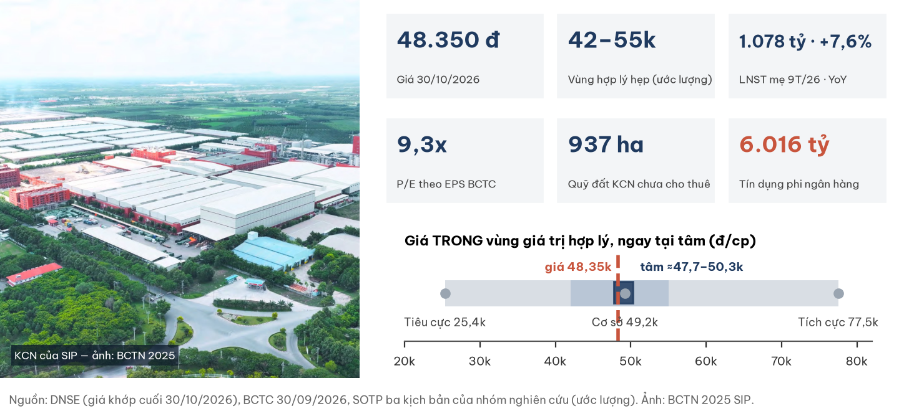

## Investment Summary

**Giá 48.350 đ (khớp cuối 30/10/2026) nằm TRONG vùng giá trị hợp lý ≈42.000–55.000 đ, ngay tại tâm ≈47.700–50.300 đ (ước lượng).** Lãi lõi bền và tăng; điều chưa rõ là chất lượng khoản tín dụng lớn và giá trị thật của 937 ha đất còn lại.

| Dữ liệu chính | Giá trị | Ghi chú |
|---|---|---|
| Giá · vốn hoá | **48.350 đ** · 11.706 tỷ | khớp cuối 14:45:06 ngày 30/10/2026; 242,11 tr cp |
| Vùng hợp lý hẹp · tâm | **42.000–55.000 · ≈47.700–50.300 đ** | SOTP ba kịch bản; sai số mô hình ±≈4.000 đ |
| LNST mẹ 9T/26 · Q3/26 | **1.078 tỷ (+7,6%)** · 344 tỷ (−5,9%) | 9T trên cơ sở EPS: +5,5%; Q3 chưa soát xét |
| P/E theo EPS BCTC · trung vị ngành | **9,3x** · 10,1x | EPS TTM 5.184 đ đã trừ quỹ khen thưởng phúc lợi |
| Tiền thuê khách trả trước (DT chưa thực hiện) | **15.077 tỷ** | +1.702 tỷ trong 9T: cho thuê mới tốt hơn lãi kế toán |
| Tín dụng phi ngân hàng | **6.016 tỷ** = 116% VCSH mẹ | cho vay CTCK 4.223 + trái phiếu DN 1.792 |
| Thanh khoản 3 tháng | ≈4,1 tỷ đ/phiên | 2025: 18–68 tỷ |

**Ba điều cần biết**

1. **Lãi lõi bền:** LN gộp điện nước +13%, dịch vụ KCN +12% trong 9T; tiền thuê đất ghi nhận phân bổ, nên TT 99/2025 không làm gãy chuỗi lãi như ở doanh nghiệp ghi một lần.
2. **≈26% LNTT là lãi tài chính** trên 13.808 tỷ tài sản tài chính, trong đó 4.223 tỷ cho công ty chứng khoán vay (69% không có tài sản bảo đảm của bên vay) và 1.792 tỷ trái phiếu mua mới.
3. **Giá ngang tâm:** ở 48.350 đ, thị trường đã trả cho lãi lõi ở P/E ≈9x; phần còn lại phụ thuộc tín dụng và đất Tây Ninh.

| Điều làm nhận định đổi | Điều kiện (kiểm tại BCTC năm 2026 kiểm toán, ≤ 31/03/2027) | Tâm mới (ước lượng) |
|---|---|---|
| Tích cực hơn | công bố bên vay + thu hồi đủ; cho thuê ≥ 60 ha/năm ở giá ≥ 16 tỷ/ha toàn phần; thu hồi khoản tạm ứng 635,6 tỷ | ≈54.000–58.700 |
| Tiêu cực hơn | dự phòng/ngoại trừ ở khoản cho vay hoặc trái phiếu (lỗ ≥ 30%); cho thuê ≤ 30 ha lần hai liên tiếp | ≈41.200–45.200 |

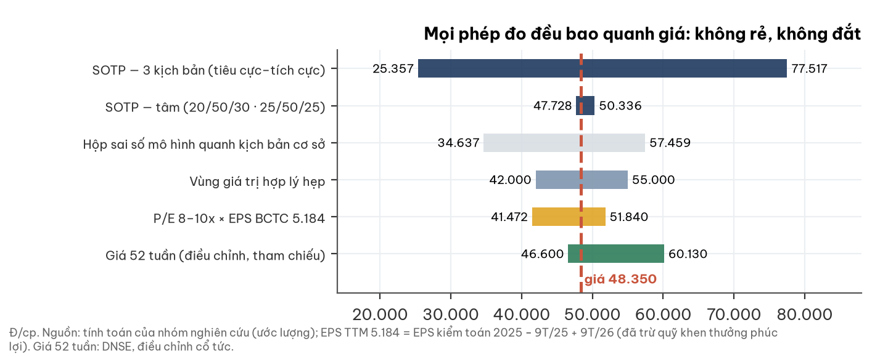

## 1. Tóm tắt điều hành

**Doanh nghiệp tạo tiền đều; bảng cân đối dùng tiền đó cho một khoản tín dụng phi ngân hàng lớn chưa minh bạch.**

- **Tình huống:** 9T/26 doanh thu 7.003 tỷ (+11%), LNST mẹ 1.078 tỷ (+7,6%); kế hoạch năm (874 tỷ hợp nhất) đã vượt.
- **Vấn đề:** chênh lãi đến từ cho vay CTCK, trái phiếu, tài trợ bằng 4.374 tỷ vay ngân hàng tín chấp; Q3 lãi giảm, chi phí tài chính ×2,6.
- **Trả lời:** giá trong vùng, tại tâm; ở ±5% quanh giá (45.930–50.770 đ) kết luận không đổi.

## 2. Thị trường đang định giá gì

**Ở 48.350 đ, thị trường ngầm định lỗ ≈10% phần tín dụng không bảo đảm với đất 12 tỷ/ha, hoặc không lỗ với đất ≈10 tỷ/ha.**

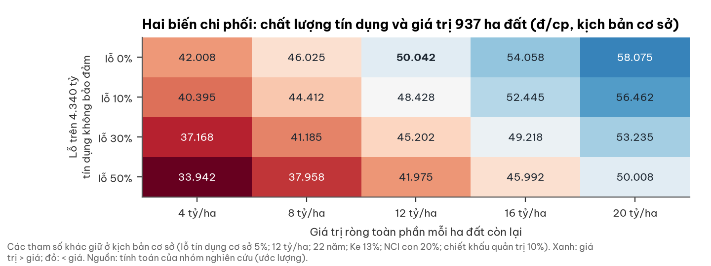

- Đất 12 tỷ/ha toàn phần ≈ giá thực thu 110–120 USD/m² sau đền bù, hạ tầng, thuế (ước lượng); giá chào vùng 185 USD/m².
- Mỗi 10% lỗ trên 4.340 tỷ không bảo đảm ≈ −1.600 đ/cp; mỗi ±4 tỷ/ha ≈ ±4.000 đ/cp.

## 3. Ngành: giữa chu kỳ, cung đuổi kịp cầu; đất lõi tốt, đất vệ tinh yếu

**Hấp thụ đất KCN hồi từ nền thấp, nhưng giá thuê đi ngang và Tây Ninh — nơi có 72% quỹ đất của SIP — đang giảm giá.**

| Yếu tố (người đọc ngành độc lập, 01/11/2026) | Trạng thái | Ảnh hưởng SIP |
|---|---|---|
| FDI 9T/2026 | đăng ký 50,4 tỷ USD (+76%); giải ngân 21,1 tỷ USD (+12%), 83% chế biến chế tạo | cầu thuê đất được đỡ |
| Giá thuê đất phía Nam (Q2/26) | 186 USD/m²/chu kỳ, +1,7% YoY; hấp thụ 9T +56% từ nền thấp | không giả định tăng giá thực |
| Phân hoá lõi – vệ tinh | TP.HCM lấp đầy 86%, giá +6,8%; **Tây Ninh 61%, giá −6,8%** | Phước Đông B chịu cạnh tranh cung mới |
| Đền bù | tăng theo bảng giá đất hằng năm từ 2026 | ép biên dự án mới (Phước Đông GĐ3, Long Đức 2) |
| **TT 99/2025** (từ 01/01/2026) | tiền thuê nhận trước nhiều kỳ phải phân bổ | SIP đã phân bổ từ trước: lãi không gãy; P/E ngành trộn hai chế độ |
| Thuế Mỹ | 12,5% (Section 301), hai cuộc điều tra nhắm VN còn treo | rủi ro đuôi với khách sản xuất hướng Mỹ |

## 4. Doanh nghiệp: người quản lý KCN kiêm nhà bán lẻ tiện ích

**Thành lập 2007 bởi Tập đoàn Công nghiệp Cao su VN, SIP nay là chủ đầu tư 3.205 ha KCN; Tập đoàn không còn trong danh sách cổ đông lớn.**

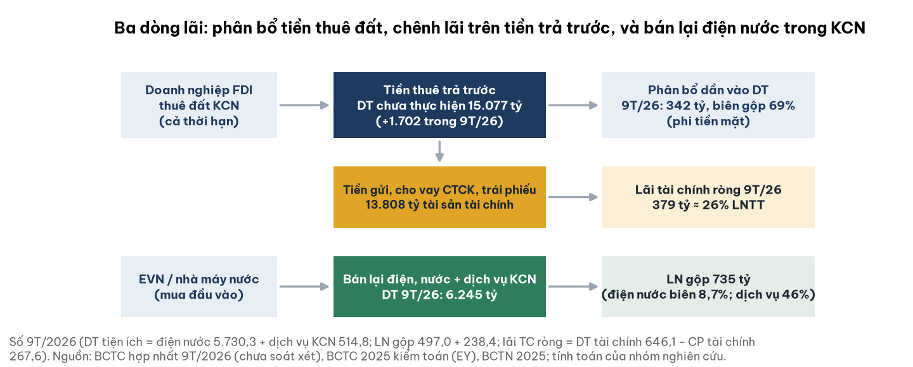

- Mốc: KCN Đông Nam 2008, Phước Đông – Bời Lời 2009, Lộc An – Bình Sơn 2013, Lê Minh Xuân 3 2014; lên HOSE 08/08/2023.
- Cổ đông lớn: Đô thị An Lộc 19,79%, Nam Tân Uyên 9,00%, Chủ tịch 7,11%, Tổng giám đốc 7,56% (BCTN 2025).
- Tầm nhìn công bố: đối tác tin cậy, hệ sinh thái dịch vụ KCN trọn gói (điện, nước, xử lý thải, nhà xưởng, logistics).

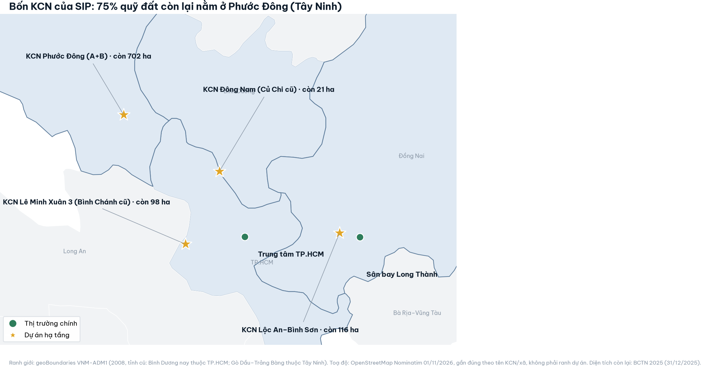

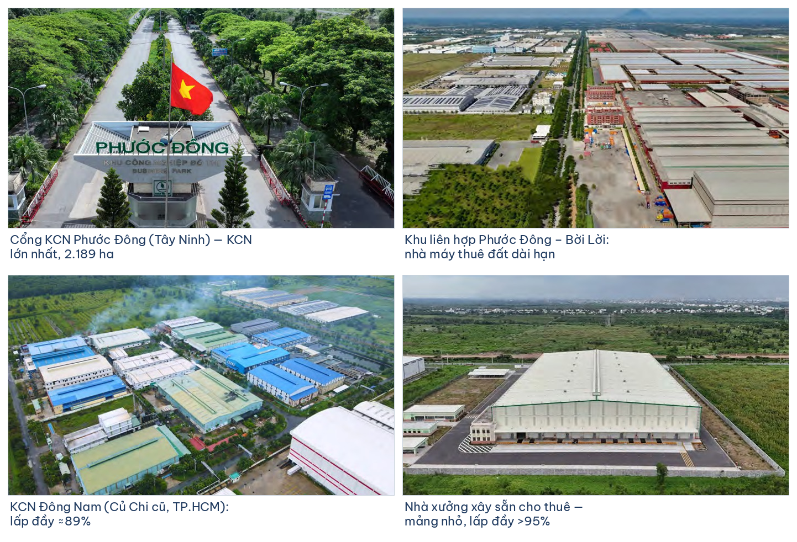

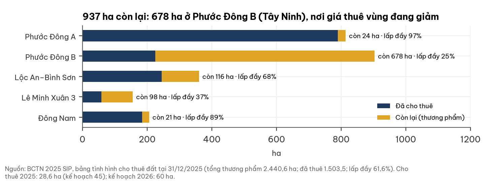

| KCN | Địa bàn (BCTN 2025) | Thương phẩm (ha) | Lấp đầy | Còn lại (ha) |
|---|---|---|---|---|
| Phước Đông A + B | P. Gia Lộc, Tây Ninh | 1.717,8 | 97% · 25% | 24 · 678 |
| Lộc An – Bình Sơn | X. Long Thành, Đồng Nai (cạnh sân bay Long Thành) | 360,6 | 68% | 116 |
| Lê Minh Xuân 3 | X. Bình Lợi, TP.HCM | 155,8 | 37% | 98 |
| Đông Nam | X. Bình Mỹ, TP.HCM | 206,5 | 89% | 21 |

## 5. Tài chính dựng từ dưới lên

### 5a. Lợi nhuận

**Lãi tiện ích tăng đều trong 9T; riêng Q3 đi lùi: LN gộp −4%, lãi vay ×1,9, lãi liên kết −64%.**

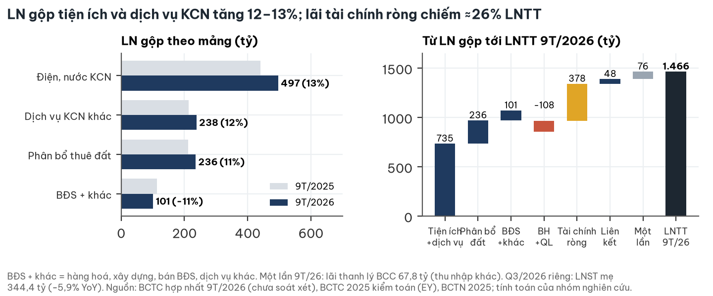

- Một lần 9T/26: lãi thanh lý BCC 67,8 tỷ; bỏ ra, LNTT lõi ≈+10,6% (ước lượng).
- ≈9% LNST mẹ được trích quỹ khen thưởng phúc lợi: EPS TTM 5.184 đ, không phải 5.778 đ.

### 5b. Dòng tiền và cổ tức

**Tiền thuê trả trước nuôi dòng tiền; cổ tức 2025 cao là một lần, không phải mức nền.**

| 9T/2026 (tỷ đồng) | Giá trị |
|---|---|
| CFO trước mua trái phiếu (xếp vào kinh doanh) | 3.181,5 |
| trong đó tăng phải trả (chủ yếu tiền thuê trả trước) | 1.793,2 |
| Mua trái phiếu · capex | −1.840,5 · −569,4 |
| Cổ tức đã trả · vay ròng | −1.155,5 · +676,6 |
| Tiền cuối kỳ (giảm 446,6) | 400,8 |

- Cổ tức 2025 = 5.000 đ (10,3% trên giá), bằng 111% LNST riêng, có hoàn nhập ≈329 tỷ quỹ đầu tư phát triển.
- Kế hoạch 2026 chỉ cam kết tối thiểu 10% (1.000 đ ≈ 2,1%).

### 5c. Bảng cân đối

**Ròng tài chính dương ≈4.410 tỷ, nhưng nằm chủ yếu ở công ty con; công ty mẹ chỉ ròng ≈781 tỷ.**

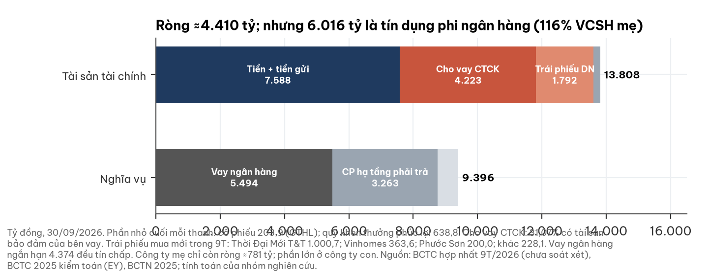

- Cho vay CTCK: 31% có tài sản bảo đảm của bên vay; phần còn lại dựa vào thoả thuận với "bên thứ ba" (có thể là ngân hàng trung gian).
- Trái phiếu mua mới: Thời Đại Mới T&T 1.000,7; Vinhomes 363,6; Phước Sơn 200,0 — giá trị hợp lý chưa xác định.

## 6. Giá cổ phiếu và thanh khoản

**Giá điều chỉnh cổ tức −6,3% trong 12 tháng; thanh khoản cạn từ tháng 7/2026.**

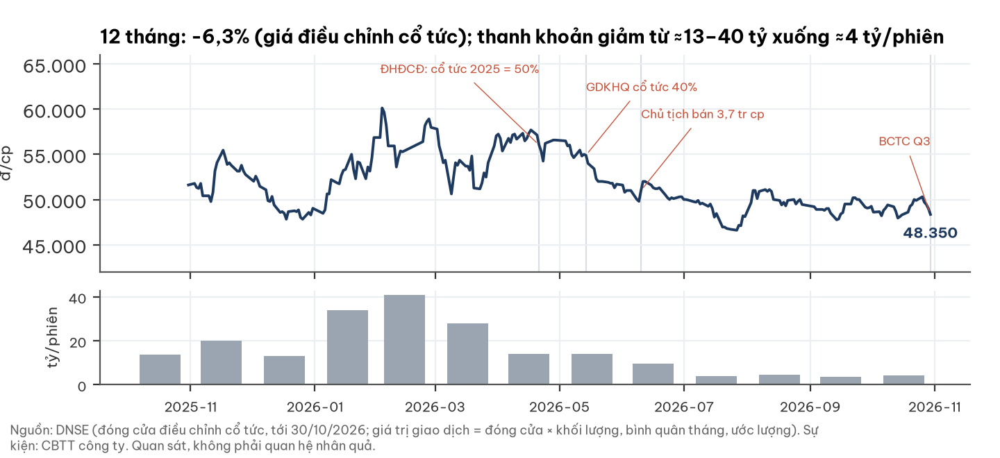

- Chủ tịch bán thoả thuận 3,7 triệu cp từ 10/06/2026 (8,64% → 7,11%). Quan sát, không suy nhân quả.
- Nước ngoài sở hữu 2,6%; free float ước ≈56%.

## 7. Định giá

**Tổng giá trị các phần (SOTP), ba kịch bản cho ≈25.400–77.500 đ; tâm ≈47.700 đ (20/50/30) đến ≈50.300 đ (25/50/25).**

| Kịch bản | Xác suất | Điều kiện | Giá trị |
|---|---|---|---|
| Tích cực | 0,20 | P/E lõi 10x; không lỗ tín dụng; đất 18 tỷ/ha, 15 năm; thu hồi 90% chi phí đã chi | **≈77.500** |
| Cơ sở | 0,50 | P/E 9x; lỗ 5% phần không bảo đảm; 12 tỷ/ha, 22 năm; chiết khấu quản trị 10% | **≈49.200** |
| Tiêu cực | 0,30 | P/E 7x; lỗ 30%; 6 tỷ/ha, 30 năm; NCI 31%; chiết khấu quản trị 20% | **≈25.400** |

- SOTP = lãi lõi × P/E + tài sản tài chính ròng − lỗ tín dụng − thuế tương lai + đất còn lại + thu hồi chi phí đã chi.
- Xác suất nghiêng xuống (0,30 tiêu cực) vì đất chủ yếu ở Tây Ninh và bên vay chưa công bố.

| Chi phí vốn chủ Ke (nội địa, β ≈1,1) | P/E lõi ≈ 1/(Ke − 2%) | Giá trị cơ sở (đ/cp) |
|---|---|---|
| 10,5% (cận dưới dải) | 11,8x | ≈59.000 |
| **12,3%** | 9,7x | ≈51.700 |
| **13,0% (dùng)** | 9,1x | ≈49.500 |
| **13,4%** | 8,8x | ≈48.300 |
| 14,0% (cận trên dải) | 8,3x | ≈46.700 |

## 8. Rủi ro — pre-mortem

**Hai rủi ro chi phối: tổn thất tín dụng và tốc độ cho thuê Phước Đông B.**

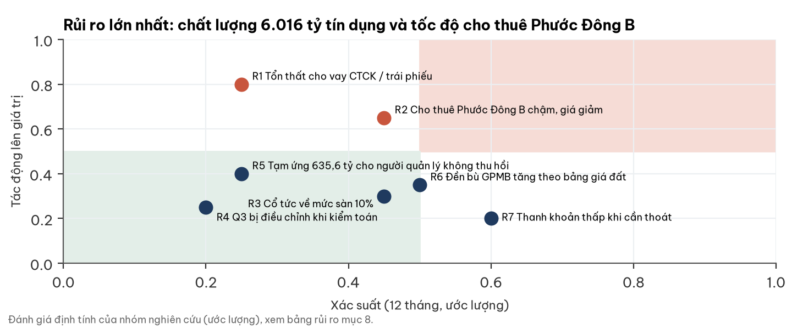

| Rủi ro | Xác suất | Tác động | Dấu hiệu sớm | Ngày kiểm |
|---|---|---|---|---|
| R1 Tổn thất cho vay CTCK / trái phiếu | thấp–TB | cao | dự phòng, gia hạn, trái phiếu T&T không định giá được | 31/03/2027 |
| R2 Phước Đông B cho thuê chậm, giá giảm | TB | cao | DT chưa thực hiện tăng < 500 tỷ/quý | 31/01/2027 |
| R3 Cổ tức về mức sàn 10% | TB | thấp–TB | ĐHĐCĐ 2027 | 04/2027 |
| R4 Q3 bị điều chỉnh khi kiểm toán | thấp | thấp | soát xét/kiểm toán điều chỉnh | 31/03/2027 |
| R5 Tạm ứng 635,6 tỷ không thu hồi | thấp–TB | TB | số dư không giảm thêm 2 quý | hằng quý |
| R6 Đền bù tăng theo bảng giá đất | TB | TB | tạm ứng đền bù tăng không kèm hợp đồng thuê | 31/01/2027 |
| R7 Thanh khoản thấp | cao | thấp | ADV < 4 tỷ kéo dài | hằng tháng |

## 9. Pháp lý & quản trị — WARNING (mức trung bình–cao)

**Chưa thấy khởi tố hay xử phạt; ba điểm quản trị cần theo dõi.**

| Hạng mục | Nội dung | Đánh giá |
|---|---|---|
| Tạm ứng cho người quản lý | 635,6 tỷ cho thành viên HĐQT/BGĐ/BKS/quản lý chủ chốt, "để tìm hiểu và mua đất"; gần như không đổi ≥ 2 năm | ≈12% VCSH mẹ, ≈2.600 đ/cp; bên liên quan |
| Tín dụng phi ngân hàng | 6.016 tỷ; bên vay, lãi suất không công bố; vay ngân hàng tín chấp song song | cờ cấu trúc, chưa có bằng chứng sai phạm |
| Hợp đồng hợp tác (BCC) Thế Hệ Mới | SIP giữ 18,89%; đối tác nhận toàn bộ DT "đầu tư khác" tới 2060 | phân chia cần giải thích |
| Nhân sự | miễn nhiệm một Phó TGĐ 05/2026; thay một thành viên BKS 04/2026 | theo dõi |
| Kiểm toán | EY: ý kiến chấp nhận toàn phần 2025; soát xét 6T/26 không ngoại trừ | sạch, nhưng không nói về chất lượng tín dụng |

Phạm vi tra cứu: CBTT công ty tới 30/10/2026 và một lượt tin 01/11/2026; chưa tra đầy đủ HOSE/UBCK.

## 10. Lịch xúc tác và mốc hai chiều

| Mốc | Ngày | Nếu tích cực | Nếu tiêu cực |
|---|---|---|---|
| BCTC Q4/2026 | ≈30/01/2027 | DT chưa thực hiện +> 500 tỷ; LNST mẹ ≥ 321 tỷ | LNST mẹ < 300 tỷ, lãi vay tăng tiếp |
| BCTC năm 2026 kiểm toán | ≈31/03/2027 | không ngoại trừ; dư nợ CTCK < 3.000 tỷ hoặc công bố bên vay | dự phòng/nhấn mạnh ở khoản cho vay, trái phiếu |
| ĐHĐCĐ 2027 | ≈04/2027 | cổ tức 2026 ≥ 30%; công bố giá thuê, tiến độ Phước Đông GĐ3 | cổ tức 10%; thêm đầu tư ngoài ngành |
| Diện tích cho thuê 2026 | BCTN 2026 | ≥ 60 ha | ≤ 30 ha lần hai |
| Tạm ứng 635,6 tỷ | hằng quý | giảm/giải trình | tăng |

## Phụ lục A — Số BCTC chính (tỷ đồng)

| Chỉ tiêu | Q3/26 | Q3/25 | 9T/26 | 9T/25 | 2025 kiểm toán |
|---|---|---|---|---|---|
| Doanh thu thuần | 2.425,8 | 2.233,7 | 7.003,0 | 6.304,3 | 8.596,2 |
| LN gộp | 351,6 | 366,4 | 1.072,2 | 977,5 | 1.343,4 |
| Chi phí lãi vay | 88,8 | 45,6 | 211,4 | 117,0 | 161,7 |
| LNTT | 462,3 | 468,0 | 1.465,8 | 1.373,5 | 1.838,5 |
| LNST mẹ · EPS (đ) | 344,4 · 1.422 | 365,8 · 1.511 | 1.078,0 · 4.050 | 1.001,9 · 3.838 | 1.322,9 · 4.972 |
| VCSH mẹ · vay (30/09/26) | 5.176,0 · 5.494,2 | | | | |

## Phụ lục B — Đối chiếu dữ liệu thị trường với BCTC

- P/E 8,2–8,4x trên dữ liệu thị trường dùng LNST mẹ/số cp (chưa trừ quỹ khen thưởng phúc lợi); theo EPS BCTC là 9,3x.
- Trung vị P/E 10,1x của 14 doanh nghiệp KCN/cao su cùng cơ sở dữ liệu thị trường; so với 8,2–8,4x của SIP, không so với 9,3x.
- Cho vay CTCK đầu năm 5.028,1 tỷ (trình bày lại); "≈4.900 tỷ" tại ĐHĐCĐ là số trước phân loại lại theo TT 99.

## Phụ lục C — Nguồn

- BCTC hợp nhất và riêng 9T/2026 (ký 29/10/2026, chưa soát xét); BCTC giữa niên độ 2026 (EY soát xét); BCTC 2025 (EY kiểm toán, 30/03/2026); BCTN 2025; tài liệu ĐHĐCĐ 21/04/2026; CBTT 2025–2026 — saigonvrg.com.vn.
- Giá: dữ liệu giao dịch HOSE qua DNSE (khớp cuối 30/10/2026 14:45:06; lấy 01/11/2026 17:07 ICT, Chủ nhật). Ngành: báo cáo của người đọc ngành độc lập 01/11/2026 (nguồn gốc Cushman & Wakefield, CBRE, Bộ Tài chính, báo chí).
- Logo: saigonvrg.com.vn (header trang chủ). Ảnh: BCTN 2025 SIP (trang PDF 4, 20, 22, 30, 31). Toạ độ: OpenStreetMap Nominatim 01/11/2026; ranh giới: geoBoundaries VNM-ADM1 (2008; Bình Dương cũ nay thuộc TP.HCM).

## Phụ lục D — Phương pháp và giới hạn

- Lãi lõi = LN gộp 9T trừ phân bổ đất, trừ chi phí bán hàng và quản lý, × 4/3, sau thuế 20%, × (1 − NCI 8,5%) × (1 − quỹ khen thưởng phúc lợi 9%). Lãi tài chính không vốn hoá vào P/E (đã tính trong tài sản tài chính ròng).
- Tài sản tài chính ròng 4.412 tỷ = 13.808 − vay 5.494 − chi phí hạ tầng phải trả 3.263 − quỹ khen thưởng phúc lợi 639; NCI 8,5–31% áp cho phần ở công ty con.
- Đất: 937 ha × tỷ/ha toàn phần, chiết khấu 13%; cộng lại 4.457 tỷ chi phí đã chi cho quỹ đất (thu hồi 30–90%). Thuế tương lai trên doanh thu chờ phân bổ: hiện giá 383–575 tỷ.
- Giới hạn: Q3 chưa soát xét; không có BCTC từng công ty con, giá thuê/m² chính thức, danh tính bên vay và điều khoản trái phiếu; số ha cập nhật tới 31/12/2025; nghĩa vụ tiền thuê đất hằng năm trả Nhà nước (nếu có) chưa trích; mọi tham số định giá là ước lượng.

## Phụ lục E — Quy trình độc lập

Báo cáo qua ba bước: đọc BCTC gốc – đọc ngành độc lập (không xem kết luận doanh nghiệp) – người phản biện kiểm từng số trên ảnh BCTC. Người phản biện đã sửa:

| Điểm sửa | Trước | Sau |
|---|---|---|
| EPS, P/E | EPS 5.778, P/E 8,4x | theo BCTC, đã trừ quỹ khen thưởng phúc lợi: EPS 5.184, P/E 9,3x |
| Lãi lõi, tài sản ròng | chưa trừ quỹ khen thưởng phúc lợi | trừ ≈9% dòng lãi và số dư quỹ 638,8 tỷ |
| Tâm giá trị | ≈51.500 đ, giá thấp hơn 6–10% | ≈47.700–50.300 đ, giá ngang tâm; sai số ±≈4.000 đ được khai |
| NCI, chi phí đã chi | NCI 8,5% phẳng; chi phí đã chi không tính | NCI 8,5–31% ở công ty con; cộng thu hồi chi phí đã chi |
| Tạm ứng | "tạm ứng nhân viên 643,7 tỷ" | 635,6 tỷ cho HĐQT/BGĐ/BKS/quản lý chủ chốt (bên liên quan); cảnh báo nâng lên trung bình–cao |
| Cổ tức | "lợi suất 10,3%" | lợi suất quá khứ, payout 111%, sàn 2026 là 10% |
| So sánh ngành | 11 doanh nghiệp | 14 doanh nghiệp, trung vị P/E 10,1x |

## Phụ lục F — Tuyên bố miễn trừ trách nhiệm

Tài liệu này chỉ nhằm mục đích cung cấp thông tin nghiên cứu, không phải lời khuyên, chào mời hay khuyến nghị mua, bán hoặc nắm giữ bất kỳ chứng khoán nào, và không tính đến mục tiêu, tình hình tài chính hay nhu cầu của bất kỳ cá nhân nào. Thông tin dựa trên nguồn công khai được cho là đáng tin cậy nhưng không được bảo đảm về độ chính xác hay đầy đủ; các ước lượng, kịch bản và xác suất là đánh giá tại thời điểm 01/11/2026 và có thể thay đổi mà không cần thông báo. Hiệu quả trong quá khứ không bảo đảm kết quả tương lai. Nhà đầu tư cần tự đánh giá và tham khảo tư vấn chuyên môn trước khi ra quyết định. Logo và hình ảnh thuộc quyền của doanh nghiệp, chỉ dùng để nhận diện, không hàm ý doanh nghiệp tài trợ hay xác nhận báo cáo.
