# TCH — CTCP Đầu tư Dịch vụ Tài chính Hoàng Huy: bàn giao đầu tiên ở New City-II đẩy lãi quý gấp 13 lần trên nền không nợ vay, nhưng lợi nhuận mẹ chuẩn hoá chỉ cho ROE ≈6% và backlog đang tiêu nhanh hơn bổ sung — giá ngang sổ sách, ở nửa dưới vùng giá trị hợp lý

**Báo cáo Due Diligence · 31/10/2026 · Nhóm nghiên cứu** · HOSE · Bất động sản nhà ở/đô thị Hải Phòng; phân phối ô tô tải qua HHS · quý ghi theo dương lịch (Q3/26 = 7–9/2026; niên độ TCH kết thúc 31/3)

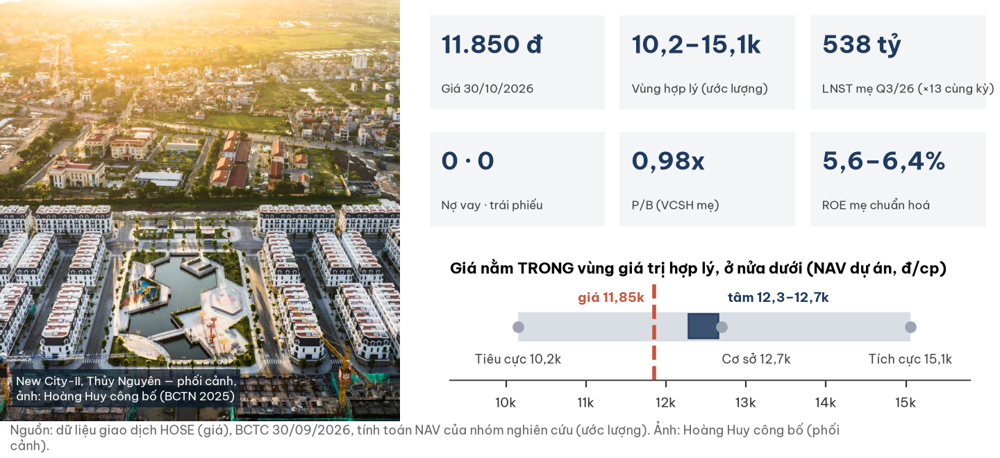

## Investment Summary

**Giá 11.850 đ (đóng cửa 30/10/2026) nằm TRONG vùng giá trị hợp lý ≈10.150–15.050 đ, thấp hơn tâm ≈12.300–12.650 đ (ước lượng) khoảng 3,5–6,3%.** Lãi đột biến là thật; điều chưa chắc là nhịp bán hàng sau đợt bàn giao này.

| Dữ liệu chính | Giá trị | Ghi chú |
|---|---|---|
| Giá · vốn hoá | **11.850 đ** · 11.889 tỷ | phiên gần nhất (thị trường nghỉ 31/10); 1.003,31 tr cp |
| Vùng giá trị hợp lý · tâm | **10.150–15.050 · ≈12.300–12.650 đ** | NAV dự án, 3 kịch bản (ước lượng) |
| LNST Q3/26 hợp nhất · thuộc cổ đông mẹ | 750,5 tỷ · **537,7 tỷ** | ×13 cùng kỳ (hợp nhất); 28% thuộc cổ đông thiểu số CRV |
| P/B · P/E TTM (cổ đông mẹ) | **0,98x** · 14,9x | P/E chuẩn hoá 15–18x |
| ROE mẹ chuẩn hoá (TB FY23–FY26E) | **5,6–6,4%** | lợi nhuận rất lồi theo chu kỳ bàn giao |
| Nợ vay · trái phiếu | **0 · 0** | tiền + tiền gửi 3.296 tỷ (phần mẹ ≈2.960) |
| Người mua trả tiền trước (backlog) | 5.600 tỷ, **−893 tỷ trong quý** | lần đầu giảm; New City-II −1.033 tỷ |
| Kế hoạch FY26 (hợp nhất) · đã đạt 6T | DT 5.000 / LNST 2.000 · 48% / 46% | |
| Thanh khoản 3 tháng | ≈62 tỷ đ/phiên | nước ngoài 10,5% (06/2026) |

**Ba điều cần biết**

1. **Lợi nhuận Q3/26 là thật và chất lượng:** đến từ bàn giao New City-II, biên gộp BĐS 51,9%, không có lãi một lần; dòng tiền âm chỉ vì đã nộp đủ 2.993 tỷ tiền đất cho hai quỹ đất mới.
2. **Nhưng đây là đỉnh chu kỳ bàn giao, chưa phải nền mới:** backlog New City-II ở nhịp này hết sau ≈3 quý; doanh số ký mới chưa được công bố; thị trường Hải Phòng đang chững.
3. **Giá 11.850 đ ngầm định chiết khấu ≈20–29% so NAV dự án:** phản ánh cấu trúc hai tầng niêm yết và lịch sử tuân thủ (2 vi phạm hành chính trong 16 tháng), cùng lúc bảng cân đối không vay.

| Điều làm nhận định đổi | Điều kiện (kiểm tại BCTC quý 10–12/2026, công bố ≤ 15/02/2027) | Tâm mới (ước lượng) |
|---|---|---|
| Tích cực hơn | LN mẹ quý ≥ 250 tỷ **và** thu mới thô ≥ 1.000 tỷ (hoặc NMTT dự án HH1–HH2 ≥ 300 tỷ); hoặc HH1–HH2 công bố bán > 50% số căn | ≈14.000–15.000 |
| Tiêu cực hơn | LN mẹ quý < 150 tỷ cùng NMTT New City-II không giảm; biên gộp BĐS 9T < 40%; soát xét có ngoại trừ; QĐ xử phạt mới | ≈10.150–11.000 |

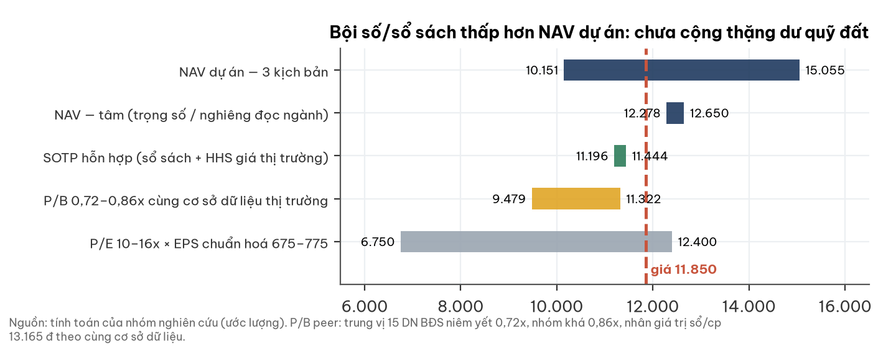

## 1. Tóm tắt điều hành

**Một doanh nghiệp không vay đang ghi nhận đợt lãi lớn nhất chu kỳ; câu hỏi là tốc độ bán mới, không phải sức khoẻ tài chính.**

- **Tình huống:** Q3/26 doanh thu 1.958 tỷ (×5,7), LNST mẹ 538 tỷ; bàn giao đợt đầu New City-II tại Thủy Nguyên.
- **Vấn đề:** backlog đang giảm, dự án mới (150 Tô Hiệu, lô I.14) có giá đất cao hơn, thị trường Hải Phòng chững.
- **Trả lời:** giá nằm trong vùng hợp lý, nửa dưới; ở ±5% quanh giá (11.260–12.440) kết luận không đổi.

## 2. Thị trường đang định giá gì

**Ở 11.850 đ, thị trường trả đúng giá trị sổ sách, tức chiết khấu ≈20–29% so NAV dự án.**

| Phép định giá ngược (ước lượng) | Giá trị |
|---|---|
| ROE dài hạn ngầm định (Ke 12,3–13,4%, g 3%) | **≈12%** — gấp đôi ROE chuẩn hoá ≈6% |
| Chiết khấu ngầm định so NAV dự án (thặng dư quỹ đất 25 / 40 / 55%) | 20% / **25%** / 29% |
| P/B so trung vị 15 DN BĐS niêm yết (cùng cơ sở dữ liệu) | 0,90x vs 0,72x (+25%) |

- Chênh lệch ROE chỉ hợp lý nếu sổ sách **đánh giá thấp quỹ đất** — nên NAV dự án là phương pháp chính.
- Mức trên trung vị ngành có lý do: không vay, biên ≈50%, tiền đất đã nộp; phần lớn đối thủ còn nợ vay/trái phiếu.

## 3. Ngành: nhà ở phía Bắc vào pha chững, Hải Phòng đi sau Hà Nội 2–4 quý

**Lợi nhuận 2026 của chủ đầu tư phản ánh bán hàng 2024–25, nên có thể đẹp nhất đúng lúc bán mới chậm lại.**

| Yếu tố ngành (người đọc ngành độc lập, 31/10/2026) | Trạng thái | Ảnh hưởng TCH |
|---|---|---|
| Chu kỳ | Hà Nội đầu→giữa pha suy về khối lượng: căn hộ bán Q3 −48 đến −66% YoY, thấp tầng hấp thụ 9% | doanh số HH1–HH4 là biến quyết định |
| Hải Phòng | cuối pha tăng → đầu pha chững; giá chung cư ≈34→40 tr/m² (Q1/25→Q1/26); nguồn cung sơ cấp > 20.000 căn | chưa có số Q3; rủi ro cung |
| Cạnh tranh | một siêu dự án của chủ đầu tư quốc gia chiếm ≈47% giao dịch thấp tầng Đông Hải Phòng H1/2026 | New City-II, Green River cùng ở Thủy Nguyên |
| Lãi vay mua nhà | cố định ≈10,9%, thả nổi 13–15% | hỗ trợ lãi vay khách hàng đã tăng ×11 (vẫn nhỏ) |
| Chỉ báo dẫn | NMTT + doanh số ký mới, không phải doanh thu | NMTT TCH âm lần đầu (mục 5) |

## 4. Doanh nghiệp: chủ đầu tư đô thị Hải Phòng, cấu trúc hai tầng niêm yết

**Hoàng Huy phát triển khu đô thị và chung cư tại Hải Phòng; quỹ đất sạch, tiền đất đã nộp, không dùng nợ vay.**

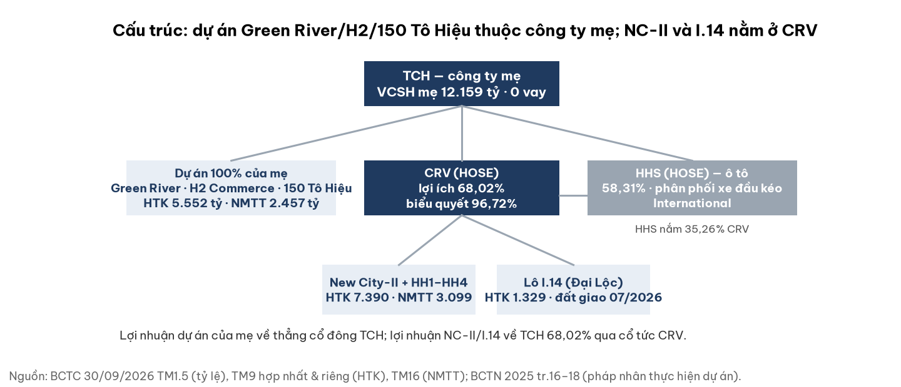

- Gốc là Công ty TNHH TM Hoàng Huy (hoạt động từ 1995); TCH đăng ký lần đầu 25/12/2007. HHS phân phối độc quyền xe đầu kéo International.
- Đã hoàn thành New City (8,05 ha), Commerce H1; đang làm 5 dự án, tổng mức đầu tư ≈30.700 tỷ (BCTN 2025).
- CRV niêm yết HOSE 10/10/2025; Green River, H2, 150 Tô Hiệu do công ty mẹ trực tiếp thực hiện.

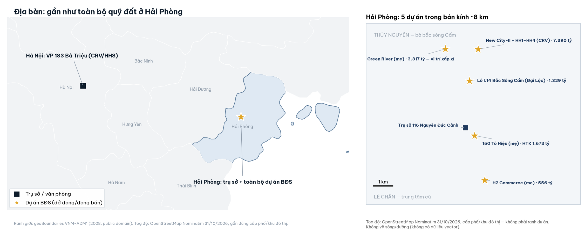

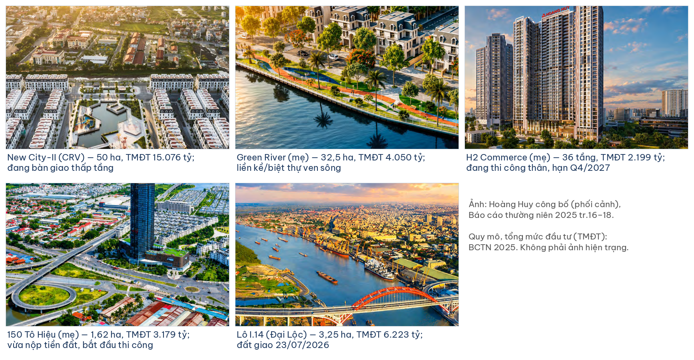

| Dự án | Pháp nhân | Quy mô · TMĐT | HTK 30/09/26 (tỷ) | Trạng thái |
|---|---|---|---|---|
| New City-II (+HH1–HH4) | CRV (68,02%) | 50 ha · 15.076 tỷ | 7.390 | bàn giao thấp tầng; HH1–HH4 (≈2.494 căn) đang làm hầm |
| Green River | mẹ (100%) | 32,5 ha · 4.050 tỷ | 3.317 | bàn giao rải rác; hạn Q4/2028 |
| 150 Tô Hiệu | mẹ (100%) | 1,62 ha · 3.179 tỷ | 1.678 | vừa nộp tiền đất, bắt đầu thi công |
| Lô I.14 Bắc Sông Cấm | Đại Lộc (qua CRV) | 3,25 ha · 6.223 tỷ | 1.329 | giao đất 23/07/2026 |
| H2 Commerce | mẹ (100%) | 36 tầng · 2.199 tỷ | 556 | thi công phần thân; hạn Q4/2027 |

## 5. Tài chính dựng từ dưới lên

### 5a. Doanh thu và biên

**Biên gộp 48,8% quý này là biên BĐS lõi (6T 51,9%, ngang FY25 51,0%), không có lãi một lần.**

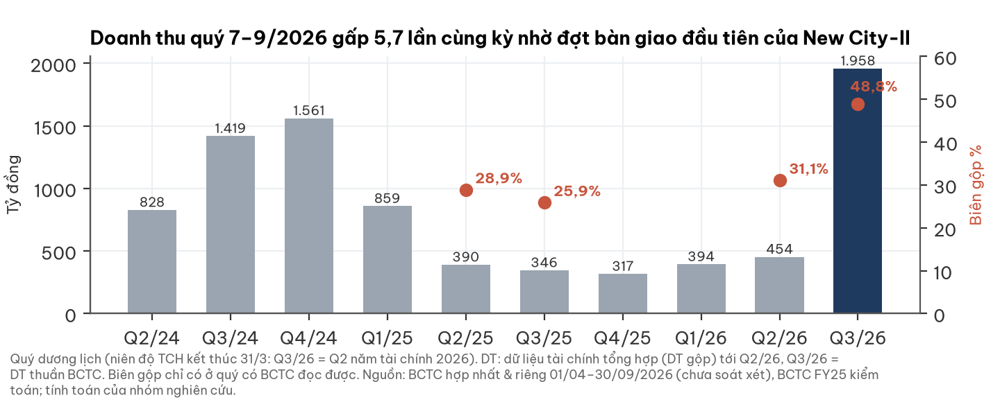

- Mảng ô tô (HHS) giảm: doanh thu 6T 359 tỷ (−16%), biên 13%; chưa có giải trình chính thức.
- Dự toán giá vốn tổng chưa công bố: rủi ro quyết toán sau vẫn còn mở.

### 5b. Lợi nhuận thuộc cổ đông mẹ

**Con số đúng để định giá là 538 tỷ, không phải 750 tỷ; EPS 6T đúng là 661 đ, không phải 911 đ như BCTC trình bày.**

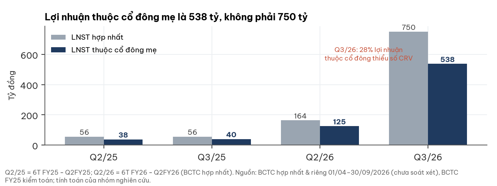

- LN mẹ TTM 796 tỷ vẫn thấp hơn FY24 (855 tỷ); trung bình FY21–25 chỉ 491 tỷ.
- Lãi New City-II/I.14 lên TCH qua cổ tức CRV; lãi Green River/H2/150 Tô Hiệu về thẳng cổ đông TCH.

### 5c. Backlog

**Người mua trả tiền trước giảm lần đầu; ở nhịp Q3, phần của New City-II hết sau ≈3 quý nếu không có bán mới.**

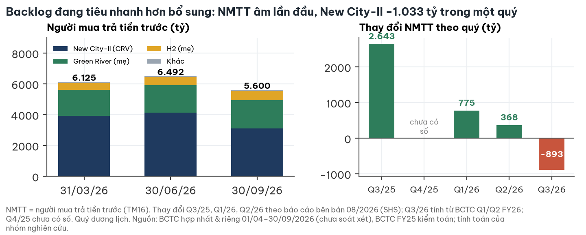

- Kế hoạch FY26 (hợp nhất) khả thi nếu giữ nhịp bàn giao: P(DT ≥ 5.000 tỷ) ≈0,60; P(LNST ≥ 2.000 tỷ) ≈0,50 (ước lượng).
- Chưa có số doanh số ký mới; BCTC 30/09 chưa xuất hiện tiền khách ứng cho HH1–HH4.

### 5d. Quỹ đất, dòng tiền và bảng cân đối

**Tiền mặt giảm 2.910 tỷ vì đã đổi thành đất sạch; công ty vẫn không vay.**

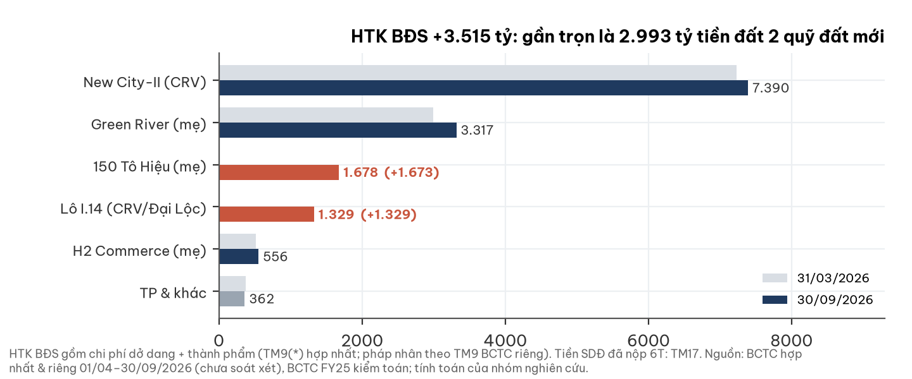

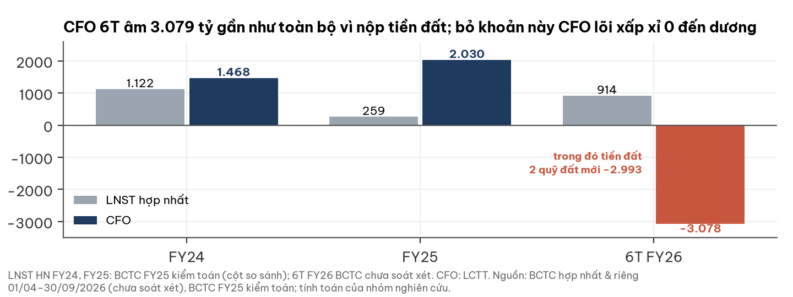

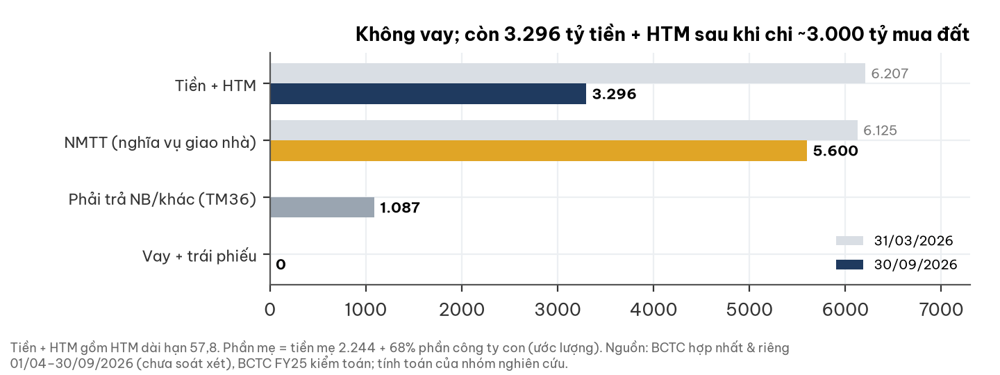

- Tiền SDĐ đã nộp 6T 2.993 tỷ khớp phần tăng HTK của 150 Tô Hiệu (+1.673) và lô I.14 (+1.329).
- Tiền gửi lớn nhất 678 tỷ ở Sacombank (tên mới: NH TMCP Sài Gòn Tài Lộc), gần như không rút trong kỳ.
- Vốn chào bán 2025 còn 865,5 tỷ, dùng đúng mục đích Green River/H2 (báo cáo 29/09/2026).

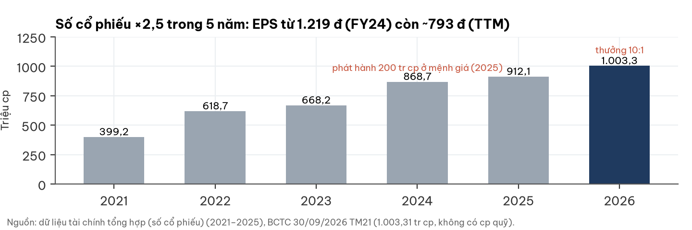

## 6. Giá cổ phiếu và sự kiện

**Giá giảm 36,8% trong 12 tháng (VN-Index +6,2%); phiên sau BCTC giảm 2,9% sau nhịp tăng 16% trước đó.**

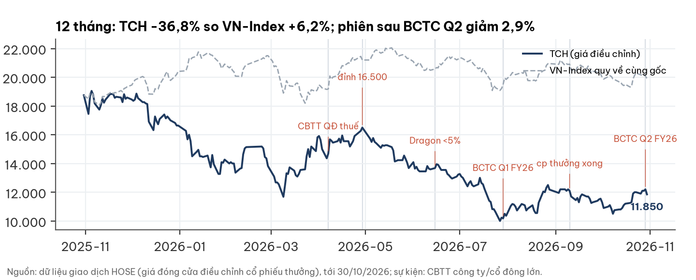

- Quan sát, không phải nhân quả: kỳ vọng bàn giao đã được công khai từ 08/2026; con số thuộc cổ đông mẹ thấp hơn con số hợp nhất.
- Nhóm quỹ Dragon Capital bán ròng xuống 4,71% (06/2026); dòng khối ngoại tháng 10 chưa có số.

## 7. Định giá

**NAV dự án ba kịch bản cho ≈10.150–15.050 đ; trọng số ≈12.650 đ, nghiêng theo đọc ngành ≈12.280 đ.**

| Kịch bản | Xác suất | Điều kiện | Giá trị |
|---|---|---|---|
| Tích cực | 0,25 | HH1–HH4 bán tốt; biên quỹ đất còn lại ≈47%; chiết khấu holding 10% / quản trị 5% | **≈15.050** |
| Cơ sở | 0,50 | biên quỹ đất ≈40%; biên ròng backlog 33,5%; chiết khấu 20% / 10% | **≈12.700** |
| Tiêu cực | 0,25 | bán chậm, biên ≈24%; chiết khấu 30% / 15% | **≈10.150** |

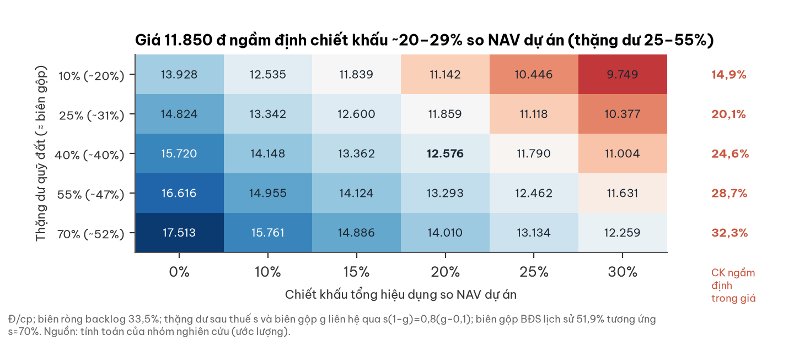

- Chiết khấu holding chỉ áp phần đi qua CRV/HHS; chiết khấu quản trị áp toàn bộ. Ke 12,3–13,4% (β 1,16).
- Thặng dư cơ sở 40% nằm giữa biên lịch sử (≈70%) và quỹ đất mới mỏng hơn (10–25%) — lệch nhẹ về thận trọng.
- Phép thử thị trường: SOTP hỗn hợp ≈11.200–11.450; P/B ngành ≈9.480–11.320; P/E 10–16x ≈6.750–12.400 — đều chưa cộng thặng dư quỹ đất.

## 8. Rủi ro — pre-mortem

**Rủi ro lớn nhất là tốc độ bán mới; bảng cân đối không phải điểm yếu.**

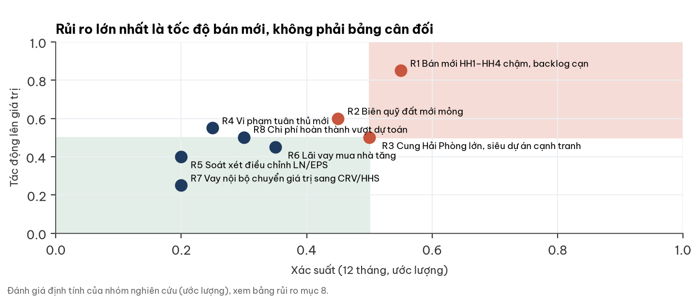

| Rủi ro | Xác suất | Tác động | Dấu hiệu sớm | Ngày kiểm |
|---|---|---|---|---|
| R1 HH1–HH4 bán chậm, backlog cạn | TB–cao | cao | NMTT không tăng 2 quý liền | 15/02/2027 |
| R2 Biên quỹ đất mới mỏng | TB | TB–cao | biên gộp BĐS 9T < 45% | 15/02/2027 |
| R3 Cung Hải Phòng lớn, siêu dự án cạnh tranh | TB | TB | giá sơ cấp/chiết khấu bán hàng tăng | hằng quý |
| R4 Vi phạm tuân thủ mới | thấp–TB | TB | QĐ xử phạt/CBTT bất thường | 31/03/2027 |
| R5 Soát xét điều chỉnh LN/EPS | thấp | TB | BCTC soát xét 6T | 30/11/2026 |
| R6 Lãi vay mua nhà tăng | thấp–TB | TB | lãi thả nổi > 15% | hằng quý |
| R7 Vay nội bộ chuyển giá trị sang CRV/HHS | thấp | thấp | dư nợ vay nội bộ > 100 tỷ | 31/03/2027 |
| R8 Chi phí hoàn thành vượt dự toán | thấp–TB | TB | trích trước/giá vốn tăng bất thường | hằng quý |

## 9. Pháp lý & quản trị — WARNING (mức trung bình, không chặn phân tích)

**Hai vi phạm hành chính trong 16 tháng ở hai cơ quan khác nhau; đồng thời điểm từng bị phạt đã được khắc phục.**

| Hạng mục | Nội dung | Đánh giá |
|---|---|---|
| Thuế (03/04/2026) | QĐ 1020/QĐ-XPHC, Thuế TP Hải Phòng: khai sai căn cứ tính thuế TNDN; phạt + truy thu + chậm nộp 20,21 tỷ; đã CBTT 07/04/2026 | tiền nhỏ (≈20 đ/cp); QĐ không nêu kỳ thuế |
| Chứng khoán (05/12/2024) | UBCKNN phạt 295 tr đ: CBTT thiếu giao dịch bên liên quan, duyệt muộn hợp đồng thuê văn phòng | thủ tục, không hình sự |
| Đã khắc phục | BC quản trị 6T 2026, BCTN 2025 và 3 nghị quyết HĐQT 2026 công bố đầy đủ giao dịch nội bộ tập đoàn | tích cực |
| Còn theo dõi | TCH cho CRV vay ≤ 500 tỷ, HHS ≤ 100 tỷ, lãi do TGĐ quyết (đã giải ngân 30 tỷ) | chuyển giá trị giữa các tầng cổ đông |
| Kiểm soát | Ông Đỗ Hữu Hạ + HH Finance (người liên quan) 35,99% = 71,2% phiếu ĐHĐCĐ 2026 | tập trung |
| Giám sát | 1/5 thành viên HĐQT độc lập; Trưởng BKS kiêm KTT công ty con; TGĐ chọn kiểm toán | yếu |
| CRV | biểu quyết 96,72%; bỏ phần uỷ quyền 7,37% vẫn 89,35%; free float độc lập ≈3% | kiểm soát vững; thanh khoản CRV gần như không có |
| Kiểm toán | AASC, FY25 chấp nhận toàn phần; tiếp tục soát xét/kiểm toán FY26 | sạch |

## 10. Lịch xúc tác và mốc hai chiều

| Mốc | Ngày | Xác suất | Nếu đúng | Nếu sai |
|---|---|---|---|---|
| BCTC 6T soát xét: LN mẹ trong ±5% của 663 tỷ, không ngoại trừ, EPS sửa về ≈661 đ | 30/11/2026 | 0,75 | giữ vùng | tâm −≈1.000 đ |
| LN mẹ quý 10–12/2026 ≥ 250 tỷ | 15/02/2027 | 0,60 | cùng mốc dưới ⇒ tích cực hơn | < 150 tỷ ⇒ ≈10.500–11.000 |
| Thu mới thô quý ≥ 1.000 tỷ hoặc NMTT HH1–HH2 ≥ 300 tỷ | 15/02/2027 | 0,45 | tâm ≈14.000–15.000 | < 500 tỷ hai quý ⇒ kịch bản tiêu cực |
| FY26 LNST hợp nhất ≥ 2.000 tỷ và DT ≥ 5.000 tỷ | 15/05/2027 | 0,50 | biên trên | < 1.400 tỷ ⇒ ≈11.000 |
| Biên gộp BĐS 9T ≥ 45% | 15/02/2027 | 0,70 | giữ | < 40% ⇒ ≈10.150 |
| Không có QĐ xử phạt mới | 31/03/2027 | 0,75 | +≈700 đ | −≈1.400 đ |
| 865,5 tỷ vốn chào bán dùng đúng mục đích | 31/03/2027 | 0,80 | giữ | −≈700 đ |

## Phụ lục A — Số BCTC chính (tỷ đồng)

| Chỉ tiêu | Q3/26 (Q2 FY26) | Q3/25 | 6T FY26 | FY25 (kiểm toán) |
|---|---|---|---|---|
| Doanh thu thuần | 1.958,2 | 346,0 | 2.409,1 | 1.447,4 |
| Biên gộp | 48,8% | 25,9% | 45,5% | 24,1% |
| LNST hợp nhất · mẹ | 750,5 · 537,7 | 56,3 · 40,2 | 914,3 · 663,1 | 259,2 · 211,1 |
| CFO | | | −3.078,5 | +2.030,0 |
| Tiền + HTM · vay (30/09/26) | 3.296,3 · 0 | | | |
| HTK BĐS · NMTT (30/09/26) | 14.630,9 · 5.599,8 | | | |
| VCSH mẹ · NCI (30/09/26) | 12.159,1 · 3.120,5 | | | |

## Phụ lục B — Đối chiếu dữ liệu thị trường với BCTC

- LN mẹ quý 04–06/2026 theo dữ liệu thị trường 125,4 khớp BCTC (6T − Q2 = 125,42); FY24/FY25 khớp kiểm toán.
- Dữ liệu thị trường chưa nạp kỳ 07–09/2026 (P/E 39,8 là cũ) và số cổ phiếu còn 912,1 tr (trước thưởng; đúng 1.003,3 tr).
- P/B theo dữ liệu thị trường 0,82x dùng giá trị sổ/cp cũ; cùng cơ sở với số cp mới là 0,90x; theo VCSH mẹ BCTC là 0,98x.

## Phụ lục C — Nguồn

- BCTC hợp nhất và riêng 01/04–30/09/2026 (29/10/2026, chưa soát xét); BCTC FY25 kiểm toán (AASC, 25/06/2026); CV giải trình 42/2026/TCH-CV; BCTN 2025; NQ ĐHĐCĐ 2026; BC quản trị 6T 2026; QĐ 1020/QĐ-XPHC; BC sử dụng vốn 29/09/2026 — hoanghuy.vn.
- Giá: dữ liệu giao dịch HOSE (đóng cửa 30/10/2026, không có phiên 31/10). Ngành: báo cáo của người đọc ngành độc lập 31/10/2026; số liệu Hải Phòng H1/2026 qua VietnamFinance, Nhà Đầu Tư.
- Án UBCKNN 2024: Nhân Dân, Báo Đầu Tư. Sacombank đổi tên: The Leader, Báo Đầu Tư. Số dự án HH1–HH4/150 Tô Hiệu một phần từ báo cáo bên bán 08/2026 (không dùng giá mục tiêu).
- Logo: hoanghuy.vn (header trang chủ), làm sạch nền. Ảnh dự án: BCTN 2025 tr.16–18 (Hoàng Huy công bố, phối cảnh). Toạ độ: OpenStreetMap Nominatim 31/10/2026; ranh giới: geoBoundaries VNM-ADM1.

## Phụ lục D — Phương pháp và giới hạn

- NAV = VCSH mẹ (tách phần trực tiếp 5.959 tỷ và phần qua công ty con 6.200 tỷ) + lãi backlog (NMTT ex-VAT × biên ròng × tỷ lệ sở hữu × PV) + thặng dư quỹ đất còn lại (12.137 tỷ × thặng dư × PV 4 năm) − chiết khấu.
- Thặng dư sau thuế s và biên gộp g: s(1−g) = 0,8(g−0,1) (CPBH 10% DT, thuế 20%).
- Giới hạn: BCTC 6T chưa soát xét; không có dự toán tổng, giá trị hợp đồng, doanh số ký mới, số căn còn lại; chưa có số thị trường Hải Phòng Q3; chưa có dòng khối ngoại; chưa rõ danh tính nhóm uỷ quyền 7,37% tại CRV; mọi tham số NAV là ước lượng.

## Phụ lục E — Quy trình độc lập

Báo cáo qua ba bước: đọc BCTC gốc → đọc ngành độc lập (không xem kết luận doanh nghiệp) → người phản biện độc lập kiểm lại từng số trên ảnh BCTC. Người phản biện đã sửa:

| Điểm sửa | Trước | Sau |
|---|---|---|
| QĐ thuế 1020 (20,21 tỷ) | bị bỏ sót | đưa vào cảnh báo quản trị |
| Quy đổi thặng dư ↔ biên gộp | "25% ≈ biên 40–45%" | 25% ≈ 31%; biên lịch sử ≈ thặng dư 70% |
| Pháp nhân dự án | Green River/H2 coi như qua CRV | thuộc công ty mẹ 100% (BCTC riêng) |
| Chiết khấu | áp đều, lý do gồm cổ đông thiểu số | tách holding/quản trị; tâm tăng ≈11.950 → ≈12.300–12.650 |
| Phép thử P/B ngành | lệch cơ sở (≈8.700) | cùng cơ sở (≈9.480) |
| Phép thử qua giá CRV | dùng giá CRV (khớp 24/62 phiên) | bỏ; thay SOTP hỗn hợp có HHS |
| Doanh thu New City-II quý | 1.000–1.200 tỷ | ≈1.650–1.750 tỷ |
| Kiểm soát CRV | "dựa một phần vào uỷ quyền" | 89,35% không cần uỷ quyền |
| Giao dịch bên liên quan | nghi chưa công bố | đã công bố đầy đủ (điểm tích cực) |

## Phụ lục F — Tuyên bố miễn trừ trách nhiệm

Tài liệu này chỉ nhằm mục đích cung cấp thông tin nghiên cứu, không phải lời khuyên, chào mời hay khuyến nghị mua, bán hoặc nắm giữ bất kỳ chứng khoán nào, và không tính đến mục tiêu, tình hình tài chính hay nhu cầu của bất kỳ cá nhân nào. Thông tin dựa trên nguồn công khai được cho là đáng tin cậy nhưng không được bảo đảm về độ chính xác hay đầy đủ; các ước lượng, kịch bản và xác suất là đánh giá tại thời điểm 31/10/2026 và có thể thay đổi mà không cần thông báo. Hiệu quả trong quá khứ không bảo đảm kết quả tương lai. Nhà đầu tư cần tự đánh giá và tham khảo tư vấn chuyên môn trước khi ra quyết định. Logo và hình ảnh dự án thuộc quyền của doanh nghiệp, chỉ dùng để nhận diện, không hàm ý doanh nghiệp tài trợ hay xác nhận báo cáo.
