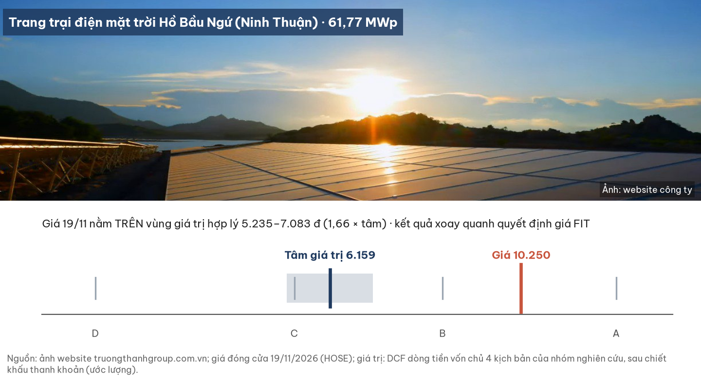
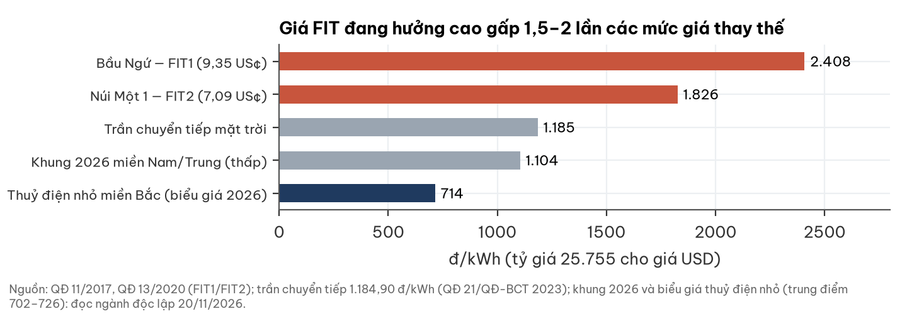
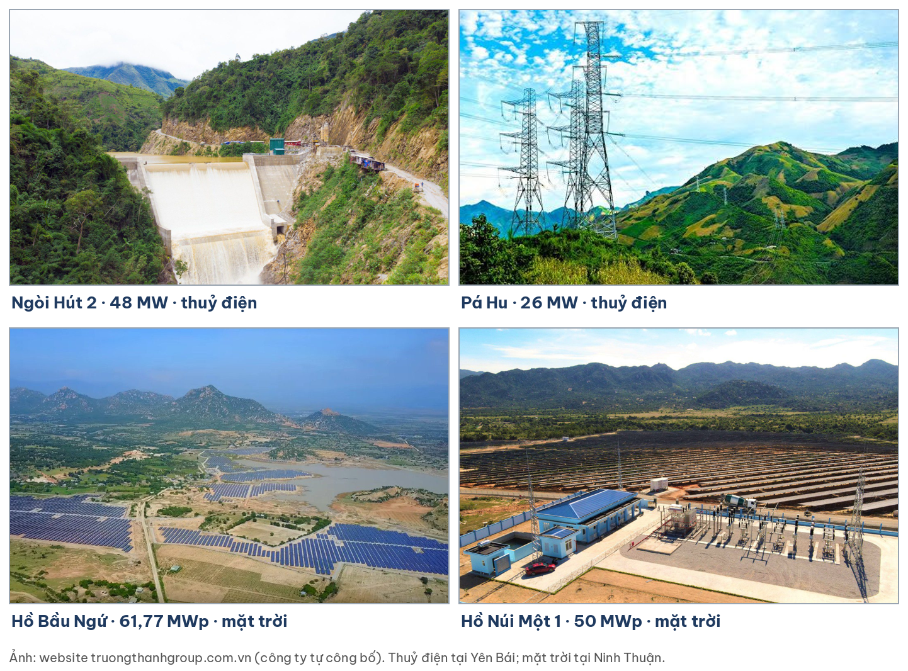
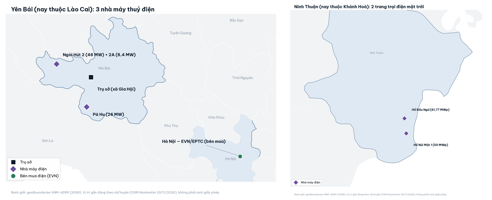
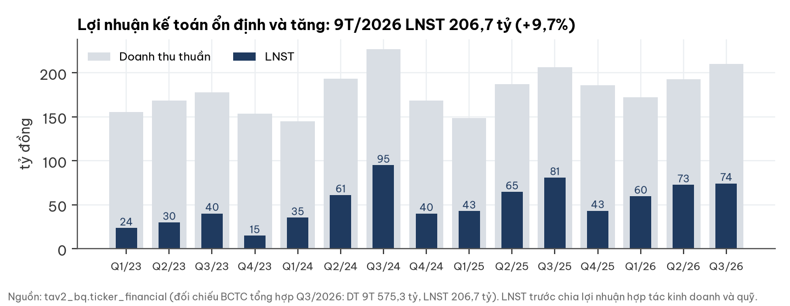
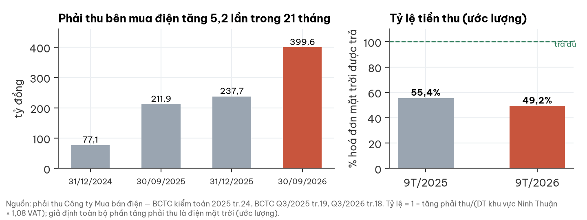
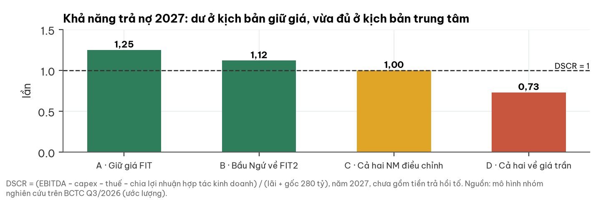
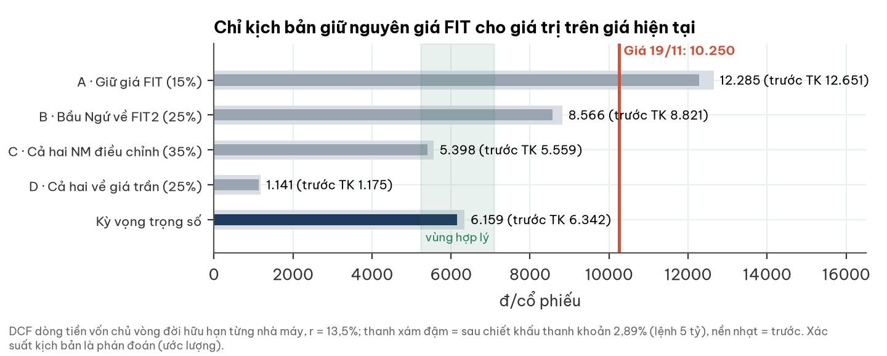
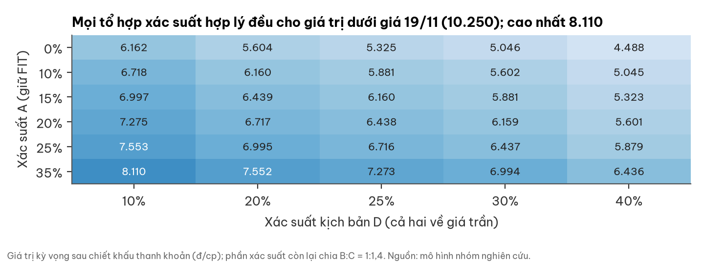
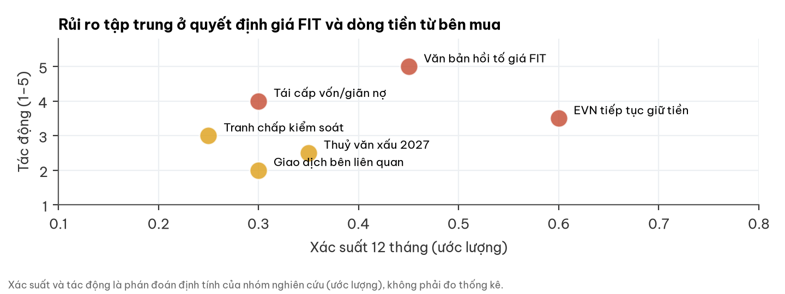

# TTA — Trường Thành: thuỷ điện và điện mặt trời vẫn lãi đều, nhưng gần một nửa tiền điện mặt trời chưa về và giá đã trả cho kịch bản giữ nguyên giá FIT

| Chỉ tiêu | Giá trị | Chỉ tiêu | Giá trị |
|---|---|---|---|
| Giá (HOSE) | **10.250 đ** (đóng cửa 19/11/2026) | Vùng giá trị hợp lý | **5.235 – 7.083 đ** |
| Tâm giá trị (sau chiết khấu thanh khoản 2,89%) | **6.159 đ** (trước chiết khấu 6.342) | Giá / tâm | **1,66 lần** (1,62 lần trước chiết khấu) |
| LNST 9T/2026 | **206,7 tỷ** (+9,7%); sau chia hợp tác kinh doanh 183,6 tỷ | P/E (12 tháng, EPS 1.145 đ) · P/B | 8,9 · 0,72 |
| Nợ vay 30/9/2026 | **1.554,5 tỷ**; nợ ròng/EBITDA 2,3 lần | Phải thu bên mua điện (EPTC) | **399,6 tỷ** (+162 trong 9T) |
| Vốn hoá | ~1.830 tỷ (178,56 triệu cp) | Thanh khoản (trung vị 250 phiên) | 2,20 tỷ/phiên |

**Ba điều cần biết**

- **Tích cực:** năm nhà máy đang chạy, biên gộp 58,5%, lợi nhuận 9T vượt 115% kế hoạch năm; dư nợ giảm đều, kiểm toán 2025 chấp nhận toàn phần.
- **Tiêu cực:** ~51% doanh thu đến từ hai trang trại mặt trời bị kết luận hưởng giá FIT không đúng quy định; bên mua chỉ trả ~49% hoá đơn 9T/2026.
- **Định giá:** giá hiện tại chỉ hợp lý nếu giá FIT được giữ nguyên (xác suất thị trường ngầm định ≥ ~45%); kỳ vọng trọng số cho 6.159 đ.

## 1. Tóm tắt điều hành

| | Nội dung |
|---|---|
| **Tình huống** | Nhà sản xuất điện độc lập quy mô vừa: 3 thuỷ điện ở Yên Bái và 2 trang trại mặt trời ở Ninh Thuận, bán toàn bộ cho EVN. |
| **Vấn đề** | Giá FIT của hai trang trại mặt trời có thể bị tính lại, kể cả hồi tố; bên mua đã giữ lại một phần tiền điện. |
| **Câu hỏi** | Giá 10.250 đ đang trả cho kết cục nào của quyết định giá FIT? |
| **Trả lời** | Giá nằm TRÊN vùng giá trị hợp lý ở cả hai mức (trước/sau chiết khấu thanh khoản). Nhận định đổi theo văn bản giá FIT và dòng tiền bên mua trả. |

## 2. Luận điểm và điều thị trường đang định giá

| Luận điểm tích cực | Luận điểm tiêu cực |
|---|---|
| Thuỷ điện Yên Bái ổn định: DT 9T 279,8 tỷ, biên gộp 53,9% | Mặt trời 51% DT, 55% LN gộp — phụ thuộc giá FIT1/FIT2 |
| Lãi 9T 206,7 tỷ, gần như toàn bộ từ vận hành | Phải thu EPTC 77 → 400 tỷ trong 21 tháng; doanh thu ghi đủ giá FIT |
| Dư nợ trả dần tới 2033; lãi vay bình quân ~8,4% | Khả năng trả nợ 2027 vừa đủ (1,00 lần) ở kịch bản trung tâm |
| Cổ đông mới gom 20,04% (8/2026): có thể là chất xúc tác | Giao dịch với bên liên quan và người nội bộ chưa minh bạch đủ (mục 7) |

- **Thị trường đang định giá:** xác suất giữ nguyên giá FIT ≥ ~45% nếu chỉ cân hai kịch bản A/B.
- **Có thể chưa tính:** dòng tiền Q4/2026, hoàn thuế trên phần hồi tố, bù trừ hồi tố linh hoạt (+~100 đ).
- **Có thể đã tính quá tay:** hành vi trả tiền thực tế của bên mua (49%) thấp hơn cả kịch bản trung tâm (72%).

## 3. Ngành: giá điện mặt trời ưu đãi đang được rà soát, thuỷ điện nhỏ theo biểu giá hành chính

- Kết luận thanh tra về quy hoạch điện nêu cả Bầu Ngứ (FIT1) và Núi Một 1 (FIT2); đến 20/11/2026 chưa có văn bản xử lý cuối.
- Giá thay thế khả dĩ thấp hơn 24–51% so với giá đang hưởng; quyết định có thể kèm hồi tố từ ngày vận hành.
- Thuỷ điện nhỏ bán theo biểu giá chi phí tránh được; hợp đồng 20 năm hết hạn ~2036–2040.

## 4. Doanh nghiệp: năm nhà máy, một người mua

Trường Thành khởi đầu từ thuỷ điện Ngòi Hút 2 (vận hành 2015), sau đó mở rộng sang điện mặt trời trên hồ thuỷ lợi ở Ninh Thuận (2019–2020) và nắm 35% điện gió Phương Mai 1 (Bình Định). Công ty đang chuẩn bị dự án thuỷ điện tích năng Phước Hoà (đề xuất 1.200 MW).

| Nhà máy | Loại | Công suất | Vận hành | Giá bán | Bên mua |
|---|---|---|---|---|---|
| Ngòi Hút 2 | Thuỷ điện | 48 MW | 2015 | Cơ chế nhà máy >30 MW | EVN (chưa công bố đơn vị) |
| Ngòi Hút 2A | Thuỷ điện | 8,4 MW | 2016 | Biểu giá chi phí tránh được | EVN |
| Pá Hu | Thuỷ điện | 26 MW | 10/2020 | Biểu giá chi phí tránh được | EVN |
| Hồ Bầu Ngứ | Mặt trời | 61,77 MWp | 11/2019 | FIT1 9,35 US¢ | EPTC |
| Hồ Núi Một 1 | Mặt trời | 50 MWp | 11/2020 | FIT2 7,09 US¢ | EPTC |

## 5. Tài chính: lợi nhuận kế toán vững, dòng tiền mặt trời yếu đi

- CFO 9T/2026 159,0 tỷ thấp hơn LNST 206,7 tỷ (77%); 2025 CFO 236,3 ≈ LNST 231,6.
- Tỷ lệ tiền thu hoá đơn mặt trời cùng kỳ: 55,4% (9T/2025) → 49,2% (9T/2026).
- Lợi nhuận cơ sở tính EPS thấp hơn LNST ~18%: 23,1 tỷ chia cho đối tác hợp tác kinh doanh ở hai thuỷ điện Ngòi Hút, 14,0 tỷ trích quỹ.

## 6. Định giá: kỳ vọng trọng số 6.159 đ/cp, dưới giá hiện tại ở mọi tổ hợp xác suất hợp lý

| Kịch bản | Điều kiện | Xác suất | Trước TK (đ/cp) | Sau TK (đ/cp) |
|---|---|---|---|---|
| A · Giữ giá FIT | Không điều chỉnh, thu đủ phải thu | 15% | 12.651 | 12.285 |
| B · Bầu Ngứ về FIT2 | Hồi tố 385 tỷ, Núi Một 1 giữ FIT2 | 25% | 8.821 | 8.566 |
| C · Cả hai nhà máy điều chỉnh | Bầu Ngứ FIT2 + Núi Một 1 về giá trần; hồi tố 674 tỷ | 35% | 5.559 | 5.398 |
| D · Cả hai về giá trần | Hồi tố 1.053 tỷ + thuỷ văn −15% 2027 + lãi vay +1 điểm % | 25% | 1.175 | 1.141 |
| **Kỳ vọng trọng số** | | | **6.342** | **6.159** |

- Xác suất là phán đoán neo vào kết luận thanh tra (nêu cả hai nhà máy) và hành vi trả tiền của bên mua; độ nhạy ở hình dưới.
- Phương pháp: dòng tiền vốn chủ vòng đời hữu hạn từng nhà máy (thuỷ điện tới 2060, mặt trời 25 năm), không giá trị vĩnh viễn.
- Phước Hoà tính theo giá trị sổ sách 90,7 tỷ (đã trừ 5 tỷ sẽ chuyển thành vốn góp của bên ngoài); Phương Mai 1 theo giá gốc trừ dự phòng.

| Chi phí vốn và thanh khoản | Giá trị |
|---|---|
| Tỷ lệ chiết khấu r | **13,5%**, neo lãi huy động 12 tháng hiệu dụng **7,40%** (CCTG 12 tháng, 02/11/2026); điều chỉnh 1:1 khi lãi huy động đổi |
| Độ nhạy tâm sau TK theo r | −100bp **6.612** · −50bp **6.380** · 0 **6.159** · +50bp **5.950** · +100bp **5.751** |
| Chiết khấu thanh khoản | **2,89%** cho lệnh 5 tỷ = nửa chênh lệch mua-bán 0,44% + biến động ngày 1,63% × √(5/2,20); thanh khoản 3 tháng gần nhất (1,13 tỷ/phiên) ⇒ 3,87%, tâm 6.097 |
| Lãi suất chiết khấu thị trường đang ngầm định | 15,1% (147 mã, 30/10/2026), cao hơn 75% lịch sử từ 2014; đỉnh 2022 15,9%, đáy 2022–23 12,1% |
| TPCP 10 năm | 4,57% (19/11/2026), +0,57 điểm % trong 12 tháng (nguồn chưa đối chiếu độc lập) |

- Hai dòng lãi suất thị trường chỉ để tham khảo mức chiết khấu chung; không làm thay đổi giá trị hợp lý.

## 7. Rủi ro, pháp lý và quản trị

| Rủi ro | Xác suất 12T (ước lượng) | Tác động | Dấu hiệu sớm | Ngày kiểm |
|---|---|---|---|---|
| Văn bản hồi tố giá FIT | Trung bình | Rất cao | Văn bản Bộ Công Thương/EVN | 30/06/2027 |
| Bên mua tiếp tục giữ tiền | Cao | Cao | Phải thu EPTC > 450 tỷ | BCTC Q4/2026 |
| Khả năng trả nợ < 1 lần | Trung bình | Cao | Giãn/hoãn nợ, vay mới để trả nợ | Hằng quý |
| Tranh chấp kiểm soát | Thấp–trung bình | Trung bình | Báo cáo sở hữu, thay đổi HĐQT | Liên tục |

**Lưu ý pháp lý và quản trị (cảnh báo có nguồn, không đưa vào kịch bản cơ sở):**
- BCTC kiểm toán 2025 (tr.26): 96,64 tỷ từng là khoản tạm chi trả nợ vay của cựu Chủ tịch qua Chủ tịch HĐQT hiện tại; cuối 2025 đã chuyển giao cho "các cá nhân liên quan".
- Vay dài hạn thành viên ban lãnh đạo 139,25 tỷ về 0 cuối 2025 (tr.34); công ty cho cổ đông lớn là pháp nhân vay 15 tỷ tại 30/9/2026.
- Sở hữu tập trung (Cty TNHH XD Trường Thành 23,63%, ông Trần Huy Đức 23,26%, bà Nguyễn Thị Ngọc 11,63% tại 30/9/2025; nhóm cổ đông mới 20,04%) ⇒ tỷ lệ tự do chuyển nhượng ước ~17–20%.

## 8. Lịch xúc tác và điều làm nhận định thay đổi

| Mốc | Ngày | Tích cực hơn nếu | Tiêu cực hơn nếu |
|---|---|---|---|
| BCTC Q4/2026 | ~30/01/2027 | Phải thu EPTC giảm < 300 tỷ | Phải thu EPTC > 450 tỷ hoặc trích dự phòng |
| Văn bản xử lý giá FIT | ~30/06/2027 | Giữ FIT cho dự án đã vận hành ⇒ giá trị tiến về 12.285 | Hồi tố + giá trần ⇒ giá trị về vùng 1.141–5.398 |
| Hợp đồng hợp tác kinh doanh | BCTN 2026 | Có thời hạn/được mua lại | Mở rộng sang nhà máy khác |
| Lãi huy động 12 tháng | Liên tục | −50bp ⇒ tâm +~220 đ | +50bp ⇒ tâm −~210 đ |

## Phụ lục A — Số liệu BCTC chính (tỷ đồng)

| Chỉ tiêu | 9T/2025 | 9T/2026 | Nguồn |
|---|---|---|---|
| Doanh thu thuần | 542,4 | 575,3 | BCTC tổng hợp Q3/2026 |
| — trong đó khu vực Ninh Thuận (mặt trời) | 280,1 | 295,5 | Báo cáo bộ phận Q3/2025, Q3/2026 |
| LNST | 188,5 | 206,7 | BCTC Q3/2026 |
| CFO | 182,6 | 159,0 | Lưu chuyển tiền tệ |
| Phải thu EPTC cuối kỳ | 211,9 | 399,6 | Q3/2025 tr.19; Q3/2026 tr.18 |

## Phụ lục B — Đối chiếu dữ liệu thị trường với BCTC

Doanh thu và LNST quý trong cơ sở dữ liệu thị trường khớp BCTC gốc Q3/2026 (210,16 / 74,35 tỷ). Giá và thanh khoản: dữ liệu giao dịch HOSE đến 19/11/2026.

## Phụ lục C — Nguồn

BCTC tổng hợp Q3/2025, Q3/2026, soát xét 6T/2026, kiểm toán 2025; NQ ĐHĐCĐ 23/04/2026; báo cáo sở hữu 25/08/2026 (website truongthanhgroup.com.vn). Logo và ảnh nhà máy: website công ty. Toạ độ: OpenStreetMap Nominatim (20/11/2026), vị trí gần đúng theo xã/huyện; ranh giới tỉnh geoBoundaries (2008). Giá FIT: QĐ 11/2017, QĐ 13/2020; giá trần chuyển tiếp: QĐ 21/QĐ-BCT (2023). Kết luận thanh tra: báo chí (nguoiquansat.vn 01/01/2024; theleader.vn 26/03/2024).

## Phụ lục D — Phương pháp và giới hạn

- Sản lượng từng nhà máy, giá EPTC tạm trả, hợp đồng mua bán điện và thời hạn hợp tác kinh doanh: không công bố; dùng ước lượng (Bầu Ngứ 98, Núi Một 1 85 GWh/năm).
- BCTC chỉ tách phải thu theo người mua, không theo nhà máy; tỷ lệ tiền thu giả định toàn bộ phần tăng phải thu EPTC là điện mặt trời.
- Hồi tố quy đổi theo tỷ giá bình quân năm; tỷ giá áp dụng thực tế theo quy định chưa xác minh. Thuế GTGT hoá đơn điện giả định 8%.

## Phụ lục E — Quy trình

Số liệu đối chiếu BCTC gốc của công ty; định giá dựng độc lập với giá thị trường rồi mới so sánh; có người phản biện độc lập rà soát số liệu và nguồn; giới hạn dữ liệu nêu ở Phụ lục D.

## Phụ lục F — Tuyên bố miễn trừ trách nhiệm

Tài liệu chỉ nhằm mục đích cung cấp thông tin nghiên cứu, không phải lời khuyên hay khuyến nghị đầu tư cá nhân hoá, không phải lời mời mua hoặc bán chứng khoán. Thông tin lấy từ nguồn được cho là đáng tin cậy nhưng không được bảo đảm đầy đủ, chính xác. Giá trị ước tính và kịch bản phụ thuộc giả định có thể thay đổi. Nhà đầu tư tự chịu trách nhiệm với quyết định của mình.
