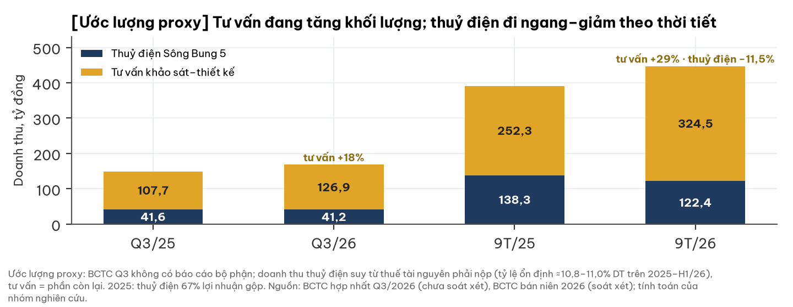
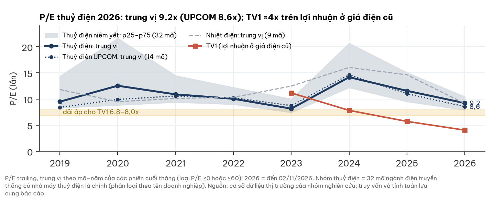
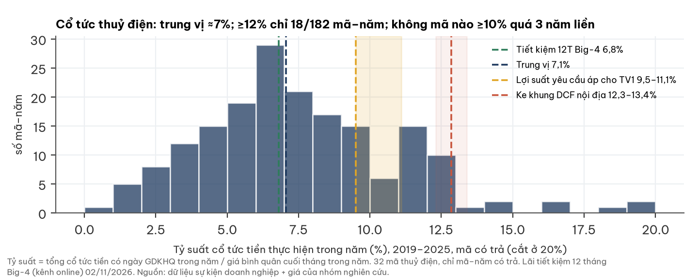

# TV1 — CTCP Tư vấn Xây dựng Điện 1 (EVNPECC1): giá điện Sông Bung 5 hạ bậc từ 2027 sẽ cắt gần một nửa lợi nhuận, nhưng theo mặt bằng thuỷ điện niêm yết, giá 19.800 đ đã phản ánh điều đó — giá nằm trong vùng giá trị 18.200–22.000 đ, hoà vốn ở giá điện ≈515–540 đ/kWh

**Báo cáo Due Diligence · 02/11/2026 · Nhóm nghiên cứu** · UPCOM · Thuỷ điện và tư vấn khảo sát–thiết kế điện · số liệu tỷ đồng trừ khi ghi khác · dữ liệu đến 02/11/2026

## Investment Summary

**Giá 19.800 đ (đóng cửa 30/10/2026) nằm TRONG vùng giá trị hợp lý 18.200–22.000 đ/cp (ước lượng), thấp hơn tâm ≈20.700 khoảng 4%.** Biến quyết định là **giá bán điện Sông Bung 5 sau mốc hạ bậc 2027** (chưa có văn bản; lãnh đạo nêu 500–600 đ/kWh). Bội số và lợi suất yêu cầu được hiệu chuẩn bằng **32 công ty thuỷ điện niêm yết, 2019–2026** (mục 7). Giá hiện tại ngang giá trị nếu giá điện ròng mới **≈515–540 đ/kWh** — nằm trong dải lãnh đạo nêu — và công ty không bị cấm thầu.

| Dữ liệu chính | Giá trị | Ghi chú |
|---|---|---|
| Giá · vốn hoá | **19.800 đ** · 528,5 tỷ | DNSE, đóng cửa 30/10/2026; 26,69 tr cp; tham chiếu 02/11 = 20.000 đ (kết luận không đổi) |
| Vùng giá trị hợp lý · tâm | **18.200–22.000 · ≈20.700 đ** | P/E 6,8–8,0x trên lợi nhuận bền 2027+ và chiết khấu cổ tức ở lợi suất yêu cầu 9,5–11,1%; 4 kịch bản giá điện (ước lượng) |
| Căn cứ bội số | thuỷ điện UPCOM 2026: P/E trung vị **8,6x** (p25 7,8x); toàn nhóm 9,2x | × 0,87 vì TV1 chi trả thấp (mục 7) |
| Căn cứ lợi suất yêu cầu | tỷ suất cổ tức thuỷ điện: trung vị **7,1%**/năm (2019–25); lợi suất tổng ngầm định 9,5–11,1% | tiết kiệm 12T Big-4 6,8%; TPCP 10 năm 4,58% |
| Giá điện Sông Bung 5 ròng 2025 · sau 2027 | ≈949 đ/kWh · **chưa xác định** (lãnh đạo: 500–600; văn bản 2018: bậc sau ≈340) | thuỷ điện tạo 67% lãi gộp 2025 |
| LNST bền 2027+ ở giá 500–600 | **≈65–82 tỷ** (2025: 150,2; KH 2026: 104,2) | không cấm thầu (ước lượng) |
| Cổ tức FY2025 · lợi suất · tỷ lệ chi trả | 1.500 đ · 7,6% · 27% LNST | KH FY2026: 10% mệnh giá |
| Tiền + tiền gửi · vay · tiền ròng điều chỉnh | 198,5 · 129,9 · **≈ −39** | vay chủ yếu từ cá nhân (118,8) |
| Thanh khoản 20 phiên | trung bình 0,72 · trung vị 0,41 tỷ/phiên | biên độ UPCOM ±15% |

## Ba điều cần biết

1. **Giá điện Sông Bung 5 hạ bậc là biến lớn nhất, có bằng chứng cùng chiều nhưng chưa có mức:** hồ sơ bán nhà máy 2018 ghi giá hai bậc (569 → 244 đ/kWh); báo cáo thường niên 2025 viết giá điện nhà máy “sụt giảm”; lãnh đạo nêu 500–600 đ/kWh từ 2027.
2. **Thị trường đã định giá phần lớn cú cắt:** TV1 giao dịch ở P/E ≈4x lợi nhuận hiện tại, so 8,6x của thuỷ điện UPCOM. Ở 19.800 đ, P/E ngầm định trên lợi nhuận bền sau hạ bậc là 6,5x (giá 600) – 8,1x (giá 500) — sát dải 6,8–8,0x áp cho TV1 theo ngành.
3. **Cổ đông thiểu số nhận ít qua cổ tức hơn ngành:** TV1 chi trả 27% (ngành ≈76%) và trích 20% vào quỹ; giá trị còn lại nằm ở tiền tích luỹ. Rủi ro pháp lý (cấm thầu EVN) là đuôi xấu thứ hai.

| Điều làm nhận định đổi | Điều kiện | Kiểm tại |
|---|---|---|
| Tích cực hơn | **Văn bản** giá điện ròng sau 2027 ≥≈600 đ/kWh (hoặc 500–600 là giá cố định chưa gồm vận hành), mốc hạ lùi ≥2 năm; cam kết chi trả ≥50%; điện mặt trời lòng hồ có giá bán + vốn không pha loãng; bán Sông Bung 5 ≥1.000 tỷ; vụ án kết thúc không cấm thầu | BCTC kiểm toán 2026 (~03/2027), ĐHĐCĐ 2027 (~04/2027), BCTC Q1/2027 |
| Tiêu cực hơn | Văn bản giá ≤500 hoặc gần 340 đ/kWh; quyết định cấm thầu EVN; kiểm toán ngoại trừ; đầu tư ≈800 tỷ điện mặt trời bằng vay/phát hành khi chưa có giá bán; cổ tức FY2026 <1.500 đ; văn bản truy thu phần giá điện đã trả | cùng mốc; vụ án: khi có kết luận |

## 1. Tóm tắt điều hành

**Nhà máy thuỷ điện hết nợ cộng mảng tư vấn đang tăng; nguồn lãi chính sắp mất 35–50% giá bán, và giá cổ phiếu đã điều chỉnh tương ứng.**

- **Tình huống:** 9T/2026 doanh thu 446,9 tỷ (+14%), LNST 124,6 tỷ (+44%); quý 3 lãi 66,9 tỷ — đều ở giá điện cũ.
- **Vấn đề:** giá điện hạ bậc từ 2027 (chưa có văn bản); lợi nhuận bền ≈43–55% mức 2025; lãnh đạo bị khởi tố.
- **Trả lời:** vùng giá trị 18.200–22.000 đ, tâm ≈20.700; giá 19.800 đ tương ứng giá điện ròng ≈515–540 đ/kWh, không cấm thầu.

## 2. Thị trường đang định giá gì

**Ở 19.800 đ, thị trường định giá như thể giá điện mới ≈515–540 đ/kWh và công ty không bị cấm thầu — giữa dải lãnh đạo nêu.**

| Phép định giá ngược (ước lượng) | Giá trị |
|---|---|
| Giá điện ròng hoà vốn (không cấm thầu, đúng mốc 2027, sản lượng 205 tr kWh): chân P/E 7,42x · tâm hai phương pháp · riêng cổ tức | **≈540 · ≈515 · ≈480 đ/kWh** (2025: ≈949) |
| P/E ngầm định của giá 19.800 trên LNST bền 2027+ ở 600 / 500 đ/kWh | **6,5x / 8,1x** (thuỷ điện UPCOM 2026: p25 7,8x, trung vị 8,6x) |
| Cổ tức cần có để biện minh giá (lợi suất yêu cầu 9,5–11,1%, không tăng trưởng) | 1.880–2.200 đ/năm; thực trả FY2025 1.500 đ |
| Giá so giá trị tài sản (SOTP trộn rủi ro pháp lý ≈25.900) | 0,76 lần — chiết khấu 24%, trong thông lệ 20–40% cho cổ đông thiểu số/holding |

## 3. Ngành: nhu cầu tư vấn điện đi lên, nhịp giải ngân do hành chính quyết định

**Người đọc ngành độc lập xếp nhu cầu tư vấn điện vào chu kỳ đi lên mang tính cấu trúc, nhưng tiến độ phụ thuộc phê duyệt.**

| Yếu tố ngành (đọc độc lập, 28/10/2026) | Trạng thái | Ảnh hưởng TV1 |
|---|---|---|
| Quy hoạch điện VIII điều chỉnh | khối lượng nguồn + lưới lớn đến 2030 | cầu tư vấn tăng |
| Vốn đầu tư EVN 2026 | kế hoạch ≈123 nghìn tỷ, đi ngang; H1 giải ngân 36% | nhịp ghi nhận chậm |
| Dự án khí LNG | 16/18 có nhà đầu tư, 2 khởi công | trượt tiến độ |
| Rủi ro chính | phải thu và nhịp ghi nhận; hình sự hoá làm cán bộ ngại ký | trùng rủi ro của TV1 |

- Khách hàng tăng trưởng 2026 của TV1 là các ban quản lý dự án truyền tải (EVNNPT) — đúng khối nơi xảy ra vụ án.

## 4. Doanh nghiệp: một nhà máy thuỷ điện và một công ty tư vấn điện lâu năm

**EVNPECC1 vừa vận hành thuỷ điện Sông Bung 5, vừa khảo sát–thiết kế công trình điện cho EVN; EVN nắm 54,34%.**

| Mảng (năm 2025) | Doanh thu | Lãi gộp | Đặc điểm |
|---|---|---|---|
| Thuỷ điện Sông Bung 5 (57 MW, 100%) | 261,6 | 165,1 (67%) | bán cho Công ty Mua bán điện; thuê đất đến 08/2059 |
| Tư vấn khảo sát–thiết kế | 447,0 | 80,8 | khách hàng chủ yếu là đơn vị EVN |

- Công ty con MTV3 (Đà Nẵng) sáp nhập vào công ty mẹ theo hợp đồng 08/10/2026 — không đổi số hợp nhất.
- Sông Bung 5 đã đấu giá ≥5 lần (01/2019 → 05/2021, khởi điểm 1.688 → 1.351,7 tỷ), không có người đăng ký; một công ty chứng khoán (04/2026) quy cho “rủi ro điều chỉnh giá bán trong tương lai”.
- **Hợp đồng bán điện giá cố định hai bậc:** bậc cao trong kỳ trả nợ dự án (tất toán 31/03/2025), bậc sau thấp hơn nhiều. Thuế tài nguyên và phí môi trường rừng do bên mua trả thêm ngoài giá.

Ảnh: banner trang chủ pecc1.com.vn, minh hoạ các lĩnh vực tư vấn; không xác định là công trình cụ thể. Ảnh thuỷ điện **không phải** Sông Bung 5 hay tài sản của công ty.

## 5. Tài chính dựng từ dưới lên

### 5a. Doanh thu và lợi nhuận theo quý

**Doanh thu theo mùa nước; quý 4 thường là quý lớn nhất của thuỷ điện.**

- Biên gộp quý 3: 38,9% báo cáo; **35,5% nếu bỏ hoàn nhập dự phòng tồn kho 5,7** (Q3/25: 34,4%).
- Chi phí quản lý doanh nghiệp quý 3 gấp đôi (21,5 so 10,6), chưa thuyết minh.

### 5b. Chất lượng lợi nhuận

**Lợi nhuận lõi quý 3 là 16–45 tỷ hoặc 31–45 tỷ, tuỳ hoàn nhập dự phòng được ghi vào đâu; chưa đủ cơ sở để chọn.**

| Trường hợp | Hoàn nhập phải thu 19,2 tỷ ghi vào | Lãi lõi quý 3 | 9 tháng so cùng kỳ | Phần chưa giải thích |
|---|---|---|---|---|
| (A) | chi phí quản lý (chuẩn mực thông thường) | 16–45 | −17%…+15% | cả 31,9 khác ròng; chi phí quản lý trước hoàn nhập ≈40,7 (≈3,9× bình quân quý H1) |
| (B) | thu nhập khác | 31–45 | 0%…+15% | ≈16 |

- **Cờ:** dự phòng giảm 24,9 tỷ trong quý 3; dòng tiền ghi nhận ≈21,5 tỷ là phi tiền mặt; dự phòng khách hàng đầu năm trong thuyết minh Q3 (63,2) lệch 26,7 tỷ so BCTC 2025 kiểm toán (89,9).
- BCTC quý 3 chưa soát xét, bản scan; không có báo cáo bộ phận, không có giao dịch bên liên quan; thuế hiệu dụng 13,1%.

### 5c. Dòng tiền và tiền ròng

**Dòng tiền kinh doanh khớp lợi nhuận lõi; sau các nghĩa vụ đã biết, tiền ròng hơi âm.**

- Vay dự án dài hạn còn 0,41 tỷ; vay ngắn hạn chủ yếu từ cá nhân, một phần đang tranh chấp tại toà.
- Phải thu khách hàng gộp 387,5 tỷ, thấp hơn đầu năm (408,2).

## 6. Giá cổ phiếu và sự kiện

**Giá giảm 46% từ đỉnh tháng 3/2026 và đi ngang 18.000–20.500 đ từ giữa tháng 7.**

- Quan sát, không phải nhân quả: khoảng 3/4 mức giảm từ đỉnh diễn ra trước ngày khởi tố 07/05/2026.
- Phiên 30/10 (sau BCTC quý 3): +4,8% với 156.400 cổ phiếu (≈3,1 tỷ), ≈7,5 lần trung vị 20 phiên.

## 7. So sánh ngành (peer): thuỷ điện niêm yết

**32 công ty thuỷ điện niêm yết giao dịch ở P/E trung vị 9,2x (UPCOM 8,6x) và trả cổ tức ≈7%/năm; TV1 rẻ hơn rõ ở lợi nhuận hiện tại, ngang dải ngành ở lợi nhuận sau hạ bậc.**

| Nhóm (2026, trung vị) | Số mã | P/E | P/B | Tỷ suất cổ tức 12T | ROE | Chi trả FY2025 |
|---|---|---|---|---|---|---|
| Thuỷ điện — toàn nhóm | 32 | **9,2x** | 1,9x | 7,9% | 20,6% | 76% |
| Thuỷ điện — HOSE | 12 | 9,9x | 1,9x | 9,6% | 18,8% | 90% |
| Thuỷ điện — HNX | 6 | 9,4x | 1,6x | 9,6% | 18,6% | 79% |
| Thuỷ điện — UPCOM | 14 | **8,6x** (p25 7,8x) | 1,9x | 6,0% | 21,4% | 55% |
| Nhiệt điện | 9 | 9,1x | 0,8x | 4,9% | 8,3% | 30% |
| **TV1** | — | **4,0x** (lợi nhuận giá điện cũ) | 1,1x | 7,6% (FY2025) | 29,4% (gồm khoản một lần Q3) | 27% |

- **Thanh khoản thấp không làm P/E thấp hơn trong nhóm này:** mã GTGD <0,05 tỷ/phiên P/E 11,1x; >0,3 tỷ 9,1x (2023–2026). UPCOM thấp hơn HOSE ≈8–15%.
- **Chi trả thấp thì P/E thấp hơn:** thuỷ điện chi trả <50% giao dịch 9,1x so 10,5x toàn mẫu (2021–2026) ⇒ hệ số 0,87 áp cho TV1.
- Ca lợi nhuận giảm mạnh hơn nhóm (11 ca, 2019–2025) phần lớn hồi phục (thuỷ văn); thị trường nhìn xuyên (P/E năm sau ≈24x) — không dùng làm bội số vì giá điện TV1 giảm vĩnh viễn.

- **Tỷ suất ≥10–12% không bền:** ≥12% chỉ 18/182 mã–năm; chuỗi ≥10% dài nhất 3 năm (1 mã). Hiện (12T đến 11/2026) mã có trả ở trung vị 9,5% do giá ngành giảm năm 2026.
- **Lợi suất yêu cầu ngầm định 9,5–11,1%:** mã cổ tức ổn định (7 mã) 7,8% + tăng trưởng 3,3% ≈11,1%; hồi quy giá–cổ tức 10,4%; tỷ suất hiện tại 9,5%.

## 8. Định giá

**Hai phương pháp đồng hạng, giả định hiệu chuẩn theo ngành: vùng giá trị 18.200–22.000 đ, tâm ≈20.700; giá 19.800 đ trong vùng.**

| Kịch bản giá điện ròng 2027+ | Xác suất (ước lượng) | Căn cứ | LNST bền (không / có cấm thầu) | P/E 7,42x (không / có cấm thầu) | Cổ tức chiết khấu, chi trả 27% / 40% |
|---|---|---|---|---|---|
| (a) giữ ≈975 đ/kWh | 10% | ngược với BCTN 2025 và lời lãnh đạo | 143 / 118 | **39.200** / 31.400 | 38.300 / 39.300 |
| (b) 600 đ/kWh | 45% | lời lãnh đạo (500–600), chưa có văn bản | 82 / 57 | **22.500** / 14.700 | 24.000 / 24.500 |
| (c) 500 đ/kWh | 35% | như (b) | 65 / 40 | **18.000** / 10.200 | 20.100 / 20.600 |
| (d) ≈340 đ/kWh | 10% | hồ sơ 2018 (bậc 243,66 + vận hành ≈95); chưa từng được áp | 39 / 14 | **10.900** / 3.100 | 14.000 / 14.300 |
| **Kỳ vọng** (cấm thầu 30%; mốc hạ lùi 2 năm 15%) | | | | **19.600** (12.400–24.400) | **21.500 / 22.000** |

- **(i) P/E 6,8–8,0x (trung tâm 7,42x)** trên lợi nhuận bền 2027+, cộng tiền ròng cuối 2027 = P/E thuỷ điện UPCOM 2026 (p25 7,83x; trung vị 8,55x; toàn nhóm 9,22x) × 0,87. Kiểm chéo hồi quy mô tả (sàn, thanh khoản, quy mô, chi trả, ROE): 7,5–8,3x.
- **(ii) Chiết khấu cổ tức** 10 năm (2026: 1.000–2.000 đ; sau đó chi trả × lợi nhuận), lợi suất yêu cầu 9,5–11,1% (mục 7); tiền giữ lại hưởng lãi ≈5%/năm, tính theo sổ ở năm 10; giá trị cuối kỳ = 7,42x lợi nhuận hoạt động.
- **Vùng** = thấp nhất–cao nhất của hai phương pháp (P/E 6,8x 18.200; cổ tức chi trả 40% 22.000) ⇒ **18.200–22.000 đ**, tâm ≈20.700.

| Độ nhạy (ước lượng; tâm hai phương pháp hoặc P/E · cổ tức 40%) | Giá trị (đ/cp) |
|---|---|
| Lợi suất yêu cầu 8% · 10,4% · 13% (khung DCF nội địa 12,3–13,4%) | 23.200 · 20.700 · 18.500 |
| P/E 6,0x · 7,42x · 9,22x (toàn nhóm, không điều chỉnh chi trả) | 18.300 · 20.700 · 23.600 |
| Sản lượng giữa 175 / 237 tr kWh | 15.800–18.600 / 23.600–25.500 |
| Bi quan (giá 5/30/40/25%, cấm thầu 40%) · lạc quan (25/45/25/5%, không cấm thầu) | 16.100–18.900 · 25.400–27.000 |
| Giá trị cuối kỳ bảo thủ (≤0,6 lần vốn chủ hoạt động) · quỹ khen thưởng 20% (giả định ngành trích 7%) | cổ tức 16.500–17.000 · P/E 17.200 |

- Dải hai chiều 15.800–27.000 bao quanh giá; giá điện ròng ≥≈540 đ/kWh: cả hai phương pháp cho giá trị cao hơn giá; <≈480: cả hai thấp hơn giá (không cấm thầu, sản lượng 205).
- **SOTP** (thuỷ điện DCF 2027–2059 + tư vấn − nợ): kỳ vọng ≈28.000 (trộn pháp lý ≈25.900); tâm 20.700 = chiết khấu ≈20%. Sông Bung 5 đã đấu giá ≥5 lần không có người mua.
- Điện mặt trời lòng hồ (46 MWp + 5 MW lưu trữ, ≈800 tỷ): chưa vào quy hoạch, chưa có giá bán ⇒ **không tính**.

**Bối cảnh lãi suất (tham khảo):** mức chiết khấu thị trường chung đang ngầm định 15,1% (147 mã, 30/10/2026; phân vị 75% từ 2014); thuỷ điện niêm yết ngầm định thấp hơn (9,5–11,1%). TPCP 10 năm 4,58% (30/10/2026).

## 9. Rủi ro — pre-mortem

**Rủi ro lớn nhất là giá điện Sông Bung 5 sau 2027; tiếp theo là pháp lý và kiểm toán.**

| Rủi ro | Xác suất | Tác động | Dấu hiệu sớm | Ngày kiểm |
|---|---|---|---|---|
| **Giá điện Sông Bung 5 ≤600 đ/kWh từ 2027** | **cao (0,75)** | **rất cao** (LNST bền −45…−57% so 2025; đã nằm trong vùng giá trị) | doanh thu thuỷ điện/sản lượng Q1/2027; thuyết minh BCTC kiểm toán 2026 | 03–04/2027 |
| Cấm thầu EVN 3–5 năm / buộc nộp lợi bất chính | thấp–TB (0,30) | cao | kết luận điều tra, cáo trạng | khi công bố |
| Kiểm toán 2026 ngoại trừ/từ chối | thấp–TB (0,35) | cao | đổi kiểm toán, chậm công bố | 03/2027 |
| Khoản 33,8 tỷ bị đảo | TB | TB | BCTC kiểm toán điều chỉnh | 03/2027 |
| El Niño cắt thuỷ điện | TB | thấp (chỉ 2026) | thuế tài nguyên Q4 thấp | 01/2027 |
| Lợi nhuận bị giữ lại, cổ tức không tăng | TB | TB | kế hoạch cổ tức 2026 = 1.000 đ | 04/2027 |
| Phán quyết vay cá nhân vượt sổ (gốc 64,4 + lãi 42,1 đã ghi) | thấp | TB | bản án | khi có |
| Truy thu phần giá điện trả cao hơn biểu giá 2018 (2022–2026) | thấp (chưa lượng hoá) | rất cao (≈415 tỷ trước thuế nếu áp hồi tố đủ) | kết luận thanh tra/kiểm toán hợp đồng; tiền lệ một thuỷ điện khác (ký lại giá 2022, chưa thấy truy thu) | khi có |
| Thanh khoản mỏng | cao | thấp–TB | — | liên tục |

## 10. Pháp lý & quản trị — WARNING (mức cao, không chặn phân tích)

**Vụ án có tội danh kế toán ⇒ rủi ro gồm tư cách nhà thầu và độ tin cậy số liệu quá khứ; kênh tác động lên công ty là cấm thầu và buộc nộp lợi bất chính.**

| Hạng mục | Nội dung (có nguồn) | Đánh giá |
|---|---|---|
| Vụ án EVNNPT/PC1 | 07/05/2026 khởi tố, tạm giam Chủ tịch HĐQT và phó phòng tài chính–kế toán; tội danh gồm đấu thầu, **kế toán**, tham ô, hối lộ | chưa kết luận |
| VnExpress 02/07/2026 | “13 công ty bị xác định có liên quan”, gồm “các công ty CP tư vấn xây dựng điện 1, 2, 3, 4”; “nhà thầu… cũng có vi phạm”; 47 **người** bị khởi tố, không nêu pháp nhân. The Investor ghi “ít nhất 13 lãnh đạo và nhân viên” — hai nguồn không khớp | TV1 có tên; hậu quả chưa rõ |
| Khung pháp lý (tham khảo, cần luật sư xác nhận) | Điều 76 BLHS không gồm 5 tội danh ⇒ pháp nhân không bị truy cứu hình sự; kênh thực tế: **cấm thầu 6 tháng–5 năm** (Luật Đấu thầu 2023; NĐ 214/2025 Điều 133), **buộc nộp lợi bất chính/bồi thường** | cấm thầu EVN = rủi ro doanh thu lớn nhất |
| Soát xét H1/2026 (An Việt) | chấp nhận, **hai đoạn nhấn mạnh**: 127,63 tỷ nợ vay + lãi cá nhân đang kiện; việc bắt tạm giam hai cá nhân | không phải ngoại trừ |
| Kiểm toán | đã ký An Việt kiểm toán 2026 (18/08/2026); 2025 A&C chấp nhận toàn phần | đã có kiểm toán viên |
| Dấu hiệu nhỏ cùng chiều | điều chỉnh vốn chủ trực tiếp +8,9 tỷ (H1); thu nhập khác 33,8 tỷ không thuyết minh; dự phòng lệch thuyết minh (Q3) | theo dõi, không chứng minh sai phạm |

- Phạm vi tra cứu: BCTC, CBTT công ty và tin tức đến 02/11/2026; “không thấy” không có nghĩa là không có.

## 11. Mốc kiểm chứng hai chiều

| # | Mốc | Ngày | Chiều tích cực | Chiều tiêu cực | Xác suất tích cực |
|---|---|---|---|---|---|
| **M0** | **Văn bản giá điện Sông Bung 5 sau 2027** (CBTT, BCTC kiểm toán 2026, ĐHĐCĐ 2027, doanh thu Q1/2027) | ≈03–04/2027 | ≥≈540 đ/kWh ròng, hoặc 500–600 là giá cố định chưa gồm vận hành, hoặc mốc lùi ≥2 năm | <≈480 (≈340 là xấu nhất) | **≈0,55** |
| M1 | LNST hợp nhất Q4/2026 (giá điện cũ) | ≈30/01/2027 | ≥45 tỷ | <25 tỷ | 0,50 |
| M2 | Doanh thu thuỷ điện Q4/2026 | ≈30/01/2027 | ≥100 tỷ | <80 tỷ | 0,45 |
| M3 | Thuyết minh khoản 33,8 tỷ | ≈31/03/2027 | có căn cứ, giữ nguyên | bị đảo/điều chỉnh | 0,60 |
| M4 | Ý kiến kiểm toán 2026 | ≈31/03/2027 | chấp nhận toàn phần | ngoại trừ/từ chối/đổi | 0,65 |
| M5 | Kết luận vụ án / cấm thầu | khi công bố | không cấm thầu, không buộc nộp | cấm thầu EVN / buộc nộp lớn | 0,70 |
| M6 | Cổ tức FY2026 | ≈04/2027 | ≥2.000 đ hoặc cam kết chi trả ≥50% | <1.500 đ | 0,35 (KH 10%; KH FY2025 6%, thực trả 15%) |
| M7 | Phải thu khách hàng gộp | ≈30/01/2027 | ≤390 tỷ | >430 tỷ | 0,60 |
| M8 | Điện mặt trời lòng hồ | khi có chủ trương | giá bán + vốn không pha loãng | ≈800 tỷ bằng vay/phát hành khi chưa có giá bán | 0,30 |

## Phụ lục A — Số BCTC chính và lưới định giá (tỷ đồng)

| Chỉ tiêu | Q3/26 | Q3/25 | 9T/26 | 9T/25 |
|---|---|---|---|---|
| Doanh thu thuần | 168,1 | 149,3 | 446,9 | 390,6 |
| Biên gộp | 38,9% | 34,4% | 36,4% | 37,4% |
| Chi phí quản lý · EBIT lõi | 21,5 · 44,0 | 10,6 · 40,8 | 42,4 · 120,1 | 27,5 · 118,6 |
| Tài chính ròng · khác ròng | +1,1 · **+31,9** | −2,4 · −4,4 | −1,3 · +31,7 | −7,5 · −4,6 |
| LNTT · thuế hiệu dụng | 77,0 · 13,1% | 34,0 · 21,4% | 150,5 · 17,2% | 106,5 · 18,9% |
| LNST báo cáo · lõi (ước lượng; A / B) | 66,9 · 16–45 / 31–45 | 26,8 · ≈30,7 | 124,6 · ≈74–103 / 89–103 | 86,4 · ≈88,9 |
| CFO | ≈69,8 | | 116,8 | 137,6 |
| 30/09/26: tiền · tiền gửi đến hạn · vay · VCSH | 30,7 · 167,8 · 129,9 · 574,7 | | | |

| Giá trị theo kịch bản × P/E (đ/cp; không cấm thầu, đúng mốc 2027, lợi suất yêu cầu 10,4%; đã cộng tiền ròng cuối 2027, cổ tức 2026) | 6,0x | 6,8x | 7,42x | 8,0x | 9,22x |
|---|---|---|---|---|---|
| (d) ≈340 đ/kWh · LNST bền ≈39 tỷ | 9.100 | 10.100 | 10.900 | 11.600 | 13.200 |
| (c) 500 đ/kWh · ≈65 tỷ | 15.000 | 16.700 | 18.000 | 19.300 | 21.900 |
| (b) 600 đ/kWh · ≈82 tỷ | 18.700 | 20.800 | 22.500 | 24.100 | 27.400 |
| (a) giữ giá cũ · ≈143 tỷ | 32.500 | 36.300 | 39.200 | 42.000 | 47.800 |

## Phụ lục B — Đối chiếu dữ liệu thị trường với BCTC

- Dữ liệu tài chính tổng hợp chưa có quý 3/2026 tại 02/11; Q1+Q2/2026 (57,76 tỷ) khớp LNST H1 soát xét (57,759).
- “Tiền” trong dữ liệu tổng hợp thiếu tiền gửi nắm giữ đến hạn; phải thu “≈295 tỷ” là khái niệm khác với phải thu khách hàng gộp 387,5 của BCTC.
- Tỷ suất cổ tức 12 tháng của TV1 tại 11/2026 hiển thị ≈10,8% vì hai đợt (600 đ FY2024, GDKHQ 11/12/2025; 1.500 đ FY2025, GDKHQ 07/10/2026) rơi trong cùng 12 tháng; báo cáo dùng 7,6% (FY2025).

## Phụ lục C — Nguồn

- BCTC hợp nhất và riêng Q3/2026 (ký 29/10/2026, chưa soát xét); BCTC bán niên 2026 (An Việt soát xét); BCTC 2025 kiểm toán (A&C); công văn giải trình 6603/TVĐ1-P3; CBTT kiểm toán 2026, cổ tức 2025, sáp nhập MTV3 — pecc1.com.vn.
- Giá: DNSE (đóng cửa 30/10/2026; tham chiếu 02/11/2026). Lịch sử giá, P/E, P/B, lợi nhuận quý, cổ tức tiền theo sự kiện doanh nghiệp: cơ sở dữ liệu thị trường của nhóm (truy vấn, dữ liệu và mã tính lưu cùng báo cáo).
- So sánh ngành: 32 công ty thuỷ điện + 9 nhiệt điện thuộc ngành điện truyền thống, giao dịch năm 2026; phân loại thuỷ/nhiệt theo tên doanh nghiệp; sàn theo sự kiện niêm yết/chuyển sàn và biên độ giá. Lãi tiết kiệm 12 tháng Big-4 (kênh online) 6,8%, chứng chỉ tiền gửi 12 tháng 7,4%: khảo sát báo chí 02/11/2026.
- Vụ án: VnExpress 02/07/2026 (https://vnexpress.net/47-nguoi-bi-khoi-to-trong-vu-an-tai-tong-cong-ty-truyen-tai-dien-quoc-gia-5092437.html); The Investor. Khung pháp lý: BLHS (Điều 76; Luật 86/2025), Luật Đấu thầu 22/2023, NĐ 214/2025 — tra cứu tham khảo. Ngành: người đọc ngành độc lập 28/10/2026.
- Giá điện Sông Bung 5: PECC1, “Báo cáo phương án bán toàn bộ tài sản NMTĐ Sông Bung 5”, 8/2018, tr.13; BCTN 2025 tr.38 (nêu giá điện “sụt giảm”, không nêu mức/mốc); KBSV 17/04/2026 tr.4 (dẫn lời lãnh đạo; bản gốc chưa đọc được); đấu giá Sông Bung 5: baodauthau.vn 17/05/2021; tiền lệ giá điện thuỷ điện khác: vnbusiness.vn; ĐHĐCĐ 2026 và điện mặt trời lòng hồ: baodauthau.vn 30/04/2026, 27/06/2025.
- Logo và ảnh: pecc1.com.vn (02/11/2026). Toạ độ: Global Energy Monitor wiki; OpenStreetMap Nominatim; geoBoundaries VNM-ADM1 (2008). Vị trí gần đúng.

## Phụ lục D — Phương pháp và giới hạn

- **Bốn kịch bản giá điện** (≈975 / 600 / 500 / ≈340 đ/kWh ròng), xác suất 10/45/35/10% (phán đoán theo chứng cứ mục 4); cấm thầu EVN 30%; mốc hạ lùi 2 năm 15%.
- Lợi nhuận thuỷ điện = (sản lượng × giá ròng − vận hành 25 − khấu hao 38 − chung 8) × 80%, hiệu chuẩn bằng báo cáo bộ phận 2025 kiểm toán. Sản lượng 175/205/210 tr kWh. Tư vấn 30–50 tỷ (cấm thầu: 10–20 + khoản một lần 30 tỷ). Tiền ròng hưởng lãi 5%/năm trước thuế.
- **Bội số:** P/E trailing trung vị theo mã–năm (phiên cuối tháng, loại ≤0 và ≥60), thuỷ điện UPCOM 2026 (14 mã) và toàn nhóm (32 mã); hệ số chi trả 0,87 = P/E mã–năm chi trả <50% / toàn mẫu 2021–2026 (2024–2026: 0,79 — độ nhạy P/E 6,75x ⇒ tâm ≈19.600).
- **Lợi suất yêu cầu:** (1) mã cổ tức ổn định (có trả ≥6/7 năm 2019–2025, biến thiên cổ tức ≤35%): tỷ suất 2021–25 + tăng trưởng cổ tức; (2) hồi quy giá = b × cổ tức qua gốc (182 mã–năm); (3) tỷ suất 12 tháng hiện tại. Khung DCF nội địa (β≈1,1) 12,3–13,4% chỉ ở độ nhạy.
- Giới hạn: giá điện sau 2027 chưa có văn bản; nhóm so sánh nhỏ, mã–năm không độc lập (thống kê mô tả, không suy diễn thống kê); không có ca cắt giá bán vĩnh viễn được xác nhận trong nhóm so sánh; tỷ lệ trích quỹ khen thưởng của ngành chưa đo (giả định 7% ở độ nhạy); điện mặt trời lòng hồ không định giá; BCTC Q3 chưa soát xét; xác suất kịch bản là phán đoán; khung pháp lý chưa có ý kiến luật sư.

## Phụ lục E — Quy trình độc lập

Báo cáo qua các bước: đối chiếu BCTC gốc (bán niên soát xét, năm kiểm toán) → người đọc ngành độc lập (không biết mã, giá) → nhóm nghiên cứu dựng định giá từ báo cáo bộ phận → hiệu chuẩn bội số và lợi suất yêu cầu bằng dữ liệu thị trường của nhóm công ty thuỷ điện niêm yết → người phản biện độc lập kiểm số liệu, nguồn và độ cân bằng lập luận. Mọi phép tính tái lập được từ truy vấn và mã lưu cùng báo cáo. Giới hạn dữ liệu nêu ở Phụ lục D.

## Phụ lục F — Tuyên bố miễn trừ trách nhiệm

Tài liệu này chỉ nhằm mục đích cung cấp thông tin nghiên cứu, không phải lời khuyên, chào mời hay khuyến nghị mua, bán hoặc nắm giữ bất kỳ chứng khoán nào, và không tính đến mục tiêu, tình hình tài chính hay nhu cầu của bất kỳ cá nhân nào. Thông tin dựa trên nguồn công khai được cho là đáng tin cậy nhưng không được bảo đảm về độ chính xác hay đầy đủ; các ước lượng, kịch bản và xác suất là đánh giá tại thời điểm 02/11/2026 và có thể thay đổi mà không cần thông báo. Hiệu quả trong quá khứ không bảo đảm kết quả tương lai. Nhà đầu tư cần tự đánh giá và tham khảo tư vấn chuyên môn trước khi ra quyết định. Logo và hình ảnh thuộc quyền của doanh nghiệp, chỉ dùng để nhận diện, không hàm ý doanh nghiệp tài trợ hay xác nhận báo cáo.
