# TV1 — CTCP Tư vấn Xây dựng Điện 1 (EVNPECC1): tư vấn điện đang tăng và cổ tức 2025 đạt 7,6%, nhưng giá điện Sông Bung 5 sắp hạ bậc từ 2027 kéo lợi nhuận bền vững về ≈65–82 tỷ, nên giá 19.800 đ cao hơn vùng giá trị cân bằng 13.900–18.100 đ (≈+25% so tâm) — chỉ ngang giá trị nếu giá điện mới ≥≈590 đ/kWh

**Báo cáo Due Diligence · 02/11/2026 · Nhóm nghiên cứu** · UPCOM · Thuỷ điện và tư vấn khảo sát–thiết kế điện · số liệu tỷ đồng trừ khi ghi khác

**BẢN ĐÍNH CHÍNH LẦN 2 — thay bản đính chính gửi 02/11/2026 15:25 (bản đó thay bản 11:55).** Kết luận đổi từ “giá từ ngang đến cao hơn giá trị ≈10%, vùng 17.800–20.600 đ” sang **“giá cao hơn vùng giá trị cân bằng 13.900–18.100 đ, tâm ≈15.900”**. Lý do là lỗi phương pháp: bản trước tính lợi nhuận bền vững trên **giá điện Sông Bung 5 hiện tại**, trong khi đã có bằng chứng giá này hạ bậc từ 2027. Bản dựng lại đã qua một vòng phản biện độc lập; vòng đó chỉ ra một bản nháp nghiêng quá về phía bi quan (tiền tích luỹ bị định giá thấp, bội số chiết khấu rủi ro hai lần) — bản này đã sửa cả hai chiều và chưa qua vòng phản biện kế tiếp. Chi tiết: Phụ lục E.

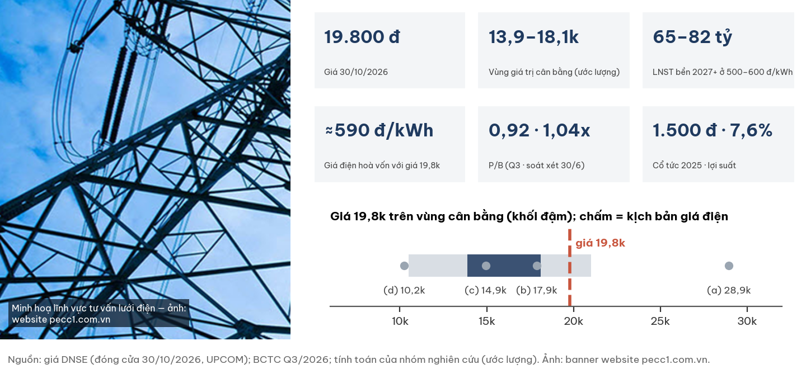

## Investment Summary

**Giá 19.800 đ (đóng cửa 30/10/2026) CAO HƠN vùng giá trị cân bằng 13.900–18.100 đ/cp (ước lượng): +9% đến +42%, so tâm ≈15.900 là +25%.** Biến quyết định là **giá bán điện Sông Bung 5 sau mốc hạ bậc 2027**, chưa có văn bản; lãnh đạo nêu 500–600 đ/kWh. Giá hiện tại ngang giá trị nếu giá điện ròng mới **≥≈590 đ/kWh và công ty không bị cấm thầu** — tức đầu trên của dải lãnh đạo nêu. Theo giá trị tài sản (thuỷ điện + tư vấn), giá hiện tại không đắt; theo dòng tiền cổ đông thiểu số thực nhận, giá cao hơn kỳ vọng.

| Dữ liệu chính | Giá trị | Ghi chú |
|---|---|---|
| Giá · vốn hoá | **19.800 đ** · 528,5 tỷ | DNSE, đóng cửa 30/10/2026; 26,69 tr cp; tham chiếu 02/11 = 20.000 đ |
| Vùng giá trị cân bằng · tâm | **13.900–18.100 · ≈15.900 đ** | hai phương pháp đồng hạng: P/E 6,5–7x trên lợi nhuận bền 2027+ và chiết khấu cổ tức; 4 kịch bản giá điện (ước lượng) |
| Giá điện Sông Bung 5 ròng 2025 · sau 2027 | ≈949 đ/kWh · **chưa xác định** (lãnh đạo: 500–600; văn bản 2018: bậc sau ≈340) | thuỷ điện tạo 67% lãi gộp 2025 |
| Giá điện hoà vốn với giá 19.800 đ | **≈590 đ/kWh** | P/E 6,75x, không cấm thầu, sản lượng 205 tr kWh |
| LNST bền 2027+ ở giá 500–600 | **≈65–82 tỷ** (2025: 150,2; KH 2026 của công ty: 104,2) | nếu không bị cấm thầu (ước lượng) |
| Cổ tức cần có để biện minh giá · thực trả | **2.435–2.650 đ/năm** · 1.500 đ FY2025; KH FY2026 1.000 đ | cổ tức bền 2028+ ở giá 500–600: ≈650–1.200 đ |
| Giá trị tài sản (SOTP) kỳ vọng | ≈25.900–28.000 đ | giá 19.800 = SOTP × 0,76 (chiết khấu 24%) |
| Tiền + tiền gửi · vay · tiền ròng điều chỉnh | 198,5 · 129,9 · **≈ −39** | vay chủ yếu từ cá nhân (118,8) |
| Thanh khoản 20 phiên | trung bình 0,72 · trung vị 0,41 tỷ/phiên | biên độ UPCOM ±15% |

## Ba điều cần biết

1. **Giá điện Sông Bung 5 hạ bậc là rủi ro lớn nhất, có bằng chứng cùng chiều nhưng chưa có mức:** hồ sơ bán nhà máy năm 2018 ghi giá hai bậc (569 → 244 đ/kWh, chưa gồm vận hành và phí); báo cáo thường niên 2025 viết công ty đầu tư điện mặt trời lòng hồ để duy trì doanh thu “khi giá điện của nhà máy TĐ Sông Bung 5 sụt giảm”; lãnh đạo nêu 500–600 đ/kWh từ 2027. Chưa rõ 500–600 là giá tổng hay chỉ phần giá cố định (nếu là phần cố định, giá ròng ≈595–695 và giá hiện tại nằm trong vùng giá trị).
2. **Lãi đẹp 2025–2026 là lãi ở giá điện cũ:** ở 500–600 đ/kWh, lợi nhuận thuỷ điện giảm từ ≈123 tỷ (2025) xuống ≈25–42 tỷ; lợi nhuận bền cả công ty ≈65–82 tỷ. Quý 3/2026 còn có 1/3–3/4 lãi không lặp lại hoặc chưa thuyết minh.
3. **Cổ đông thiểu số nhận giá trị chủ yếu qua cổ tức:** để biện minh 19.800 đ cần 2.435–2.650 đ/năm; ở giá điện 500–600, chi trả 27–40%, cổ tức bền ≈650–1.200 đ. Tiền giữ lại vẫn thuộc cổ đông (đã tính, kể cả lãi tiền gửi), nhưng công ty có ứng viên dùng tiền là dự án điện mặt trời ≈800 tỷ chưa có giá bán. Rủi ro pháp lý (cấm thầu EVN) là đuôi xấu thứ hai.

| Điều làm nhận định đổi | Điều kiện | Kiểm tại |
|---|---|---|
| Tích cực hơn | **Văn bản** xác nhận giá điện ròng sau 2027 ≥≈600 đ/kWh (hoặc 500–600 là giá cố định chưa gồm vận hành), hoặc mốc hạ lùi ≥2 năm; điện mặt trời lòng hồ có chủ trương + giá bán + vốn không pha loãng; cổ tức ≥2.000 đ hoặc cam kết chi trả ≥50%; bán Sông Bung 5 ≥1.000 tỷ | BCTC kiểm toán 2026 (~03/2027), ĐHĐCĐ 2027 (~04/2027), BCTC Q1/2027 |
| Tiêu cực hơn | Văn bản xác nhận giá ≤500 hoặc gần 340 đ/kWh; quyết định cấm thầu EVN; kiểm toán ngoại trừ; đầu tư ≈800 tỷ điện mặt trời bằng vay/phát hành khi chưa có giá bán; cổ tức 2026 thấp hơn mức 2025 (<1.500 đ); văn bản truy thu phần giá điện đã trả vượt | cùng mốc; vụ án: khi có kết luận |

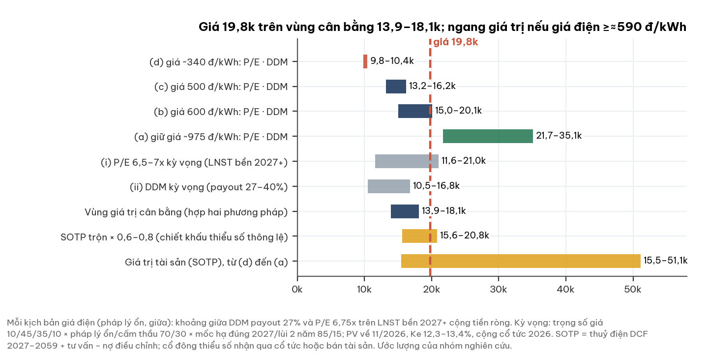

## 1. Tóm tắt điều hành

**Một doanh nghiệp có nhà máy thuỷ điện hết nợ và mảng tư vấn đang tăng, nhưng nguồn lãi chính sắp mất 35–50% giá bán — giá hiện tại đang định giá kết cục ở đầu tốt của dải.**

- **Tình huống:** 9T/2026 doanh thu 446,9 tỷ (+14%), LNST 124,6 tỷ (+44%); quý 3 lãi 66,9 tỷ, cao nhất 11 quý — tất cả ở giá điện cũ.
- **Vấn đề:** giá điện Sông Bung 5 hạ bậc từ 2027 (mức chưa có văn bản); lợi nhuận bền sau đó ≈43–54% mức 2025; lãnh đạo bị khởi tố trong vụ án có tội danh kế toán.
- **Trả lời:** vùng giá trị cân bằng 13.900–18.100 đ, tâm ≈15.900; giá 19.800 đ ngầm định giá điện ròng ≈590 đ/kWh và không cấm thầu.

## 2. Thị trường đang định giá gì

**Ở 19.800 đ, thị trường định giá như thể giá điện mới nằm ở đầu trên dải lãnh đạo nêu (≈590–600 đ/kWh) và công ty không bị cấm thầu.**

| Phép định giá ngược (ước lượng) | Giá trị |
|---|---|
| Giá điện ròng hoà vốn (P/E 6,75x, không cấm thầu, sản lượng 205 triệu kWh, cộng tiền ròng) | **≈590 đ/kWh** (2025: ≈949) |
| LNST bền 2027+ theo kịch bản giá điện 600 / 500 đ/kWh (không cấm thầu) | **≈82 / ≈65 tỷ** |
| Giá trị theo P/E 6,75x ở 600 / 500 đ/kWh (không cấm thầu) | ≈20.100 / ≈16.200 đ |
| Cổ tức cần có để biện minh giá (Ke 12,3–13,4%, không tăng trưởng) | 2.435–2.650 đ/năm (tỷ lệ chi trả cần ≈80% ở giá 600; 2025 trả 1.500 đ, 27%) |
| Giá so giá trị tài sản (SOTP trộn rủi ro pháp lý ≈25.900) | 0,76 lần — chiết khấu 24%, trong thông lệ 20–40% cho cổ đông thiểu số/holding |

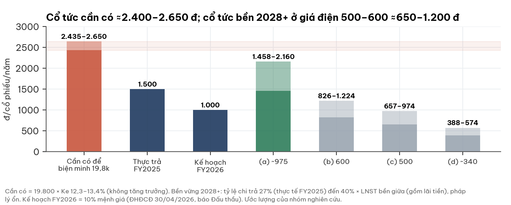

## 3. Ngành: nhu cầu tư vấn điện đi lên, nhịp giải ngân do hành chính quyết định

**Người đọc ngành độc lập xếp nhu cầu tư vấn điện vào chu kỳ đi lên mang tính cấu trúc, nhưng tiến độ phụ thuộc phê duyệt.**

| Yếu tố ngành (đọc độc lập, 28/10/2026) | Trạng thái | Ảnh hưởng TV1 |
|---|---|---|
| Quy hoạch điện VIII điều chỉnh | khối lượng nguồn + lưới lớn đến 2030 | cầu tư vấn tăng |
| Vốn đầu tư EVN 2026 | kế hoạch ≈123 nghìn tỷ, đi ngang; H1 giải ngân 36% | nhịp ghi nhận chậm |
| Dự án khí LNG | 16/18 có nhà đầu tư, 2 khởi công | trượt tiến độ |
| Rủi ro chính | phải thu và nhịp ghi nhận; hình sự hoá làm cán bộ ngại ký | trùng đúng rủi ro của TV1 |

- Khách hàng tăng trưởng 2026 của TV1 là các ban quản lý dự án truyền tải (EVNNPT) — đúng khối nơi xảy ra vụ án.

## 4. Doanh nghiệp: một nhà máy thuỷ điện và một công ty tư vấn điện lâu năm

**EVNPECC1 vừa vận hành thuỷ điện Sông Bung 5, vừa khảo sát–thiết kế công trình điện cho EVN; EVN nắm 54,34%.**

| Mảng (năm 2025) | Doanh thu | Lãi gộp | Đặc điểm |
|---|---|---|---|
| Thuỷ điện Sông Bung 5 (57 MW, 100%) | 261,6 | 165,1 (67%) | bán cho Công ty Mua bán điện; thuê đất đến 08/2059 |
| Tư vấn khảo sát–thiết kế | 447,0 | 80,8 | khách hàng chủ yếu là đơn vị EVN |

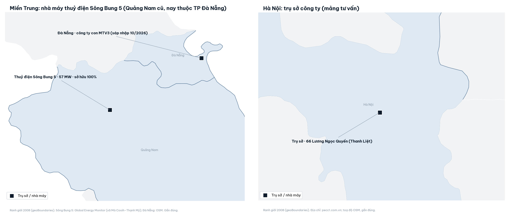

- Công ty con MTV3 (Đà Nẵng) sáp nhập vào công ty mẹ theo hợp đồng 08/10/2026 — không đổi số hợp nhất.
- Sông Bung 5 từng được đấu giá ≥5 lần (01/2019 → 05/2021, giá khởi điểm 1.688 → 1.390 → 1.351,7 tỷ) nhưng không có người đăng ký; một công ty chứng khoán (04/2026) giải thích đấu giá thất bại bởi “rủi ro điều chỉnh giá bán trong tương lai”.
- **Giá điện là biến quyết định:** hợp đồng bán điện có giá cố định hai bậc — bậc cao trong kỳ trả nợ vay dự án (đã tất toán 31/03/2025), bậc sau thấp hơn nhiều. Giá ròng 2025 ≈949 đ/kWh; sau 2027 chưa xác định (lãnh đạo: 500–600; hồ sơ 2018: ≈340). Thuế tài nguyên và phí môi trường rừng được bên mua trả thêm ngoài giá, không đổi kết luận.

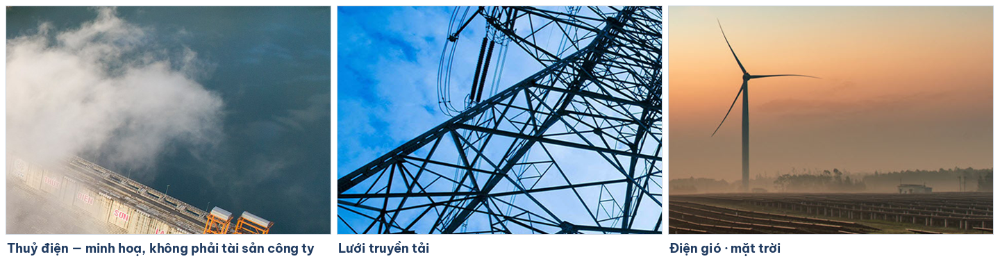

Ảnh: banner trang chủ pecc1.com.vn, minh hoạ các lĩnh vực tư vấn; không xác định là công trình cụ thể. Ảnh thuỷ điện **không phải** Sông Bung 5 hay tài sản của công ty.

## 5. Tài chính dựng từ dưới lên

### 5a. Doanh thu và lợi nhuận theo quý

**Doanh thu theo mùa nước; quý 4 thường là quý lớn nhất của thuỷ điện.**

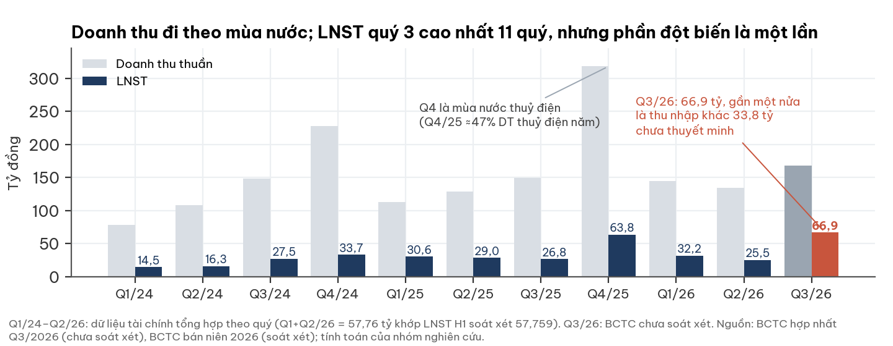

- Biên gộp quý 3: 38,9% báo cáo; **35,5% nếu bỏ hoàn nhập dự phòng tồn kho 5,7** (Q3/25: 34,4%).
- Chi phí quản lý doanh nghiệp quý 3 gấp đôi (21,5 so 10,6), chưa thuyết minh.

### 5b. Chất lượng lợi nhuận

**Lợi nhuận lõi quý 3 là 16–45 tỷ hoặc 31–45 tỷ, tuỳ hoàn nhập dự phòng được ghi vào đâu; chưa đủ cơ sở để chọn.**

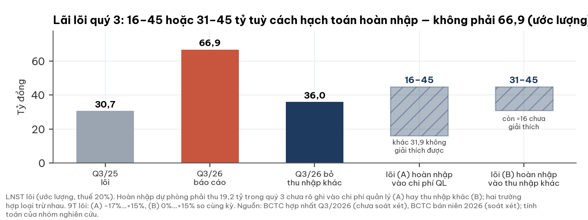

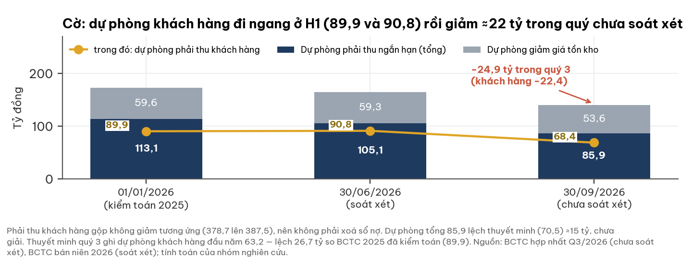

| Trường hợp | Hoàn nhập phải thu 19,2 tỷ ghi vào | Lãi lõi quý 3 | 9 tháng so cùng kỳ | Phần chưa giải thích |
|---|---|---|---|---|
| (A) | chi phí quản lý (chuẩn mực thông thường) | 16–45 | −17%…+15% | cả 31,9 khác ròng; chi phí quản lý trước hoàn nhập ≈40,7 (≈3,9× bình quân quý H1) |
| (B) | thu nhập khác | 31–45 | 0%…+15% | ≈16 |

- Nghiêng (A): BCTC bán niên ghi trích dự phòng phải thu vào chi phí quản lý. Nghiêng (B): thuyết minh quý 3 về khoản này bỏ trống; chi phí quản lý 40,7 tỷ khó tin.
- **Cờ:** dự phòng giảm 24,9 tỷ trong quý 3 (phải thu 19,2 + tồn kho 5,7); dòng tiền ghi nhận ≈21,5 tỷ là phi tiền mặt.
- **Cờ mới:** thuyết minh quý 3 ghi dự phòng phải thu khách hàng đầu năm 63,2 tỷ — lệch 26,7 tỷ so BCTC 2025 đã kiểm toán (89,9).
- BCTC quý 3 chưa soát xét, bản scan, thuyết minh mỏng: không có báo cáo bộ phận, không có giao dịch bên liên quan.
- Thuế hiệu dụng quý 3 chỉ 13,1% — gợi ý phần lớn khoản khác không chịu thuế.

### 5c. Dòng tiền và tiền ròng

**Dòng tiền kinh doanh khớp lợi nhuận lõi; nhưng sau các nghĩa vụ đã biết, tiền ròng hơi âm.**

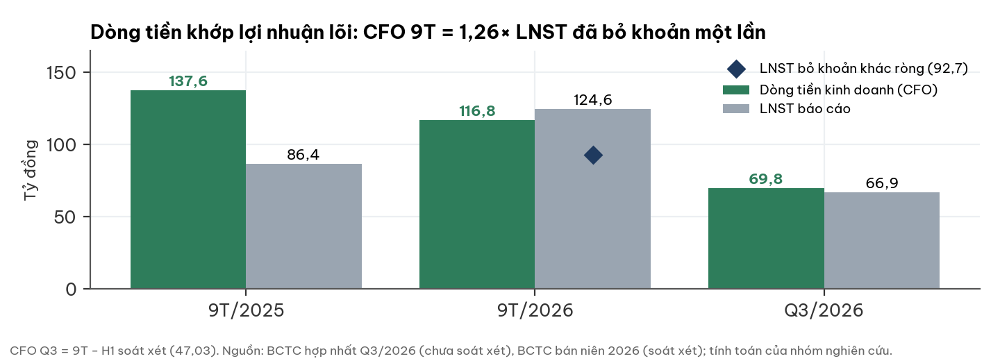

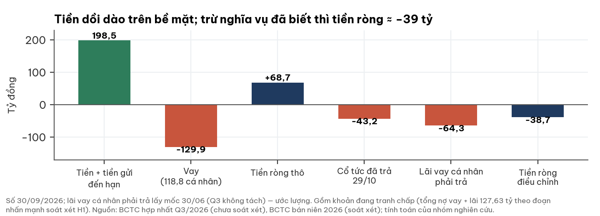

- Vay dự án dài hạn chỉ còn 0,41 tỷ; vay ngắn hạn chủ yếu từ cá nhân, một phần đang tranh chấp tại toà.
- Phải thu khách hàng gộp 387,5 tỷ, thấp hơn đầu năm (408,2).

## 6. Giá cổ phiếu và sự kiện

**Giá đã giảm 46% từ đỉnh tháng 3/2026 và đi ngang trong khoảng 18.000–20.500 đ từ giữa tháng 7.**

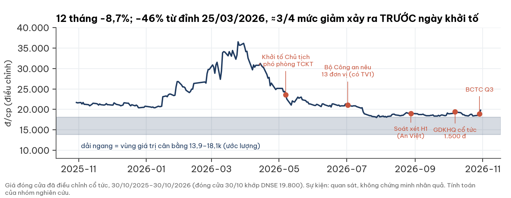

- Quan sát, không phải nhân quả: khoảng 3/4 mức giảm từ đỉnh diễn ra trước ngày khởi tố 07/05/2026.
- Phiên 30/10 (sau BCTC quý 3): +4,8% với 156.400 cổ phiếu (≈3,1 tỷ), ≈7,5 lần trung vị 20 phiên.

## 7. Định giá

**Hai phương pháp đồng hạng: vùng giá trị cân bằng 13.900–18.100 đ, tâm ≈15.900; giá 19.800 đ cao hơn ≈25% so tâm, ngang giá trị nếu giá điện mới ≥≈590 đ/kWh.**

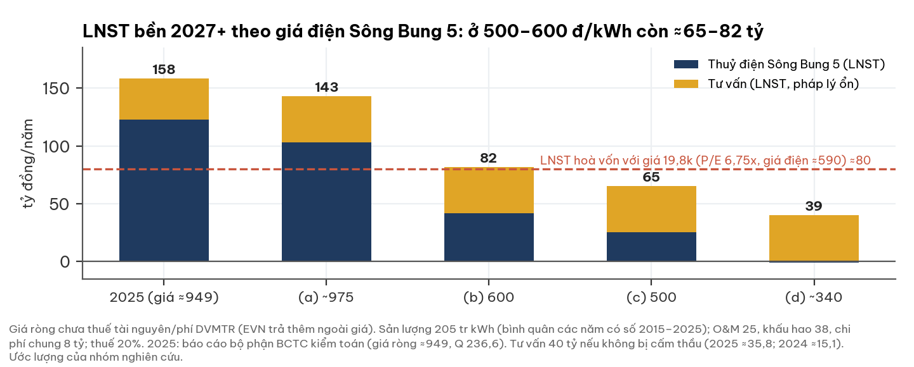

| Kịch bản giá điện ròng 2027+ | Xác suất (ước lượng) | Căn cứ | LNST bền (không cấm thầu / cấm thầu) | P/E 6,75x (không / có cấm thầu) | Cổ tức chiết khấu, chi trả 27% / 40% |
|---|---|---|---|---|---|
| (a) giữ ≈975 đ/kWh | 10% | ngược với báo cáo thường niên 2025 và lời lãnh đạo; vay dự án đã tất toán 03/2025 | 143 / 118 | **35.100** / 28.000 | 21.700 / 22.800 |
| (b) 600 đ/kWh | 45% | lời lãnh đạo (500–600), chưa có văn bản | 82 / 57 | **20.100** / 13.100 | 15.000 / 15.700 |
| (c) 500 đ/kWh | 35% | như (b) | 65 / 40 | **16.200** / 9.100 | 13.200 / 13.700 |
| (d) ≈340 đ/kWh | 10% | hồ sơ 2018: bậc sau 243,66 + vận hành ≈95; bậc này chưa từng được áp, mâu thuẫn với lời lãnh đạo mới hơn | 39 / 14 | **9.800** / 2.700 | 10.400 / 10.700 |
| **Kỳ vọng** (cấm thầu 30%; mốc hạ lùi 2 năm 15%) | | | | **17.600** (11.600–21.000) | **13.900 / 14.500** |

- **(i) P/E 6,5–7x trên lợi nhuận bền 2027+, cộng tiền ròng cuối 2027.** Lợi nhuận đã cắt theo giá điện mới ⇒ không chiết khấu rủi ro giá điện thêm lần nữa ở bội số. Căn cứ: P/E trung vị 23 công ty thuỷ điện niêm yết 2026 ≈10,9x (2025: 12,8x); 6,5–7x = chiết khấu ≈35–40% cho thanh khoản thấp, quy mô nhỏ, mảng tư vấn theo chu kỳ. Cùng bội số cho cả hai trạng thái pháp lý: cấm thầu làm giảm lợi nhuận tư vấn (về 10–20 tỷ) và trừ một khoản nộp/bồi thường một lần ≈30 tỷ (ước lượng), không làm giảm giá trị nhà máy điện.
- **(ii) Chiết khấu cổ tức:** 10 năm cổ tức (2026: 1.000–2.000 đ; sau đó tỷ lệ chi trả × lợi nhuận), tiền giữ lại hưởng lãi tiền gửi ≈5%/năm và được tính đủ theo giá trị sổ ở năm 10; phần kinh doanh cuối kỳ tối đa 0,6 lần vốn chủ hoạt động. Thấp hơn P/E ≈3.000–4.000 đ chỉ vì phần kinh doanh cuối kỳ được định giá thận trọng (thanh khoản thấp, cổ đông thiểu số không quyết định phân phối).
- **Vùng giá trị cân bằng** = từ thấp đến cao của hai phương pháp (cổ tức 13.900–14.500; P/E 17.000–18.100) ⇒ **13.900–18.100 đ**, tâm ≈15.900.
- **Kiểm tra hai chiều** (ước lượng; P/E | cổ tức): bỏ hẳn rủi ro pháp lý ⇒ 19.700 | 15.500; trọng số giá lạc quan (25/45/25/5) **và** bỏ rủi ro pháp lý ⇒ 22.700 | 17.000; trọng số bi quan (5/30/40/25) và cấm thầu 40% ⇒ 14.400 | 13.000; sản lượng 175 / 237 triệu kWh ⇒ 14.100 / 21.200 | 12.800 / 16.300; P/E 5,5x / 8x ⇒ 14.700 / 20.400; mức chiết khấu thị trường 15,1% ⇒ 17.100 | 12.600. Dải 12.600–22.700 bao quanh giá hiện tại; tâm nằm dưới giá.
- **Tổ hợp đạt 19.800 đ (trong hai phương pháp trên):** giữ giá điện cũ; giá 600 đ/kWh + không cấm thầu ở P/E 7x (≈20.800); giá 500–600 + không cấm thầu + mốc hạ lùi 2 năm (20.500–23.800). Không tổ hợp nào ở giá ≈340 hoặc có cấm thầu ở 500–600.
- **Giá trị tài sản (SOTP):** thuỷ điện DCF đến 2059 + tư vấn − nợ điều chỉnh: (a) 45.100–51.100 · (b) 27.700–30.800 · (c) 23.000–25.400 · (d) 15.500–16.600 đ; kỳ vọng ≈28.000 (trộn rủi ro pháp lý ≈25.900). Kịch bản (b)/(c) đều trên 19.800. Tâm 15.900 tương đương chiết khấu ≈39% so SOTP — mép trên thông lệ 20–40% cho cổ đông thiểu số/holding; áp thông lệ đó cho SOTP được 15.600–20.800. Tài sản khó hiện thực hoá: Sông Bung 5 đã đấu giá ≥5 lần không có người đăng ký (01/2019 khởi điểm 1.688 tỷ → 11/2020 1.390 tỷ → 05/2021 1.351,7 tỷ).
- **Điện mặt trời nổi lòng hồ (46 MWp + 5 MW lưu trữ, ≈800 tỷ, kỳ vọng ≈90 tỷ doanh thu/năm theo lãnh đạo):** chưa vào quy hoạch, chưa có giá bán ⇒ **không tính** giá trị; vốn đầu tư ≈1,5 lần vốn hoá.

**Bối cảnh lãi suất (tham khảo):** mức chiết khấu thị trường đang ngầm định 15,1% (147 mã, 30/10/2026; phân vị 75% từ 2014). Lợi suất trái phiếu Chính phủ 10 năm 4,58% (30/10/2026).

## 8. Rủi ro — pre-mortem

**Rủi ro lớn nhất là giá điện Sông Bung 5 sau 2027; tiếp theo là pháp lý và kiểm toán.**

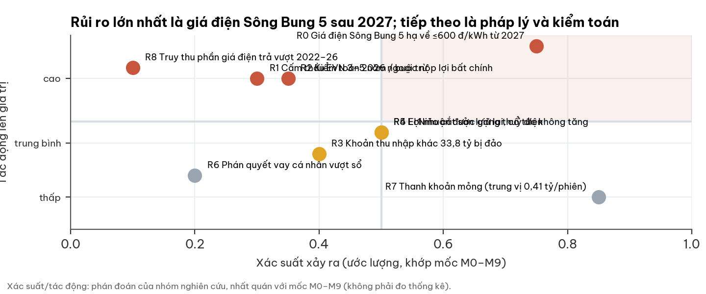

| Rủi ro | Xác suất | Tác động | Dấu hiệu sớm | Ngày kiểm |
|---|---|---|---|---|
| **R0 Giá điện Sông Bung 5 về ≤600 đ/kWh từ 2027** | **cao (0,75)** | **rất cao** (lợi nhuận bền −45…−57% so 2025) | doanh thu thuỷ điện/sản lượng quý 1/2027; thuyết minh BCTC kiểm toán 2026 | 03–04/2027 |
| R1 Cấm thầu EVN 3–5 năm / buộc nộp lợi bất chính | thấp–TB (0,30) | cao | kết luận điều tra, cáo trạng | khi công bố |
| R2 Kiểm toán 2026 ngoại trừ/từ chối | thấp–TB (0,35) | cao | đổi kiểm toán, chậm công bố | 03/2027 |
| R3 Khoản 33,8 tỷ bị đảo | TB | TB | BCTC kiểm toán điều chỉnh | 03/2027 |
| R4 El Niño cắt thuỷ điện | TB | thấp (chỉ 2026) | thuế tài nguyên Q4 thấp | 01/2027 |
| R5 Lợi nhuận bị giữ lại, cổ tức không tăng | TB | TB | kế hoạch cổ tức 2026 = 1.000 đ | 04/2027 |
| R6 Phán quyết vay cá nhân vượt sổ (gốc 64,4 + lãi 42,1 đã ghi) | thấp | TB | bản án | khi có |
| R8 Truy thu phần giá điện đã trả cao hơn biểu giá 2018 (2022–2026) | thấp (chưa lượng hoá) | rất cao (quy mô ≈415 tỷ trước thuế nếu áp hồi tố đủ) | kết luận thanh tra/kiểm toán về hợp đồng mua bán điện; tiền lệ một thuỷ điện khác (ký lại giá 2022, yêu cầu xác định tiền lãi, chưa thấy truy thu hồi tố) | khi có |
| R7 Thanh khoản mỏng | cao | thấp–TB | — | liên tục |

## 9. Pháp lý & quản trị — WARNING (mức cao, không chặn phân tích)

**Vụ án có tội danh kế toán ⇒ rủi ro không chỉ là tư cách nhà thầu mà là độ tin cậy số liệu quá khứ. Rủi ro với công ty đi qua cấm thầu và buộc nộp lợi bất chính, không qua truy cứu hình sự pháp nhân.**

| Hạng mục | Nội dung (có nguồn) | Đánh giá |
|---|---|---|
| Vụ án EVNNPT/PC1 | 07/05/2026 khởi tố, tạm giam Chủ tịch HĐQT và phó phòng tài chính–kế toán; vụ án gồm đấu thầu, **kế toán**, tham ô, hối lộ | chưa kết luận |
| Thông tin vụ án 02/07/2026 (VnExpress) | “13 công ty bị xác định có liên quan”, gồm “các công ty CP tư vấn xây dựng điện 1, 2, 3, 4”; “EVNNPT và nhà thầu đều có sai phạm trong lập, phê duyệt dự toán”; “Các nhà thầu khi thực hiện nhiều hạng mục cũng có vi phạm.” 47 **người** bị khởi tố; bài không nói pháp nhân nào bị khởi tố. Một nguồn khác (The Investor) ghi “ít nhất 13 lãnh đạo và nhân viên” — hai nguồn không khớp | TV1 có tên; chưa xác định hậu quả |
| Khung pháp lý với pháp nhân (tham khảo, cần luật sư xác nhận) | Điều 76 Bộ luật Hình sự không gồm 5 tội danh của vụ án ⇒ pháp nhân không bị truy cứu hình sự theo luật hiện hành; dự thảo sửa đổi (dự kiến hiệu lực 03/2027) không hồi tố. Kênh thực tế: **cấm thầu 6 tháng–5 năm** (Luật Đấu thầu 2023; Nghị định 214/2025 Điều 133: 3–5 năm cho hối lộ/gian lận), **buộc nộp lợi bất chính/bồi thường**, người bị truy cứu phải rời quản lý | cấm thầu trong hệ thống EVN = rủi ro doanh thu lớn nhất |
| Soát xét H1/2026 (An Việt) | kết luận chấp nhận, **hai đoạn nhấn mạnh**: 127,63 tỷ nợ vay + lãi cá nhân đang kiện; việc bắt tạm giam hai cá nhân | đoạn nhấn mạnh không phải ngoại trừ |
| Kiểm toán | Big4 từ chối; đã ký An Việt kiểm toán 2026 (18/08/2026); 2025 A&C chấp nhận toàn phần | rủi ro “không có kiểm toán viên” đã đóng |
| Bốn dấu hiệu nhỏ cùng chiều | điều chỉnh vốn chủ trực tiếp +8,9 tỷ (H1); thu nhập khác 33,8 tỷ không thuyết minh; dự phòng lệch thuyết minh ≈15 tỷ (Q3); dự phòng khách hàng đầu năm trong thuyết minh Q3 lệch 26,7 tỷ so BCTC 2025 kiểm toán | theo dõi, không chứng minh sai phạm |
| BCTC quý 3 | mục thuyết minh vụ án bỏ trống | chưa soát xét |

- Phạm vi tra cứu: BCTC, CBTT công ty và tin tức đến 02/11/2026; không thấy tin mới sau 28/10, nhưng “không thấy” không có nghĩa là không có.

## 10. Mốc kiểm chứng hai chiều

| # | Mốc | Ngày | Chiều tích cực | Chiều tiêu cực | Xác suất tích cực |
|---|---|---|---|---|---|
| **M0** | **Văn bản giá điện Sông Bung 5 sau 2027** (CBTT, BCTC kiểm toán 2026, tài liệu ĐHĐCĐ 2027, hoặc doanh thu/sản lượng quý 1/2027) | ≈03–04/2027 | ≥≈600 đ/kWh ròng (hoà vốn ≈590), hoặc mốc hạ lùi ≥2 năm | <≈590 (≤500 / ≈340 là xấu hơn kịch bản trung tâm) | **≈0,25** |
| M1 | LNST hợp nhất Q4/2026 (giá điện cũ) | ≈30/01/2027 | ≥45 tỷ | <25 tỷ | 0,50 |
| M2 | Doanh thu thuỷ điện Q4/2026 (giá điện cũ) | ≈30/01/2027 | ≥100 tỷ | <80 tỷ | 0,45 |
| M3 | Thuyết minh khoản 33,8 tỷ | ≈31/03/2027 | có căn cứ, giữ nguyên | bị đảo/điều chỉnh | 0,60 |
| M4 | Ý kiến kiểm toán 2026 | ≈31/03/2027 | chấp nhận toàn phần | ngoại trừ/từ chối/đổi | 0,65 |
| M5 | Kết luận vụ án / quyết định cấm thầu | khi công bố | không cấm thầu, không buộc công ty nộp | cấm thầu EVN 3–5 năm / buộc nộp lớn | 0,70 |
| M6 | Cổ tức 2026 | ≈04/2027 | ≥2.000 đ hoặc cam kết chi trả ≥50% | <1.500 đ (thấp hơn mức 2025) | 0,35 (kế hoạch 2026 10%, nhưng kế hoạch 2025 là 6% và thực trả 15%) |
| M7 | Phải thu khách hàng gộp | ≈30/01/2027 | ≤390 tỷ | >430 tỷ | 0,60 |
| M8 | Điện mặt trời lòng hồ Sông Bung 5 | khi có chủ trương/quy hoạch | có chủ trương + giá bán + vốn không pha loãng | đầu tư ≈800 tỷ bằng vay/phát hành khi chưa có giá bán | 0,30 |
| M9 | EVN tăng giá bán lẻ điện ≥1 lần | 30/06/2027 | có | không | 0,55 (người đọc ngành) |

## Phụ lục A — Số BCTC chính (tỷ đồng)

| Chỉ tiêu | Q3/26 | Q3/25 | 9T/26 | 9T/25 |
|---|---|---|---|---|
| Doanh thu thuần | 168,1 | 149,3 | 446,9 | 390,6 |
| Biên gộp | 38,9% | 34,4% | 36,4% | 37,4% |
| Chi phí quản lý · EBIT lõi | 21,5 · 44,0 | 10,6 · 40,8 | 42,4 · 120,1 | 27,5 · 118,6 |
| Tài chính ròng · khác ròng | +1,1 · **+31,9** | −2,4 · −4,4 | −1,3 · +31,7 | −7,5 · −4,6 |
| LNTT · thuế hiệu dụng | 77,0 · 13,1% | 34,0 · 21,4% | 150,5 · 17,2% | 106,5 · 18,9% |
| LNST báo cáo · lõi (ước lượng; A / B) | 66,9 · 16–45 / 31–45 | 26,8 · ≈30,7 | 124,6 · ≈74–103 / 89–103 | 86,4 · ≈88,9 |
| CFO | ≈69,8 | | 116,8 | 137,6 |
| 30/09/26: tiền · tiền gửi đến hạn · vay · VCSH | 30,7 · 167,8 · 129,9 · 574,7 | | | |

| Độ nhạy LNST bền × P/E (đ/cp) | 3x | 4x | 5x | 6x |
|---|---|---|---|---|
| 40 tỷ (giá ≈340) | 4.500 | 6.000 | 7.500 | 9.000 |
| 60 tỷ (giá 500) | 6.700 | 9.000 | 11.200 | 13.500 |
| 75 tỷ (giá 600) | 8.400 | 11.200 | 14.000 | 16.900 |
| 95 tỷ (≈ giá 19,8k ở 5,5x) | 10.700 | 14.200 | 17.800 | 21.400 |
| 130 tỷ (giữ giá cũ) | 14.600 | 19.500 | 24.400 | 29.200 |

## Phụ lục B — Đối chiếu dữ liệu thị trường với BCTC

- Dữ liệu tài chính tổng hợp chưa có quý 3/2026 tại 02/11; Q1+Q2/2026 (57,76 tỷ) khớp LNST H1 soát xét (57,759).
- “Tiền” trong dữ liệu tổng hợp thiếu tiền gửi nắm giữ đến hạn; phải thu “≈295 tỷ” là khái niệm khác với phải thu khách hàng gộp 387,5 của BCTC.

## Phụ lục C — Nguồn

- BCTC hợp nhất và riêng Q3/2026 (ký 29/10/2026, chưa soát xét); BCTC bán niên 2026 (An Việt soát xét); BCTC 2025 kiểm toán (A&C; thuyết minh 6 dự phòng phải thu); công văn giải trình 6603/TVĐ1-P3; CBTT hợp đồng kiểm toán 2026, cổ tức 2025, sáp nhập MTV3, tỷ lệ sở hữu nước ngoài — pecc1.com.vn.
- Giá: DNSE (đóng cửa 30/10/2026; tham chiếu 02/11/2026). Lịch sử giá, P/E, P/B, lợi nhuận quý: cơ sở dữ liệu tài chính tổng hợp của nhóm.
- Vụ án: VnExpress 02/07/2026, https://vnexpress.net/47-nguoi-bi-khoi-to-trong-vu-an-tai-tong-cong-ty-truyen-tai-dien-quoc-gia-5092437.html (mở lại 02/11/2026); The Investor (PECC3); BCTC bán niên 2026 thuyết minh 33. Khung pháp lý: Bộ luật Hình sự (Điều 76; Luật 86/2025), Luật Đấu thầu 22/2023, Nghị định 214/2025 — tra cứu tham khảo, cần luật sư xác nhận. Ngành: báo cáo của người đọc ngành độc lập 28/10/2026. Lãi suất: bộ dữ liệu lãi suất thị trường của nhóm (30/10/2026).
- Giá điện Sông Bung 5: PECC1, “Báo cáo phương án bán toàn bộ tài sản NMTĐ Sông Bung 5”, 8/2018, tr.13 (pecc1.com.vn); Báo cáo thường niên 2025 tr.38 (HNX); báo cáo công ty chứng khoán KBSV 17/04/2026 tr.4 (dẫn lời lãnh đạo; nhóm chưa đọc lại được bản gốc để xác định 500–600 là giá tổng hay giá cố định); lịch sử đấu giá Sông Bung 5: báo Đấu thầu (baodauthau.vn, 17/05/2021); tiền lệ giá điện thuỷ điện khác: vnbusiness.vn; P/E ngành thuỷ điện: cơ sở dữ liệu tài chính của nhóm (23 mã, 2024–2026); BCTC hợp nhất 2025 kiểm toán, báo cáo bộ phận tr.34–35. ĐHĐCĐ 2026 và điện mặt trời lòng hồ: báo Đấu thầu 30/04/2026 và 27/06/2025 (baodauthau.vn).
- Logo và ảnh: pecc1.com.vn (tải 02/11/2026). Toạ độ: Sông Bung 5 — Global Energy Monitor wiki (xã Mà Cooih–Thạnh Mỹ theo thông báo đấu giá); trụ sở 66 Lương Ngọc Quyến và Đà Nẵng — OpenStreetMap Nominatim 02/11/2026; ranh giới geoBoundaries VNM-ADM1 (2008). Vị trí gần đúng.

## Phụ lục D — Phương pháp và giới hạn

- **Trục chính = giá điện Sông Bung 5 sau 2027**, bốn kịch bản (giữ ≈975 / 600 / 500 / ≈340 đ/kWh ròng) với xác suất 10/45/35/10% (phán đoán dựa trên chứng cứ ở mục 4, 7); kết hợp trạng thái pháp lý (cấm thầu EVN 30%) và mốc hạ (lùi 2 năm: 15%).
- Lợi nhuận thuỷ điện = (sản lượng × giá ròng − vận hành 25 − khấu hao 38 − chi phí chung 8) × 80%; hàm hiệu chuẩn bằng báo cáo bộ phận BCTC 2025 kiểm toán. Sản lượng 175 / 205 / 210 triệu kWh. Tư vấn 30–50 tỷ (cấm thầu: 10–20, cộng khoản một lần 30 tỷ). Tiền ròng hưởng lãi 5%/năm trước thuế.
- (i) P/E 6,5–7x trên lợi nhuận bền 2027+ cộng tiền ròng cuối 2027, quy về 11/2026 ở Ke 12,3–13,4% (khung β≈1,1; β TV1 chưa đo), cộng cổ tức 2026 (1.000–2.000 đ). (ii) Chiết khấu cổ tức 10 năm, chi trả 27/40/60%, giá trị cuối kỳ = tiền ròng theo sổ + min(0,6; ROE/Ke) × vốn chủ kinh doanh. Vùng = từ thấp đến cao của hai phương pháp (chi trả 27–40%, P/E 6,5–7x).
- SOTP: thuỷ điện DCF 2027–2059 (phần vận hành trong giá trượt 2,5%/năm), lãi suất 11–13%, + tư vấn 40 tỷ × 6, − tiền ròng điều chỉnh — giá trị tài sản, đối chiếu bằng chiết khấu thiểu số thông lệ 20–40%.
- Giới hạn: **giá điện sau 2027 chưa có văn bản** (mức, mốc); hai nguồn mâu thuẫn về mức; điện mặt trời lòng hồ không định giá; BCTC quý 3 chưa soát xét và không có báo cáo bộ phận (tách mảng quý là ước lượng); tin pháp lý tra bằng công cụ tìm kiếm; xác suất kịch bản là phán đoán; khung pháp lý là tra cứu tham khảo, chưa có ý kiến luật sư.

## Phụ lục E — Quy trình độc lập và đính chính

Báo cáo qua bốn bước: đọc BCTC gốc → đọc ngành độc lập (không biết mã, giá) → nhóm nghiên cứu định giá → người phản biện độc lập kiểm lại số liệu, nguồn và cân bằng lập luận. Đã qua ba vòng phản biện (vòng 1: 12 điểm; vòng 2: 4 trọng yếu + 10 nhỏ; vòng 3 — trên bản nháp dựng lại theo giá điện: 3 trọng yếu + 12 nhỏ). **Bản này (đính chính lần 2, thay bản 02/11/2026 15:25) chưa qua vòng phản biện thứ tư.**

| Đính chính lần 2 — lỗi phương pháp | Bản 15:25 | Bản này |
|---|---|---|
| Giá điện Sông Bung 5 | giả định giữ ≈912–950 đ/kWh, chỉ giảm 20% từ 2034; ghi “không có dấu hiệu nào theo cả hai chiều” về giá điện 2027 | **sai** — nghiên cứu sẵn có của nhóm (13/10/2026) đã có hồ sơ 2018 (bậc 569 → 244), báo cáo thường niên 2025 (“giá điện… sụt giảm”), lời lãnh đạo (500–600 từ 2027) nhưng không được dùng; nay là **trục chính** với 4 kịch bản |
| Lợi nhuận bền | 103–172 tỷ (giá điện cũ, tài chính +5) | ≈65–82 tỷ ở 500–600 (không cấm thầu); tiền ròng tính riêng, hưởng lãi tiền gửi |
| Phép thử cổ tức | chỉ là chú thích (cần 2.435–2.650 đ) | phương pháp **đồng hạng** với P/E |
| Vùng giá trị · kết luận | 17.800–20.600 · “từ ngang đến cao hơn ≈10%” | **13.900–18.100, tâm ≈15.900 · giá cao hơn ≈25% so tâm** |
| Mốc · rủi ro | — | thêm M0/R0 giá điện tái ký, M8 điện mặt trời lòng hồ, R8 truy thu giá điện |

| Vòng 3 — sửa trên bản nháp dựng lại (chưa gửi) | Bản nháp | Bản này |
|---|---|---|
| Tiền tích luỹ trong phép chiết khấu cổ tức | không sinh lãi, giá trị cuối kỳ 0,6 lần toàn bộ vốn chủ ⇒ tiền bị định giá thấp hơn mệnh giá | hưởng lãi ≈5%, tính đủ theo sổ; 0,6 lần chỉ áp phần vốn chủ kinh doanh |
| Bội số P/E | 5–6x (3–4x nếu cấm thầu) — lấy từ năm thị trường đã chiết khấu rủi ro giá điện ⇒ phạt hai lần | 6,5–7x có căn cứ ngành; cấm thầu đi qua lợi nhuận tư vấn + khoản một lần |
| Xác suất | giá ≈340: 20%; cấm thầu 35%; cổ tức ≥2.000 đ: 20% | 10% (bậc này chưa từng áp); 30%; 35% (tiền lệ chi vượt kế hoạch) |
| Sản lượng giữa · tiền ròng | 192,5 tr kWh; bỏ lợi nhuận Q4/2026 và tiền ròng âm | 205 (bình quân các năm có số 2015–2025); tính cả hai |
| Vùng · kết luận | 8.700–10.600 · giá “gần gấp đôi” | **13.900–18.100 · giá cao hơn ≈25% so tâm** |
| Lịch sử đấu giá Sông Bung 5 | “5–6 lần 2018–21” | ≥5 lần 01/2019–05/2021, khởi điểm 1.688 → 1.351,7 tỷ (không tìm thấy thông báo bán mới năm 2026) |

**Vòng 2 (bản 15:25):**

| Vòng 2 — điểm trọng yếu | Bản 11:55 | Bản đính chính |
|---|---|---|
| Trọng số kịch bản | 25/50/25, “không có căn cứ để nghiêng” — mâu thuẫn với xác suất rủi ro pháp lý/kiểm toán 0,35 | kịch bản xấu định nghĩa lại (cấm thầu / ngoại trừ / buộc nộp); bộ nhất quán 20/45/35; vùng 17.800–20.600 ⇒ **từ ngang đến cao hơn ≈10%** (trước: “ngang giá”, 19.200–20.600) |
| Lãi lõi quý 3 | 16–45, trộn hai cách hạch toán; “một nửa là một lần” | tách (A) 16–45 / (B) 31–45; 9 tháng (B) 0%…+15%; “1/3 đến 3/4” |
| Dự phòng khách hàng đầu năm | 63,2 (H1 “tăng do trích lập”) | **89,9** theo BCTC 2025 kiểm toán; H1 đi ngang, quý 3 giảm ≈22; thêm cờ lệch 26,7 tỷ |
| Nguồn pháp lý | “13 đơn vị xảy ra vụ án”, nguồn không mở được | trích nguyên văn VnExpress có URL; nêu “nhà thầu có sai phạm”; nguồn mâu thuẫn; khung pháp lý cấm thầu/lợi bất chính |

Điểm nhỏ đã sửa: cổ tức cần có 2.435–2.650 đ (trước ≈2.800); so sánh trọng số 30/50/20 sau chiết khấu; kịch bản xấu trên vốn chủ soát xét (9.500–13.300); bỏ “P/B thấp nhất 0,50” không có nguồn; ghi nguồn gốc dải Ke và độ nhạy 15,1%; cộng cổ tức tích luỹ năm lẻ; chú thích ảnh thuỷ điện; định nghĩa vùng giá trị hợp lý; “Ba điều cần biết” nêu tiền ròng điều chỉnh âm và nợ đang kiện.

| Vòng 1 — điểm sửa | Trước | Sau |
|---|---|---|
| Mốc nửa đầu năm | dùng BCTC quý 2 chưa soát xét | dùng bán niên soát xét: phi tiền quý 3 −21,5; CFO quý 3 69,8 (trước 62,5) |
| Dự phòng | giảm 27,5 | giảm 24,9; dự phòng khách hàng **giảm** ≈22 (90,8 → 68,4); chuyển từ điểm cộng sang cờ |
| Điều chỉnh vốn chủ +8,9 | chưa giải thích | khớp dự phòng ghi giảm thẳng vào vốn; vẫn là cờ |
| Lợi nhuận lõi quý 3 | 36–44 tỷ; 9 tháng +7% | khoảng hai chiều (đã tách tiếp ở vòng 2) |
| P/E · P/B | P/E lõi 3,24x; P/B 0,92 | 3,2–3,8x; P/B 0,92 và 1,04 (vốn chủ soát xét) |
| Kịch bản cơ sở | LNST 125–155; 16.400–26.100 | LNST 103–172; **13.500–29.000** |
| So sánh giá với kỳ vọng | so thẳng giá trị 2027–28 | chiết khấu về hôm nay |
| SOTP | khấu hao cộng 33 năm: 24.300 / 44.700 | khấu hao 13 năm: 23.900 / 44.200 |

## Phụ lục F — Tuyên bố miễn trừ trách nhiệm

Tài liệu này chỉ nhằm mục đích cung cấp thông tin nghiên cứu, không phải lời khuyên, chào mời hay khuyến nghị mua, bán hoặc nắm giữ bất kỳ chứng khoán nào, và không tính đến mục tiêu, tình hình tài chính hay nhu cầu của bất kỳ cá nhân nào. Thông tin dựa trên nguồn công khai được cho là đáng tin cậy nhưng không được bảo đảm về độ chính xác hay đầy đủ; các ước lượng, kịch bản và xác suất là đánh giá tại thời điểm 02/11/2026 và có thể thay đổi mà không cần thông báo. Hiệu quả trong quá khứ không bảo đảm kết quả tương lai. Nhà đầu tư cần tự đánh giá và tham khảo tư vấn chuyên môn trước khi ra quyết định. Logo và hình ảnh thuộc quyền của doanh nghiệp, chỉ dùng để nhận diện, không hàm ý doanh nghiệp tài trợ hay xác nhận báo cáo.
