# TV1 — EVNPECC1: giá trị nội tại khoảng 11.400–24.200 đ (tâm ≈18.100) xoay quanh hai biến — giá điện Sông Bung 5 sau mốc tái ký còn chưa xác định và chu kỳ tư vấn thiết kế điện; giá 19.500 đ nằm trong khoảng, gần tâm

**Báo cáo Due Diligence · 02/11/2026 · Nhóm nghiên cứu** · UPCOM: TV1 · Thuỷ điện và tư vấn khảo sát–thiết kế điện · tỷ đồng trừ khi ghi khác · dữ liệu đến 02/11/2026

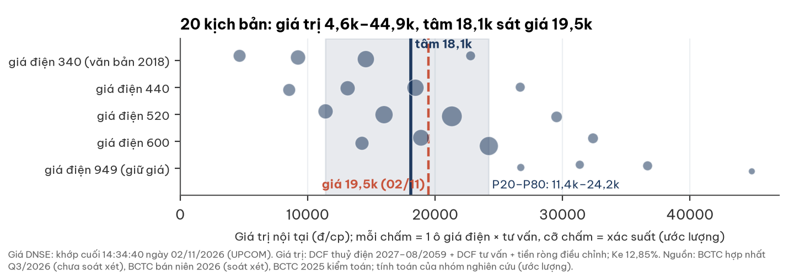

## Investment Summary

**Giá 19.500 đ nằm TRONG dải giá trị nội tại chính 11.400–24.200 đ/cp, gần tâm ≈18.100 (ước lượng).** Dải rộng vì giá điện Sông Bung 5 từ 2027 chưa có văn bản; các kịch bản giá điện trải khoảng 22.000 đ/cp giữa mức thấp nhất (≈340 đ/kWh) và cao nhất (949 đ/kWh).

| Dữ liệu chính | Giá trị | Ghi chú |
|---|---|---|
| Giá · vốn hoá | **19.500 đ** · 520,5 tỷ | DNSE, khớp cuối 14:34:40 ngày 02/11/2026; đóng cửa 30/10: 19.800 |
| Giá trị nội tại: tâm · P20–P80 · toàn bộ kịch bản | **≈18.100** · **11.400–24.200** · 4.600–44.900 | 5 kịch bản giá điện × 4 kịch bản tư vấn, có xác suất (ước lượng) |
| Cấu phần tâm (đ/cp) | thuỷ điện 12.500 + tư vấn 8.000 − tiền ròng điều chỉnh 2.400 | DCF dòng tiền chủ sở hữu, Ke 12,85% |
| P/E 12T · P/B · cổ tức FY2025 | 2,8x (3,3x bỏ thu nhập khác Q3) · 0,91x · 1.500 đ (7,7%) | thuỷ điện niêm yết 2026: P/E trung vị 9,2x |
| LNST 9T/2026 · 2025 | 124,6 (+44%) · 150,2 | đều ở giá điện hiện hành ≈949 đ/kWh |
| Hợp đồng tư vấn ký mới 2025 | **835,1** (≈+198% so 2024) | công ty công bố 01/2026 |
| Thanh khoản 20 phiên | ≈45 nghìn cp ≈ 0,87 tỷ/phiên (bình quân; trung vị ≈0,45 tỷ) | biên độ UPCOM ±15% |

## Ba điều cần biết

1. **Giá điện Sông Bung 5 sau 2027 là biến lớn nhất và chưa xác định.** Văn bản duy nhất được phê duyệt (2018) có bậc 243,66 đ/kWh (≈340 gồm vận hành); bậc này chưa từng áp; công ty viết giá "sụt giảm"; lãnh đạo nêu 500–600.
2. **Tư vấn thiết kế đang ở pha tốt của một chu kỳ.** Hợp đồng ký mới 2025 kỷ lục, biên 9T/26 11–17%; nhưng biên từng âm năm 2022–23 và cạnh tranh gay gắt.
3. **Rủi ro pháp lý nằm ngoài tâm.** Lãnh đạo bị khởi tố trong vụ EVNNPT; kết quả 9T chưa thấy tác động. Cấm thầu EVN 3 năm sẽ trừ ≈8.300 đ/cp (bảng riêng, mục 7).

| Điều làm nhận định đổi | Điều kiện | Kiểm tại |
|---|---|---|
| Tích cực hơn | Văn bản giá điện ròng 2027+ ≥600 đ/kWh hoặc mốc hạ lùi; doanh thu tư vấn FY2026 ≥500 tỷ với biên ≥11% sau khi bỏ hoàn nhập; trúng gói tư vấn Sơn La/Lai Châu mở rộng; vụ án kết thúc không cấm thầu | BCTC Q4/26 (01/2027), kiểm toán 2026 (03/2027), ĐHĐCĐ 2027 |
| Tiêu cực hơn | Văn bản giá ≈340 đ/kWh; yêu cầu truy thu phần giá 2022–26; quyết định cấm thầu EVN; biên tư vấn về ≤5%; kiểm toán ngoại trừ | cùng mốc; vụ án: khi có kết luận |

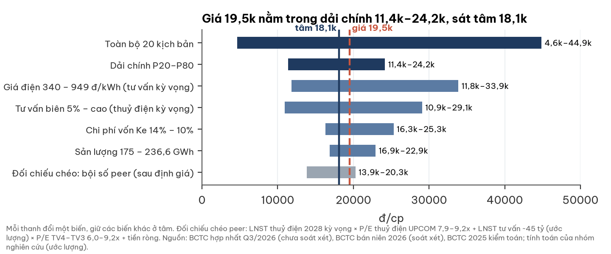

## 1. Giá điện Sông Bung 5 — điều chưa xác định (WARNING)

**Giá thực hiện ≈940–949 đ/kWh suốt 2014–2025; mức sau mốc tái ký là ẩn số lớn nhất, chưa có văn bản công bố.**

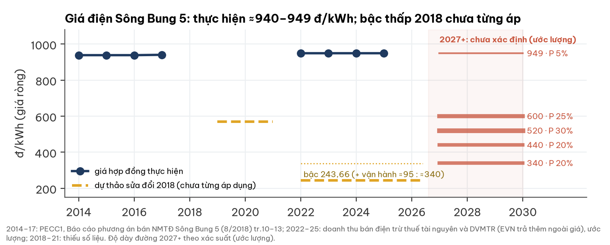

| Sự thật đã kiểm | Nguồn |
|---|---|
| Nhà máy 57 MW, bán toàn bộ cho EVN; giá ròng 938,78–940,76 (2014–17), ≈949 (2025) | PA bán Sông Bung 5 8/2018; BCTC 2025 |
| Dự thảo hợp đồng sửa đổi 2018: 569,36 (2019–21), **243,66 từ 01/01/2022** (chưa gồm vận hành, thuế, phí); EVN NQ 286/NQ-HĐTV, Cục ĐTĐL 1374/ĐTĐL-GP | PA bán Sông Bung 5 tr.13 |
| Bậc 243,66 **chưa từng được áp dụng** dù vay dự án tất toán 31/03/2025 | doanh thu 2022–25 |
| Công ty: "giá điện của nhà máy TĐ Sông Bung 5 sụt giảm" (không nêu mức, mốc) | BCTN 2025 tr.38 |
| Lãnh đạo nêu 500–600 đ/kWh từ 2027 | qua một công ty chứng khoán 04/2026; chưa đối chiếu bản gốc |
| Đấu giá nhà máy 2019–21 (khởi điểm 1.688 → 1.351,7 tỷ): không ai đăng ký | baodauthau.vn |

| Khung pháp lý (tham khảo) | Hàm ý |
|---|---|
| Luật Điện lực 61/2024 Đ.52: giá trên chi phí hợp lý + lợi nhuận hợp lý; chỉ 4 căn cứ điều chỉnh hợp đồng đã ký | EVN **không** đơn phương hạ giá; lưu ý: dự án Luật Điện lực sửa đổi trình ngày 20/10/2026 (Đ.52 có thể đổi); nhà máy trên 30 MW có thể chỉ hưởng giá hợp đồng cho phần sản lượng hợp đồng, phần còn lại theo giá thị trường điện (chưa kiểm Sông Bung 5 có tham gia trực tiếp không) |
| TT 12/2025: IRR ≤12% toàn đời là **trần**, không phải sàn; Đ.16 cho phép giá từng năm cao trong kỳ trả nợ, thấp sau | bậc thấp đã ký thì chủ đầu tư khó từ chối |
| Khung giá thuỷ điện 2026 (QĐ 1127/QĐ-BCT): 0–1.110 đ/kWh | không ràng buộc ở 949 |

| Kịch bản giá ròng 2027+ | Xác suất (ước lượng) | Căn cứ | LNST thuỷ điện 2028 | Giá trị thuỷ điện/cp |
|---|---|---|---|---|
| Giữ 949 | 5% | EVN không đơn phương hạ; ngược với lời công ty | 86,9 | 28.300 |
| 600 | 25% | đầu trên mức lãnh đạo nêu | 34,6 | 15.800 |
| 520 | 30% | giữa mức lãnh đạo nêu | 22,6 | 12.900 |
| 440 | 20% | thoả thuận trung gian | 10,6 | 10.100 |
| ≈340 | 20% | văn bản 2018 (243,66 + vận hành ≈95) | −5,5 | 6.200 |

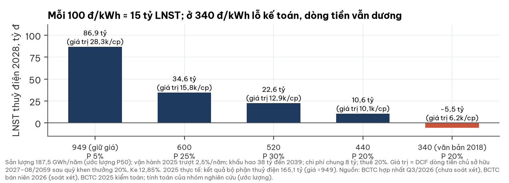

- Ở ≈340 đ/kWh nhà máy lỗ kế toán đến 2039 nhưng dòng tiền vẫn dương (hoà vốn tiền mặt ≈146 đ/kWh).
- Mỗi năm mốc hạ lùi thêm: +1.450–1.780 đ/cp. **Đuôi xấu tách riêng:** truy thu phần giá 2022–26 nếu bậc 2018 áp hồi tố ≈659 tỷ trước thuế (−17.500 đ/cp) — xác suất thấp, chưa có dấu hiệu.
- **Nhà đầu tư nên tự kiểm bằng văn bản gốc:** hợp đồng sửa đổi đã ký (điều kiện chuyển bậc), CBTT, tài liệu ĐHĐCĐ 2027 — nhóm nghiên cứu chưa tiếp cận được.

## 2. Tư vấn thiết kế điện: vai trò và đường ống

**TV1 là đơn vị thiết kế phía Bắc của nhóm tư vấn EVN; doanh thu = vốn đầu tư điện × tỷ lệ phí định mức × thị phần.**

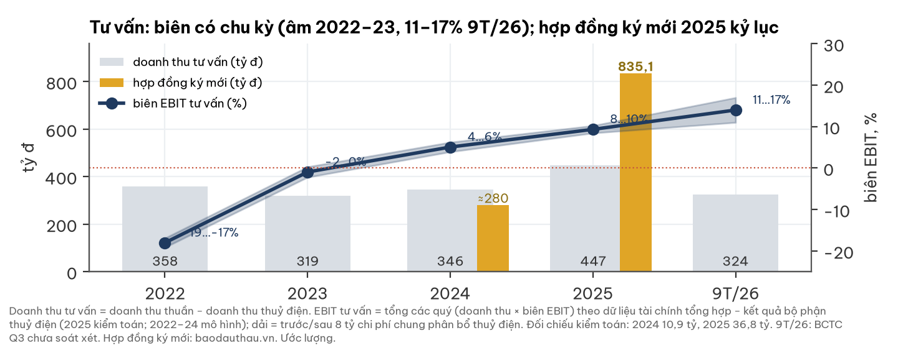

| Thành phần đường ống | Số | Nguồn |
|---|---|---|
| Vốn đầu tư EVN 2025 · kế hoạch 2026 · 2026–30 | 125,8 · ≈123 · ≈830 nghìn tỷ (hoặc ≈5 tỷ USD/năm) | EVN, báo chí; hai nguồn lệch |
| Tỷ lệ phí khảo sát–thiết kế | 1,12–1,13% tổng mức đầu tư (gói 500kV thật); định mức TT 38/2026 1,7–2,0% chi phí xây dựng | muasamcong; Bộ Xây dựng |
| Thị phần hiệu dụng của TV1 | ≈22% bể phí ≈2.000 tỷ (ước lượng, phí 1,6%) | tính toán |
| Khách hàng 2017–25 | 650 gói, 4.023 tỷ: BQLDA miền Bắc 533, miền Trung 426, EVNNPT 273 | vietnamfinance 11/2025 |
| Nguồn việc nêu tại ĐHĐCĐ 2026 | Sơn La, Lai Châu, Tuyên Quang mở rộng (đã ký 81,7 tỷ); 500kV; FS Ninh Thuận 1 cùng PECC2 | baodauthau 30/04/2026 |

- **Thuận:** miền Bắc thiếu 5.680 MW năm 2027 (Bộ Công Thương 15/09/2026) — đúng địa bàn; TV1 là bên thiết kế gốc các nhà máy cần mở rộng.
- **Nghịch:** công ty tự nêu "cạnh tranh gay gắt, quy mô một số lĩnh vực truyền thống thu hẹp"; hợp đồng ký mới 2024 chỉ ≈280 tỷ; gói 5 Krông Buk–Tây Ninh 1 (158,8 tỷ) về liên danh PECC3+2+4, không có TV1; dự phòng phải thu 86–113 tỷ (22–28% phải thu gộp).
- Mốc kiểm: doanh thu tư vấn FY2026 (01–03/2027); kết quả thầu tư vấn các tuyến 500kV mới.

| Kịch bản tư vấn | Xác suất (ước lượng) | Tăng doanh thu 2027–30 | Biên EBIT | LNST 2027 | Giá trị/cp |
|---|---|---|---|---|---|
| Biên 5% (quay về mức 2024) | 20% | 3%/năm | 5% | 21,4 | 900 |
| Thấp | 30% | 3%/năm | 8% | 34,2 | 5.500 |
| Giữa | 40% | 8%/năm | 11% | 49,4 | 10.800 |
| Cao | 10% | 14%/năm | 14% | 66,3 | 19.000 |

## 3. Doanh nghiệp: một nhà máy thuỷ điện và một công ty tư vấn điện lâu năm

**EVN nắm 54,34%; năm 2025 thuỷ điện tạo 67% lãi gộp, tư vấn tạo 63% doanh thu.**

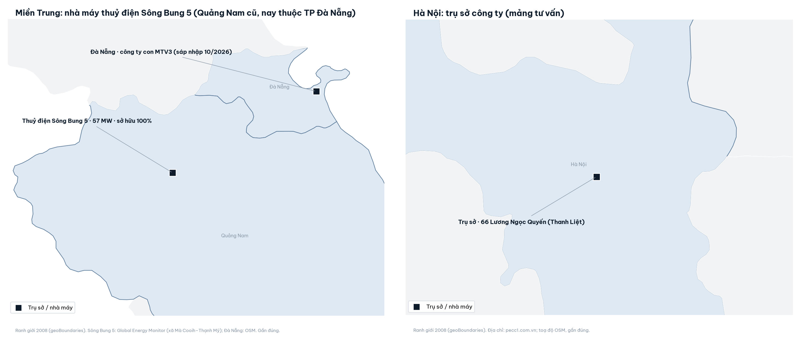

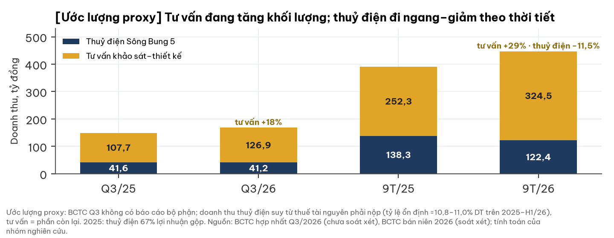

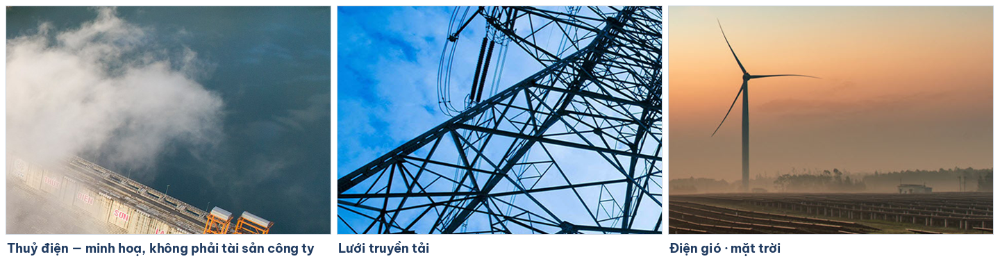

Ảnh: website pecc1.com.vn, chỉ minh hoạ lĩnh vực tư vấn; **không phải** Sông Bung 5 hay tài sản cụ thể của công ty.

## 4. Tài chính: lợi nhuận tốt, chất lượng quý 3 cần thận trọng

**Lãi 9T tăng 44% ở giá điện cũ; lãi quý 3 có phần một lần chưa thuyết minh.**

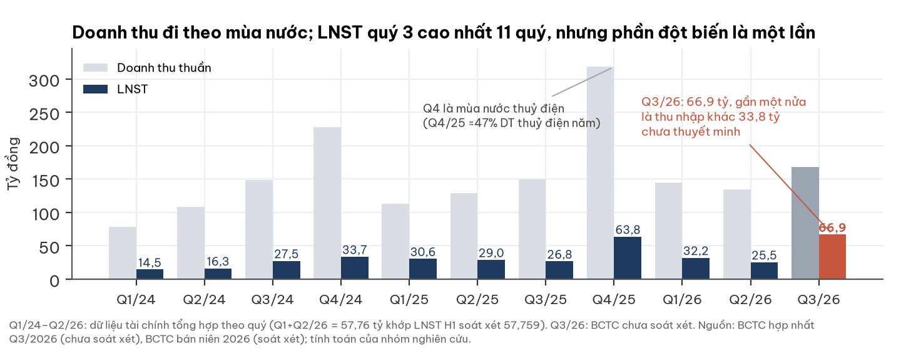

| Quý 3/2026 (BCTC chưa soát xét) | Số | Đọc |
|---|---|---|
| Doanh thu · LNST | 168,1 · 66,9 | Q3/25: 149,3 · 26,8 |
| Thu nhập khác (ròng 31,9) | 33,8 | chưa thuyết minh |
| Dự phòng giảm trong quý | 24,9 | phần lớn phi tiền mặt |
| LNST lõi (ước lượng) | 16–45 hoặc 31–45 | tuỳ hoàn nhập ghi vào đâu |

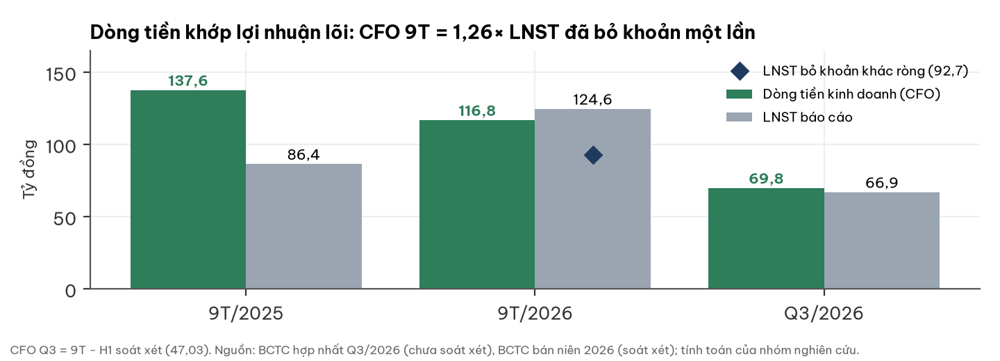

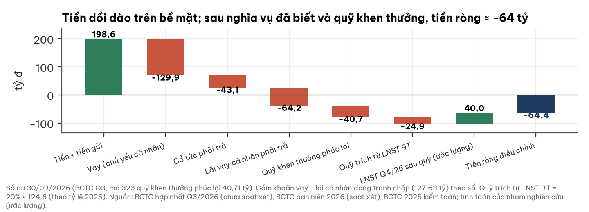

- Tiền ròng điều chỉnh −64,4 tỷ gồm quỹ khen thưởng phúc lợi đã trích 40,7 tỷ và khoản vay cá nhân đang tranh chấp (127,6 tỷ gốc + lãi, đã trong sổ).
- Quỹ khen thưởng 20% LNST; chi trả cổ tức 27% (FY2025); không trả cổ tức tiền FY2016–22.
- **Cờ độ tin cậy số liệu kế toán:** thuyết minh Q3 ghi dự phòng phải thu khách hàng đầu năm 63,2 tỷ, lệch 26,7 tỷ so với BCTC 2025 đã kiểm toán (89,9); tổng dự phòng trên bảng cân đối (mã 136) lệch thuyết minh khoảng 15 tỷ; vốn chủ sở hữu điều chỉnh trực tiếp +8,9 tỷ ở H1. Chủ tịch HĐQT và phó phòng tài chính–kế toán bị khởi tố, trong vụ có tội danh về kế toán, nên độ tin cậy số liệu các năm 2023–25 là một rủi ro còn mở; BCTC kiểm toán FY2026 (dự kiến 03/2027) sẽ là mốc xác nhận. Nền biên tư vấn 2024–26 trùng giai đoạn dự án 500 kV mạch 3 đang được điều tra.

## 5. Định giá: tổng các phần, dựng độc lập với giá thị trường

**Tâm ≈18.100 đ/cp; dải chính 11.400–24.200; giá 19.500 trong dải.**

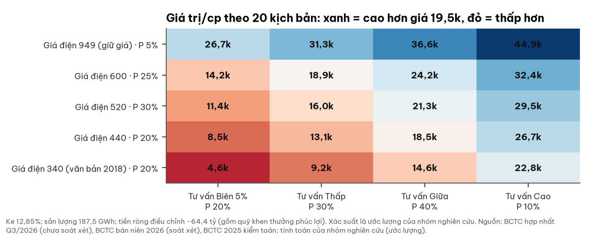

- Thuỷ điện: DCF dòng tiền chủ sở hữu 2027–08/2059 (hết thuê đất), sản lượng 187,5 GWh/năm (bình quân dài hạn 185–190), sau quỹ khen thưởng 20%.
- Tư vấn: DCF 2027–32 + giá trị cuối kỳ tăng 5%/năm; vốn lưu động 49% phần doanh thu tăng thêm. Điện mặt trời lòng hồ (≈800 tỷ): **không tính** (chưa có giá bán, IRR ước ≈6,8%).
- Ke 12,85% (dải nội địa 12,3–13,4%; β 1,1); Ke 12,3% → 19.100, 13,4% → 17.200; nếu dùng mức chiết khấu thị trường chung 15,1% thì tâm ≈14.800.

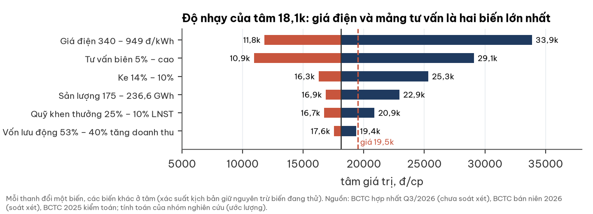

**Bối cảnh lãi suất (tham khảo):** mức chiết khấu thị trường chung đang ngầm định 15,1% (147 mã, 30/10/2026; phân vị 75% từ 2014; đỉnh 2022 15,9%, đáy 2022–23 12,1%), cao hơn Ke áp cho TV1. TPCP 10 năm 4,58% (02/11/2026; +0,63 điểm % trong 12 tháng; nguồn chưa đối chiếu độc lập).

## 6. Điều thị trường có thể chưa phản ánh — và có thể đã phản ánh quá tay

| Có thể chưa phản ánh | Bằng chứng | Kiểm bằng |
|---|---|---|
| Đường ống tư vấn đã khoá doanh thu 2026–27 | ký mới 835,1 tỷ (1,9× doanh thu tư vấn), trả trước +33%, doanh thu tư vấn 9T +29% (doanh thu hợp nhất +14%) | doanh thu tư vấn FY2026 ≥500 tỷ |
| Mốc hạ giá có thể chậm | 2022 đã qua không hạ; EVN không đơn phương hạ | doanh thu thuỷ điện Q1/2027 |
| Vị thế thiết kế gốc thuỷ điện mở rộng | Tuyên Quang mở rộng: dự thầu duy nhất | gói Sơn La/Lai Châu mở rộng |
| Giả thuyết: điều chỉnh quy hoạch sinh thêm việc thiết kế lại | chưa có số | kết quả thầu 2027 |

| Có thể đã phản ánh quá tay — hoặc thị trường đúng | Bằng chứng |
|---|---|
| Giá điện về ≈340 | mức duy nhất có văn bản phê duyệt; công ty viết "sụt giảm" |
| Biên tư vấn không bền | âm 2022–23; cạnh tranh gay gắt; ký mới 2024 ≈280 tỷ |
| Rủi ro pháp lý và truy thu | khởi tố lãnh đạo; truy thu tiềm năng ≈659 tỷ trước thuế |
| Cổ đông thiểu số nhận ít | chi trả 27%, quỹ khen thưởng 20%, 7 năm không cổ tức tiền |
| Độ tin cậy số liệu kế toán | thuyết minh Q3 lệch BCTC kiểm toán 26,7 tỷ (dự phòng phải thu đầu năm); lệch ≈15 tỷ tổng dự phòng; vốn chủ điều chỉnh +8,9 tỷ; tội danh kế toán trong vụ án; biên tư vấn 2024–26 trùng giai đoạn dự án đang điều tra |

## 7. So sánh ngành (peer) — đối chiếu sau định giá

**32 mã thuỷ điện giao dịch ở P/E trung vị ≈9x, tỷ suất cổ tức người trả trung vị ≈7–8%/năm; TV1 ≈3x trên lợi nhuận hiện hành vì lợi nhuận đó sắp đổi.**

| Nhóm / mã (02/11/2026) | P/E | P/B | Cổ tức 12T | ROE |
|---|---|---|---|---|
| Thuỷ điện — toàn nhóm (32 mã, trung vị 2026) | 9,2x | 1,9x | 7,9% | 20,6% |
| Thuỷ điện — UPCOM (13 mã) | 8,8x (p25 7,9x) | 1,95x | 5,4% | 21,6% |
| TV2 · TV3 · TV4 (tư vấn điện) | 8,4x · 7,7x · 5,1x | 1,33x · 0,80x · 0,98x | 3,8% · 3,7% · 8,0% | 8,9% · 11,3% · 15,3% (5 năm) |
| **TV1** | **2,8x** (3,3x lõi) | 0,91x | 7,7% (FY2025) | 29,4% (gồm khoản một lần) |

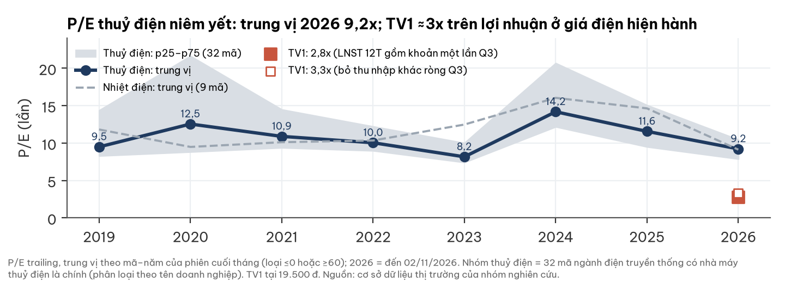

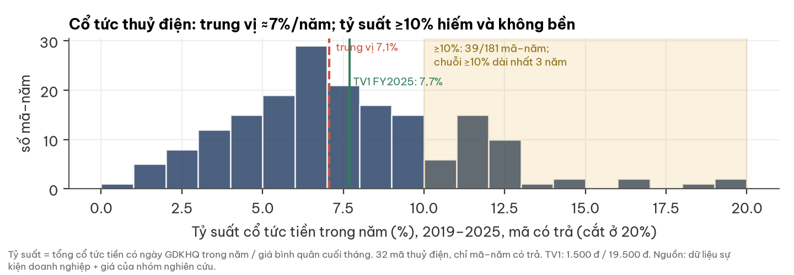

- Tỷ suất cổ tức ≥10% không bền (21% số mã–năm): 39/181 mã–năm 2019–25; chuỗi dài nhất 3 năm.
- Đối chiếu bằng bội số peer (LNST thuỷ điện 2028 kỳ vọng × 7,9–9,2x; tư vấn ≈45 tỷ × 6,0–9,2x; tiền ròng): **13.900–20.300 đ/cp**, giao với dải nội tại.

## 8. Pháp lý & quản trị — WARNING (không nằm trong tâm)

**Kênh tác động lên công ty là cấm thầu, buộc nộp lợi bất chính và truy thu giá điện — không phải truy cứu hình sự pháp nhân.**

| Hạng mục | Nội dung (có nguồn) |
|---|---|
| Vụ EVNNPT/PC1 | 07/05/2026 khởi tố Chủ tịch HĐQT và phó phòng tài chính–kế toán; tội danh gồm đấu thầu, kế toán, tham ô, hối lộ; chưa có kết luận |
| VnExpress 02/07/2026 | "13 công ty bị xác định có liên quan", gồm các công ty tư vấn xây dựng điện 1–4; The Investor ghi 13 **người** — hai nguồn không khớp |
| Khung pháp lý (tham khảo, cần luật sư) | Đ.76 BLHS không gồm 5 tội danh ⇒ pháp nhân không bị truy cứu hình sự; cấm thầu 3–5 năm (NĐ 214/2025 Đ.133) |
| Kiểm toán | 2025 A&C chấp nhận toàn phần; soát xét H1/2026 An Việt có hai đoạn nhấn mạnh; An Việt kiểm toán 2026 |

| Độ nhạy riêng (không cộng vào tâm) | Δ đ/cp |
|---|---|
| Cấm thầu EVN 3 năm, doanh thu tư vấn −50% · 5 năm · 3 năm −70% | −8.300 · −13.300 · −11.700 |
| Buộc nộp lợi bất chính 20 / 50 / 100 tỷ | −660 / −1.660 / −3.320 |
| Truy thu giá điện 2022–26 nếu áp hồi tố đủ | −17.500 |

- Phạm vi tra cứu: BCTC, CBTT và báo chí đến 02/11/2026; "không thấy" không có nghĩa là không có.

## 9. Rủi ro và mốc kiểm hai chiều

| Mốc / rủi ro | Ngày | Chiều tích cực | Chiều tiêu cực |
|---|---|---|---|
| Văn bản giá điện Sông Bung 5 2027+ | 01–04/2027 | ≥600 đ/kWh hoặc mốc lùi | ≈340; truy thu |
| LNST và doanh thu thuỷ điện Q4/2026 | ≈30/01/2027 | LNST ≥45 tỷ | <25 tỷ |
| Doanh thu, biên tư vấn FY2026 | ≈03/2027 | ≥500 tỷ, biên ≥11% | biên ≤5% |
| Thuyết minh thu nhập khác 33,8 tỷ; ý kiến kiểm toán | ≈03/2027 | giữ nguyên; chấp nhận toàn phần | điều chỉnh; ngoại trừ |
| Kết luận vụ án | khi công bố | không cấm thầu | cấm thầu EVN |
| Cổ tức FY2026 | ≈04/2027 | ≥1.500 đ | <1.000 đ |
| Điện mặt trời lòng hồ | khi có chủ trương | có giá bán, vốn không pha loãng | ≈800 tỷ vay khi chưa có giá |

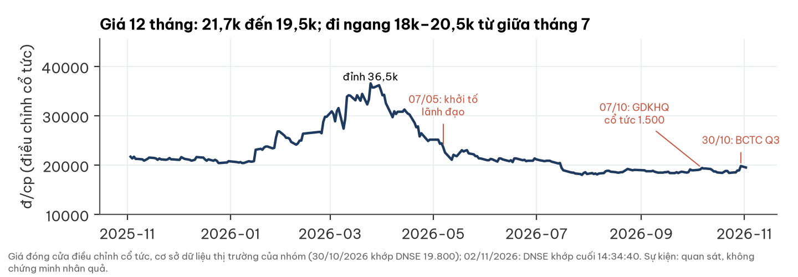

## Phụ lục A — Số BCTC chính (tỷ đồng)

| Chỉ tiêu | Q3/26 | Q3/25 | 9T/26 | 9T/25 |
|---|---|---|---|---|
| Doanh thu thuần | 168,1 | 149,3 | 446,9 | 390,6 |
| LNTT · LNST | 77,0 · 66,9 | 34,0 · 26,8 | 150,5 · 124,6 | 106,5 · 86,4 |
| Tài chính ròng · khác ròng | +1,1 · +31,9 | −2,4 · −4,4 | −1,3 · +31,7 | −7,5 · −4,6 |
| CFO | ≈69,8 | | 116,8 | 137,6 |
| 30/09/26: tiền · tiền gửi · vay · VCSH · quỹ khen thưởng | 30,7 · 167,8 · 129,9 · 574,7 · 40,7 | | | |

## Phụ lục B — Đối chiếu dữ liệu

- Dữ liệu tài chính tổng hợp: Q1+Q2/2026 khớp LNST bán niên soát xét (57,76). EBIT tư vấn tách từ dữ liệu này khớp báo cáo bộ phận kiểm toán 2025 (37,7 so 36,8).
- Tỷ suất cổ tức 12 tháng hiển thị ≈10,8% vì hai đợt rơi cùng 12 tháng; báo cáo dùng 7,7% (FY2025).

## Phụ lục C — Nguồn

- BCTC hợp nhất Q3/2026 (chưa soát xét), bán niên 2026 (An Việt soát xét), 2025 kiểm toán (A&C); BCTN 2025; CBTT — pecc1.com.vn.
- Giá: DNSE (02/11/2026 14:34:40; đóng cửa 30/10). Lịch sử giá, P/E, cổ tức ngành: cơ sở dữ liệu thị trường của nhóm (32 mã thuỷ điện, 9 nhiệt điện; TV2–TV4).
- Giá điện Sông Bung 5: PECC1, "Báo cáo phương án bán toàn bộ tài sản NMTĐ Sông Bung 5", 8/2018; BCTN 2025 tr.38. Pháp lý: Luật Điện lực 61/2024, TT 12/2025/TT-BCT, QĐ 1127/QĐ-BCT, BLHS, Luật Đấu thầu 22/2023, NĐ 214/2025.
- Tư vấn: baodauthau.vn (19/01/2026 kết quả 2025; 30/03/2026 gói 5 Krông Buk–Tây Ninh 1; 30/04/2026 ĐHĐCĐ); vietnamfinance.vn 11/2025; TT 38/2026/TT-BXD PL VIII; EVN; Bộ Công Thương 15/09/2026. Vụ án: VnExpress 02/07/2026; The Investor.
- Logo, ảnh: pecc1.com.vn. Toạ độ: Global Energy Monitor, OpenStreetMap; ranh giới geoBoundaries 2008 — gần đúng.

## Phụ lục D — Phương pháp và giới hạn

- Định giá nội tại dựng độc lập từ BCTC, quy định và dữ liệu ngành, không dùng giá thị trường làm đầu vào; bội số peer chỉ đối chiếu chéo sau đó.
- Giá trị = DCF thuỷ điện (5 kịch bản giá ròng) + DCF tư vấn (4 kịch bản) + tiền ròng điều chỉnh; tâm = kỳ vọng theo xác suất. Xác suất là phán đoán có căn cứ, không đo thống kê.
- Biên tư vấn lịch sử: EBIT hợp nhất theo quý trừ kết quả bộ phận thuỷ điện (2022–24 mô hình hoá).
- Giới hạn: chưa có văn bản hợp đồng sửa đổi; mức 500–600 chưa đối chiếu bản gốc; BCTC Q3 chưa soát xét; sản lượng 2019–20, 2024 suy ra; khung pháp lý chưa có ý kiến luật sư; điện mặt trời lòng hồ không định giá.

## Phụ lục E — Quy trình độc lập

Số liệu đối chiếu BCTC gốc → người đọc ngành độc lập (không biết mã, giá) → định giá nội tại dựng độc lập với giá thị trường → người phản biện độc lập kiểm số liệu, nguồn và độ cân bằng → đối chiếu chéo bội số peer. Mọi phép tính tái lập được từ mã và dữ liệu lưu cùng báo cáo.

## Phụ lục F — Tuyên bố miễn trừ trách nhiệm

Tài liệu này chỉ nhằm mục đích cung cấp thông tin nghiên cứu, không phải lời khuyên, chào mời hay khuyến nghị mua, bán hoặc nắm giữ bất kỳ chứng khoán nào, và không tính đến mục tiêu, tình hình tài chính hay nhu cầu của bất kỳ cá nhân nào. Thông tin dựa trên nguồn công khai được cho là đáng tin cậy nhưng không được bảo đảm về độ chính xác hay đầy đủ; các ước lượng, kịch bản và xác suất là đánh giá tại thời điểm 02/11/2026 và có thể thay đổi mà không cần thông báo. Hiệu quả trong quá khứ không bảo đảm kết quả tương lai. Nhà đầu tư cần tự đánh giá và tham khảo tư vấn chuyên môn trước khi ra quyết định. Logo và hình ảnh thuộc quyền của doanh nghiệp, chỉ dùng để nhận diện, không hàm ý doanh nghiệp tài trợ hay xác nhận báo cáo.
