# TV2 — CTCP Tư vấn Xây dựng Điện 2 (PECC2): bốn hợp đồng EPC đưa lợi nhuận về đỉnh chu kỳ cũ, nhưng giá 27.000 đ đã cao hơn giá trị kỳ vọng ≈31% khi neo đúng mức P/E thị trường từng trả ở đỉnh

**Báo cáo Due Diligence · 01/11/2026 · Nhóm nghiên cứu** · HOSE · Tư vấn, tổng thầu EPC và vận hành nhà máy điện · số liệu tỷ đồng trừ khi ghi khác

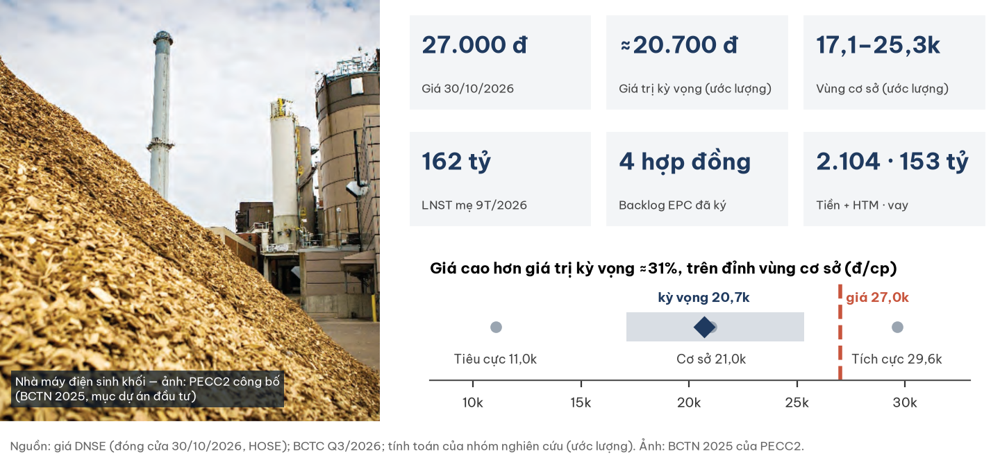

## Investment Summary

**Giá 27.000 đ (đóng cửa 30/10/2026) cao hơn giá trị kỳ vọng ≈20.700 đ khoảng 31% và nằm TRÊN vùng giá trị hợp lý cơ sở 17.100–25.300 đ (ước lượng).** Doanh nghiệp đang tốt lên thật; điều giá chưa phản ánh đủ là lợi nhuận này mang tính chu kỳ.

| Dữ liệu chính | Giá trị | Ghi chú |
|---|---|---|
| Giá · vốn hoá | **27.000 đ** · 1.823 tỷ | DNSE, khớp cuối 14:45:07 ngày 30/10/2026; 67,53 tr cp |
| Giá trị kỳ vọng · vùng cơ sở | **≈20.700 · 17.100–25.300 đ** | 3 kịch bản 25/50/25, P/E 7–9x (ước lượng) |
| LNST mẹ 9T/2026 · ước cả năm | 162,2 · 217–242 | đạt 163% kế hoạch hợp nhất cả năm (≈100) |
| P/E 2026E · P/B | 7,5–8,4x · 1,37x | P/E trung vị pha lợi nhuận đỉnh 2017–21: 7,45x |
| Tiền + đầu tư nắm giữ đến hạn · vay | 2.104 · 153 | gần như toàn bộ tiền là tiền khách ứng 2.419 |
| Phơi nhiễm bên liên quan CMC | ≈855 = **64% vốn chủ mẹ** | phải thu 666 + đầu tư 189, chưa dự phòng |
| Cổ tức · thanh khoản | 1.000 đ/cp (3,7%) · 3,05 tỷ/phiên | thanh khoản: trung vị 20 phiên |

**Ba điều cần biết**

1. **Tăng trưởng là thật:** 4 hợp đồng EPC đã ký (Ô Môn IV, hai nhà máy sinh khối eREX, điện gió Tân Thuận GĐ3) kéo doanh thu đến 2028; lõi đã chiếm 62% lãi trước thuế quý 3.
2. **Nhưng đây là đỉnh chu kỳ, chưa phải nền mới:** 2017–21 TV2 cũng lãi 214–272 tỷ rồi giảm ≈70% khi hết hợp đồng; khi đó thị trường chỉ trả ≈7,45x lợi nhuận.
3. **Giá 27.000 đ cần lợi nhuận ≈245 tỷ/năm bền vững ở 7,45x**, tức mức đỉnh 2026 kéo dài sang 2027–28 — nghiêng về kịch bản tích cực.

| Điều làm nhận định đổi | Điều kiện | Kiểm tại |
|---|---|---|
| Tích cực hơn | Phải thu CMC giảm ≥30% sau khi Tân Thuận GĐ3 vận hành; hợp đồng EPC mới có giá trị công bố; kiểm toán 2026 chấp nhận toàn phần | BCTC Q4 & kiểm toán 2026 (01–03/2027) |
| Tiêu cực hơn | Phải thu CMC >700 tỷ hoặc trích lập; GĐ3 trượt sang 2027; biên gộp quý <8%; pháp nhân bị nêu trong vụ án | cùng mốc; vụ án: khi có kết luận |

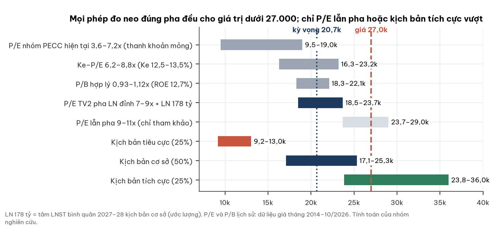

## 1. Tóm tắt điều hành

**Một công ty tư vấn điện ít nợ đang ở đầu chu kỳ EPC thứ hai; câu hỏi là chu kỳ này dài hơn chu kỳ trước bao nhiêu.**

- **Tình huống:** 9T/2026 doanh thu 1.199 tỷ (+56%), lãi trước thuế 195 tỷ (×3,7); tiền khách ứng tăng lên 2.419 tỷ.
- **Vấn đề:** 44% lãi 9 tháng là lãi trên tiền khách ứng; phơi nhiễm bên liên quan CMC 64% vốn chủ; cựu lãnh đạo bị khởi tố.
- **Trả lời:** neo P/E theo đúng pha chu kỳ, giá cao hơn giá trị kỳ vọng 21–38% trong mọi biến thể có căn cứ.

## 2. Thị trường đang định giá gì

**Ở 27.000 đ, thị trường coi lợi nhuận đỉnh 2026 là bền vững cho 2027–28.**

| Phép định giá ngược (ước lượng) | Giá trị |
|---|---|
| Lợi nhuận bền vững ngầm định ở P/E 7,45x / 9x | **≈245 / ≈203 tỷ** (cơ sở: 165–190) |
| Xác suất kịch bản tích cực cần có (nếu tiêu cực vẫn 25%) | không đạt được — trần kỳ vọng ≈25.000 đ |
| Xác suất tích cực cần có nếu bỏ hẳn kịch bản tiêu cực | ≈70% |

- P/E dùng là mức thị trường thực trả cho chính TV2 khi lãi 214–272 tỷ (2017–21), không phải P/E thời lợi nhuận đáy.
- Phía tích cực có căn cứ: ở pha lợi nhuận đáy, thị trường vẫn định TV2 ≥1,04x sổ sách mọi tháng từ 2017.

## 3. Ngành: nhu cầu điện tăng mạnh, nhưng nhịp đầu tư do Nhà nước gác cổng

**Người đọc ngành độc lập đánh giá chu kỳ đi lên về nhu cầu tư vấn, nhưng nhịp giải ngân phụ thuộc phê duyệt hành chính.**

| Yếu tố ngành (đọc độc lập, 28/10/2026) | Trạng thái | Ảnh hưởng TV2 |
|---|---|---|
| Thiếu hụt nguồn điện | ≈4,3 GW 2027 → ≈14 GW 2030 | cầu tư vấn, EPC dài hạn |
| Quy hoạch điện VIII | ≈45% công suất chưa có chủ trương | còn ở pha tư vấn — thuận lợi |
| Đầu tư lưới EVN 2026 | đi ngang ≈123 nghìn tỷ; 500kV khởi công 2/28 kế hoạch 9T | mảng lưới co lại |
| Cạnh tranh | 4 công ty tư vấn gốc EVN; gói 500kV 1–2 nhà thầu | vị thế vững trong nước |
| Rủi ro | LNG, điện gió ngoài khơi, hạt nhân có thể vào tay tư vấn/EPC ngoại | trần tăng trưởng |

- Động lực 2026–28 của TV2 là **EPC nguồn điện** (khí PVN, sinh khối Nhật, gió) — nằm ngoài trần tài chính của EVN.

## 4. Doanh nghiệp: từ tư vấn thiết kế sang tổng thầu và vận hành

**PECC2 thiết kế, xây và vận hành nhà máy điện; EVN nắm 51,33%.**

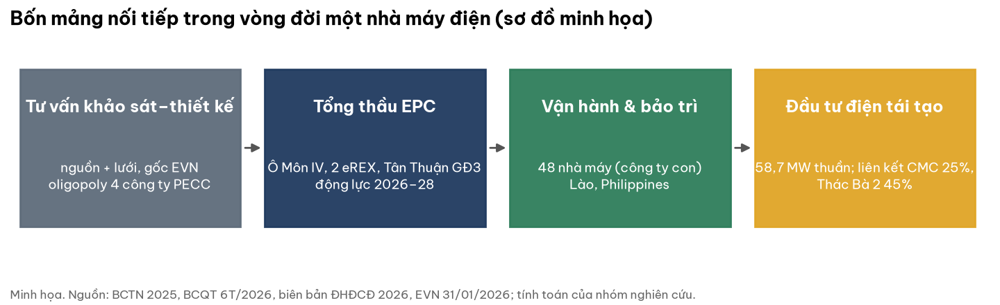

- 40 năm hoạt động (lễ kỷ niệm trong BCTN 2025); trụ sở Thủ Đức, TP.HCM; 1.432 lao động; ≈50 kỹ sư hạt nhân.
- Công ty con vận hành–bảo trì 48 nhà máy, gồm hợp đồng tại Lào (điện gió Monsoon 600 MW).
- Đầu tư 7 dự án tái tạo, 58,7 MW thuần; Hậu Giang sinh khối và Thác Bà 2 phát điện 04/2025.

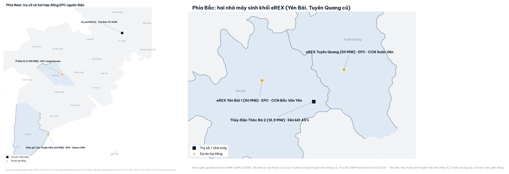

| Hợp đồng EPC đã ký | Chủ đầu tư | Quy mô | Vận hành dự kiến | Tiền khách ứng 30/09 |
|---|---|---|---|---|
| Ô Môn IV (Cần Thơ), liên danh Doosan | PVN | 1.155 MW khí | 12/2028 | 467 (suy luận) |
| eREX Yên Bái 1 | eREX (Nhật) | 50 MW sinh khối | đầu 2028 | 929 |
| eREX Tuyên Quang | eREX (Nhật) | 50 MW sinh khối | ≈2028 | 914 |
| Điện gió Tân Thuận GĐ3 (Cà Mau) | CMC (liên kết 25%) | 25 MW | Q4/2026 | — |

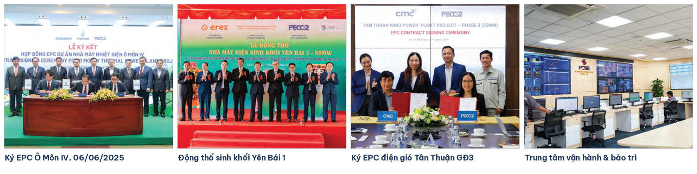

*Ảnh: PECC2 công bố, BCTN 2025. Giá trị từng hợp đồng không được công bố.*

## 5. Tài chính dựng từ dưới lên

### 5a. Chu kỳ lợi nhuận

**Lợi nhuận 2026 đang quay về đỉnh chu kỳ trước, chưa vượt.**

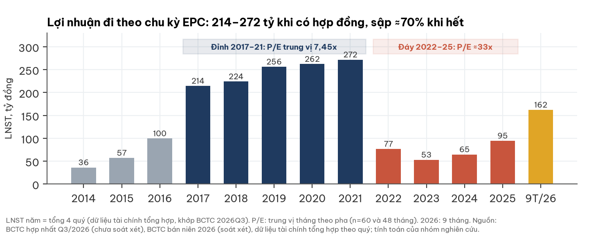

- Ước LNST 2026: 217–242 tỷ (EPS 3.200–3.600 đ) vs 3.180–4.030 đ giai đoạn 2017–21 (quy về số cổ phiếu hiện tại).
- Kế hoạch năm của ban lãnh đạo thận trọng: 9 tháng đã đạt 163%; biên lãi ròng thực tế 13,6%.

### 5b. Chất lượng lợi nhuận

**Phần lõi tăng nhanh và biên gộp giữ được; nhưng lãi tiền gửi trên tiền khách ứng vẫn là trụ lớn.**

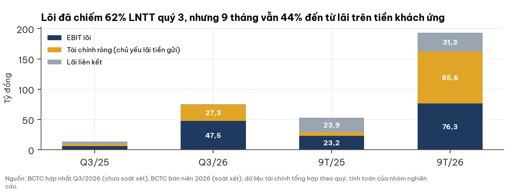

- Biên gộp hợp nhất 15,7% dù doanh thu gần gấp đôi; biên gộp công ty mẹ (nơi làm EPC) chỉ 9,7%.
- Lãi tiền gửi là tiền thật (thu 109 tỷ lãi và cổ tức 9T) nhưng sẽ co khi tiền ứng được chi cho thiết bị.

### 5c. Tiền và dòng tiền

**Không có rủi ro thanh khoản, nhưng cũng không có tiền dư đáng kể của cổ đông.**

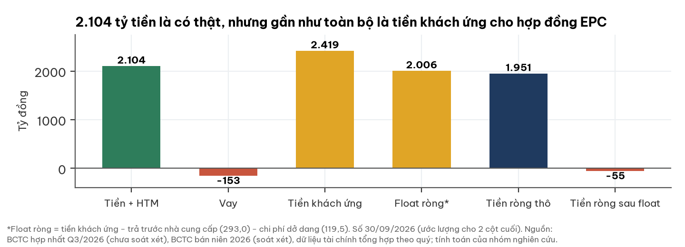

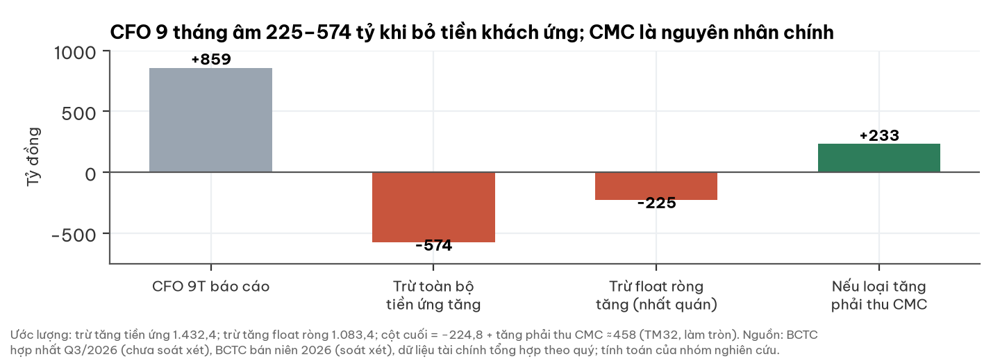

- Định giá dùng P/E trên lợi nhuận đã gồm lãi tiền gửi nên **không cộng thêm tiền mặt**.

### 5d. Bên liên quan CMC

**Phải thu CMC tăng hơn gấp ba trong 9 tháng; khả năng thu phụ thuộc dòng tiền GĐ3 sau vận hành.**

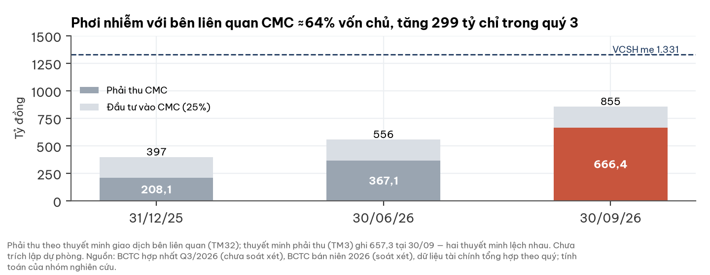

- Tích cực: CMC tái cơ cấu nợ 2025, bắt đầu có lãi; GĐ3 dùng chung hạ tầng 75 MW đang vận hành.
- Tiêu cực: GĐ1–2 vay USD lỗ luỹ kế; không có BCTC CMC; mất 50% phơi nhiễm ≈ −5.100 đ/cp (ước lượng).

## 6. Giá cổ phiếu và sự kiện

**Giá giảm 21,6% từ đầu năm nhưng vẫn ở trên vùng cơ sở.**

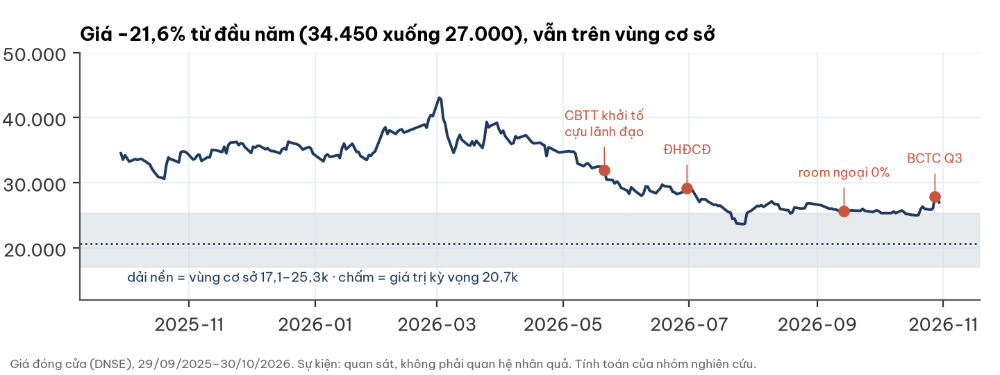

- Quan sát, không phải nhân quả: phiên 28/10 (ngày ký BCTC Q3) +6,9% với 1,01 triệu cổ phiếu.
- Room ngoại về 0% từ 14/09/2026: khối ngoại (7,28% cuối 2025) không mua thêm được.

## 7. Định giá

**Ba kịch bản neo P/E pha lợi nhuận đỉnh cho giá trị kỳ vọng ≈20.700 đ; vùng cơ sở 17.100–25.300 đ.**

| Kịch bản | Xác suất | Điều kiện (LNST bình quân 2027–28) | P/E | Giá trị |
|---|---|---|---|---|
| Tích cực | 0,25 | 230–270 tỷ: hợp đồng mới (khí, Philippines, hạt nhân), CMC trả đủ | 7–9x | **23.800–36.000** (tâm ≈29.600) |
| Cơ sở | 0,50 | 165–190 tỷ: 4 hợp đồng đúng tiến độ, lãi tiền gửi giảm còn 50–70 | 7–9x | **17.100–25.300** (tâm ≈21.000) |
| Tiêu cực | 0,25 | 100–120 tỷ: vượt chi phí EPC, CMC trích lập ≈100 tỷ một lần | 7–8x | **9.200–13.000** (tâm ≈11.000) |

| Độ nhạy | Giá trị kỳ vọng | Giá so kỳ vọng |
|---|---|---|
| **Cơ sở: 25/50/25, P/E 7–9x** | **≈20.700** | **+31%** |
| Trọng số 30/50/20 · 20/50/30 | ≈19.700 · ≈21.600 | +37% · +25% |
| P/E 6,5–8,5x · 7,5–10x | ≈19.600 · ≈22.400 | +38% · +21% |
| Tiêu cực định theo sổ sách 0,8–1,0x | ≈22.100 | +22% |
| P/E 9–11x (lẫn pha lợi nhuận đáy — chỉ tham khảo) | ≈25.200 | +7% |

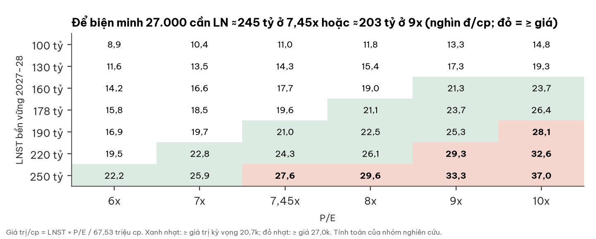

- Vùng cơ sở dựng góc-tới-góc (165 tỷ × 7x … 190 tỷ × 9x); dựng một chiều hẹp hơn: 18.400–23.700 đ.
- Giá chỉ vào vùng cơ sở khi **cùng lúc** lợi nhuận ≥203 tỷ và P/E 9x.
- Kịch bản tiêu cực ứng ≈0,56x sổ sách — thấp hơn mọi tháng từ 2014; vì vậy có dòng độ nhạy định theo sổ sách.

## 8. Rủi ro — pre-mortem

**Rủi ro lớn nhất là lợi nhuận quay về nền cũ khi hết hợp đồng; bảng cân đối không phải điểm yếu.**

| Rủi ro | Xác suất | Tác động | Dấu hiệu sớm | Ngày kiểm |
|---|---|---|---|---|
| R1 Không có hợp đồng mới sau 2028 | TB | cao | không công bố EPC mới đến 06/2027 | 30/06/2027 |
| R2 CMC chậm trả/trích lập | TB | cao | phải thu >700 tỷ | BCTC Q4/2026 |
| R3 Vượt chi phí EPC (thiết bị nhập, tỷ giá) | TB | TB–cao | biên gộp quý <8% | hằng quý |
| R4 Lãi tiền gửi co nhanh | cao | TB | tài chính ròng −50% so cùng kỳ | hằng quý |
| R5 Vụ án mở rộng sang pháp nhân | thấp–TB | cao | kết luận điều tra | khi công bố |
| R6 Kiểm toán 2026 có ngoại trừ | thấp | cao | ý kiến kiểm toán | 03/2027 |
| R7 Room ngoại 0% kéo dài | TB | thấp–TB | ĐHĐCĐ 2027 không sửa ngành nghề | 06/2027 |

## 9. Pháp lý & quản trị — WARNING (trung bình–cao, không chặn phân tích)

**Cựu lãnh đạo bị khởi tố, nhưng pháp nhân chưa bị nêu và kiểm toán vẫn được duy trì.**

| Hạng mục | Nội dung | Đánh giá |
|---|---|---|
| Vụ án EVNNPT/PC1 | Cựu Chủ tịch và cựu Kế toán trưởng bị khởi tố tội tham ô tài sản (Đ.353), VKSND tối cao phê chuẩn 05/2026 | chưa kết luận điều tra |
| Họp báo Bộ Công an 02/07/2026 | 13 pháp nhân vi phạm, gồm "các công ty tư vấn xây dựng điện" (không nêu tên) | chưa xác định TV2 có trong danh sách |
| Kiểm toán | EY chấp nhận toàn phần FY2025; UHY soát xét H1/2026 chấp nhận, có đoạn nhấn mạnh vụ án; **đã ký kiểm toán 2026 với UHY (15/07/2026)** | tích cực; Q3 chưa soát xét |
| Giao dịch bên liên quan | NQ HĐQT 29/10/2026: hợp đồng tổng thầu với bên liên quan do HĐQT/TGĐ duyệt, ngoài ngưỡng 35% trình ĐHĐCĐ | chưa thẩm định pháp lý; cần theo dõi |
| Sở hữu | EVN 51,33%; ĐHĐCĐ 2026: cổ đông ngoài EVN dự ≈41% số cổ phiếu của họ | tập trung |
| Nhân sự | Chủ tịch mới từ 30/06/2026; phụ trách kế toán mới từ 17/07/2026 | đang chuyển giao |

## 10. Mốc kiểm chứng hai chiều

| Mốc | Ngày | Xác suất chiều tích cực | Nếu tích cực | Nếu tiêu cực |
|---|---|---|---|---|
| Tân Thuận GĐ3 vận hành thương mại | ≤31/12/2026 | 0,55 | CMC có dòng tiền trả nợ | trượt sang 2027 |
| Phải thu CMC ≤470 tỷ | 01–03/2027 | 0,35 | giảm chiết khấu rủi ro | >700 tỷ hoặc trích lập |
| LNST hợp nhất 2026 ≥230 tỷ | ≈30/01/2027 | 0,50 | nghiêng kịch bản tích cực | <200 tỷ |
| CFO 2026 trừ float ròng ≥0 | 03/2027 | 0,30 | chất lượng lợi nhuận tốt hơn | < −300 tỷ |
| Kiểm toán 2026 chấp nhận toàn phần | 03/2027 | 0,70 | giảm rủi ro quản trị | ngoại trừ/từ chối |
| Hợp đồng EPC/tư vấn mới có giá trị | ≤30/06/2027 | 0,45 | kéo dài chu kỳ, biện minh P/E cao hơn | không có |
| Room ngoại được nâng | ≈06/2027 | 0,60 | mở lại người mua nước ngoài | giữ 0% |

## Phụ lục A — Số BCTC chính (tỷ đồng)

| Chỉ tiêu | Q3/26 | Q3/25 | 9T/26 | 9T/25 |
|---|---|---|---|---|
| Doanh thu thuần | 517,1 | 253,8 | 1.199,2 | 769,5 |
| Biên gộp hợp nhất | 17,5% | 16,0% | 15,7% | 15,5% |
| EBIT lõi · tài chính ròng · liên kết | 47,5 · 27,3 · 0,7 | 5,9 · 3,4 · 4,5 | 76,3 · 85,6 · 31,3 | 23,2 · 5,7 · 23,9 |
| Lãi trước thuế | 76,4 | 14,8 | 195,4 | 52,3 |
| CFO (báo cáo) | −125,3 | | +858,6 | |
| 30/09/26: tiền + HTM · vay · tiền khách ứng | 2.104,2 · 152,8 · 2.418,6 | | | |
| 30/09/26: phải thu CMC (TM32 / TM3) · VCSH mẹ | 666,4 / 657,3 · 1.331 | | | |

## Phụ lục B — Đối chiếu dữ liệu thị trường với BCTC

- Dữ liệu tài chính tổng hợp đã có quý 3/2026: LNST mẹ 60,77 khớp BCTC (61,04 gồm cổ đông thiểu số).
- Tiền theo dữ liệu tổng hợp 1.059,7 chỉ gồm tiền và tương đương, thiếu 1.044,5 đầu tư nắm giữ đến hạn — không dùng cho tiền ròng.
- P/E dữ liệu tổng hợp ngày 30/10 là 8,6x (lợi nhuận 4 quý); P/E 2026E 7,5–8,4x (ước lượng) — khác cơ sở.

## Phụ lục C — Nguồn

- BCTC hợp nhất và riêng Q3/2026 (ký 28/10/2026, chưa soát xét); BCTC hợp nhất bán niên 2026 (UHY soát xét); công văn giải trình 4270/PECC2-TCKT; BCTN 2025; NQ và biên bản ĐHĐCĐ 2026; BC quản trị 6T/2026; CBTT room ngoại 14/09/2026; NQ HĐQT 29/10/2026; CBTT hợp đồng kiểm toán 2604/PECC2-TC&PC — pecc2.com.
- Giá: DNSE (khớp cuối 14:45:07 30/10/2026; HOSE). Lịch sử P/E, P/B tháng 2014–10/2026 và lợi nhuận quý: cơ sở dữ liệu tài chính tổng hợp của nhóm.
- Hợp đồng: EVN (31/01/2026, ký EPC Yên Bái 1); The Investor (06/2025, Ô Môn IV); Mekong ASEAN (eREX); Báo Pháp luật (21/06/2026, Tân Thuận GĐ3); Nhân Dân (CCN Xuân Vân). Vụ án: Nhân Dân, Người Quan Sát (02/07/2026), họp báo Bộ Công an 01/10/2026.
- Ngành: báo cáo của người đọc ngành độc lập 28/10/2026. Logo: pecc2.com. Ảnh: BCTN 2025 (PDF tr.9, 29, 35). Toạ độ: OpenStreetMap Nominatim 01/11/2026 (gần đúng cấp xã/phường/huyện); ranh giới: geoBoundaries VNM-ADM1.

## Phụ lục D — Phương pháp và giới hạn

- Giá trị/cp = LNST bình quân 2027–28 × P/E ÷ 67,53 triệu cp. P/E 7–9x: quanh trung vị 7,45x (IQR 6,1–8,9x) của TV2 khi lợi nhuận ở đỉnh 2017–21; khớp P/E hợp lý theo chi phí vốn 12,5–13,5% (6,2–8,8x).
- Không làm DCF: dòng tiền EPC theo dự án, không có giá trị hợp đồng.
- Giới hạn: không có giá trị hợp đồng, backlog theo giá trị, cơ cấu doanh thu theo mảng; BCTC Q3 chưa soát xét, hai thuyết minh lệch nhau về phải thu CMC; không có BCTC CMC; neo P/E dựa trên một chu kỳ duy nhất; trọng số kịch bản là phán đoán.

## Phụ lục E — Quy trình độc lập

Báo cáo qua bốn bước: đọc BCTC gốc → đọc ngành độc lập (không biết mã, giá) → nhóm nghiên cứu định giá → người phản biện độc lập kiểm lại số liệu, nguồn và cân bằng lập luận. Người phản biện đã sửa:

| Điểm sửa | Trước | Sau |
|---|---|---|
| Neo P/E lịch sử | trung vị 2019+ 11,0x (lẫn P/E thời lợi nhuận đáy ≈33x) | tách pha: đỉnh 2017–21 trung vị 7,45x |
| Vùng và kỳ vọng | vùng 18.300–28.100, kỳ vọng ≈22.600; giá "trong vùng, nửa trên" | vùng 17.100–25.300, kỳ vọng ≈20.700; giá trên vùng, +31% |
| Cách dựng vùng | góc-tới-góc không nói ra | khai rõ, kèm vùng một chiều |
| Trọng số kịch bản | 25/50/25 trình bày như có căn cứ | giữ 25/50/25, thêm độ nhạy 30/50/20 và 20/50/30 |
| CFO trừ tiền ứng | một số −573 | dải −574 … −225; nêu CMC là nguyên nhân chính |
| "Biên lãi ròng ≈4%" | gán cho ban lãnh đạo | là ý kiến cổ đông về kế hoạch; thực tế 13,6%, kế hoạch đã vượt 63% |
| Pháp lý | thiếu họp báo 02/07/2026; ghi "đúng luật" cho cơ chế duyệt bên liên quan | bổ sung; bỏ khẳng định chưa thẩm định |
| Điểm tích cực bị sót | — | hợp đồng kiểm toán 2026 với UHY; kế hoạch thận trọng |
| Chi phí vốn · thanh khoản | Ke 12,3–13,4%; chỉ trung bình 5,66 tỷ | Ke 12,5–13,5%; thêm trung vị 3,05 tỷ |

## Phụ lục F — Tuyên bố miễn trừ trách nhiệm

Tài liệu này chỉ nhằm mục đích cung cấp thông tin nghiên cứu, không phải lời khuyên, chào mời hay khuyến nghị mua, bán hoặc nắm giữ bất kỳ chứng khoán nào, và không tính đến mục tiêu, tình hình tài chính hay nhu cầu của bất kỳ cá nhân nào. Thông tin dựa trên nguồn công khai được cho là đáng tin cậy nhưng không được bảo đảm về độ chính xác hay đầy đủ; các ước lượng, kịch bản và xác suất là đánh giá tại thời điểm 01/11/2026 và có thể thay đổi mà không cần thông báo. Hiệu quả trong quá khứ không bảo đảm kết quả tương lai. Nhà đầu tư cần tự đánh giá và tham khảo tư vấn chuyên môn trước khi ra quyết định. Logo và hình ảnh thuộc quyền của doanh nghiệp, chỉ dùng để nhận diện, không hàm ý doanh nghiệp tài trợ hay xác nhận báo cáo.
