# VCB — Ngân hàng TMCP Ngoại thương Việt Nam: tài sản sạch nhất và nguồn vốn rẻ nhất hệ thống, nhưng giá đã trả cho ROE bền ≈18% nên nằm trên vùng giá trị hợp lý

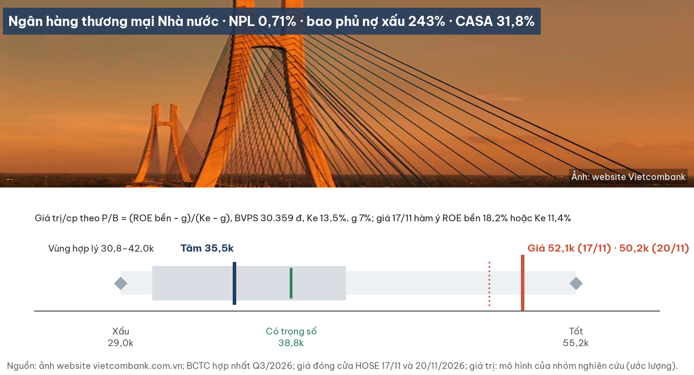

| Chỉ tiêu | Giá trị | Chỉ tiêu | Giá trị |
|---|---|---|---|
| Giá (HOSE) | **52.100 đ** (17/11/2026, mốc định giá) · **50.200 đ** (đóng cửa 20/11/2026) | Vùng giá trị hợp lý | **30.800 – 42.000 đ** (Ke 13,5% ± 1 điểm %) |
| Tâm giá trị (kịch bản cơ sở) | **35.500 đ** · có trọng số 3 kịch bản **38.800 đ** | Giá / tâm | **1,47 lần** (17/11) · 1,41 lần (20/11) |
| Giá trị sổ sách/cp (30/9/2026) | 30.359 đ · P/B 1,72 lần (17/11) | ROE lõi 9T/2026 năm hoá | 16,65% (bỏ khoản một lần) |
| Nợ xấu (NPL) / bao phủ | **0,71%** / **243%** | Nợ nhóm 2 từ đầu năm | **+85%** (cho vay +8,5%) |
| LN trước dự phòng Q3/2026 | **+44,8%** so cùng kỳ | LNTT Q3/2026 | **−0,2%** (dự phòng 6.184 tỷ) |
| Cổ tức tiền dự kiến | 2.433 đ/cp (từ LN 2025) | Thanh khoản | ≈175 tỷ đ/phiên (trung vị 3 năm) |

**Ba điều cần biết**

- **Tích cực:** NPL thấp nhất nhóm ngân hàng lớn, dự phòng gấp 2,4 lần nợ xấu, chưa xoá nợ nào trong 9 tháng; CASA 31,8% so với ngành ≈19%.
- **Tiêu cực:** nợ nhóm 2 tăng nhanh gấp 10 lần dư nợ; NIM đang ở đỉnh đúng lúc có chỉ đạo giảm lãi cho vay; CASA giảm, Kho bạc và CCTG bù phần thiếu.
- **Định giá:** giá 52.100 đ hàm ý ROE bền 18,2% hoặc chi phí vốn 11,4%; ở giá 50.200 đ (20/11) vẫn là ROE 17,7% hoặc Ke 11,6%, tức vẫn TRÊN vùng giá trị hợp lý.

## 1. Tóm tắt điều hành

| | Nội dung |
|---|---|
| **Tình huống** | Ngân hàng Nhà nước chi phối (74,8%), chất lượng tài sản và chi phí vốn tốt nhất hệ thống; 9T/2026 LNST công ty mẹ 33.032 tỷ (+24,4%). |
| **Vấn đề** | Phần tăng có ≈3.171 tỷ lãi một lần; LN lõi +12,5%. Q3 lợi nhuận trước dự phòng tăng mạnh nhưng dự phòng gấp 8 lần cùng kỳ. |
| **Câu hỏi** | ROE bền dài hạn là bao nhiêu, và giá hiện tại đang trả cho ROE nào? |
| **Trả lời** | ROE bền tâm 14,6% (giữa 13,2% và 16,0%), tâm giá trị 35.500 đ. Giá cần ROE ≈18% vĩnh viễn hoặc chi phí vốn ≈11,4%. |

## 2. Luận điểm và điều thị trường đang định giá

| Luận điểm tích cực | Luận điểm tiêu cực |
|---|---|
| NPL 0,71% vs ngành 2,09%; bao phủ 243% vs ngành 77% | Nợ nhóm 2 +85%, nhóm 3–4 từ 1.063 lên 4.229 tỷ trong 9 tháng |
| LN trước dự phòng 9T +39,9% (lõi +30,9%), thu nhập lãi thuần +34,5% | NIM ở đỉnh 8 quý (báo chí); chỉ đạo giảm 1,5–2 điểm % lãi cho vay SXKD |
| Dự phòng trái phiếu DN đã trích 97% gốc còn lại: áp lực năm sau nhẹ hơn | Dịch vụ thuần chỉ +3,9%; CASA giảm từ 33,7% xuống 31,8% |
| Giữ lại lợi nhuận (NQ 79) giúp vốn tăng nhanh, đỡ tăng trưởng tín dụng | Bảo lãnh vay vốn và cam kết ngoại bảng tăng nhanh; ngân hàng chuyển giao chưa định lượng |

- **Giá đang trả cho gì:** chênh 35.500 lên 52.100 đ có **hai nguồn**: ROE bền (dùng ROE lõi 16,65% cho 45.100 đ, giải thích ≈58% khoảng chênh) và chi phí vốn (phần còn lại).
- **Điều thị trường có thể đang tính đúng:** beta thực tế của VCB chỉ ≈0,84, cho Ke 10,9–11,9%; ở Ke 12% giá trị là 46.100 đ, gần giá hơn.
- **Điều thị trường có thể chưa tính:** đệm dự phòng dày cho phép LN 2027 không phải trích bù mạnh; nhưng ngược lại, NIM đỉnh và nợ nhóm 2 chưa phản ánh vào ROE bền.

## 3. Ngành: nhóm quốc doanh bị điều tiết bằng văn bản nhiều hơn chu kỳ

| Động lực | Dữ kiện (đọc ngành độc lập, 17/11/2026) |
|---|---|
| NIM | Nhóm quốc doanh ≈2,7–3,0% vs tư nhân bán lẻ 3,7–4,7%; ngành Q2/2026 3,15% |
| Chỉ đạo lãi suất | Giảm ≥0,5 điểm % huy động, 1,5–2 điểm % cho vay SXKD; thanh tra tháng 11/2026 |
| Chất lượng tài sản ngành | NPL 2,09%, nhóm 2 1,63%, bao phủ 77% (13 ngân hàng, 30/9) |
| Nhóm quốc doanh | NPL ≈1,3%, bao phủ ≈150%; nhóm 2 +26–33% ở 3 ngân hàng niêm yết |
| Thanh khoản | Tiền gửi Kho bạc tập trung ở NHTM Nhà nước; quy chế Kho bạc dự kiến sửa 01/2027 |
| Vốn | 4 NHTM Nhà nước giữ ≈45% tín dụng nhưng ≈20% vốn điều lệ; Basel III bắt buộc 2030 |
| Định giá ngành | P/B 1,42 lần (TB 5 năm 1,63); ROE ngành 16,2% vs Ke 14,6% (một nguồn CTCK) |

- Động lực 4 quý tới (nhận định người đọc ngành): **văn bản/hành chính 0,55 · chu kỳ tín dụng 0,25 · cấu trúc vốn 0,20**.
- Biến lớn nhất cho LN 2027: chi phí tín dụng (nhóm 2 chuyển xuống), rồi NIM.

## 4. Doanh nghiệp: ngân hàng đầu mối ngoại thương, tập trung ở hai đô thị lớn

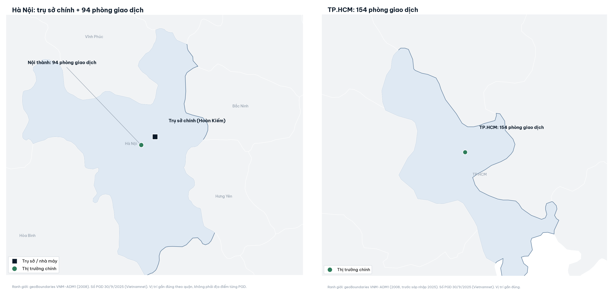

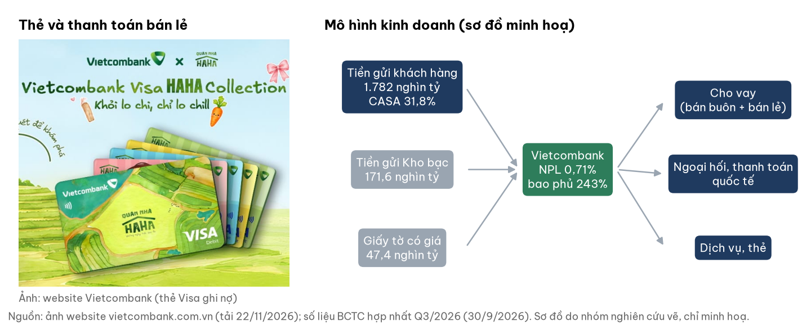

| Hạng mục | Thông tin |
|---|---|
| Lịch sử | Thành lập 1963, ngân hàng đối ngoại chuyên doanh; cổ phần hoá và niêm yết HOSE 30/6/2009 |
| Sở hữu | Nhà nước 74,80% · Mizuho 15,00% · khác 10,20% (free float thực ≈10%) |
| Quy mô (30/9/2026) | Tổng tài sản 2,68 triệu tỷ; dư nợ 1,82 triệu tỷ; tiền gửi KH 1,78 triệu tỷ |
| Mạng lưới (30/9/2025) | 640 điểm giao dịch, 130 chi nhánh; TP.HCM 154 và Hà Nội 94 phòng giao dịch |
| Công ty con mới | Ngân hàng TNHH MTV Ngoại thương Công nghệ số (tên cũ CBBank) — nhận chuyển giao bắt buộc, được miễn hợp nhất và loại khỏi tính CAR |
| Hợp nhất 2026 | Một công ty liên doanh 52% thành công ty con (GCN 03/6/2026), tạo lãi đánh giá lại ≈3.171 tỷ |

- Lợi thế cạnh tranh: **hẹp nhưng có thật** — nguồn vốn được Nhà nước bảo chứng và kỷ luật tín dụng; cả hai có công tắc hành chính (Kho bạc, chỉ đạo lãi suất).

## 5. Tài chính: dòng trên mạnh, dự phòng bắt đầu tăng

### 5a. Lợi nhuận lõi tăng ≈12,5%, không phải 24,4%

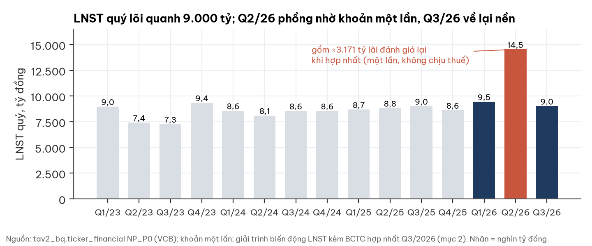

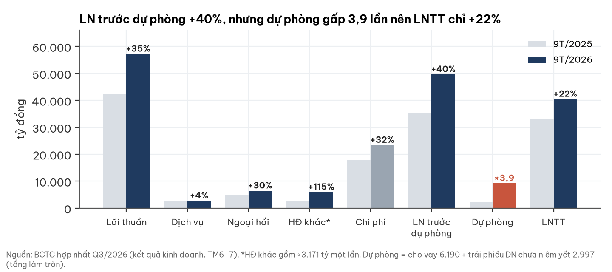

- LNTT 9T theo BCTC hợp nhất 40.440 tỷ (+22,1%); một số báo chí ghi 43.789 tỷ — báo cáo này dùng BCTC.
- Chi phí hoạt động +31,9%, tỷ lệ chi phí/thu nhập 32,0%; thuế 18,3% LNTT, bình thường.
- Lãi dự thu 11.811 tỷ (+18,0%), gấp đôi tốc độ cho vay; quy mô ≈0,65% dư nợ, chưa bất thường.

### 5b. Chất lượng tài sản: đệm dày, nhưng tầng sớm đang xấu đi

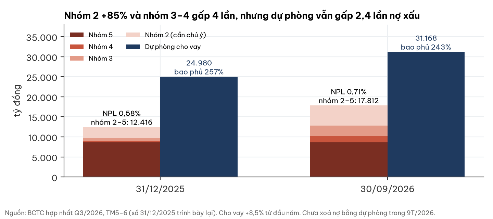

- Hình thành nợ xấu 9T 3.104 tỷ ≈ 0,24% dư nợ năm hoá; chi phí tín dụng cho vay năm hoá 0,47%.
- Kể cả khi toàn bộ nhóm 2–4 (9.223 tỷ) mất trắng, dự phòng hiện có vẫn đủ.
- Dư nợ ngành Xây dựng 2025 +72% (90,5 lên 155,3 nghìn tỷ) so với tổng dư nợ +15,5%; bảo lãnh vay vốn 287 tỷ (2024) lên 9.549 tỷ (30/9/2026); tổng bảo lãnh gấp 2,37 lần cuối 2024, ≈55% vốn chủ (số liệu đối chiếu từ BCTC kiểm toán 2025/Q3-2026). Không điều chỉnh vào giá trị sổ sách.

### 5c. Nguồn vốn: vẫn rẻ nhất, nhưng kém bền hơn

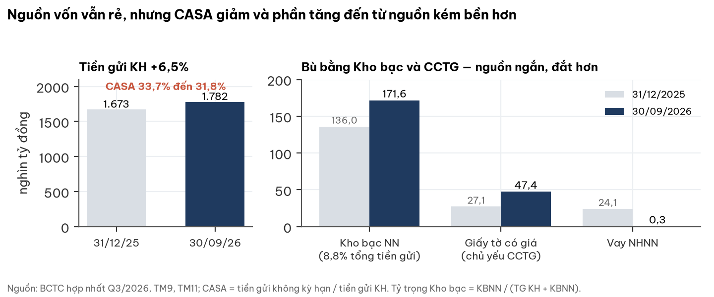

- Tiền gửi Kho bạc 8,8% tổng tiền gửi (từ 7,5%). Nếu Kho bạc rút về mức cuối 2025 và thay bằng CCTG đắt hơn ≈2 điểm %, thu nhập lãi giảm ≈0,7 nghìn tỷ/năm (≈1%, ước lượng).
- Vay NHNN giảm từ 24.127 về 282 tỷ.

### 5d. Vốn: đủ chuẩn hiện hành, Basel III/D-SIB là rủi ro pha loãng ROE

| Chỉ tiêu | Số | Ghi chú |
|---|---|---|
| CAR Basel III (30/6/2026) | ≈11,1–11,6% | Báo chí, một nguồn; chưa có CET1 |
| CAR nếu yêu cầu ≈12% (10,5% + D-SIB giả định) | ROE bền 14,6% thành 13,8% | Giá trị 31.800 đ (thông tin rủi ro, không đổi tâm) |
| LDR theo quy định | Chưa có số | Tỷ lệ thô cho vay/(TG KH + GTCG) 99,3%, không phải định nghĩa quy định |

## 6. Sự kiện vốn: cổ tức tiền 2.433 đ/cp và các đợt phát hành đang chờ

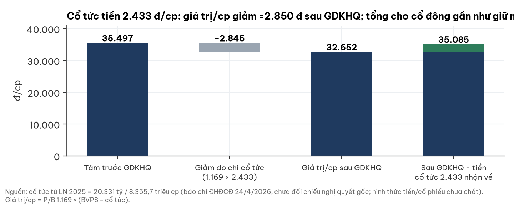

| Hành động (ĐHĐCĐ 24/4/2026, theo báo chí) | Tác động lên giá trị/cp |
|---|---|
| Cổ tức từ LN 2025: 20.331 tỷ (≈2.433 đ/cp nếu bằng tiền; hình thức chờ phê duyệt) | Tiền: giá trị/cp giảm ≈2.850 đ sau ngày giao dịch không hưởng quyền; tổng cho cổ đông ≈35.085 đ |
| Phát hành từ nguồn vốn chủ ≈10.687 tỷ (≈ +12,8% số cp, ước lượng) | Chia lại, không đổi tổng giá trị |
| Cổ tức bằng cổ phiếu (nếu chọn, ≈ +24,3% số cp) | Chia lại, không đổi tổng giá trị |
| Phát hành riêng lẻ tối đa 6,5% (≈543 triệu cp) | Có lợi cho BVPS nếu giá phát hành > 30.359 đ; chưa đưa vào cơ sở |

- **Mọi giá trị/cp trong báo cáo tính trên 8.355,7 triệu cp hiện hành, trước ngày giao dịch không hưởng quyền**, nên so được trực tiếp với giá 52.100 đ.

## 7. Định giá: giá trị nội tại 35.500 đ, giá thị trường cao hơn mọi biến thể ở chi phí vốn 13,5%

**Phương pháp:** P/B = (ROE bền − g)/(Ke − g) trên BVPS 30.359 đ; g 7% (ước lượng, ≤ GDP danh nghĩa dài hạn). Mô hình được dựng trước, không dùng giá thị trường; P/PCF, EV/EBITDA, FCFE không áp dụng cho ngân hàng.

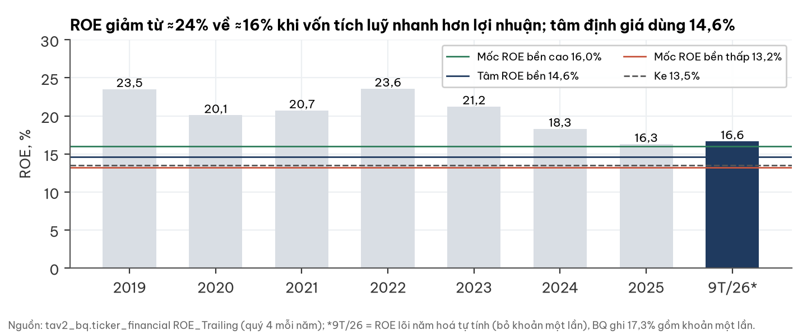

| Mốc ROE bền | Cơ sở | P/B | Giá trị/cp |
|---|---|---|---|
| 13,2% | ROE 2025 với chi phí tín dụng chuẩn hoá 0,8% (trước đợt tăng NIM 2026) | 0,95 | **29.000** |
| **14,6% (tâm)** | Trung điểm; không dựa vào giả định cực nào | 1,169 | **35.500** |
| 16,0% | LN trước dự phòng lõi 9T/26 năm hoá, chi phí tín dụng 0,8% — dùng NIM đỉnh | 1,38 | **42.000** |

| Kịch bản | Xác suất | Điều kiện | Giá trị/cp |
|---|---|---|---|
| Xấu | 0,25 | NIM −30bp theo chỉ đạo, chi phí tín dụng 1,0%; ROE 13,2% | **29.000** |
| Cơ sở | 0,50 | ROE 14,6%, g 7% | **35.500** |
| Tốt | 0,25 | NIM giữ, chi phí tín dụng 0,4–0,6%; ROE 18%, g 8% | **55.200** |
| **Có trọng số** | | | **38.800** |

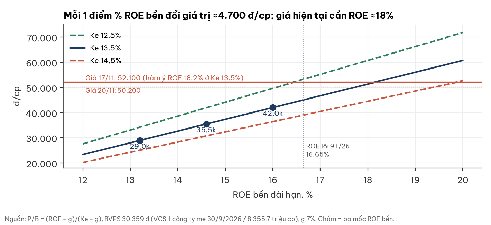

**Chi phí vốn gắn lãi huy động:** r = 13,5% neo theo lãi huy động 12 tháng hiệu dụng 7,40% (CCTG 12 tháng, 02/11/2026; không đổi tới 20/11), truyền dẫn 1:1. Khung CAPM nội địa: rf chuẩn hoá ≈6,75%, ERP 5,0–6,1%; beta thực tế VCB 0,76 (tuần, 06/2021–11/2026), hiệu chỉnh 0,84, cho Ke 10,9–11,9% — mốc đọc 12% cho 46.100 đ. Báo cáo giữ tâm ở r 13,5% (điểm neo theo lãi huy động) và trình bày mốc 12% song song, không thay tâm.

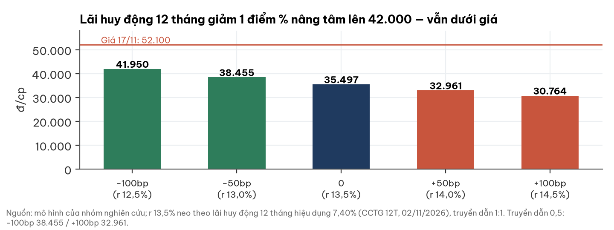

- **Bối cảnh lãi suất:** lãi suất chiết khấu mà giá thị trường chung đang ngầm định ≈15,1% (147 mã, 30/10/2026), cao hơn r 13,5% của báo cáo; phân vị 75% lịch sử 2014–2026 (đỉnh 2022 15,9%, đáy 2022–23 12,1%). TPCP 10 năm 4,57% (17/11/2026), +0,57 điểm % trong 12 tháng (nguồn chưa đối chiếu độc lập). Chỉ để tham khảo, không đổi giá trị hợp lý.
- **Thanh khoản:** trung vị 3 năm ≈175 tỷ đ/phiên; chiết khấu thanh khoản 0%, giá trị trước = sau chiết khấu.
- Mô hình hai giai đoạn (giữ lại lợi nhuận nhiều hơn 5 năm đầu): 36.100–36.800 đ ở Ke 13,5%; 43.400–45.100 đ ở Ke 12,5%.

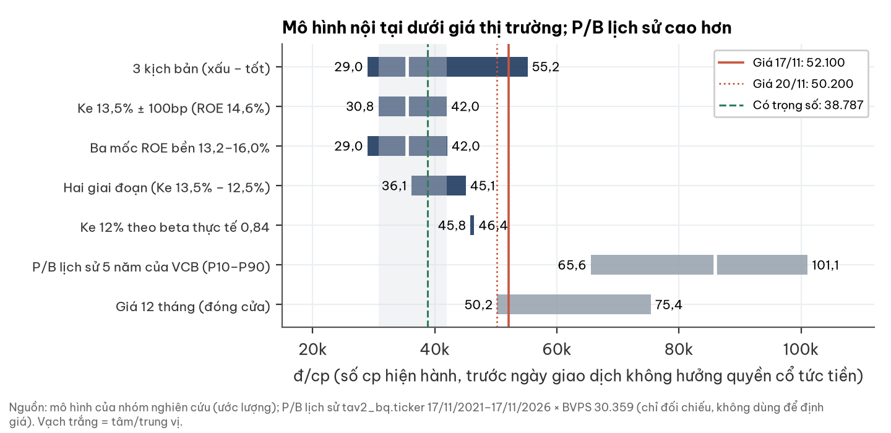

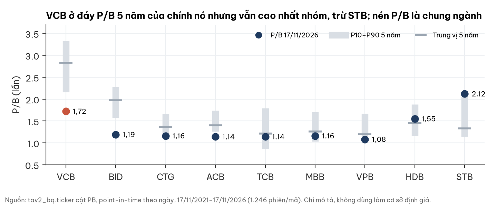

- **Kết luận:** ở r 13,5%, giá 52.100 đ (17/11) và 50.200 đ (20/11) đều **TRÊN** vùng giá trị hợp lý 30.800–42.000 đ; giá chỉ vào vùng nếu chấp nhận Ke ≤ ≈11,6% hoặc ROE bền ≥ ≈17,7%.
- P/B lịch sử 5 năm (2,16–3,33 lần) cho giá cao hơn nhiều; đó là mô tả, không phải cơ sở định giá — cả nhóm ngân hàng lớn đang gần đáy P/B 5 năm.

## 8. Rủi ro: chi phí tín dụng và NIM quyết định ROE bền

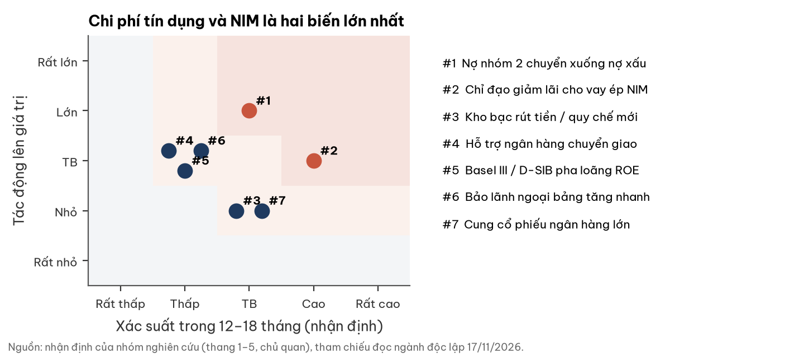

| # | Rủi ro | Xác suất | Tác động | Dấu hiệu sớm | Ngày kiểm |
|---|---|---|---|---|---|
| 1 | Nhóm 2 chuyển xuống nợ xấu | TB | Lớn | NPL > 1,0% hoặc nhóm 2–4 > 1,0% dư nợ | BCTC Q4/2026 (≈cuối 01/2027) |
| 2 | Chỉ đạo giảm lãi ép NIM | Cao | TB | NIM tự tính Q4 giảm > 20bp | BCTC Q4/2026 |
| 3 | Kho bạc rút tiền / quy chế mới | TB | Nhỏ | Tiền gửi Kho bạc < 136 nghìn tỷ | Q4/2026; quy chế 01/2027 |
| 4 | Hỗ trợ ngân hàng chuyển giao | Thấp | TB | Công bố hỗ trợ > 5% LNST năm hoặc bỏ miễn hợp nhất | Công bố thông tin bất thường |
| 5 | Basel III / D-SIB | Thấp | TB | Quy định D-SIB ≥ 1,5% | Văn bản NHNN |
| 6 | Bảo lãnh ngoại bảng | Thấp | TB | Bảo lãnh tiếp tục tăng nhanh hơn vốn chủ | BCTC Q4/2026 |
| 7 | Cung cổ phiếu ngân hàng lớn | TB | Nhỏ | Phát hành riêng lẻ dưới BVPS | Công bố phát hành |

## 9. Pháp lý và quản trị: chỉ cảnh báo, không có vụ án

- Kiểm toán nhà nước điều chỉnh hồi tố số liệu 2025, quy mô nhỏ (vốn chủ riêng lẻ +29 tỷ; LN trước dự phòng hợp nhất +46,9 tỷ). Ý kiến kiểm toán EY về BCTC 2025: **chấp nhận toàn phần**.
- Kết luận thanh tra cấp chi nhánh 2026 (Đà Nẵng, Bình Phước) "chưa đến mức xử lý hành chính". Không tìm thấy vụ khởi tố cán bộ năm 2026 (phạm vi: báo chí; chưa tra UBCKNN/HOSE).
- Nghĩa vụ chính sách: ngân hàng chuyển giao, chỉ đạo lãi suất, phê duyệt tăng vốn/cổ tức của chủ sở hữu. BCTC Q3/2026 không soát xét.

## 10. Xúc tác và điều làm nhận định thay đổi (hai chiều)

| Hướng | Điều kiện | Tác động |
|---|---|---|
| Tích cực hơn | Q4/2026 nhóm 2 giảm so với quý trước, bao phủ ≥ 200%, chi phí tín dụng cả năm ≤ 0,8% | Nâng ROE bền về phía 16% (42.000 đ) |
| Tích cực hơn | Lãi huy động 12 tháng hiệu dụng giảm ≥ 50bp | Tâm +8% (38.500 đ) |
| Tích cực hơn | Phát hành riêng lẻ ≥ 1,5 lần BVPS | BVPS tăng |
| Tiêu cực hơn | NPL > 1,0% hoặc nhóm 2–4 > 1,0% dư nợ; bao phủ < 180% | Hạ ROE bền về 13,2% (29.000 đ) |
| Tiêu cực hơn | Lãi huy động hiệu dụng +50bp | Tâm −7% (33.000 đ) |
| Tiêu cực hơn | D-SIB ≥ 1,5%; hỗ trợ ngân hàng chuyển giao > 5% LNST năm | ROE bền 13,8% hoặc thấp hơn |

- Theo dõi: BCTC Q4/2026; ngày chốt quyền cổ tức và phát hành thưởng; công bố phát hành riêng lẻ; Pillar 3/CAR.

## Phụ lục A — Số liệu BCTC chính (hợp nhất, tỷ đồng)

| Chỉ tiêu | 9T/2026 | 9T/2025 | Q3/2026 | Q3/2025 |
|---|---|---|---|---|
| Thu nhập lãi thuần | 57.179 | 42.505 | 20.386 | 14.657 |
| LN trước dự phòng | 49.620 | 35.470 | 17.402 | 12.015 |
| Chi phí dự phòng | 9.180 | 2.338 | 6.184 | 776 |
| LNTT | 40.440 | 33.133 | 11.218 | 11.239 |
| LNST công ty mẹ | 33.032 | 26.549 | — | — |

Bảng cân đối 30/9/2026: tổng tài sản 2.682.409 · cho vay 1.816.093 · tiền gửi KH 1.781.703 · tiền gửi Kho bạc 171.617 · giấy tờ có giá 47.392 · vốn chủ 253.761 (công ty mẹ 253.669) · 8.355.675.094 cp.

## Phụ lục B — Đối chiếu dữ liệu thị trường với BCTC

| Chỉ tiêu | Dữ liệu thị trường | BCTC | Ghi chú |
|---|---|---|---|
| LNST Q1–Q3/2026 | 9.457 / 14.542 / 9.033 | 9T 33.032 | Khớp tổng |
| ROE trượt 4 quý (Q3/2026) | 17,3% | Lõi tự tính 16,65% | Chênh do khoản một lần Q2 |
| LNTT 9T | Báo chí 43.789 (+32%) | 40.440 (+22,1%) | Dùng BCTC |

## Phụ lục C — Nguồn

- **Công ty:** BCTC hợp nhất Q3/2026 (ký 30/10/2026) và giải trình biến động LNST; BCTC hợp nhất kiểm toán 2025 (bản công bố thông tin qua static2.vietstock.vn). Logo, ảnh cầu và ảnh thẻ Visa: website vietcombank.com.vn (tải 22/11/2026); logo chỉ để nhận diện, không ngụ ý ngân hàng bảo chứng báo cáo.
- **ĐHĐCĐ 2026:** baodautu.vn, nhadautu.vn, doanhnhan.baophapluat.vn (chưa đối chiếu nghị quyết gốc).
- **Mạng lưới:** Vietnamnet, số liệu 30/9/2025 (vietnamnet.vn/mot-ngan-hang-giam-72-phong-giao-dich-tu-dau-nam-dan-dau-he-thong-2467900.html).
- **Lịch sử thành lập:** Wikipedia "Vietcombank"; ngày niêm yết theo dữ liệu chứng khoán DNSE (30/6/2009).
- **Ngành:** đọc ngành độc lập 17/11/2026 (SSI, VDSC, FiinRatings, VNBA, TCBS qua báo chí); NIM Q2 và CAR 30/6: elibook.vn, ACBS 07/8/2026.
- **Dữ liệu thị trường:** chuỗi tài chính quý, giá, khối lượng, P/B; giá 20/11/2026 từ hệ thống giao dịch DNSE; lãi huy động 12 tháng hiệu dụng; lãi suất chiết khấu ngầm định; TPCP 10 năm.
- **Bản đồ:** ranh giới geoBoundaries VNM-ADM1 (2008); toạ độ trung tâm quận Hoàn Kiếm và TP.HCM theo Wikipedia — vị trí gần đúng.

## Phụ lục D — Phương pháp và giới hạn dữ liệu

- Một giai đoạn P/B Gordon ngầm chia cổ tức ≈52% lợi nhuận, trong khi VCB chia tiền thực tế ≈10%; mô hình hai giai đoạn hiển thị để bù chiều lệch này.
- Khoản một lần 3.171 tỷ ước bằng phần tăng của thu nhập khác; thuyết minh hợp nhất kinh doanh chi tiết không có trong BCTC quý.
- **Chưa có dữ liệu:** CET1, LDR theo quy định, CASA theo khách hàng cá nhân/DN, dư nợ BĐS, top-10 khách hàng, quy mô và lỗ luỹ kế của ngân hàng chuyển giao, NIM chính thức Q3.
- Một số số liệu bảng thuyết minh lấy từ bản scan, chưa có bản số hoá để đối chiếu tự động.
- Hình thức cổ tức 2025 và số cp sau phát hành: báo chí chưa thống nhất.
- Không có số liệu mạng lưới theo vùng cuối 2025 từ báo cáo thường niên; bản đồ dùng số 30/9/2025.

## Phụ lục E — Quy trình nghiên cứu

Số liệu đối chiếu trực tiếp với BCTC gốc do ngân hàng công bố. Mô hình định giá được dựng trước, độc lập với giá thị trường, rồi mới so với giá. Bối cảnh ngành do một người đọc ngành độc lập soạn mà không biết giá cổ phiếu. Toàn bộ số liệu, mô hình và giả định đã được một người phản biện độc lập kiểm tra. Giới hạn dữ liệu nêu ở Phụ lục D.

## Phụ lục F — Tuyên bố miễn trừ trách nhiệm

Tài liệu này chỉ nhằm mục đích cung cấp thông tin nghiên cứu, không phải lời khuyên, đề nghị hay khuyến nghị mua, bán hoặc nắm giữ bất kỳ chứng khoán nào, và không tính đến mục tiêu, tình hình tài chính hay nhu cầu của từng nhà đầu tư. Thông tin được tổng hợp từ các nguồn được cho là đáng tin cậy tại thời điểm lập, nhưng không được bảo đảm về tính đầy đủ hay chính xác. Các ước lượng, kịch bản và giá trị hợp lý phản ánh giả định tại ngày lập và có thể thay đổi mà không cần thông báo. Kết quả trong quá khứ không bảo đảm kết quả tương lai. Nhà đầu tư cần tự đánh giá và chịu trách nhiệm với quyết định của mình.
