# VCP — CTCP Xây dựng và Năng lượng VCP: lợi nhuận bứt phá nhờ mảng ngoài điện và lãi cho vay, nhưng dòng tiền và phân bổ vốn còn nhiều câu hỏi; giá nằm sát tâm giá trị

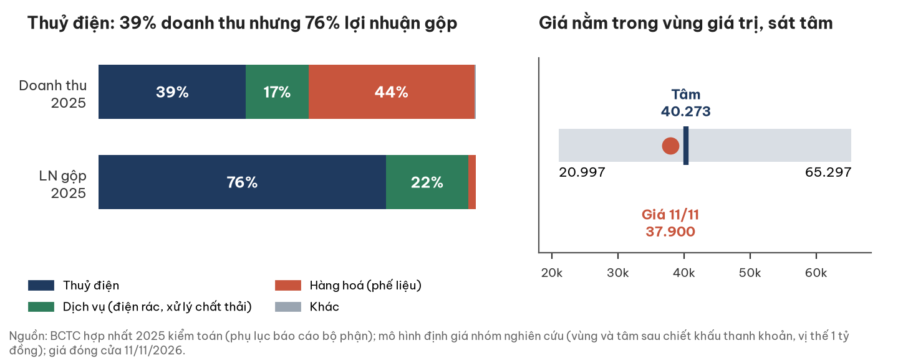

## Tóm tắt một trang

| Chỉ tiêu | Giá trị |
|---|---|
| Giá đóng cửa 11/11/2026 (UPCoM) | **37.900 đ/cp** |
| Giá trị hợp lý (tâm), sau chiết khấu thanh khoản cho vị thế cỡ 1 tỷ đồng | **40.273 đ/cp** (trước chiết khấu: 41.560) |
| Vùng giá trị (kịch bản tiêu cực – tích cực), sau chiết khấu | 20.997 – 65.297 (trước chiết khấu: 21.669 – 67.385) |
| P/E TTM · P/B công ty mẹ (sau cổ tức) | 4,5 lần · 1,23 lần |
| LNST công ty mẹ: quý 3/26 · TTM | 245,4 tỷ (gần gấp đôi cùng kỳ) · 700,8 tỷ |
| Nợ vay/EBITDA · khả năng trả lãi 9T | 3,2 lần · 4,0 lần |
| Cổ tức tiền mặt 2025 | 900 đ/cp (9%), chi ngày 06/11/2026 |
| Thanh khoản (60 phiên) | 0,30 tỷ đồng/phiên |

**Ba điều cần biết**

- **Mảng điện tốt và có thật** (biên gộp 76–78%), nhưng doanh thu điện quý 3 giảm 1,4% so với cùng kỳ. Phần tăng lợi nhuận chủ yếu đến từ mảng ngoài điện và lãi tài chính.
- **Phân bổ vốn là câu hỏi lớn nhất:** cho vay 823,4 tỷ đồng, chủ yếu cho cá nhân; khoảng 77% lãi 9T chưa thu bằng tiền.
- **Giá 37.900 nằm trong vùng giá trị, cách tâm 5,9%.** Mọi kết luận về chênh lệch này nhạy với hai phần lợi nhuận quý 3 chưa được giải thích.

## 1. Giá đang ở giữa vùng giá trị, và vùng này rộng

Ba kịch bản có xác suất cho giá trị kỳ vọng 41.560 đ/cp (trước chiết khấu thanh khoản); giá hiện tại thấp hơn tâm sau chiết khấu 5,9%.

| Kịch bản | Xác suất | LNST mẹ dùng (tỷ) | Điều kiện | Giá trị (đ/cp) |
|---|---|---|---|---|
| Tiêu cực | 0,30 | 306,5 trừ lỗ cho vay 401,9 | Thuỷ văn thường (như 2024), El Niño 2026–27; thu hồi nợ cho vay chỉ 50% | 21.669 |
| Cơ sở | 0,45 | 441,5 | LNST mẹ 2025 kiểm toán, ROE 17,1% | 40.475 |
| Tích cực | 0,25 | 700,8 | Biên ngoài điện quý 3 lặp lại | 67.385 |

- Xác suất 0,30/0,45/0,25 là **ước lượng**, chưa có cơ sở định lượng. Thay bằng 0,35/0,45/0,20, tâm sau chiết khấu là 38.058.
- Nếu bỏ khỏi kịch bản tích cực (a) phần biên gộp vượt mức thường (74,9 tỷ) và (b) lãi dồn tích chưa thu (57,8 tỷ), tâm sau chiết khấu giảm còn 38.390 rồi 36.937; giá 37.900 khi đó nằm trên tâm.
- Chiều ngược lại: nếu tài sản mới 2026 sinh lời đúng bằng chi phí vốn, tâm là 47.555 (46.081 sau chiết khấu). Vùng bất định của tâm vì thế khoảng **36.900 – 46.100**.

| Điểm tích cực | Điểm cần theo dõi |
|---|---|
| Biên gộp điện 76–78%; dòng tiền kinh doanh dương mọi quý từ 2025 trừ Q3/25 | Lãi cho vay chủ yếu chưa thu bằng tiền; cho vay cá nhân 823,4 tỷ |
| Nợ vay/EBITDA 3,2 lần, khả năng trả lãi 4,0 lần; cổ tức tiền mặt đều | Biên hàng hoá quý 3 ước khoảng 25%, so với 1,5–4,5% trước đó; chưa có giải thích |
| Trái phiếu 500 tỷ dùng đúng mục đích mua Linh Linh; báo cáo sử dụng vốn được kiểm toán chấp nhận | Dòng tiền kinh doanh 9T có 373 tỷ thu hồi phải thu một lần |
| BCTC 2025 kiểm toán và 6T/2026 soát xét: ý kiến chấp nhận toàn phần | 46,8% cổ phiếu VCP (của bên thứ ba) đang cầm cố cho trái phiếu 500 tỷ |

## 2. Doanh nghiệp: tập đoàn thuỷ điện đã mở rộng sang điện rác, thương mại phế liệu và tài chính

VCP xác định mục tiêu trở thành một trong những tập đoàn hàng đầu Việt Nam về đầu tư xây dựng thuỷ điện, năng lượng tái tạo và các giải pháp liên quan (website công ty). Sáu nhà máy được website nêu công suất, tổng **170 MW**, bán điện cho EVN; ngoài ra có điện rác và xử lý chất thải (Ngôi Sao Xanh, Bắc Ninh) và thương mại phế liệu.

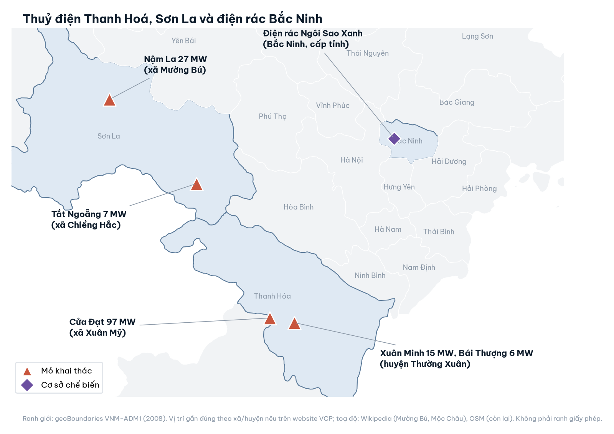

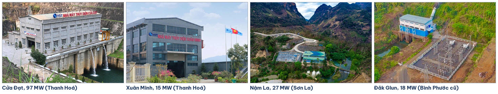

*Ảnh: website VCP (vcpholdings.com.vn), truy cập 12/11/2026. Thêm Đăk Glun 18 MW (xã Đăk Nhau, Bình Phước cũ, nay thuộc Đồng Nai).*

| Nhà máy | Công suất | Địa điểm (theo website) |
|---|---|---|
| Cửa Đạt | 97 MW | xã Xuân Mỹ, huyện Thường Xuân, Thanh Hoá |
| Nậm La | 27 MW | xã Mường Bú, huyện Mường La, Sơn La |
| Đăk Glun | 18 MW | xã Đăk Nhau, huyện Bù Đăng, Bình Phước cũ |
| Xuân Minh · Bái Thượng | 15 MW · 6 MW | xã Xuân Cao · xã Xuân Dương, Thường Xuân |
| Tắt Ngoẵng | 7 MW | xã Chiềng Hắc, Mộc Châu, Sơn La |

**Ngành:** nhóm nghiên cứu và người đọc ngành độc lập đánh giá thuỷ điện đang ở pha **sản lượng đi từ đỉnh 2025 xuống đáy mùa khô 2027**.

- El Niño 2026–27 có xác suất mạnh đến rất mạnh khoảng 60–65%; thuỷ điện toàn quốc 10T/26 khoảng −16%.
- Khung giá PPA 0–1.110 đ/kWh đang cố định; giá bán lẻ giảm 2% từ 01/11/2026 ép biên EVN.
- Cửa Đạt đã khấu hao 75%: rủi ro tái đàm phán giá khi nợ được trả hết.

## 3. Lợi nhuận quý 3 gấp đôi, nhưng không đến từ điện

Doanh thu điện quý 3 là 223,0 tỷ (−1,4%); lợi nhuận gộp tăng 130,2 tỷ, trong đó ngoài điện đóng góp 106,1 tỷ.

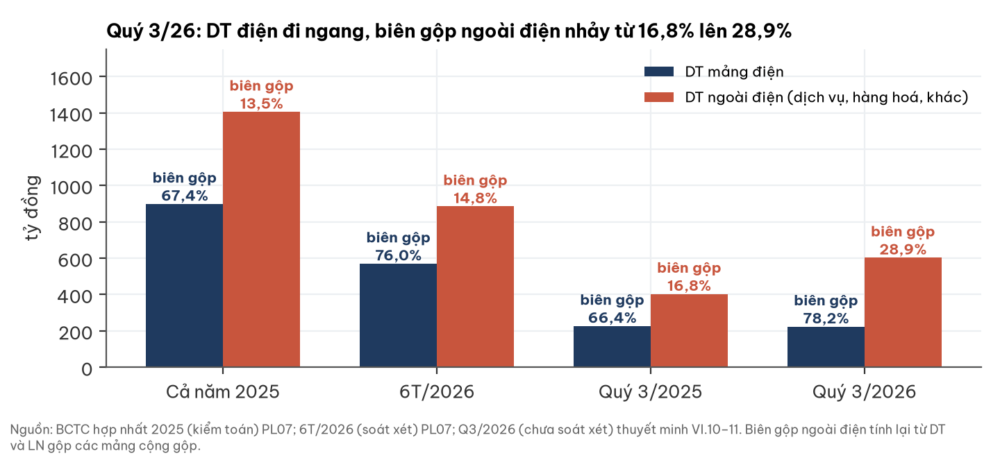

- Biên gộp điện tăng nhờ giá vốn điện giảm từ 75,9 xuống 48,6 tỷ; công ty chưa giải thích. Khấu hao trên báo cáo lưu chuyển tiền tệ thấp hơn thuyết minh tài sản cố định khoảng 62 tỷ.
- Mảng hàng hoá (phế liệu) có biên 1,5% (2025) và 4,5% (6T/26). Quý 3 ước tính khoảng 25% (**ước lượng**): giải trình CV110 của công ty nêu "do doanh thu kinh doanh phế liệu" nhưng không giải thích biên.
- Giả thuyết khác: mảng dịch vụ điện rác tăng nhờ dự án BCC Hiệp Hoà (góp vốn 523,2 tỷ). Báo cáo Q3 chưa đủ chi tiết để loại giả thuyết nào.
- Thuế suất hiệu dụng 8,4% phù hợp cơ chế ưu đãi (điện rác miễn thuế, thuỷ điện 10%).

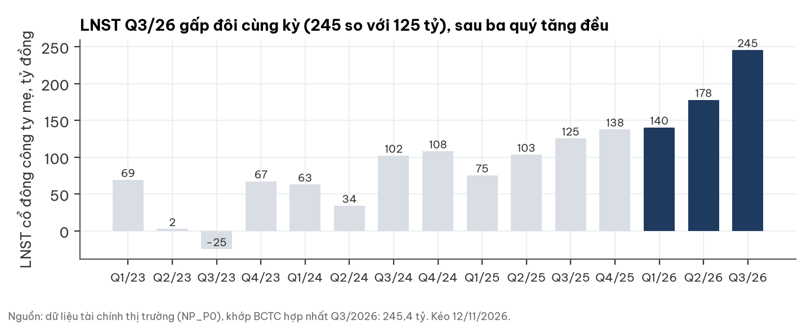

## 4. Dòng tiền và bảng cân đối: vay tăng, tiền chuyển sang cho vay và hàng hoá

CFO 9T/26 là 1.004,4 tỷ; trừ 373,3 tỷ giảm phải thu một lần, mô hình dùng CFO TTM 776,7 tỷ.

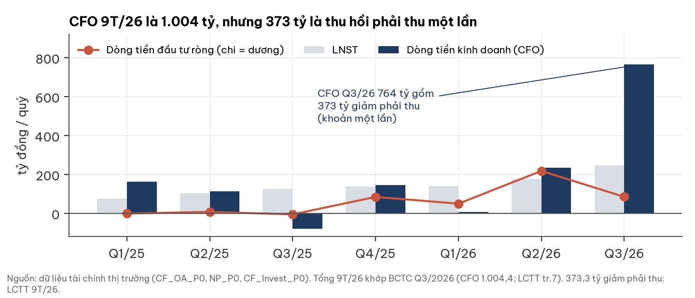

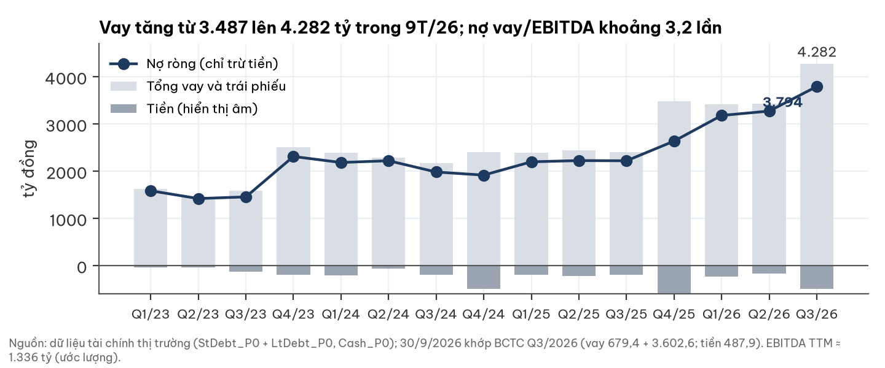

- Hàng hoá tồn kho tăng từ 237,8 lên 631,7 tỷ, trong khi dòng điều chỉnh tồn kho trên lưu chuyển tiền tệ 9T chỉ −5,9 tỷ: chưa khớp, cần giải thích.
- Khoản "đầu tư nắm giữ đến ngày đáo hạn" 971 tỷ chủ yếu là cho vay được phân loại lại theo TT 99/2025, **không phải tiền gửi**.
- Vay ngắn hạn 679,4 tỷ so với tiền 487,9 tỷ. Số cổ phiếu 83,79 triệu, không đổi từ 2022.

## 5. Phân bổ vốn: cho vay 823 tỷ và các thương vụ với cá nhân là điểm cần theo dõi nhất

Dư nợ cho vay tương đương khoảng 32% vốn chủ công ty mẹ; lãi ghi nhận lớn hơn nhiều so với tiền thực thu.

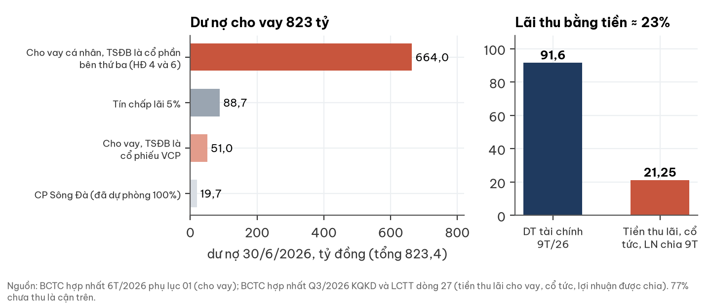

- Phần lớn dư nợ cho cá nhân vay, tài sản bảo đảm là cổ phần của bên thứ ba; 51,0 tỷ bảo đảm bằng chính cổ phiếu VCP.
- Trái phiếu 500 tỷ (đáo hạn 25/12/2028) dùng mua 51% Linh Linh; bảo đảm bằng 39,22 triệu cổ phiếu VCP (46,8%) của bên thứ ba.
- Linh Linh: lợi thế thương mại 250,5 tỷ, bằng 85% tài sản thuần mua được; 62% tài sản thuần là phải thu.
- Khoảng 1.000 tỷ góp vốn 9T chưa được thuyết minh chi tiết.

## 6. Định giá: dựng từ lợi nhuận và vốn chủ, không dùng giá thị trường làm đầu vào

Phương pháp: giá trị vốn chủ công ty mẹ = B0 + (N − r·B0)/(r − g), N là LNST mẹ theo kịch bản, B0 = vốn chủ mẹ sau cổ tức (30.728 đ/cp), g = 2% (ước lượng).

- **r = 13,5%** tại điểm neo lãi huy động 12 tháng hiệu dụng 7,40% (02/11/2026); r điều chỉnh theo lãi huy động với hệ số 1 (giả định).
- Lãi suất chiết khấu mà giá thị trường đang ngầm định (bình quân 147 mã, 30/10/2026) là 15,1%, ở phân vị 75% lịch sử 2014–2026 (đỉnh 15,9% tháng 12/2022; đáy 12,1% tháng 8/2023). Chỉ để tham khảo.
- Trái phiếu Chính phủ 10 năm: 4,57% (11/11/2026), cao hơn 0,59 điểm % so với 12 tháng trước; nguồn chưa đối chiếu độc lập.

| Lãi huy động 12T | −100bp | −50bp | Điểm neo | +50bp | +100bp |
|---|---|---|---|---|---|
| Giá trị tâm (đ/cp, trước chiết khấu) | 45.656 | 43.515 | 41.560 | 39.769 | 38.120 |
| So với điểm neo | +9,9% | +4,7% | 0 | −4,3% | −8,3% |

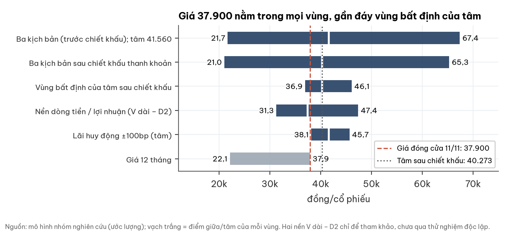

- **Thanh khoản:** chiết khấu 3,1% cho vị thế 1 tỷ đồng (thoát lệnh cần khoảng 33 phiên ở mức tham gia 10%); 1,7% cho 0,3 tỷ (10 phiên).
- **Hai cách đo khác, chỉ tham khảo, chưa qua thử nghiệm độc lập:** theo trung vị LNST 3 năm 37.392; theo dòng tiền tự do 31.272; theo mức đầu tư chuẩn ngành thuỷ điện 47.374. Không đổi tâm.

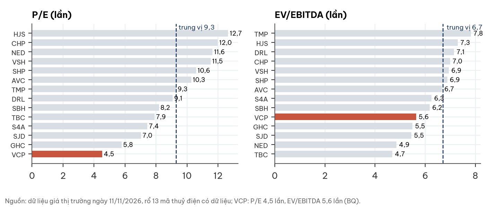

VCP giao dịch ở P/E 4,5 lần (trung vị ngành 9,3 lần) và EV/EBITDA 5,6 lần (6,7 lần). **Chiết khấu có cơ sở một phần:** quản trị và phân bổ vốn, cơ cấu doanh thu thương mại biên mỏng, UPCoM với thanh khoản thấp, kiểm soát nội bộ. **Có thể quá mức** nếu quý 4 xác nhận biên quý 3. Bội số chỉ để đối chiếu, không đổi tâm.

## 7. Rủi ro và cảnh báo pháp lý

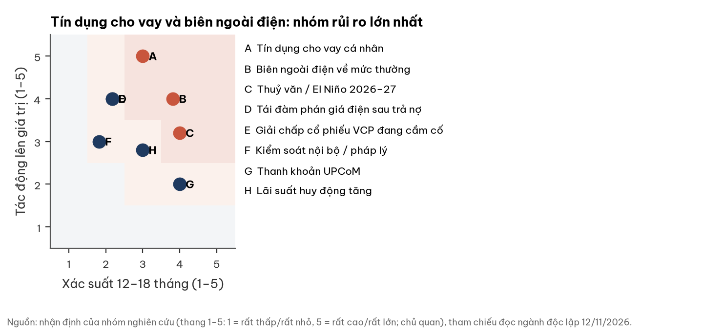

| Mã | Rủi ro | Dấu hiệu sớm | Mốc kiểm |
|---|---|---|---|
| A | Tín dụng cho vay cá nhân | Trích lập dự phòng; dư nợ không giảm | BCTC 2026 kiểm toán |
| B | Biên ngoài điện về mức thường | Biên gộp ngoài điện quý 4 ≤ 5% | BCTC Q4/2026 |
| C | Thuỷ văn, El Niño | Mực nước hồ Bắc Trung Bộ dưới MNDBT | Đến 31/12/2026 |
| D | Tái đàm phán giá điện sau trả nợ | Thông báo hết hạn hoặc sửa đổi PPA; khung giá thay đổi | Khi công bố |
| E | Giải chấp cổ phiếu VCP | Giá giảm mạnh, thông báo bổ sung tài sản bảo đảm | Liên tục |
| F | Kiểm soát nội bộ, pháp lý | Ý kiến kiểm toán; thông tin thanh tra | BCTC 2026 kiểm toán |
| G | Thanh khoản UPCoM | Giá trị giao dịch 60 phiên dưới 0,3 tỷ/phiên | Liên tục |
| H | Lãi huy động tăng | Lãi huy động 12T tăng ≥ 50bp | Liên tục |

- **Cảnh báo, không đưa vào kịch bản cơ sở:** Cục Thuế TP Hà Nội xử phạt 101,99 triệu đồng (09/10/2026), gồm hành vi kê khai hoá đơn của đơn vị không hoạt động tại địa chỉ đăng ký. Tác động tài chính không đáng kể.
- Báo cáo hợp nhất Q3/26 do cùng một người ký cả chức danh người lập biểu và kế toán trưởng; báo cáo bộ phận 6T/26 ghi mảng hàng hoá có tài sản bộ phận bằng 0 dù tồn kho 600,3 tỷ. Chưa có bằng chứng sai phạm.
- Chưa thấy thông tin khởi tố, thanh tra chứng khoán hay đổi kiểm toán.

## 8. Điều làm nhận định đổi, theo cả hai chiều

| Mốc | Ngày | Nhận định tích cực hơn nếu | Nhận định tiêu cực hơn nếu |
|---|---|---|---|
| BCTC Q4/2026 | ≤ 30/01/2027 | LN gộp ngoài điện ≥ 100 tỷ, có thuyết minh khách hàng và hợp đồng | Biên ngoài điện ≤ 5%; hàng hoá tồn > 600 tỷ không bán được |
| BCTC 2026 kiểm toán | ≤ 31/03/2027 | Chấp nhận toàn phần; dư nợ cho vay cá nhân ≤ 400 tỷ; làm rõ tài sản ngắn hạn khác 696,5 tỷ | Ngoại trừ hoặc nhấn mạnh; trích lập cho vay; điều chỉnh doanh thu thương mại |
| Thuỷ văn Bắc Trung Bộ | Đến 31/12/2026 | Mực nước hồ đạt mực dâng bình thường | El Niño mạnh, sản lượng thấp kéo dài |
| Lãi huy động 12T | Liên tục | −50bp: tâm +4,7% | +50bp: tâm −4,3% |

## Phụ lục A — Số liệu BCTC chính (tỷ đồng, hợp nhất, Q3/2026 chưa soát xét)

| Chỉ tiêu | Q3/26 | Q3/25 | 9T/26 |
|---|---|---|---|
| Doanh thu | 825,6 | 629,0 | 2.264,5 |
| LN gộp (biên) | 348,3 (42,2%) | 218,2 (34,7%) | n/a |
| LNTT | 288,1 | n/a | n/a |
| LNST (mẹ) | 263,9 (245,4) | n/a (125,4) | 612,6 (563,3) |

Vay và trái phiếu 4.282,0; tiền 487,9; vốn chủ 3.269,8 (mẹ 2.650,1) tại 30/09/2026.

## Phụ lục B — Đối chiếu dữ liệu thị trường và BCTC

Doanh thu 825,6 và LNST mẹ 245,4 tỷ quý 3/26 khớp BCTC. BVPS trong dữ liệu thị trường (39.024 đ/cp) tính trên vốn chủ gồm lợi ích cổ đông không kiểm soát; BVPS công ty mẹ là 31.628 (30.728 sau cổ tức 900 đ).

## Phụ lục C — Nguồn

BCTC hợp nhất Q3/2026, 6T/2026 (AASC soát xét 25/08/2026), 2025 (AASC kiểm toán 24/03/2026); CV 110/2026/CV-VCP; quyết định xử phạt số 16587 (09/10/2026) của Cục Thuế TP Hà Nội; báo cáo sử dụng tiền trái phiếu; dữ liệu giá và tài chính thị trường (kéo 12/11/2026). Logo và ảnh nhà máy: website vcpholdings.com.vn. Toạ độ bản đồ: Wikipedia (xã Mường Bú, Mộc Châu), OpenStreetMap (còn lại), gần đúng theo xã/huyện; điện rác Bắc Ninh ở mức tỉnh. Ranh giới: geoBoundaries VNM-ADM1 (2008, tỉnh cũ). Mỗi hình có tệp CSV trong figs/.

## Phụ lục D — Phương pháp và giới hạn

Giá neo là đóng cửa 11/11/2026; chưa lấy giá trong phiên 12/11. Chưa có: sản lượng kWh, giá bán bình quân, ngày hết hạn PPA, thời hạn giấy phép, free float, room ngoại, tỷ lệ cổ đông lớn, địa điểm Đak Robaye, Nậm Khoá 3, Đắk Lô, Linh Linh, Hiệp Hoà. Ước lượng: g 2%, tỷ lệ thu hồi 50% ở kịch bản tiêu cực, xác suất kịch bản, biên chuẩn hàng hoá 4,5%, thuế thương mại 20%.

## Phụ lục E — Quy trình

Số liệu đối chiếu BCTC gốc; định giá dựng khi chưa nhìn giá thị trường; có người phản biện độc lập kiểm số liệu và nguồn; bối cảnh ngành do người đọc ngành độc lập cung cấp.

## Phụ lục F — Tuyên bố miễn trừ trách nhiệm

Tài liệu này chỉ nhằm cung cấp thông tin nghiên cứu, không phải lời khuyên đầu tư cá nhân hoá, không phải lời mời mua hay bán chứng khoán. Số liệu lấy từ nguồn công bố và có thể thay đổi. Người đọc tự chịu trách nhiệm với quyết định của mình.
