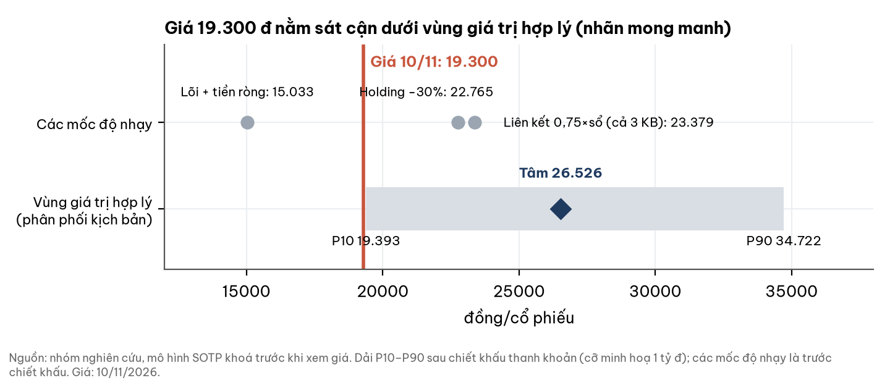
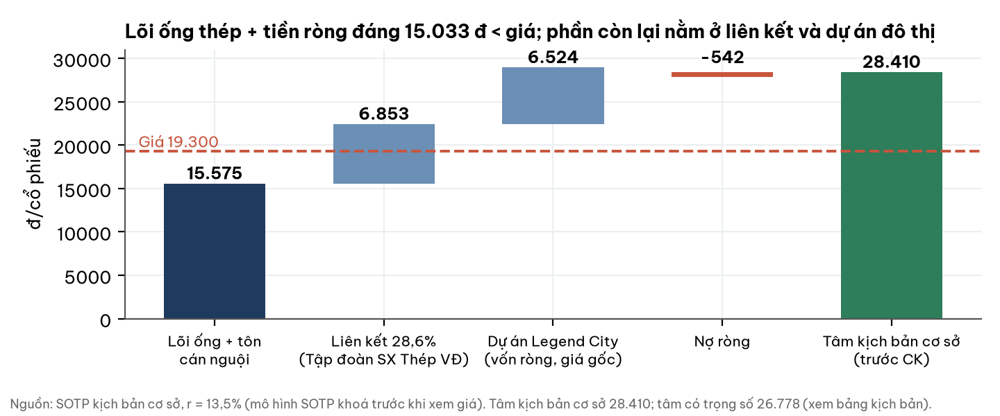
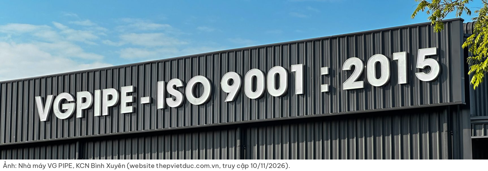
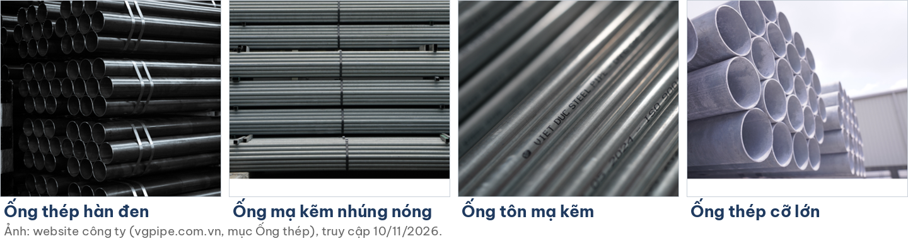
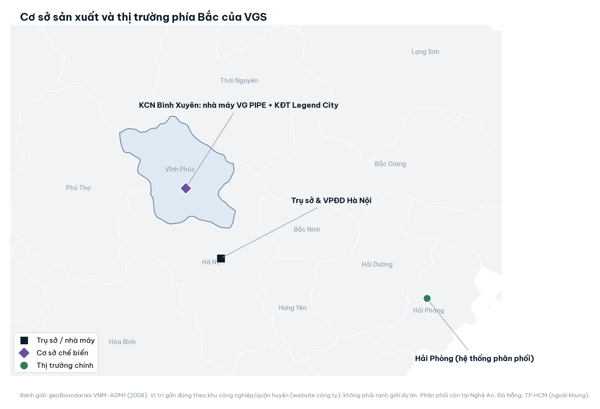
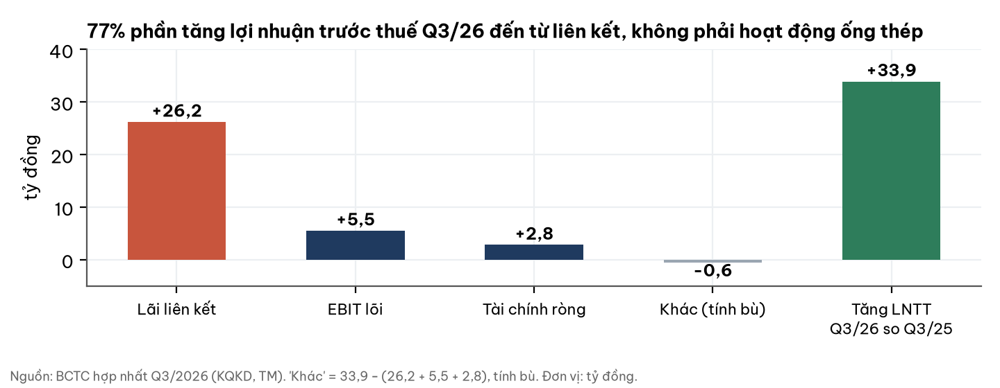
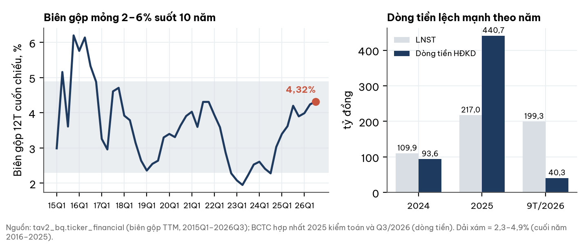
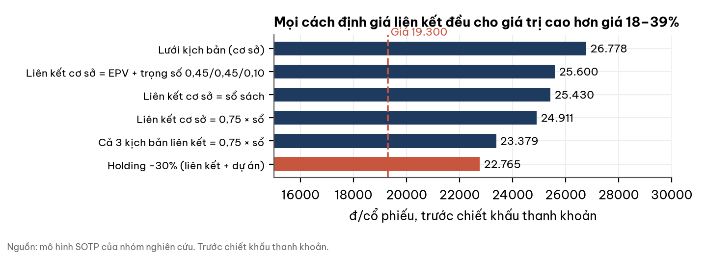
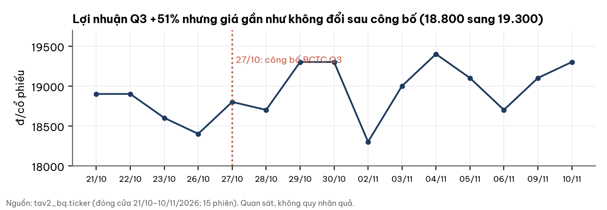

# VGS — CTCP Ống thép Việt-Đức VG PIPE: giá 19.300 đ sát cận dưới vùng giá trị hợp lý, nhưng gần nửa giá trị nằm ở liên kết đỉnh chu kỳ và dự án đô thị chưa chín

## Tear sheet — dữ liệu đến 10/11/2026

| Chỉ tiêu | Giá trị | Chỉ tiêu | Giá trị |
|---|---|---|---|
| Giá đóng cửa 10/11/2026 | **19.300 đ** | Tâm giá trị hợp lý (sau chiết khấu thanh khoản) | **26.526 đ** |
| Vùng P10–P90 | 19.393–34.722 đ | Giá so với tâm | −27,2% |
| P/B (BVPS 23.297 đ) | 0,83x | P/E 12 tháng (EPS 4.498 đ) | 4,3x |
| ROE 12 tháng | 20,4% | Nợ ròng (tiền + gửi HTM − vay) | −33,3 tỷ |
| Biên gộp 12 tháng | 4,3% | Chi phí vốn r | 13,5% |

**Vị trí: giá DƯỚI vùng giá trị hợp lý — nhãn MONG MANH** (thấp hơn cận P10 chỉ 0,5%; ở cỡ giao dịch 5 tỷ đồng, thanh khoản không đủ và nhãn là TRONG vùng).

**3 điều cần biết**
- Lõi ống thép cộng tiền ròng chỉ đáng 15.033 đ/cp, thấp hơn giá; giá trị còn lại đến từ liên kết 28,6% và dự án Legend City.
- Lợi nhuận Q3 tăng 51% nhưng 77% phần tăng lợi nhuận trước thuế đến từ liên kết; EBIT lõi chỉ tăng 9,8%.
- Có các cờ quản trị cần theo dõi (Ban kiểm soát từ nhiệm, phải thu tập trung, cổ tức liên kết); chưa có bằng chứng sai phạm.

## 1. Tóm tắt điều hành: giá thấp hơn giá trị ước tính, nhưng độ rẻ phụ thuộc cách định giá hai tài sản không phải ống thép

| Kịch bản | Xác suất | Điều kiện chính | Giá trị (đ/cp, trước CK) |
|---|---|---|---|
| Tiêu cực | 10% giá trị rơi dưới mức này | Biên gộp lõi 2,5–3,6%; liên kết 0,7 × sổ sách; Legend City × 0,7 | P10: 19.577 (sau CK 19.393) |
| Cơ sở | 50% rơi trong P25–P75 (22.509–31.008) | Biên gộp 3,6% (trung vị 10 năm); liên kết theo lãi bình quân; dự án theo giá gốc | Tâm 26.778; P50 28.410 |
| Tích cực | 10% giá trị vượt mức này | Biên gộp 4,3% (bằng 12T gần nhất); liên kết = 5 × lãi 12T | P90: 35.052 (sau CK 34.722) |

- Xác suất lấy từ phân phối 18 kết cục của mô hình; trọng số từng kịch bản thành phần (0,25/0,5/0,25) là **giả định**, không có số liệu peer.
- Nhãn **mong manh**: P10 chỉ cần nhích 0,5% là giá nằm TRONG vùng.
- Không có hàm ý khuyến nghị cá nhân; tài liệu thông tin.

## 2. Thị trường đang định giá gì: khoảng 4.270 đ/cp cho liên kết và Legend City

- Giá 19.300 đ trả khoảng 4.270 đ/cp cho hai khối liên kết + Legend City, tức khoảng 32% giá trị cơ sở của hai khối này.
- Chi phí vốn **ngầm định** để giá trị cơ sở bằng giá là 22,7%, so với 13,5% của mô hình.
- Mô hình không thưởng và không trừ lợi thế cạnh tranh: biên gộp 10 năm 2,3–4,9%, đầu vào HRC mua từ đối thủ tích hợp (Hòa Phát).

## 3. Ngành và doanh nghiệp

**Từ nhà máy ống năm 2002 thành doanh nghiệp ống – tôn – bất động sản.** Việt-Đức VG PIPE bắt đầu với nhà máy ống thép tại KCN Bình Xuyên (Vĩnh Phúc), niêm yết HNX năm 2008.

| Mốc | Sự kiện (nguồn: website/hồ sơ năng lực công ty) |
|---|---|
| 12/2002 | Thành lập nhà máy ống thép VGPIPE |
| 2008 | Niêm yết HNX, mã VGS |
| 03/2013 | Mở rộng dự án tôn mạ kẽm cùng dây chuyền ống |
| 11/2016 | Hệ thống tập đoàn đạt 1,3 triệu tấn/năm (gồm thép xây dựng ở công ty liên kết) |
| 04/2024 | Khởi công Legend City: hơn 62 ha, 786 căn liền kề, hơn 1.300 căn chung cư |

| Hoạt động (9T/2026) | Doanh thu | Biên gộp | Ghi chú |
|---|---|---|---|
| Sản phẩm tự sản xuất (ống, tôn) | 5.383,8 tỷ | 5,29% | Công suất nhà máy ống 700 nghìn tấn/năm (hồ sơ năng lực) |
| Hàng hóa thương mại | 852,6 tỷ | 0,74% | Doanh thu đi qua, giảm từ 1.304,4 tỷ |

- Bán nội địa qua nhà phân phối, gần như không xuất khẩu; hai khách chiếm 74% phải thu khách hàng.
- Giá HRC nội địa đi ngang (548,9 USD/t H1 → 556 USD/t 10/2026); thuế chống bán phá giá HRC Trung Quốc 23–28% giữ giá thép nội địa.
- Ống hàn toàn ngành H1/2026 bán 1,41 triệu tấn (+5,2%); dự báo bán thép xây dựng Q1/2027 tăng dưới 12% (xác suất 0,65).
- Vĩ mô tháng 10: IIP +15,0%, FDI luỹ kế +13,05%, GDP Q3 +9,95%; CPI 5,09% và lãi vay 3 tháng 6,60% đẩy chi phí vốn lưu động.
- Biên gộp 12T các công ty cùng ngành: HPG 17,2%, HSG 12,6%, NKG 6,8%, HMC 2,6%, SMC 1,7%; VGS 4,3%.

## 4. Tài chính: lợi nhuận tăng nhanh nhờ liên kết, hoạt động ống thép tăng chậm hơn, dòng tiền lệch theo vốn lưu động

| Đơn vị: tỷ đồng | Q3/26 | Q3/25 | YoY | 9T/26 | YoY |
|---|---|---|---|---|---|
| Doanh thu thuần | 2.138,7 | 1.767,2 | +21,0% | 6.205,3 | +9,4% |
| Lợi nhuận gộp | 98,4 | 76,7 | +28,2% | 252,4 | +26,6% |
| EBIT lõi | 61,3 | 55,8 | +9,8% | 149,8 | +14,9% |
| Lãi từ liên kết | 45,6 | 19,3 | +136% | 87,6 | ×5,9 |
| LNST cổ đông mẹ | 96,2 | 63,8 | +50,9% | 199,3 | +42,8% |

| Bảng cân đối 30/09/2026 | Tỷ đồng | 01/01/2026 |
|---|---|---|
| Tiền + gửi HTM | 1.168,3 | 355,3 |
| Vay ngắn hạn | 1.201,6 | 571,9 |
| Phải thu khách hàng (2 khách: 481,2) | 651,1 | 262,6 |
| XDCB dở dang (Legend City 891,5) | 900,1 | 809,2 |
| Vốn chủ sở hữu công ty mẹ | 1.433,3 | 1.295,6 |

- Dòng tiền kinh doanh 9T/26 chỉ 40,3 tỷ so với LNST 199,3: phải thu −370, tồn kho −145; ngành ăn vốn lưu động, dòng tiền tích luỹ nhiều năm vẫn dương.
- Khoảng 294,3 tỷ tiền gửi HTM có vẻ là tiền Vinaconex góp BCC; nợ ròng **tự do** ≈ −327,6 tỷ, phụ thuộc tái tục vay ngân hàng.
- Điểm tích cực: không có nợ dài hạn ngân hàng; chi phí vay khoảng 6,4%/năm so với lãi tiền gửi 7,4–9,3% (ước lượng).

## 5. Hai tài sản không phải ống thép: giá trị có cơ sở, nhưng điểm yếu của mỗi bên được nêu rõ

| | Điểm tích cực | Điểm thận trọng |
|---|---|---|
| **Liên kết 28,6%** (Tập đoàn SX Thép Việt Đức; giá trị sổ 255,7 tỷ) | Lãi Q3 45,6 tỷ, +136% YoY; định giá cơ sở 6.853 đ/cp theo lãi bình quân 3 mốc (56,9 tỷ) | Không công bố báo cáo; lãi 2024 chỉ 10,9 tỷ; đang đỉnh chu kỳ thép xây dựng |
| **Legend City** (vốn ròng 401,4 tỷ = 6.524 đ/cp, theo giá gốc) | 214.481 m² giai đoạn 1A đã bàn giao đất; có giấy phép xây dựng hạ tầng và nhà ở xã hội 2024–25; Vinaconex góp 50:50 | Phần còn lại giai đoạn 1 vẫn giải phóng mặt bằng; mục tiêu nhà ở thu nhập thấp có thể giới hạn lợi suất; Vinaconex vừa là đối tác vừa là bên có giao dịch hai chiều với VGS |

## 6. Định giá: dải 19,6–35,1 nghìn đ/cp; mọi cách định giá liên kết đều cho giá trị cao hơn giá

| Chi phí vốn (r) | −100bp | −50bp | **13,5%** | +50bp | +100bp |
|---|---|---|---|---|---|
| Tâm trước CK (đ/cp) | 28.242 | 27.482 | **26.778** | 26.125 | 25.517 |

| Cỡ giao dịch minh hoạ | Chiết khấu thanh khoản (ADV 250 phiên) | Tâm sau CK | P10 – P90 | Vị trí giá |
|---|---|---|---|---|
| 5 tỷ đồng | 2,11% | 26.215 | 19.165–34.314 | TRONG (sát P10) |
| 1 tỷ đồng | 0,94% | 26.526 | 19.393–34.722 | DƯỚI (mong manh) |

- Giá trị trung bình giao dịch 250 phiên 6,17 tỷ/ngày, 60 phiên chỉ 2,23 tỷ: thanh khoản đang co.
- Tâm bằng 1,15x giá trị sổ sách và 8,8x lợi nhuận chuẩn hoá (3.028 đ/cp); P/B nhóm cùng ngành trung vị khoảng 0,75x.
- Bối cảnh lãi suất: r* thị trường 15,1% (30/10/2026, phân vị 75% từ 2014; đỉnh 2022 15,9%, đáy 12,1%); TPCP 10 năm 4,58% (+0,60 điểm % so 12 tháng; nguồn chưa đối chiếu độc lập). Chỉ để tham khảo, không đổi giá trị.

## 7. Điều thị trường có thể chưa tính, và điều có thể đã tính quá tay

- **Có thể chưa tính:** lãi liên kết 12 tháng 116 tỷ (≈1.890 đ/cp/năm) không nằm trong doanh thu; tăng trưởng IIP/FDI thuận cho nhu cầu ống thép.
- **Có thể đã tính quá tay:** liên kết đang đỉnh chu kỳ; Legend City có thể bị coi là vốn chết khi chưa có giá bán kiểm chứng được.
- Khi áp chiết khấu holding 30% cho hai khối (độ nhạy, không có cơ sở dữ liệu), giá trị còn 22.765 đ, vẫn cao hơn giá 18%.

## 8. Pháp lý và quản trị: chỉ cảnh báo, không đưa vào giá trị

| Cờ | Nội dung | Phạm vi kiểm tra |
|---|---|---|
| W1 | Cả 3 thành viên Ban kiểm soát nộp đơn từ nhiệm 15/09/2025; bầu bổ sung 07/11/2025 | NQ ĐHĐCĐ bất thường 11/2025; không rõ lý do |
| W2 | Cổ tức liên kết 26,6 tỷ ghi vào doanh thu tài chính 2025, trong khi giá trị đầu tư liên kết vẫn cộng đủ phần lãi: có thể trùng; cách đọc khác làm giá trị tăng +535 đ | Không truy hết vì thiếu BCTC liên kết; kiểm toán chấp nhận toàn phần |
| W3 | Phải thu tập trung vào 2 khách; Điện Xanh Châu Á vừa là khách vừa là nhà cung cấp (phải trả 198,5 tỷ) | Có tính mùa vụ (01/01/2025 phải thu 569,9 tỷ, theo báo cáo kiểm toán; chưa đối chiếu lại) |
| W4 | Thuyết minh bên liên quan không kê giao dịch với liên kết cùng hệ sinh thái | Cần kiểm chứng |
| W5 | Vay cá nhân 2,4 tỷ tín chấp lãi 9% | Số nhỏ |
| W6 | Nghị quyết xin ý kiến cổ đông 05/10/2026 chỉ sửa ngành nghề; không phát hành, không pha loãng | Website công ty |
| W7 | Vinaconex là đối tác hai chiều (ứng trước 38,0 tỷ, đối tác BCC 50:50); giá gốc BCC không phải mốc độc lập hoàn toàn | TM6 và LCTT Q3/2026 |

## 9. Mốc theo dõi: điều làm nhận định tích cực hơn hoặc tiêu cực hơn

| Mốc | Hạn | Tích cực hơn | Tiêu cực hơn |
|---|---|---|---|
| Lãi liên kết Q4/2026 | 31/01/2027 | ≥ 35 tỷ: tâm +390 đ | < 25 tỷ hai quý liền: tâm −1.178 đ; < 10 tỷ: −1.348 đ |
| Biên gộp hợp nhất Q4/2026 | 31/01/2027 | ≥ 4,5% hai quý: +1.483 đ | < 3,0% hai quý: −2.225 đ |
| Phải thu khách hàng cuối 2026 | 31/03/2027 | ≤ 400 tỷ, không trích lập | > 800 tỷ hoặc trích lập |
| Legend City: giá bán/ghi nhận doanh thu | 31/12/2027 | Giá bán kiểm chứng được | Không bán, không xong GPMB: −685 đ |
| Ý kiến kiểm toán 2026, giải trình cổ tức liên kết | 31/03/2027 | Chấp nhận toàn phần, thuyết minh rõ | Ngoại trừ hoặc điều chỉnh hồi tố |
| Lãi huy động 12 tháng | liên tục | −50bp: +704 đ | +50bp: −653 đ |
| Thuế chống bán phá giá HRC Trung Quốc còn hiệu lực | 31/03/2027 | — | Bị huỷ: liên kết mất bảo hộ |

## Phụ lục A. Số BCTC chính
Nguồn: BCTC hợp nhất Q3/2026 (lập 27/10/2026), BCTC hợp nhất 2025 kiểm toán AASC, BCTC bán niên 2026 soát xét AASC. TTM: doanh thu thuần 7.849,6; lợi nhuận gộp 338,7; lãi liên kết 116,3; LNTT 317,0; LNST công ty mẹ 276,7 (EPS 4.498 đ). Cổ tức tiền 2025: 1.000 đ/cp. Số cổ phiếu 61.524.155.

## Phụ lục B. Đối chiếu dữ liệu thị trường với BCTC
Doanh thu quý 2.152 tỷ (BQ) khớp doanh thu gộp quý trên BCTC; LNST 96,2 khớp; biên gộp 12T 4,32% khớp 4,31% tính từ BCTC. Dòng tiền quý chưa có trong dữ liệu thị trường; dùng số BCTC 9T (40,3 tỷ).

## Phụ lục C. Nguồn
BCTC (scan, đọc từng trang); website thepvietduc.com.vn và vgpipe.com.vn (logo, ảnh nhà máy, ảnh sản phẩm, mốc lịch sử, hồ sơ năng lực); nghị quyết ĐHĐCĐ 04/2026 và 11/2025; dữ liệu giá và tài chính tổng hợp tav2_bq; đọc ngành độc lập 31/10/2026 và vĩ mô 10/11/2026 (hiển thị). Vị trí bản đồ lấy theo tên khu công nghiệp/quận huyện trên website, gần đúng; ranh giới tỉnh: geoBoundaries VNM-ADM1 (2008).

## Phụ lục D. Phương pháp và giới hạn
Mô hình SOTP: lõi ống + tôn cán nguội (EPV, tăng trưởng 0), liên kết, Legend City, nợ ròng; 18 kết cục; chi phí vốn 13,5% theo điểm neo lãi huy động 12 tháng 7,40% (độ nhạy ±50/100bp). Tham số khoá trước khi xem giá thị trường. Số tự đặt đều là **ước lượng**. **Chưa có:** BCTC liên kết, sản lượng và thị phần ống, kế hoạch kinh doanh bằng số, tổng mức đầu tư Legend City, mức trần lợi nhuận nhà ở xã hội, room ngoại, giải trình biến động lợi nhuận Q3.

## Phụ lục E. Quy trình độc lập
Số liệu đối chiếu với BCTC gốc; mô hình khoá tham số và mã nguồn trước khi xem giá; người đọc ngành độc lập viết nhận định ngành khi chưa biết kết quả định giá; một người phản biện độc lập kiểm tra số liệu, nguồn và độ cân bằng giữa luận điểm tích cực và tiêu cực. Các độ nhạy chính (cách định giá liên kết, độ rẻ theo cỡ giao dịch, holding) được nêu trong thân báo cáo.

## Phụ lục F. Tuyên bố miễn trừ trách nhiệm
Báo cáo chỉ nhằm cung cấp thông tin và không phải lời khuyên đầu tư cá nhân hoá, không phải đề nghị mua hoặc bán chứng khoán. Số liệu lấy từ nguồn công bố và có thể thay đổi; nhóm nghiên cứu không bảo đảm tính đầy đủ hoặc chính xác. Quá khứ không bảo đảm cho tương lai; nhà đầu tư tự chịu trách nhiệm với quyết định của mình.
