# VLB — CTCP Xây dựng và Sản xuất VLXD Biên Hòa: tiền ròng ≈489 tỷ, không vay, lợi nhuận lõi cao kỷ lục — nhưng khoản 344 tỷ chỉ là tiền cấp quyền bù trừ dần ≈17 năm, mỏ có đời hữu hạn và giá 48.100 đ đã nằm trong vùng giá trị hợp lý

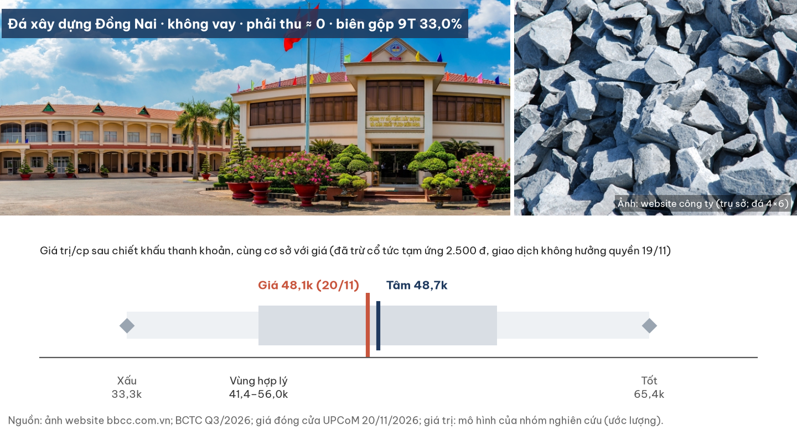

| Chỉ tiêu | Giá trị | Chỉ tiêu | Giá trị |
|---|---|---|---|
| Giá (UPCoM) | **48.100 đ** (đóng cửa 20/11/2026, đã không hưởng cổ tức 2.500 đ từ 19/11) | Tâm giá trị (sau chiết khấu thanh khoản) | **≈48.700 đ** cùng cơ sở với giá · 51.163 đ trước khi trừ cổ tức 2.500 đ |
| Vùng giá trị hợp lý | **≈41.400 – 56.000 đ** (tâm ± 15%) | Giá / tâm | **0,99 lần** |
| Tiền ròng thật (30/9/2026) | **488,8 tỷ ≈ 10.460 đ/cp**, vay = 0 | Phải thu khách hàng | **≈0** (2,76 triệu đồng); khách ứng trước 76,9 tỷ |
| LNST lõi 4 quý gần nhất | **391,6 tỷ** (đỉnh lịch sử) | Biên gộp 9T/2026 | **33,0%** (9T/2025: 27,0%) |
| P/E lõi ở giá hiện tại | ≈6,7 lần (EPS lõi sau trích quỹ 7.137 đ) | Thanh khoản | ≈1,14 tỷ đ/phiên (trung vị 250 phiên) |

**Ba điều cần biết**

- **Tích cực:** không vay, tiền ròng ≈22% vốn hoá, bán thu tiền trước; sản lượng đá Q3 +19% và doanh thu/m³ +13% so cùng kỳ.
- **Tiêu cực:** lợi nhuận ở đỉnh, gấp ≈2,7 lần trung vị 2017–2023; trữ lượng hữu hạn (ước ≈14 năm); tiền cấp quyền từng đảo chiều (2022 nộp bổ sung, 2026 nộp thừa).
- **Định giá:** khoản 344 tỷ chỉ đáng ≈2.560 đ/cp; giá 48.100 đ sát tâm giá trị, TRONG vùng hợp lý.

## 1. Tóm tắt điều hành

| | Nội dung |
|---|---|
| **Tình huống** | Doanh nghiệp khai thác đá xây dựng ở Đồng Nai, Dofico (vốn tỉnh) nắm 49%. 9T/2026 LNST 566 tỷ, gấp 2,8 lần cùng kỳ. |
| **Vấn đề** | 275 tỷ trong đó là khoản một lần, không phải tiền: tiền cấp quyền nộp thừa 2014–6/2025, được trừ dần vào nghĩa vụ các năm sau. |
| **Câu hỏi** | Lợi nhuận lõi bền ở mức nào, mỏ còn bao lâu, và khoản 344 tỷ đáng bao nhiêu? |
| **Trả lời** | Lõi ≈392 tỷ/năm nhưng ở đỉnh; đời mỏ cơ sở 14 năm; khoản bù trừ ≈119 tỷ hiện giá. Tâm ≈48.700 đ, giá sát tâm. |

## 2. Luận điểm và điều thị trường đang định giá

| Luận điểm tích cực | Luận điểm tiêu cực |
|---|---|
| Vay 0; tiền + tiền gửi 812,6 tỷ; tiền ròng thật 488,8 tỷ | 20,5 tỷ tiền gửi đang cầm cố bảo lãnh dự án |
| Phải thu ≈0, khách (nhà thầu lớn) ứng tiền trước | Lợi nhuận ở đỉnh; Long Thành, Vành đai 3 sắp hết khối lượng |
| Biên gộp 33,0% vs 27,0%; LN lõi Q3 +86% | Một phần biên có thể do cách tính tiền cấp quyền mới, chưa tách được |
| Cổ tức 2025 4.900 đ/cp từ LN lõi; tạm ứng 2026 2.500 đ | Trữ lượng hữu hạn; phần Tân Cang 1 hết hạn giấy phép 2/2025 |

- **Thị trường đang định giá:** ở 48.100 đ, P/E lõi ≈6,7 lần, ở cận trên nhóm mỏ đá niêm yết (4,4–6,8 lần); phần chênh được giải thích bởi tiền ròng và phải thu ≈0.
- **Điều thị trường có thể chưa tính:** khoản bù trừ là tiết kiệm tiền thật ≈19 tỷ/năm, dễ bị gạt hẳn vì báo chí gọi là "hoàn nhập một lần"; bến sà lan cho phép bán xuống ĐBSCL, nơi không có đá.
- **Điều thị trường có thể đã tính quá tay:** con số "tiền nhàn rỗi >800 tỷ" — tiền ròng thật chỉ ≈60% số đó.

## 3. Ngành: cầu đá vùng vượt công suất, nhưng do hành chính chi phối

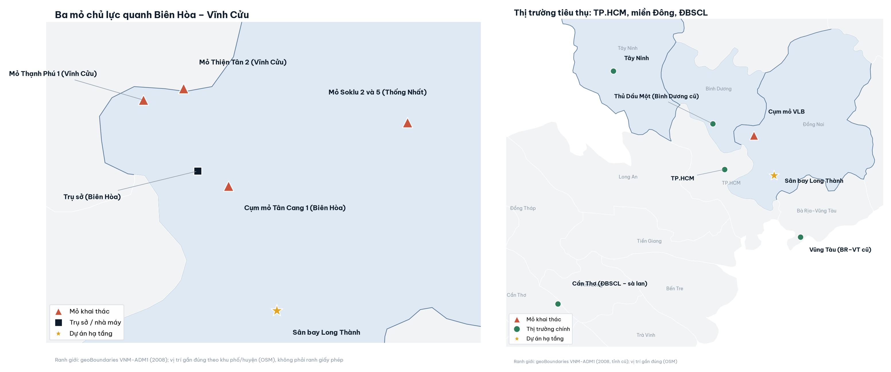

| Động lực | Dữ kiện (đọc ngành độc lập, 22/11/2026) |
|---|---|
| Vốn đầu tư công 2026–2030 | 8,22 triệu tỷ (≈2,7 lần giai đoạn trước); mục tiêu ≥5.000 km cao tốc |
| Cân đối TP.HCM 2026 | Công suất 23,66 tr m³, cầu 28,16 tr m³, thiếu 4,5 tr m³ (Sở NN&MT) |
| Cầu vùng (ước lượng) | ≈50–60 tr m³/năm so với công suất cấp phép ≈45–50 tr m³ |
| Dự án đang rút | Long Thành GĐ1 (dự kiến khai thác 24/12/2026), Vành đai 3, Biên Hòa–Vũng Tàu |
| Sóng kế tiếp | Vành đai 4 (2027–2029), TP.HCM–Mộc Bài, metro, ĐBSCL |
| Giá đá | Bình quân cả nước Q3 +3,9 đến 5,8% so quý trước (Bộ Xây dựng) |

- Phân loại 12 tháng (nhận định người đọc ngành): **hành chính 0,45 · chu kỳ 0,30 · cấu trúc 0,25**.
- Pha: giữa-muộn nhịp tăng; khối lượng dời từ quanh Biên Hòa sang xa hơn — mỏ có bến sà lan có lợi hơn.

## 4. Doanh nghiệp: ba mỏ đá chủ lực quanh Biên Hòa, bán thu tiền trước

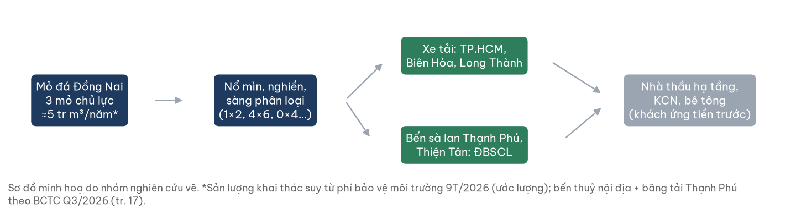

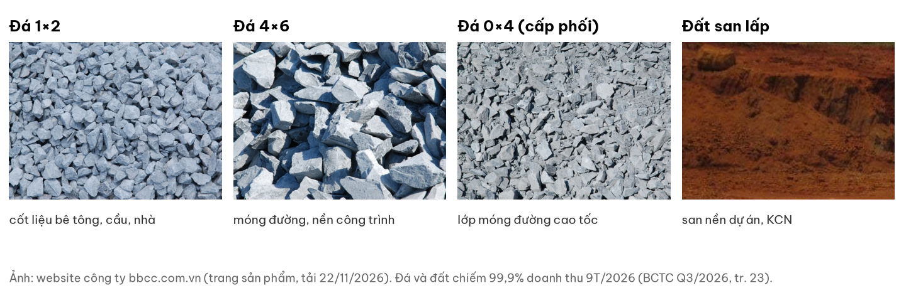

| Mỏ | Trữ lượng còn lại 1/1/2025 | Ghi chú |
|---|---|---|
| Thạnh Phú 1 (Vĩnh Cửu) | 35,59 tr m³ | Đất thuê tới 31/7/2042; có bến thuỷ nội địa + băng tải |
| Thiện Tân 2 (Vĩnh Cửu) | 22,7 tr m³ | Đang khai thác |
| Tân Cang 1 (Biên Hòa) | 22,65 tr m³ | >22 ha hết hạn 2/2025, đang xử lý; chưa rõ phần nằm trong giấy phép còn hiệu lực |
| Soklu 2, 5 (Thống Nhất) | Không công bố | Không trích dự phòng hoàn nguyên 9T; có thể đã ngừng (suy luận) |

- Trữ lượng theo báo chí, chưa đối chiếu văn bản gốc. Khai thác ≈5,1 tr m³/năm (suy từ phí bảo vệ môi trường) ⇒ đời mỏ ≈14 năm (ước lượng).
- Cổ đông: Dofico 49,08% · KSB 21,95% · Hóa An (DHA) 10,05% (mua thêm 8/2026); free float ≈18,5%.
- Đá và đất chiếm 99,9% doanh thu; không có mảng xây lắp hay vận tải đáng kể.

## 5. Tài chính: lợi nhuận lõi mạnh, bảng cân đối sạch

### 5a. Sản lượng tăng là chính, giá là phụ

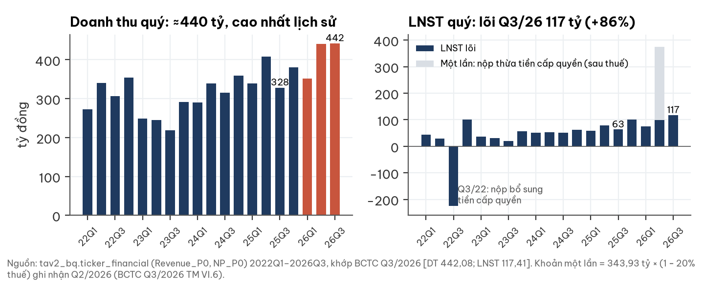

| Tỷ đồng | Q3/2026 | Q3/2025 | 9T/2026 | 9T/2025 |
|---|---|---|---|---|
| Doanh thu thuần | 442,08 | 328,02 | 1.233,93 | 1.075,37 |
| LN gộp (biên) | 153,04 (34,6%) | 82,47 (25,1%) | 407,32 (33,0%) | 290,34 (27,0%) |
| Thu nhập khác ròng | 3,04 | 10,72 | 351,66 | 13,76 |
| LNST | 117,41 | 63,05 | 565,97 | 200,71 |
| **LNST lõi** (bỏ 343,93 × 0,8) | **117,41** | 63,05 | **290,83** | 200,71 |

- Sản lượng đá Q3 1,99 tr m³ (+19,1%); doanh thu/m³ ≈222.000 đ (+13,1%, gồm hiệu ứng cơ cấu).
- Lãi tiền gửi Q3 17,8 tỷ (≈9%/năm trên số dư) có vẻ dồn lãi khi đáo hạn; mô hình không đếm lãi này.

### 5b. Lợi nhuận đang ở đỉnh lịch sử

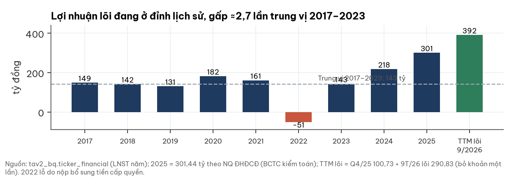

- 2025 trích quỹ khen thưởng phúc lợi + thưởng ban điều hành 14,84% LNST; EPS lõi 4 quý sau trích ≈7.140 đ.

### 5c. Tiền ròng thật ≈489 tỷ, không phải 813 tỷ

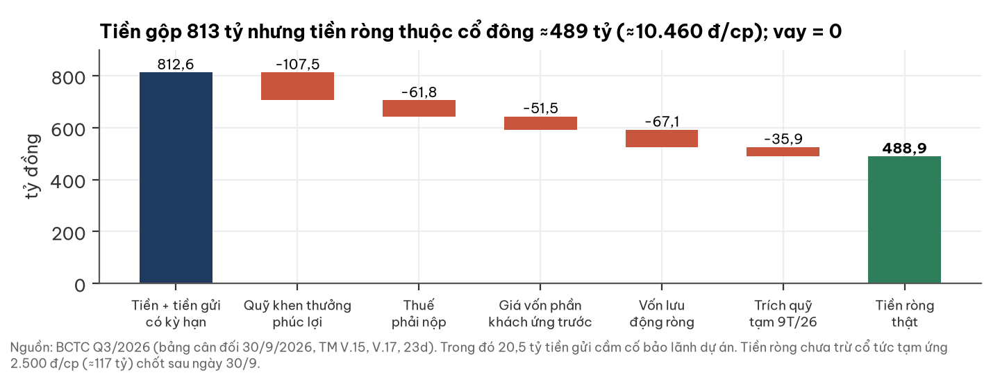

- CFO 9T 264,3 tỷ; bỏ thuế trên khoản một lần ≈333 tỷ, nhưng có 39,8 tỷ từ khách ứng trước tăng ⇒ CFO lõi/LN ≈1,0.
- Capex chỉ 1,1 tỷ; chi phí mở mỏ đi qua đền bù đất (chi phí trả trước dài hạn 286,8 tỷ).

## 6. Khoản 344 tỷ: quyền bù trừ, không phải tiền mặt

| Hạng mục | Số | Nguồn |
|---|---|---|
| Nộp thừa tiền cấp quyền 2014–6/2025 | 343,93 tỷ (ghi thu nhập khác Q2/2026) | Thông báo Thuế TP Đồng Nai 29/5 và 02/6/2026 |
| Thuế TNDN trên khoản này | ≈68,8 tỷ, đã nộp bằng tiền | BCTC Q3/2026 |
| Số dư còn bù trừ 30/9/2026 | 329,36 tỷ | BCTC Q3/2026 TM V.17 |
| Tốc độ cấn trừ | ≈19,4 tỷ/năm (9T: 14,57 tỷ) | BCTC Q3/2026, bán niên 2026 |
| Giá trị hiện tại trong đời mỏ 14 năm | 119,4 tỷ ≈ 2.560 đ/cp | Mô hình (ước lượng) |

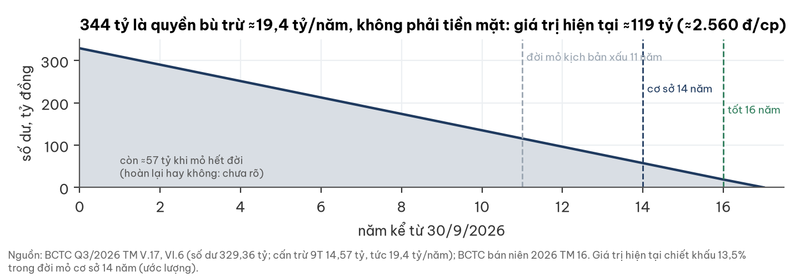

- Kiểm toán soát xét bán niên chấp nhận toàn phần, không đoạn nhấn mạnh. Chưa qua kiểm toán năm (dự kiến ≈03/2027).
- Cổ tức 4.900 đ/cp năm 2025 và tạm ứng 2.500 đ/cp năm 2026 chi từ lợi nhuận lõi, không từ khoản này.

## 7. Định giá: tâm ≈48.700 đ, giá sát tâm

**Phương pháp:** giá trị = hiện giá LN vận hành sau thuế × (1 − 14,84% trích quỹ), đời mỏ hữu hạn, không giá trị cuối kỳ + hiện giá khoản bù trừ + tiền ròng thật. Mỏ mới/mở rộng tính NPV = 0. Mô hình được khoá trước khi so với giá.

| Kịch bản | Xác suất | Điều kiện | Giá trị (cơ sở 30/9) | Cùng cơ sở với giá |
|---|---|---|---|---|
| Xấu | 0,25 | LN vận hành 250 tỷ; đời mỏ 11 năm; khoản bù trừ bị huỷ | 35.836 | 33.336 |
| Cơ sở | 0,50 | 330 tỷ (−10% so 4 quý gần nhất); 14 năm; g 2% | 53.604 | 51.104 |
| Tốt | 0,25 | 400 tỷ (giá tăng, Vành đai 4); 16 năm; g 3% | 67.885 | 65.385 |
| **Có trọng số** | | trước / sau chiết khấu thanh khoản (2,98%, quy mô 5 tỷ) | **52.732 / 51.163** | **≈50.200 / 48.735** |

- Cột "cùng cơ sở" trừ cổ tức tạm ứng 2.500 đ (giao dịch không hưởng quyền 19/11, trả 17/12): tiền ròng 30/9 vẫn chứa khoản này, còn giá 20/11 thì không.
- Tỷ lệ trích quỹ 12,4% (theo EPS 9T công bố) thay 14,84%: tâm +2,2%.

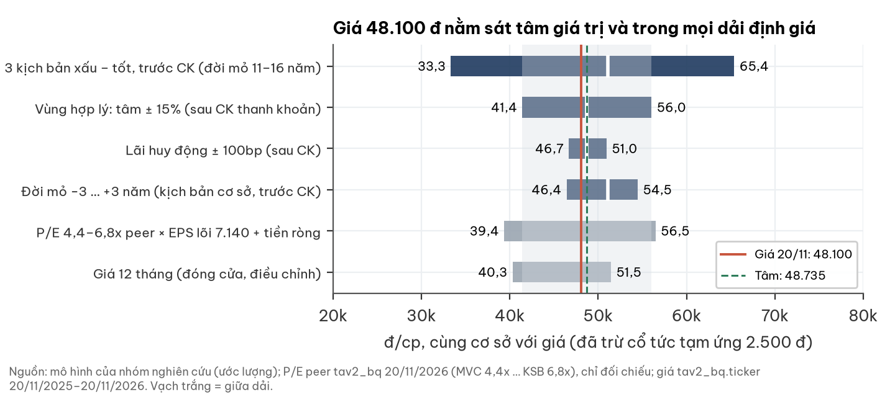

**Chi phí vốn gắn lãi huy động:** r = 13,5% tại điểm neo lãi huy động 12 tháng hiệu dụng 7,4% (CCTG 12 tháng, 18/11/2026), truyền dẫn 1:1; lãi huy động ±100bp ⇒ tâm −4,0% / +4,3%.

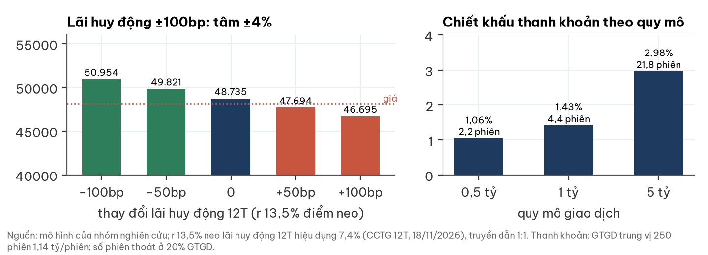

- **Bối cảnh lãi suất:** lãi suất chiết khấu mà giá thị trường chung đang ngầm định ≈15,1% (147 mã, 30/10/2026), cao hơn r 13,5% của báo cáo; phân vị 75% lịch sử 2014–2026 (đỉnh 2022 15,9%, đáy 2022–23 12,1%). TPCP 10 năm 4,57% (20/11/2026), +0,56 điểm % trong 12 tháng (nguồn chưa đối chiếu độc lập). Chỉ để tham khảo, không đổi giá trị hợp lý.

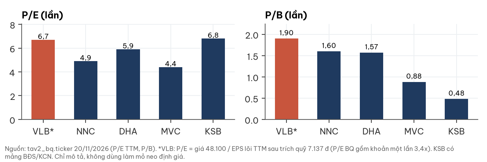

- **Kết luận:** giá 48.100 đ bằng 0,99 lần tâm, **TRONG** vùng giá trị hợp lý ≈41.400–56.000 đ; cao hơn kịch bản xấu ≈44%, thấp hơn kịch bản tốt ≈26%.

## 8. Rủi ro: giấy phép và tiền cấp quyền quyết định giá trị

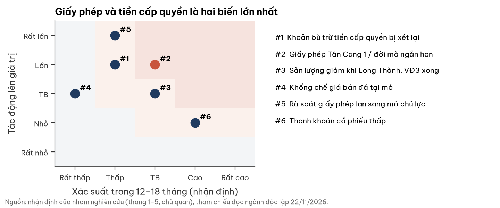

| # | Rủi ro | Xác suất | Tác động | Dấu hiệu sớm | Ngày kiểm |
|---|---|---|---|---|---|
| 1 | Khoản bù trừ bị xét lại | Thấp | Lớn (−2.560 đ/cp, hơn nếu phải nộp thêm) | Thông báo truy thu; kiểm toán nhấn mạnh | BCTC kiểm toán 2026 (≈03/2027) |
| 2 | Đời mỏ ngắn hơn (Tân Cang 1) | TB | Lớn (−3 năm: −8,7% giá trị cơ sở) | Không có quyết định cấp lại giấy phép | Công bố thông tin |
| 3 | Sản lượng giảm khi dự án gần mỏ xong | TB | TB | Sản lượng quý < 1,6 tr m³ | BCTC Q4/2026 (≈20/01/2027) |
| 4 | Khống chế giá bán đá tại mỏ | Rất thấp | TB | Văn bản trung ương áp trần giá | Đến 06/2027 |
| 5 | Rà soát giấy phép lan sang mỏ chủ lực | Thấp | Rất lớn | Kết luận thanh tra/kiểm toán | Công bố thông tin |
| 6 | Thanh khoản thấp | Cao | Nhỏ | GTGD < 0,5 tỷ/phiên | Hằng quý |

## 9. Pháp lý và quản trị: chỉ cảnh báo, không có vụ án

- Tiền cấp quyền đã đảo chiều một lần: 2022 nộp bổ sung (Q3/2022 lỗ 224 tỷ), 2026 được xác định nộp thừa cho cùng giai đoạn.
- Thanh tra Chính phủ từng yêu cầu Đồng Nai rà soát gia hạn giấy phép mỏ Soklu; Kiểm toán Nhà nước từng kiến nghị xử lý một số khu đất (báo chí; chưa đọc văn bản gốc).
- Quản trị chéo Dofico–KSB–Hóa An: không có giao dịch bán hàng với bên liên quan ngoài cổ tức. Thoái vốn Dofico có thể là xúc tác hai chiều.
- Kiểm toán A&C; soát xét bán niên 2026 chấp nhận toàn phần. BCTC Q3/2026 không soát xét.

## 10. Xúc tác và điều làm nhận định thay đổi (hai chiều)

| Mốc | Ngày | Điều kiện kiểm chứng |
|---|---|---|
| BCTC Q4/2026 | ≈20/01/2027 | Sản lượng đá Q4 ≥ 1,85 tr m³ và doanh thu/m³ ≥ 215.000 đ |
| Cấn trừ tiền cấp quyền Q4 | ≈20/01/2027 | ≈4–6 tỷ/quý, không có thông báo phải nộp bổ sung |
| BCTC kiểm toán 2026 | ≈31/03/2027 | Chấp nhận toàn phần, không ngoại trừ/nhấn mạnh về khoản 343,93 tỷ |
| Cổ tức 2026 (ĐHĐCĐ 2027) | ≈06/2027 | Tổng ≥ 4.500 đ/cp |

| Hướng | Điều kiện | Tác động |
|---|---|---|
| Tích cực hơn | Tân Cang 1 / Thiện Tân 2 được cấp lại hoặc gia hạn ≥ 10 năm | Tâm +1.689 đ/cp |
| Tích cực hơn | Giá đá Q4/2026 > +3% so quý trước và mốc Q4 đạt | Mỗi +10 tỷ LN vận hành: tâm +615 đ/cp |
| Tích cực hơn | Lãi huy động 12 tháng hiệu dụng −100bp | Tâm +4,3% |
| Tiêu cực hơn | Thông báo truy thu hoặc khoản bù trừ bị huỷ | Tâm −2.560 đ/cp cơ sở, hơn nếu phải nộp thêm |
| Tiêu cực hơn | Sản lượng Q4 < 1,6 tr m³; rà soát giấy phép lan sang 3 mỏ chủ lực | Về phía kịch bản xấu (≈33.300 đ) |
| Tiêu cực hơn | Lãi huy động +100bp; ý kiến kiểm toán có ngoại trừ | Tâm −4,0% hoặc hơn |

## Phụ lục A — Số liệu BCTC chính (riêng, tỷ đồng, 30/9/2026)

| Khoản | Số | Khoản | Số |
|---|---|---|---|
| Tiền | 27,58 | Quỹ khen thưởng phúc lợi | 107,47 |
| Tiền gửi có kỳ hạn | 785,01 | Thuế phải nộp | 61,75 |
| Phải thu khách hàng | 0,0028 | Khách ứng trước | 76,94 |
| Chi phí trả trước dài hạn (đền bù mỏ) | 286,8 | Dự phòng hoàn nguyên | 16,22 |
| Ký quỹ cải tạo môi trường | 38,88 | Vay | 0 |
| Khoản bù trừ tiền cấp quyền | 329,36 | Cổ phiếu lưu hành | 46,72 triệu |

## Phụ lục B — Đối chiếu dữ liệu thị trường với BCTC

| Chỉ tiêu | Dữ liệu thị trường | BCTC | Ghi chú |
|---|---|---|---|
| LNST Q2/2026 | 374,45 | H1 448,56 − Q1 74,11 | Khớp |
| P/E 4 quý | 3,4 lần | — | Gồm khoản một lần; P/E lõi ≈6,7 lần |
| Giá điều chỉnh trước 19/11 | hệ số 0,953 | Cổ tức 2.500 đ / giá 52.900 đ | Khớp tạm ứng cổ tức |

## Phụ lục C — Nguồn

- **Công ty:** BCTC riêng Q3/2026 (duyệt 19/10/2026) và bán niên 2026 (soát xét A&C); nghị quyết ĐHĐCĐ 2026 và thông báo nhân sự; thông báo thay đổi sở hữu của CTCP Hóa An (20/8/2026). Logo, ảnh trụ sở và ảnh sản phẩm: website bbcc.com.vn (tải 22/11/2026); logo chỉ để nhận diện, không ngụ ý công ty bảo chứng báo cáo.
- **Báo chí (chưa đối chiếu văn bản gốc):** nộp thừa tiền cấp quyền (24hmoney, doanhnhan.baophapluat.vn, 6/2026); nộp bổ sung 2022 (nguoiquansat.vn, baodauthau.vn); trữ lượng và đất Thạnh Phú 1 (stockbiz.vn); rà soát giấy phép Soklu (thoibaotaichinhvietnam.vn, stockbiz.vn); kiến nghị về đất (vnbusiness.vn); tạm ứng cổ tức 2.500 đ, giao dịch không hưởng quyền 19/11/2026 (vietstock.vn 11/2026).
- **Ngành:** đọc ngành độc lập 22/11/2026 (Bộ Xây dựng, Sở NN&MT và Ban Giao thông TP.HCM, ACV qua báo chí). **Dữ liệu thị trường:** tài chính quý, giá, P/E, P/B; lãi huy động; TPCP 10 năm.
- **Bản đồ:** ranh giới geoBoundaries VNM-ADM1 (2008, tỉnh cũ); toạ độ theo OpenStreetMap Nominatim (22/11/2026) — vị trí gần đúng theo khu phố/huyện, không phải ranh giấy phép.

## Phụ lục D — Phương pháp và giới hạn dữ liệu

- LN vận hành không gồm lãi tiền gửi (tiền ròng đã cộng theo mệnh giá); trích quỹ trừ cả dòng chảy lẫn khoản tạm trích 9T (35,9 tỷ).
- Đời mỏ = trữ lượng báo chí ÷ sản lượng suy từ phí bảo vệ môi trường (tỷ trọng ≈2,6 t/m³) — ước lượng.
- **Chưa có dữ liệu:** BCTC 2025 kiểm toán (ý kiến, thuyết minh giấy phép); bảng giấy phép (số, hạn, công suất, cote); quyết định phê duyệt tiền cấp quyền; phần Tân Cang 1 trong giấy phép còn hiệu lực; khả năng hoàn lại ≈57 tỷ khoản bù trừ còn dư khi mỏ hết đời; cấu phần chi phí hàng bán theo quý.
- BCTC Q3/2026 chưa soát xét. Một số số trữ lượng lấy từ báo chí, chưa đối chiếu văn bản gốc.

## Phụ lục E — Quy trình nghiên cứu

Số liệu đối chiếu với BCTC gốc; mô hình định giá dựng trước, độc lập với giá thị trường. Bối cảnh ngành do một người đọc ngành độc lập soạn mà không biết giá cổ phiếu; số liệu, mô hình và giả định đã qua một người phản biện độc lập.

## Phụ lục F — Tuyên bố miễn trừ trách nhiệm

Tài liệu này chỉ nhằm mục đích cung cấp thông tin nghiên cứu, không phải lời khuyên, đề nghị hay khuyến nghị mua, bán hoặc nắm giữ bất kỳ chứng khoán nào, và không tính đến mục tiêu, tình hình tài chính hay nhu cầu của từng nhà đầu tư. Thông tin được tổng hợp từ các nguồn được cho là đáng tin cậy tại thời điểm lập, nhưng không được bảo đảm về tính đầy đủ hay chính xác. Các ước lượng, kịch bản và giá trị hợp lý phản ánh giả định tại ngày lập và có thể thay đổi mà không cần thông báo. Kết quả trong quá khứ không bảo đảm kết quả tương lai. Nhà đầu tư cần tự đánh giá và chịu trách nhiệm với quyết định của mình.
