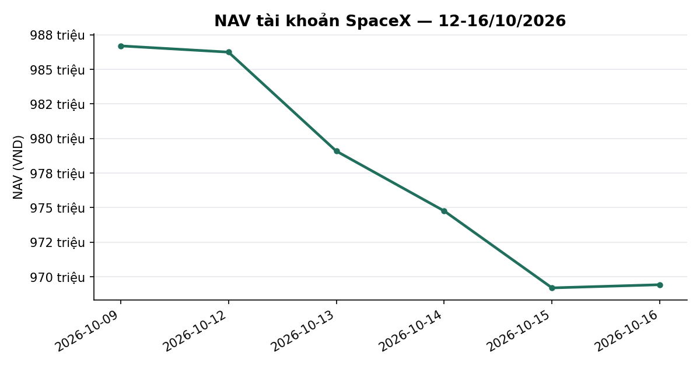
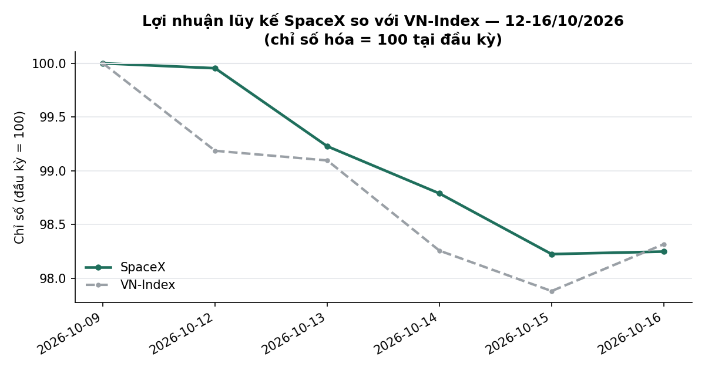
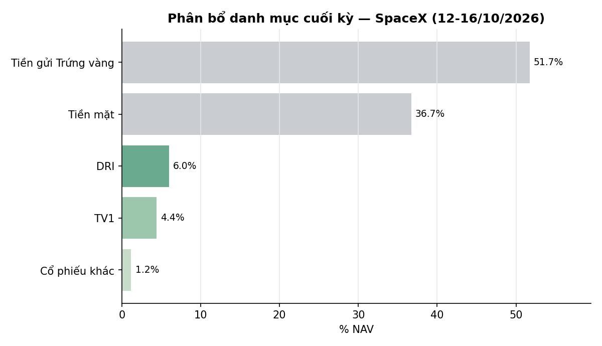

# BÁO CÁO TUẦN — TÀI KHOẢN SPACEX
## Kỳ báo cáo: 12/10/2026 – 16/10/2026

**Tài khoản:** SpaceX · số hiệu 0002023347 tại công ty chứng khoán lưu ký · Chiến lược V2.4
**Ngày lập báo cáo:** 17/10/2026
**Đối tượng:** Báo cáo hiệu suất & quản lý danh mục — dành cho nhà đầu tư

> 📊 Xem biểu đồ minh hoạ đính kèm trong email (NAV, lợi nhuận lũy kế so VN-Index, phân bổ danh mục);
> bản trên kênh chat chỉ hiển thị văn bản.

---

## 1. TÓM TẮT ĐIỀU HÀNH

| Chỉ tiêu | SpaceX |
|---|---:|
| NAV cuối kỳ trước (09/10) | 986.698.574 |
| NAV cuối kỳ (16/10) | **969.426.082** |
| Thay đổi trong kỳ | **−17.272.492 (−1,75%)** |
| VN-Index cùng kỳ (09/10 → 16/10) | 1.735,09 → 1.705,91 (**−1,68%**) |
| Giá trị cổ phiếu cuối kỳ | 112.131.700 (11,6% NAV) |
| Tiền mặt (đã gồm tiền bán cổ phiếu ngày 16/10) | 355.941.844 (36,7% NAV) |
| Tiền gửi "Trứng vàng" | 501.352.538 (51,7% NAV) |
| Số mã nắm giữ cuối kỳ | 6 |

**Nhận định tuần:** VN-Index giảm **−1,68%** (từ 1.735,09 xuống 1.705,91), chạm mức thấp nhất của tuần ở 1.698,35 vào ngày 15/10 rồi hồi nhẹ phiên cuối. Danh mục SpaceX giảm **−1,75%**, kém chỉ số **0,07 điểm phần trăm**. Mức giảm đến từ giá của nhóm cổ phiếu đang giữ đầu tuần — VPI (−4,86 triệu VND), PVT (−4,58 triệu), DRI (−4,44 triệu), SIP (−1,97 triệu), TV1 (−1,84 triệu) — trong khi tiền gửi Trứng vàng đóng góp +0,82 triệu VND. Ngày 16/10, danh mục kết thúc kỳ nắm giữ định sẵn 60 phiên của rổ cổ phiếu chủ đạo (PVT, SIP, VNM, SAB, NCT), đồng thời thoát toàn bộ VPI khi vị thế chạm ngưỡng cắt lỗ −20% so với giá vốn; tỷ trọng cổ phiếu giảm từ 48,4% xuống còn 11,6% NAV. Tính từ đầu tháng 10, danh mục **−1,24%** so với VN-Index **−3,55%** (vượt chỉ số +2,31 điểm phần trăm); từ khi bắt đầu hoạt động **−3,06%** so với **−8,29%** (vượt +5,23 điểm phần trăm).

*NAV theo ngày, SpaceX. Đơn vị: VND. Kỳ dữ liệu: 09/10–16/10/2026 (6 phiên). Nguồn: dữ liệu tài khoản tại công ty chứng khoán lưu ký (NAV chốt cuối ngày), tính toán nội bộ.*

---

## 2. TOÀN CẢNH THỊ TRƯỜNG

| Ngày | VN-Index | Thay đổi |
|---|---:|---:|
| 09/10 (cuối kỳ trước) | 1735,09 | — |
| 12/10 | 1720,98 | −0,81% |
| 13/10 | 1719,42 | −0,09% |
| 14/10 | 1704,87 | −0,85% |
| 15/10 | 1698,35 | −0,38% |
| 16/10 | 1705,91 | +0,45% |

*VN-Index đóng cửa hằng ngày; nguồn HOSE, dữ liệu tới 16/10/2026.*

**Kỹ thuật (VN-Index, dữ liệu đóng cửa 16/10/2026):**
- *Xu hướng:* chỉ số đóng cửa 1.705,91 điểm, giảm 1,68% trong tuần, 4 trên 5 phiên giảm. Chỉ số nằm dưới cả MA20 (1.754,1), MA50 (1.776,3) và MA200 (1.797,3); MA20 tiếp tục dốc xuống (1.779,0 → 1.754,1 trong tuần) — cấu trúc vẫn là điều chỉnh kéo dài từ cuối tháng 9.
- *Hỗ trợ/kháng cự:* hỗ trợ gần là mức đóng cửa thấp nhất tuần 1.698,35, tiếp theo là đáy 3 tháng 1.651,2; kháng cự gần là MA20 quanh 1.754, xa hơn là MA50 1.776 và MA200 1.797; đỉnh 3 tháng 1.874,5.
- *Động lượng:* RSI(14) 32,9 (thấp, tiến sát vùng quá bán 30 nhưng chưa vào); MACD−signal −6,06 (âm, thu hẹp từ −6,89 ngày 15/10); dòng tiền CMF −0,20 (âm).
- *Thanh khoản:* khối lượng khớp trung bình tuần khoảng 584 triệu cp, thấp hơn khoảng 18,6% so với tuần trước (717 triệu cp); phiên hồi 16/10 chỉ đạt 510 triệu cp — nhịp hồi chưa được xác nhận bằng khối lượng.
- *Độ rộng:* tỷ lệ cổ phiếu đóng cửa trên MA50 là **31,6%** (345 mã trong rổ đủ điều kiện ngày 16/10), so với 33,2% (349 mã) ngày 09/10 và thấp nhất tuần ở 28,9% (15/10); vẫn dưới ngưỡng 40% thường gắn với nhịp hồi bền vững.

**Cơ bản / định giá (dữ liệu tới 16/10/2026):**
- *Định giá:* chỉ báo định giá tổng hợp (P/E, P/B và chênh lệch với lãi suất tiền gửi, phân vị 10 năm) ở **21,7/100 — vùng RẺ**; P/E thị trường 11,06 lần (phân vị 6), P/B 1,86 lần (phân vị 22), chênh lệch lợi suất lợi nhuận so với lãi suất tiền gửi 12 tháng +1,64 điểm % (phân vị 38). Chỉ báo mang tính tham khảo, chưa qua kiểm định đủ mạnh để dùng làm tín hiệu giao dịch.
- *Trạng thái thị trường theo mô hình của chiến lược:* vẫn ở mức **Trung tính**; tín hiệu thận trọng đang tích luỹ **8/25 phiên** cần thiết để chuyển sang phòng thủ cao nhất (còn 17 phiên). Thị trường ở "nền xấu" 14 phiên liên tục từ 29/09, VN-Index giảm 4,2% từ đầu đợt; ngưỡng xem lại là từ 15 phiên và VN-Index giảm ≥5,0% (tương ứng khoảng 1.692 điểm) — chưa chạm. Theo thống kê lịch sử, xác suất tín hiệu ở mức tích luỹ này được xác nhận khoảng 44% (khoảng tin cậy 24–63%, mẫu mỏng). Đây là thông tin mô hình, không phải khuyến nghị.
- *Tăng trưởng lợi nhuận, dòng tiền khối ngoại, diễn biến lãi suất mới trong tuần:* báo cáo này không có số liệu đã đối soát cho các mục này trong kỳ nên không đưa ra nhận định; chỉ sử dụng mặt bằng lãi suất đã phản ánh trong chỉ báo định giá ở trên.

*Lợi nhuận lũy kế so với VN-Index (cơ sở 100 tại 09/10/2026). Đơn vị: chỉ số (cơ sở 100). Kỳ dữ liệu: 09/10–16/10/2026 (6 phiên). Nguồn: dữ liệu tài khoản tại công ty chứng khoán lưu ký (NAV chốt cuối ngày), HOSE (VN-Index), tính toán nội bộ.*

---

## 3. HIỆU QUẢ, ATTRIBUTION & RỦI RO

### 3.1 NAV theo ngày

| Ngày | NAV (VND) | Thay đổi NAV | Thay đổi VN-Index |
|---|---:|---:|---:|
| 09/10 (cuối kỳ trước) | 986.698.574 | — | — |
| 12/10 | 986.247.378 | −0,05% | −0,81% |
| 13/10 | 979.087.536 | −0,73% | −0,09% |
| 14/10 | 974.759.746 | −0,44% | −0,85% |
| 15/10 | 969.196.007 | −0,57% | −0,38% |
| 16/10 | 969.426.082 | +0,02% | +0,45% |

Cả tuần **−1,75%** so với VN-Index **−1,68%** — chênh lệch **−0,07 điểm phần trăm**.

### 3.2 Hiệu suất lũy kế

| Giai đoạn | SpaceX | VN-Index (giá) | VN-Index có cổ tức | Chênh so giá | Chênh so có cổ tức |
|---|---:|---:|---:|---:|---:|
| Tuần này (09/10 → 16/10) | −1,75% | −1,68% | chưa có số (G4: 2026-10-14 số mã rổ 351 → 333 (-18, > 5% của 351)) | −0,07pp | chưa có số (G4: 2026-10-14 số mã rổ 351 → 333 (-18, > 5% của 351)) |
| Từ đầu tháng 10 (MTD, 30/09 → 16/10) | −1,24% | −3,55% | chưa có số (G4: 2026-10-14 số mã rổ 351 → 333 (-18, > 5% của 351)) | +2,31pp | chưa có số (G4: 2026-10-14 số mã rổ 351 → 333 (-18, > 5% của 351)) |
| Từ khi bắt đầu hoạt động (01/07 → 16/10) | −3,06% | −8,29% | chưa có số (G4: 2026-10-14 số mã rổ 351 → 333 (-18, > 5% của 351)) | +5,23pp | chưa có số (G4: 2026-10-14 số mã rổ 351 → 333 (-18, > 5% của 351)) |

_VN-Index có cổ tức: đội tự tính từ cổ tức tiền mặt của cổ phiếu HOSE, tái đầu tư tại ngày GDKHQ, sau thuế TNCN 5% trên cổ tức; HOSE không công bố bản có cổ tức của VN-Index._
_Mốc VN-Index của dòng "Từ khi bắt đầu hoạt động": giá đóng cửa 30/06/2026 — phiên mà vốn gốc của tài khoản phản ánh._

Tài khoản bắt đầu hoạt động ngày 01/07/2026 nên quý IV/2026 (QTD) trùng với tháng 10 và chưa có số cả năm (YTD) độc lập.

**Rủi ro (từ khi bắt đầu hoạt động, theo NAV chốt cuối ngày, 75 phiên):** mức sụt giảm tối đa từ đỉnh −10,29%; độ biến động hằng ngày 0,82% (quy năm khoảng 13,0%).

### 3.3 Attribution tuần (đóng góp vào NAV, triệu VND)

| Nguồn | Đóng góp |
|---|---:|
| VPI | −4,86 |
| PVT | −4,58 |
| DRI | −4,44 |
| SIP | −1,97 |
| TV1 | −1,84 |
| NCT, VNM | −0,36 |
| SAB, VPB, MBB và các mã khác (cộng) | +0,72 |
| **Biến động giá (gồm phần đã bán trong kỳ)** | **−17,35** |
| Lãi tiền gửi Trứng vàng | +0,82 |
| Phí giao dịch và thuế (gồm thuế thu nhập cá nhân trên cổ phiếu có nguồn gốc cổ tức) | −0,74 |
| **Thu nhập ngoài giá (cộng)** | **+0,08** |
| **Thay đổi NAV** | **−17,27** |

*Đóng góp giá = số lượng × (giá 16/10 − giá 09/10) với phần bán trong kỳ tính theo giá khớp thực tế. Lãi Trứng vàng = mức tăng số dư Trứng vàng trong kỳ (không có khoản nạp/rút). Phí và thuế = chênh lệch giữa giá trị khớp bán và mức tăng tiền mặt thực tế của tài khoản. Tổng các cấu phần khớp thay đổi NAV đến từng đồng (−17.348.900 + 818.638 − 742.230 = −17.272.492).*

### 3.4 Hoạt động trong tuần

Chỉ có giao dịch **bán** trong phiên 16/10 (không có lệnh mua), tổng giá trị khớp **347,6 triệu VND**:

| Mã | Khối lượng | Giá khớp bình quân | Giá trị (VND) | Lý do |
|---|---:|---:|---:|---|
| PVT | 3.500 | 23.890 | 83.615.000 | Kết thúc kỳ nắm giữ 60 phiên |
| SIP | 1.700 | 48.241 | 82.010.000 | Kết thúc kỳ nắm giữ 60 phiên |
| VNM | 900 | 57.633 | 51.870.000 | Kết thúc kỳ nắm giữ 60 phiên |
| SAB | 1.100 | 43.205 | 47.525.000 | Kết thúc kỳ nắm giữ 60 phiên |
| NCT | 500 | 83.100 | 41.550.000 | Kết thúc kỳ nắm giữ 60 phiên |
| VPI | 800 | 49.425 | 39.540.000 | Cắt lỗ: giá thấp hơn giá vốn 62.375 khoảng 20,8% (ngưỡng −20%) |
| MSB | 100 | 14.650 | 1.465.000 | Thanh lý lô nhỏ còn lại |

Lệnh được chia nhỏ trong phiên để hạn chế tác động giá; toàn bộ khớp đủ. Phí giao dịch 0,097% và thuế chuyển nhượng 0,1% trên giá trị bán, cộng thuế thu nhập cá nhân đối với cổ phiếu có nguồn gốc cổ tức/cổ phiếu thưởng, được khấu trừ khi bán.

**Quyền lợi cổ đông:** cổ tức tiền mặt **TPB** 500 đ/cp đã được thanh toán ngày 14/10. Cuối kỳ còn 7,15 triệu VND cổ tức tiền mặt đang chờ thanh toán (đã nằm trong số dư tiền): **DRI** 3,70 triệu (1.000 đ/cp, thanh toán 20/10) và **TV1** 3,45 triệu (1.500 đ/cp, thanh toán 29/10); cả hai đã được cộng (sau thuế 5%) vào tỷ suất của hai mã ở bảng dưới.

### 3.5 Danh mục cuối kỳ (16/10/2026)

| Mã | KL | Giá vốn | Giá 16/10 | Giá trị thị trường | % NAV | Lãi/lỗ (%) |
|---|---:|---:|---:|---:|---:|---:|
| DRI | 3.700 | 13.262 | 15.700 | 58.090.000 | 5,99 | +25,55% |
| TV1 | 2.300 | 20.148 | 18.500 | 42.550.000 | 4,39 | −1,11% |
| VPB | 286 | 22.021 | 24.500 | 7.007.000 | 0,72 | +11,26% |
| MBB | 175 | 21.313 | 19.850 | 3.473.750 | 0,36 | −3,94% |
| VIB | 47 | 13.620 | 13.850 | 650.950 | 0,07 | +1,69% |
| TPB | 30 | 14.609 | 12.000 | 360.000 | 0,04 | −15,03% |
| **Cổ phiếu — tổng (6 mã)** | | | | **112.131.700** | **11,57** | **+11,76%** |
| **Tiền mặt** | | | | **355.941.844** | **36,72** | |
| **Tiền gửi Trứng vàng** | | | | **501.352.538** | **51,72** | |
| **Nợ ký quỹ** | | | | **0** | **0,00** | |
| **Tổng NAV** | | | | **969.426.082** | **100,00** | |

*Giá vốn là giá vốn thô thực tế; "Lãi/lỗ (%)" tính theo giá đóng cửa 16/10/2026, đã cộng cổ tức tiền mặt đã đối soát được với sổ công ty chứng khoán (sau thuế thu nhập cá nhân 5%). Tổng lãi chưa thực hiện của các vị thế còn nắm giữ khoảng +12,53 triệu VND (+11,76% trên giá vốn thô 106,5 triệu VND). Với cổ phiếu thưởng, giá vốn được phân bổ lại trên số cổ phiếu sau thưởng. Tiền mặt gồm 7,15 triệu VND cổ tức tiền mặt đang chờ thanh toán và khoảng 346,8 triệu VND tiền thu từ các lệnh bán ngày 16/10 (tiền bán cổ phiếu về tài khoản theo chu kỳ thanh toán T+2).*

*Phân bổ danh mục cuối kỳ 16/10/2026, % NAV. Nguồn: dữ liệu tài khoản tại công ty chứng khoán lưu ký, giá đóng cửa HOSE 16/10/2026, tính toán nội bộ.*

**Ghi nhận:** danh mục gồm 6 mã, mã lớn nhất DRI ở mức 5,99% NAV; 88,4% NAV nằm ở tiền gửi và tiền mặt. Tỷ trọng cổ phiếu thấp hơn nhiều so với trần phân bổ của trạng thái Trung tính (70%) vì hiện chưa có tín hiệu mua mới đủ điều kiện (không có tín hiệu động lượng mới, không có mã báo cáo lợi nhuận sắp công bố đủ chuẩn, và phần danh mục tạm giữ chờ cơ hội đang để ở mức 0%); tiền chưa dùng được giữ ở tiền gửi và tiền mặt cho tới khi có tín hiệu mới.

---

## 4. ĐÍNH CHÍNH SỐ ĐÃ CÔNG BỐ

Nhân dịp rà soát định kỳ, chúng tôi điều chỉnh một số số liệu đã công bố ở các báo cáo trước. **Tỉ suất của chính tài khoản SpaceX không thay đổi** ở bất kỳ mục nào dưới đây; các báo cáo cũ không được phát hành lại.

- **Mốc VN-Index "từ khi bắt đầu hoạt động".** Mốc so sánh đúng là giá đóng cửa 30/06/2026 (phiên phản ánh vốn gốc đầu kỳ), thay cho giá đóng cửa 01/07/2026 đã dùng trước đây. Chỉ số VN-Index "từ khi bắt đầu" được đính chính: báo cáo tuần 14–18/09 từ −2,76% thành **−2,38%**; tuần 21–25/09 từ −4,40% thành **−4,03%**; tuần 28/09–02/10 từ −6,94% thành **−6,58%**; tuần 05–09/10 từ −7,08% thành **−6,72%**. Khoảng chênh lệch của tài khoản so với VN-Index ở các kỳ này vì vậy thu hẹp khoảng 0,37 điểm phần trăm.
- **Sổ NAV lịch sử.** NAV ngày 02/07/2026 được điều chỉnh từ 994.733.747 xuống **990.304.455**; tỉ suất ngày 02/07 và 03/07 lệch khoảng 0,44 điểm phần trăm, còn các tỉ suất lũy kế (tuần, tháng, từ khi bắt đầu) không đổi. Sổ NAV được bổ sung ngày 06/08/2026 còn thiếu: độ biến động công bố cho tháng 08 điều chỉnh từ 12,37% thành **12,80%**, tháng 07 từ 17,3% thành **17,4%**; mức "+0,12% so với hôm trước" ghi trong bản tin ngày 07/08 đúng là **+1,10%**.

---

## 5. OUTLOOK KỲ TỚI (19/10 – 23/10/2026)

**Kỹ thuật.** Kịch bản cơ sở (khả năng cao nhất): VN-Index dao động trong biên 1.690–1.755 — thử lại vùng hỗ trợ 1.698 và kháng cự MA20 (đang dốc xuống, khoảng 1.750 trong tuần tới). Kịch bản tích cực (khả năng trung bình–thấp): đóng cửa vững trên 1.755 cùng khối lượng cải thiện và độ rộng vượt 40% sẽ xác nhận nhịp hồi về 1.776–1.797 (MA50/MA200). Kịch bản tiêu cực (khả năng trung bình): thủng 1.698 kèm khối lượng tăng mở đường về đáy 3 tháng 1.651. *Điều kiện làm sai kịch bản cơ sở:* đóng cửa dưới 1.698 hai phiên liên tiếp, độ rộng lùi dưới 28%, hoặc đóng cửa trên 1.776.

**Cơ bản.** Định giá thị trường ở vùng thấp trong lịch sử 10 năm (P/E 11,1 lần, chỉ báo tổng hợp 21,7/100) là nền hỗ trợ trung hạn nhưng không phải tín hiệu thời điểm. Mô hình trạng thái của chiến lược đang ở Trung tính với tín hiệu thận trọng tích luỹ 8/25 phiên; nếu tình trạng "nền xấu" kéo dài từ 15 phiên và VN-Index giảm ≥5% từ đầu đợt (khoảng 1.692), mô hình sẽ được xem lại; xác suất xác nhận phòng thủ theo thống kê lịch sử khoảng 44% (khoảng tin cậy rộng, mẫu mỏng). Nếu xác nhận, tỷ trọng cổ phiếu mục tiêu giảm về mức thấp nhất của khung phân bổ; nếu không, cơ cấu hiện tại (cổ phiếu 11,6% NAV, tiền gửi/tiền mặt 88,4%) được giữ cho tới khi xuất hiện tín hiệu mới. *Điều kiện làm sai:* thị trường bứt phá lên trên 1.800 với độ rộng cải thiện bền vững. Dòng tiền dự kiến: cổ tức DRI 3,70 triệu VND (trước thuế) ngày 20/10 và TV1 3,45 triệu VND ngày 29/10.

Các nhận định trên là kịch bản có điều kiện, không phải khuyến nghị đầu tư chắc chắn.

---

## 6. PHỤ LỤC — PHƯƠNG PHÁP LUẬN

**Định giá:** NAV = giá trị cổ phiếu theo giá đóng cửa cuối ngày + tiền mặt + tiền gửi Trứng vàng − dư nợ (nếu có), đối chiếu trực tiếp với dữ liệu tài khoản tại công ty chứng khoán lưu ký. Đẳng thức cuối kỳ: 112.131.700 + 355.941.844 + 501.352.538 = 969.426.082 (chênh lệch 0 đồng).

**Độ rộng thị trường:** tỷ lệ cổ phiếu đóng cửa trên đường trung bình 50 phiên, tính trên rổ cổ phiếu đủ điều kiện tại từng thời điểm (không dùng danh sách hiện tại để tránh sai lệch nhìn trước). Các báo cáo trước tính trên toàn bộ danh sách theo dõi (836 mã ngày 09/10: 32,4%); báo cáo này chỉ tính trên rổ đủ điều kiện (349 mã ngày 09/10: 33,2%), nên hai số không so trực tiếp được.

**Cổ tức & quyền lợi cổ đông:** cổ tức tiền mặt chỉ được cộng vào tỷ suất khi đã đối soát được với sổ công ty chứng khoán; thuế thu nhập cá nhân 5% trên cổ tức tiền mặt.

**Chi phí:** phí giao dịch 0,097% mỗi lượt (HOSE); thuế chuyển nhượng chứng khoán 0,1% trên giá trị bán.

**Hiệu suất lũy kế:** vốn khởi điểm 1.000.000.000 VND tại 01/07/2026; VN-Index so sánh tại cùng mốc (đóng cửa 30/06/2026: 1.860,01).

**Track record:** lịch sử hoạt động còn ngắn (75 phiên kể từ 01/07/2026) — so sánh với VN-Index mang tính mô tả, chưa đủ dài để có ý nghĩa thống kê.

**Công bố tuân thủ:**
- Đây không phải là khuyến nghị đầu tư. Kết quả hoạt động trong quá khứ không đảm bảo cho kết quả trong tương lai.
- Số liệu trong báo cáo được đối chiếu với dữ liệu giao dịch tại công ty chứng khoán lưu ký tài khoản.

---

*Báo cáo tuần 12/10–16/10/2026 — Tổng hợp và đối soát bởi Đội ngũ Quản lý Danh mục & Nghiên cứu Định lượng.*
