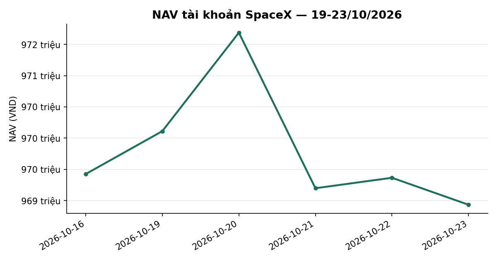
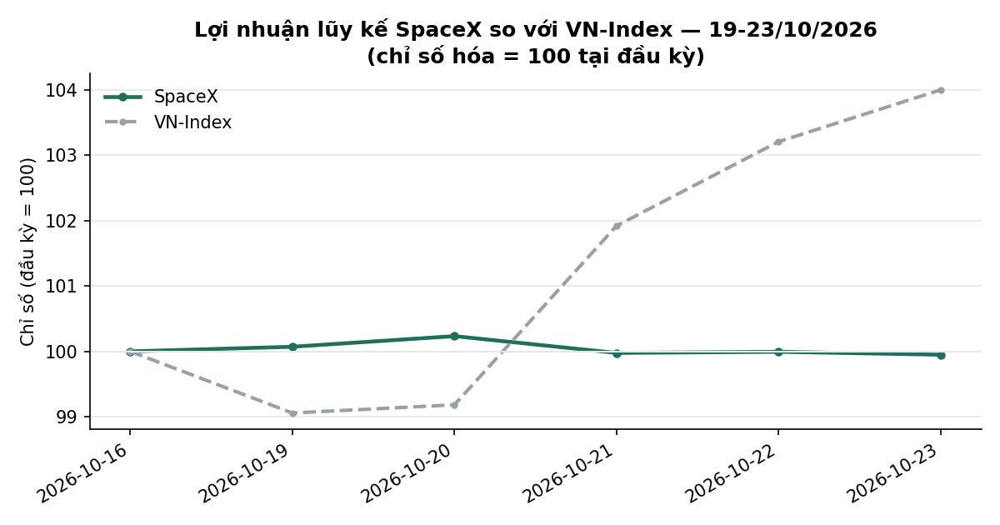
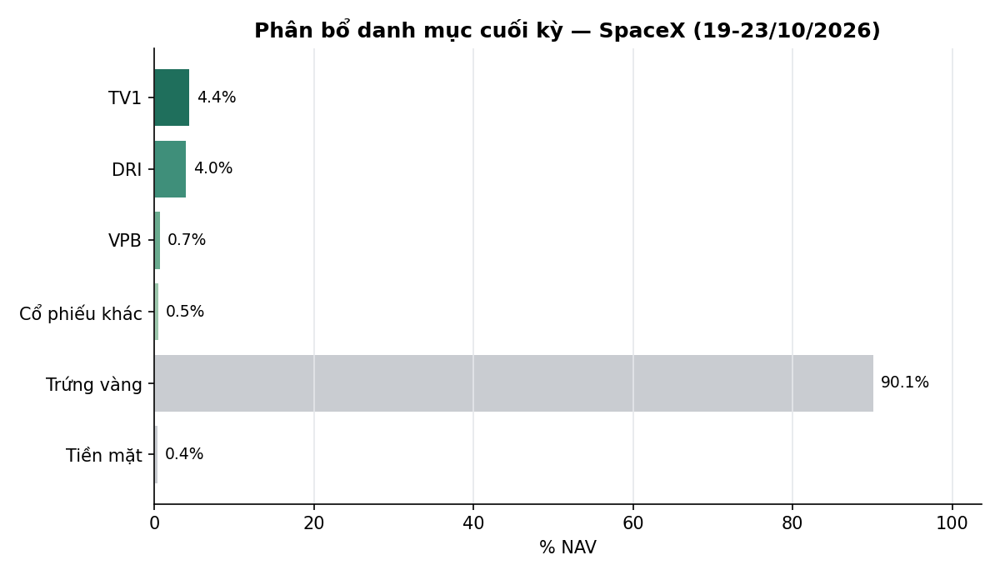

# BÁO CÁO TUẦN — TÀI KHOẢN SPACEX
## Kỳ báo cáo: 19/10/2026 – 23/10/2026

**Tài khoản:** SpaceX · số hiệu 0002023347 tại công ty chứng khoán lưu ký · Chiến lược V2.4
**Ngày lập báo cáo:** 24/10/2026
**Đối tượng:** Báo cáo hiệu suất & quản lý danh mục — dành cho nhà đầu tư

> 📊 Xem biểu đồ minh hoạ đính kèm trong email (NAV, lợi nhuận lũy kế so VN-Index, phân bổ danh mục);
> bản trên kênh chat chỉ hiển thị văn bản.

---

## 1. TÓM TẮT ĐIỀU HÀNH

| Chỉ tiêu | SpaceX |
|---|---:|
| NAV cuối kỳ trước (16/10) | 969.426.082 |
| NAV cuối kỳ (23/10) | **968.934.792** |
| Thay đổi trong kỳ | **−491.290 (−0,05%)** |
| VN-Index cùng kỳ (16/10 → 23/10) | 1.705,91 → 1.774,15 (**+4,00%**) |
| Giá trị cổ phiếu cuối kỳ | 92.235.000 (9,5% NAV) |
| Tiền mặt | 3.454.750 (0,4% NAV) |
| Tiền gửi "Trứng vàng" | 873.245.042 (90,1% NAV) |
| Số mã nắm giữ cuối kỳ | 6 |

**Nhận định tuần:** VN-Index tăng **+4,00%** (từ 1.705,91 lên 1.774,15) sau một tuần đảo chiều rõ rệt: phiên đầu tuần (19/10) chỉ số đóng cửa 1.689,84 — thấp hơn mức thấp nhất của tuần trước (1.698,35) — rồi bật tăng ba phiên liên tiếp, mạnh nhất là 21/10 (+2,76%, khối lượng 947,8 triệu cp, cao nhất kể từ 09/10). Danh mục SpaceX gần như đi ngang (**−0,05%**), kém chỉ số **4,05 điểm phần trăm**, vì cuối tuần trước danh mục đã chuyển phần lớn sang tiền gửi: cổ phiếu chỉ còn 11,6% NAV đầu kỳ và 9,5% NAV cuối kỳ, 90,1% NAV nằm ở tiền gửi Trứng vàng — phần này không tham gia nhịp tăng của thị trường nhưng sinh lãi ổn định (+1,15 triệu VND trong tuần). Phần cổ phiếu đóng góp −1,42 triệu VND do giá (chủ yếu DRI −1,11 triệu và TV1 −0,23 triệu); ngày 21/10 chủ tài khoản chủ động bán 1.200 cp DRI ở giá 15.400 (18,48 triệu VND). Tính từ đầu tháng 10 danh mục **−1,29%** so với VN-Index **+0,31%** (kém 1,60 điểm phần trăm so với chỉ số giá); từ khi bắt đầu hoạt động **−3,11%** so với **−4,62%** (vượt +1,51 điểm phần trăm so với chỉ số giá).

*NAV theo ngày, SpaceX. Đơn vị: VND. Kỳ dữ liệu: 16/10–23/10/2026 (6 phiên). Nguồn: dữ liệu tài khoản tại công ty chứng khoán lưu ký (NAV chốt cuối ngày), tính toán nội bộ.*

---

## 2. TOÀN CẢNH THỊ TRƯỜNG

| Ngày | VN-Index | Thay đổi |
|---|---:|---:|
| 16/10 (cuối kỳ trước) | 1705,91 | — |
| 19/10 | 1689,84 | −0,94% |
| 20/10 | 1691,97 | +0,13% |
| 21/10 | 1738,67 | +2,76% |
| 22/10 | 1760,63 | +1,26% |
| 23/10 | 1774,15 | +0,77% |

*VN-Index đóng cửa hằng ngày; nguồn HOSE, dữ liệu tới 23/10/2026.*

**Kỹ thuật (VN-Index, dữ liệu đóng cửa 23/10/2026):**
- *Xu hướng:* chỉ số đóng cửa 1.774,15 điểm, tăng 4,00% trong tuần (3 phiên tăng liên tiếp từ 21/10). Chỉ số đã vượt lên trên MA20 (1.737,9) và đóng cửa cao hơn MA50 (1.772,2) một khoảng rất nhỏ (+0,11%); vẫn dưới MA200 (1.796,6). MA20 đã ngừng dốc xuống (1.754,1 → 1.737,9 trong tuần, các phiên cuối chỉ giảm dưới 1 điểm/phiên) — cấu trúc chuyển từ điều chỉnh kéo dài sang nhịp hồi đang kiểm tra vùng MA50–MA200.
- *Hỗ trợ/kháng cự:* hỗ trợ gần là MA50 quanh 1.772 và MA20 quanh 1.738; xa hơn là mức đóng cửa thấp nhất tuần 1.689,84 và đáy 3 tháng 1.651,2. Kháng cự gần là MA200 quanh 1.797; tiếp theo là đỉnh 3 tháng 1.874,5 và vùng 1.894.
- *Động lượng:* RSI(14) 57,2 (tăng mạnh từ 32,9 cuối tuần trước, đã thoát vùng yếu); MACD−signal +5,86 (đổi dấu sang dương từ 22/10, từ −6,06 tuần trước); dòng tiền CMF +0,01 (từ −0,20, về sát mức trung tính).
- *Thanh khoản:* khối lượng khớp trung bình tuần khoảng 716 triệu cp, cao hơn khoảng 22,7% so với tuần trước (584 triệu cp); phiên bứt phá 21/10 đạt 948 triệu cp — nhịp tăng được xác nhận bằng khối lượng.
- *Độ rộng:* tỷ lệ cổ phiếu đóng cửa trên MA50 là **46,5%** (342 mã trong rổ đủ điều kiện ngày 23/10), so với 31,6% (345 mã) ngày 16/10; đỉnh tuần 48,7% (21/10), thấp nhất tuần 32,9% (19/10). Đã vượt ngưỡng 40% thường gắn với nhịp hồi bền vững, nhưng chưa vượt 50%.

**Cơ bản / định giá (dữ liệu tới 23/10/2026):**
- *Định giá:* chỉ báo định giá tổng hợp (P/E, P/B và chênh lệch với lãi suất tiền gửi, phân vị 10 năm) ở **24,8/100 — vùng RẺ** (21,7 tuần trước); P/E thị trường 11,26 lần (phân vị 7), P/B 1,89 lần (phân vị 26), chênh lệch lợi suất lợi nhuận so với lãi suất tiền gửi 12 tháng +1,48 điểm % (phân vị 41). Chỉ báo mang tính tham khảo, chưa qua kiểm định đủ mạnh để dùng làm tín hiệu giao dịch (0/17 góc nhìn qua kiểm định đa giả thuyết).
- *Trạng thái thị trường theo mô hình của chiến lược:* vẫn ở mức **Trung tính**; tín hiệu thận trọng ở mức cao nhất đang tích luỹ **13/25 phiên** cần thiết để xác lập (còn 12 phiên). Thị trường ở "nền xấu" 19 phiên liên tục từ 29/09 (6 phiên mức Gấu + 13 phiên mức Khủng hoảng, bộ đếm được đặt lại một lần khi đổi mức); VN-Index chỉ còn −0,4% so với đầu đợt nên ngưỡng xem lại (từ 15 phiên và VN-Index giảm ≥5,0%, tương ứng khoảng 1.692 điểm — ước lượng) chưa chạm. Theo thống kê lịch sử, xác suất tín hiệu ở mức tích luỹ này được xác nhận khoảng 69% (khoảng tin cậy 44–91%, mẫu 16 trường hợp — rất mỏng). Đây là thông tin mô hình, không phải khuyến nghị.
- *Tăng trưởng lợi nhuận, dòng tiền khối ngoại, diễn biến lãi suất mới trong tuần:* báo cáo này không có số liệu đã đối soát cho các mục này trong kỳ nên không đưa ra nhận định; chỉ sử dụng mặt bằng lãi suất đã phản ánh trong chỉ báo định giá ở trên.

*Lợi nhuận lũy kế so với VN-Index (cơ sở 100 tại 16/10/2026). Đơn vị: chỉ số (cơ sở 100). Kỳ dữ liệu: 16/10–23/10/2026 (6 phiên). Nguồn: dữ liệu tài khoản tại công ty chứng khoán lưu ký (NAV chốt cuối ngày), HOSE (VN-Index), tính toán nội bộ.*

---

## 3. HIỆU QUẢ, ATTRIBUTION & RỦI RO

### 3.1 NAV theo ngày

| Ngày | NAV (VND) | Thay đổi NAV | Thay đổi VN-Index |
|---|---:|---:|---:|
| 16/10 (cuối kỳ trước) | 969.426.082 | — | — |
| 19/10 | 970.111.486 | +0,07% | −0,94% |
| 20/10 | 971.687.907 | +0,16% | +0,13% |
| 21/10 | 969.198.674 | −0,26% | +2,76% |
| 22/10 | 969.366.194 | +0,02% | +1,26% |
| 23/10 | 968.934.792 | −0,04% | +0,77% |

*NAV ngày 21/10 xác lập theo số dư tài khoản và giá đóng cửa cuối ngày 21/10.*

Cả tuần **−0,05%** so với VN-Index **+4,00%** — chênh lệch **−4,05 điểm phần trăm**.

### 3.2 Hiệu suất lũy kế

| Giai đoạn | SpaceX | VN-Index (giá) | VN-Index có cổ tức | Chênh so giá | Chênh so có cổ tức |
|---|---:|---:|---:|---:|---:|
| Tuần này (16/10 → 23/10) | −0,05% | +4,00% | +4,00% | −4,05pp | −4,05pp |
| Từ đầu tháng 10 (MTD, 30/09 → 23/10) | −1,29% | +0,31% | +0,36% | −1,60pp | −1,65pp |
| Từ khi bắt đầu hoạt động (01/07 → 23/10) | −3,11% | −4,62% | −3,98% | +1,51pp | +0,88pp |

_VN-Index có cổ tức: đội tự tính từ cổ tức tiền mặt của cổ phiếu HOSE, tái đầu tư tại ngày GDKHQ, sau thuế TNCN 5% trên cổ tức; HOSE không công bố bản có cổ tức của VN-Index._
_Mốc VN-Index của dòng "Từ khi bắt đầu hoạt động": giá đóng cửa 30/06/2026 — phiên mà vốn gốc của tài khoản phản ánh._

Tài khoản bắt đầu hoạt động ngày 01/07/2026 nên quý IV/2026 (QTD) trùng với tháng 10 và chưa có số cả năm (YTD) độc lập.

**Rủi ro (từ khi bắt đầu hoạt động, theo NAV chốt cuối ngày, 80 phiên):** mức sụt giảm tối đa từ đỉnh −10,29% (đáy ngày 27/07, chưa bị vượt trong tuần); độ biến động hằng ngày 0,79% (quy năm khoảng 12,6%). Với 90,1% NAV ở tiền gửi, độ biến động của tuần tới chủ yếu đến từ phần cổ phiếu (9,5% NAV).

### 3.3 Attribution tuần (đóng góp vào NAV, VND)

| Nguồn | Đóng góp |
|---|---:|
| DRI | −1.110.000 |
| TV1 | −230.000 |
| VPB | −114.400 |
| MBB | −8.750 |
| VIB | +16.450 |
| TPB | +30.000 |
| **Biến động giá (gồm phần đã bán trong kỳ)** | **−1.416.700** |
| Lãi tiền gửi Trứng vàng và lãi tiền gửi không kỳ hạn | +1.145.153 |
| Phí giao dịch (16.263) và thuế chuyển nhượng (18.480) trên lệnh bán DRI | −34.743 |
| Thuế thu nhập cá nhân 5% trên cổ tức tiền mặt DRI (khấu trừ khi chi trả 20/10) | −185.000 |
| **Thu nhập ngoài giá (cộng)** | **+925.410** |
| **Thay đổi NAV** | **−491.290** |

*Đóng góp giá = số lượng × (giá 23/10 − giá 16/10), phần bán trong kỳ tính theo giá khớp thực tế (DRI 1.200 cp bán 15.400 đ, bằng giá đóng cửa 23/10 nên không phát sinh chênh lệch giá bán). Cổ tức tiền mặt DRI 1.000 đ/cp × 3.700 cp = 3,70 triệu VND đã nằm trong số dư tiền từ trước kỳ và được chi trả ngày 20/10 sau khi trừ thuế 5%; cổ tức TV1 3,45 triệu VND (1.500 đ/cp × 2.300 cp) thanh toán ngày 29/10 đã nằm trong tiền mặt cuối kỳ. Lãi Trứng vàng và lãi không kỳ hạn được tính theo hiệu số từ đẳng thức tiền (tăng số dư Trứng vàng + thay đổi tiền mặt − giá trị bán ròng + thuế cổ tức). Tuần này chủ tài khoản chuyển khoảng 370,7 triệu VND từ tiền mặt sang Trứng vàng (khoảng 348,8 triệu ngày 20/10 và khoảng 22,0 triệu ngày 23/10; số tiền suy ra từ số dư, không làm đổi NAV). Phí và thuế lấy từ xác nhận khớp lệnh của công ty chứng khoán. Tổng: −1.416.700 + 1.145.153 − 34.743 − 185.000 = −491.290 (khớp thay đổi NAV đến từng đồng).*

### 3.4 Hoạt động trong tuần

Không có lệnh mua. Có một giao dịch **bán** trong phiên 21/10, do chủ tài khoản chủ động thực hiện theo đánh giá riêng đối với cổ phiếu này, tổng giá trị khớp **18,48 triệu VND**:

| Mã | Khối lượng | Giá khớp bình quân | Giá trị (VND) | Lý do |
|---|---:|---:|---:|---|
| DRI | 1.200 | 15.400 | 18.480.000 | Quyết định chủ động của chủ tài khoản (chốt một phần vị thế, lãi so với giá vốn thô khoảng +16%) |

Toàn bộ khớp đủ (2 lệnh: 800 cp + 400 cp). Phí giao dịch 0,088% và thuế chuyển nhượng 0,1% trên giá trị bán được khấu trừ khi bán.

**Quyền lợi cổ đông:** cổ tức tiền mặt **DRI** 1.000 đ/cp đã được thanh toán ngày 20/10 (3,70 triệu VND trước thuế, thuế 5% khấu trừ 185.000 đ). Cuối kỳ còn 3,45 triệu VND cổ tức tiền mặt đang chờ thanh toán (đã nằm trong số dư tiền): **TV1** 1.500 đ/cp × 2.300 cp, thanh toán 29/10; khoản này đã được cộng (sau thuế 5%) vào tỷ suất của TV1 ở bảng dưới.

### 3.5 Danh mục cuối kỳ (23/10/2026)

| Mã | KL | Giá vốn | Giá 23/10 | Giá trị thị trường | % NAV | Lãi/lỗ (%) |
|---|---:|---:|---:|---:|---:|---:|
| TV1 | 2.300 | 20.148 | 18.400 | 42.320.000 | 4,37 | −1,60% |
| DRI | 2.500 | 13.262 | 15.400 | 38.500.000 | 3,97 | +23,28% |
| VPB | 286 | 22.021 | 24.100 | 6.892.600 | 0,71 | +9,44% |
| MBB | 175 | 21.313 | 19.800 | 3.465.000 | 0,36 | −4,17% |
| VIB | 47 | 13.620 | 14.200 | 667.400 | 0,07 | +4,26% |
| TPB | 30 | 14.609 | 13.000 | 390.000 | 0,04 | −8,18% |
| **Cổ phiếu — tổng (6 mã)** | | | | **92.235.000** | **9,52** | **+8,18%** |
| **Tiền mặt** | | | | **3.454.750** | **0,36** | |
| **Tiền gửi Trứng vàng** | | | | **873.245.042** | **90,12** | |
| **Nợ ký quỹ** | | | | **0** | **0,00** | |
| **Tổng NAV** | | | | **968.934.792** | **100,00** | |

*Giá vốn là giá vốn thô thực tế; "Lãi/lỗ (%)" tính theo giá đóng cửa 23/10/2026, đã cộng cổ tức tiền mặt đã đối soát được với sổ công ty chứng khoán (sau thuế thu nhập cá nhân 5%). Tổng lãi chưa thực hiện của các vị thế còn nắm giữ khoảng +7,41 triệu VND (+8,18% trên giá vốn thô 90,60 triệu VND). Với cổ phiếu thưởng và quyền mua, giá vốn được phân bổ lại trên số cổ phiếu sau thưởng/phát hành. Tiền mặt gồm 3,45 triệu VND cổ tức TV1 đang chờ thanh toán; tiền sở hữu còn lại khoảng 5 nghìn VND. Đẳng thức: 92.235.000 + 3.454.750 + 873.245.042 = 968.934.792 (chênh 0 đồng).*

*Phân bổ danh mục cuối kỳ 23/10/2026, % NAV ("Cổ phiếu khác" gồm MBB, VIB, TPB). Nguồn: dữ liệu tài khoản tại công ty chứng khoán lưu ký, giá đóng cửa HOSE 23/10/2026, tính toán nội bộ.*

**Ghi nhận:** danh mục gồm 6 mã, mã lớn nhất TV1 ở mức 4,37% NAV; 90,5% NAV nằm ở tiền gửi và tiền mặt. Tỷ trọng cổ phiếu thấp hơn nhiều so với trần phân bổ của trạng thái Trung tính (70%) vì hiện chưa có tín hiệu mua mới đủ điều kiện (không có tín hiệu động lượng mới, chưa có mã báo cáo lợi nhuận đủ chuẩn vào thời điểm cuối kỳ, và phần danh mục tạm giữ chờ cơ hội đang để ở mức 0%); tiền chưa dùng được giữ ở tiền gửi cho tới khi có tín hiệu mới.

---

## 4. OUTLOOK KỲ TỚI (26/10 – 30/10/2026)

**Đối chiếu dự báo kỳ trước.** Kịch bản cơ sở của kỳ trước (VN-Index dao động 1.690–1.755) đã không diễn ra: chỉ số vượt biên trên từ 22/10. Kịch bản tích cực (đóng cửa trên 1.755 với khối lượng cải thiện và độ rộng vượt 40%) diễn ra phần lớn: chỉ số đạt 1.774, sát MA50 (1.772), độ rộng 46,5%, khối lượng tuần tăng 22,7%; nhịp hồi chưa chạm MA200 (1.797).

**Kỹ thuật.** Kịch bản cơ sở (khả năng cao nhất): sau tuần tăng 4%, VN-Index tích luỹ/giằng co trong biên 1.740–1.800, kiểm tra lại MA50 (1.772) làm hỗ trợ và thử kháng cự MA200 (1.797). Kịch bản tích cực (khả năng trung bình): đóng cửa vững trên 1.797 cùng khối lượng không thấp hơn mức trung bình tuần này (khoảng 716 triệu cp) và độ rộng vượt 50% sẽ mở đường về đỉnh 3 tháng 1.874. Kịch bản tiêu cực (khả năng trung bình–thấp): đóng cửa dưới MA20 (1.738) hai phiên liên tiếp cho thấy nhịp hồi thất bại, đưa chỉ số về kiểm tra 1.690. *Điều kiện làm sai kịch bản cơ sở:* đóng cửa trên 1.800 với khối lượng lớn (chuyển sang kịch bản tích cực), hoặc đóng cửa dưới 1.738 hai phiên liên tiếp, hoặc độ rộng lùi dưới 40%.

**Cơ bản.** Định giá thị trường vẫn ở vùng thấp trong lịch sử 10 năm (P/E 11,3 lần, chỉ báo tổng hợp 24,8/100) là nền hỗ trợ trung hạn nhưng không phải tín hiệu thời điểm. Mô hình trạng thái của chiến lược đang ở Trung tính với tín hiệu thận trọng tích luỹ 13/25 phiên; do VN-Index đã hồi gần về mốc đầu đợt (−0,4%), điều kiện xem lại (giảm ≥5%, khoảng 1.692 điểm — ước lượng) chỉ xảy ra nếu chỉ số mất toàn bộ nhịp hồi vừa qua; nếu xảy ra và được xác nhận, tỷ trọng cổ phiếu mục tiêu giảm về mức thấp nhất của khung phân bổ. Nếu không, cơ cấu hiện tại (cổ phiếu 9,5% NAV, tiền gửi/tiền mặt 90,5%) được giữ cho tới khi xuất hiện tín hiệu mới. Về danh mục: ba mã (HT1, SCL, VPB) đến hạn xem xét mua theo chiến lược khai thác hiệu ứng sau công bố lợi nhuận từ phiên 26/10; việc thực hiện phụ thuộc nguồn tiền sẵn có trong tài khoản (hiện phần lớn nằm ở Trứng vàng) và quyết định của chủ tài khoản — nếu không có nguồn tiền, danh mục giữ nguyên. *Điều kiện làm sai:* thị trường mất MA20 (1.738) kèm độ rộng lùi dưới 40%. Dòng tiền dự kiến: cổ tức TV1 3,45 triệu VND (trước thuế) ngày 29/10 (đã nằm trong số dư tiền).

Các nhận định trên là kịch bản có điều kiện, không phải khuyến nghị đầu tư chắc chắn.

---

## 5. PHỤ LỤC — PHƯƠNG PHÁP LUẬN

**Định giá:** NAV = giá trị cổ phiếu theo giá đóng cửa cuối ngày + tiền mặt + tiền gửi Trứng vàng − dư nợ (nếu có), đối chiếu trực tiếp với dữ liệu tài khoản tại công ty chứng khoán lưu ký. Đẳng thức cuối kỳ: 92.235.000 + 3.454.750 + 873.245.042 = 968.934.792 (chênh lệch 0 đồng).

**Độ rộng thị trường:** tỷ lệ cổ phiếu đóng cửa trên đường trung bình 50 phiên, tính trên rổ cổ phiếu đủ điều kiện tại từng thời điểm (không dùng danh sách hiện tại để tránh sai lệch nhìn trước): 46,5% (342 mã) ngày 23/10; 31,6% (345 mã) ngày 16/10.

**Cổ tức & quyền lợi cổ đông:** cổ tức tiền mặt chỉ được cộng vào tỷ suất khi đã đối soát được với sổ công ty chứng khoán; thuế thu nhập cá nhân 5% trên cổ tức tiền mặt.

**Chi phí:** phí giao dịch 0,097% mỗi lượt đối với HOSE (0,088% đối với UPCOM); thuế chuyển nhượng chứng khoán 0,1% trên giá trị bán.

**Hiệu suất lũy kế:** vốn khởi điểm 1.000.000.000 VND tại 01/07/2026; VN-Index so sánh tại cùng mốc (đóng cửa 30/06/2026: 1.860,01).

**Track record:** lịch sử hoạt động còn ngắn (80 phiên kể từ 01/07/2026) — so sánh với VN-Index mang tính mô tả, chưa đủ dài để có ý nghĩa thống kê.

**Công bố tuân thủ:**
- Đây không phải là khuyến nghị đầu tư. Kết quả hoạt động trong quá khứ không đảm bảo cho kết quả trong tương lai.
- Số liệu trong báo cáo được đối chiếu với dữ liệu giao dịch tại công ty chứng khoán lưu ký tài khoản.

---

*Báo cáo tuần 19/10–23/10/2026 — Tổng hợp và đối soát bởi Đội ngũ Quản lý Danh mục & Nghiên cứu Định lượng.*
