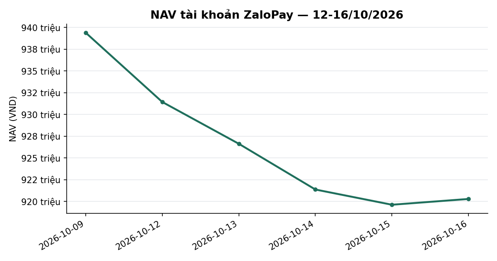
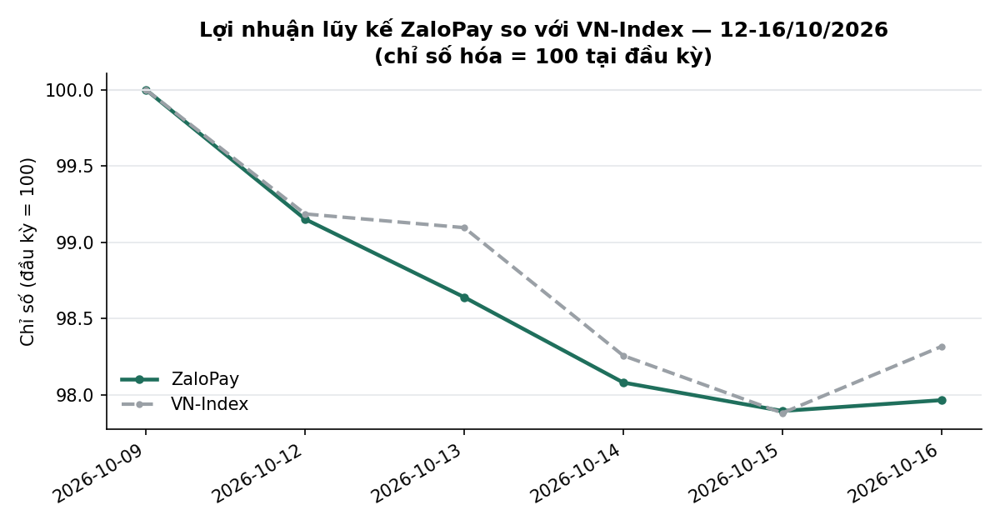
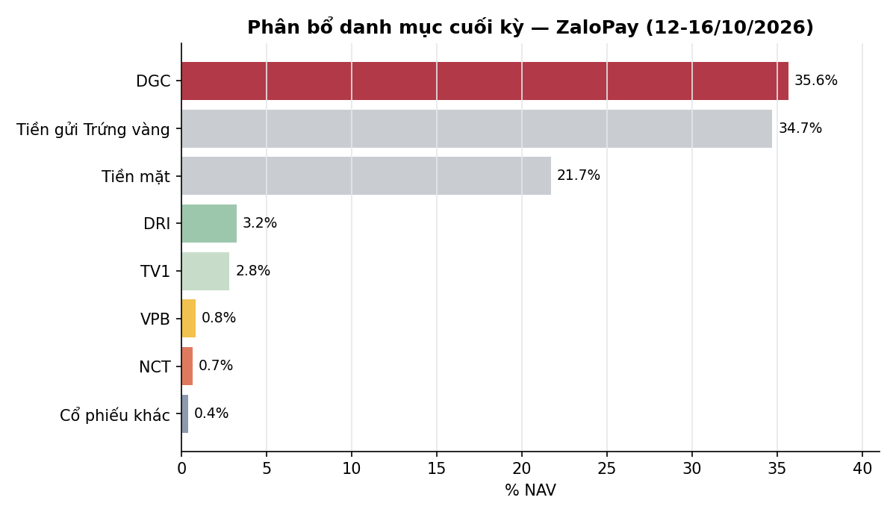

# BÁO CÁO TUẦN — TÀI KHOẢN ZALOPAY
## Kỳ báo cáo: 12/10/2026 – 16/10/2026

**Tài khoản:** ZaloPay · DNSE, số hiệu 0001743768 · V2.4 live từ 06/07/2026 (cash-only, không margin)
**Chiến lược:** V2.4 (2 book BAL/LAG + parking custom30V tại trạng thái NEUTRAL)
**Ngày lập báo cáo:** 17/10/2026 · **Người lập:** Taylor (Quant)
**Đối tượng:** Kênh theo dõi nội bộ (KHÔNG gửi nhà đầu tư ngoài) — giữ minh bạch đầy đủ

> 📊 Xem biểu đồ minh hoạ đính kèm trong email (NAV, lợi nhuận lũy kế so VN-Index, phân bổ danh mục);
> bản trên kênh chat chỉ hiển thị văn bản.

> **Chất lượng số liệu tuần này:** chuỗi `nav_history_ZaloPay.csv` đủ 5/5 phiên (nguồn `live`, không có dòng tái dựng).
> Chênh lệch chưa giải thích được duy nhất: **1.421 VND** trong phân rã tiền mặt ngày 16/10 (Mục 3.3) — nhỏ hơn 0,0002% NAV, ghi rõ ở đó.

---

## 1. TÓM TẮT ĐIỀU HÀNH

| Chỉ tiêu | ZaloPay |
|---|---:|
| NAV cuối kỳ trước (09/10) | 939.394.841 |
| NAV cuối kỳ (16/10) | **920.292.705** |
| Thay đổi trong kỳ | **−19.102.136 (−2,03%)** |
| VN-Index cùng kỳ (09/10 → 16/10) | 1.735,09 → 1.705,91 (**−1,68%**) |
| Giá trị cổ phiếu cuối kỳ | 401.102.350 (43,6% NAV; trong đó DGC 328.000.000 = 35,6%) |
| Tiền mặt (đã gồm tiền bán cổ phiếu ngày 16/10) | 199.778.103 (21,7% NAV) |
| Tiền gửi "Trứng vàng" (đọc tự động qua API DNSE) | 319.412.252 (34,7% NAV) |
| Nợ ký quỹ | 0 |
| Số mã nắm giữ cuối kỳ | 8 (7 mã bot quản lý + DGC legacy) |

**Nhận định tuần:** VN-Index giảm **−1,68%**; ZaloPay giảm **−2,03%**, kém chỉ số **0,35pp**. Riêng **DGC** (10.000 cp, loại khỏi bot do hạn chế HOSE) đóng góp **−10,00 triệu VND** (giá 33.800 → 32.800) — một mình chiếm khoảng 52% mức giảm giá của tuần. **Phần bot quản lý (không gồm DGC) −1,51%, tốt hơn VN-Index +0,17pp** (bảng 3.2). Các mã còn lại kéo giảm: PVT (−2,72 triệu), VPI (−2,44), DRI (−2,28), TV1 (−1,12), SIP (−0,85). Ngày 16/10 bot kết thúc kỳ nắm giữ 60 phiên của rổ chủ đạo (PVT, SIP, VNM, SAB, NCT) và thoát toàn bộ VPI do chạm ngưỡng cắt lỗ −20% so với giá vốn; tỷ trọng cổ phiếu giảm từ ~66% xuống 43,6% NAV (bot quản lý: 7,9% NAV). Tính từ đầu tháng 10: **−4,00%** so với VN-Index **−3,55%**; từ khi bắt đầu hoạt động (06/07): **−6,84%** so với **−7,46%** (+0,62pp).

*NAV theo ngày, ZaloPay. Đơn vị: VND. Kỳ dữ liệu: 09/10–16/10/2026 (6 phiên). Nguồn: `nav_history_ZaloPay.csv` (số dư và vị thế broker DNSE chốt cuối ngày), tính toán nội bộ.*

---

## 2. TOÀN CẢNH THỊ TRƯỜNG

| Ngày | VN-Index | Thay đổi |
|---|---:|---:|
| 09/10 (cuối kỳ trước) | 1735,09 | — |
| 12/10 | 1720,98 | −0,81% |
| 13/10 | 1719,42 | −0,09% |
| 14/10 | 1704,87 | −0,85% |
| 15/10 | 1698,35 | −0,38% |
| 16/10 | 1705,91 | +0,45% |

*VN-Index đóng cửa hằng ngày; nguồn HOSE, dữ liệu tới 16/10/2026.*

**Kỹ thuật (VN-Index, dữ liệu đóng cửa 16/10/2026):**
- *Xu hướng:* chỉ số đóng cửa 1.705,91 điểm, giảm 1,68% trong tuần, 4 trên 5 phiên giảm. Chỉ số nằm dưới cả MA20 (1.754,1), MA50 (1.776,3) và MA200 (1.797,3); MA20 tiếp tục dốc xuống (1.779,0 → 1.754,1 trong tuần) — cấu trúc vẫn là điều chỉnh kéo dài từ cuối tháng 9.
- *Hỗ trợ/kháng cự:* hỗ trợ gần là mức đóng cửa thấp nhất tuần 1.698,35, tiếp theo là đáy 3 tháng 1.651,2; kháng cự gần là MA20 quanh 1.754, xa hơn là MA50 1.776 và MA200 1.797; đỉnh 3 tháng 1.874,5.
- *Động lượng:* RSI(14) 32,9 (thấp, tiến sát vùng quá bán 30 nhưng chưa vào); MACD−signal −6,06 (âm, thu hẹp từ −6,89 ngày 15/10); dòng tiền CMF −0,20 (âm).
- *Thanh khoản:* khối lượng khớp trung bình tuần khoảng 584 triệu cp, thấp hơn khoảng 18,6% so với tuần trước (717 triệu cp); phiên hồi 16/10 chỉ đạt 510 triệu cp — nhịp hồi chưa được xác nhận bằng khối lượng.
- *Độ rộng:* tỷ lệ cổ phiếu đóng cửa trên MA50 là **31,6%** (345 mã trong rổ đủ điều kiện ngày 16/10), so với 33,2% (349 mã) ngày 09/10 và thấp nhất tuần ở 28,9% (15/10); vẫn dưới ngưỡng 40% thường gắn với nhịp hồi bền vững.

**Cơ bản / định giá (dữ liệu tới 16/10/2026):**
- *Định giá:* chỉ báo định giá tổng hợp (P/E, P/B và chênh lệch với lãi suất tiền gửi, phân vị 10 năm) ở **21,7/100 — vùng RẺ**; P/E thị trường 11,06 lần (phân vị 6), P/B 1,86 lần (phân vị 22), chênh lệch lợi suất lợi nhuận so với lãi suất tiền gửi 12 tháng +1,64 điểm % (phân vị 38). Chỉ báo mang tính tham khảo, chưa qua kiểm định đủ mạnh để dùng làm tín hiệu giao dịch.
- *Trạng thái thị trường theo mô hình của chiến lược:* vẫn ở mức **Trung tính**; tín hiệu thận trọng đang tích luỹ **8/25 phiên** cần thiết để chuyển sang phòng thủ cao nhất (còn 17 phiên). Thị trường ở "nền xấu" 14 phiên liên tục từ 29/09, VN-Index giảm 4,2% từ đầu đợt; ngưỡng xem lại là từ 15 phiên và VN-Index giảm ≥5,0% (tương ứng khoảng 1.692 điểm) — chưa chạm. Theo thống kê lịch sử, xác suất tín hiệu ở mức tích luỹ này được xác nhận khoảng 44% (khoảng tin cậy 24–63%, mẫu mỏng). Đây là thông tin mô hình, không phải khuyến nghị.
- *Tăng trưởng lợi nhuận, dòng tiền khối ngoại, diễn biến lãi suất mới trong tuần:* báo cáo này không có số liệu đã đối soát cho các mục này trong kỳ nên không đưa ra nhận định; chỉ sử dụng mặt bằng lãi suất đã phản ánh trong chỉ báo định giá ở trên.

*Lợi nhuận lũy kế so với VN-Index (cơ sở 100 tại 09/10/2026). Đơn vị: chỉ số (cơ sở 100). Kỳ dữ liệu: 09/10–16/10/2026 (6 phiên). Nguồn: NAV chốt cuối ngày từ `nav_history_ZaloPay.csv` (broker DNSE), VN-Index HOSE (BQ `tav2_bq.ticker`), tính toán nội bộ.*

---

## 3. HIỆU QUẢ, ATTRIBUTION & RỦI RO

### 3.1 NAV theo ngày

| Ngày | NAV (VND) | Thay đổi NAV | Thay đổi VN-Index |
|---|---:|---:|---:|
| 09/10 (cuối kỳ trước) | 939.394.841 | — | — |
| 12/10 | 931.434.028 | −0,85% | −0,81% |
| 13/10 | 926.631.443 | −0,52% | −0,09% |
| 14/10 | 921.376.412 | −0,57% | −0,85% |
| 15/10 | 919.627.726 | −0,19% | −0,38% |
| 16/10 | 920.292.705 | +0,07% | +0,45% |

Cả tuần **−2,03%** so với VN-Index **−1,68%** — chênh lệch **−0,35pp**.

### 3.2 Hiệu suất lũy kế

| Giai đoạn | ZaloPay | VN-Index (giá) | VN-Index có cổ tức | Chênh so giá | Chênh so có cổ tức |
|---|---:|---:|---:|---:|---:|
| Tuần này (09/10 → 16/10) | −2,03% | −1,68% | −1,68% | −0,35pp | −0,35pp |
| Từ đầu tháng 10 (MTD, 30/09 → 16/10) | −4,00% | −3,55% | −3,50% | −0,46pp | −0,50pp |
| Từ khi bắt đầu hoạt động (06/07 → 16/10) | −6,84% | −7,46% | −6,85% | +0,62pp | +0,01pp |
| Phần bot quản lý (không gồm DGC) — Tuần này (09/10 → 16/10) | −1,51% | −1,68% | −1,68% | +0,17pp | +0,17pp |
| Phần bot quản lý (không gồm DGC) — Từ đầu tháng 10 (MTD, 30/09 → 16/10) | −1,06% | −3,55% | −3,50% | +2,48pp | +2,44pp |
| Phần bot quản lý (không gồm DGC) — Từ khi bắt đầu hoạt động (06/07 → 16/10) | −1,68% | −7,46% | −6,85% | +5,79pp | +5,18pp |

_VN-Index có cổ tức: đội tự tính từ cổ tức tiền mặt của cổ phiếu HOSE, tái đầu tư tại ngày GDKHQ, sau thuế TNCN 5% trên cổ tức; HOSE không công bố bản có cổ tức của VN-Index._
_Dòng "Phần bot quản lý (không gồm DGC)": loại phần ngoài bot (DGC) ≈ 35,64% NAV ngày 16/10; số chính thức của tài khoản là các dòng phía trên._
_Mốc VN-Index "từ khi bắt đầu hoạt động": giá đóng cửa 06/07/2026 (mốc đúng theo Mục 4)._

**Lưu ý nguồn số:** cột "VN-Index có cổ tức" có số đầy đủ cả 6 dòng. Ngày 14/10 khoảng 100 mã kém thanh khoản (26 mã HOSE) không có giao dịch nên không vào rổ tính chỉ số hôm đó (rổ 351 → 333 mã, hồi lại 337 và 346 mã ở 15/10 và 16/10); đã kiểm các mã này không có ngày giao dịch không hưởng quyền cổ tức tiền trong 14–15/10, và người dùng đã xác nhận chấp nhận (18/10). Các mã này chiếm khoảng 0,4% vốn hoá rổ nên ảnh hưởng tới số công bố là rất nhỏ.

**Rủi ro (từ khi bắt đầu, NAV chốt cuối ngày, 72 quan sát từ 07/07):** mức sụt giảm tối đa từ đỉnh **−16,35%**; độ biến động hằng ngày 1,26% (quy năm khoảng 20,0%). DGC chiếm 35,6% NAV nên là nguồn rủi ro đơn lẻ lớn nhất của tài khoản.

### 3.3 Attribution tuần (đóng góp vào NAV, triệu VND)

| Nguồn | Đóng góp |
|---|---:|
| DGC (legacy, ngoài bot) | −10,00 |
| PVT | −2,72 |
| VPI | −2,44 |
| DRI | −2,28 |
| TV1 | −1,12 |
| SIP | −0,85 |
| NCT, VNM | −0,27 |
| SAB, VPB, MBB và các mã khác (cộng) | +0,45 |
| **Biến động giá (gồm phần đã bán trong kỳ)** | **−19,22** |
| Lãi tiền gửi Trứng vàng | +0,52 |
| Phí giao dịch (0,097%), thuế chuyển nhượng (0,1%) và thuế TNCN trên cổ phiếu có nguồn gốc cổ tức | −0,40 |
| **Thu nhập ngoài giá (cộng)** | **+0,12** |
| **Thay đổi NAV** | **−19,10** |

*Đóng góp giá = số lượng × (giá 16/10 − giá 09/10) với phần bán trong kỳ tính theo giá khớp thực tế. Lãi Trứng vàng = mức tăng số dư Trứng vàng (319.412.252 − 318.890.326 = +521.926; không có nạp/rút — bot không có đường code nạp/rút Trứng vàng, mọi chuyển tiền là thao tác tay của chủ tài khoản và tuần này không có). Phí/thuế lấy từ `dnse_khoplenh_broker_confirm_16-10-2026.csv` (32 dòng khớp): phí 189.417 + thuế 215.274 (gồm thuế TNCN 500đ/cp × 40 cp MSB có nguồn gốc cổ tức cổ phiếu = 20.000) = 404.691. Phân rã tiền mặt: Δtiền mặt +194.868.338 so với giá trị khớp bán 195.274.450 → −406.112, trong đó 404.691 là phí/thuế đã giải thích; **còn −1.421 VND chưa giải thích được** (cùng bậc với lãi tiền mặt vài chục đồng/ngày và làm tròn phí từng lệnh; chưa đối soát được từng đồng). Tổng: −19.217.950 + 521.926 − 406.112 = −19.102.136 (khớp thay đổi NAV đến từng đồng).*

### 3.4 Hoạt động trong tuần

Chỉ có giao dịch **bán** trong phiên 16/10 (không có lệnh mua), giá trị khớp **195,27 triệu VND**:

| Mã | Khối lượng | Giá khớp bình quân | Giá trị (VND) | Lý do |
|---|---:|---:|---:|---|
| PVT | 2.071 | 23.888 | 49.471.900 | Kết thúc kỳ nắm giữ 60 phiên |
| SIP | 700 | 48.264 | 33.785.000 | Kết thúc kỳ nắm giữ 60 phiên |
| VNM | 601 | 57.617 | 34.627.900 | Kết thúc kỳ nắm giữ 60 phiên |
| SAB | 744 | 43.157 | 32.108.650 | Kết thúc kỳ nắm giữ 60 phiên |
| NCT | 300 | 83.100 | 24.930.000 | Kết thúc kỳ nắm giữ 60 phiên |
| VPI | 400 | 49.412 | 19.765.000 | Cắt lỗ −20% so với giá vốn (theo quy tắc production) |
| MSB | 40 | 14.650 | 586.000 | Thanh lý lô nhỏ còn lại (cổ phiếu từ cổ tức cổ phiếu → chịu thuế TNCN) |

Lệnh được chia nhỏ trong phiên; toàn bộ khớp đủ. Lệnh bán tay ngoài giờ bot: không phát hiện (đối chiếu `orders` của `dnse_raw_2026-10-16.jsonl` với `dnse_khoplenh_broker_confirm_16-10-2026.csv`: tổng khớp 195.274.450 trùng nhau).

**Quyền lợi cổ đông:** không có cổ tức tiền mặt nào thanh toán vào tài khoản trong kỳ. Cuối kỳ còn **4,00 triệu VND** cổ tức tiền mặt đang chờ thanh toán (trước thuế): **DRI** 1,90 triệu (1.000 đ/cp × 1.900, thanh toán 20/10) và **TV1** 2,10 triệu (1.500 đ/cp × 1.400, thanh toán 29/10); cả hai đã được cộng (sau thuế 5%) vào tỷ suất hai mã ở bảng dưới. Giá vốn broker thấp hơn giá khớp thật là kỳ vọng (DNSE trừ cổ tức tiền mặt gộp khỏi costPrice trước ex-date); bảng dùng giá vốn thô đã cộng lại cổ tức.

### 3.5 Danh mục cuối kỳ (16/10/2026)

| Mã | KL | Giá vốn | Giá 16/10 | Giá trị thị trường | % NAV | Lãi/lỗ (%) |
|---|---:|---:|---:|---:|---:|---:|
| DGC | 10.000 | 47.775 | 32.800 | 328.000.000 | 35,64 | -15,44% |
| DRI | 1.900 | 13.263 | 15.700 | 29.830.000 | 3,24 | +25,54% |
| TV1 | 1.400 | 20.329 | 18.500 | 25.900.000 | 2,81 | -1,99% |
| VPB | 312 | 21.226 | 24.500 | 7.644.000 | 0,83 | +15,43% |
| NCT | 73 | 94.400 | 83.100 | 6.066.300 | 0,66 | -3,92% |
| SIP | 49 | 47.140 | 48.300 | 2.366.700 | 0,26 | +2,46% |
| MBB | 52 | 20.511 | 19.850 | 1.032.200 | 0,11 | -3,22% |
| VIB | 19 | 13.607 | 13.850 | 263.150 | 0,03 | +1,78% |
| **Cổ phiếu — tổng (8 mã)** | | | | **401.102.350** | **43,58** | **−12,23%** |
| *trong đó DGC* | | | | *328.000.000* | *35,64* | *−15,44%* |
| *trong đó các mã còn lại (7 mã)* | | | | *73.102.350* | *7,94* | *+9,39%* |
| **Tiền mặt** | | | | **199.778.103** | **21,71** | |
| **Tiền gửi Trứng vàng** | | | | **319.412.252** | **34,71** | |
| **Nợ ký quỹ** | | | | **0** | **0,00** | |
| **Tổng NAV** | | | | **920.292.705** | **100,00** | |

*Giá vốn là giá vốn thô thực tế; "Lãi/lỗ (%)" tính theo giá đóng cửa 16/10/2026, đã cộng cổ tức tiền mặt đối soát được với sổ DNSE (sau thuế TNCN 5%). Tổng lãi/lỗ = −67,10 triệu VND trên giá vốn thô 548,56 triệu VND (DGC −73,75 triệu; các mã còn lại +6,65 triệu trên 70,81 triệu). Đẳng thức: 401.102.350 + 199.778.103 + 319.412.252 = 920.292.705 (chênh 0 đồng). Tiền mặt gồm 4,00 triệu cổ tức đang chờ thanh toán và khoảng 194,9 triệu tiền thu từ lệnh bán 16/10 (T+2).*

*Phân bổ danh mục cuối kỳ 16/10/2026, % NAV. Nguồn: vị thế và số dư broker DNSE chốt cuối ngày, giá đóng cửa HOSE 16/10/2026, tính toán nội bộ.*

**Ghi nhận:** phần bot quản lý chỉ còn 7,94% NAV cổ phiếu. Thấp hơn nhiều so với trần phân bổ trạng thái Neutral (70%) là **bình thường**: `golive_v23_status.json` ngày 16/10 cho `n_bal=0`, `n_lag_upcoming=0`, `n_lag_recent=0` (không có tín hiệu động lượng mới, không có mã báo cáo lợi nhuận sắp công bố/mới công bố đủ chuẩn), `etf_park_frac=0,0` (parking tắt), w_LAG hiện tại 48,2% so với mục tiêu 50% (trong band ±10pp); rổ `capit_episode_basket` = NCT, PVT, SAB, SIP, VNM đã hết kỳ nắm giữ 60 phiên và được bán. Tiền chưa dùng nằm ở Trứng vàng và tiền mặt. DGC (35,6% NAV) nằm ngoài quản lý của bot nên không chịu quy tắc cắt lỗ/phân bổ.

---

## 4. ĐÍNH CHÍNH SỐ ĐÃ CÔNG BỐ (nguồn: `kb/projects/report-corrections-pending-20261014.md`, user duyệt 14/10)

Không sửa file báo cáo cũ, không phát hành lại; **tỉ suất của chính tài khoản KHÔNG đổi** ở các mục dưới đây.

**A. Mốc VN-Index "từ khi bắt đầu" sai.** Mốc đúng: SpaceX = đóng cửa 30/06/2026; ZaloPay = đóng cửa 06/07/2026 (chỉ số giá).

| Báo cáo | Đã công bố | Đúng | Mốc đã dùng |
|---|---:|---:|---|
| SpaceX tuần 14–18/09 | −2,76% | −2,38% | 01/07 |
| SpaceX tuần 21–25/09 | −4,40% | −4,03% | 01/07 |
| SpaceX tuần 28/09–02/10 | −6,94% | −6,58% | 01/07 |
| SpaceX tuần 05–09/10 | −7,08% | −6,72% | 01/07 |
| ZaloPay tuần 14–18/09 | −1,76% | −1,51% | 07/07 |
| ZaloPay tuần 21–25/09 | −3,42% | −3,17% | 07/07 |
| ZaloPay tuần 28/09–02/10 | −6,68% | −5,74% | 03/07 |
| ZaloPay tuần 05–09/10 | −6,82% | −5,88% | 03/07 |
| ZaloPay tháng 09 | −5,02% | −4,06% | 03/07 |

Chênh so VN-Index ở các ô SpaceX bị thổi ~0,37pp; ZaloPay 0,25pp (mốc 07/07) hoặc ~0,94pp (mốc 03/07). Báo cáo tháng 07: cột ZaloPay đúng mốc 06/07 là −5,84% (tỉ suất tài khoản đã đính chính riêng 27/09).

**B. Sổ NAV lịch sử (áp lên dữ liệu thật 14/10).**
- NAV SpaceX 02/07 sửa còn 990.304.455 (trước 994.733.747): tỉ suất ngày 02/07 và 03/07 lệch ~0,44pp; "từ đầu/MTD/WTD" không đổi.
- Chèn dòng 06/08 còn thiếu cho cả 2 tài khoản: **biến động tháng 08 ZaloPay in 25,58% → đúng 18,27%**; SpaceX 12,37% → 12,80%.
- Biến động tháng 07 SpaceX in 17,3% → 17,4%.
- Tin EOD Discord SpaceX 07/08 in "+0,12% so với hôm trước" → đúng +1,098%.

---

## 5. OUTLOOK KỲ TỚI (19/10 – 23/10/2026)

**Kỹ thuật.** Kịch bản cơ sở (khả năng cao nhất): VN-Index dao động trong biên 1.690–1.755 — thử lại vùng hỗ trợ 1.698 và kháng cự MA20 (đang dốc xuống, khoảng 1.750 trong tuần tới). Kịch bản tích cực (khả năng trung bình–thấp): đóng cửa vững trên 1.755 cùng khối lượng cải thiện và độ rộng vượt 40% sẽ xác nhận nhịp hồi về 1.776–1.797 (MA50/MA200). Kịch bản tiêu cực (khả năng trung bình): thủng 1.698 kèm khối lượng tăng mở đường về đáy 3 tháng 1.651. *Điều kiện làm sai kịch bản cơ sở:* đóng cửa dưới 1.698 hai phiên liên tiếp, độ rộng lùi dưới 28%, hoặc đóng cửa trên 1.776.

**Cơ bản.** Định giá thị trường ở vùng thấp trong lịch sử 10 năm (P/E 11,1 lần, chỉ báo tổng hợp 21,7/100) là nền hỗ trợ trung hạn nhưng không phải tín hiệu thời điểm. Mô hình trạng thái của chiến lược đang ở Trung tính với tín hiệu thận trọng tích luỹ 8/25 phiên; nếu tình trạng "nền xấu" kéo dài từ 15 phiên và VN-Index giảm ≥5% từ đầu đợt (khoảng 1.692), mô hình sẽ được xem lại; xác suất xác nhận phòng thủ theo thống kê lịch sử khoảng 44% (khoảng tin cậy rộng, mẫu mỏng). Nếu xác nhận, tỷ trọng cổ phiếu mục tiêu giảm về mức thấp nhất của khung phân bổ; nếu không, cơ cấu hiện tại (cổ phiếu 43,6% NAV gồm DGC 35,6%; tiền gửi/tiền mặt 56,4%) được giữ cho tới khi xuất hiện tín hiệu mới. *Điều kiện làm sai:* thị trường bứt phá lên trên 1.800 với độ rộng cải thiện bền vững. Dòng tiền dự kiến: cổ tức DRI 1,90 triệu VND (trước thuế) ngày 20/10 và TV1 2,10 triệu VND ngày 29/10.

Các nhận định trên là kịch bản có điều kiện, không phải khuyến nghị đầu tư chắc chắn.

**Rủi ro riêng của ZaloPay:** DGC chiếm 35,6% NAV và nằm ngoài bot; mỗi 1% biến động giá DGC ≈ 0,36% NAV. Phần bot quản lý (7,9% NAV cổ phiếu) quá nhỏ để chênh lệch tương đối so với chỉ số có ý nghĩa — NAV tuần tới chủ yếu do DGC và Trứng vàng quyết định.

---

## 6. GAP / GIỚI HẠN CÒN MỞ

1. **VN-Index có cổ tức: có số, kèm lưu ý nguồn** — ngày 14/10 khoảng 100 mã kém thanh khoản không giao dịch nên rổ tính chỉ số tụt 351 → 333 mã; đã kiểm không có cổ tức tiền bị bỏ sót và được xác nhận chấp nhận (xem Mục 3.2).
2. **Residual tiền mặt 16/10: −1.421 VND** chưa giải thích (Mục 3.3).
3. Tăng trưởng lợi nhuận, dòng tiền khối ngoại, diễn biến lãi suất mới trong tuần: không có số liệu đối soát nên không đưa nhận định.
4. Track record ngắn (72 phiên từ 07/07) — so sánh với VN-Index mang tính mô tả.

---

## 7. PHỤ LỤC — PHƯƠNG PHÁP LUẬN

- **NAV** = cổ phiếu (giá đóng cửa) + tiền mặt + Trứng vàng (`egg.totalValue`, đọc tự động qua API DNSE từ 18/08, cột `egg_assets_auto`) − nợ; đối chiếu `nav_history_ZaloPay.csv` (nguồn `live`).
- **Độ rộng:** % mã đóng cửa trên MA50, rổ `tav2_mike.universe_pit` (PIT) JOIN `tav2_bq.ticker` ngày 16/10: 31,6% (345 mã); ngày 09/10: 33,2% (349 mã).
- **DT gate / Value Radar:** `dna_report.build_dt_gate_line()` và `build_value_radar_line()` (chạy từ WC_ROOT, hiển thị thuần tham khảo).
- **Chi phí:** phí 0,097%/lượt (HOSE); thuế chuyển nhượng 0,1%; TNCN 5% cổ tức tiền mặt; TNCN 500đ/cp khi bán cổ phiếu có nguồn gốc cổ tức cổ phiếu.
- Báo cáo nội bộ — không phải khuyến nghị đầu tư.

---

*Báo cáo tuần 12/10–16/10/2026 (ZaloPay) — Taylor (Quant).*
