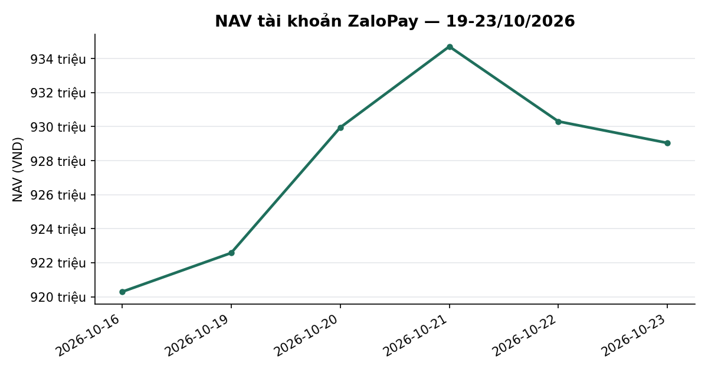
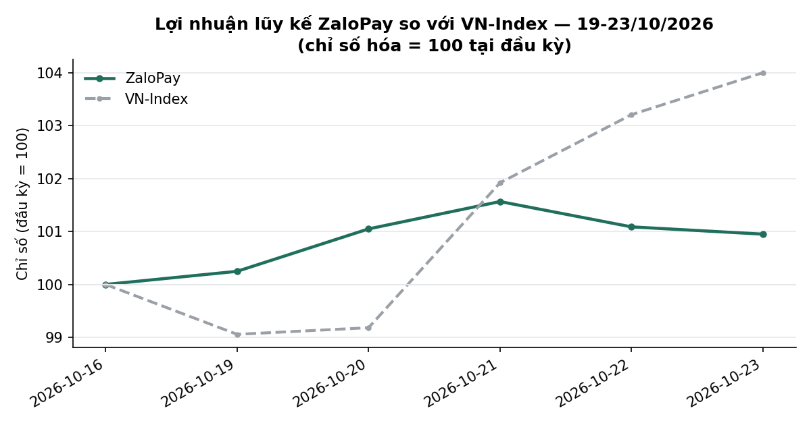
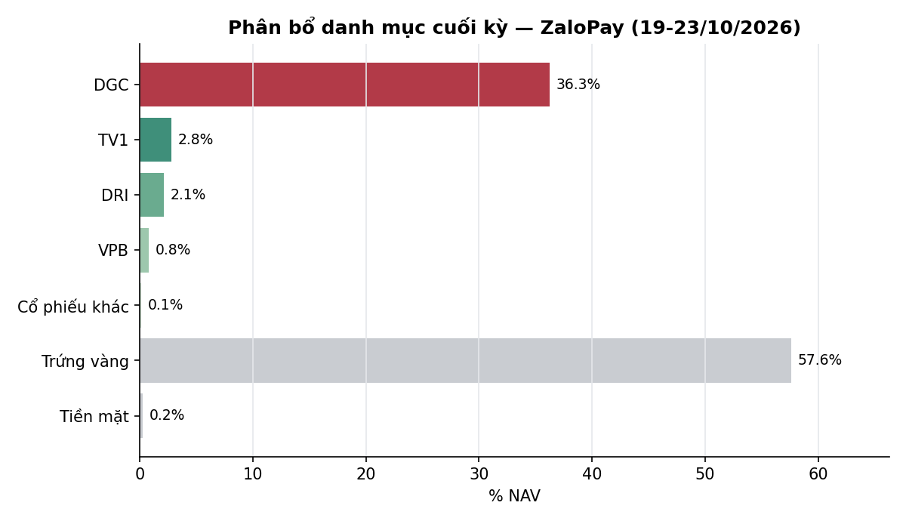

# BÁO CÁO TUẦN — TÀI KHOẢN ZALOPAY
## Kỳ báo cáo: 19/10/2026 – 23/10/2026

**Tài khoản:** ZaloPay · DNSE, số hiệu 0001743768 · V2.4 live từ 06/07/2026 (cash-only, không margin)
**Chiến lược:** V2.4 (2 book BAL/LAG + parking custom30V tại trạng thái NEUTRAL)
**Ngày lập báo cáo:** 24/10/2026 · **Người lập:** Taylor (Quant)
**Đối tượng:** Kênh theo dõi nội bộ (KHÔNG gửi nhà đầu tư ngoài) — giữ minh bạch đầy đủ

> 📊 Xem biểu đồ minh hoạ đính kèm trong email (NAV, lợi nhuận lũy kế so VN-Index, phân bổ danh mục);
> bản trên kênh chat chỉ hiển thị văn bản.

> **Chất lượng số liệu tuần này:** chuỗi `nav_history_ZaloPay.csv` đủ 5/5 phiên nhưng **ngày 21/10 là dòng tái dựng** (`nav_is_estimate=True`, nguồn `backfill dnse_raw positions/balances@2026-10-21T23:59:13 + BQ Price`); 4 dòng còn lại nguồn `live`. Hai mốc đầu/cuối kỳ (16/10, 23/10) đều `live` nên NAV tuần và phân rã tiền không phụ thuộc dòng ước lượng; chỉ tỉ suất ngày 21/10 và 22/10 là số ước lượng.
> ℹ️ Có 1 khoản biến động tiền chưa đối chiếu xong (lớn nhất 9.360.000 đ); tỉ suất kỳ chứa ngày đó có thể được điều chỉnh.
> **Còn mở (Mục 6):** cửa sổ dòng tiền 20/10→21/10 vẫn hiển thị "ĐANG MỞ" trong `cash_identity.py` do lệnh bán tay DRI 600 cp (đã được user xác nhận trên bus ngày 21/10 nhưng chưa được ghi vào `data/cash_identity_acks.json`). Chênh lệch số học của cửa sổ chỉ −322 VND.

---

## 1. TÓM TẮT ĐIỀU HÀNH

| Chỉ tiêu | ZaloPay |
|---|---:|
| NAV cuối kỳ trước (16/10) | 920.292.705 |
| NAV cuối kỳ (23/10) | **929.040.539** |
| Thay đổi trong kỳ | **+8.747.834 (+0,95%)** |
| VN-Index cùng kỳ (16/10 → 23/10) | 1.705,91 → 1.774,15 (**+4,00%**) |
| Giá trị cổ phiếu cuối kỳ | 391.598.600 (42,2% NAV; trong đó DGC 337.000.000 = 36,3%) |
| Tiền mặt | 2.105.702 (0,2% NAV) |
| Tiền gửi "Trứng vàng" (đọc tự động qua API DNSE) | 535.336.237 (57,6% NAV) |
| Nợ ký quỹ | 0 |
| Số mã nắm giữ cuối kỳ | 6 (5 mã bot quản lý + DGC legacy) |

**Nhận định tuần:** VN-Index tăng **+4,00%** (1.705,91 → 1.774,15), đảo chiều từ đáy đóng cửa 1.689,84 ngày 19/10; phiên 21/10 +2,76% với khối lượng 947,8 triệu cp. ZaloPay tăng **+0,95%**, kém chỉ số **3,05 điểm phần trăm**. Gần như toàn bộ mức tăng đến từ **DGC +9,00 triệu VND** (32.800 → 33.700, +2,74%, mã legacy ngoài bot chiếm 36,3% NAV); phần bot quản lý (không gồm DGC) đi ngang **−0,04%** vì chỉ còn 5,9% NAV cổ phiếu, phần còn lại ở Trứng vàng/tiền mặt (57,8% NAV). Tuần có 2 sự kiện giao dịch: (i) 19/10 bot bán nốt phần dư của rổ CAPIT hết kỳ nắm giữ (NCT 73 cp, SIP 49 cp — 8,44 triệu VND); (ii) 21/10 **user bán tay 600 cp DRI @15.400** (9,24 triệu VND, theo nghiên cứu discretionary sleeve — user xác nhận 21/10 22:29 ICT). Tính từ đầu tháng 10 tài khoản **−3,09%** so với VN-Index **+0,31%** (−3,40pp); từ khi bắt đầu hoạt động **−5,96%** so với **−3,76%** (−2,19pp). Riêng phần bot quản lý: MTD **−1,11%**, từ khi bắt đầu **−1,72%** (vượt VN-Index giá +2,04pp).

*NAV theo ngày, ZaloPay. Đơn vị: VND. Kỳ dữ liệu: 16/10–23/10/2026 (6 phiên; ngày 21/10 là NAV tái dựng). Nguồn: vị thế và số dư broker DNSE chốt cuối ngày (`nav_history_ZaloPay.csv`), tính toán nội bộ.*

---

## 2. TOÀN CẢNH THỊ TRƯỜNG

| Ngày | VN-Index | Thay đổi |
|---|---:|---:|
| 16/10 (cuối kỳ trước) | 1705,91 | — |
| 19/10 | 1689,84 | −0,94% |
| 20/10 | 1691,97 | +0,13% |
| 21/10 | 1738,67 | +2,76% |
| 22/10 | 1760,63 | +1,26% |
| 23/10 | 1774,15 | +0,77% |

*VN-Index đóng cửa hằng ngày; nguồn HOSE (`tav2_bq.ticker`, ticker VNINDEX), dữ liệu tới 23/10/2026.*

**Kỹ thuật (VN-Index, dữ liệu đóng cửa 23/10/2026):**
- *Xu hướng:* đóng cửa 1.774,15, tăng 4,00% trong tuần (3 phiên tăng liên tiếp từ 21/10). Đã vượt lên trên MA20 (1.737,9) và đóng cửa cao hơn MA50 (1.772,2) +0,11%; vẫn dưới MA200 (1.796,6). MA20 ngừng dốc xuống (1.754,1 → 1.737,9; các phiên cuối giảm <1 điểm/phiên) — từ điều chỉnh kéo dài sang nhịp hồi kiểm tra vùng MA50–MA200.
- *Hỗ trợ/kháng cự:* hỗ trợ gần MA50 ≈1.772 và MA20 ≈1.738; xa hơn là đóng cửa thấp nhất tuần 1.689,84 và đáy 3 tháng 1.651,2. Kháng cự gần MA200 ≈1.797; tiếp theo đỉnh 3 tháng 1.874,5 và vùng 1.894 (Res_1Y).
- *Động lượng:* RSI(14) 57,2 (từ 32,9); MACD−signal +5,86 (đổi dấu dương từ 22/10, từ −6,06); CMF +0,01 (từ −0,20).
- *Thanh khoản:* khối lượng khớp trung bình tuần ≈716 triệu cp, +22,7% so với tuần trước (584 triệu); phiên 21/10 đạt 948 triệu cp.
- *Độ rộng:* % mã đóng cửa trên MA50 **46,5%** (342 mã trong rổ `universe_pit` ngày 23/10), từ 31,6% (345 mã) ngày 16/10; đỉnh tuần 48,7% (21/10), đáy 32,9% (19/10). Vượt ngưỡng 40%, chưa vượt 50%.

**Cơ bản / định giá (dữ liệu tới 23/10/2026; nguồn `dna_report.build_value_radar_line()` / `build_dt_gate_line()`, chạy từ WC_ROOT):**
- *Value Radar:* **24,8/100 — RẺ** (phân vị 10 năm; 21,7 tuần trước) · P/E 11,26 (p7) · P/B 1,89 (p26) · spread EY−CCTG 12T +1,48pp (p41). ⓘ Thông tin bổ sung, CHƯA qua kiểm định đủ mạnh (0/17 lăng kính qua đa kiểm định) — chỉ để đọc, không phải tín hiệu mua/bán.
- *DT gate:* 🟢 BÌNH THƯỜNG · committed **NEUTRAL**; candidate **CRISIS 13/25** (52%, còn 12 phiên để commit, base giữ từ 07/10) · P(CRISIS xác nhận|k=13) ≈69% [44–91%, n=16] ⚠ mẫu mỏng. Nền xấu 19 phiên liền từ 29/09 (6 BEAR + 13 CRISIS, đổi qua lại 1 lần → bộ đếm reset, vẫn NEUTRAL) · VNINDEX −0,4% từ đầu đợt · ngưỡng xem lại: ≥15 phiên và VNINDEX ≤−5,0% (≈1.692 — ước lượng) — chưa chạm.
- *Tăng trưởng lợi nhuận, dòng tiền khối ngoại, diễn biến lãi suất mới trong tuần:* không có số liệu đã đối soát trong kỳ nên không đưa nhận định (Mục 6).

*Lợi nhuận lũy kế so với VN-Index (cơ sở 100 tại 16/10/2026). Đơn vị: chỉ số (cơ sở 100). Kỳ dữ liệu: 16/10–23/10/2026 (6 phiên). Nguồn: NAV broker DNSE chốt cuối ngày (`nav_history_ZaloPay.csv`), VN-Index từ `tav2_bq.ticker` (cùng nguồn đã verify), tính toán nội bộ.*

---

## 3. HIỆU QUẢ, ATTRIBUTION & RỦI RO

### 3.1 NAV theo ngày

| Ngày | NAV (VND) | Thay đổi NAV | Thay đổi VN-Index |
|---|---:|---:|---:|
| 16/10 (cuối kỳ trước) | 920.292.705 | — | — |
| 19/10 | 922.576.337 | +0,25% | −0,94% |
| 20/10 | 929.949.168 | +0,80% | +0,13% |
| 21/10 (*tái dựng*) | 934.706.943 | +0,51% | +2,76% |
| 22/10 | 930.305.666 | −0,47% | +1,26% |
| 23/10 | 929.040.539 | −0,14% | +0,77% |

Cả tuần **+0,95%** so với VN-Index **+4,00%** — chênh lệch **−3,05 điểm phần trăm**.

### 3.2 Hiệu suất lũy kế

| Giai đoạn | ZaloPay | VN-Index (giá) | VN-Index có cổ tức | Chênh so giá | Chênh so có cổ tức |
|---|---:|---:|---:|---:|---:|
| Tuần này (16/10 → 23/10) | +0,95% | +4,00% | +4,00% | −3,05pp | −3,05pp |
| Từ đầu tháng 10 (MTD, 30/09 → 23/10) | −3,09% | +0,31% | +0,36% | −3,40pp | −3,45pp |
| Từ khi bắt đầu hoạt động (06/07 → 23/10) | −5,96% | −3,76% | −3,13% | −2,19pp | −2,83pp |
| Phần bot quản lý (không gồm DGC) — Tuần này (16/10 → 23/10) | −0,04% | +4,00% | +4,00% | −4,04pp | −4,04pp |
| Phần bot quản lý (không gồm DGC) — Từ đầu tháng 10 (MTD, 30/09 → 23/10) | −1,11% | +0,31% | +0,36% | −1,42pp | −1,47pp |
| Phần bot quản lý (không gồm DGC) — Từ khi bắt đầu hoạt động (06/07 → 23/10) | −1,72% | −3,76% | −3,13% | +2,04pp | +1,41pp |

_VN-Index có cổ tức: đội tự tính từ cổ tức tiền mặt của cổ phiếu HOSE, tái đầu tư tại ngày GDKHQ, sau thuế TNCN 5% trên cổ tức; HOSE không công bố bản có cổ tức của VN-Index._
_Dòng "Phần bot quản lý (không gồm DGC)": loại phần ngoài bot (DGC) ≈ 36,27% NAV ngày 23/10; số chính thức của tài khoản là các dòng phía trên._

Tài khoản bắt đầu hoạt động ngày 06/07/2026 nên QTD (quý IV) trùng với MTD tháng 10 và chưa có YTD độc lập.

**Rủi ro (từ khi bắt đầu, NAV chốt cuối ngày, 77 quan sát từ 07/07):** mức sụt giảm tối đa từ đỉnh **−16,35%** (không đổi trong tuần); độ biến động hằng ngày 1,22% (quy năm khoảng 19,4%). DGC chiếm 36,3% NAV nên vẫn là nguồn rủi ro đơn lẻ lớn nhất: mỗi 1% biến động giá DGC ≈ 0,36% NAV.

### 3.3 Attribution tuần (đóng góp vào NAV, VND)

| Nguồn | Đóng góp |
|---|---:|
| DGC (legacy, ngoài bot) | +9.000.000 |
| DRI | −570.000 |
| VPB | −124.800 |
| TV1 | −140.000 |
| MBB | −2.600 |
| VIB | +6.650 |
| SIP (bán 19/10) | +2.300 |
| NCT (bán 19/10, giá bán = giá 16/10) | 0 |
| **Biến động giá (gồm phần đã bán trong kỳ)** | **+8.171.550** |
| Lãi tiền gửi Trứng vàng + lãi tiền gửi không kỳ hạn | +705.273 |
| Phí giao dịch (16.314) và thuế chuyển nhượng (17.675) | −33.989 |
| Thuế TNCN 5% cổ tức tiền mặt DRI (khấu trừ khi chi trả 20/10: 1.000 đ × 1.900 cp × 5%) | −95.000 |
| **Thu nhập ngoài giá (cộng)** | **+576.284** |
| **Thay đổi NAV** | **+8.747.834** |

*Đóng góp giá = số lượng × (giá 23/10 − giá 16/10) với phần bán trong kỳ tính theo giá khớp thực tế (`dnse_khoplenh_broker_confirm_19-10-2026.csv`, `..._21-10-2026.csv`). Phí/thuế lấy từ chính 2 file đó (cột phi_tra_so + phi_dnse + thue; lệnh DRI tỷ lệ 0,088%, lệnh NCT/SIP 0,097%); không có thuế TNCN 500đ/cp tuần này (NCT/SIP không phải cổ phiếu từ cổ tức cổ phiếu). Lãi Trứng vàng + lãi không kỳ hạn = Δtrứng vàng (+215.923.985) + Δtiền mặt − giá trị bán ròng + thuế cổ tức. Số liệu: Δtiền mặt = 2.105.702 − 199.778.103 = −197.672.401; giá trị bán ròng = 17.675.300 − 16.314 − 17.675 = 17.641.311; ⇒ 215.923.985 − 197.672.401 − 17.641.311 + 95.000 = 705.273. Tổng: 8.171.550 + 705.273 − 33.989 − 95.000 = 8.747.834 (khớp thay đổi NAV đến từng đồng).*

*Phân rã tiền tới đồng và cách suy ra các khoản chuyển (mục (c)/(d) của quy trình):*
- *Cổ tức DRI 1.000 đ/cp × 1.900 cp = 1,90 triệu VND (ex 22/09, thanh toán 20/10 — `tav2_bq.corporate_action`) đã nằm trong `totalCash` từ trước (cashDividendReceiving 16/10 = 4,00 triệu = DRI 1,90 + TV1 2,10; 23/10 còn 2,10 triệu = TV1). Khi chi trả chỉ phát sinh khấu trừ thuế 5% = 95.000 đ.* Kiểm chứng chéo: cửa sổ 19/10→20/10 tiền mặt −195.867.878, Trứng vàng +195.893.309; lãi Trứng vàng ngày đó giả định bằng ngày 21/10 (120.420 đ, ước lượng) ⇒ khoản chuyển ≈195.772.889 đ và thuế −95.000 ⇒ −195.867.889 (lệch 11 đ — cùng bậc lãi không kỳ hạn).
- *Chuyển tiền sang Trứng vàng là thao tác TAY của chủ tài khoản — bot không có đường code nạp/rút Trứng vàng.* Suy ra từ số dư: ≈195,77 triệu ngày 20/10 và ≈19,45 triệu ngày 23/10 (tổng ≈215,22 triệu = Δtrứng vàng 215.923.985 − lãi 705.273); **số tiền KHÔNG có sổ nạp/rút để đối chiếu** (DNSE OpenAPI không có sổ này), chỉ suy ra từ số dư; không làm đổi NAV.
- *Lãi Trứng vàng* ≈120,4 nghìn đ/ngày (≈8,5%/năm trên số dư — ước lượng từ số dư các ngày không có chuyển tiền: 21/10, 22/10).

### 3.4 Hoạt động trong tuần

Tuần có **bán** ở 2 phiên (không có lệnh mua), tổng giá trị khớp **17,68 triệu VND**:

| Ngày | Mã | Khối lượng | Giá khớp bình quân | Giá trị (VND) | Bên đặt | Lý do |
|---|---|---:|---:|---:|---|---|
| 19/10 | NCT | 73 | 83.100 | 6.066.300 | Bot (CAPIT_AUTO_EXIT) | Bán nốt phần dư rổ CAPIT hết kỳ nắm giữ 60 phiên (16/10 đã bán 300 cp) |
| 19/10 | SIP | 49 | 48.347 | 2.369.000 | Bot (CAPIT_AUTO_EXIT) | Như trên (16/10 đã bán 700 cp) |
| 21/10 | DRI | 600 | 15.400 | 9.240.000 | **User bán tay** | Theo nghiên cứu discretionary sleeve; user xác nhận 21/10 22:29 ICT |

**Đối soát lệnh bán tay DRI (mục (f)):** `dnse_raw_2026-10-20/21.jsonl` KHÔNG có bản ghi `orders` của tài khoản (lệnh đặt ngoài bot không xuất hiện ở đó) và `exec_ZaloPay_2026-10-21_journal.csv` không tồn tại — nên lệnh được xác nhận bằng nguồn khác: (1) `dnse_khoplenh_broker_confirm_21-10-2026.csv` dòng BÁN DRI 600 cp @15.400 (tiểu khoản 0001743768; cùng ngày SpaceX 0002023347 bán 800+400); (2) `dnse_raw_2026-10-23.jsonl` positions: DRI `closedQuantity`=600, `averageClosePrice`=15.400, KL 1.900 → 1.300; (3) bus `answer spacex-dri-sell-ngoai-plan-20261021` (Mike, 21/10 15:32Z): user xác nhận tự bán tay DRI cho cả SpaceX (1.200 cp) và ZaloPay (600 cp), không bất thường. Tiền: 9.240.000 − phí 8.131 (1.663 + 6.468) − thuế 9.240 = 9.222.629 so với phần dư đo được 9.222.307 → chênh −322 đ.

**Quyền lợi cổ đông:** cổ tức tiền mặt **DRI** 1,90 triệu VND (trước thuế) thanh toán 20/10, khấu trừ TNCN 95.000 đ. Cuối kỳ còn **2,10 triệu VND** cổ tức tiền mặt chờ thanh toán (đã nằm trong số dư tiền): **TV1** 1.500 đ/cp × 1.400 cp, thanh toán 29/10; đã cộng (sau thuế 5%) vào tỷ suất TV1 ở bảng dưới. Giá vốn broker thấp hơn giá khớp thật là kỳ vọng (DNSE trừ cổ tức tiền mặt gộp khỏi costPrice trước ex-date; kiểm bằng bước nhảy costPrice DRI 13.263,16 → 12.263,16, TV1 20.328,57 → 18.828,57 trong `dnse_raw`); bảng dùng giá vốn thô đã cộng lại cổ tức.

### 3.5 Danh mục cuối kỳ (23/10/2026)

| Mã | KL | Giá vốn | Giá 23/10 | Giá trị thị trường | % NAV | Lãi/lỗ (%) |
|---|---:|---:|---:|---:|---:|---:|
| DGC | 10.000 | 47.775 | 33.700 | 337.000.000 | 36,27 | −13,55% |
| TV1 | 1.400 | 20.329 | 18.400 | 25.760.000 | 2,77 | −2,48% |
| DRI | 1.300 | 13.263 | 15.400 | 20.020.000 | 2,15 | +23,27% |
| VPB | 312 | 21.226 | 24.100 | 7.519.200 | 0,81 | +13,54% |
| MBB | 52 | 20.511 | 19.800 | 1.029.600 | 0,11 | −3,47% |
| VIB | 19 | 13.607 | 14.200 | 269.800 | 0,03 | +4,36% |
| **Cổ phiếu — tổng (6 mã)** | | | | **391.598.600** | **42,15** | **−11,40%** |
| *trong đó DGC* | | | | *337.000.000* | *36,27* | *−13,55%* |
| *trong đó các mã còn lại (5 mã)* | | | | *54.598.600* | *5,88* | *+7,79%* |
| **Tiền mặt** | | | | **2.105.702** | **0,23** | |
| **Tiền gửi Trứng vàng** | | | | **535.336.237** | **57,62** | |
| **Nợ ký quỹ** | | | | **0** | **0,00** | |
| **Tổng NAV** | | | | **929.040.539** | **100,00** | |

*Giá vốn là giá vốn thô thực tế (costPrice DNSE cộng lại cổ tức tiền mặt gộp đã bị trừ); "Lãi/lỗ (%)" tính theo giá đóng cửa 23/10/2026, đã cộng cổ tức tiền mặt đối soát được với sổ DNSE (sau thuế TNCN 5%). Tổng lãi/lỗ = −60,57 triệu VND trên giá vốn thô 531,40 triệu VND (DGC −64,75 triệu; các mã còn lại +4,18 triệu trên 53,65 triệu). Đẳng thức: 391.598.600 + 2.105.702 + 535.336.237 = 929.040.539 (chênh 0 đồng). Tiền mặt gồm 2,10 triệu cổ tức TV1 đang chờ thanh toán; tiền sở hữu còn lại ≈5,7 nghìn VND (BID 0,37 cp lẻ không tính vào bảng).*

*Phân bổ danh mục cuối kỳ 23/10/2026, % NAV ("Cổ phiếu khác" gồm MBB, VIB). Nguồn: vị thế và số dư broker DNSE chốt cuối ngày, giá đóng cửa HOSE 23/10/2026, tính toán nội bộ.*

**Ghi nhận (mục (e)):** phần bot quản lý chỉ còn 5,88% NAV cổ phiếu; thấp hơn nhiều so với trần phân bổ trạng thái Neutral (70%) là **bình thường**: `data/golive_v23_status.json` ngày 23/10 cho `n_bal=0`, `n_lag_upcoming=5` (HT1/SCL/VPB ... đến hạn T+1 = 26/10 — chưa tới hạn trong kỳ), `n_lag_recent=0`, `etf_park_frac=0,0` (parking tắt), `capit_episode_basket=[]` (rổ CAPIT đã bán hết), w_LAG hiện tại 48,0% so với mục tiêu 50% (trong band ±10pp). Tiền chưa dùng nằm ở Trứng vàng và tiền mặt. DGC (36,3% NAV) nằm ngoài quản lý của bot nên không chịu quy tắc cắt lỗ/phân bổ.

---

## 4. OUTLOOK KỲ TỚI (26/10 – 30/10/2026)

**Đối chiếu dự báo kỳ trước.** Kịch bản cơ sở kỳ trước (biên 1.690–1.755) KHÔNG xảy ra: chỉ số vượt biên trên từ 22/10. Kịch bản tích cực (đóng cửa >1.755, khối lượng cải thiện, độ rộng >40%) xảy ra phần lớn: đóng cửa 1.774 sát MA50 (1.772), độ rộng 46,5%, khối lượng tuần +22,7%; chưa tới MA200 (1.797).

**Kỹ thuật.** Kịch bản cơ sở (khả năng cao nhất): sau tuần +4%, VN-Index tích luỹ trong biên 1.740–1.800, kiểm tra MA50 (1.772) làm hỗ trợ và thử kháng cự MA200 (1.797). Kịch bản tích cực (khả năng trung bình): đóng cửa vững trên 1.797 cùng khối lượng ≥ mức trung bình tuần này (≈716 triệu cp) và độ rộng >50% mở đường về đỉnh 3 tháng 1.874. Kịch bản tiêu cực (khả năng trung bình–thấp): đóng cửa dưới MA20 (1.738) hai phiên liên tiếp — nhịp hồi thất bại, kiểm tra lại 1.690. *Điều kiện làm sai kịch bản cơ sở:* đóng cửa >1.800 với khối lượng lớn, hoặc <1.738 hai phiên liên tiếp, hoặc độ rộng lùi <40%.

**Cơ bản.** Định giá thấp trong lịch sử 10 năm (P/E 11,3 lần, Value Radar 24,8/100) là nền hỗ trợ trung hạn, không phải tín hiệu thời điểm (Value Radar chỉ hiển thị). DT gate: committed NEUTRAL, candidate CRISIS 13/25; VN-Index đã hồi gần về mốc đầu đợt (−0,4%) nên điều kiện xem lại (≤−5%, ≈1.692 — ước lượng) chỉ xảy ra nếu chỉ số mất toàn bộ nhịp hồi; nếu xảy ra và được xác nhận, tỷ trọng cổ phiếu mục tiêu giảm về mức thấp nhất. *Điều kiện làm sai:* mất MA20 (1.738) kèm độ rộng <40%. **Kế hoạch 26/10** (`plan_ZaloPay_2026-10-26.json`, 0 lệnh, chờ duyệt): LAG HT1 (LAG_LO), SCL (LAG_HI, ACK_PROCEED) và VPB (LAG_LO, đang giữ 312 cp) đến hạn mua T+1 = 26/10, quy mô ước tính ≈24 triệu/mã (HT1, VPB) và ≈30 triệu (SCL) — nhưng `availableCash` chỉ 3.748 đ nên cổng P0 tự HOLD trừ khi user rút Trứng vàng (quyết định của user; plan không giả định rút). Dòng tiền dự kiến: cổ tức TV1 2,10 triệu VND (trước thuế) ngày 29/10 (đã nằm trong tiền mặt).

Các nhận định trên là kịch bản có điều kiện, không phải khuyến nghị đầu tư chắc chắn.

**Rủi ro riêng của ZaloPay:** DGC chiếm 36,3% NAV và nằm ngoài bot; NAV tuần tới chủ yếu do DGC (±1% giá = ±0,36% NAV) và lãi Trứng vàng quyết định. L1 park-trim đang `BLOCKED_RECONCILE` do sổ lô chưa phản ánh lệnh bán tay DRI 600 cp (xem Mục 6).

---

## 5. ĐÍNH CHÍNH SỐ ĐÃ CÔNG BỐ

Không có đính chính mới trong tuần này. Các số kỳ trước (tuần 12–16/10: NAV 920.292.705; −2,03% so với VN-Index −1,68%) không đổi; mốc 16/10 dùng làm NAV đầu kỳ ở trên khớp đúng số đã công bố.

---

## 6. GAP / GIỚI HẠN CÒN MỞ

Đã tra trước khi ghi "chưa giải thích": (a) giá vốn broker < giá khớp thật — kiểm bước nhảy costPrice (DRI, TV1) và `corporate_action` (DRI ex 22/09 payout 20/10 1.000 đ; TV1 ex 07/10 payout 29/10 1.500 đ); (b) `cashDividendReceiving` 4,00 → 2,10 triệu = DRI 1,90 đã chi trả 20/10; (c) phân rã tiền tới đồng bằng `dnse_khoplenh_broker_confirm_19/21-10-2026.csv` + nav_history; (d) mọi chuyển Trứng vàng là thao tác tay; (e) tỷ trọng cổ phiếu thấp đã giải thích bằng `golive_v23_status.json`; (f) lệnh bán tay DRI đối soát bằng broker confirm + positions + bus.

1. **Cửa sổ dòng tiền 20/10 19:10 → 21/10 23:59 vẫn "ĐANG MỞ"** (`python3 mike/bin/cash_identity.py --account ZaloPay`; cả SpaceX): do KL DRI đổi (−600 cp) không có lệnh trong `dnse_raw`. Bản chất đã giải thích (bán tay, user xác nhận — bus `answer` 21/10) với phần dư số học −322 đ (SpaceX −726 đ), nhưng **chưa có bản ghi xác nhận trong `data/cash_identity_acks.json`** (mục cần `confirmed_by` user + `acked_residual_vnd` 9.222.307, `acked_qty_gaps` {"DRI": −600}). Tôi KHÔNG tự ghi — cần Mike/user ghi. Ảnh hưởng: nhắc "ℹ️ có 1 khoản biến động tiền chưa đối chiếu xong" trong snapshot ngày 21–23/10 và gỡ block L1 park-trim.
2. **NAV ngày 21/10 là dòng tái dựng** (`nav_is_estimate=True`); NAV tuần không bị ảnh hưởng. Nhánh `fix/nav-snapshot-manual-fills-20261022` (theo ghi chú phiên trước) chờ arch-review/merge rồi mới bù dòng 21/10.
3. **Khoản chuyển Trứng vàng (≈195,77 triệu 20/10; ≈19,45 triệu 23/10) và lãi Trứng vàng chỉ suy ra từ số dư** — không có sổ nạp/rút; tách "lãi Trứng vàng" khỏi "lãi không kỳ hạn" không làm được (cùng bậc ≈vài chục đồng/tuần); thuế cổ tức 95.000 đ là suy từ 5% × cổ tức (khớp 11 đ với dữ liệu 19→20/10).
4. VN-Index có cổ tức lấy nguyên từ `period_table_32.py`; **không kiểm lại số mã trong rổ tính chỉ số tuần này** (ghi chú tuần trước về rổ tụt 351 → 333 mã không được sao chép vì chưa kiểm).
5. Tăng trưởng lợi nhuận, dòng tiền khối ngoại, diễn biến lãi suất mới trong tuần: không có số liệu đối soát nên không đưa nhận định.
6. Track record ngắn (77 quan sát từ 07/07) — so sánh với VN-Index mang tính mô tả.

---

## 7. PHỤ LỤC — PHƯƠNG PHÁP LUẬN

- **NAV** = cổ phiếu (giá đóng cửa) + tiền mặt + Trứng vàng (`egg.totalValue`, đọc tự động qua API DNSE từ 18/08, cột `egg_assets_auto`) − nợ; đối chiếu `nav_history_ZaloPay.csv`. Đẳng thức cuối kỳ: 391.598.600 + 2.105.702 + 535.336.237 = 929.040.539 (0 đồng).
- **Vị thế cuối kỳ** lấy từ `dnse_raw_2026-10-23.jsonl` (positions, tiểu khoản 0001743768) — KHÔNG từ `verified_snapshot_ZaloPay_2026-10-23.json` vì snapshot đó dựng từ journal bot nên còn ghi DRI 1.900 cp (chưa trừ lệnh bán tay 600 cp). Lãi/lỗ: (giá + 95% × cổ tức gộp đã bị trừ − giá vốn thô) / giá vốn thô.
- **Độ rộng:** % mã đóng cửa trên MA50, rổ `tav2_mike.universe_pit` (`in_universe`, PIT) JOIN `tav2_bq.ticker`: 23/10 46,5% (342 mã); 16/10 31,6% (345 mã).
- **DT gate / Value Radar:** `dna_report.build_dt_gate_line()` và `build_value_radar_line()` (WC_ROOT, hiển thị thuần tham khảo).
- **Chi phí:** phí 0,097%/lượt (HOSE; lệnh UPCOM 0,088%); thuế chuyển nhượng 0,1%; TNCN 5% cổ tức tiền mặt.
- **Risk:** sụt giảm tối đa tính từ đỉnh với vốn khởi điểm 987.865.567 làm điểm đầu; độ biến động = độ lệch chuẩn mẫu của tỉ suất ngày NAV (không hiệu chỉnh dòng tiền vì không có nạp/rút ngoại sinh), quy năm √252.
- Mã phân rã: `agents/Taylor/research/weekly_20261019_20261023/calc.py` (→ `calc.json`), `tables.py`.
- Báo cáo nội bộ — không phải khuyến nghị đầu tư.

---

*Báo cáo tuần 19/10–23/10/2026 (ZaloPay) — Taylor (Quant).*
